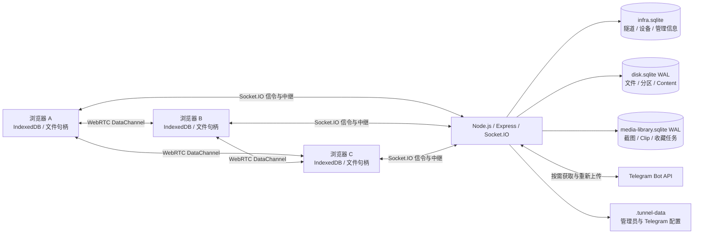
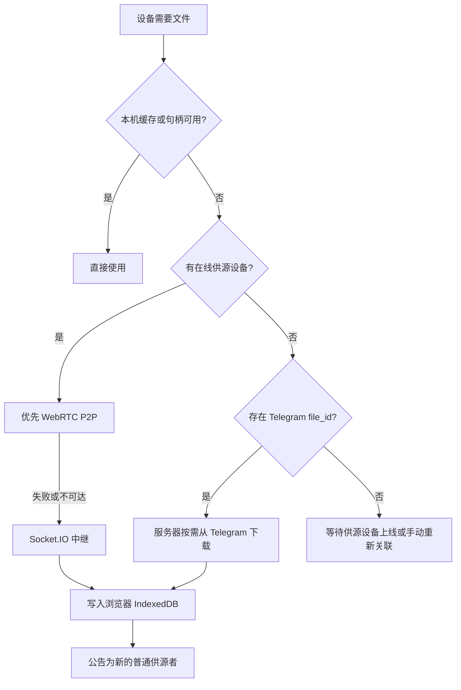

# Drop2Tunnel（即时传输隧道）

> 自托管、浏览器优先的跨设备传输与协同工作台。

Drop2Tunnel 以“隧道”为协作单元，让多台设备通过浏览器加入同一空间，发送文本、富文本、文件与合辑，并在设备之间同步缓存、协同内容和实时媒体状态。

它不是单纯的网盘，也不是纯 P2P 工具：

- Node.js 服务器负责页面托管、隧道路由、Socket.IO 信令与中继、历史协调、权限和 Telegram 接入；
- 浏览器使用 IndexedDB 保存传输记录、文件缓存和协同数据；
- 文件优先从在线设备通过 WebRTC DataChannel 获取，失败时可降级到 Socket.IO 中继；
- Telegram `file_id` 可以作为没有在线供源时的备选恢复来源；
- 已获得文件副本的浏览器会继续成为其他设备的普通供源者。

**本 README 核对分支：** `dev/doc-overview` · **核对快照：** `89e2ef3c335f1f232010c41c343a6eabadc0c631`（2026-11-01）  
**当前业务源码事实终点：** `99283320188a43a4234986f2eaa9d9d9374e2bd3`（2026-10-19）· [功能与架构总览](docs/overview/master.md) · [文档版本维护](docs/overview/VERSION.md)

> README 上次实际修改于 **2026-09-27**（`c2997b3e6e88d8045e7da1ac5c5f485c158c5b7a`）。到本次核对快照为止，该分支累计前进 **256 个 Git Commit**（含代码、测试、文档及设计资料提交），不是 256 个正式 Release。旧文中的 `Alpha-1.6.5` / `dev/2607A-NEWCODE` 已不代表当前分支；`package.json` 的 `version` 字段也不应直接当成最新产品发行代号。

> [!WARNING]
> 项目仍在快速迭代，适合个人、自托管和受控环境测试；这里的功能状态不代表独立安全审计或真实公网/移动设备全面验收。当前没有应用层端到端加密，服务器不是“零接触文件数据”的盲中继。

## 核心概念

### 隧道

隧道是设备共享传输记录和协同状态的逻辑空间。每个隧道同时拥有：

- 内部会话 ID；
- 可轮换的 5 位短码（新设备加入时使用，与长期会话 ID 分离）；
- 已登记设备的成员身份及签名授权凭据；
- 可选的隧道备注名；
- 创建者、被授权管理员与普通成员及其权限；
- 在线设备、文件供源和历史记录状态。

使用普通隧道不要求先注册网盘账号。新设备须凭**当前有效短码**或由已授权成员生成的**签名二维码加入凭据**完成服务端登记；已登记设备用自身的签名授权重连。**仅知道会话 ID、旧短码或普通历史链接，不等于仍有加入权限。** 短码可以轮换，已有合法成员不因此被强制踢出；失去本机授权时重新加入不自动恢复原创建者/管理员身份。

### 传输记录

隧道中的时间线支持：

- 纯文本；
- 富文本；
- 单文件；
- 多文件合辑；
- Telegram 单文件和 album；
- 从其他隧道转发而来的记录。

传输记录保存的是消息结构和文件元信息。大文件二进制不会被塞进普通历史快照，而是通过独立的文件资产链路同步。

### 缓存副本与供源设备

每台设备独立维护本机文件缓存。某台设备拥有完整缓存或仍可读取有效的本机文件句柄时，就可以成为该文件的供源设备。

文件缺失时，恢复优先级通常为：

1. 当前设备已有的浏览器缓存或有效本机文件句柄；
2. 同隧道或关联源隧道中拥有缓存的在线设备；
3. WebRTC P2P 失败后的 Socket.IO 中继；
4. Telegram `file_id` 等已登记的备选来源。

从远端或 Telegram 恢复成功后，文件会写入当前浏览器缓存，并重新公告为可供其他设备获取的普通副本。

## 功能概览

### 隧道路由与设备连接

- 创建新隧道、使用当前 5 位短码加入、从本机已加入列表选择；
- 已授权成员生成签名二维码/加入链接；短码轮换即使旧加入二维码失效；
- 设备签名成员身份、重新连接与旧成员受限升级；
- 自动记住最近访问的本机隧道；
- 隧道切换浮层、隧道备注和切换前传输任务提醒；
- 多设备同时在线和历史对齐；
- 服务端辅助的附近设备发现；
- 向尚未加入当前隧道的附近设备发送加入邀请；
- 已关注设备、设备主页和设备间联系入口；
- 本地设备备注，显示格式为 `备注名(原设备名)`；
- 备注仅对设置方可见，并只镜像给被备注设备作为不可见备份。

> “附近设备”是服务端辅助发现，不等同于 Bluetooth、Nearby Connections 或系统级近场发现。

### 文本、富文本与协同编辑

- 发送普通文本；
- 实时协同富文本编辑；
- 在协同内容中插入图片和文件引用；
- 将当前协同内容发送为富文本记录；
- 富文本记录直接编辑；
- 从版本 1 开始保存修改历史；
- 记录修改设备、修改时间和版本号；
- 双栏只读版本对比，以 `+` / `-` 标记行级差异；
- 服务端基于 `baseVersion` 原子校验并发修改；
- 离线草稿独立保存，重连后进行冲突处理；
- 冲突内容可手动合并，或作为关联原记录的新记录发送；
- 可选的跨设备剪贴板共享。

### 文件与合辑

- 点击选择、拖放和系统分享文件；
- 单文件发送；
- 多选文件按“合辑”发送，或拆分为多条记录；
- 合辑备注、单文件备注和 Telegram caption 统一进入文件记录备注；
- 合辑宫格、子文件切换和两级返回栈；
- 图片、视频和音频网页内预览；
- 图片和视频全屏浏览、键盘切换与移动端手势；
- 文件详情、下载、还原、释放浏览器缓存、删除；
- 生成仅授予指定文件的磁链，通过内置下载页、缓存列表获取；后台保留分享及下载触发记录；
- 合辑“下载全部”会等待缓存后统一打包 ZIP，也可提前下载当前已就绪内容；
- 文件夹打包发送；
- 本机目录同步；
- 只读挂载本机目录或单文件；
- 从传输记录转发到其他隧道，并记住上次目标；
- 为每条记录复制可定位到指定隧道和锚点的链接；
- 单条传输记录详情浮层和 `/record/:sessionId/:messageId` 路由。

### 文件传输与恢复

- WebRTC DataChannel P2P 传输；
- P2P 不可用、连接尚未就绪或文件通道超时等情况下自动回退到 Socket.IO 分块中继；
- 大文件支持按范围向多个在线供源设备请求；
- 供源负载选择、传输超时、重试和卡住检测；
- 小文件优先和手动强制拉取；
- 进度抽屉、队列状态和点击进度定位记录；
- 传输中断状态标记；
- 文件发送准备阶段的“发送处理中”占位与阶段进度；
- 浏览器缓存丢失后从其他在线设备恢复；
- 跨隧道备份导入和转发时重映射文件 ID，避免缓存键串线；
- 删除、退出和清缓存前保护仍被其他记录或隧道引用的文件；
- 删除记录后先更新 UI，再在空闲队列中清理孤立缓存，降低大文件数据库扫描造成的卡顿。

网络代理与 WebRTC 的关系需要分层判断：浏览器能经 PAC/全局代理打开页面或完成 Socket.IO 信令，**不代表 WebRTC UDP/ICE 一定能直连**。Android VPN、Origin 的媒体权限、候选对和文件通道等待时序都会影响这一次任务走 P2P 还是应用层 Socket.IO Relay。WebRTC TURN `relay` 候选也不是同一个 Socket.IO Relay。历史 Windows PAC/全局与 Android Igniter 的 48 组对照及复盘见 [P2P_TRANSMISSION_NOTES-260812.md](docs/other/P2P_TRANSMISSION_NOTES-260812.md)。

### 本机文件句柄

在支持 File System Access API 的安全 Chromium 环境中，大文件可以保留本机文件句柄：

- 文件可从原路径直接读取，不必长期复制完整二进制到浏览器；
- 有效句柄显示 `💾 外部文件`；
- 其他设备仍通过普通文件资产链路获取并缓存；
- 在远端副本确认前，可保留同一 `fileId` 下的安全缓存副本；
- 文件移动、删除、改名或权限失效后，界面回退到普通还原流程；
- 远端恢复成功后，会立即刷新传输记录、合辑卡片和预览层。

该能力依赖浏览器实现和用户授权，不应被视为永久可靠的文件存储。

### 会话资源管理器

资源管理器用于查看当前隧道中的文件资源及其引用关系：

- 单文件、合辑文件、富文本和协同编辑引用；
- 本机缓存、外部句柄、远端供源和 Telegram 来源状态；
- 按类型、缓存状态和 Telegram 渠道筛选；
- 跳转到引用位置；
- 挂载本机目录或文件；
- 清理未引用或中断的垃圾缓存；
- Telegram 文件防失联检测及修复；
- 桌面端居中大浮层、移动端全屏；
- 刷新、最小化、恢复和关闭；
- 最小化后保留筛选、搜索、滚动位置和已加载 DOM，并显示为可拖动悬浮胶囊。

### 备份与导入

- 导出当前隧道传输历史；
- 仅元数据备份；
- 包含文件二进制的完整备份；
- 导入时保留原时间，或追加到当前时间线尾部；
- 跨隧道导入时重映射 `fileId`；
- 如果本机已有源缓存，可复制为目标隧道的独立缓存；
- 备份文件从普通文件入口选中时，会自动识别并进入导入流程；
- 导入和退出隧道等重操作显示阻塞进度面板。

### PWA 与移动端

- 可安装为 PWA；
- Android 系统分享目标 `/share/`；
- 批量分享后可选择合辑或拆分发送；
- Service Worker 应用壳缓存和强制刷新；
- 移动端“连接 / 隧道 / 协同”三栏横向跟手切换；
- PC/平板宽屏独立滚动、移动端返回手势、资源加载阶段和启动性能诊断；
- 传输记录滚动锚点保存和载入稳定；
- 文件预览、全屏、合辑和音乐播放器的浏览器返回栈；
- 系统分享和页面选择文件使用统一的发送准备进度。

### 媒体预览与音乐播放器

- 视频封面本地生成与缓存；
- MP3、M4A/MP4、FLAC 等音频封面和文字元数据解析；
- 音频临时试听；
- 全屏后台音乐播放器；
- 播放队列、拖动排序、删除、收藏、定位文件、分享和下载；
- 队尾自动从当前隧道媒体库补充不重复歌曲；
- 队列按设备和隧道持久化；
- Media Session 系统通知栏控制；
- 封面、队列顺序和当前歌曲恢复。

### 实时媒体能力

以下功能依赖 HTTPS、浏览器权限和 WebRTC，仍建议视为实验性能力：

- 全局对讲机；
- 群语音；
- 摄像头广播；
- 已关注设备之间的音视频联系。

### Telegram Bot

Telegram Bot 可作为隧道内容入口和文件恢复兜底：

- 管理页录入 Bot Token；
- 自动生成 webhook secret；
- 自动注册 webhook 和命令；
- `/tunnel 12345` 进入指定隧道中转模式；
- `/leave_tunnel` 退出中转模式；
- 未绑定模式下从 caption 或后续消息获取 5 位短码；
- 文本、富文本、文件、图片、视频、音频、语音、动画、视频消息；
- `media_group_id` 聚合为一个合辑；
- 单文件 caption 和 album caption 原样保存为记录备注；
- 中转模式和聊天绑定持久化，Node.js 重启后恢复；
- Telegram `file_id` 长期绑定在文件记录上，作为设备间恢复失败后的备选来源；
- 服务端按需下载 Telegram 文件到临时缓存，完成客户端传输后清理二进制；
- 文件恢复到浏览器后，浏览器成为普通在线供源者；
- 资源管理器可检测当前 Bot 是否仍能使用旧 `file_id`；
- 在已有本机或在线设备副本时，可通过当前 Bot 重新上传并换绑新的 `file_id`。

Telegram 不能凭空恢复已经在所有设备、服务器和旧 Bot 中都不可用的文件。

### Telegram SNS 媒体文件

当 Telegram 转入隧道的文本、单文件备注或 album caption 中包含 YouTube、YT Music、TikTok、Facebook、Instagram、Threads、LINE、Twitter/X 等链接时，服务端会先异步识别可由 `yt-dlp` 解析的 SNS 媒体：

- 备注中可同时包含多个 URL；
- 列表 URL 会作为一个可展开的来源，内部包含多条媒体；
- 识别阶段只读取元数据，不会自动下载完整媒体；
- 在“传输记录详情”底部的“SNS媒体文件”区域，点击“获取文件内容”才会启动完整下载；
- 服务端使用 `yt-dlp` 下载到 `.tunnel-data` 临时工作区，成功后注册成 server asset，并生成一条普通文件传输记录；
- 客户端继续按普通 server asset 逻辑通过 HTTP/Range 拉取到浏览器缓存；
- 已经获得缓存的浏览器会成为后续其他设备的普通供源者。

YouTube 视频下载会优先选择 H.264、最高不超过 1080p 的视频轨，并按音频码率优先选择接近 256K、再接近 128K 的 AAC/M4A 音轨；若无 H.264 视频，则降级到 AV1 或其他可用视频轨。`music.youtube.com` 链接只选择音频轨。该能力要求服务端已安装 `ffmpeg` 和包含 `yt-dlp-ejs` 的 `yt-dlp`；通过 pip 安装时应使用 `python -m pip install -U "yt-dlp[default]"`，官方独立可执行文件已内置该组件。

### Telegram 虚拟网盘与第三方 S3 接口

独立于隧道浏览器缓存，`/disk` 提供以 Telegram 存储为基础的用户网盘：

- Telegram OIDC、Passkey 等网盘身份、同一浏览器多账号、账号/分区切换与受权限保护的定位链接；
- 原生分区、目录树、上传/下载/预览、Range、目录上传、文件改名/移动/跨分区复制、回收站和文本/Markdown/Hex 编辑；
- 单文件/目录分享、静态签名资源和**协同邀请/协同 Mount**，访问时持续校验受邀范围及成员角色；
- 共享 Content Object 与 Telegram Anchor 的内容复用、持有证明（PoP）、引用/清理保护、分片缓存和上传任务恢复；
- 浏览器渐进上传：写入本地服务器暂存的同时，Telegram 可读取已到达的字节；区分源端进度与 Telegram 最终确认，并检测源端失联；
- 有限的 **S3 Compatible / SigV4** 网关 `/S3API`，支持常见对象读写、列举和部分拷贝/删除；**不等于完整 AWS S3**，没有实现标准 S3 Multipart Upload API；
- SNS/YouTube 已完成成品可由服务端直接读取、校验后存入用户选定的网盘分区/目录，不必先下载到浏览器再重新上传；失败及结果未知时保留幂等恢复约束。

网盘权威元数据保存在 `.tunnel-data/disk.sqlite`（Node 内置 `node:sqlite`、WAL），旧 JSON 可通过**停服、预检、明确执行**的迁移工具导入。Telegram 消息、上传暂存和实际物理缓存不是一个 SQL 事务。

详见 [网盘能力与限制](docs/overview/telegram-drive.md)、[S3 Compatible 接入](docs/telegram-drive-s3-compatible.md)、[共享 Content Object](docs/telegram-drive-content-objects.md)。

### 网页工坊（网页 ZIP）

- `.html.zip` 包内组织 HTML、JS、CSS 和图片/视频/音频等资源，通过文件树新建多级路径、导入本机/隧道/网盘资源及拖放生成引用；
- 编辑文件和目录移动/重命名时，保守修正**可确定的包内 HTML 引用**，不对任意 JS/CSS 字符串做危险的全局替换；
- 包内 `manifest.json` 持久化名称、创建/修改时间和发布运行选项；可独立新标签页运行或在当前应用全屏浮层运行；
- 支持草稿箱、编辑原文件、另存为、最小化、发布后的原记录定位及两种预览入口（ZIP 默认首页 / 当前编辑文件）；
- 一键生成包含离线 Markdown 运行依赖的 HTML/MD 页面对；运行包不依赖外部 CDN。

详见 [网页工坊](docs/overview/web-workshop.md)。

### SNS/YouTube 下载、转码与独立媒体收藏

- SNS 与 YouTube Premium 页面支持媒体解析、手动格式表达式、音轨修复、按需下载、后台任务与缓存控制；
- 转码中心支持自定义 FFmpeg Profile，H.265 内置配置默认 MKV，用户可覆盖任务输出后缀；
- Telegram 指定目标转发支持多目标选择、后台队列、进度、取消及尽量撤回；未知远端发送结果不会冒充已确认成功；
- `/media-library` 是**独立管理员媒体工作台**：从本机、网盘或已完成下载任务导入，按真实帧时刻提取截图、逐帧定位、裁切 Clip、建立多种 H.265 压缩版本；
- 媒体库具有自己的工作区、候选缓存、`media-library.sqlite`、收藏位置授权、人物/标签、候选安全删除与会话目录 `clips/shots`；正式收藏才写入网盘 Content/文件索引。

详见 [下载与转码](docs/overview/download-transcode.md)和[多媒体收藏](docs/overview/media-library.md)。

### 光媒、VClient 与本地化

- **Light Transfer 光媒**：动态二维码分片传递文件或合辑，接收残片/校验与继续扫描存于本设备；可选网络加速，不应视为普通 WebRTC P2P 的替代实现；
- **VClient**：独立运行的常驻缓存节点，可经授权的 Shell 工具把服务器本机文件推送至指定隧道并等待节点确认；
- **多语言**：客户端内置 16 种语言的词条、运行时和审计工具；不同设备可使用不同 UI 语言。

详见 [光媒](docs/overview/light-transfer.md)、[VClient](docs/overview/vclient.md)、[本地化](docs/overview/pwa-ui/localization.md)。

### 设置、权限与管理

- 功能首页顶栏齿轮设置页；
- 发送文件夹、同步目录、剪贴板共享、垃圾清理、资源浏览器和备份/导入统一放入设置页；
- 隧道创建者身份；
- 默认权限矩阵：
  - 读取传输记录；
  - 发送文本；
  - 发送富文本；
  - 发送文件；
  - 删除记录；
  - 协同编辑；
  - 全局对讲机发声；
  - 群语音；
- 权限同时在客户端 UI 和服务端事件处理层执行；
- 无读取权限的设备不会收到历史快照、实时记录或历史广播；
- `/admin` 管理后台；
- `/tgbot` Telegram 配置页；
- 首次使用 TOTP 配置和管理员会话 Cookie；
- 管理认证、敏感 API 和 Telegram 配置受到服务端保护。

权限分为创建者、受授权管理员和普通成员；服务端有管理员设备更新与权限拒绝逻辑。普通成员权限仍通过会话策略控制，具体细粒度授权范围应以 [隧道与权限实现](docs/overview/tunnel-core.md) 和当前服务端代码为准，不能把“尚无完整逐设备矩阵”误写成“没有管理员能力”。

## 架构



### 文件恢复流程



## 数据存储与隐私边界

| 数据 | 主要位置 | 说明 |
| --- | --- | --- |
| 传输记录、文件缓存、协同内容 | 浏览器 IndexedDB | 每台设备独立保存，可被浏览器配额策略清理 |
| PWA 系统分享待发送文件 | 浏览器 IndexedDB `shareQueue` | 页面打开后转入正常发送流程 |
| 本机目录和文件句柄 | 浏览器 IndexedDB | 依赖 File System Access API 和持续授权 |
| 活跃隧道、Socket 状态、供源索引 | Node.js 内存 | 服务重启后由浏览器重新加入并协调恢复 |
| 隧道短码、备注、创建者、权限、设备及磁链记录 | `.tunnel-data/infra.sqlite` | 使用 `sql.js` 持久化 | 
| 已登记隧道成员授权及旧成员证明 | `.tunnel-data/.tunnel-access.key`、`.tunnel-access-members`、`.tunnel-access-legacy` | 身份签名与受限历史升级，迁移时必须同时保护 |
| 管理员 TOTP 和会话签名密钥 | `.tunnel-data` | 本机私有文件，需妥善备份和限制权限 |
| Telegram Bot 配置与聊天绑定 | `.tunnel-data` | Token 不写入 `tunnel.config.json` |
| Telegram 文件临时缓存和 `file_id` 元数据 | `.tunnel-data/telegram-assets` | 二进制按需下载并尽量在客户端取走后清理 |
| Telegram 网盘账号、分区、文件、共享 Content、协同与任务元数据 | `.tunnel-data/disk.sqlite` | 原生 SQLite WAL；上传暂存与分片缓存字节仍在文件系统 |
| S3 网关凭据与 Secret | `.tunnel-data/s3-credentials.json`、`s3-secret.key` | 独立加密存储，非 `disk.sqlite` 的普通行 |
| 媒体提取与正式收藏的业务状态 | `.tunnel-data/media-library.sqlite` 及其工作缓存 | 独立 SQLite WAL、租约和清理规则，不可当作网盘数据库 |
| SNS Cookies | `.tunnel-data/*-cookies.txt` | 由 `/sns-cookies` 管理，用于 `yt-dlp` 访问 YouTube、TikTok、X 等平台 |
| SNS 媒体临时下载 | `.tunnel-data/sns-media-work` | `yt-dlp` 下载过程中的临时输出，成功后登记为 server asset |
| Socket.IO 中继数据 | 服务器进程 | 中继期间服务器会接触文件分块 |

因此：

- 项目不是“服务器绝不接触文件内容”的架构；
- WebRTC 成功时文件可直接在浏览器之间传输；
- Socket.IO 降级和 Telegram 恢复时，服务器会处理中转或临时文件数据；
- 当前没有额外的应用层端到端加密；
- 隧道当前短码、签名加入凭据、设备 grant 和服务端签名密钥都应作为敏感授权材料对待；只知道历史 ID 不应成为新设备的通行证。

## 快速开始

### 环境要求

- Node.js 24.15 或更高版本（网盘使用内置 SQLite WAL 驱动）；
- npm；
- `yt-dlp`，用于解析和按需下载 SNS 媒体链接；
- `yt-dlp-ejs`，用于解析和按需下载 SNS 媒体链接；
- `deno`，用于辅助yt-dlp命令执行；
- `ffmpeg`，用于 `yt-dlp` 合并视频轨/音频轨、转封装和处理部分平台媒体；
- 支持 WebSocket、WebRTC 和 IndexedDB 的现代浏览器；
- PWA、文件句柄、摄像头和麦克风等完整能力需要 HTTPS，`localhost` 除外。

旧网盘 JSON 可用离线脚本迁移到 SQLite。先停止 Node 服务，在项目根目录执行：

```bash
node tools/migrate-tgdisk-json-to-sqlite.cjs --data-dir .tunnel-data
node tools/migrate-tgdisk-json-to-sqlite.cjs --data-dir .tunnel-data --apply
```

第一条命令在系统临时目录中复制目标库并完整试跑导入，不修改正式数据库；临时目录需有足够空间容纳一份网盘 SQLite。若系统临时盘空间不足，两条命令都可附加 `--scratch-dir /path/to/large/temp`，指定已有且空间充足的临时目录。先查看输出中的 `missing`、`warnings` 和每表 `added`、`updated`、`retainedExisting` 数量，确认符合旧环境实际情况，再执行带 `--apply` 的导入。

脚本处理默认分区与 `disk-spaces.json` 列出的命名分区，以及账号、分片、目录、用量、分享、任务、协同、缓存归属和 Telegram 占位文件 ID。它会把旧 JSON、`disk-secret.key` 和导入前的 SQLite 在线快照备份到 `.tunnel-data/migration-backups/json-to-sqlite-*`，不会删除旧文件。目标库已有不同标识的记录会保留；对于登录提供方和 Telegram 身份完全相同、但新旧用户 ID 不同的账号，会保留 SQLite 中的账号，并将旧文件、分享、任务、协同成员等引用映射到该账号。分片内容哈希和大小相同但 Telegram `file_id` 不同的去重缓存会保留 SQLite 当前映射，同时导入旧库独有映射；复用前运行时仍会向 Telegram 验证 `file_id`。重叠的分区使用时间会合并为最早创建时间和最晚使用时间。其它同一标识内容冲突、SQL 约束冲突或导入核对失败会报错，整批导入回滚。若旧认证数据存在，必须保留与旧 `disk-auth.json` 配套的 `disk-secret.key`，否则旧登录数据无法恢复。

成功后可再次运行第一条命令，预期 `changed: false`；核对网盘账号、文件分片和协同内容后再启动 Node 服务。仍应另行保留整份 `.tunnel-data` 的离线备份，尤其是上传暂存与分片缓存字节。停服是必须的，脚本无法保证运行中的其它进程不会持有过期内存视图。

部署更新后需运行 `npm ci` 并重启 Node 服务。运行中的网盘数据库应使用 SQLite 在线备份，不能只复制 `disk.sqlite` 而遗漏尚未 checkpoint 的 WAL 数据；`disk-secret.key` 也需随网盘身份数据一并保管。

### 获取代码

```bash
git clone https://github.com/Ltre/file-tunnel.git
cd file-tunnel
git checkout dev/doc-overview
npm ci
```

### 配置端口

项目读取根目录的 `tunnel.config.json`：

```json
{
  "debugLogsEnabled": false,
  "serverPort": 3000
}
```

仓库当前配置默认使用 `80` 端口。Linux 普通用户通常不能直接监听低于 1024 的端口，开发和反向代理部署建议改为 `3000` 或其他高位端口。

### 启动

```bash
npm start
```

然后访问：

```text
http://localhost:3000
```

局域网测试可使用：

```text
http://<服务器局域网 IP>:3000
```

局域网 IP 上的普通 HTTP 不属于安全上下文，File System Access、摄像头、麦克风、部分 PWA 能力可能不可用。完整功能请使用 HTTPS 域名。

### 限制允许的来源

默认允许任意 Origin。生产环境建议设置：

```bash
ALLOWED_ORIGINS=https://tunnel.example.com npm start
```

多个来源使用逗号分隔：

```bash
ALLOWED_ORIGINS=https://a.example.com,https://b.example.com npm start
```

## 生产环境反向代理

以下是一个最小 Nginx 示例。证书部分请按实际环境配置：

```nginx
map $http_upgrade $connection_upgrade {
    default upgrade;
    ''      close;
}

server {
    listen 443 ssl http2;
    server_name tunnel.example.com;

    # ssl_certificate ...;
    # ssl_certificate_key ...;

    location / {
        proxy_pass http://127.0.0.1:3000;
        proxy_http_version 1.1;
        proxy_set_header Upgrade $http_upgrade;
        proxy_set_header Connection $connection_upgrade;
        proxy_set_header Host $host;
        proxy_set_header X-Real-IP $remote_addr;
        proxy_set_header X-Forwarded-For $proxy_add_x_forwarded_for;
        proxy_set_header X-Forwarded-Proto $scheme;
        proxy_read_timeout 300s;
        proxy_send_timeout 300s;
    }
}
```

代理层必须正确转发 WebSocket Upgrade 请求，否则 Socket.IO、传输信令和实时协同无法正常工作。

## PWA 配置

`manifest.hosts.json` 支持按访问域名返回不同的 PWA 名称、图标、主题色和 Share Target 配置。

最小结构：

```json
{
  "default": {
    "name": "Drop2Tunnel",
    "short_name": "Drop2Tunnel",
    "description": "在同一个传输隧道中的设备间发送文件、消息和协同内容。",
    "start_url": "/?pwa=1",
    "scope": "/",
    "display": "standalone",
    "background_color": "#f4f6fb",
    "theme_color": "#4f5ec2",
    "icons": [
      {
        "src": "/tunnel-icon.svg",
        "sizes": "any",
        "type": "image/svg+xml",
        "purpose": "any maskable"
      }
    ],
    "share_target": {
      "action": "/share/",
      "method": "POST",
      "enctype": "multipart/form-data",
      "params": {
        "title": "title",
        "text": "text",
        "url": "url",
        "files": [
          {
            "name": "shared_file",
            "accept": ["*/*"]
          }
        ]
      }
    }
  }
}
```

修改 Service Worker 应用壳资源后，也要同步更新 `CACHE_NAME`，避免旧 PWA 长期使用缓存版本。

## 从服务器 Shell 推送到缓存节点

目标隧道已经在管理后台启用缓存节点、且独立 VClient 进程在线时，可以把服务器本地文件直接写入该隧道的传输记录并等待 VClient 确认落盘：

```bash
# 单文件；--tunnel 同时接受 5 位短码和隧道长 ID
npm run vclient:push -- --tunnel A1B2C --file /srv/media/song.m4a --remark "管理员推送"

# 重复 --file 会创建一条合辑记录
npm run vclient:push -- --tunnel A1B2C --file /srv/media/01.m4a --file /srv/media/02.m4a --name "示例合辑"

# 目录合辑只读取目录直属普通文件
npm run vclient:push -- --tunnel A1B2C --collection /srv/media/album --name "示例合辑"
```

命令默认读取 `.tunnel-data/vclient-control.token`，也可通过 `VCLIENT_TOKEN`、`VCLIENT_TOKEN_FILE` 或 `--token-file` 指定；`--server` 可指定主服务地址，`--timeout` 可调整等待缓存完成的秒数。命令使用现有 Socket.IO 文件中继协议，只有 VClient 确认文件完整落盘后才以成功状态退出。

## 管理后台

打开：

```text
https://tunnel.example.com/admin
```

首次访问会进入管理员 TOTP 初始化流程：

1. 使用身份验证器扫描二维码或录入密钥；
2. 输入 6 位动态验证码完成初始化；
3. 浏览器获得受 `HttpOnly`、`SameSite=Strict` 保护的管理员会话 Cookie；
4. 后续可进入管理后台和 Telegram 配置页。

管理员认证文件位于 `.tunnel-data`。迁移服务器时应一并备份，否则需要重新初始化认证。

管理入口还包括 `/admin/devices`、`/admin/magnets` 的独立设备/磁链统计，以及 `/disk-management`、`/s3-management`（受保护的网盘和 S3 凭据配置）。独立媒体后台为 `/media-library`，不是直接暴露给未登录访客的公共文件浏览页。

## Telegram Bot 配置

完成管理员登录后打开：

```text
https://tunnel.example.com/tgbot
```

配置项包括：

- Bot Token；
- Telegram 最大文件大小；
- 用于 `file_id` 换绑修复的私有用户、群组或频道 ID。

保存后，服务端会验证 Token、生成 webhook secret、注册 webhook，并注册 `/tunnel` 与 `/leave_tunnel` 命令。

使用示例：

```text
/tunnel A1B2C
```

进入中转模式后，发送到 Bot 的内容会直接进入该隧道。退出：

```text
/leave_tunnel
```

Telegram webhook 必须能够从公网通过 HTTPS 访问当前服务。

## SNS Cookies 配置

完成管理员登录后打开：

```text
https://tunnel.example.com/sns-cookies
```

可为 YouTube / YT Music、TikTok、Facebook、Instagram、Threads、LINE、Twitter/X 等平台保存 cookies 文件内容。YouTube 和 YT Music 共用 `.tunnel-data/yt-cookies.txt`。

这些 cookies 只供服务端 `yt-dlp` 在识别和下载 SNS 媒体时使用。它们可能包含敏感登录态，应像 Bot Token 一样保护，不要提交到 Git 仓库，也不要交给不可信用户。

服务端默认使用随官方 `yt-dlp` 或 `yt-dlp[default]` 安装的本地 `yt-dlp-ejs`，避免解析时依赖 GitHub 网络。只有本地 EJS 不可用且服务器能稳定访问 GitHub 时，才应设置 `SOCIAL_YTDLP_REMOTE_COMPONENTS=ejs:github`。SNS 元数据解析默认最多等待 90 秒，也可通过 `SOCIAL_YTDLP_TIMEOUT_MS` 调整。

## 音视频 ICE 配置

`tunnel.config.json` 中可为实时音视频功能追加 ICE/TURN 配置：

```json
{
  "serverPort": 3000,
  "debugLogsEnabled": false,
  "rtc": {
    "replaceDefaultIceServers": false,
    "iceServers": [
      { "urls": "stun:stun.example.com:3478" }
    ],
    "turnServers": [
      {
        "urls": "turn:turn.example.com:3478",
        "username": "user",
        "credential": "password"
      }
    ]
  }
}
```

该运行时配置目前主要由实时音视频控制器使用。普通文件 DataChannel 仍包含项目内置的公共 STUN 配置。

## 基本使用流程

1. 打开首页，创建新隧道或输入**当前有效**的 5 位短码加入；
2. 为当前设备设置易识别的名称；
3. 已授权成员生成签名二维码，或提供当前短码，帮助新设备明确加入；
4. 发送文本、富文本、单文件或合辑；
5. 在其他设备点击“还原文件”获取缺失缓存；
6. 使用“释放空间”仅删除当前浏览器中的缓存副本，不删除隧道记录；
7. 使用资源管理器检查引用、缓存来源和 Telegram 兜底状态；
8. 使用备份/导入保存或迁移传输历史；
9. 使用“暂时离开”保留本机隧道数据，使用“退出隧道”清理当前设备中的该隧道数据。

## 浏览器兼容性

推荐使用当前版本的 Chrome、Edge 或其他 Chromium 浏览器。

| 能力 | Chromium | Firefox | Safari / iOS |
| --- | --- | --- | --- |
| 文本、历史、IndexedDB | 推荐 | 基础可用 | 基础可用 |
| WebRTC 文件与音视频 | 推荐 | 视环境而定 | 受系统策略影响较大 |
| PWA 安装 | 推荐 | 平台相关 | 支持方式与限制不同 |
| Web Share Target | Android Chromium 推荐 | 通常不可用 | 支持情况不同 |
| File System Access 句柄 | 推荐，需 HTTPS | 不支持或能力有限 | 不支持或能力有限 |
| 后台媒体与 Media Session | 推荐 | 部分支持 | 受系统限制 |

实际兼容性还取决于系统权限、浏览器后台策略、NAT、防火墙和反向代理配置。

## 当前限制

- 项目仍持续演进，数据结构和交互可能调整；README 描述核对快照，不等于所有部署环境已升级；
- 没有应用层端到端加密；
- Socket.IO 中继时服务器能够接触文件分块；
- 普通隧道文件 WebRTC/Socket.IO 的跨刷新断点恢复仍有限制，不能与网盘渐进上传、服务器接管任务或光媒残片续传混为一谈；
- 刷新、网络中断或切换隧道可能中止浏览器主导的活动传输；**已经交接给服务端**的网盘上传/转存或 Telegram 后台任务则有各自持久化、恢复和取消规则；
- IndexedDB 容量和清理策略由浏览器决定，大文件缓存可能被系统回收；
- File System Access 句柄可能因移动、删除、重命名或撤销权限而失效；
- “30MB 以下文件不使用外部句柄”的策略在部分移动端批量或合辑场景仍有重复授权提示的回归记录；
- Telegram `file_id` 与 Bot 相关，换 Bot 后必须在仍有文件内容来源时重新上传换绑；
- 没有任何浏览器缓存、在线设备副本或可用 Telegram 来源时，文件无法被恢复；
- 已具备 owner/admin/普通成员区分、可轮换短码和签名准入；但不能把它等同于所有业务都拥有完整逐用户细粒度 ACL；
- 富文本版本编辑器尚未完全复用协同编辑器的全部内容插入能力；
- 已有 **16 种语言**的客户端本地化运行时与审计机制（包括繁体中文、英语、日语等），新增模块仍可能存在词条遗漏或真实设备排版问题；

## 当前默认限制

以下数值来自当前服务端实现，后续版本可能调整：

- 单个隧道最多 10 台在线设备；
- 服务端历史协调窗口最多 1000 条记录；
- 单个隧道最多登记 500 个文件资产；
- 单个文件资产最大 1 GiB；
- 富文本协同内容最大约 512 KiB；
- 单个编辑器资源最大 20 MiB。

这些限制不等同于浏览器实际可用存储空间；浏览器配额通常会更早成为大文件缓存的约束。

## 目录结构

以下为当前 `dev/doc-overview` 的代表性入口（不是文件总清单）：

```text
file-tunnel/
├── README.md                          # 本文件；按分支代码事实更新
├── app.js / server.js                 # 首页逻辑、HTTP/Socket.IO 与业务路由
├── package.json / package-lock.json   # Node >=24.15、依赖与运行脚本
├── service-worker.js                  # PWA 缓存与 Share Target
├── tunnel.config.json                 # 服务端端口/FFmpeg/RTC 等配置
├── pages/
│   ├── index.html                     # 隧道主页面（样式主要在 client/index.css）
│   ├── admin-layout.html              # 管理后台布局
│   ├── disk-collaboration.html        # 网盘协同受邀页
│   ├── s3-management.html             # S3 凭据管理
│   └── media-library.html             # 独立媒体提取与收藏
├── client/
│   ├── file-assets.js                 # 文件 WebRTC P2P / Socket.IO Relay
│   ├── disk-ui.js / disk-client.js    # Telegram 网盘界面与请求
│   ├── disk-pending-save.js           # 下载成品转存待办与恢复
│   ├── web-workshop.js                # 网页 ZIP 编辑、发布与预览
│   ├── media-library.js               # 截图、Clip 与收藏交互
│   └── i18n.js / i18n-catalog.js      # 多语言运行时与词条
├── server/
│   ├── tunnel-access.js               # 稳定隧道成员、短码及签名加入
│   ├── file-assets.js                 # 文件供源与中继
│   ├── infra-store.js                 # 隧道/后台基础设施 sql.js
│   ├── disk-repository.js             # 网盘原生 SQLite WAL
│   ├── disk-api.js / object-storage.js
│   ├── disk-content-repository.js     # 共享 Content 生命周期
│   ├── download-task-source.js        # SNS/YouTube 已完成成品后端源
│   ├── s3/                            # SigV4 / S3 Compatible 子集
│   └── media-library/                 # 独立媒体数据库、处理、缓存、API
├── vclient/ / scripts/vclient-push.js  # 常驻节点与 Shell 推送
├── tools/deploy/                      # 构建、校验、远端发布
├── tests/                             # 单元、回归及隔离浏览器用例
├── docs/overview/                     # 当前源码事实、历史与覆盖索引
├── docs/devlog/                       # 逐阶段开发及测试记录
├── prompts/                            # 需求、想法及设计材料（不等于已实现）
└── .tunnel-data/                      # 运行时私有数据；不得提交到仓库
```

## 构建与发布工具

仓库提供 `tools/deploy` 下的最小可控部署工具：

- `npm run deploy:build`：生成压缩后的前端静态资源和服务端发布目录；
- `npm run deploy:verify`：检查发布目录中的关键文件；
- `tools/deploy/release.sh <profile>`：按 `tools/deploy/profiles/*.json` 生成对应环境的 `dist`；
- `tools/deploy/deploy-remote.sh <profile>`：使用 rsync 将 `dist` 同步到目标服务器，默认不删除目标目录中 dist 没有的额外文件；
- `tools/deploy/rollback.sh`：辅助回滚。

详细说明见 [`tools/deploy/README.zh-cn.md`](tools/deploy/README.zh-cn.md)。

## 开发记录

项目的重要设计决策、问题复现和修复过程保存在仓库内：

- [`docs/devlog/dev-2606C-features.md`](docs/devlog/dev-2606C-features.md)：历史窗口、合辑、缓存恢复、预览与 Telegram 初期接入；
- [`docs/devlog/dev-2607A-features.md`](docs/devlog/dev-2607A-features.md)：移动端、音乐播放器、备份、文件句柄、转发、Telegram 可靠性、资源管理器、富文本版本和权限；
- [`docs/devlog/dev-2609-features.md`](docs/devlog/dev-2609-features.md)：SQLite WAL、S3、网页工坊、协同、上传恢复与 PWA 变动；
- [`docs/devlog/dev-2610-features.md`](docs/devlog/dev-2610-features.md)：共享 Content、渐进上传、分区、多账号、媒体收藏、隧道鉴权和服务端成品转存；
- [`prompts/dev-prompt-logs/dev-2607A.md`](prompts/dev-prompt-logs/dev-2607A.md)：本轮需求、测试反馈、根因排查与解决记录；
- [`prompts/dev-prompt-logs/dev-filecache-ref-260705.md`](prompts/dev-prompt-logs/dev-filecache-ref-260705.md)：跨隧道缓存引用和备份导入隔离；
- [`prompts/dev-prompt-logs/dev-real-filesystem-handle-260705.md`](prompts/dev-prompt-logs/dev-real-filesystem-handle-260705.md)：文件系统句柄与安全缓存副本；
- [`prompts/dev-prompt-logs/dev-telegram-fileid-renew-260706.md`](prompts/dev-prompt-logs/dev-telegram-fileid-renew-260706.md)：Telegram `file_id` 防失联检测与换绑。
- [`prompts/dev-prompt-logs/deploy-tools-260709.md`](prompts/dev-prompt-logs/deploy-tools-260709.md)：前端资源压缩、版本参数、PWA 缓存和部署工具设计；
- [`prompts/dev-prompt-logs/dev-260710-sns-file-dl.md`](prompts/dev-prompt-logs/dev-260710-sns-file-dl.md)：Telegram 备注中的 SNS 多链接、列表媒体识别和“获取文件内容”链路。

查看各版本的实际差异，请结合 Git 标签、Release 页面和 commit message，不要仅根据旧 README 判断当前能力。

## README 更新跨度：2026-09-27 → 2026-11-01

经 **仅对 `dev/doc-overview` 提交历史**执行按文件的最近修改查询，README 上次变更为 `c2997b3e...`（2026-09-27），与本次核对前分支 HEAD `89e2ef3c...` 相比相差 **256 个 Git Commit**。这 256 个提交同时包含业务代码、测试、文档与尚未实现的原型图，**不能误算成 256 次产品发版**。

为防止 GitHub 单次差异接口的 300 文件上限漏掉后半部分 `server/`、`tests/`，检查按连续提交节点拆分：14 + 26 + 10 + 20 + 48 + 72 + 66 = **256**，大量原型图片的时间段继续拆小确认。代码增量按主题归纳如下：

| 期间（按提交节点） | 主要已合入变化 |
| --- | --- |
| 9 月下旬 | S3 Compatible 网关与管理员凭据、Telegram Chat 字典、网盘目录/上传健壮性、PWA 加载改进 |
| 9 月末—10 月初 | Telegram 渐进上传、真实进度与回滚、共享 Content Object / PoP / GC、Engine.IO 安全更新 |
| 10 月上旬 | 分区、协同 Mount、静态签名资源、S3 诊断和跨作用域复制 |
| 10 月 8—13 日 | 回收站、文件夹上传、编辑器、多账号/登录回执、后台待转存、网页工坊 Markdown |
| 10 月 13—17 日 | 独立媒体提取与收藏、后台拆页、磁链持久化、短码与长期成员授权分离、多目标 Telegram 转发及 PWA UI |
| 10 月 17—19 日 | 媒体候选安全删除/实帧回退、签名扫码/历史成员升级、消息输入优化、YouTube 手写格式、服务端直接转存 |

**事实与验证边界：** 代码改动以本分支当前实现为准，规划中的串流控制台原型和尚未开发的 R2 缓存方案不在“已实现”清单内。开发日志的 `976/976` 属于 2026-10-19 开发阶段当时的全量测试记录，**本次 README 更新没有重新执行测试**。更完整的模块归属、历史和限制见 [docs/overview](docs/overview/master.md)、[覆盖审计](docs/overview/COVERAGE.md)及 [10 月演进](docs/overview/history/2026-10.md)。

## 服务端数据备份

至少备份：

```text
.tunnel-data/
tunnel.config.json
manifest.hosts.json
```

其中 `.tunnel-data` 包含基础设施数据库、管理员认证、Telegram 配置、SNS cookies、Telegram/SNS 临时资产和恢复元数据。

浏览器 IndexedDB 不包含在服务器备份中。重要传输记录和文件应使用应用内“备份/导入”另行导出，不能只备份服务器目录。

## 安全建议

- 生产环境必须启用 HTTPS；
- 设置明确的 `ALLOWED_ORIGINS`，不要长期保留 `*`；
- 保护 `.tunnel-data`，避免泄露 Bot Token、TOTP 和会话签名密钥；
- 不要公开传播当前隧道短码、签名二维码、成员授权凭据以及 `.tunnel-access.*` 服务端密钥材料；
- Telegram Bot 使用专用账号、私有群组或频道作为备份目标；
- SNS cookies 可能包含第三方平台登录态，应限制文件权限并定期轮换；
- SNS 媒体下载依赖第三方平台规则和 `yt-dlp` 能力，部署者应自行确认合规边界；
- 为公网服务配置防火墙、反向代理限速和日志轮转；
- 不要把本项目用于需要强合规、零知识存储或已审计端到端加密的场景。

## 许可证

项目当前在 `package.json` 中声明为 MIT。仓库尚未提供独立的 `LICENSE` 文件，正式对外分发前建议补充完整许可证文本。
