# 隧道、设备、协同与权限 — 思维导图

> **源码基线 Commit**：`b1788ca4b219718ad802ed778ed41c081ecad39b`  
> **文档更新时间**：2026-10-16  
> **状态**：现有功能与运行边界  
> **主要参考**：[../tunnel-core.md](./../tunnel-core.md)、[../tunnel-core/device-direct.md](./../tunnel-core/device-direct.md)

[返回全景思维导图](./README.md)

```mermaid
mindmap
  root((隧道与设备))
    隧道身份及加入
      创建隧道
        内部 Session ID
        五位短码
          实际事件
            join-by-short-code
            short-code-session
            session-short-code
            GET /api/short-codes/:shortCode
          设计边界
            服务端映射内部长 Session ID
            不能把短码当稳定存储主键
          生成与唯一性
          短码解析到会话
          重新生成与旧码失效
        备注名称
          显示位置
            顶栏与最近隧道
            后台隧道列表
            跨隧道目标选择
          同步事件
            session-remark-update
            session-remark
          创建和重命名
          多端同步备注
          独立本机备注不混用
      进入隧道
        短码输入
        扫描二维码
        完整邀请链接
        最近隧道列表
          选择状态
            本地记忆会话入口
            显示备注加短码
            重新进入后恢复历史
            与新建隧道分开
        历史设备回访
      切换与离开
        切换前进行中任务提示
        退出与数据清理
        缓存仍被引用时保护
        短码切换菜单
    设备身份与在线状态
      设备注册
        Device ID
        名称与型号
        Profile Device 注册
        浏览器与 VClient 标识
      在线感知
        Socket 注册与重连
        设备加入及离开广播
        Session devices 快照
        设备属性更新
        心跳和上次在线
      设备资料
        独立设备主页
        可复制设备链接
        在线状态与支持动作
        设备本地备注
          展示
            设置方的备注名和设备原名
            不更改对方设备的全局名称
          不可见备份
            device-remark-backup
            device-remark-restore-request
            device-remark-restore-response
          显示备注及原名
          备注仅本机可见
          备注在被备注设备做不可见备份
          备注丢失后的恢复
      附近设备
        服务端辅助发现
        并非蓝牙原生广播
        附近设备入口
        向未入当前隧道设备发邀请
          发现和邀请事件
            nearby-presence
            nearby-devices
            device-tunnel-invite
            device-tunnel-invite-ack
          限制
            服务端辅助发现不是原生蓝牙扫描
      关注设备
        IndexedDB 联系人表
        关注与取消关注
        按最近互动时间显示
        设备离线时显示历史资料
      定向隧道
        设备对设备专属会话
        邀请与 Claim
        离线邀请暂存
          状态转换
            等待对方设备上线
            对方查看待办邀请
            接受后执行 Claim
            拒绝后清理请求
        已关注设备一键联系
        联系人语音入口
        对讲及摄像头入口
    传输记录时间线
      记录类型
        普通文本
        富文本
        单文件
        多文件合辑
        Telegram 媒体与相册
        其它隧道转发记录
        SNS 附加来源
      记录结构
        ID 与时间戳
        文件元信息与真实文件分离
          可用性表现
            本机完整缓存直接打开
            仅远程供源时提示恢复
            所有供源离线时等待来源
            删除消息和释放缓存是不同动作
        单文件备注
        合辑备注与单项备注
        发送人及来源
      历史同步
        本地 IndexedDB 保存
        首次快照
        History revision 校验
        实时新增事件
        修改事件
        删除墓碑
          必要性
            旧客户端可能保存被删记录
            重连历史合并不能让旧记录复活
          回归
            服务端重启后重新同步
            离线设备恢复同步
            重复历史快照
        重连差量与补偿
        历史序列顺序稳定
        大量历史避免主线程长时阻塞
          高风险
            阻塞广播会拖慢实时文件进度
            裁剪 DOM 不得丢失正在执行任务
            持久审计应从 UI 热路径移开
      记录管理
        删除并广播
        独立记录详情
        指向指定记录的深链接
        跳转后定位并恢复滚动锚点
        转发时保持来源语义
    富文本及协同
      富文本编辑器
        文字样式和内容
        嵌入图片与文件引用
        编辑完成转成记录
          发布后
            富文本写入隧道历史
            其它在线设备协同区清空
          资源
            图片与附件走 editor asset
            不把大图片编码进 HTML
        已发送记录再次编辑
      历史版本
        起始版本 1
        修改设备及修改时间
        双栏只读版本比较
        行级增删差异
      多端冲突
        服务端 baseVersion 原子校验
          接受
            请求携带已知版本
            服务器校验并更新
            广播新的权威版本
          拒绝
            基础版本过时
            不自动覆盖新编辑
            保留离线待合并草稿
        离线草稿独立保存
          本地状态
            pending edit
            不直接替换已发布记录
          重连
            对比服务端最新版本
            手工合并或新建关联记录
        重连冲突提示
        手动合并
        作为关联新记录另发
      引用一致性
        文件 ID 指向资产
        不因为文本修改盲删资源
    权限控制
      创建者及普通设备
        默认设备能力矩阵
        读取历史权限
        发送文本权限
        发送富文本权限
        发送文件权限
        删除记录权限
        协同编辑权限
        群语音权限
        全局对讲权限
      服务端实施
        无读取权限不发历史
          服务端拦截
            历史 Snapshot
            历史差量
            文件元信息
            不仅隐藏客户端列表
        无读取权限不发实时消息
          事件分发
            过滤不可读的设备
            权限变更立即应用
            其它频道不能间接泄漏
        事件级鉴权与失败提示
          服务端事件
            session-permissions-update
            session-permissions
            permission-denied
          前端对应
            hasTunnelPermission
            requireTunnelPermission
            applyTunnelPermissionUi
        客户端禁用仅作体验
      管理权限边界
        管理员与创建者不混同
          角色
            owner
            admins
            joined devices
          管理事件
            session-admins-update
            管理操作必须服务端验证
        逐设备授权未完全实现
    剪贴板与通知
      跨设备剪贴板
        用户启用开关
        接收更新
        同步权限与重复控制
      通知中心
        设备通知
        编辑授权请求
        查看及动作处理
        未读角标和打开入口
    UI 与交互
      宽屏设备列表及记录区
      移动端连接隧道协同三栏
      隧道控制中心
      设备切换入口
      主题及布局保存
      键盘与触控操作
      浏览器历史返回栈
        层级
          关闭预览浮层
          返回记录详情
          移动栏切换
          保持当前隧道不误退出
    边界与回归
      服务器失联后的重连
      多端短码及历史一致性
      离线设备等待邀请
      可读权限变更后历史隔离
      重复消息去重
      移动端返回不误离开隧道
```

注意：该图概括细节与交互边界；具体调用链、迁移过程、失败回滚及版本差异以链接的模块文档和实际源码为准。
