# Telegram 网盘：身份、文件系统、分片、上传与播放 — 思维导图

> **源码基线 Commit**：`b1788ca4b219718ad802ed778ed41c081ecad39b`  
> **文档更新时间**：2026-10-16  
> **状态**：现有功能与运行边界  
> **主要参考**：[../telegram-drive.md](./../telegram-drive.md)、[../architecture.md](./../architecture.md)

[返回全景思维导图](./README.md)

```mermaid
mindmap
  root((Telegram 虚拟网盘))
    账号与登录
      网盘用户身份
        用户唯一 ID
        默认与其它分区
        Cookie Session 身份
      Telegram OIDC
        授权流程
          发起 Telegram 认证
          独立授权结果回执
          区分同账号重复登录与账号切换
        跳转授权
        独立授权完成回执
        同账号重复登录保护
      Passkey
        身份边界
          独立凭据身份
          手机号用于定位
          必须验证设备 Passkey
          管理员完成成员关联
        独立登录身份
        验证手机号定位身份
        设备凭据校验
      第三方 App Token
        创建 Access Token
        Token 范围及期限
        撤销和轮换
      多账号
        浏览器最多十个会话
          账号隔离
            签名 HttpOnly Cookie
            当前选择器不是凭据
            切换不取消其它账号任务
            Cookie 存在不保证依然有效
        签名 HttpOnly Cookie
        当前账户选择器
        点击选择即时高亮
        切换显式确认
        固定任务发起账号和分区
        后台任务不误用默认账户
    网盘分区
      默认分区
      命名分区
      稳定 Partition ID
        分区标识
          ID 保持不变
          底层 scopeKey 不变
          显示名称可修改
          默认分区不可删除
      不可变底层 Scope Key
      可修改显示名称
      创建分区
      重命名
      独立复制分区
        复刻行为
          共享原有 Content 引用
          不重复上传 Telegram 正文
          不复制成员授权
          不复制静态开放及 Mount
      删除限制
        默认分区不能删除
        非空回收站不能删除
        存在挂载及授权需校验
      分区重启恢复
    目录系统
      路径正规化
      创建目录
      层级树
      面包屑导航
      路径直接输入
      目录重命名
        操作前置检查
          目标目录授权
          重名冲突
          祖先合法性
          受分享和静态开放保护限制
      移动目录
      删除目录
      目录时间戳
      子项统计
      拖放文件进入目录
      全局搜索
      移动端专用导航
      上下文菜单
    逻辑文件模型
      Logical File
        文件名
        大小
        MIME
        分区和目录
        创建修改时间
        逻辑版本
        Cache Identity
      Content Object
        三层实体
          Logical File
          Content Object
          Telegram Anchor
        引用安全
          引用与 Lease
          持有证明 PoP
          Generation 状态
          清理前确认无其它引用
        内容哈希与大小
        Telegram 锚点
        多个逻辑文件共享正文
        持有证明 PoP
        随机样本校验
          PoP
            由服务端发出随机挑战
            需要证明实际持有指定字节
            不接受只有 SHA 与文件长度
            避免获取别人的共享 Content
        零字节特殊处理
        引用租约
        延迟 GC
      文件版本
        按逻辑版本绑定
        写时复制
          编辑
            新内容写入新 Content
            当前逻辑文件版本改变
            其它文件原引用保持不变
            并发版本冲突拒绝覆盖
        冲突拒绝覆盖
        编辑不破坏其它共享文件
    Telegram 存储层
      Bot 后端
        所属 Chat
        数字 Channel ID
        Bot 访问可用性
      媒体分片
        持久关联
          分片顺序
          message_id
          file_id
          media_group_id
          缺片不允许标记内容完整
        顺序与大小
        message ID
        file_id
        Media Group
        物理分片顺序
      Caption
        文件元数据
        校验与更新
      缩略图
        视频封面
        图片缩略图
        封面关联
    上传操作
      传统文件上传
      多文件批量
      Telegram 分片
      Staging 临时文件
        生命周期
          待接收
          已接收部分字节
          远端上传进行中
          完成关联已落库
          可安全清理
      逐片传输
      渐进上传
        并发流水线
          浏览器 XHR 上传
          Node 增长文件读取
          Telegram 提前读取已落盘字节
          SSE 汇报服务器阶段进度
        结束
          验证来源完整字节
          确认最终 Telegram 关联
          再提交 Logical File
          清理临时消息放在后面
        浏览器 XHR 发送进度
        增长文件供 Telegram 读取
        SSE 服务端进度
        轮询退路
        临时媒体消息
        最终媒体组确认
        一次逻辑文件提交
        临时消息后置清理
      任务调度
        并发
          全局
          单 Bot
          单 Chat
        429
          根据 Retry After 冷却
          任务结果未知时保留恢复依据
        全局并发
        单 Bot 并发
        单 Chat 并发
        429 冷却
        上传背压和队列拒绝
        失败重试仅限确定安全
      中断和恢复
        Manifest V2
          可恢复元数据
            上传来源
            当前 attempt
            临时消息信息
            最终 file_id 与 message_id
            后置清理债务
            不明结果禁止盲重传
        断网恢复
        Node 重启恢复
        结果未知不可盲重发
        远端成功本地事务失败补偿
        上传回滚保护已有 Content
        取消任务清理临时文件
    读取下载
      完整文件下载
      Stream 直链
      单段 Range
        字节读取
          解算起止偏移
          映射到 Telegram 分片
          按序拼接
          校验返回长度
          不支持越界的 Range
      分片边界拼接
      Telegram getFile 获取
      Part Cache 本地复用
        校验
          所属 Bot
          分片大小
          file_id 对应关系
          正在读取者保护
        失效
          可疑索引不能当新文件来源
          校验失败回退重新获取
        分片归属
        文件大小验证
        缓存读取引用
      file_id 共享复用
        Bot 及内容身份校验
        不可信映射刷新
      浏览器端缓存
        命中原则
          固定账号与分区
          文件版本相同
          已接收总字节通过校验
          旧文件内容不得覆盖新版
        正在接收进度
        完整大小校验
        相同逻辑版本复用
        防止旧版本覆盖新版本
      音视频在线预览
        浏览器 Range
        拖动 Seek
        本地封面
        失败重试
    搜索与交互
      文件类型过滤
      全局及目录搜索
      搜索结果来源区分
      PC 多选与右键
      移动端全屏与菜单
      批量移动
      批量删除
      文件详情
      任务列表及操作状态
      目录选择器
      批量文件夹导入
    数据持久层
      存储所有权
        disk.sqlite WAL 与 Repository
        上传暂存文件
        分片物理缓存
        账号签名与独立密钥
        不在数据库事务中等待 Telegram API
      disk.sqlite
        WAL
        Repository
        原子事务
        Content 引用
        用户文件目录操作
      JSON 遗留迁移
        离线预演
        apply 导入
        不盲覆写冲突
      分片缓存文件系统
      临时上传工作区
      独立密钥
      在线一致性备份
    异常防护
      Telegram 429
      Blob 大小不一致
      区间读越界
      分片无法访问
      数据库锁与竞态
      恢复结果未知
      原始文件未确认禁止删除
      安全错误 userMessage 反馈
```

注意：该图概括细节与交互边界；具体调用链、迁移过程、失败回滚及版本差异以链接的模块文档和实际源码为准。
