# 网盘高级能力：协同、分享、S3、回收站与编辑 — 思维导图

> **源码基线 Commit**：`b1788ca4b219718ad802ed778ed41c081ecad39b`  
> **文档更新时间**：2026-10-16  
> **状态**：现有功能与运行边界  
> **主要参考**：[../telegram-drive.md](./../telegram-drive.md)、[../../telegram-drive-content-objects.md](./../../telegram-drive-content-objects.md)、[../../telegram-drive-s3-compatible.md](./../../telegram-drive-s3-compatible.md)

[返回全景思维导图](./README.md)

```mermaid
mindmap
  root((网盘高级功能))
    共享与外链
      文件分享
        访问条件
          Share Token
          有效期
          文件身份
          当前授权
          分享不转让所有权
        分享有效期
        分享访问权限
        下载入口
        Share 文件引用
      目录分享
        授权子树
          当前根目录
          子目录及后代
          禁止访问父级与兄弟目录
          撤权后重新校验访问
        目录授权范围
        目录子树浏览
        范围外禁止访问
      静态开放
        公开访问
          HMAC 签名
          s3pub 路径
          到期与撤销
          授权用户与分区绑定
        状态
          显式开放显示蓝色 S
          继承公开不等于独立设置
          已下载字节无法追回
        仅显式授权
        HMAC 签名
        s3pub 静态路径
        过期及撤销
        分区用户路径范围绑定
        蓝色 S 标记
        继承开放不等于独立设置
        开放时保护目录不可破坏性移动
        已被外部缓存内容无法回收
    文件目录协同
      邀请协同
        创建一次性邀请
        预览邀请内容
        接受邀请
        拒绝和过期
      角色
        Viewer 只读
          权限
            允许查看被授予的内容
            不允许修改原始对象
            读取时仍检查实时授权
        Editor 可编辑
          操作范围
            授权子树内编辑
            修改新版本
            移动改名必须留在授权根
            被撤权后禁止继续操作
        所有者管理
      协同成员
        邀请列表
        移除成员
        撤权即时检查
          每次动作
            检验受邀成员
            检验来源 Scope
            检验授权文件和目录根
            不以浏览器旧权限为准
        访问日志
      文件与目录权限
        根授权约束
        目录范围隔离
        编辑时二次授权
        禁止路径越界
      协同界面
        受邀内容独立页面
        文件预览
        目录浏览
        编辑上传改名删除
        返回与设备选择
      协同保护
        授权中资源防误删
        被撤权不继续访问
    协同挂载 Mount
      用户本机原生目录中建立指针
      来源受邀协同授权
      目录挂载
        实现
          Native 目录内保存 Mount 指针
          Foreign 资源仍保留原拥有者
          面包屑路径不逃逸授权根
          不是复制 Telegram 正文
        进入来源子树
        原生面包屑保持清楚
        避免重复挂载
      单文件挂载
        交互
          在本地目录呈现文件
          可原位预览
          授权已过期显示失效
          禁止伪装本地可任意写对象
        原位预览
        无法当原生内容随意改写
      挂载管理
        查看来源与状态
        失效提示
        移除挂载
        撤权后不可继续读取
      跨作用域
        Native 和 Foreign Scope
        跨界 Move 拆成 Copy 然后 Delete
          二阶段
            目标复制成功
            后续删除源对象
          源删除失败
            COPIED_SOURCE_RETAINED
            目标不能回滚为不存在
            保留安全重试依据
        复制成功删源失败状态
        保留安全重试凭证
        不跨越授权根目录
      第三方 API
        挂载指针只读
        不能通过路径逃逸
    跨账户转存
      受邀文件转自己网盘
      协同目录文件转存
      新建独立 Logical File
      共享合法 Content 引用
      自有来源禁止伪装外部转存
      选择账户分区目录
      复制到另一协同项目
      复制不等于移动
    网盘回收站
      普通浏览器删除
        按账户分区隔离
        保存原路径
        保留 Content 引用
      例外
        S3 删除依其永久删除语义
        后台 API 删除可能直接永久
      浏览器普通删除先入回收站
      按用户及分区隔离
      记录来源路径
      保留 Content 引用
      浏览删除记录
      还原
        原目录祖先合法
        同名冲突
          恢复前
            祖先目录合法
            原名称是否占用
            仍有恢复权限
            Content 引用可用
        权限校验
        引用仍可用
      永久删除
        清理
          释放逻辑文件引用
          检查 Content 引用和 Lease
          未确认状态不直接远端销毁
          Generation 不能错误复活
        释放引用
        受控 GC
      API 和 S3 删除另有永久语义
    在线编辑
      TXT 编辑
      Markdown 编辑
      Hex 编辑
      最大文件 20 MB
      保存新内容版本
      Content 写时复制
      并发版本冲突提示
      只修改当前 Logical File
      不更改其他引用文件
    文件夹上传
      预检
        本机递归枚举
        实际深度最多 30
        默认总字节不超过 500000000
        分批最多一百文件
        不能凭文件名大小证明字节相同
      本地目录递归选择
      目录树预检
      总大小默认五亿字节
      最大真实深度三十层
      每批不超过一百文件
      分批进度
      继续上传清单确认
      不用文件名和大小冒充内容哈希
    S3 Compatible
      S3API Path Style 入口
      SigV4 认证
      用户 UUID 及分区绑定
      Access Key 创建
        授权
          SigV4
          固定用户 UUID
          Bucket 与分区关联
          支持停用与轮换
      密钥停用轮换
      Bucket 定位
      ListBuckets
      GetBucketLocation
      ListObjects V1
      ListObjects V2
        列举
          分页
          Prefix
          Bucket 授权检查
          仅有限协议子集
      PUT Object
        普通 PUT
        AWS chunked PUT
          过程
            校验请求签名
            解析 chunked 请求体
            远端 Telegram 成功后入库
            异常不能提供虚假已提交对象
        Telegram 成功后提交索引
      GET Object
      HEAD Object
      单段 Range
        支持
          GET 单段字节范围
          HEAD 对象元信息
        限制
          不表示支持 Multi Range
      CopyObject
      DeleteObject
      DeleteObjects 批量
      S3 错误响应 REST XML
      FolderSync 适配修复
      未支持 Multipart Upload API
        不可使用
          CreateMultipartUpload
          UploadPart
          CompleteMultipartUpload
          需选择普通 PUT 或受支持 AWS chunked PUT
      未支持完整 ACL SSE Object Lock
    第三方网盘 API
      App 与 Access Token
      权限 Scope
      文件上传下载
      目录操作
      API 与 S3 独立入口
      API 删除可能永久
    内容去重和清理
      逻辑文件与共享正文分离
      同内容安全复用
      Proof of Possession
        权益
          SHA 只是候选
          请求者须出示被挑战实际内容
          没有证明不能借用别人的 Content
          所属 Scope 和权限仍需验证
      引用计数及租约
      远端锚点生存状态
      未知 Telegram 响应保护
      Generation 不能错误复活
      后台诊断及 GC
    管理审计
      Disk Management 页面
      文件索引核查
      Content Object 查看
      清理债务
      操作任务记录
      请求追踪 ID
      Server Timing
      错误详情脱敏
    SNS 成品转存
      下载缓存 Pin
      Pending Saves
        幂等
          SNS 成品 Pin 缓存
          attemptId
          账号分区目录确认
          恢复任务保存
          状态未知禁止盲重传
      Idempotency
      attempt ID
      登录账号及分区选择
      未知结果不释放 Pin
      重启后恢复
      可选转发到隧道
```

注意：该图概括细节与交互边界；具体调用链、迁移过程、失败回滚及版本差异以链接的模块文档和实际源码为准。
