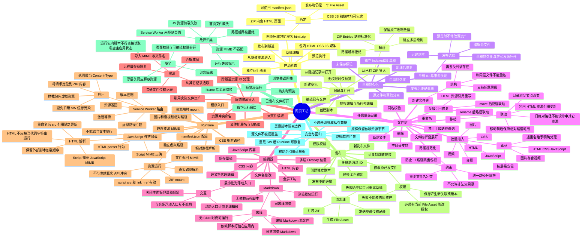

# 网页工坊、HTML ZIP、Markdown 与隔离 Runtime — 思维导图

> **源码基线 Commit**：`b1788ca4b219718ad802ed778ed41c081ecad39b`  
> **文档更新时间**：2026-10-16  
> **状态**：现有功能与运行边界  
> **主要参考**：[../web-workshop.md](./../web-workshop.md)、[../pwa-ui.md](./../pwa-ui.md)

[返回全景思维导图](./README.md)

注意：该图概括细节与交互边界；具体调用链、迁移过程、失败回滚及版本差异以链接的模块文档和实际源码为准。
