# 后台管理、安全、部署、存储与测试回归 — 思维导图

> **源码基线 Commit**：`b1788ca4b219718ad802ed778ed41c081ecad39b`  
> **文档更新时间**：2026-10-16  
> **状态**：现有功能与运行边界  
> **主要参考**：[../admin-security-deployment.md](./../admin-security-deployment.md)、[../tests-and-regressions.md](./../tests-and-regressions.md)、[../source-map.md](./../source-map.md)

[返回全景思维导图](./README.md)

```mermaid
mindmap
  root((管理与工程保障))
    管理后台
      访问边界
        Admin Session 必须有效
        页面入口鉴权
        管理 API 再次鉴权
        不与网盘普通账号认证混用
      管理员登录
        TOTP 首次配置
          流程
            初次绑定 Secret
            保存加密凭据
            首次验证码验证
            之后正常六位码登陆
        二步验证码验证
        Secret at Rest
        管理员 Cookie Session
        登出与过期
      主页
        系统运行状态
        隧道列表
        设备概况
        连接统计
      Telegram 管理
        后台页面
          tgbot 配置和 Webhook
          Chat 字典
          Telegram Content
          网盘文件与 Content 诊断
        Bot 和 Webhook
        Chat 字典
        内容管理
        网盘文件审核
      SNS 工具
        Cookie 管理
        SNS 下载队列
        YouTube Premium
        视频转码
      S3 管理
        Access Key
        Bucket 绑定
        用户分区关系
        密钥轮换
      存储占用
        分类
          tunnel data
          infra sqlite
            用途
              隧道短码
              设备信息
              角色与权限
              基础审计
              与网盘 disk sqlite 分离
          disk sqlite
            持久化
              WAL
              Logical File
              Content 引用
              用户目录与分区
              分享与协同
              不用裸文件复制漏掉活动 WAL
          分片缓存
          下载转码缓存
          Staging 暂存
          报表不代表可安全直接删除
        tunnel data 总用量
        Telegram part cache
        分区及暂存
        目录空间统计
      任务后台
        下载任务
        上传任务
        缓存清理
        失败记录
    账号认证与密钥
      管理员 TOTP Secret
        落盘
          加密保存
          日志脱敏
          备份包括恢复所需密钥
          权限最小化
      网盘独立身份
        Telegram OIDC
        Passkey
        多账号 Cookie
      App Access Token
      S3 Access Key Secret
      Bot Token
      Cookie Sync Token
      session signing Key
      不写入公开页面
      文件权限和备份范围
    网络安全
      HTTPS
      Allow Origins
      Socket 连接鉴权
        控制面
          设备与 Session 身份
          管理命令另行鉴权
          不通过客户端可编辑参数获取权限
      速率限制
      资源读权限
      用户输入长度
      URL 目标校验
        边界
          外部 SNS URL
          Telegram API URL
          回源和转发链接
          禁止绕过内网与管理员端点
      文件路径防逃逸
        检查
          相对路径标准化
          拒绝上级目录越界
          限制读写在授权根
          ZIP 解包也需校验路径
      Shell 命令参数安全
      SSRF 风险约束
      私有资源分享撤销
      动态配置不暴露凭据
      Telegram API 代理
    运行时数据
      浏览器 IndexedDB
        文件与历史
        草稿
        缓存引用
        联系人
      浏览器 OPFS
        大文件缓存
        Worker
      Server 内存
        会话在线状态
        Socket
        文件供源索引
      infra sqlite
        路由短码
        设备属性
        权限信息
      disk sqlite
        WAL
        网盘文件目录
        用户分享
        Content Object
      tunnel data 文件
        Telegram 配置
        Chat 字典
        上传暂存
        分片缓存
        S3 凭据
        SNS Cookie
        任务缓存
    部署
      Node 最低版本 24.15
        可部署性
          内置 node:sqlite
          检查实际 Node 运行版本
          CentOS 旧 GLIBC 不一定兼容
          不把 npm 安装成功视作环境适配
      npm ci
      动态 tunnel config
      开发及生产环境
      Nginx WebSocket Upgrade
      HTTPS 证书
      Cloudflare CDN
      静态资源缓存策略
      Service Worker 更新
        发布
          壳缓存版本
          旧 tab 激活影响
          动态版本脚本可加载
          不能缓存用户授权 API
      部署构建
        产物
          HTML CSS JS
          静态资源 Hash
          Worker 路径
          Bundle Manifest
          Verifier 检查完整性
        esbuild
        产物资源 hash
        压缩 HTML CSS JS
        构建 manifest
        依赖替换
      部署验收
        构建 verify
        页面静态路径
        Worker 资源
        旧版本 SW 升级
        缓存命中与刷新
    数据备份与迁移
      保存 tunnel data
      同步独立密钥
      SQLite 在线备份
        正确性
          采用一致性备份接口
          覆盖活动 WAL 事务
          备份中禁止只复制主 DB 文件
          恢复前核查版本
      WAL 数据不可漏
      网盘 JSON 到 SQLite 离线迁移
      频道 ID 离线批量变更
      多账户备份验证
      分片缓存和临时文件策略
    自动测试体系
      基础
        Mock Telegram
        P2P 文件单测
        SQLite Repository
        S3 有限协议
        Web ZIP Runtime
        构建回归
        测试通过不能代替生产环境
      P2P Asset
      Infra Store
      Telegram Drive
      Collaboration Mount
      Content Object
      S3 协议子集
      Downloader
      YouTube Premium
      音轨修复
      VClient
      PWA
      Web Workshop
      光媒
      功能版本回归
    人工验收
      真 Telegram
        人工检查
          Bot 频道权限
          getFile 真实结果
          429 冷却
          public 到 private 映射
          Webhook 真实订阅范围
      Android 触控 PWA
      平板分栏
      WebRTC 网络代理
        验收矩阵
          PC PAC 与全局代理
          Android VPN
          摄像头 Origin 权限
          ICE selected pair
          真实 DataChannel
          应用层 Relay 和 ACK 区别
      Cloudflare 缓存
      FolderSync 对接
      yt dlp 远端可用性
      视频 FFmpeg 产物
      设备断线重连
      多账号切换
    故障注入
      中断分块传输
      清空浏览器缓存
      文件引用不一致
      数据库冲突
      上传结果未知
      Telegram 429
      Cookie 过期
      PWA 旧 SW
      Worker 不可用
      服务端重启
        恢复
          隧道设备重连
          文件下载 attempt 清理
          Telegram 上传 Manifest 恢复
          数据库一致性
          VClient Heartbeat
    维护规则
      优先源码事实
      需求 Prompt 为历史意图
      Devlog 为根因记录
      Tests 不代替真机验证
      当前与计划明确区分
      按不可变 Commit 追踪基线
      不将 Overview 自身算新增源码
```

注意：该图概括细节与交互边界；具体调用链、迁移过程、失败回滚及版本差异以链接的模块文档和实际源码为准。
