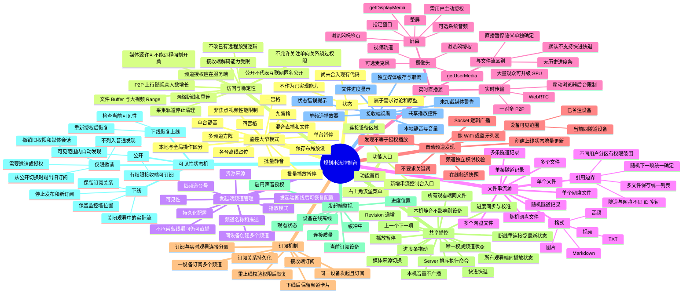

# 规划：串流控制台、动态频道与监控大爷模式 — 思维导图

> **源码基线 Commit**：`b1788ca4b219718ad802ed778ed41c081ecad39b`  
> **文档更新时间**：2026-10-16  
> **状态**：仅需求规划，尚未合入当前代码  
> **主要参考**：[../master.md](./../master.md)

[返回全景思维导图](./README.md)

本图来源于用户提出的“串流控制台”需求与本次对话设计讨论；均不应混入当前系统已实现能力。
