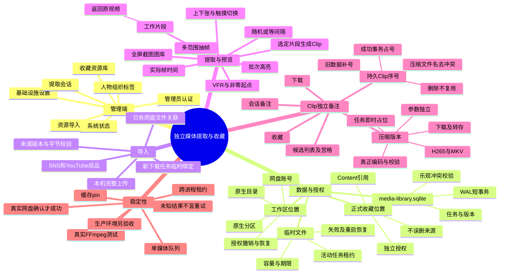

# 视频画面提取与多媒体收藏：功能与边界思维导图

> **源码基线 Commit**：`10ebe1000b9bd57097f90e51337a251ba17734f3`  
> **文档更新时间**：`2026-10-17`  
> 详细说明：[media-library.md](../media-library.md)；使用手册：`docs/media-library.md`；开发记录：`docs/devlog/dev-2610-features.md` 261013—261017。

## 与其它模块分界

- 隧道文件传输的 `FileAssetTransfer`、WebRTC P2P / Socket.IO Relay 不直接成为媒体库的业务队列。
- 网盘 `disk.sqlite` 管理正式文件、共享 Content 与访问权限；媒体业务本身在 `media-library.sqlite`，不是网盘的扩展表。
- SNS/YouTube 下载器保持其原任务和缓存；媒体库以可恢复关联订阅任务结果，不因绑定失败自动再生成一个下载任务。
- 与 [媒体预览及实时交互](./03-media-preview-realtime.md) 的普通预览/摄像头/通话不是同一子系统。
