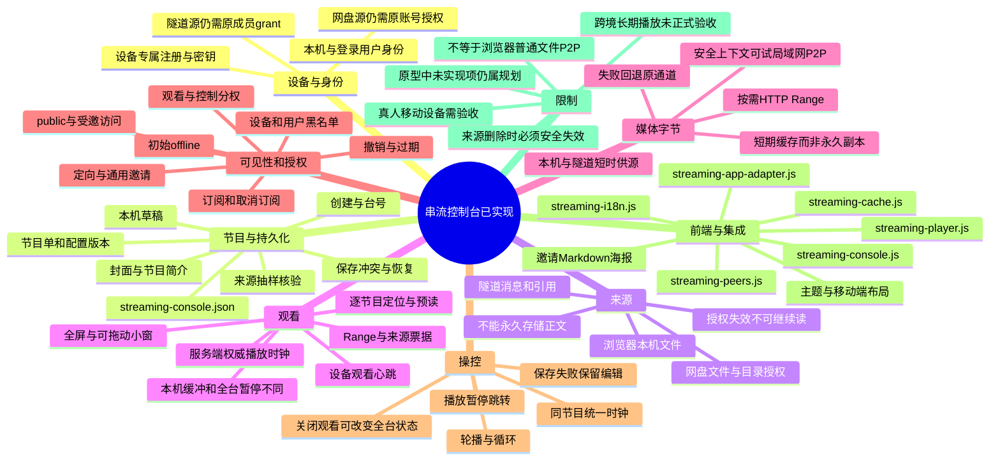

# 串流控制台：已合入功能与边界思维导图

> **当前源码锚点**：`71e58b07350a0ef3b480fa82272177863de74448`  
> **文档更新时间**：2026-11-07  
> 详见 [streaming-console.md](../streaming-console.md)；原需求对照见 [12-planned-streaming-console.md](./12-planned-streaming-console.md)。

**持久化边界：** 频道/设备/播放编排写入 `streaming-console.json`，不是 `disk.sqlite`；网盘数据、隧道历史和媒体库候选仍归原系统。部分历史规划（比如独立长期 CDN 存储、真正通用实时屏幕广播或全球端到端持续可用保证）不因为原型图存在就变成当前能力。

**验收边界：** 有 Node、隔离浏览器、合成视频与构建测试记录，但真实 Android、不同网络代理/浏览器、Telegram 正式账号及跨境长时间播放必须单独验证。
