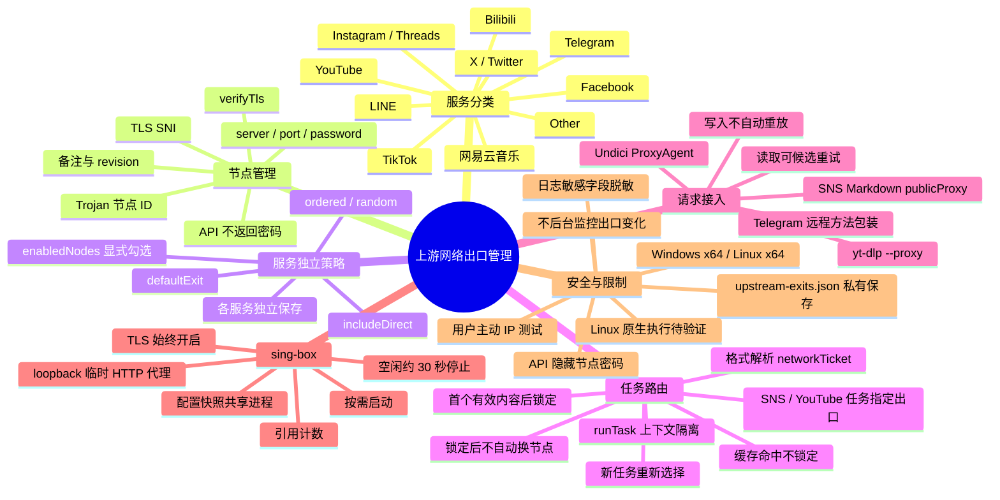

# 上游网络出口、Trojan 节点与任务级路由 — 思维导图

> **源码基线 Commit**：`1da33930cfb0f7022114825e2cb300ce18ff4eae`  
> **文档更新时间**：2026-11-19  
> **主要参考**：[../upstream-exits.md](../upstream-exits.md)、[../admin-security-deployment.md](../admin-security-deployment.md)

[返回全景思维导图](./README.md)

**当前边界：** 这是服务端出站请求的按服务路由，不是用户设备系统 VPN，不改变浏览器 WebRTC ICE。候选只包含明确启用的节点；真实用户节点和所有第三方平台仍需现场验证。
