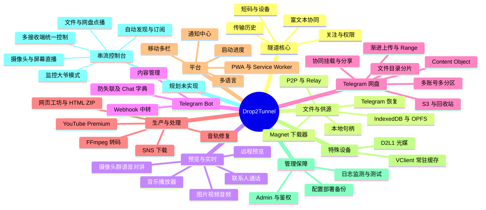

# Drop2Tunnel 全功能思维导图集

> **源码基线 Commit**：`b1788ca4b219718ad802ed778ed41c081ecad39b`  
> **文档更新时间**：2026-10-16  
> **工作基线**：此目录的“已实现”部分仅依据 `dev/doc-overview` 已合入的代码及 [Overview 体系](../master.md)，不把其它分支或当前讨论当作已交付功能。

## 阅读方式

这是**可在支持 Mermaid 的 Markdown 阅读器中渲染的思维导图源文件**。先看全景图，接着按模块进入细节图。为避免单张图节点过多导致拥挤或渲染卡顿，拆为按业务边界聚合的多张思维导图。每个功能继续向下拆到用户操作、状态、来源、权限、异常或持久化边界；复杂流程的时序仍请参考原有 Overview 文档。

## 总图

## 按模块展开至末梢

- [隧道、设备、协同与权限](./01-tunnel-devices-collaboration.md)
- [文件、合辑、P2P、缓存、恢复与磁链](./02-file-transfer-cache-magnet.md)
- [媒体预览、播放器、实时音视频与远程预览](./03-media-preview-realtime.md)
- [Telegram Bot、中转、内容管理与来源迁移](./04-telegram-bot-content.md)
- [Telegram 网盘：身份、文件系统、分片、上传与播放](./05-telegram-drive-files-identity.md)
- [网盘高级能力：协同、分享、S3、回收站与编辑](./06-drive-sharing-s3-advanced.md)
- [SNS、YouTube Premium、Cookie 同步、音轨修复与转码](./07-sns-youtube-transcode.md)
- [网页工坊、HTML ZIP、Markdown 与隔离 Runtime](./08-web-workshop-runtime.md)
- [PWA、首页 UI、主题、多语言、通知与性能反馈](./09-pwa-ui-localization.md)
- [光媒 D2L1 与 VClient 常驻缓存节点](./10-light-transfer-vclient.md)
- [后台管理、安全、部署、存储与测试回归](./11-admin-security-deploy-tests.md)
- [规划：串流控制台、动态频道与监控大爷模式](./12-planned-streaming-console.md) — **规划，未实现**

## 来源、范围与边界

- 每个子图顶部给出主要来源文档；完整源码入口见 [source-map.md](../source-map.md)。
- 既有 Overview 已整理的源代码事实终点是 `b1788ca4b219718ad802ed778ed41c081ecad39b`，详见 [VERSION.md](../VERSION.md)；本次仅新增视图型文档，**不推进源码锚点**。
- 图中的“支持”表达对应源码基线所记录的能力或受限能力，并**不意味着真机、真实 Telegram、所有浏览器和所有第三方 S3 客户端均已验收**。
- `12-planned-streaming-console.md` 明确记录对话形成的未来需求，不应从这张图推断功能已上线。
