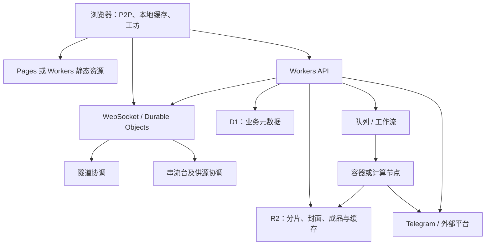

问：


    如果这个项目要整体部署到cloudflare worker and pages，需要具体哪些的改造。
    请全面分析，从代码逻辑、架构、存储、状态、通信等等
    只分析，不要改代码


答：


    我会先按当前代码梳理运行入口、数据库与文件存储、后台任务、实时通信及代理链路，再对照 Cloudflare Workers／Pages 的能力和限制，分析需要改造的部分、可迁移范围与可行的部署架构。全程只读，不修改任何文件。

    已运行 Get-Content docs/overview/master.md -TotalCount 210; Get-Content package.json; Get-Content server.js -TotalCount 230; rg --files -g 'AGENTS.md' -g '*wrangler*' -g '*cloudflare*' -g '*docker*' -g '*Docker*'; Get-Content C:/Users/Dell/.codex/skills/research/SKILL.md -TotalCount 180

    总览文档的源码基线停在 10 月中旬，我会以当前工作区代码为准，特别补查后来加入的串流功能。平台限制会用 research 技能核对 Cloudflare 官方文档；结果只在回复中给出，不写入项目。

    Cloudflare limits开始工作

    运行了命令已搜索网页

    目前最关键的障碍已经明确：服务端依赖的持久化不止 SQLite，还包括 JSON 文件、落盘上传暂存和缓存，以及大量进程内状态。串流当前也已有 NDJSON 长连接和供源长轮询，不能只按“搬几个 HTTP API”来评估。后续我会分别说明：前端接入 Cloudflare、核心服务改为 Workers 原生架构、以及保留全部功能的混合部署，各自要改到什么程度。

    运行了命令已搜索网页

    Cloudflare limits已完成

    运行了命令已搜索网页

    现在可以给出比较明确的方案了：浏览器侧的 P2P、本地缓存和网页工坊可以大体保留；改造量主要集中在服务端的状态归属、上传恢复、存储接口和后台任务。一个具体例子是串流播放票据目前保存在进程内 Map 中，签发和读取若落到不同实例就会失败，必须先解决统一归属，才能安全扩容。


## 一、结论

**前端和大部分业务控制逻辑可以迁到 Cloudflare，但当前项目要完整保留全部功能，仅靠 Workers＋Pages 不够。**

主要原因有四类：

1. **当前服务依赖常驻 Node 进程及大量进程内状态。**
2. **数据库、配置、任务、上传暂存和缓存依赖本地文件系统。**
3. **Socket.IO、串流供源、跨设备通知等需要统一的状态归属。**
4. **yt-dlp、FFmpeg、FFprobe 等依赖 Linux／Node 子进程运行环境。**

如果目标是停止使用现在的服务器，同时保留全部功能，比较完整的组合会是：

> **Workers／Pages＋Durable Objects＋D1＋R2＋任务编排＋Cloudflare Containers 或外部计算节点。**

其中，**Containers 属于额外的容器运行环境，和普通 Workers／Pages 有明显区别。**

下面基于当前分支 `dev/2610-s3-BUGBUGBUG-2`、HEAD `9db1325b` 及未提交代码分析；Cloudflare 能力按 **2026-10-27** 官方文档核对。本轮没有修改文件，也没有执行部署。

---

## 二、当前项目的实际运行模型

当前项目包含多种运行方式和数据归属，迁移时需要分别处理。

| 部分 | 当前实现 | 迁移影响 |
|---|---|---|
| 页面、API | Express，共用一个 HTTP 服务 | 需要适配 Workers 入口及静态资源路由 |
| 实时通信 | Socket.IO＋WebRTC 信令＋应用层 Relay | 需要处理协议兼容、连接归属和跨实例通信 |
| 隧道基础数据 | `sql.js`，内存数据库导出到 `infra.sqlite` | 需要替换持久化及整库加载方式 |
| 网盘元数据 | `node:sqlite`、SQLite WAL | 需要改数据库访问接口和事务组织 |
| 媒体库、转发队列 | 独立原生 SQLite 数据库 | 同样需要迁移 |
| 串流台配置与播放状态 | `streaming-console.json`＋内存状态 | 需要重新划分持久状态与实时状态 |
| 上传、下载和缓存 | 本地目录、临时文件、分片文件 | 需要对象存储和可恢复任务模型 |
| 下载、转码、帧提取 | 子进程＋本地输入输出文件 | 需要容器或其他计算节点 |
| 浏览器数据 | IndexedDB、OPFS、文件句柄、Service Worker | 可以大体保留，但必须注意域名迁移 |
| Telegram | 文件实体、消息和 Bot API | 可以继续保留，访问与调度方式需要调整 |

几个关键源码入口：

- [服务入口及全局状态](D:/Workspace/github/Ltre/file-tunnel/server.js:3678)
- [基础数据库](D:/Workspace/github/Ltre/file-tunnel/server/infra-store.js:12)
- [网盘数据库](D:/Workspace/github/Ltre/file-tunnel/server/disk-repository.js:30)
- [串流状态存储](D:/Workspace/github/Ltre/file-tunnel/server/streaming-console.js:36)
- [网盘上传暂存](D:/Workspace/github/Ltre/file-tunnel/server/telegram-drive.js:37)
- [媒体处理执行器](D:/Workspace/github/Ltre/file-tunnel/server/media-library/processing.js:51)

---

## 三、代码运行环境需要哪些改造

### 3.1 Express 可以复用一部分，启动方式必须调整

Cloudflare 当前已经支持通过适配器运行 Express，**不需要为了迁移强制更换所有路由框架**。

但当前入口会：

- 读取本地配置及数据库；
- 初始化多个业务服务；
- 注册全局定时器；
- 探测本机工具；
- 启动 HTTP 监听；
- 在退出时刷盘、关闭数据库、终止任务。

需要改为：

- 请求由 Worker 入口接收；
- 环境配置由绑定及配置服务提供；
- 持久状态从存储读取；
- 后台工作交给明确的任务执行器；
- 不依赖进程退出时才保存重要数据。

另外，Workers 的 `node:http` 适配层**不支持普通 Node 服务的 `upgrade` 事件和底层 socket**。因此 Express 的可运行性，不能直接证明当前挂在 HTTP Server 上的 Socket.IO 可以原样运行。[Express 官方教程](https://developers.cloudflare.com/workers/tutorials/deploy-an-express-app/)、[HTTP 兼容边界](https://developers.cloudflare.com/workers/runtime-apis/nodejs/http/)

### 3.2 Node 兼容不等于完整 Node 主机

当前 Workers 已有较广的 Node API 兼容能力，但这里有两个关键边界：

- `node:sqlite`、`node:child_process` 当前属于可以导入的非功能实现，不能执行现有数据库和子进程工作。
- `node:fs` 提供虚拟文件系统，其中 `/tmp` 是请求级临时空间，不能作为跨请求共享、长期保存的数据目录。

所以当前 `.tunnel-data`、SQLite、上传暂存、下载成品、cookie 文件，均需要另行安排。[Node 兼容文档](https://developers.cloudflare.com/workers/runtime-apis/nodejs/)、[文件系统文档](https://developers.cloudflare.com/workers/runtime-apis/nodejs/fs/)

### 3.3 流式代码要按 Workers 资源预算重新核对

当前代码大量使用 Node Stream、`pipeline()`、`res.write()`、`drain`、文件读取流。

迁移时需要核对：

- Node Stream 与 Web Streams 的转换；
- 背压是否仍然有效；
- 客户端断开后是否取消上游读取；
- 是否存在整段 `Buffer.concat()`；
- Range、长度、校验和及错误响应是否保持一致。

当前 Workers 的几个直接相关限制是：

| 项目 | 当前限制及影响 |
|---|---|
| 内存 | 每个 isolate 128 MB，多个并发请求会共享 |
| CPU | 付费默认 30 秒，可配置最高 5 分钟 |
| 上传请求体 | 常见 Free／Pro zone 为 100 MB；按 zone 套餐决定 |
| 响应体 | 不强制限制总大小，但不能因此整段读进内存 |
| 响应结束后的后台延长 | `waitUntil()` 最多延长 30 秒 |
| 同时向外连接 | 每个请求有数量限制，需要控制并发 |

HTTP 连接保持期间，并没有统一的固定执行时长上限，因此可以做长响应；但这仍然不能替代可靠的后台任务运行机制。[Workers 限制](https://developers.cloudflare.com/workers/platform/limits/)

---

## 四、数据库和存储需要怎样拆分

### 4.1 数据库不能只替换一个连接地址

当前至少有以下几种持久化机制：

- `infra.sqlite`：`sql.js` 在内存中操作，再整库导出；
- `disk.sqlite`：原生 SQLite WAL；
- `media-library.sqlite`：原生 SQLite；
- `telegram-forward.sqlite`：原生 SQLite；
- 多种 JSON 文件、密钥文件、任务目录和上传清单。

迁移后应分别决定用途：

| 数据 | 适合的方向 |
|---|---|
| 用户、分区、文件逻辑节点、分享、协同授权 | D1 或其他关系数据库 |
| 隧道房间、在线连接、播放控制的权威状态 | Durable Objects |
| 上传分片、封面、下载成品、媒体缓存 | R2 |
| 不要求立即一致的低频配置或派生缓存 | KV |
| 稳定签名密钥、服务级凭据 | Secrets 或专门的密钥管理 |
| 审计及统计 | 异步写入、批量聚合 |

**D1 和 Durable Objects 有不同职责，不必把所有数据同时写进两者。每种状态应明确一个权威来源。**

### 4.2 当前同步存储接口需要调整

网盘 Repository 当前使用同步 SQL，并且存在：

- `BEGIN IMMEDIATE`；
- 回调式事务；
- 多张表的一致提交；
- 唯一索引及触发器；
- 基于原始版本的冲突检测。

参见 [网盘 Repository](D:/Workspace/github/Ltre/file-tunnel/server/disk-repository.js:9) 和 [共享 Content 数据模型](D:/Workspace/github/Ltre/file-tunnel/server/disk-content-repository.js:1)。

D1 使用异步绑定接口，支持事务性 `batch()`，但不能原样执行当前任意同步回调事务。

需要改造：

1. 数据访问接口及调用链；
2. 事务内校验与更新的组织；
3. 并发写入的版本检查；
4. 数据库初始化及版本迁移；
5. 批量读取、目录查询、分页和索引。

当前部分代码会整批加载记录，再在 JavaScript 中筛选。迁移后应尽量把过滤与分页下推到数据库，否则会放大查询、网络和内存成本。

### 4.3 D1 也需要容量和热点规划

当前 D1 付费单库最大 10 GB，单行／字符串／BLOB 最大约 2 MB；单库仍然逐个处理查询。

这意味着：

- 大型合辑或聚合 JSON 要检查大小；
- 文件字节应放对象存储；
- 高频心跳、播放进度和每个传输分片不能都写进主库；
- 后期需要按实际数据和事务边界拆库。

如果启用读副本，还要为“刚修改后立即读取”安排 Sessions／bookmark；权限撤销等操作需要明确的新鲜度保证。[D1 限制](https://developers.cloudflare.com/d1/platform/limits/)、[D1 事务接口](https://developers.cloudflare.com/d1/worker-api/d1-database/)、[读副本一致性](https://developers.cloudflare.com/d1/best-practices/read-replication/)

### 4.4 KV 不适合承接实时权威状态

KV 是最终一致的，其他位置可能延迟 60 秒或更久才能看到更新。

因此以下数据不宜直接以 KV 为最终判断依据：

- 登录撤销；
- 协同权限；
- 串流控制指令；
- 在线设备状态；
- 上传锁与实体引用计数；
- 一次性授权的消费状态。

KV 可以保存允许短暂陈旧的配置和缓存。[KV 一致性说明](https://developers.cloudflare.com/kv/concepts/how-kv-works/)

---

## 五、进程内状态是最核心的改造点

当前 [服务端全局状态](D:/Workspace/github/Ltre/file-tunnel/server.js:3702) 包含大量 `Map`、`Set`、计时器及 socket 引用，例如：

- 隧道与设备连接；
- 在线文件供源；
- 文件传输分配；
- 协同编辑相关状态；
- 远程预览、通话；
- 通知和待处理请求；
- Telegram 下载和任务状态。

普通 Worker 的全局变量可以作为可丢失的缓存，**不能保证下一次请求还能访问同一份状态**。

### 推荐按协调范围划分权威状态

| 协调范围 | 主要职责 |
|---|---|
| 每个隧道 | 成员、权限、连接、信令、协同状态、供源发现 |
| 每个设备或设备组 | 多隧道在线位置、通知投递、供源任务路由 |
| 每个串流台 | 播放版本、节目切换、观看会话、邀请及踢出 |
| 每个上传任务 | 分片完成情况、租约、取消、恢复 |
| 每个 Bot／频道调度范围 | Telegram 并发、公平性、限速及退避 |

Durable Objects 适合这些协调工作，但仍然要处理：

- 内存随休眠、部署、异常而丢失；
- 重连恢复；
- 旧连接迟到消息；
- 请求去重；
- 版本冲突；
- 定时器恢复；
- 跨对象消息与权限校验。

WebSocket 休眠可以降低空闲连接成本，但业务状态需要持久化或能重建；持续运行的计时器也会影响休眠。[Durable Objects WebSocket](https://developers.cloudflare.com/durable-objects/best-practices/websockets/)

**不能把整个系统塞进一个 Durable Object，也不能简单地给每个 HTTP 请求创建一个新对象。**

---

## 六、隧道通信、P2P 和 Relay 的改造

### 6.1 浏览器 P2P 可以大体保留

当前文件传输、音视频、远程预览的 WebRTC 仍主要发生在浏览器之间。

服务迁移后可以继续保留：

- ICE 配置；
- SDP、candidate 交换；
- DataChannel；
- P2P 优先及失败降级；
- 浏览器缓存与多来源恢复。

需要迁移的是服务端的信令、发现、成员和供源协调。

**部署到 Cloudflare 不会自动解决用户的全局代理／PAC、NAT 或浏览器网络路径问题。** 这些仍然需要沿用现有探测和降级逻辑。

### 6.2 Socket.IO 有两条现实路线

**路线 A：保留 Node Socket.IO 服务**

放在原服务器或容器中，Cloudflare 做入口和静态资源托管。

优点是协议改动较小；扩容时仍然要解决房间状态、polling 会话归属和共享业务状态。

**路线 B：改为 Workers WebSocket＋Durable Objects**

需要适配：

- 事件封装；
- ACK 与超时；
- 心跳、重连；
- 房间及广播；
- 二进制帧；
- 身份恢复；
- 多版本客户端兼容。

这会涉及前后端及 VClient，不能仅替换一个 WebSocket URL。

### 6.3 大文件 Relay 要单独设计成本和背压

当前 [文件传输模块](D:/Workspace/github/Ltre/file-tunnel/client/file-assets.js:1) 的 Relay 分块为 64 KiB。

一个 1 GiB 文件对应约 **16,384 个数据块**，还未包含：

- 发送端进入中继和中继发往接收端的两段通信；
- ACK、重试；
- 发现及状态消息。

需要单独规划中继的：

- 消息量和吞吐；
- 每连接缓冲上限；
- 慢接收端背压；
- 断连取消；
- 请求与消息成本；
- 大流量对信令和控制响应的影响。

此外，普通 Worker 不承担通用 TURN 服务。Cloudflare Realtime TURN 是独立服务，和项目当前的 Socket.IO Relay 是不同的中继机制。[Workers 协议边界](https://developers.cloudflare.com/workers/reference/protocols/)、[Realtime TURN](https://developers.cloudflare.com/realtime/turn/)

---

## 七、串流控制台需要专门改造

这是当前项目中对实例归属依赖很强的一部分。

### 7.1 当前实现已经包含多种通信方式

从最新 [串流 HTTP 实现](D:/Workspace/github/Ltre/file-tunnel/server/streaming-http.js:21) 看：

- 配置和播放状态保存为 JSON；
- 观看者及票据保存在内存；
- `/events` 使用 NDJSON 长连接，每 10 秒发送状态；
- `/provider-work` 使用最长约 20 秒的供源长轮询；
- 媒体按 Range／分段读取；
- 服务端有每秒播放状态检查；
- 读前缓存默认总计 64 MiB、单票据 16 MiB。

所以当前串流并非只有普通短轮询。

### 7.2 多实例下会发生的具体问题

例如：

1. 实例 A 签发播放票据，保存在自己的 `tickets Map`；
2. 浏览器请求媒体；
3. 请求落到实例 B；
4. B 找不到票据。

供源也有类似问题：

- 浏览器的供源长轮询连接停在 A；
- 媒体读取请求落到 B；
- B 看不到 A 上的供源连接及待处理请求。

另外，多个实例各自修改同一个串流 JSON，会产生覆盖和版本冲突。

### 7.3 推荐的职责拆分

- **串流台协调对象**：管理权威播放状态、版本、观看会话、邀请与权限。
- **供源协调对象**：将读取请求路由到实际持有文件的浏览器。
- **媒体读取 Worker**：处理鉴权、Range、背压及上游取消。
- **对象存储**：保存封面和明确允许缓存的媒体数据。
- **数据库**：保存可检索的台配置、订阅及其他持久业务数据。

播放时钟可以延续当前“位置＋时间差”的计算思路，按节目边界或事件推进，减少无条件定时写入。

票据可以考虑签名化以减少内存依赖，但仍需校验：

- 台权限是否撤销；
- 节目与来源版本是否改变；
- 设备／账号绑定；
- 有效期。

当前 64 MiB 缓存也需要缩减或迁出，避免占用 Worker 共享内存的一半。

---

## 八、Telegram 网盘、上传、缓存和 S3

### 8.1 Telegram 文件实体可以继续保留

迁移不要求把所有 Telegram 文件重新上传到 R2。

可以继续保留：

- Telegram 文件和消息；
- 现有逻辑文件 ID；
- 分区、目录、协同挂载；
- Content Object、物理版本及引用关系。

需要迁移的是元数据、凭据、缓存、调度和任务执行。

### 8.2 当前渐进上传机制需要重做存储适配

当前上传链路支持：

> 浏览器持续写入本地暂存文件，同时 Telegram 从增长中的文件读取。

涉及：

- [增长文件读取器](D:/Workspace/github/Ltre/file-tunnel/server/growing-file-readable.js:50)
- [渐进上传执行器](D:/Workspace/github/Ltre/file-tunnel/server/disk-progressive-upload.js:6)

R2 的普通对象无法直接提供相同的“边写边读同一增长文件”语义。

可行方向包括：

- 以已完成的小分片为交接单位，写入 R2 后交给上传任务；
- 由容器继续承担增长文件及 Telegram 上传；
- 对有限大小请求直接流式处理，但另行解决中断恢复和重试。

无论哪条路线，都要保留当前的取消、完成校验、租约、去重及旧任务隔离。

### 8.3 大文件请求存在入口限制

当前对象存储支持约 2 GB 的对象上传，而普通 Workers 入口在常见 zone 套餐下只有 100 MB 请求体限制。

因此：

- 浏览器上传可以继续分片；
- R2 multipart 可以承接大对象；
- **现有 S3 客户端的一次大 PUT，不能假定迁移后仍然有效。**

要完整保留这种请求能力，需要支持适当的 multipart 流程、调整入口方案，或保留具备所需上传能力的服务。

当前 Telegram 单片上限为 20,000,000 字节、单批为 40,000,000 字节，虽低于常见入口限制，仍要计算同时缓存、组装 multipart 和并发读取的内存占用。见 [分片限制](D:/Workspace/github/Ltre/file-tunnel/server/disk-limits.js:1)。

### 8.4 本地缓存需要改变实现

当前 [Telegram 分片缓存](D:/Workspace/github/Ltre/file-tunnel/server/disk-part-cache.js:21) 默认允许约 10 GiB，包含落盘文件、读者和正在填充的请求状态。

迁移后可采用：

- R2 保存可恢复缓存；
- 边缘缓存加速允许公开缓存的响应；
- 小型内存缓存作为加速层；
- 用权威租约／状态减少重复回源。

要保留内容版本、分片哈希和授权边界。用户停止分享或协同权限撤销后，缓存不能继续绕过检查。

### 8.5 S3 网关仍然需要保留业务映射

项目中的 S3 Bucket 是凭据作用域内的网盘映射；R2 Bucket 是物理存储容器。二者不能直接一一替换。

迁移 [S3 网关](D:/Workspace/github/Ltre/file-tunnel/server/s3/routes.js:1) 时，需要保持：

- 凭据绑定用户及 Bucket 映射；
- SigV4 验签；
- 原始路径编码、查询参数及已签请求头；
- 流式签名解码及内容校验；
- Range、HEAD、ETag、XML 错误格式。

代理在验签前改变 Host、路径或请求内容，可能导致签名失败。

公开静态资源可以借助 Worker＋R2＋CDN，但要定义撤销与缓存失效策略；R2 强一致和经过 CDN 后的缓存表现需要分别考虑。[R2 API](https://developers.cloudflare.com/r2/api/workers/workers-api-reference/)、[R2 一致性](https://developers.cloudflare.com/r2/reference/consistency/)

---

## 九、后台任务与重处理功能

### 9.1 无法直接放进普通 Worker 的现有执行逻辑

包括：

- SNS／YouTube 抓取；
- yt-dlp、Deno；
- FFmpeg 转码及音轨修复；
- 帧提取、短片生成、缩略图和媒体验证；
- 本地 Bot API 文件路径读取；
- VClient 本地缓存进程。

其中 [媒体库](D:/Workspace/github/Ltre/file-tunnel/server/media-library/processing.js:93) 和转码服务依赖真实子进程及文件路径。

### 9.2 任务需要独立、可恢复地执行

建议模型：

```text
API 创建任务
    ↓
持久化任务及输入引用
    ↓
队列／工作流调度
    ↓
容器或计算节点执行
    ↓
产物写入对象存储／Telegram
    ↓
校验并提交完成状态
    ↓
通知前端
```

需要改造的任务机制包括：

- 用任务租约替代本机 PID 存活判断；
- 用任务 ID、尝试次数及版本隔离迟到结果；
- 分布式取消；
- 幂等重试；
- 执行中断恢复；
- 输入与产物生命周期；
- 失败重试及人工处理入口。

例如当前 [Telegram 转发队列](D:/Workspace/github/Ltre/file-tunnel/server/telegram-forward-jobs.js:6) 已区分“中断后结果不确定”，这个语义需要保留，不能因队列重试重复发送。

Queues、Workflows 可以承担调度和编排，**不会使普通 Worker 获得 FFmpeg 子进程能力**；队列消息应传任务 ID 和资源引用。[Queues 限制](https://developers.cloudflare.com/queues/platform/limits/)、[Workflows 限制](https://developers.cloudflare.com/workflows/reference/limits/)

### 9.3 Telegram 调度必须按全局范围协调

当前 [上传调度器](D:/Workspace/github/Ltre/file-tunnel/server/telegram-upload-scheduler.js:9) 有全局、Bot 和频道并发控制，但状态在本进程内。

多实例后，每个实例各自遵守并发限制，会使总并发随实例数增加。

需要统一：

- Bot／频道调度；
- `retry_after`；
- 公平排队；
- 取消；
- 重试上限。

---

## 十、前端、身份、域名及安全边界

### 10.1 前端改造量相对较小，但不能直接上传整个仓库

静态资源需要独立构建，明确允许发布的文件。

特别注意：

- 后台页面目前受 Express 中间件保护；
- `/runtime-config.js` 动态输出配置；
- Manifest 按域名生成；
- 部分 URL 映射到同一个首页；
- Service Worker 对 API、Socket.IO、网页工坊运行目录有特殊处理。

Pages／Workers 静态托管时，需要分别保留路由、鉴权和缓存行为。缺失 API 不应被 SPA fallback 返回一份 HTML。

已有 [构建脚本](D:/Workspace/github/Ltre/file-tunnel/tools/deploy/build.mjs:1) 可以作为基础；前端也可直接使用 Workers Static Assets，Pages 并非必需。[Workers 静态资源](https://developers.cloudflare.com/workers/static-assets/)

### 10.2 建议尽量保留同一业务域名

当前多处请求使用同源相对路径，串流还有严格的 Origin 及 Cookie 检查。

保持：

```text
https://原业务域名/
https://原业务域名/api/...
https://原业务域名/socket.io/...
```

通常能减少前端和认证改造。

如果拆成 `pages.dev` 与另一个 API 域名，需要全面调整：

- Cookie 及 credentials；
- CORS、CSRF、Origin；
- 媒体鉴权；
- WebSocket 地址；
- OIDC 回调；
- Passkey 的 RP ID／Origin；
- 分享链接和公开资源链接。

### 10.3 浏览器数据迁移需要单独安排

IndexedDB、OPFS、Service Worker 和文件句柄都与 origin 有关。

如果更换业务域名，旧域名下的浏览器数据不会自动出现在新域名下，影响可能包括：

- 隧道历史和文件缓存；
- 网页工坊草稿；
- 串流本机来源；
- 已保存账号；
- 目录授权和同步配置。

因此应尽量保留域名；确需更换时，再设计导出、导入及重新授权流程。

### 10.4 密钥与认证流程需要持续一致

需要迁移并保持稳定的内容包括：

- 管理员及网盘签名密钥；
- S3 Secret 加密密钥；
- 隧道成员凭据；
- Bot Token；
- OIDC 配置；
- VClient 控制凭据；
- 登录撤销记录。

Passkey／OIDC 待处理挑战当前也有进程内状态，需要保证回调能找到原挑战，并原子消费。

当前 `scrypt` 在 Workers 有支持，不必强制更换密码算法；应保持原有格式并验证历史账户兼容，同时评估 CPU 和内存预算。[Workers crypto](https://developers.cloudflare.com/workers/runtime-apis/nodejs/crypto/)

现有本机 HTTP／SOCKS 代理、`127.0.0.1` Bot API 等配置也必须重新设计；Cloudflare 运行环境无法沿用原主机的本地地址含义。

---

## 十一、建议采用的部署架构

### 方案 A：前端接入 Cloudflare，后端保留现有服务器

```text
浏览器
  ├─ Cloudflare 静态前端
  └─ 同源 API／Socket.IO → 现有 Node 服务
                              ├─ SQLite／JSON／文件
                              ├─ Telegram
                              └─ 下载、转码及媒体任务
```

**改造量较小，适合作为第一阶段。**

可以先获得静态分发和统一入口能力，但服务端状态、存储及计算仍在原服务器上。

### 方案 B：核心控制服务迁为 Cloudflare 原生架构



**适合长期扩展，但服务端改造量大。**

重点是把控制、持久化、实时协调、媒体传输和任务执行分别安排好。

### 方案 C：使用 Cloudflare Containers 保留更多现有 Node 代码

容器可以运行 Node、yt-dlp、FFmpeg 等工具，也有保留 Socket.IO 的空间。

但需要处理：

- 容器休眠及重建；
- 外置持久数据；
- 任务恢复；
- 连接重连；
- 多容器状态归属。

当前 Containers 默认磁盘是临时的；已有快照能力，但快照是时间点副本，不能直接替代实时持久数据库卷，也不能把 R2 当成 SQLite WAL 的普通本地磁盘。[Containers FAQ](https://developers.cloudflare.com/containers/faq/)、[容器快照](https://developers.cloudflare.com/containers/guides/snapshots/)

---

## 十二、实施顺序与验收重点

### 推荐顺序

1. **拆分运行环境依赖**  
   明确数据库、文件存储、实时通信、任务执行、配置及密钥接口。

2. **先迁前端和入口**  
   保留域名、路径及后端，核对 PWA、登录、分享与实时通信。

3. **迁持久化与上传暂存**  
   优先解决事务、Content 引用、分片恢复及对象存储一致性。

4. **迁隧道和设备协调**  
   完成连接归属、权限、发现、信令、通知及 Relay。

5. **迁串流协调和供源**  
   解决票据、节目时钟、观看会话、长连接、供源和缓存。

6. **迁后台任务执行**  
   接入队列及容器，保留取消、恢复和“不确定结果”的语义。

7. **完成数据切换及故障验收**  
   安排备份、最终增量同步、旧任务排空及回退路径，明确切换期间唯一的写入权威。

### 必须验收的场景

- 请求落到不同实例；
- Worker／DO／容器重建；
- 长连接被中断并恢复；
- 上传到一半断线；
- Telegram 已成功但回执丢失；
- 协同权限撤销后继续读取；
- 两个用户同时操作共享 Content；
- 多接收端同时控制串流台；
- 缓存删除、公开链接停止后的读取；
- 旧 Service Worker 和旧客户端仍在使用；
- 大文件 Range、S3 签名、移动端后台恢复；
- P2P、Relay、代理环境下的原有降级行为。

### 我的建议

**近期采用方案 A，长期按方案 B 拆分；下载、转码等任务使用容器或独立计算节点。**

这样可以逐步核对现有功能，保留回退能力。直接把当前整个 Node 服务放进一个容器，只能减少部分运行环境适配工作，无法解决本地持久化、进程内状态和多实例一致性这些核心问题。