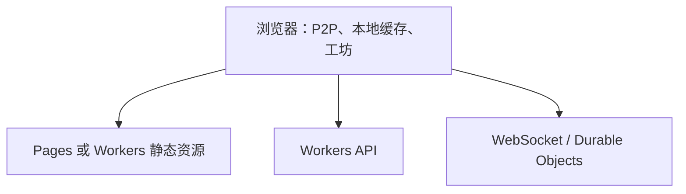

# 隧道传输链路历史需求清单

整理截至 2026-11-19。项目历史自 2026-06-21 起；检索范围为当前工作区 `prompts/`、本地可见 Git 引用及当前 `HEAD 8fe4c71`（共 1130 个可达提交），以及 `dev/2611-s1` 的[暂定验收草案](../../docs/other/%5B尚未决定采用%5D%20隧道传输链路核心验收基线%20v1.0.md)。本文用于下一轮你亲自定稿，不宣布 v1.0 已采用，也不宣布现有版本已通过。

- **明确**：可追溯到用户提出的目标、修复要求或澄清。表示历史上提出过，不表示完整实现或已经验收。
- **历史**：旧产品形态、阶段性方案或曾经尝试的策略，保留其原条件和后来的不同意见。
- **复测**：用户观察到的可复验现象；样本数字保留原义，不能当作全局阈值或根因。
- **候选**：来自助手设计稿、代码、提交或 v1.0 草案的推导，未找到足够证据把它归为用户已经确认的产品要求。

正文按行为归并重复描述；同一行为的旧要求、追加限制和反例同时保留。文末保留旧检索索引作为原始候选定位工具，它包含助手回复和范围外的命中。全量提交说明和历史 prompt 文本增量用于检索，未逐版本审计全部代码差异，也不含未保存在本地的聊天或远端历史；附件日志和截图作为复测线索，不从中倒推用户意图。

## 1. 主链路、建链与路径恢复

| ID | 性质 | 需求或历史条件 | 原始出处 |
| --- | --- | --- | --- |
| R01 | 明确 | 同一局域网且可直连的普通隧道文件尽快使用 WebRTC P2P，批量也要快速进入有效传输。防止正常环境长期全走 Relay；不因仅修某类记录而改变普通文件的优先路径。 | [11 月原话：局域网全 Relay](../dev-prompt-logs/dev-2611.md#L1001)、[关闭代理对照](../dev-prompt-logs/dev-2611.md#L2739)、[261117-1 第 6 项](../dev-prompt-logs/dev-2611.md#L6096) |
| R02 | 明确 | 电脑家中 Wi-Fi、手机蜂窝时，尽可能找通可用的设备间路径，避免过早落入过慢的 Socket.IO 中继；不承诺跨网必直连。 | [260626 用户问题](../dev-prompt-logs/dev-260626-NETWORK-FIX.md#L1) |
| R03 | 明确 | 无法建立或维持可用 P2P 时保留 Socket.IO Relay 兜底，用户不应重新发送原文件。不要因显示慢或短暂背压就放宽降级条件，也不要赖在已无有效进展的 P2P 上。路径可用性比代理开关或文件类型可靠。 | [四组代理对照和限制](../dev-prompt-logs/dev-2611.md#L2737)、[261117-1](../dev-prompt-logs/dev-2611.md#L6096)；早期富文本回退 `5659412` |
| R04 | 明确、复测 | 访问网站需要代理时，尽量让局域网文件直连免受代理影响；验证 PC localhost/局域网 IP、手机代理开/关、PC PAC/全局代理、正式站；同页关闭代理后应能恢复可用路径，记录刷新与不刷新差异。不规定正在健康传输的 Relay 必须被抢断。 | [现场四组](../dev-prompt-logs/dev-2611.md#L2737)、[代理澄清](../dev-prompt-logs/dev-2611.md#L4005)；`25919f0`、`1777fdc` |
| R05 | 明确 | 增加 Cloudflare TURN 支持。TURN 是 WebRTC 中继，应与设备直连、Socket.IO Relay 分辨；具体路由阶梯、启用条件、默认策略与费用边界仍需决定。当前清单不摘录配置中的凭据。 | [11 月第 8 项](../dev-prompt-logs/dev-2611.md#L7132)；[6 月讨论](../dev-prompt-logs/dev-260626-NETWORK-FIX.md#L3) |
| R06 | 历史、候选 | 6 月提出另寻快路，助手建议从当时的 1.5 秒探测改成按业务等待、先直连再 TURN、再 Socket.IO；还讨论候选诊断、IPv6、HTTP Range、多个受信中继或多跳。保留探索史，不视作全局超时、上线承诺或要求取消大文件 Relay。 | [260626 讨论](../dev-prompt-logs/dev-260626-NETWORK-FIX.md)、[多服务器 Relay 草案](../ideas/multi-server-relay-overview.md)；`cea1be9`、`e305b99` |
| R07 | 明确、复测 | 与用户认为快且相对稳定的参考版本做同条件对照：6 月 `efc44c5`、`3f3ca56` 是阶段性比较线索，8 月 `0b8e4e18` 是恢复链路线索，11 月用户点名 `efbb770` 对照直连及批量启动。不能整版恢复并带回已知跨隧道问题。 | `e305b99`、`bf70b5e`、`3024703`、`d71823e`；[11 月参考版本及反例](../dev-prompt-logs/dev-2611.md#L734) |
| R08 | 复测 | 三设备测试必须能解释每一供源连接的实际路径。无代理也曾出现零星 Relay；一端显示 multisource P2P、另一端显示 Relay 不能直接判作全 P2P或页面造假，应按文件、分片、设备对和实际候选路径对账。 | [261116](../dev-prompt-logs/dev-2611.md#L5520)、[261119 第 4–5 项](../dev-prompt-logs/dev-2611.md#L6887)；`745e76d` |
| R09 | 复测 | 同局域网经正式站进入，P2P 标签下曾不足 300 KiB/s，本机地址对照约 1–2 MB（原文口径）；另有 300–700 K 波动与 SNS 数十 KB。使用同设备、访问入口、代理、文件和来源对照；实际直连类型、首条数据和吞吐分别测。 | [正式站慢速](../dev-prompt-logs/dev-2611.md#L3565)、[多设备波动](../dev-prompt-logs/dev-2611.md#L5520)、[SNS](../dev-prompt-logs/dev-2611.md#L6142) |
| R10 | 候选 | 信令重连、限流和辅助审计不能把正常文件传输拖死。已有有效数据通道是否维持、失效尝试何时冷却、是否复用 PeerConnection，按可观察后果验收；不冻结连接对象数量、重连实现或 ICE 策略。 | `6807af7`、`3024703`、`d71823e`；[信令调查与复测](../dev-prompt-logs/dev-2611.md#L1606)；草案 P0-06/23/27 |

## 2. 文件身份、并发与可靠完成

| ID | 性质 | 需求或历史条件 | 原始出处 |
| --- | --- | --- | --- |
| R11 | 历史 | 初期大文件由另一端弹出接收确认，确认后两端都应看到进度；后来增加新设备自动缓存同步。不要把早期「每次弹确认」加到后续自动同步，也不要因此忽略显式拒绝。 | 历史 `e72bc87:prompts/prompts-20260621-2316.md`；`9444e1c` |
| R12 | 明确 | 多个大文件要排队和分工，有多个在线供源时分散负载，不能固定压到一台设备；慢源、大文件或某项异常不能把其他可完成的任务长期堵住。 | [260622 第 1 项](../dev-prompt-logs/dev-260622-new-functions.md#L1553)；`94b2c72`、`b83dabe`、`22391c7` |
| R13 | 明确、候选 | 大文件可按分片从多个候选设备取得；同一文件必须正确拼合，文件集合中各成员、所属记录和实际内容对应。并行不是每个文件的强制条件；重试可换供源，不承诺必定续用任意旧分片。 | [260625 磁链逐源/分片方案](../dev-prompt-logs/dev-260625-multi-relay.md#L9)；`7c8f926`、`fa5db60`、`bacec32`；草案 P0-10/11/13–15 |
| R14 | 明确、复测 | A 发约 40 MB 时 B 立即刷新，之后应能通过现有来源恢复并最终取得完整文件；强制重拉不能再次卡在同一点，也不应要求删除原记录、所有设备刷新、重新上传；完成后清除僵死进度。 | [260625 问题复测](../dev-prompt-logs/dev-260625-multi-relay.md#L5)；`3c5f1af`、`29ac00a` |
| R15 | 明确、复测 | 约 100 MB 以上文件须核对单次真实传输与 UI 重画。PC localhost、手机 LAN IP 组合曾出现 0→100→0→100、缓存迟迟未就绪；与两端均 LAN IP 对照，不能刻意隐藏旋转提示来掩盖真实重复或未写入。 | [2610 第 14 项](../dev-prompt-logs/dev-2610.md#L14252)、[专项待办](../dev-prompt-logs/p2p-progress-origin-difference-todo-261030.md) |
| R16 | 明确 | 已整文件完成的任务不能又经 Relay 全量跑一遍；多源分片启动不应重置整文件进度。暂时背压与确认在途不能误作失败；已确认不可继续的尝试应释放队列并允许重新选择来源或路由。 | `7c8f926`、`f62a8fd`、`bacec32`、`29ac00a`、`d508c6e`；[11 月现象与限制](../dev-prompt-logs/dev-2611.md#L2737) |
| R17 | 候选、提交证据 | 同一接收工作只有一个权威提交结果；旧尝试迟到的开始、结束、超时、确认或分片不能覆盖更新任务、复活被取消任务或重复写入。可以有授权的多范围供源或临时探测，但要隔离尝试身份。 | `d508c6e`、`9444e1c`、`a290b18`、`3bd5451`；草案 P0-03/04/24–26 |
| R18 | 明确 | 设备两端各自显示真实上传、下载进度。发送端排入缓冲不应瞬到 100%；单个分片完成不等于整个文件成功，接收卡片可用和接收完成要等实际数据可用。区分发送结束、接收完成、目标确认；不要假设所有路径都保存到同一种缓存。 | [bugA/bugB 进度要求](../dev-prompt-logs/dev-2611.md#L4482)；`961d596` 的尝试及 `80d2835` 的作废反馈 |
| R19 | 候选 | 文件字节不缺失、不串用；元数据与内容匹配，适用范围内支持大文件分块。测试用大小与外部哈希验证实体，有助于查出“能打开但不完整”；SHA-256、单次消息上限、固定分块大小不是用户已定的传输协议。 | `29ac00a`、`3bd5451`；草案 P0-07/08/10/11 |

## 3. 进度、取消与结果反馈

| ID | 性质 | 需求或历史条件 | 原始出处 |
| --- | --- | --- | --- |
| R20 | 明确 | 显示真实的传输方式、百分比，降级后同步更新。无法区分真实直连、WebRTC 中继或混合路径时，不给单一路径假象。富文本取图是这一要求最早的专用场景之一。 | `babfc93`、`745e76d`；[261119 两端路径问题](../dev-prompt-logs/dev-2611.md#L6889) |
| R21 | 明确 | 没有第二台可供源设备、仅查找来源、只有缺缓存元数据时不能凭空在传输抽屉闪“等待传输任务启动”。双方确认在线且文件可传后，正在排队或在传的任务可以显示；缺缓存状态留在文件卡片或恢复结果中。 | [2610 原话](../dev-prompt-logs/dev-2610.md#L16436)；`95cb869` |
| R22 | 明确、复测 | 新设备进已有 45 文件/220 MB 的隧道，要尽快能启动有效同步；调查曾近 20 秒双方无进度、代理下曾 1–2 分钟以上无反馈、Relay 小文件几百 K 疑似漏条。先核对实际内容、首条数据与渲染，再区分没启动、任务未显示和太快关闭。 | [45 件案例](../dev-prompt-logs/dev-2611.md#L2145)、[261117 原话](../dev-prompt-logs/dev-2611.md#L6096)、[261119 实测](../dev-prompt-logs/dev-2611.md#L6889) |
| R23 | 明确、候选 | 多任务进度集中在可收合抽屉，窄屏不覆盖主要操作；历史要求折叠状态可拖动。快速任务需要有用户可感知的结果，但 800ms 等停留时间属于实现和具体测试证据，未确认固定验收值。 | [260625 抽屉回归](../dev-prompt-logs/dev-260625-multi-relay.md#L180)、[11 月快任务](../dev-prompt-logs/dev-2611.md#L6096)；`4c54e8f` |
| R24 | 明确、候选 | 准确区分已排队、发送/接收中、接收确认、不可用、失败与取消；超时不能当成功。涉及后台继续的动作，关闭弹层或切换页面不等于撤销传输；显式取消另有语义。打印诊断时要能对应实际文件尝试。 | [批量超时原话](../dev-prompt-logs/dev-2611.md#L734)、[Relay 拒绝现场](../dev-prompt-logs/dev-2610.md#L16779)；`b1bc912`、`9444e1c`、`3bd5451` |
| R25 | 明确 | 列表锚点在加载、进度变化、缓存操作之后不应乱跳；文件和富文本详情、转发结果弹层的返回操作遵循窗口层级。转发结果有关闭按钮、Esc，并支持点遮罩、手机返回键/手势，保留过程和逐条结果。控制中心磁贴排序属单独 UI 需求。 | [260625 原话](../dev-prompt-logs/dev-260625-multi-relay.md#L10)、`5a1e128`；[261117-1 第 3 项附近](../dev-prompt-logs/dev-2611.md#L6142) |

## 4. 记录、缓存、清理与多种来源

| ID | 性质 | 需求或历史条件 | 原始出处 |
| --- | --- | --- | --- |
| R26 | 明确 | 新设备加入自动同步本隧道历史，刷新、重新加入和多设备同步要对齐；富文本引用、媒体、文件元数据和实际字节可分别恢复。不得把其他隧道历史注入当前隧道；日志应能辅助核对。 | `e72bc87:prompts/prompts-20260621-2316.md`、`f75ef6b`、`9ff5e3e`、`3c5f1af`、`8969a4c`；[260622 同步问题](../dev-prompt-logs/dev-260622-new-functions.md#L11) |
| R27 | 明确 | 资源浏览器可查看文件及其引用，区分已缓存、缺失、获取中；已有完整本地文件应可直接预览、下载或作供源。仅发现记录或本地存在过引用不代表实体还在；旧恢复响应不能使完整文件降回缺缓存。 | `8e60091`；[11 月确认修复范围](../dev-prompt-logs/dev-2611.md#L3947) |
| R28 | 明确 | 可手动强制拉回某文件；会话资源浏览器可一键获取缺失缓存，按当前会话遍历，向确有对应字节的设备请求，同一资源不能重复排队。应覆盖普通、转发、集合和 SNS 文件，保留它们各自授权与恢复来源。 | [260625 强制拉回](../dev-prompt-logs/dev-260625-multi-relay.md#L5)、[2610 批量按钮原话](../dev-prompt-logs/dev-2610.md#L19755)；`554ba28`、`825b9ae` |
| R29 | 历史、明确 | 260625 曾建议通过百分比与卡住状态阻止强拉，同段同时出现 40% 与 30%，且标为搁置测试；后续要保留的行为是保护仍在正常进展的任务、给真的失败/停滞任务恢复入口。不要采用任一个历史百分比当硬门槛。 | [260625 原文](../dev-prompt-logs/dev-260625-multi-relay.md#L5)；草案 P0-20/21 |
| R30 | 明确、复测 | 同会话设备在后台、失焦或临时重连时，只要实际仍在线且可提供文件，应能重新发现，不依赖切回浏览器才碰运气；不能把已离线、浏览器被系统挂起或只持历史的设备当可靠源。有其他来源应能改试。 | [260625 后台现场](../dev-prompt-logs/dev-260625-multi-relay.md#L7)；`3024703` |
| R31 | 明确 | 普通文件及 SNS 成品优先使用持有完整文件的设备缓存；正常 P2P 建链、排队或获取仍在进展时不能提前发起昂贵的上游回源。已有缓存可用时不必要重新下载帖子媒体。无可用设备缓存时才用对应备用来源。 | [2608A 单项与批量对照](../dev-prompt-logs/dev-2608A.md#L2176)；`8b67b54`、`f0f7945`、`9a94615`、`ab38b5b` |
| R32 | 明确 | 隧道文件保存到 Telegram 网盘后，保留与对应远端文件的引用作为备用来源；这不改变在线设备供源优先级。文件是 Telegram Bot、SNS、网盘送入的，仍按对应身份、权限及可用性选择回源，不能影响普通链路。 | [2608B 第 9 项](../dev-prompt-logs/dev-2608B.md#L5816)；`8b67b54` |
| R33 | 明确 | 资源检查、离线清理、退出/本地清缓存、删除记录以及彻底删除有不同含义；保留仍被其他记录、集合、Markdown、共享副本引用的实际资源。不能误删唯一可用的安全副本，也不能把旧消息恢复成已删的可见记录。 | `913f52f`、`1a467ee`、`248e283`、`2f7ab0a`；[帖子资源和回收记录](../dev-prompt-logs/dev-2610.md#L19029)；草案 P0-22/32 |
| R34 | 明确 | 提供按隧道启停的可选常驻缓存节点：在普通设备全离线后，已经缓存到节点的内容仍能取回。节点是与浏览器平级的独立进程，多个隧道复用一个节点进程；管理页可查看节点及已启用的隧道。停止节点与擦除缓存分别处理。 | [2608B 第 4 项](../dev-prompt-logs/dev-2608B.md#L1194)、[缓存节点需求稿](../dev-prompt-logs/vclient/vclient-缓存节点需求文档.md)；`ce8450f` |
| R35 | 候选、专项 | VClient 加入已有隧道补已有记录、在线持续保存新记录、重启后继续提供已持有资源；具体只支持哪条路径、队列并发、哈希持久化和管理日志是专项约束，不反推所有浏览器必须持久化或默认让服务器保存文件。 | [缓存节点详稿](../dev-prompt-logs/vclient/vclient-缓存节点需求文档.md)、[2608B](../dev-prompt-logs/dev-2608B.md#L3707) |

## 5. 跨隧道、转发副本与网页 ZIP

| ID | 性质 | 需求或历史条件 | 原始出处 |
| --- | --- | --- | --- |
| R36 | 明确 | 允许向曾加入且未退出的目标隧道发送或转发；首次连接目标也要能完成。保持当前页面，不以跳转目标隧道作为前置条件，不能出现先跳页、再报连接未建、必须第二次再发。 | [2610 第 4 项](../dev-prompt-logs/dev-2610.md#L8148)；`0f8a7c8`、`d527d91` |
| R37 | 明确、复测 | 批量转发要逐项展示结果，不能先报整个批次成功但只落部分记录；实际核对目标记录和实体。原样保留线上 A→B 20 条只见 6 条、C→B 16 条超时看不到、单条成功和第二次 20 条全部成功四个样本。尚不设等待秒数。 | [2611 批量现场](../dev-prompt-logs/dev-2611.md#L734)；`f7b9183`、`f382a24` |
| R38 | 明确 | 转发成功后，目标隧道持有可正常读、预览、同步及继续合法供源的副本。只加入目标隧道的手机也可用，不能因没加入 A 而拒绝读取 B 的副本（包括 ZL5GS）。转发人执行转发时和接收人访问 B 副本时，是两个授权判断。 | [261117-1 澄清](../dev-prompt-logs/dev-2611.md#L6124)；`c379f64`、`b677c2b` |
| R39 | 明确、候选 | 目标归属独立；合法复用字节可以，但不能只留一个依赖源隧道权限的占位。目标副本与源记录、集合成员、正文附件等要有正确映射；源删除、退出或源设备离线不能仅因此使已确认的目标副本失效。按动作定义目标可用与失败条件，不保证所有设备离线且无任何持久来源时仍可取实体。 | [261117-1](../dev-prompt-logs/dev-2611.md#L6136)、[附件转发与删除说明](../dev-prompt-logs/dev-2610.md#L19029)；`c379f64`、`f382a24`；草案 P0-28–30 |
| R40 | 明确 | 不自动加入无关来源隧道，也不能用短码、设备 ID、链接或复用缓存绕过权限。既允许目标成员合法读目标副本，也要保护源隧道本身的历史、其他文件和编辑授权。来自其他隧道的迟到响应不能污染当前列表。 | [目标副本澄清](../dev-prompt-logs/dev-2611.md#L6124)、[串流专项来源边界](../dev-prompt-logs/dev-2610.md#L10803)；`8969a4c`、`c379f64` |
| R41 | 明确 | 网页 ZIP 区分查看与编辑：他人创建则标注创建者，编辑向创建者申请；有授权后连贯修改应同步回对应源网页。回源不迫使双方同时切换 A；不能只有两端先后访问 A 才开始，也不强制将设备自动加入。 | [2610 第 8 项](../dev-prompt-logs/dev-2610.md#L20253)、[2611 回源现场](../dev-prompt-logs/dev-2611.md#L2170) |
| R42 | 明确 | 同一目标隧道内同一个源网页的转发副本共享授权，不逐条重复申请；改任一副本应同步同隧道其他同源副本，并把差异可靠回源。验证先编辑第一个再编辑第二个，源连续更新，第二个不永久显示「待同步到原网页」。 | [261117-1 第 4 项](../dev-prompt-logs/dev-2611.md#L6155) |
| R43 | 明确、复测 | 同源编辑或重命名只传播受授权的改动；不吞掉已经转发的其他记录，不把同源当成记录去重。复测多次转发、改任一条、再次从 A 转发以及顺序连续编辑，既对齐内容又保留记录数量；撤销、冲突和恢复路径单独验证。 | [后续验收反例](../dev-prompt-logs/dev-2611.md#L6488)、[2611 回源范围](../dev-prompt-logs/dev-2611.md#L644) |

## 6. 向主链路供文件的专项和旧方案

| ID | 性质 | 需求或历史条件 | 原始出处 |
| --- | --- | --- | --- |
| R44 | 历史、明确 | 早期富文本媒体迁往资源 ID、浏览器本地 Blob 渲染、独立取图，支持回退，并给出当前链路和进度；禁止把协同编辑正文传输和媒体字节传输混作一次成功。 | `c04435a`、`5659412`、`babfc93`；[260622](../dev-prompt-logs/dev-260622-new-functions.md#L11) |
| R45 | 历史、明确 | 早期分享磁链为服务内 URL，关联种子设备、隧道和文件。打开独立下载器，优先取得服务端种子信息，与本地缓存合并、冲突以服务端为准，探索多源分片。后续独立下载器实际走 Relay 的记录须保留，但不可推导普通隧道只能 Relay，也不可说磁链已支持 DHT/直连。 | [260625 需求原话](../dev-prompt-logs/dev-260625-multi-relay.md#L9)、[261014 QA](../dev-prompt-logs/dev-261014-magnet-link-QA.txt#L36)；`3bd5451` |
| R46 | 明确 | SNS 媒体文件进入隧道以后，可正常取、传和作为缓存供源；局域网关闭代理遇到此类记录时，不能把它当作天然低速或必走 Relay。分别排查上游下载、缓存写入、设备间转运；给出对照证据，不与来源授权错误强行归为一因。 | [261117-1 第 2.2 项](../dev-prompt-logs/dev-2611.md#L6142)、[2608A 缓存优先](../dev-prompt-logs/dev-2608A.md#L2176) |
| R47 | 明确 | SNS 帖子转换为 Markdown 并引用可用的隧道媒体，区分元数据解析、附件下载/保存、文档完成。B 站 `BV1Nbny69E31` 例只证明解析与生成结果不同；`SNS_POST_FAILED` 不能证明源站不可达。后续用户要求考虑 `Range: bytes=0-` 作为 B 站媒体抓取兜底；HTTP 567 可能受出口 IP 影响，不能把猜测或兜底扩成隧道普遍规则。 | [2610 Markdown/引用](../dev-prompt-logs/dev-2610.md#L20625)、[261117-1](../dev-prompt-logs/dev-2611.md#L6100)、本轮聊天 B 站澄清 |
| R48 | 明确、专项 | 串流台尽量利用局域网和隧道设备缓存，避免无谓访问公网服务。收到授权的节目，可借实际持有来源的设备取节目，不自动加入源隧道。该策略是串流授权场景，不能套成没有目标副本也能读任意源文件的通则。 | [2610 串流第 2 项](../dev-prompt-logs/dev-2610.md#L10803)；`2949ae9` |
| R49 | 候选、专项 | 早期分离 Socket.IO 端口、域名，随后走同源、Nginx/CDN；近场 NFC、光媒、原生 Companion、frp、多实例中继、加密或代理出口均有各自的讨论。这些是部署边界或独立方式，只有影响普通隧道可达性、文件保密/完整或路径选择时纳入同一测试，不当作普通传输必须启用的组件。 | `5b79068`、`67ef9f2`、`17d2680`；[NFC](../ideas/tunnel-NFC-pair-overview-20260704.md)、[光媒](../ideas/LIGHT-TRANSFER-overview-260813.md)、[安全](../ideas/security-overview-260629.md)、[frp](../ideas/frp-support-overview.md) |

## 7. 按早期原文补列的专项行为

| ID | 性质 | 需求或历史条件 | 原始出处 |
| --- | --- | --- | --- |
| R50 | 明确、历史 | 切换隧道前检查是否存在正在进行的传输；如果该切换会停止当前任务，提示用户并允许放弃切换。此为 7 月的前台切换语义，不推翻后续明确支持后台继续的任务。仅查询来源或无真实传输时不要误弹。 | [2607A 第 9 项](../dev-prompt-logs/dev-2607A.md#L12) |
| R51 | 明确 | 删除缺缓存文件后，同会话设备同步移除记录，还要更新真实任务数和等待计数；不留没有任何活动条目的空抽屉。另一方面，用户主动隐藏抽屉后仍保留顶栏入口，可主动查看已有等待/建链/停滞状态，和禁止自动弹出幽灵条不矛盾。 | [2607A 第 14 项](../dev-prompt-logs/dev-2607A.md#L17)、[2607B 小文件复测](../dev-prompt-logs/dev-2607B.md#L1359) |
| R52 | 明确 | 拖放支持多文件；同一批文件分别验证合辑或拆分发送，普通小文件也应完整自动到达，不靠手工点两次恢复。合辑或拆分发送时先发布记录，后台生成封面，单个媒体预处理失败不能阻塞批量发送。 | [拖放](../dev-prompt-logs/dev-2607B.md#L1191)、[合辑与拆分复测](../dev-prompt-logs/dev-2607B.md#L1359)、[封面异步](../dev-prompt-logs/dev-2607A.md#L435) |
| R53 | 明确、复测 | 两端互发几十文件之后不能残留僵死 0% 建链条；三设备中 A/B 都在发时，无发送任务的 C 也应持续获得份额，不应卡到被迫关闭页面。槽位、计时器等具体数字属于实现；同一设备可以一边接收后续文件，一边提供已经完整收到的文件。 | [2607B 两/三设备](../dev-prompt-logs/dev-2607B.md#L5)、[接力复验说明](../dev-prompt-logs/dev-2607B.md#L769) |
| R54 | 复测、明确 | 6807af7 的线上复测：小文件近乎秒传 P2P，约 56 MB 的大文件先以 P2P 传到一个设备，之后给其他设备走 Relay。要求查清是哪一连接及失败条件，同时保留正常链路；不要把大文件对另一设备走 Relay 一概判成重复，也不要整套回退。 | [2607B 用户原话](../dev-prompt-logs/dev-2607B.md#L2717) |
| R55 | 明确 | 绑定本地文件句柄前留浏览器安全副本；没有别的设备在线就保留。只有确认另一个可靠副本完整可用后才考虑释放；如果原文件移动、改名、删除或权限被收回时其他设备尚未完整收到，要及时把本机安全副本作为资源实体。 | [260705 句柄 5.1–5.3 原话](../dev-prompt-logs/dev-real-filesystem-handle-260705.md#L1) |
| R56 | 明确 | 备份支持元数据导入与含二进制导入场景。A 备份导入本机新建 B 后，退出/清理 B 不得把 A 的本地缓存清掉；可采用安全独立副本或引用保护。纯元数据导入不凭空承诺有文件字节。 | [260705 导入/导出原话](../dev-prompt-logs/dev-filecache-ref-260705.md#L5) |
| R57 | 明确 | 网盘转发文件或目录，选择目标界面点「继续」即执行，不能额外套一层重复确认；目标选择器位置问题属于 UI。它是网盘入口要求，和当时切换正在传输的隧道可能需要提示不冲突。 | [2609 第 8 项](../dev-prompt-logs/dev-2609.md#L979) |
| R58 | 明确 | 记录的滚动锚点归设备和隧道，重新载入后定位到旧位置；异步载入不挤走定位，用户开始滚动后立即让出控制权，不把列表锁在底部。 | [2607A 锚点复测](../dev-prompt-logs/dev-2607A.md#L404) |
| R59 | 明确 | 传输抽屉等 UI 调整不顺手改 P2P/Relay 选路、供源优先、超时和队列；对照原版本及用户复测确定差异，只有定位到确切链路缺陷才按本次授权范围修。此要求是多次反复回归后的明确边界，并不禁止以后经确认改造策略。 | [2607B 原话](../dev-prompt-logs/dev-2607B.md#L1395)、[2607B 大文件](../dev-prompt-logs/dev-2607B.md#L2719)、[2611 确认范围](../dev-prompt-logs/dev-2611.md#L3947) |

## 8. v1.0 草案：逐组复核和建议改写

| 草案条款 | 与历史要求的关系 | 建议边界 |
| --- | --- | --- |
| P0-01/02 | P2P 优先和 Relay 兜底有直接依据（R01–R06）。 | 固定「具备可用直连条件、实测无无故退化；失败或不可用时自动选择可用兜底」。补入 TURN 并区分三种路径；不可用的授权、来源或用户已取消时，发起 Relay 本身不是合格条件。不给手机开关代理下的全局结论，不凭缓冲短停扩大降级。 |
| P0-03/04/05 | 重复全量传输、背压及失败释放有历史反例（R16–R17）。 | 单一有效结果优先于“同时只准一个网络请求”。不禁止候选探测、正常分片并发、混合来源或超时后重试；有界等待，避免将「等缓存恢复」理解成无限等待。 |
| P0-06/27 | 复用 PeerConnection、信令重连保留现有可用的数据链路是策略候选。 | 防协商风暴、无故断流、永久卡死；实现可更换。网络接口或身份变化时允许必要重建，验收后续可恢复。 |
| P0-07/08/09/10/11 | 实体正确、双端进度准确、大文件和属性无损有历史支持（R11–R19）。 | 用外部哈希验证选定样本；不要求运行时加 SHA-256 或每个小文件都做一遍实验哈希。完整成功以该动作约定的输出已可用为准：缓存恢复要提交缓存，流式下载或外部句柄等按自身落点确认。双端不必同一帧达到 100%，发送端的状态要有可信含义，不能把缓冲入队当已传完。 |
| P0-12/13/14/15/16 | 对应队列、多文件、集合与多来源需求（R12–R17）。 | 核心是有合格供源时能继续、文件不串、不错误阻塞。允许整文件重试；只有专门确认的场景才要求断点续传、每次分片、多来源全部并发或限时内启动。 |
| P0-17/18/19/20/21/22 | 对应缓存、批量找源与清理（R26–R35）。 | 有效且有权读取的本地缓存优先；发布供源以完整且有权的数据为前提。清理按操作语义保护其他引用和唯一安全副本；明确要求删除或驱逐时另定规则，不用「唯一」无限期禁止用户操作。不把起草中的 VClient 责任强加给普通浏览器。 |
| P0-23/24/25/26 | 故障恢复及迟到事件隔离是合理的回归要求（R14–R17/24）。 | 只要求短时异常后可恢复、可重试且旧事件不能变更最终结果，不保证任何网络断开都无损续传。测试优先覆盖本次实际涉及的竞态。 |
| P0-28/29/30/31/32 | 隔离、授权、历史一致和删除不复活可以保留；草案缺少目标副本可用性及同源 ZIP 合作规则（R36–R43）。 | 隔离的是业务可见性和授权，允许经授权的字节复用及明确的回源同步。补入只加入 B 的客户端读取目标副本、目标标签正确、批量逐项确认、同源编辑不吞记录；“不乱序”按已定义顺序核对，不能冻结所有历史呈现策略。 |
| P1-01–08 与候选 20% | 有快启动、吞吐及稳定性回归的真实背景；暂无统一量化承诺。 | 先固定设备/浏览器、真实网络、代理、端点、队列负载、文件内容和路径，再测首个真实字节、两端首帧、分片/总吞吐、成功率与完成耗时。20% 只可暂作人工复核线索；保留 40 MB、100+ MB、45 个/220 MB 等历史复验样本，不写成全局性能门槛。 |
| T01–T15、固定样本与发布 0/5 | 可作回归库，不是历史上已经约定每次改动的完整门禁。 | 区分小改验证、链路策略变更和全量发布验收。通用烟测加受影响场景，全量矩阵留给核心改动或版本发布。补实际缺项：Android 代理现场切换、localhost/LAN/公网入口、两供源混合路径、SNS 批量、约数百 K 的短进度、目标仅授权、同源网页两副本。内部 512 KB、15 MB 等仅作当前版本边界样本；0 B 是否支持应单独确认。 |
| §五、§六、§七硬性开发规约 | 现有测试和代码提供证据线索；草案没有执行它们，本轮也未执行。 | 保留有意义的验收覆盖，允许同等覆盖的重写；每个新增故障有可核验证据，尽可能自动化，真实设备/网络问题用真实现场或注明未测，不要求每次都新建自动化或把未运行当失败。仓库现有流程和用户验收决定最终发布条件。 |

下一轮定稿前，最需要单独决定四件事：① 直连、TURN、Socket.IO Relay 的优先次序和网络切换条件；② 不同动作的“发送完”“接收完成”“目标可用”分别以什么为证据；③ 给定哪些供源条件才承诺可恢复、转发副本何时可确认；④ 性能样本、容差和分级验收门槛。历史用户复测优先于助手对“已修复”的报告；不同环境的通过和失败同时保留。

## 9. 主要版本线索与待核对边界

- **2026-06：** 历史对账、富文本资源解耦、Relay、队列和缓存找源（`f75ef6b`、`c04435a`、`5659412`、`3c5f1af`、`94b2c72`）。`cea1be9` 是实验分支，`e305b99`、`bf70b5e` 有回滚和性能不满意的说明。
- **2026-07 至 08：** 分片进度、P2P 建链、背压、错误回退、候选与代理环境（`7c8f926`、`f62a8fd`、`29ac00a`、`d508c6e`、`745e76d`、`3024703`）；SNS 恢复优先、VClient 与审计解耦（`9a94615`、`ce8450f`、`d71823e`）。
- **2026-09 至 10：** 网盘分片、Range 与缓存复用有独立的方案线；仅将送入隧道、从隧道恢复、合法供源的边界纳入本文。保留代理矩阵、磁链实际传法与同服务不同入口重复进度的线索（`25919f0`、`53156b1`、`0b33901`）。
- **2026-11：** `efbb770` 仅为用户认可的性能对照之一；`8969a4c` 是历史隔离线索，`c379f64` 是目标副本访问早期修复，`554ba28`、`f7b9183`、`825b9ae` 是批量恢复及转发/回源阶段产物；`961d596`、`80d2835`、`61402a2` 记录了严重回归或作废，`4102438`、`b677c2b` 是之后的恢复/修复线索。提交标题里的“修复”不覆盖用户后续复测。
- **仍需人工核对：** 早期纯数字、合并或只叫“Update”的提交不能仅靠标题认领一条需求；历史 `prompts/` 移动、删除的路径与原始日志不一定一致。附件中的路径截图、速度与错误日志需按场景复核，不能据此承诺结果。补获更早的用户原文后，增补出处或拆细条目，避免把候选提升为已确认。

## 附录：上一轮的原始候选索引

以下内容保留作检索证据。原统计为 131 个当前文本、211 条提交说明候选及 2465 段原文命中；这是索引的规模，不是产品需求条数。重复命中、助手推测和已被推翻的实现都可能出现。

## 提交说明候选索引

- b677c2b698890ff7f5699ba0e2b3ab02e36f7019（2026-11-19T05:00:46+08:00）：【大问题已减少】修复转发副本权限、控制中心拖动及后台文件预览
- 1dabf8c4f5aa8e26f30fb098d86f8ff96e2f305a（2026-11-18T10:02:10+08:00）：整理隧道传输基线与安全加固需求
- 61402a2e22eee28a50c6e619dfa7487490ca04b1（2026-11-18T05:24:57+08:00）：【出严重BUG】传输隧道不传输！
- 80d283537780bc631fc75353888465984bfcf4ca（2026-11-18T04:01:30+08:00）：【出严重BUG】[编号261117-1]问的作废产物
- 41024384450d05807c90cc430ffe74dcdaaceb95（2026-11-17T06:57:16+08:00）：【有小BUG】恢复隧道传输核心并修复出口记录与预览返回交互
- 3bd5451c1e730309e26d3ee5619e95d213a83777（2026-11-17T01:07:31+08:00）：docs: document magnet relay receiver acknowledgements
- f382a24c7ce8f825c997f715e5ab154a2bcb1a35（2026-11-17T01:07:27+08:00）：docs: document P2P abandonment forwarding confirmation and cache safety
- 961d5961956fd9fe45872a1a99017cd7a2779074（2026-11-17T00:29:06+08:00）：【严重BUG·隧道传输链路】修复整文件传输进度与帖子媒体校验，完善出口诊断和后台交互
- 4f70955d483566aa292e41fd57a47c87cc531121（2026-11-16T05:09:53+08:00）：【未完成】feat/fix: 上游多网络出口管理与统一适配、节点轮询及诊断、P2P/Relay传输链路与双端进度修复、后台下载任务交互与日志、YT语言代码及音乐命名、网盘主题与多语言、移动端Markdown及隧道首页调整（执行与测试未完成）
- 825b9ae10a708459b565498ca179ef0af6ed0ae1（2026-11-11T07:06:31+08:00）：【先固定代码】完善多语言与网盘交互，支持表单云存储并修复传输恢复
- f7b91837bf799c80d420b81f5e291996b318b372（2026-11-10T02:30:57+08:00）：【先固定代码】fix: 三轮修复批量传输与P2P/Relay、跨隧道转发及网页ZIP回源、16语言国际化、Telegram登录、磁链下载、网盘响应与转存、视频转码及界面交互（新发现代理降级与漏译等问题待续）
- 884a3a0f5361a9e2c58c5364fec2282904c51060（2026-11-09T06:04:28+08:00）：【未完成且有BUG】[261108-1]续修P2P降级、磁链与转码，补齐转发反馈和多语言；历经复测翻案、隐蔽缺陷与额度中断，保留验收遗留
- 554ba28858a9524c6e62c3183d60ddc20dcea6be（2026-11-08T22:46:26+08:00）：【操你妈！有严重错误！上一轮未完成任务！】[261107-2]阶段修复批量缓存恢复与网页回源，集中前台翻译并记录验收遗留
- 248e2839a3f86adf56cdf62e0d71f496e0689716（2026-11-08T07:07:35+08:00）：【有严重错误！操你妈个屄！】修复控制中心布局、缓存安全、网页回源与备份恢复
- 305aebd271a6dd8d1238c999a2b6a5f55bb3fc7d（2026-11-07T06:41:33+08:00）：【有小BUG】完善串流操作、网页同步及隧道路由扫码
- 2f7ab0a7b1db760cd76fbeeb547838a983a26d5e（2026-11-05T05:59:43+08:00）：【有小问题】feat: 修复帖子 Markdown 附件复活与删除异常，完善转换进度、传输记录多选及下载多表单
- 6fb0f0fff0f1c330678df84199d27d55ae50ef6c（2026-11-05T05:59:43+08:00）：【有小问题】完善 Markdown 进度、记录多选与下载表单
- 8969a4c4b0b7de69e5a626921d7caefb9f7c5242（2026-11-03T00:42:35+08:00）：【需要到线上灰度验证严重BUG是否修复】修复隧道历史串入及 X 帖子四图解析遗漏
- 9444e1c66642a0a2b0b48415ab02aed6d61110f9（2026-11-02T13:48:21+08:00）：【有BUG】补齐退出诊断并修正 Relay 接收拒绝处理
- 95cb86905e2ff8ea3e1ed9631080d39cf8c69d8e（2026-11-02T04:05:41+08:00）：【有BUG】修复还原反馈与传输抽屉状态并适配 Cloudflare 限流
- c379f6498efb3bca4880c5b4e6163a3391fd9e08（2026-11-01T20:51:18+08:00）：先固定代码：修复转发副本访问并完善串流邀请与全屏交互
- 0b33901c3669d8dd210a52e80c5d84a67b22b222（2026-10-30T18:14:34+08:00）：Create p2p-progress-origin-difference-todo-261030.md
- 161649727039398ea8e71a6ebeb2b029537bce36（2026-10-30T18:00:25+08:00）：先固定代码：修复串流保存与本地缓存，改善界面和内存占用
- 897a6b41568ea6bd83a98b32456679cc2cd5dd63（2026-10-29T23:55:38+08:00）：【有严重BUG！】优化串流导入与节目单，修复主题闪变和SNS图片解析、infra回滚恢复，补充退出诊断
- abd145c6f72238e2f0a5f410692cfe41e596408d（2026-10-29T21:25:00+08:00）：【有小问题，还有infra基础设施代码大改】修复数据库崩溃与预览时序，完善资源最小化、串流封面与本机播放、SNS恢复及网盘定位
- 2949ae989fbe70da5f2249c1723fce139a2647d0（2026-10-28T04:03:52+08:00）：【有点BUG】完善串流后台小窗与局域网供源，修复弱网、备份、网易云及界面问题
- 5d7dd8668d85a12577206b34186a44d0771ed7ff（2026-10-27T12:58:46+08:00）：先固定代码：完善串流台封面、记录导入与操控体验，修正缓存和网盘定位并补强发现刷新及发布
- 431439c074f9ae5ac5227e3d4aeb177cfa3cd266（2026-10-26T01:57:22+08:00）：先固定代码：完善串流台封面、记录导入与操控体验，修正缓存和网盘定位并补强发现刷新及发布
- d527d9133a69544bc9865543b956d9d771b81209（2026-10-25T16:21:16+08:00）：【开发因额度不足被中断】wip: 修复网盘跨隧道取源与串流发现，完善原地转发、转存定位、账号交互及 Toast（额度耗尽中断，待续作验收）
- 0f8a7c8d86f7d7e1248d04748b4f9b589dca2134（2026-10-25T14:12:48+08:00）：【有BUG】完善网盘转存核验与定位、账号登录及切换保护、跨隧道原地转发与供源授权，记录转存查看和界面交互待办，重点标记跨隧道取源受阻、串流发现反复为空及账号偶发加载缓慢仍未解决
- bb8681a3f60c01a4b6ab016396ae95e330bf50d4（2026-10-24T16:04:07+08:00）：先固定代码：修复 Markdown 与网盘交互，完善串流编辑体验
- 4f73cad09dc557822d995a16da3a987dc209f536（2026-10-23T19:54:44+08:00）：【有BUG】修复串流供源与账号切换并完善控制台交互
- e59fa10f9f53ce5afa5c9ea2f284589a7b77001a（2026-10-22T20:57:36+08:00）：【有严重BUG】修复串流控制台交互、媒体播放与邀请权限
- 558ef3e0552d202dde50f46e2f8882a03e8f18fe（2026-10-20T03:25:35+08:00）：【未完成开发】实现串流控制台第一阶段业务与独立来源适配
- f7cee6291f1123cf8dbf637c013d074bec37ce0b（2026-10-17T22:26:35+08:00）：先固定代码：完善媒体库与网盘操作，修复取帧及隧道旧成员兼容
- 3f8d31d5b6d23cb60f84646ac3db710a5ed0678e（2026-10-16T06:17:36+08:00）：docs: deepen PWA, Light Transfer, VClient and administration mindmaps 09-11
- 53156b16cc65117694ada113d76e8acfa98d6041（2026-10-15T16:41:25+08:00）：先固定代码：完善后台磁链持久化、Clip 管理与 Telegram 转发取消
- 25919f04d309cea082a84426b0f1094fff82f6e5（2026-10-14T21:48:00+08:00）：docs: add exact P2P proxy regression sources and verification boundary
- 1777fdcf5c12a7d94f83b087ee1a2f81d54bc891（2026-10-14T21:47:55+08:00）：docs: document PC PAC/global proxy and Android VPN P2P/Socket.IO behavior in transmission overview
- f5a2bc9c025354f3ca5471b8075afb6fcc39091d（2026-10-14T21:47:49+08:00）：docs: correct P2P retrospective section numbering and annotate October verification
- 6f64c476e4abf4ccf19b15579d02e5fd42f5858e（2026-10-14T21:45:39+08:00）：docs: expand P2P proxy-mode test matrix and WebRTC-versus-Socket.IO fallback diagnosis
- 7d4971809b8f11aa601fa886a6f4279eec94ffec（2026-10-14T21:39:36+08:00）：docs: link August WebRTC VPN and media-permission retrospective from transfer overview
- cccab3528684eb1bc9fbce0971b462948b104a4a（2026-10-14T21:14:49+08:00）：先固定代码：完善多目标 Telegram 转发与后台布局，修复网盘定位和工坊跳转
- fd542241feef813646d6dcfce86aac65a1062bda（2026-10-11T11:21:04+08:00）：Add QA analysis for v2610 requirements
- 282d9d274ebd52156906d43a13eda6a6c24c4520（2026-10-04T02:12:09+08:00）：先固定代码：feat: 引入共享 Content Object 管线并完善内容复用与存储生命周期
- eca763de09a75b1467f6a51e116e187f10159c44（2026-10-01T09:51:43+08:00）：fix: 修复 Engine.IO 高危漏洞并补齐线上安全修复工具
- 6b30f81859ba39dd744a9853545be6436e573c0b（2026-09-30T20:25:06+08:00）：【有严重BUG！！】fix: 完善 Telegram 上传超时处理与分片读取，保留原有代理控制逻辑
- 4c0091752f238d56a832453979fe17a20f3bbc7e（2026-09-30T15:14:20+08:00）：有BUG，先固定代码：fix: 修复网盘双击响应并优化 PWA 启动，新增 S3 接入管理
- 93d34caeb528f5401cda8dd8118ddac1199beb58（2026-09-29T18:40:36+08:00）：先固定代码：fix: 完善网盘频道迁移预检、正式数据核查与媒体播放错误诊断
- 8d085ce9bb844d8744fcc6c3b89d5ad3dac3dc93（2026-09-29T06:29:21+08:00）：先固定代码：Telegram Chat 字典与历史来源迁移机制已经落地，但迁移策略又被进一步调整，同时灰度环境暴露出大文件上传被误判为“用户取消”的待查问题。
- 42cdc647dafe7043885dd937cb2f37c3479bc938（2026-09-28T21:47:01+08:00）：先固定代码：fix: 完善网盘上传故障取证与批量移动即时反馈
- c2997b3e6e88d8045e7da1ac5c5f485c158c5b7a（2026-09-28T02:07:27+08:00）：先固定代码：refactor: 网盘共享元数据迁至 SQLite WAL 并完善事务、旧数据迁移与并发保护
- 059099607a7aa986d9a66ff386f5fd691c604b78（2026-09-26T19:30:34+08:00）：先固定代码：完善网页工坊多级路径与资源引用联动
- 90fb3444f3deab27a89a1434a7023a9e0a894a4e（2026-09-26T03:37:15+08:00）：docs: document administration, VClient and regression strategy
- 92a541c00a05e7aaeb7bd5470066a93083e175d5（2026-09-14T14:23:31+08:00）：【有严重BUG】先固定代码：fix: 完善网盘 Range 播放与后台媒体处理，新增音轨错位修正版下载并记录验收遗留
- 89d7fd72e068ed4fbfeddbd941e6dc71c8f8259b（2026-09-13T00:00:45+08:00）：先固定代码：fix: 修复网盘菜单历史回退与媒体预览生命周期，验收后继续排查 Range 播放及 PC 回退问题
- 1c6cd27043a24eddfb33e99a1c60f6d5b4dd3c7c（2026-09-12T05:50:23+08:00）：先固定代码：feat: 完善网盘媒体播放与分片缓存复用，验收后待修播放器缓存链路与交互边界
- 4be1eeb27efdec323735acb9d2d5154a5f276afd（2026-09-08T23:18:07+08:00）：先固定代码：feat: 建立网盘并行分片上传与 Range 媒体读取层
- cdf1e21de8c9076e7a0d43419cb0fc86c483dd6f（2026-09-04T04:36:13+08:00）：先固定代码：feat: 增加网盘后台审核并完善缓存与跨隧道交互
- ad718a87b8ae03ac4e8228f78e2cbefa478a1a59（2026-09-03T17:20:58+08:00）：先固定代码：feat: 扩展通用 Passkey 网盘与第三方接入能力
- 7b5e738789b0a751509997891cafea7829fe5f54（2026-09-01T17:55:10+08:00）：先固定代码：feat: 新增 Telegram 网盘完整存储与文件管理体系，接入 OIDC/本地 Mock 登录并修复来电取消同步
- 7e5014c12286031f765c93270b78d99dc8bae169（2026-08-30T19:38:14+08:00）：先固定代码：feat: 新增独立 SNS 下载中心并增强设备语音通话
- a7fbce97196cf487dc25e5e585daeee6eb4bd143（2026-08-28T08:31:39+08:00）：先固定代码：feat: 完善远程预览控制并支持剪贴板图片发送
- 370f57a77f85a84a40b9bdcc06541a2e82246783（2026-08-27T08:41:05+08:00）：先固定代码：feat: 完善隧道管理并新增全局通话与远程预览
- d71823e19842bead397c8e698a13e723992f15ef（2026-08-26T00:19:43+08:00）：先固定代码：fix: 恢复稳定传输链路并隔离隧道审计开销
- 22391c7b40460722c4836f591b9fa1dc30dc207b（2026-08-25T16:24:49+08:00）：先固定代码：fix: 修复隧道传输进度闪退与巨量缓存阻塞
- 9e4a9a9b907fdf45fb261dd434c3843aab3ef208（2026-08-25T11:42:51+08:00）：有BUG的代码：fix: 恢复隧道实时传输进度并消除巨量历史重复负载
- 46fcc27d11853fef313b0ce1a000afc7b37e3ec9（2026-08-25T09:36:32+08:00）：有问题的代码：前台传输链路又不正常了
- 8e75c1a31cc1330ce0af533d37467dc34d70f545（2026-08-25T05:43:14+08:00）：该版本解决了yt抓歌曲编号及兼顾专辑作者是群星的情况：feat: 增加 VClient Shell 推送并修复歌曲专辑核验
- ce8450f768806f36eda49f035156703d9c6bbe01（2026-08-24T10:47:11+08:00）：先固定代码：新增虚拟客户端vclient支持；youtube premium元数据问题处理
- 860aa9d999fedb24d5d727af0736258c79f79213（2026-08-24T00:59:26+08:00）：Update vclient-缓存节点需求文档.md
- 83c4ca6858ee426f734df5fa2e0f3eb30824299d（2026-08-20T22:40:40+08:00）：先固定代码：fix: 修复光媒摘要帧容量溢出并完善 YouTube Premium 转发 Telegram 的服务端处理日志与上传进度
- a290b18a823f49365bfc3ec349013b0c82370dee（2026-08-20T11:21:30+08:00）：先固定代码：fix: 完善歌曲 Composer/Genre 与 relay 幂等处理并优化光媒超长帧，待修 Ultimate 超链接、二维码显示/帧率及 Chrome Cookie 抓取异常
- 23353daa52b769790e59adb137f958514de3b54b（2026-08-20T07:55:59+08:00）：先固定代码：fix: 完成外部依赖异常防护与歌曲 Track 三级回退并测试通过，待修 Ultimate 超链接、光媒超长帧及 Composer/Genre 提取
- 0ba12f2218b7ec5f7503d56a1283c01a56b90e4d（2026-08-19T23:59:32+08:00）：先固定代码：fix: 修复 Telegram 原尺寸封面进度与三级封面串用并测试通过，待处理 Ultimate 链接预览及“艺术家 - 歌曲名”预填
- 76064cea7b61114c2990ccbe55f614943ada46fd（2026-08-19T08:27:00+08:00）：先固定代码：feat: 完善光媒/摄像头与 Telegram 歌曲分享，统一 DR2T 出站代理并增强 Premium 异常处理，待修账号差异解析及频道表单联动
- b5e0383a3168e9026ef1e6ab3fbfff611b002a32（2026-08-17T03:14:00+08:00）：DEBUG: feat: 完成 YouTube Premium 多艺术家/源语言/分段下载并测试通过，新增光媒传输与设备摄像头交互待线上灰度测试
- afd41eec817ca0242ac02c928bf0d007a647fffa（2026-08-16T05:47:01+08:00）：youtube-premium: 完善歌曲元信息、标签与浏览器缓存管理，待修浮层滚动/溢出、非歌曲年份回退及格式/参考信息持久缓存
- 460f5f8bcc8bd9aa8709d3aeea3373a19b3be591（2026-08-16T02:11:41+08:00）：feat: 为 YouTube Premium 成品新增浏览器缓存，并改为缓存优先转发到隧道
- c475183f7f16052e51c9631d97edf94b509d0c7c（2026-08-15T07:59:18+08:00）：feat: 为 YouTube Premium 下载任务新增原尺寸封面获取功能
- fae90039ecb87fefce0a9eddfc4b0d5309bbd956（2026-08-15T07:03:43+08:00）：fix: 优化  youtube premium 成品转发与文件信息查看
- 0607d70478c3267d641f3da83bf6f14b2b60872e（2026-08-15T06:21:21+08:00）：DEBUG - feat: 新增私人 YouTube Premium 下载页并完善格式选择与任务恢复
- 084920ac1c23c4ca95fc0170685c3eb15286b627（2026-08-15T01:52:33+08:00）：fix: 修复 Telegram 防失联误收 SNS 资源，并完善多浏览器 Cookie 同步扩展构建
- ab38b5b994181ac482c7effd157d7fde672e6c01（2026-08-14T16:09:27+08:00）：fix: 修正 P2P 队列计时错位，短码输入异常仍待处理
- 9a946150b7bbda63435d8426560e720e3d348e40（2026-08-14T15:19:33+08:00）：fix: 修复 P2P 建链期误回源，批量恢复仍存在 SNS 提前回源问题
- f0f7945cdb0ba95c90fb88f7f88af408e0534d3d（2026-08-14T14:50:48+08:00）：fix: 优先通过 P2P 获取已有设备缓存，避免 SNS 文件重复回源
- cf6a07cef884d08c530901f5134202ac6a0141c0（2026-08-14T12:29:32+08:00）：DEBUG: feat: 完善 SNS 文件恢复状态并新增多服务器、多平台 Cookie 自动同步插件
- 8b67b543628736a32d8a388a2d1ca1a0405870eb（2026-08-14T04:04:40+08:00）：先固定代码：fix: 完善 SNS/Telegram 服务端资产恢复闭环，修复历史阻塞、SNS P2P 供源、YouTube 下载与 Cookie 生命周期问题
- 0f4740b4bb6cae79b2f230708d3d577673386226（2026-08-12T08:57:42+08:00）：docs: 更新 Drop2Tunnel 核心文档并补齐 16 语言国际化体系与近期新增文案
- 1f2e2b7ade4b70f0c4ea469a07480e65cf64b1d2（2026-08-12T07:09:44+08:00）：feat: 新增增强局域网 P2P 授权与智能引导，并沉淀代理环境下 WebRTC 稳定性排障经验
- 4e8c60515761c3004eddb58f8df68ef3c74af026（2026-08-12T04:35:15+08:00）：记录 P2P 稳定性测试结论
- 3024703163cd9f12d459240aed65838104b6235e（2026-08-12T00:54:47+08:00）：先固定代码：fix: 恢复 0b8e4e18 稳定传输链路基线并修复重连、请求竞态与 P2P 冷却问题，代理环境 P2P 兼容仍待攻克
- eff89b1ca13e52f69917ea4d3672bb89eadc89d3（2026-08-08T05:48:38+08:00）：先固定代码：fix: 收紧 ICE host 候选补写策略，修复代理/VPN 多网卡环境下候选被错误改写导致 P2P 难以建立的问题
- 745e76d4a9a9a349c3dc10919fefc97908c4d354（2026-08-08T02:44:40+08:00）：先固定代码：fix: 修正多源传输 P2P/relay 路由标记与 Offer 诊断误报，本地三设备回归均稳定 P2P，线上 ICE 稳定性待继续验证
- d508c6e2de8fba1582ecb84aea624b14e3e9bd98（2026-08-07T21:08:55+08:00）：先固定代码：fix: 撤销无效 ICE restart 并修复旧 relay attempt 清理竞态，回归确认三设备运行后仍偶发 Socket.IO relay 待继续排查
- 457e145fc24d84481dfae5b1a9ea4d116ccfe952（2026-08-07T06:08:21+08:00）：先固定代码：fix: 为首次 P2P 建链超时增加受控 ICE restart，改善 S10 Plus 在不同域名下持续降级 relay 的问题
- 29ac00aa9eb1c0c5f7e272f3473cfd11b007262f（2026-08-07T04:44:48+08:00）：先固定代码（看似解决了大文件P2P 100%时被relay重新来一遍的问题）；fix: 修复大文件 P2P 达到 100% 后误转 Socket.IO relay、缓存未提交及阻塞后续文件的问题
- c687ac0473553a0a345047c61f9b9d09a3c1ab03（2026-08-06T07:51:39+08:00）：先固定代码（看似能用）：fix: 针对大文件先 P2P 后向其他设备降级 relay 的持续问题，修复 Service Worker 预缓存失败导致的客户端版本混跑
- bacec32b0e773ce9e32af258613a11306e96d83b（2026-08-06T07:24:18+08:00）：先固定代码（看似能用）：fix: 修复大文件多源分片在完成确认竞态下误降级 Socket.IO relay，并兼容旧版接收端提前关闭 DataChannel
- 6807af76e34eddd08d5fa1e5350bdd59dffbbaa2（2026-08-06T05:39:50+08:00）：先固定代码（看似能用）：fix: 修复心跳与重试调度风暴导致的页面资源耗尽、建链任务残留及资源浏览器加载缓慢问题
- 76705c5b9ad2fd3e45641c4f8254c8cb8ecefaec（2026-08-06T04:06:12+08:00）：先固定代码（好像能用了，需测试线上环境）：fix: 完善 WebRTC ICE/SDP 信令与文件传输稳定性，修复局域网候选补全、信令错投及任务状态残留问题
- f62a8fdbcd8796f6f09e9c27116c2f679d7eb43d（2026-08-05T02:05:01+08:00）：先固定代码：fix: 修复瞬时背压导致零星文件未自动缓存，以及 P2P 完成确认竞态引发的误降级中继问题
- 2c30a0d00fcd2a522e014ca78bdd9c3f4d280e4c（2026-08-05T01:28:37+08:00）：先固定代码（这个能用）：fix: 优化文件传输资源回收与进度渲染性能，缓解页面卡顿，并在回归中发现多设备同步后仍偶发零星文件未自动缓存问题待排查
- fa5db60b55490705a4ce44e96c0f09a0f5e781b8（2026-08-04T18:20:40+08:00）：先固定代码再说（看起来能用）：fix: 修复多分片传输进度回退、完成阶段重复上传及窄屏文件名列被挤压问题
- 5df0d36d9b2190fa52bd6564648d5d5e35bf3299（2026-08-04T17:36:54+08:00）：先固定代码：这个版本不要用，但上个版本还行
- 57434ae93e629ed6f396d132e7aa1dbff466ce51（2026-08-03T02:00:13+08:00）：先固定代码再说 .
- 51d53ef5ed7b4e8d406aa907ed74805272d230e7（2026-07-29T13:45:30+08:00）：先固定代码：恢复了局域网P2P链路优先能力，但是速度好像上不去
- af0e7a3275b0e2d2e7852a9c57361891e903ad18（2026-07-17T14:47:28+08:00）：［先固定代码再说］feat: 新增 LAN-only WebRTC 直连优先策略并保留标准 P2P 与 Socket.IO 完整兜底
- 6cbf9a89581d762bf2ffd56877c131de713df578（2026-07-16T18:27:03+08:00）：固定有问题的代码：WRONGCODE2
- 27745c26a230c16c715249c3ae61d267b8816b0b（2026-07-16T06:31:05+08:00）：错误代码先固定（谨慎merge到别的分支）
- a0fa3272bdc49f8df26d4f4ad0ae7df97e23f4b9（2026-07-14T19:16:10+08:00）：feat: 支持客户端与 Telegram 统一获取 YouTube/YT Music 媒体，完成歌曲元数据写入、方形封面裁切、M4A 内嵌封面、结果合辑关联及抓取任务队列与幂等控制
- 9e8f8517dc15b1f5684540191c85c45185471338（2026-07-13T07:47:57+08:00）：Update file-assets.js
- 55a1a19f2f49db24bfaeff3f52342dc33dce2f53（2026-07-13T01:15:31+08:00）：debug: 算是能用，但是不能发布
- 7c8f9264cef0c04ec90e38d5566b74e8fe6fde82（2026-07-11T03:34:34+08:00）：算是修复了: multi-source 分片启动事件导致接收进度反复归零
- 315e9702abf0a7774a5b8f4e96bd296c072262cc（2026-07-10T23:38:50+08:00）：代码固定: 稳定多源文件传输互斥与进度聚合，修复重复上传、状态冲突及缓存完成后 UI 未刷新；待修接收进度回零显示抖动
- ef248e4ced87eec31507fc51c3b144a170333780（2026-07-10T23:37:46+08:00）：md: 稳定多源文件传输互斥与进度聚合，修复重复上传、状态冲突及缓存完成后 UI 未刷新；待修接收进度回零显示抖动
- ff83c5081c0fecf2e506bdd54b4f2c09d203747b（2026-07-10T23:12:34+08:00）：先固定代码：暂时判定局域网内可以较稳定先以P2P传输文件
- 664de8b953f73bb8293ef3acc9803cdc2c2611d8（2026-07-10T13:11:02+08:00）：测试修复 YouTube/YT Music 的 yt-dlp JS Challenge 解析失败，为元数据解析与媒体下载启用 --remote-components ejs:github 并增加环境变量开关
- f21ce744aac6506298adb31b393ec882727e07a2（2026-07-10T12:24:41+08:00）：测试 Telegram 中 SNS 多链接/列表媒体识别、详情页“获取文件内容”、yt-dlp 后台下载、Server Asset 生成及普通文件记录缓存拉取链路
- 0e26105a2bd539e3918a23a9b80ae9ddbe181417（2026-07-10T06:42:16+08:00）：feat/devlog: 完善收藏模型、跨记录媒体浏览、SNS 备注解析与 cookies 配置，记录收藏 UI 和全屏计数待修
- afa9505fa25a19251691776651d9935fdd382271（2026-07-09T01:35:55+08:00）：Add i18n strings for tunnel/transfer UI
- ce9628ce58a3dc0360db618dddd1754675cd1517（2026-07-08T00:09:29+08:00）：feat: 完善跨隧道转发、文件预览、富文本版本管理、隧道权限、设置页整合与多语言支持
- 8ea9b599ea1290af1069c340fbd7e80b8c70f56f（2026-07-07T14:11:37+08:00）：feat/regression: 完成转发目标记忆、合辑删除后的 F/G/P 返回层级、富文本版本历史/Diff/冲突处理、隧道权限与设置页工具迁移；回归确认 30MB 以下文件仍误触外部句柄授权，待增设备管理员细粒度权限、富文本多类型编辑及版本历史倒序展示
- bfac28b374c91e945b853a29a6b9c6a2903c10b8（2026-07-07T11:24:01+08:00）：fix: 修复 /record 详情页脚本路径、桌面三栏气泡异常撑宽、P 层合辑文件直达预览误自动拉缓存，并将传输记录操作合并为桌面上下文菜单/移动端底部菜单；待处理资源管理器跳转后最小化、详情浮层化、复制锚点 toast、备注编辑浮层、转发前收起菜单与菜单手势下滑关闭
- 9dcd5792288a93dee22a6e21b9892d79094fdda9（2026-07-07T08:13:51+08:00）：含BUG代码固定：修复外部句柄文件误显示释放/还原、合辑成员删除卡顿与重复点击积压、设备备注展示、记录深链定位、资源管理器桌面/移动布局及最小化刷新；待处理资源管理器最小化胶囊样式、单条记录详情页空白、桌面端传输气泡异常撑宽、P 层合辑文件预览误自动拉缓存、传输记录按钮合并进汉堡菜单
- 4c8b75fb4ab97d3c28b9423affd6de64a311e29a（2026-07-06T23:40:17+08:00）：先固定代码: fix: 完成 Telegram 单文件/album 备注原样写入传输记录、隧道中转模式跳过备注短码解析并落盘持久化、路由/连接区隧道列表改短码展示、Telegram file_id 防失联检测换绑，以及单文件备注与合辑备注 UI 统一
- 52e73dd923bef1d736626f5bd64513909dc05dfa（2026-07-06T21:01:26+08:00）：devlog: 完成本轮文件来源判定、备注模型、Telegram 渠道、设备协作、发送占位、删除性能和音乐队列回归修复；Telegram 输入状态、file_id 恢复链路及 Share Target 进度体验进入线上待测
- ea3df516f21cd698b187f475d14f42768b21e1e1（2026-07-06T09:56:45+08:00）：fix: 还原文件失败：server-asset-fetch-404
- 9882906a4fc5a24c964002d4d460c0fb41a86c54（2026-07-06T08:22:16+08:00）：代码固定：fix/devlog: 完成退出隧道与备份导入进度浮层、路由页移动端免自动聚焦、跨隧道导入 fileId 重映射与缓存引用保护、外部文件句柄安全副本绑定；记录待修句柄文件全屏预览误判、桌面端输入框聚焦、附近设备邀请、传输记录转发/锚点链接/合辑备注、Telegram 状态收口、设备备注、资源管理器重构、记录详情页、富文本版本编辑、合辑宫格裁切、隧道权限与 Telegram file_id 离线备份
- 585ec13c5543cb0abcdb360f1b19ea0529e8dbf8（2026-07-05T23:09:12+08:00）：fix/regression: 修复生产环境 /share 入口确认、外部文件句柄状态刷新、退出隧道后半截 sessionId 残留、移动端三栏加载中偏移、完整备份 JSON 被当作普通文件发送；待处理复杂隧道退出进度提示、备份导入进度条、移动端路由页 input 自动聚焦、元数据导入跨隧道共享缓存误删与真实文件句柄缓存绑定问题
- 11caf229a2505acd97bd4ad8970ea1267ab9284f（2026-07-05T15:16:25+08:00）：先固定代码再说：regression/devlog: 回归验收本轮批量改造：文件预览 UI、备份/挂载、Telegram bot、路由性能与三栏定位大部分落地，但外部文件句柄失效检测、移动端三栏整页加载错位、退出隧道残留会话、完整备份展开导入仍未解决
- 3c8ddd97d3e833e22ffdfdc5b98918a15360cd65（2026-07-05T05:01:39+08:00）：【固定代码待测】feat/devlog: 完成全屏音乐播放器队列滑动删除、拖拽排序、封面滑动切歌、/tgbot 自动生成 secret 并注册 webhook、近场发现与 TOTP 管理鉴权落地；记录待修文件预览按钮/音频封面展示、P 层媒体文件名、传输记录备份导入、退出隧道后残留异常、隧道列表加载慢及移动端三栏加载错位问题
- b2009dbabad843ec121e83f19fbd1d4a8ee64421（2026-07-04T10:06:49+08:00）：debug前固定代码：fix/regression: 修复未播放音频首次进播放器封面缺失、后台预加载导致队列焦点错到下一曲、自动补歌队列刷新后丢失、localStorage/IndexedDB 双写恢复及抽屉态 -/X 按钮失效；待查队尾当前歌曲刷新恢复后偶发被重排到队首
- bf6981adfd842181369872553175010af812e670（2026-07-04T08:21:13+08:00）：有BUG，但代码固定: fix/devlog: 修复队列抽屉态 - / X 偶发失效与队尾插入新歌 duration 先显示 0:00，并尝试补强首次进播放器封面兜底；回归确认未播放过音频首次进入全屏播放器封面仍未解决
- 341551a8a093ed748ae61a53e03031da11e26ef9（2026-07-03T21:54:48+08:00）：devlog: 完成音乐播放器隧道隔离、随机续播、隧道备注持久化、合辑 P 层直达预览与三栏切换加固，并记录待修问题：取消随机续播收藏筛选、统一 LF 行尾、修复合辑更多入口误进 G、G 内切换后返回 F、桌面端预览内容区误关闭
- dd982a75be01d3a484f81835154a46597eb8eade（2026-07-03T18:48:01+08:00）：固定代码：完善播放器与隧道路由交互，并修复回归测试发现的媒体队列、收藏筛选、备注持久化、跨隧道播放、合辑预览和三栏切换问题
- ac1c66f5403a40d45aee1d021d13264c802687af（2026-07-03T06:24:40+08:00）：固定有问题的新功能代码，待测试
- aba6454d58939a3df7a8c7be3db0a7177071ec63（2026-07-02T21:51:00+08:00）：验收[临时试听+后台音乐播放队列]UI问题，还需要优化
- 320ae89cbd8dff33800bb28446895aa5484d2ac8（2026-07-02T09:23:00+08:00）：DEBUG：dev/2607A-WRONGCODE-wrongcode错误分支
- a7446b30cc66a3e9c3a9a0885f2566f3b6032ece（2026-07-02T06:47:51+08:00）：提交到：错误代码DEBUG分支
- 3d50eb42fa7ab477d3fd293abb1009fe746f39f8（2026-07-01T16:04:59+08:00）：feat: 完善合辑全屏预览切换、隧道备注同步、首页滑动导航、桌面布局优化与 Telegram Bot 入站收文件
- cfc462c0e76ed394e77fd51b0537c9b108d95a6a（2026-07-01T02:34:43+08:00）：ZIPCODE测试分支：feat(collection): 完善合辑消息的分层预览、单文件操作、缓存还原、批量下载、实时同步与宫格性能体验
- 6aa8504904022e3235ebfde3a8f5c0aa2e4845a5（2026-06-30T08:42:02+08:00）：扩大传输历史同步窗口、支持点击进度定位文件记录，并修复进度抽屉展开时的点击穿透问题
- 783b9cdb5d072e99beebbab7743c92822fcd266d（2026-06-29T12:04:52+08:00）：里程碑修复缓存传输、P2P/relay 重试隔离、多设备同步、消息兜底、强拉自愈与进度状态
- 5e861c8ad44720b6a02df5ab6d328612695e8916（2026-06-29T05:16:11+08:00）：WRONGCODE: 固定当前多设备缓存传输改动，作为排查重入不同步、消息漏同步、强拉失效、磁链溢出与进度卡死的回退点
- bf70b5e2dd3cb3f5cdbac73d547ae5b02e3458ad（2026-06-29T01:23:24+08:00）：暂时解决一批问题，网络传输问题勉强能保持一点点稳定，但还不如[commit 3f3ca566fab3cadb76c7e4ab1fff16ddf0d85c6c]的网络传输逻辑稳定
- 3fa9439cf5caeee0472dff7c805d74f755f07e51（2026-06-28T05:52:35+08:00）：hideAllProgressForFile有问题，先不调用
- 3f3ca566fab3cadb76c7e4ab1fff16ddf0d85c6c（2026-06-27T03:28:49+08:00）：操他妈的！也不是不能用！
- e305b99b32aac20b8159952cfc788dd8ab1ece18（2026-06-27T00:48:12+08:00）：待测：网络传输逻辑大部分回滚到efc44c5eb908b1acea54ee44290a08bd30de0d06，并保留其它方面的后续修改
- cea1be949b20fd31e2998b798e0bcff5b271dfff（2026-06-26T23:19:55+08:00）：新代码测试：（优化跨网络 WebRTC 链路探测与中继降级策略）dev-260626-NEWWORK-FIX-NEWCODE-STEP1
- 6df61d9b56f9db616e28f18e5ed7b30e3abe9d8c（2026-06-26T12:51:28+08:00）：1
- f4415ac2d31582fe1166b4a6f66e61afd394d54e（2026-06-26T12:28:13+08:00）：Update dev-260625-multi-relay.md
- d1d9f1b343922ce9eedabd839f106e543b209248（2026-06-26T12:21:43+08:00）：Update dev-260625-multi-relay.md
- 889c45945fe8cfbe6e98201198afc9756d092849（2026-06-26T12:18:05+08:00）：设备信息页各种功能问题修正进程中,先提交代码固定再debug
- ab424e8d91abe418ea4c5e855762f626e64507c2（2026-06-26T11:59:37+08:00）：Update dev-260625-multi-relay.md
- 71f1f181a5d0222331d10e8414275dcd525293c1（2026-06-26T11:57:33+08:00）：Update dev-260625-multi-relay.md
- 92d05e8c674bf9d93b068763d58f82f4341306d8（2026-06-26T11:54:16+08:00）：Update dev-260625-multi-relay.md
- 111c8d593fb4671c4e2b90181a39929464ec7871（2026-06-26T11:41:10+08:00）：新代码未测：UI改造+设备信息页+跨隧道设备间通话、兑奖、发起传输隧道
- 0cab36852cf57b297639f725c45f070fa1d7924f（2026-06-26T10:21:59+08:00）：Update dev-260625-multi-relay.md
- b19d3a3d0c014123c104c0f8bc16a703df1628b7（2026-06-26T10:16:13+08:00）：有问题的代码，不要直接用
- 97f9af6417924537dac6426e3e88bc88215ff772（2026-06-26T09:16:15+08:00）：Update dev-260625-multi-relay.md
- a70131463aaf726befde73ea93d66c71bff588e6（2026-06-26T09:09:21+08:00）：Update dev-260625-multi-relay.md
- 2fb749e17b776e282ca06e717abb737ed0433af7（2026-06-26T08:51:23+08:00）：fix(infra): 修复Windows持久化保存与CDN限流校验异常
- 60e083744ec6b2583d7f19e6b3fbcdc51787f29e（2026-06-26T08:37:18+08:00）：测试基础设施数据库相关改动后有没有影响到旧功能
- 9447f3a01ca58a52b276cacc4d7dac7d5a554cb3（2026-06-26T08:35:03+08:00）：Update dev-260625-multi-relay.md
- f42f1063028439f8aa5f7acdb916cb3eeec0e935（2026-06-26T08:21:01+08:00）：Update dev-260625-multi-relay.md
- 43eb3731b147b30dca5e87ad457f0400e40da29d（2026-06-26T08:10:16+08:00）：Update dev-260625-multi-relay.md
- 8d0898a5d76e2872080ebd4e7e8527bb3b9607a3（2026-06-26T07:57:14+08:00）：Update dev-260625-multi-relay.md
- 1a467eebeafd9144fcb3167289d52eeacea6fe5f（2026-06-26T07:41:20+08:00）：fix(tunnel): 完善隧道切换、磁链入口、缓存清理与管理交互
- 6775f8a104dbbff41e1e89e37e21eba8eece1c97（2026-06-26T06:50:42+08:00）：Update dev-260625-multi-relay.md
- e000a805209088bbb329144a662da6b34776a39b（2026-06-26T06:39:23+08:00）：fix(tunnel): 修复磁链入口、隧道切换退出、传输记录与管理交互
- 5be6436c607ee70ee2a5fbdbe5b79a0e7b866f1d（2026-06-26T04:28:20+08:00）：Update dev-260625-multi-relay.md
- 8cb6b7d728cdd9ccc7cd41ecfdc5a322ae51bfbb（2026-06-26T04:17:41+08:00）：Update dev-260625-multi-relay.md
- b83dabece539790a6b2dd52989adcc02c517ecee（2026-06-26T04:07:31+08:00）：feat(tunnel): 完善磁力下载、传输队列、admin面板与隧道入口
- 08d86513eb95447cfd9afea4e351ed97da278b14（2026-06-26T01:58:34+08:00）：Update dev-260625-multi-relay.md
- ae90b480069cd837a4fdf688c77075e5de44ddaa（2026-06-25T23:56:27+08:00）：Update dev-260625-multi-relay.md
- 5d0c573ac74d0abe77444fe47a2f0704d191e184（2026-06-25T23:41:42+08:00）：Update dev-260625-multi-relay.md
- b6fbedbbae6e63f5fb6797c88add3f137bb3cb83（2026-06-25T23:31:06+08:00）：Update dev-260625-multi-relay.md
- e7d8c02bdb76c32506693e5a0c5cc4a980c5c9d9（2026-06-25T22:36:59+08:00）：Update dev-260625-multi-relay.md
- b1bc912b99ec4e7fbdaf9b4c77202e1bb2ed64cf（2026-06-25T22:25:32+08:00）：feat(tunnel): 增加磁力缓存列表、访问设备审计与进度收口
- 3a84c56c8e3b841f3797ba77a44fa17cb21b9118（2026-06-25T22:23:49+08:00）：Update dev-260625-multi-relay.md
- d4144dd327dd1beb336d5155384f5158d2f9cc31（2026-06-25T22:06:01+08:00）：Update dev-260625-multi-relay.md
- dac0780001ab6c7bb029a62a5732fd9ed41c5db8（2026-06-25T19:28:06+08:00）：Update dev-260625-multi-relay.md
- 8b707d17769561cbc165c89de06850aaf2af918a（2026-06-25T18:58:41+08:00）：Update dev-260625-multi-relay.md
- cea7211333147c66ee4dd966a0f1bb095bdc65a6（2026-06-25T18:55:38+08:00）：Update dev-260625-multi-relay.md
- cecb37f2d62d47d3447088be30fe22dad092d0f5（2026-06-25T11:28:31+08:00）：Update dev-260625-multi-relay.md
- 265c4bcbe00588cff755332556a19ca6b76feee7（2026-06-25T11:26:22+08:00）：Update dev-260625-multi-relay.md
- edd736e5615afb979f84d8923e4a917045ee509e（2026-06-25T11:25:59+08:00）：Update dev-260625-multi-relay.md
- 5e14b9748e8a67665cffbb81619510ae35ef2b87（2026-06-25T11:21:43+08:00）：fix(tunnel): 修复传输记录回归、缓存重拉、设备寻址与磁链下载
- 1da1fd8a123205112a180de7734cc2fd48e6ae48（2026-06-25T07:53:26+08:00）：Update dev-260625-multi-relay.md
- 18d4012a76e0c223a862f3fa702a80b097524297（2026-06-25T07:45:04+08:00）：Update dev-260625-multi-relay.md
- 6cef09e3655612fbbb39184503e0e492529361ae（2026-06-25T07:06:07+08:00）：Update dev-260625-multi-relay.md
- 17f9cfb02e83806ab413d2ba0cd003d21cb96849（2026-06-25T07:04:03+08:00）：Update dev-260625-multi-relay.md
- f551d533e58404c8907c5ef32f74baeffc7030ee（2026-06-25T04:19:02+08:00）：fix(tunnel): 完善传输记录、缓存重拉、移动端布局与admin管理
- 891e0d75f2f03457f5a2ff863290b77b1ad9f652（2026-06-25T02:18:29+08:00）：先提交代码再说，防止被改坏
- 4c54e8fc04b68678fd01cb9859c2ca77846767c5（2026-06-24T23:12:57+08:00）：fix(mobile): 完善传输浮层、进度抽屉与顶部操作条
- c891aa65662972b168bdcd868faa3e725f84cbd1（2026-06-24T19:16:05+08:00）：fix(ui): 修复admin统计、文件浮层返回与缓存还原按钮
- e3a36a7e21ce151d7b3d7392fe258cc4c8ad592b（2026-06-24T08:42:04+08:00）：feat(file-record): 统一文件记录操作入口
- 0f959f8ed65daf55a2c6333a7cb7dea0945f7cd8（2026-06-24T07:51:12+08:00）：feat(mobile): 完善工作区导航、PWA强刷与传输记录交互
- e085b2de639968f61e8e37257e8a8aa91bf46644（2026-06-24T07:05:10+08:00）：feat(mobile): 重做移动端工作区切换与强制刷新
- 913f52f3524add9404cb55b3b1c444b30f136259（2026-06-24T05:04:02+08:00）：fix(tunnel): 修复资源引用、短码恢复、空快照误删与媒体采集异常
- 94b2c725934972c8d2d165298a01b19f2495b718（2026-06-24T02:50:26+08:00）：feat(tunnel): 增强传输调度、短码入口与文件工具
- 3c5f1af9b9c8e077b66745d5bce60c3b37b867f2（2026-06-23T05:21:48+08:00）：fix: 修复文件缓存还原与聊天历史对账同步
- 9b340e7211d3279d4e263db7393672ff384b7ee7（2026-06-23T04:03:40+08:00）：拆分文件传输与媒体会话模块
- 06f57079e190c8e66705a1d3d353a2bcab74853f（2026-06-22T20:50:39+08:00）：fix(editor): 插入图片后立即同步协同编辑内容
- 56594128c597a909f2261cf2b9e90a221baaecd9（2026-06-22T19:55:33+08:00）：fix(editor): add Socket.IO relay fallback for failed P2P asset transfer
- c04435a44a2c08c86624c9b2a6a8b080fc7fc047（2026-06-22T19:06:34+08:00）：尝试 【资源 ID + 本地 blob 渲染 + 独立 P2P 拉取】，摒弃data:image
- f75ef6b1269ed77543bbe01486a858dad66e6653（2026-06-22T01:59:09+08:00）：Synchronize session history and stabilize WebRTC
- 17d26807b2d473c7962148971fd497a404c04846（2026-06-22T00:59:33+08:00）：Simplify same-origin Socket.IO configuration
- 67ef9f2d7c10f2d69f80db17212f9c2810af1164（2026-06-22T00:39:29+08:00）：Use shared ports for Socket.IO deployment
- 5b790682f01265afebdb2116afd56efb7673edae（2026-06-22T00:24:18+08:00）：Support separate Socket.IO deployment domain

## prompts 原文候选索引

以下为命中行前后上下文，并非独立需求结论；同一段按主要关键词归入一组。源文件仍是完整上下文的依据。

### 连接、选路与中继（1185 段）

**[prompts/dev-prompt-logs/BUG-foldersync-s3-connection-test-failures-261008.md:43](../../prompts/dev-prompt-logs/BUG-foldersync-s3-connection-test-failures-261008.md#L43)**

```text

```text
Service returned error code 501: Not Implemented, Error type: Unknown, Protocol response: HTTP 501 Not Implemented, Request ID: 6ffd7a94c21d521c00335c7f

ena: Service returned error code 501: Not Implemented, Error type: Unknown, Protocol response: HTTP 501 Not Implemented, Request ID: 6ffd7a94c21d521c00335c7f
 at cc5.a(Unknown Source:88)
 at k63.b(Unknown Source:439)
```

**[prompts/dev-prompt-logs/deploy-tools-260709.md:294](../../prompts/dev-prompt-logs/deploy-tools-260709.md#L294)**

```text
* `release.json` 中源 SHA 正确；
* 服务器可启动；
* `/`、`/runtime-config.js`、`/manifest.webmanifest`、`/socket.io/` 可访问。

### 8. 创建部署提交和标签
```

**[prompts/dev-prompt-logs/deploy-tools-260709.md:399](../../prompts/dev-prompt-logs/deploy-tools-260709.md#L399)**

```text
* 不要压缩对象属性名。
* 不要改 DOM ID。
* 不要改 Socket.IO 事件名。
* 不要改 API 路由。
* 不要改 IndexedDB store/index/key 名。
```

**[prompts/dev-prompt-logs/deploy-tools-260709.md:721](../../prompts/dev-prompt-logs/deploy-tools-260709.md#L721)**

```text
严禁改名或破坏：

* Socket.IO 事件名。
* API 路由。
* JSON 字段。
```

**[prompts/dev-prompt-logs/deploy-tools-260709.md:768](../../prompts/dev-prompt-logs/deploy-tools-260709.md#L768)**

```text
这些资源使用 no-cache 或适当的短缓存，保证会重新验证。

API、Socket.IO 和动态配置不得被静态缓存。

启用 gzip，覆盖：
```

**[prompts/dev-prompt-logs/deploy-tools-260709.md:835](../../prompts/dev-prompt-logs/deploy-tools-260709.md#L835)**

```text
* runtime-config.js 检查
* manifest.webmanifest 检查
* Socket.IO 路径检查
* 管理页面检查
* PWA share 路径检查
```

**[prompts/dev-prompt-logs/dev-260622-new-functions.md:44](../../prompts/dev-prompt-logs/dev-260622-new-functions.md#L44)**

```text


这是一组会跨越传输协议、历史一致性、媒体会话和设备控制的大改动。我会先把已有功能梳理成边界清楚的模块，再在新分支上逐项落地；现有协同编辑的资源 ID、Blob 缓存和 P2P/Socket.IO 降级链路会被保留并抽取复用，不会推倒重来。
先切换到你指定的新分支，并盘点当前代码与未提交修改，避免碰坏已经稳定的部分。

```

**[prompts/dev-prompt-logs/dev-260622-new-functions.md:103](../../prompts/dev-prompt-logs/dev-260622-new-functions.md#L103)**

```text


传输历史这一块我不会再在聊天消息里塞 Base64。新的路径会让聊天记录只保存文件元数据，文件内容作为独立 Blob 资源通过 P2P 优先、Socket.IO 中继降级获取；新设备拿到历史元数据后自动拉取资源。
我先把这套通用文件资源传输放进独立模块，随后把旧的聊天文件入口切过去。

```

**[prompts/dev-prompt-logs/dev-260622-new-functions.md:256](../../prompts/dev-prompt-logs/dev-260622-new-functions.md#L256)**

```text


文件资源模块已建立：客户端和服务端各自独立于协同编辑的资源协议。它与协同编辑共用“专用 P2P 数据通道优先、Socket.IO 64KB 分块中继兜底”的策略，但不会混用图片编辑器的状态、DOM 或大小约束。现在把服务端注册、会话资源目录和聊天元数据接上。


```

**[prompts/dev-prompt-logs/dev-260622-new-functions.md:344](../../prompts/dev-prompt-logs/dev-260622-new-functions.md#L344)**

```text


文件模块的语法已经通过；接下来进入媒体部分。这里会使用独立的 WebRTC 媒体连接，不触碰现有文件/编辑器的数据通道，避免它们的协商互相干扰：摄像头是单发多收，语音是会话内 mesh，对讲机是临时单向音频连接。


```

**[prompts/dev-prompt-logs/dev-260622-new-functions.md:480](../../prompts/dev-prompt-logs/dev-260622-new-functions.md#L480)**

```text


模块边界现在已经落到目录中：client/file-assets.js 管独立文件 Blob 传输，server/file-assets.js 管资源目录和中继，client/media.js 与 server/media-session.js 管媒体会话。已有编辑器资源链路保持原样。
接下来我会做整套语法检查，并检查浏览器静态入口确实加载新模块；之后整理当前已完成的行为与仍需真实设备验证的 WebRTC 部分。


已运行 2 条命令已运行 $paths = @('app.js','server.js','index.html','client\file-assets.js','client\media.js','server\file-assets.js','server\media-session.js'); foreach ($relativePath in $paths) { $path = Join-Path (Get-Location) $relativePath; $content = [System.IO.File]::ReadAllText($path); $content = $content.Replace("`r`n", "`n"); [System.IO.File]::WriteAllText($path, $content, [System.Text.UTF8Encoding]::new($false)) }; $node = 'C:\Users\Dell\.cache\codex-runtimes\codex-primary-runtime\dependencies\node\bin\node.exe'; & $node --check app.js; if ($LASTEXITCODE -ne 0) { exit $LASTEXITCODE }; & $node --check server.js; if ($LASTEXITCODE -ne 0) { exit $LASTEXITCODE }; & $node --check client\file-assets.js; if ($LASTEXITCODE -ne 0) { exit $LASTEXITCODE }; & $node --check client\media.js; if ($LASTEXITCODE -ne 0) { exit $LASTEXITCODE }; & $node --check server\file-assets.js; if ($LASTEXITCODE -ne 0) { exit $LASTEXITCODE }; & $node --check server\media-session.js; if ($LASTEXITCODE -ne 0) { exit $LASTEXITCODE }; git diff --check; git diff --stat; git status --short --branch，已持续 1s


```

**[prompts/dev-prompt-logs/dev-260622-new-functions.md:525](../../prompts/dev-prompt-logs/dev-260622-new-functions.md#L525)**

```text


已运行 rg -n -C 3 "registerFileAssetHandlers|registerMediaHandlers|cleanupFileAssetRelays|cleanupMediaDevice|fileAssets|session\.media" server.js


```

**[prompts/dev-prompt-logs/dev-260622-new-functions.md:573](../../prompts/dev-prompt-logs/dev-260622-new-functions.md#L573)**

```text


已运行 rg -n -C 3 "registerFileAssetHandlers|registerMediaHandlers|cleanupFileAssetRelays|cleanupMediaDevice|fileAssets|session\.media" server.js


```

**[prompts/dev-prompt-logs/dev-260622-new-functions.md:618](../../prompts/dev-prompt-logs/dev-260622-new-functions.md#L618)**

```text


上传文件现在不再把内容塞进聊天消息或 HTML 的 data: URL；消息只保存元数据，字节数据单独以 Blob/ArrayBuffer 进入 IndexedDB，并按“P2P 优先、Socket.IO 中继兜底”传输。这也让新设备可以先同步历史条目，再按需拉取文件本体。


```

**[prompts/dev-prompt-logs/dev-260622-new-functions.md:815](../../prompts/dev-prompt-logs/dev-260622-new-functions.md#L815)**

```text


媒体链路是独立 WebRTC 连接，不会挤占原来的聊天/P2P 数据通道；语音采用房间内 mesh，摄像头是“单主播对所有观看者”扇出，对讲机则是按目标建立的单向临时音频流。现在再把服务端的媒体信令限制在同一会话内，避免任何跨会话的错误路由。


```

**[prompts/dev-prompt-logs/dev-260622-new-functions.md:845](../../prompts/dev-prompt-logs/dev-260622-new-functions.md#L845)**

```text


已运行 rg -n "function waitForDataChannel|ondatachannel|setupDataChannel" app.js


```

**[prompts/dev-prompt-logs/dev-260622-new-functions.md:877](../../prompts/dev-prompt-logs/dev-260622-new-functions.md#L877)**

```text


已运行 rg -n -C 4 "function waitForDataChannel|ondatachannel|setupDataChannel" app.js


```

**[prompts/dev-prompt-logs/dev-260622-new-functions.md:898](../../prompts/dev-prompt-logs/dev-260622-new-functions.md#L898)**

```text


文件上传入口（点击选择与拖放）已经都走同一个 sendFile 路径；小文件不会再作为 Base64 附在消息里，大文件也不再走旧的“offer 后无进度”分支。接收端确认后才请求本体，双方都会进入同一个进度条机制；P2P 建不起来会切到每块 64KB 的 Socket.IO 中继。


```

**[prompts/dev-prompt-logs/dev-260622-new-functions.md:1020](../../prompts/dev-prompt-logs/dev-260622-new-functions.md#L1020)**

```text


实现层面已经完成了一轮静态检查。接下来我会启动这份工作区的 3000 服务并做一次页面级冒烟检查，确认新增脚本能被加载、Socket.IO 和基础页面没有因为模块拆分失效。


```

**[prompts/dev-prompt-logs/dev-260622-new-functions.md:1107](../../prompts/dev-prompt-logs/dev-260622-new-functions.md#L1107)**

```text


已运行 Test-Path node_modules\socket.io-client


```

**[prompts/dev-prompt-logs/dev-260622-new-functions.md:1123](../../prompts/dev-prompt-logs/dev-260622-new-functions.md#L1123)**

```text


已运行 Test-Path node_modules\socket.io-client; git status --short --branch; git diff --numstat; git ls-files --others --exclude-standard


```

**[prompts/dev-prompt-logs/dev-260622-new-functions.md:1140](../../prompts/dev-prompt-logs/dev-260622-new-functions.md#L1140)**

```text

已在 dev-260623-new-functions 完成改动，未暂存、未提交。
聊天文件上传与拖放统一改为 Blob/ArrayBuffer 存储和传输，不再把新文件放进 data: URL；采用 P2P 优先、Socket.IO 分块中继兜底，并显示收发进度。[app.js](D:\\Workspace\\github\\Ltre\\file-tunnel\\app.js) [file-assets.js](D:\\Workspace\\github\\Ltre\\file-tunnel\\client\\file-assets.js)
新设备加入会话会同步历史记录并自动补拉缺失文件；断线重连时也会重新登记本机缓存，处理“先请求、后有来源上线”的竞态。
新增单主播摄像头广播、多人语音聊天、单设备与全局对讲机；媒体信令限制在同一会话内。[media.js](D:\\Workspace\\github\\Ltre\\file-tunnel\\client\\media.js) [media-session.js](D:\\Workspace\\github\\Ltre\\file-tunnel\\server\\media-session.js)
服务端新增文件资产登记、中继与断线清理。[server.js](D:\\Workspace\\github\\Ltre\\file-tunnel\\server.js) [file-assets.js](D:\\Workspace\\github\\Ltre\\file-tunnel\\server\\file-assets.js)
已通过所有新增/修改 JS 的语法检查、git diff --check，并确认本地服务 http://127.0.0.1:3000/ 返回 200 且加载新模块。服务目前已启动，可用 http://10.0.0.16:3000/ 做多设备实测。实际摄像头、语音与跨设备文件传输仍需用 Chrome/Firefox 与 Android 真机做联调验证。


```

**[prompts/dev-prompt-logs/dev-260622-new-functions.md:1526](../../prompts/dev-prompt-logs/dev-260622-new-functions.md#L1526)**

```text
文件发送功能好像坏了，拖拽或选择文件发送后没有反应。

另外一件事，局域网IP如何快速弄可信证书来测试多媒体采集功能？


```

**[prompts/dev-prompt-logs/dev-260622-new-functions.md:1675](../../prompts/dev-prompt-logs/dev-260622-new-functions.md#L1675)**

```text
  sendCount += 1;
  await new Promise(resolve => setTimeout(resolve, 20));
  return true;
};
const request = { asset: { id: '11111111-1111-4111-8111-111111111111', name: 'small.jpg', type: 'image/jpeg', size: 32000 }, from: '22222222-2222-4222-8222-222222222222' };
```

**[prompts/dev-prompt-logs/dev-260622-new-functions.md:1704](../../prompts/dev-prompt-logs/dev-260622-new-functions.md#L1704)**

```text
  sendCount += 1;
  await new Promise(resolve => setTimeout(resolve, 20));
  return true;
};
const request = { asset: { id: '11111111-1111-4111-8111-111111111111', name: 'small.jpg', type: 'image/jpeg', size: 32000 }, from: '22222222-2222-4222-8222-222222222222' };
```

**[prompts/dev-prompt-logs/dev-260622-new-functions.md:1793](../../prompts/dev-prompt-logs/dev-260622-new-functions.md#L1793)**

```text
const logs = [];
const transfer = new FileAssetTransfer({ getSocket: () => null, getSessionId: () => 's', log: (event, details) => logs.push({ event, details }) });
transfer.sendRequestedAsset = async () => { sendCount += 1; await new Promise(resolve => setTimeout(resolve, 20)); return true; };
const request = { asset: { id: '11111111-1111-4111-8111-111111111111', name: 'small.jpg', type: 'image/jpeg', size: 32000 }, from: '22222222-2222-4222-8222-222222222222' };
transfer.handleRequest(request);
```

**[prompts/dev-prompt-logs/dev-260622-new-functions.md:1904](../../prompts/dev-prompt-logs/dev-260622-new-functions.md#L1904)**

```text
app.js:110 [debug][client][history-message-deleted-locally] {sessionId: '846c3b21-0a6a-42e0-8077-1ddbb79f3aa9', deviceId: '57e14dec-362a-4bec-add1-a39e44487c33', clientTimestamp: '2026-06-23T18:57:08.759Z', messageId: '38a34fb3-c5c3-4b78-9b44-9f898f4185ef', fileId: undefined}
app.js:110 [debug][client][history-message-deleted-locally] {sessionId: '846c3b21-0a6a-42e0-8077-1ddbb79f3aa9', deviceId: '57e14dec-362a-4bec-add1-a39e44487c33', clientTimestamp: '2026-06-23T18:57:08.853Z', messageId: '40c0f7f8-adbe-43e4-984e-eca115211fa6', fileId: undefined}
app.js:110 [debug][client][file-asset-cancelled] {sessionId: '846c3b21-0a6a-42e0-8077-1ddbb79f3aa9', deviceId: '57e14dec-362a-4bec-add1-a39e44487c33', clientTimestamp: '2026-06-23T18:57:08.857Z', assetId: '95033b68-1c8d-479a-9988-c41a53ecca76'}
app.js:110 [debug][client][history-message-deleted-locally] {sessionId: '846c3b21-0a6a-42e0-8077-1ddbb79f3aa9', deviceId: '57e14dec-362a-4bec-add1-a39e44487c33', clientTimestamp: '2026-06-23T18:57:08.893Z', messageId: '643a4c97-8b3e-4745-b4bb-659889af033e', fileId: '95033b68-1c8d-479a-9988-c41a53ecca76'}
app.js:110 [debug][client][file-asset-cancelled] {sessionId: '846c3b21-0a6a-42e0-8077-1ddbb79f3aa9', deviceId: '57e14dec-362a-4bec-add1-a39e44487c33', clientTimestamp: '2026-06-23T18:57:08.897Z', assetId: '5e695b97-af79-45bd-ab02-d04aaa6ae1c3'}
app.js:110 [debug][client][history-message-deleted-locally] {sessionId: '846c3b21-0a6a-42e0-8077-1ddbb79f3aa9', deviceId: '57e14dec-362a-4bec-add1-a39e44487c33', clientTimestamp: '2026-06-23T18:57:08.938Z', messageId: '678b1865-1357-4a0c-bd72-0429834c0e9f', fileId: '5e695b97-af79-45bd-ab02-d04aaa6ae1c3'}
app.js:110 [debug][client][history-message-deleted-locally] {sessionId: '846c3b21-0a6a-42e0-8077-1ddbb79f3aa9', deviceId: '57e14dec-362a-4bec-add1-a39e44487c33', clientTimestamp: '2026-06-23T18:57:08.950Z', messageId: '8245e5e6-5e6e-4c72-99b8-1ad2323d314b', fileId: undefined}
app.js:110 [debug][client][history-message-deleted-locally] {sessionId: '846c3b21-0a6a-42e0-8077-1ddbb79f3aa9', deviceId: '57e14dec-362a-4bec-add1-a39e44487c33', clientTimestamp: '2026-06-23T18:57:08.974Z', messageId: '97a741b1-c84c-423b-9a56-e53eb2fef11f', fileId: undefined}
app.js:110 [debug][client][file-asset-cancelled] {sessionId: '846c3b21-0a6a-42e0-8077-1ddbb79f3aa9', deviceId: '57e14dec-362a-4bec-add1-a39e44487c33', clientTimestamp: '2026-06-23T18:57:08.998Z', assetId: '6d65504d-6716-42d8-9d35-26e2886a3518'}
app.js:110 [debug][client][history-message-deleted-locally] {sessionId: '846c3b21-0a6a-42e0-8077-1ddbb79f3aa9', deviceId: '57e14dec-362a-4bec-add1-a39e44487c33', clientTimestamp: '2026-06-23T18:57:09.009Z', messageId: 'a094604c-faef-4354-a702-4811c0d63635', fileId: '6d65504d-6716-42d8-9d35-26e2886a3518'}
app.js:110 [debug][client][file-asset-cancelled] {sessionId: '846c3b21-0a6a-42e0-8077-1ddbb79f3aa9', deviceId: '57e14dec-362a-4bec-add1-a39e44487c33', clientTimestamp: '2026-06-23T18:57:09.058Z', assetId: '9a5244a3-e18b-44a3-8b22-1fcda4d431c4'}
app.js:701 Set local description, sending offer to 5f38cf18-c7d7-4e75-b290-cad6711fb2db
app.js:110 [debug][client][history-message-deleted-locally] {sessionId: '846c3b21-0a6a-42e0-8077-1ddbb79f3aa9', deviceId: '57e14dec-362a-4bec-add1-a39e44487c33', clientTimestamp: '2026-06-23T18:57:09.192Z', messageId: 'eb6aaa9c-2932-4a8e-87dc-c23d3f355b82', fileId: '9a5244a3-e18b-44a3-8b22-1fcda4d431c4'}
app.js:110 [debug][client][p2p-signal-received] {sessionId: '846c3b21-0a6a-42e0-8077-1ddbb79f3aa9', deviceId: '57e14dec-362a-4bec-add1-a39e44487c33', clientTimestamp: '2026-06-23T18:57:09.217Z', peerDeviceId: '5f38cf18-c7d7-4e75-b290-cad6711fb2db', signalType: 'answer', …}
app.js:110 [debug][client][p2p-signal-received] {sessionId: '846c3b21-0a6a-42e0-8077-1ddbb79f3aa9', deviceId: '57e14dec-362a-4bec-add1-a39e44487c33', clientTimestamp: '2026-06-23T18:57:09.231Z', peerDeviceId: '5f38cf18-c7d7-4e75-b290-cad6711fb2db', signalType: 'ice-candidate', …}
app.js:110 [debug][client][p2p-ice-queued] {sessionId: '846c3b21-0a6a-42e0-8077-1ddbb79f3aa9', deviceId: '57e14dec-362a-4bec-add1-a39e44487c33', clientTimestamp: '2026-06-23T18:57:09.248Z', peerDeviceId: '5f38cf18-c7d7-4e75-b290-cad6711fb2db', pendingCandidateCount: 1}
app.js:110 [debug][client][p2p-signal-received] {sessionId: '846c3b21-0a6a-42e0-8077-1ddbb79f3aa9', deviceId: '57e14dec-362a-4bec-add1-a39e44487c33', clientTimestamp: '2026-06-23T18:57:09.255Z', peerDeviceId: '5f38cf18-c7d7-4e75-b290-cad6711fb2db', signalType: 'ice-candidate', …}
app.js:110 [debug][client][p2p-ice-queued] {sessionId: '846c3b21-0a6a-42e0-8077-1ddbb79f3aa9', deviceId: '57e14dec-362a-4bec-add1-a39e44487c33', clientTimestamp: '2026-06-23T18:57:09.262Z', peerDeviceId: '5f38cf18-c7d7-4e75-b290-cad6711fb2db', pendingCandidateCount: 2}
app.js:110 [debug][client][history-message-deleted-locally] {sessionId: '846c3b21-0a6a-42e0-8077-1ddbb79f3aa9', deviceId: '57e14dec-362a-4bec-add1-a39e44487c33', clientTimestamp: '2026-06-23T18:57:09.265Z', messageId: 'f25c2ea6-aa7d-413d-a195-b4af35a205c7', fileId: undefined}
app.js:110 [debug][client][history-canonical-applied] {sessionId: '846c3b21-0a6a-42e0-8077-1ddbb79f3aa9', deviceId: '57e14dec-362a-4bec-add1-a39e44487c33', clientTimestamp: '2026-06-23T18:57:09.270Z', canonicalMessageCount: 0, removedCount: 10}
app.js:110 [debug][client][snapshot-ack-emitted] {sessionId: '846c3b21-0a6a-42e0-8077-1ddbb79f3aa9', deviceId: '57e14dec-362a-4bec-add1-a39e44487c33', clientTimestamp: '2026-06-23T18:57:09.283Z', receivedCount: 0, restoredCount: 0, …}
app.js:110 [debug][client][p2p-ice-flushing] {sessionId: '846c3b21-0a6a-42e0-8077-1ddbb79f3aa9', deviceId: '57e14dec-362a-4bec-add1-a39e44487c33', clientTimestamp: '2026-06-23T18:57:09.601Z', peerDeviceId: '5f38cf18-c7d7-4e75-b290-cad6711fb2db', candidateCount: 2}
app.js:594 Sending ICE candidate to 5f38cf18-c7d7-4e75-b290-cad6711fb2db
app.js:630 Connection state for 5f38cf18-c7d7-4e75-b290-cad6711fb2db : connecting
app.js:110 [debug][client][p2p-connection-state] {sessionId: '846c3b21-0a6a-42e0-8077-1ddbb79f3aa9', deviceId: '57e14dec-362a-4bec-add1-a39e44487c33', clientTimestamp: '2026-06-23T18:57:10.264Z', peerDeviceId: '5f38cf18-c7d7-4e75-b290-cad6711fb2db', connectionState: 'connecting'}
app.js:605 ICE connection state for 5f38cf18-c7d7-4e75-b290-cad6711fb2db : checking
app.js:110 [debug][client][p2p-ice-state] {sessionId: '846c3b21-0a6a-42e0-8077-1ddbb79f3aa9', deviceId: '57e14dec-362a-4bec-add1-a39e44487c33', clientTimestamp: '2026-06-23T18:57:10.278Z', peerDeviceId: '5f38cf18-c7d7-4e75-b290-cad6711fb2db', iceConnectionState: 'checking'}
app.js:594 Sending ICE candidate to 5f38cf18-c7d7-4e75-b290-cad6711fb2db
app.js:605 ICE connection state for 5f38cf18-c7d7-4e75-b290-cad6711fb2db : connected
app.js:110 [debug][client][p2p-ice-state] {sessionId: '846c3b21-0a6a-42e0-8077-1ddbb79f3aa9', deviceId: '57e14dec-362a-4bec-add1-a39e44487c33', clientTimestamp: '2026-06-23T18:57:10.516Z', peerDeviceId: '5f38cf18-c7d7-4e75-b290-cad6711fb2db', iceConnectionState: 'connected'}
app.js:611 P2P connection established with 5f38cf18-c7d7-4e75-b290-cad6711fb2db
app.js:821 Data channel opened with 5f38cf18-c7d7-4e75-b290-cad6711fb2db
app.js:110 [debug][client][p2p-data-channel-opened] {sessionId: '846c3b21-0a6a-42e0-8077-1ddbb79f3aa9', deviceId: '57e14dec-362a-4bec-add1-a39e44487c33', clientTimestamp: '2026-06-23T18:57:10.956Z', peerDeviceId: '5f38cf18-c7d7-4e75-b290-cad6711fb2db'}
app.js:630 Connection state for 5f38cf18-c7d7-4e75-b290-cad6711fb2db : connected
app.js:110 [debug][client][p2p-connection-state] {sessionId: '846c3b21-0a6a-42e0-8077-1ddbb79f3aa9', deviceId: '57e14dec-362a-4bec-add1-a39e44487c33', clientTimestamp: '2026-06-23T18:57:11.017Z', peerDeviceId: '5f38cf18-c7d7-4e75-b290-cad6711fb2db', connectionState: 'connected'}
app.js:1682 Data channel ready for 5f38cf18-c7d7-4e75-b290-cad6711fb2db
app.js:110 [debug][client][editor-asset-channel-opened] {sessionId: '846c3b21-0a6a-42e0-8077-1ddbb79f3aa9', deviceId: '57e14dec-362a-4bec-add1-a39e44487c33', clientTimestamp: '2026-06-23T18:57:11.657Z', assetId: '3ad75aaf-9f2b-472e-aefd-1a91b628a67c', peerDeviceId: '5f38cf18-c7d7-4e75-b290-cad6711fb2db'}
```

**[prompts/dev-prompt-logs/dev-260625-multi-relay.md:5](../../prompts/dev-prompt-logs/dev-260625-multi-relay.md#L5)**

```text
 - 【搁置测试】文件处于丢失缓存或正在拉取缓存状态时，其上层会遮罩一个透明的刷新LOGO圈圈（两条弧线箭头组成一个圈），点击圈圈可以强制拉缓存回来，这个是操作逻辑已经开发好的。不过要注意一点：点击圈圈后进行强制拉取缓存之前，要看目前是否存在正在拉取缓存的进度，且要判断其百分比是不是已经超过40%和是否实际被卡住，如果百分比超过30%且拉取进度没有被卡住，则给出阻止强制拉取的提示。
 - 【OK】协同编辑区域，点击“引用文件”，弹出的下拉框只能看到文件名，请在名称左侧加上文件图标（以MIMETYPE区分图标）。在下拉框的外围右侧，加一个九宫格形状图标，点击这个九宫格图标，即可打开以方阵、等宽高平铺的文件列表（每个文件显示其预览图和文件名，没有预览图的文件则以MIMETYPE对应图标显示。一般图片、视频是有预览图的）
 - 【未解决，还是需要B设备的焦点位于浏览器或者离开浏览器不久】A设备拉取某个文件的缓存时，B设备虽然也开着同一个会话的页面，但是B设备的浏览器挂在后台（没有最小化），其正在别的程序窗口里干别的，是不是因为B设备有几分钟没把焦点放在浏览器上，就导致A设备找不到B设备？当B设备把焦点窗口切回浏览器（不确定是否一定要点开那个会话页所在的浏览器选项卡）时，A设备好像才发现B设备在线了，这才开始拉取文件缓存。再作个测试，B设备刚从那个会话所在浏览器切换到别的程序窗口不久，A设备可以很快找到B设备拉取缓存。本条问题跟之前反映的【A设备传输一个比较大的文件（40MB）时，在没等B设备接收的情况下，直接立即刷新B设备的页面，有时会出现拉取缓存停止在某个百分比不动的情况，即使有多台其它具有这个文件的设备都在线的情况下也时不行，甚至在B设备点击强制拉取缓存也最终停止在某个百分比不动。如果这是删掉这个文件，且让各个在线的设备重新刷新网页，让A设备重新传一份原来的这个文件（40MB），B设备就成功拉取了。】类似，好像是设备寻找不顺畅？
 - 这个问题【(4) 在传输记录区域，手机长按文件旁边的空白区域，虽然浮层确实弹出了，但是有时会出现部分界面中的文字被选取】解决了一半，手机长按文件记录所在的空白处，确实不会在文件记录所处的底部那层选取文字了，但是会选取文件详细信息所在的浮层上的文字。
 - 【功能基本能用，没有深度测试磁链的种子寻址机制】在传输记录区域，可以在某个文件下方添加一个名为“分享磁链”按钮，生成的磁力链接格式为“http(s)://服务器地址/magnet/磁链ID”，生成链接后的设备会被注册成为种子设备，而被分享磁力链接的文件被视为种子寻找目标，这个磁力链接会跟种子设备、所在隧道（会话ID）关联。其它用户通过打开这个链接，跳转到专门管理下载的页面（URI是/downloader），该页的程序会开始优先从服务器获取种子设备列表以及对应的网络打洞摘要，再跟本地缓存的种子设备列表及对应网络打洞摘要合并，如果种子设备信息存在冲突，则优先以服务器提供的为准。接着，磁力链接下载者设备会顺藤摸瓜找到尽可能多的种子目标位置（种子设备信息+隧道会话ID+文件信息），对大点的文件可能会发起多个拉取文件分片的请求。
 - 【测试不算OK，虽然稳定了点，但优化得不太好】传输记录的锚点很不稳，总是因为DOM变动或其它操作（加载数据、点击"清楚缓存"按钮）导致乱跳（滚动上移或下移）
 - 【OK】admin管理页删除隧道（会话）后，看到会把被删隧道所在的浏览器选项卡页面地址改成其它最近使用的隧道（会话）页，这感觉莫名奇妙，还不如直接跳转到一个URI为“/wasted”的页面，正中央用大号字体提示用户刚才删掉了ID为XXXXXX的传输隧道
 
 请切换到分支"dev-260625-multi-relay-NEWCODE"进行此需求的代码改动，但不要暂存，也不要提交。
 
 
 答：
 
 我先接着当前分支把这批点拆开处理：这里既有 UI 定位问题，也有 P2P/缓存状态机的问题，最好先确认当前代码真实结构，避免把前面好不容易稳定下来的链路又碰歪。

已运行 3 条命令我已经确认在 dev-260624-mobile-ui-remake 上，工作区还有前一轮未暂存改动；我会继续在这些文件上小心叠加，不做暂存/提交，也不碰无关的提示文档。现在先抓几个关键函数：文件缓存重拉、传输记录渲染、引用文件弹窗、admin 删除和服务端路由。

已运行 5 条命令有两个线索比较明确：刷新圈已经绝对定位，但它挂在气泡内部，某些气泡内容替换/动作按钮重排时会让定位基准不稳定；另一个是强制重拉现在“立即 cancel + force”，还没有先看当前进度是否真的卡住。接下来我会补一个轻量的传输活跃度记录，用它判断是否拦截强制重拉。
```

**[prompts/dev-prompt-logs/dev-260625-multi-relay.md:24](../../prompts/dev-prompt-logs/dev-260625-multi-relay.md#L24)**

```text
已运行 18 条命令关于“引用文件”那块，我不会继续用原生 <select> 硬塞图标，因为不同浏览器对 <option> 里的图标支持很差；我会换成一个外观看起来像下拉框的自定义选择器，旁边再放九宫格按钮，点开就是等宽高文件方阵。这样 PC/手机表现会稳定一些。

已运行 8 条命令设备后台焦点那条，我从代码上看不只是“找不到设备”：Socket 层只知道在线 socket，后台浏览器会被系统节流，WebRTC/P2P 数据通道尤其容易慢或超时，之后才退到 Socket.IO relay。我要在重试和强制重拉里保留更多状态，并让服务器端的种子/文件请求尽量绕开旧分配，减少卡在某个分片上的概率。

已运行 5 条命令这批我会按“先修已有链路，再补入口功能”的顺序做：先让强制重拉、锚点、长按选中文字这些不会继续干扰验收；再做引用文件方阵和磁链入口。磁链下载页我会先做成可跑通的最小闭环：主页面生成种子链接，下载页进入对应会话并优先走现有文件资源链路，P2P 不通时走 relay。

已运行 rg -n "copy.*clipboard|writeText|execCommand\('copy|legacy" app.js admin.html

我还会把磁链先做成“服务器登记 + 下载页用现有资源链路拉取”的形态，不会在这一步引入第二套文件传输协议。这样能复用已经反复调过的缓存、relay、多源分片逻辑，风险小一些。

已运行 Get-Content -Path server.js | Select-Object -Skip 900 -First 80
```

**[prompts/dev-prompt-logs/dev-260625-multi-relay.md:84](../../prompts/dev-prompt-logs/dev-260625-multi-relay.md#L84)**

```text
编辑了 1 个文件执行了 1 条命令这类静默丢请求是大文件随机卡住的高风险点之一，特别是后台/重连/刷新混在一起时；我会让 manifest 和实际分配都剔除没有 socket 的 provider。

编辑了 1 个文件我还会把“找到 provider 但 socket 瞬间没了”的竞态处理掉，不能直接 return，否则接收端只能看到进度僵死。

已运行 $i=1; Get-Content -Path server\file-assets.js | ForEach-Object { if ($i -ge 150 -and $i -le 180) { '{0,5}: {1}' -f $i, $_ }; $i++ }

这个竞态现在会显式返回 unavailable，客户端就能走重试/换源，而不是卡在那里。
```

**[prompts/dev-prompt-logs/dev-260625-multi-relay.md:172](../../prompts/dev-prompt-logs/dev-260625-multi-relay.md#L172)**

```text
 - 文件处于丢失缓存或正在拉取缓存状态时，其上层会遮罩一个透明的刷新LOGO圈圈（两条弧线箭头组成一个圈），点击圈圈可以强制拉缓存回来，这个是操作逻辑已经开发好的。不过要注意一点：点击圈圈后进行强制拉取缓存之前，要看目前是否存在正在拉取缓存的进度，且要判断其百分比是不是已经超过40%和是否实际被卡住，如果百分比超过30%且拉取进度没有被卡住，则给出阻止强制拉取的提示。
 - 协同编辑区域，点击“引用文件”，弹出的下拉框只能看到文件名，请在名称左侧加上文件图标（以MIMETYPE区分图标）。在下拉框的外围右侧，加一个九宫格形状图标，点击这个九宫格图标，即可打开以方阵、等宽高平铺的文件列表（每个文件显示其预览图和文件名，没有预览图的文件则以MIMETYPE对应图标显示。一般图片、视频是有预览图的）
 - A设备拉取某个文件的缓存时，B设备虽然也开着同一个会话的页面，但是B设备的浏览器挂在后台（没有最小化），其正在别的程序窗口里干别的，是不是因为B设备有几分钟没把焦点放在浏览器上，就导致A设备找不到B设备？当B设备把焦点窗口切回浏览器（不确定是否一定要点开那个会话页所在的浏览器选项卡）时，A设备好像才发现B设备在线了，这才开始拉取文件缓存。再作个测试，B设备刚从那个会话所在浏览器切换到别的程序窗口不久，A设备可以很快找到B设备拉取缓存。本条问题跟之前反映的【A设备传输一个比较大的文件（40MB）时，在没等B设备接收的情况下，直接立即刷新B设备的页面，有时会出现拉取缓存停止在某个百分比不动的情况，即使有多台其它具有这个文件的设备都在线的情况下也时不行，甚至在B设备点击强制拉取缓存也最终停止在某个百分比不动。如果这是删掉这个文件，且让各个在线的设备重新刷新网页，让A设备重新传一份原来的这个文件（40MB），B设备就成功拉取了。】类似，好像是设备寻找不顺畅？
 - 这个问题【(4) 在传输记录区域，手机长按文件旁边的空白区域，虽然浮层确实弹出了，但是有时会出现部分界面中的文字被选取】解决了一半，手机长按文件记录所在的空白处，确实不会在文件记录所处的底部那层选取文字了，但是会选取文件详细信息所在的浮层上的文字。
 - 在传输记录区域，可以在某个文件下方添加一个名为“分享磁链”按钮，生成的磁力链接格式为“http(s)://服务器地址/magnet/磁链ID”，生成链接后的设备会被注册成为种子设备，而被分享磁力链接的文件被视为种子寻找目标，这个磁力链接会跟种子设备、所在隧道（会话ID）关联。其它用户通过打开这个链接，跳转到专门管理下载的页面（URI是/downloader），该页的程序会开始优先从服务器获取种子设备列表以及对应的网络打洞摘要，再跟本地缓存的种子设备列表及对应网络打洞摘要合并，如果种子设备信息存在冲突，则优先以服务器提供的为准。接着，磁力链接下载者设备会顺藤摸瓜找到尽可能多的种子目标位置（种子设备信息+隧道会话ID+文件信息），对大点的文件可能会发起多个拉取文件分片的请求。
 - 【测试不算OK，虽然稳定了点，但优化得不太好】传输记录的锚点很不稳，总是因为DOM变动或其它操作（加载数据、点击"清楚缓存"按钮）导致乱跳（滚动上移或下移）
 - admin管理页删除隧道（会话）后，看到会把被删隧道所在的浏览器选项卡页面地址改成其它最近使用的隧道（会话）页，这感觉莫名奇妙，还不如直接跳转到一个URI为“/wasted”的页面，正中央用大号字体提示用户刚才删掉了ID为XXXXXX的传输隧道

你上次根据我提的需求修改好代码后，我测试发现了很多问题，甚至再往以前的问题又出现了，感觉像是某些代码被回滚（不是git意义上的回滚，是内容上的回滚）。
于是我将你上次改动的版本，暂时提交到了"dev-260625-multi-relay-WRONG-CODE"分支。
你上次改动前的版本，位于"dev-260625-multi-relay-NEWCODE"分支，这个分支解决了以前很多问题。
你要认真对比以下改动前后的这两个分支（改之后："dev-260625-multi-relay-WRONG-CODE"；改之前："dev-260625-multi-relay-NEWCODE"），看看到底哪改错了，哪些像是被回滚内容了。

因你上次改动而出现的新问题或复现的旧问题如下：

 - 【OK】复现：发现移动端底部切换栏遮挡了“设备连接”、“传输记录”、“协同编辑”区域的UI组件，这在部分设备（荣耀20手机android13 chrome; 三星手机的三星浏览器、微信内建浏览器）会出现，在荣耀20手机的夸克浏览器表现最差（传输记录、设备连接、协同编辑三个区域都无法纵向滚动，更别说底部栏遮挡问题了）。
 - 【未测，难复现】磁力下载页有时很久都没有找到种子设备，明明旁边放了好几台已经打开着同一个隧道页面的设备，好不容易等到有反应了，开始拉取文件缓存，但是要等很久，况且这个文件才几十K大小。
 - 【基本OK】之前提到问题【在传输记录区域，不论是点击文件还是富文本弹出的浮层，除了之前实现的手机返回手势能关闭浮层之外，还需要在弹出的浮层的合适位置提供“关闭”按钮】，原本已经解决了，现在又复现：手指长按某条传输记录的旁边空白区域确实不会选择到底部那一层UI的文字，但是浮层里的文件详细信息的文字被选取了。
 - 【OK】复现：在传输记录区域，不论是点击文件还是富文本弹出的浮层，除了之前实现的手机返回手势能关闭浮层之外，还需要在弹出的浮层的合适位置提供“关闭”按钮。
 - 【OK】复现：【当同时存在很多个传输进度条时，在手机屏幕上会被这些叠加的进度条填满，导致无法使用原本UI的功能】。本来之前你已经做个可伸缩的“抽屉”，随时查看或最小化进度条群，但是现在又没有了。
 - 【OK】之前已经解决了【在传输记录区域，文件如果处于没有本地缓存状态，或者一直处理缓存请求中状态，那么应该在这个文件遮盖一个透明的刷新LOGO圈圈（两条弧线箭头组成一个圈），点击这个LOGO圈圈，即可强制重新请求拉取缓存（特别是对于之前缓存拉取失败进度条僵死的情况有用）】，但现在文件记录处的上层遮罩的透明刷新LOGO圈圈又不见了。
 - 【OK】之前已经解决了【功能首页的左上角有个fixed的"刷新"按钮，右上角有个fixed的"暂时离开当前隧道"按钮，最好用一个fixed的header顶部条，放置这两个按钮，且要防止这个header条遮挡页面上的功能，例如当传输记录区域弹出文件浮层时，浮层的右上角”关闭“按钮可能会被header条遮挡。】，现在看来像是被回滚改动了。
 - 【OK】之前已经解决了【传输记录区域，对于富文本消息，其原本的粉色消息气泡UI太丑，换个不突兀的】，现在看来像是被回滚改动了。
 - 【OK】等解决了【当同时存在很多个传输进度条时，在手机屏幕上会被这些叠加的进度条填满，导致无法使用原本UI的功能】，再解决【传输进度的可伸缩抽屉，需要把伸缩的点击组件做得明显一点，不过不要跟界面突兀。当传输进度为最小化状态时，应该可以任意拖动其位置（注意多平台多浏览器兼容），避免其遮挡到功能使用】（这个之前解决过，现在感觉是被回滚改动了）。
 - 【没有解决。发现即便所有设备都同步完整大文件，但是总有个别设备还在显示未完成的进度条，多台设备再刷新页面，不再出僵死的进度条】A设备传输一个比较大的文件（40MB）时，在没等B设备接收的情况下，直接立即刷新B设备的页面，有时会出现拉取缓存停止在某个百分比不动的情况，即使有多台其它具有这个文件的设备都在线的情况下也时不行，甚至在B设备点击强制拉取缓存也最终停止在某个百分比不动。如果这是删掉这个文件，且让各个在线的设备重新刷新网页，让A设备重新传一份原来的这个文件（40MB），B设备就成功拉取了。
 
请切换到分支"dev-260625-multi-relay-NEWCODE"进行此需求的代码改动，但不要暂存，也不要提交。（别老再犯回滚逻辑的错误了！）

答：

我先把工作区状态和这两个分支的差异摸清楚，再切到 dev-260625-multi-relay-NEWCODE。这次会先做“对照修复”，尽量只把上次新增需求以最小补丁叠到 NEWCODE 上，避免把已经修好的移动端/UI/传输状态机覆盖掉。

已运行 3 条命令当前确实在 dev-260625-multi-relay-WRONG-CODE，而且还有未提交改动。为了不把这些脏改动带到 NEWCODE 上造成二次污染，我先把它们临时 stash 保存，再切到目标分支；不会暂存也不会提交。

已运行 3 条命令stash 失败没有给出正文输出，很可能是当前沙箱对 .git 写入受限。切分支和保存脏改动都需要写 .git，我会按权限流程请求提升来完成这一步。
```

**[prompts/dev-prompt-logs/dev-260625-multi-relay.md:208](../../prompts/dev-prompt-logs/dev-260625-multi-relay.md#L208)**

```text
已运行 git stash push --include-untracked --message "preserve dirty WRONG-CODE before NEWCODE repair"

脏改动已保存到 stash 里。现在切到 dev-260625-multi-relay-NEWCODE，然后我会用分支差异而不是记忆来移植正确的部分。

已运行 git switch dev-260625-multi-relay-NEWCODE

已经切到 NEWCODE。接下来我先对比 WRONG-CODE 相对 NEWCODE 改了哪些核心文件，再检查 NEWCODE 里已有的移动端 topbar、进度抽屉、富文本样式、缓存刷新圈等实现是否仍然完整。
```

**[prompts/dev-prompt-logs/dev-260625-multi-relay.md:322](../../prompts/dev-prompt-logs/dev-260625-multi-relay.md#L322)**

```text
已运行 3 条命令

当前确实在 dev-260625-multi-relay-NEWCODE，而且只有未暂存改动。现在我补最后一个容易引发“传输记录锚点乱跳”的局部：缓存状态刷新时保留滚动锚点，避免 DOM 替换把列表位置带跑。

已运行 5 条命令
```

**[prompts/dev-prompt-logs/dev-260625-multi-relay.md:349](../../prompts/dev-prompt-logs/dev-260625-multi-relay.md#L349)**

```text

已运行 2 条命令
完成了，已在 dev-260625-multi-relay-NEWCODE 上改，未暂存、未提交。
这次主要处理了：
保留 NEWCODE 现有移动端 topbar、底部栏、进度抽屉、刷新圈等修复，没有合并 WRONG-CODE。
修复文件缓存刷新圈定位：现在挂在文件记录气泡上，不会滚动后飘走。
强制拉缓存前会判断已有拉取进度：超过 30% 且未卡住时会阻止强制重拉。
协同编辑“引用文件”增加图标选择和九宫格文件浏览器。
```

**[prompts/dev-prompt-logs/dev-260625-multi-relay.md:394](../../prompts/dev-prompt-logs/dev-260625-multi-relay.md#L394)**

```text
 
 
 我会继续在 dev-260625-multi-relay-NEWCODE 上做，不暂存不提交。先把当前工作区和相关代码路径摸清楚，尤其是磁力下载缓存、admin 页面、以及进度条完成态清理这三块。

已运行 3 条命令
```

**[prompts/dev-prompt-logs/dev-260625-multi-relay.md:603](../../prompts/dev-prompt-logs/dev-260625-multi-relay.md#L603)**

```text
 - 【已整合进新需求】需求：设备可联性升级：在设备列表区域，点击某个设备的名称，弹出的浮层中有这个设备的各种信息、profile二维码（关联设备主页链接）、“关注”按钮（点击按钮可以加入联系人）。有了联系人列表，就可以不通过隧道页建立联系。

本次修改的需求以及改动的明细要分门别类整理好章节，存放到项目的docs目录中，具体文件路径是 docs/devlog/dev-260625-multi-relay.md （请用尾行追加的方式写入）
请切换到分支"dev-260625-multi-relay-NEWCODE"进行此需求的代码改动，但不要暂存，也不要提交。
 
 
```

**[prompts/dev-prompt-logs/dev-260625-multi-relay.md:625](../../prompts/dev-prompt-logs/dev-260625-multi-relay.md#L625)**

```text
 - 【未通过】关于admin管理页入口：你确实做到了点击7次首页顶栏即可打开admin页，但是，我一下一下慢慢点击，甚至每点击一次顶栏就去点击别的地方，只要凑齐点击顶栏7次，就能打开admin页，这不合理。应该是连续快速点击7次顶栏才能打开admin页，否则要重来。

本次修改的需求以及改动的明细要分门别类整理好章节，存放到项目的docs目录中，具体文件路径是 docs/devlog/dev-260625-multi-relay-step2.md （请用尾行追加的方式写入）
请切换到分支"dev-260625-multi-relay-NEWCODE"进行此需求的代码改动，但不要暂存，也不要提交。

--------------------------------
```

**[prompts/dev-prompt-logs/dev-260625-multi-relay.md:639](../../prompts/dev-prompt-logs/dev-260625-multi-relay.md#L639)**

```text
 - 【OK】连续快速点击7次功能首页的顶栏，并没有打开admin管理页
 
请切换到分支"dev-260625-multi-relay-NEWCODE"进行此需求的代码改动，但不要暂存，也不要提交。

--------------------------------
```

**[prompts/dev-prompt-logs/dev-260625-multi-relay.md:736](../../prompts/dev-prompt-logs/dev-260625-multi-relay.md#L736)**

```text

合理，而且我觉得应该这么做。
“分布式 / P2P”重点应该放在文件内容、媒体流、富文本资源、大文件分片这些高成本/隐私敏感数据不落服务器；但下面这些属于基础设施元数据，放服务器反而更稳：
隧道 ID 与短码映射
短码占用/释放状态
```

**[prompts/dev-prompt-logs/dev-260625-multi-relay.md:753](../../prompts/dev-prompt-logs/dev-260625-multi-relay.md#L753)**

```text
服务器保存：轻量元数据索引。
不保存文件正文，不保存聊天正文也可以，但至少保存隧道、短码、设备、磁链索引。
浏览器保存：文件缓存、富文本资源、历史记录副本。
用于离线恢复、P2P 供种、减少重复拉取。
P2P 负责：文件内容传输、多源分片、实时媒体。
这样并不违背“分布式”，反而是更成熟的混合架构：服务器做协调平面，客户端做数据平面。你这个应用发展到现在，短码、隧道、设备索引已经明显属于“协调平面”，该让服务器兜底了。

我刚才已经把那两个 BUG 的代码改完并验证过了，当前还停在 dev-260625-multi-relay-NEWCODE，没有暂存、没有提交。
已处理：
admin 页隧道列表不一致
```

**[prompts/dev-prompt-logs/dev-260625-multi-relay.md:965](../../prompts/dev-prompt-logs/dev-260625-multi-relay.md#L965)**

```text
 - 【带入新需求】需求：设备可联性升级：在设备列表区域，点击某个设备的名称，弹出的浮层中有这个设备的各种信息、profile二维码（关联设备主页链接）、“关注”按钮（点击按钮可以加入联系人）。有了联系人列表，就可以不通过隧道页建立联系。

本次修改的需求以及改动的明细要分门别类整理好章节，存放到项目的docs目录中，具体文件路径是 docs/devlog/dev-260625-multi-relay-step3.md （请用尾行追加的方式写入）
请切换到分支"dev-260625-multi-relay-NEWCODE"进行此需求的代码改动，但不要暂存，也不要提交。

--------------------------------

 - 功能首页点击设备弹出的设备信息浮层，UI长得太潦草了。不如这样安排：第一行作为header行，header行切分为左右两块，左边的为正方形放置二维码，右边的长方形部分放置设备大字体名称；header行下面逐行显示设备ID、型号、内网IP、外网IP、主页链接(可点击)，再往下才是"关闭"按钮和"关注/取消关注"按钮。至于"所在隧道"，就不展示了，毫无意义。
 - 设备信息页的UI布局也要调整，把二维码移到header行内的靠左侧边缘，在header行内的设备LOGO、设备名和设备ID 则 稍微紧随二维码的右侧，不过不要贴太紧，不然很丑。header行的下方，原本用于放置二维码的左侧下竖向长方形大格子，可以用来以纵向、等宽高、等距地列出大号的"语音通话（电话LOGO）"、"对讲机（扩音器喇叭LOGO）"、"开始隧道传输（两条平行反向箭头LOGO）" 按钮。本页剩下的其他信息，保持其原本的UI设计不变。本页最底部，删除掉”进入所在隧道“按钮，保留”返回首页“和”复制设备链接（原名为复制主页链接）“按钮。
 - 在设备信息页中，至于两个设备设备怎样"开始隧道传输"，可以这样考虑：优先从隧道池中寻找没有第三设备加入过的隧道ID，如果找不到则创建一个隧道，并将隧道链接带上特殊的需要回执的参数推送给对方，如果对方不在线，则先缓存到消息发送方的本地消息发送队列，等对方上线了就推送过去，对方收到消息，点击这个带有特殊回执参数的链接后，在进入隧道的同时，也发送了一条消息给原发送方，表示对方已经收到消息且回复了。
 - 确认一下设备取消关注功能开发了没有，没有就要开发。
 - 在功能首页的”连接设备“区域，设备列表没条的右侧的”信息“按钮就不要了，对讲机按钮换成喇叭扩音器LOGO样式的，直接点击设备名称即弹出"设备信息"浮层。在已关注设备下方的设备列表UI和交互也完全参考"全部设备列表"的。
 本次修改的需求以及改动的明细要分门别类整理好章节，存放到项目的docs目录中，具体文件路径是 docs/devlog/dev-260625-multi-relay-step4.md （请用尾行追加的方式写入）
请切换到分支"dev-260625-multi-relay-NEWCODE"进行此需求的代码改动，但不要暂存，也不要提交。

答：
```

**[prompts/dev-prompt-logs/dev-260625-multi-relay.md:984](../../prompts/dev-prompt-logs/dev-260625-multi-relay.md#L984)**

```text
设备列表右侧去掉“信息”按钮，只保留扩音器样式的对讲按钮；点击设备名称打开设备信息浮层。
已关注设备列表复用全部设备列表的 UI 和交互。
设备主页 /device/:deviceId 调整为二维码在 header 左侧，右侧是设备 Logo、设备名、设备 ID；原左侧大块改成“语音通话 / 对讲机 / 开始隧道传输”三个大按钮。
设备主页底部移除“进入所在隧道”，保留“返回首页”和“复制设备链接”。
“开始隧道传输”做了第一版：复用本地直连隧道池，生成带回执参数的隧道邀请链接；目标在线则 socket 推送，离线则放入本机待发送队列，首页 socket 连上后会重试推送。
新增 devlog：[docs/devlog/dev-260625-multi-relay-step4.md](D:/Workspace/github/Ltre/file-tunnel/docs/devlog/dev-260625-multi-relay-step4.md)
检查已通过：node --check app.js、node --check server.js、node --check service-worker.js、device.html/index.html 内联脚本语法检查、本次触碰文件的 git diff --check。

```

**[prompts/dev-prompt-logs/dev-260625-multi-relay.md:994](../../prompts/dev-prompt-logs/dev-260625-multi-relay.md#L994)**

```text
由于你上一轮修改，产生了一些问题或不完美的情况：

 - 【OK】测试了设备信息页的”开始隧道传输“按钮，看到socket.io有message请求，不过就没有肉眼可见的提示，也没有把发起的设备带进一个准备好的隧道。
 - 【OK】设备信息页的”所在隧道“数据展示组件删除掉，这个没有意义。
 - 【OK】设备信息页的”复制设备链接“按钮，不要做成点击出来个alert，而是弹出短暂的toast告知已复制到粘贴板。

所以这次请切换到分支"dev-260625-multi-relay-WRONG-CODE"进行此需求的代码改动，但不要暂存，也不要提交。

答：
我会先保护当前 dev-260625-multi-relay-NEWCODE 上未提交的工作，再切到你指定的 dev-260625-multi-relay-WRONG-CODE 做这次修正；不会暂存，也不会提交。

已运行 2 条命令

当前已经在 dev-260625-multi-relay-WRONG-CODE，而且工作区是干净的。接下来我直接定位设备信息页和邀请逻辑，按你这三个问题收敛修改。

已运行 3 条命令

我看到了：device.html 里“开始隧道传输”现在会等 socket ack，ack 如果迟迟不回来就会卡住，导致不跳转；同时复制成功用的是 alert，并且还保留了“所在隧道”字段。下面我直接改这三个点。

编辑了 1 个文件
```

**[prompts/dev-prompt-logs/dev-260625-multi-relay.md:1035](../../prompts/dev-prompt-logs/dev-260625-multi-relay.md#L1035)**

```text


已在 dev-260625-multi-relay-WRONG-CODE 上修完，未暂存、未提交。
这次改了两处：
[device.html](D:/Workspace/github/Ltre/file-tunnel/device.html)
“开始隧道传输”现在点击后会立刻显示 toast：正在准备传输隧道。
不再无限等待 socket ack，最多等 1 秒建连、1.2 秒 ack，然后无论是否已推送成功，都会把发起设备带进 ?open=1&invite=...&from=...#隧道ID 的准备隧道。
如果目标不在线，会 toast 提示已加入本机待发送队列。
```

**[prompts/dev-prompt-logs/dev-260625-multi-relay.md:1096](../../prompts/dev-prompt-logs/dev-260625-multi-relay.md#L1096)**

```text
上下文已自动压缩

可以，我已经在 dev-260625-multi-relay-WRONG-CODE 上补好了，而且没有暂存、没有提交。
这次不是粗暴地一上来就弹权限，而是做成了补救链路：
功能首页和独立设备信息页都能接收隧道邀请。
```

**[prompts/dev-prompt-logs/dev-260626-NETWORK-FIX.md:1](../../prompts/dev-prompt-logs/dev-260626-NETWORK-FIX.md#L1)**

```text
我向chatgpt5.5最高模型提了个问题：”测试了让两台设备处于不同网路，例如电脑连着家里wifi，手机断开WIFI使用蜂窝数据，几乎没看到采用P2P传输，而是用socket.io中继。socket.io中继太慢了！有没有办法尽可能想办法成功建立P2P，想想有没有偏门的方案找到一条两个设备所处环境能最快直达的“

模型经过深度调研后，提到”已经看到一个很可能影响判断的点：你的前端 P2P 资源传输模块里，P2P 尝试超时常量是 1500ms；跨蜂窝网建立 ICE/DataChannel 经常不止这个时间，太早降级会让你“几乎看不到 P2P”。另外你的 ICE 配置目前只有 STUN，没有 TURN。不要用 Socket.IO relay 当主要兜底。应该改成：host/srflx P2P 优先；失败后用 TURN over WebRTC relay；最后才 Socket.IO relay。“

我的看法是，确实不能太早降级，但是也要让用户看着界面没什么动静（而实际后台在寻找最优链路中，没那么快有结果）以为有BUG了，想想怎么找到解决方案的平衡点，让设备处于几乎任何网络情况下都能看起来传输能力游刃有余。
```

**[prompts/dev-prompt-logs/dev-260626-NETWORK-FIX.md:11](../../prompts/dev-prompt-logs/dev-260626-NETWORK-FIX.md#L11)**

```text
有办法提高，但要先把边界说清楚：

**浏览器 WebRTC 里没有“神奇偏门”能保证两台都在 NAT/CGNAT 后面时一定直连。** ICE 的本质就是收集 host / srflx / relay candidates，然后对 candidate pair 做连通性检查，按优先级找能通的路径。RFC 8445 里明确描述了这个过程：排序 candidate pairs、逐个检查、成功后进入 valid pairs。([rfc-editor.org][1]) 如果运营商蜂窝网是 CGNAT / symmetric NAT，STUN 往往只能知道“对 STUN 服务器暴露的地址”，但这个地址对另一个 peer 不一定可用；这种场景最终经常必须 TURN。TURN RFC 也明确说，某些 NAT 情况下直连不可能，需要中间 relay。([rfc-editor.org][2])

但你现在的实现确实还有很大优化空间。最重要的结论是：

> **不要用 Socket.IO relay 当主要兜底。应该改成：host/srflx P2P 优先；失败后用 TURN over WebRTC relay；最后才 Socket.IO relay。**

---

## 1. 你当前为什么很容易掉到 Socket.IO 中继

你现在的 `createPeerConnection()` 配置只有 STUN，没有 TURN：

```js
iceServers: [
  { urls: 'stun:stun.l.google.com:19302' },
  { urls: 'stun:stun1.l.google.com:19302' },
  { urls: 'stun:stun.cloudflare.com:3478' },
  { urls: 'stun:stun.stunprotocol.org:3478' }
],
iceTransportPolicy: 'all',
```

**[prompts/dev-prompt-logs/dev-260626-NETWORK-FIX.md:34](../../prompts/dev-prompt-logs/dev-260626-NETWORK-FIX.md#L34)**

```text
```

也就是说，一旦 STUN 打洞失败，你没有 TURN candidate 可以进入 WebRTC relay，只能进入你自己的 Socket.IO relay。

更关键的是，你的 `client/file-assets.js` 里 P2P 资源传输超时是：

```js
const P2P_TIMEOUT = 1500;
```

跨蜂窝网络建立 ICE/DataChannel，1.5 秒太短。你的发送逻辑是：连接 peer → 等 DataChannel 1.5 秒 → 不行就标记 P2P 失败 → 30 秒 cooldown → 走 Socket.IO relay。

所以你看到“几乎没 P2P”，可能不是单纯网络不支持，而是**你太早判死刑**。

---

## 2. 第一优先级：延长 P2P 探测，不要 1.5 秒就降级

建议先改成：

```js
const P2P_CONNECT_TIMEOUT = 8000;      // 初次等待 DataChannel
const P2P_CHANNEL_TIMEOUT = 20000;     // 新建 file-asset channel
const P2P_RETRY_DELAY = [1000, 3000, 8000];
```

你的旧 `handleFileOffer()` / `handleFileAnswer()` 已经有 15 秒、20 秒等待 DataChannel 的思路。  但新的 `FileAssetTransfer` 模块却只给了 1500ms。建议统一成：

* 小文件：可以 2 秒失败后 relay。
* 中大文件：至少等 8–15 秒。
* 超大文件：允许后台继续 ICE 尝试，同时先用 relay 慢速预热，P2P 一旦连上就切流。

这叫 **relay-racing + P2P upgrade**：先不让用户等死，但也不放弃 P2P。

---

## 3. 第二优先级：加 TURN，而不是 Socket.IO relay

你现在只有 STUN。MDN 说明 `iceServers` 可以配置 STUN/TURN，TURN 需要 `username` 和 `credential`；`iceTransportPolicy: "all"` 会考虑所有候选，`"relay"` 则只考虑 TURN relay。([MDN 網頁文檔][3])

建议配置成：
```

**[prompts/dev-prompt-logs/dev-260626-NETWORK-FIX.md:76](../../prompts/dev-prompt-logs/dev-260626-NETWORK-FIX.md#L76)**

```text
```js
const ICE_SERVERS = [
  // STUN: 发现公网映射，争取直连
  { urls: 'stun:stun.l.google.com:19302' },
  { urls: 'stun:stun.cloudflare.com:3478' },

  // 你自己的 TURN：优先 UDP
  {
    urls: [
      'turn:turn.yourdomain.com:3478?transport=udp',
      'turn:turn.yourdomain.com:3478?transport=tcp',
      'turns:turn.yourdomain.com:5349?transport=tcp'
    ],
    username: turnUsername,
    credential: turnCredential
  }
];
```

**[prompts/dev-prompt-logs/dev-260626-NETWORK-FIX.md:101](../../prompts/dev-prompt-logs/dev-260626-NETWORK-FIX.md#L101)**

```text
```

为什么 TURN 比 Socket.IO relay 好很多：

* TURN 是 WebRTC 原生 relay，数据走 DTLS/SCTP/DataChannel，不需要你在应用层用 Socket.IO 包一层又一层。
* TURN UDP relay 通常比 Socket.IO over WebSocket/HTTP relay 更适合大文件连续传输。
* ICE 会自动把 host、srflx、relay 候选放在同一套连接竞争里，不需要你手写太多 fallback。
* TURN 只在直连失败时兜底；RFC 8445 也建议 ICE agent 收集 server-reflexive 和 relayed candidates。([rfc-editor.org][1])

部署上直接用 coturn。至少准备：

* 新加坡 / 香港 / 日本 / 韩国节点，按用户地理位置选最近。
```

**[prompts/dev-prompt-logs/dev-260626-NETWORK-FIX.md:116](../../prompts/dev-prompt-logs/dev-260626-NETWORK-FIX.md#L116)**

```text
* `realm` 设置为你的域名。
* 使用短期凭证，别写死账号密码到前端。
* WebRTC 业务里优先 TURN/UDP，弱网和企业网再落到 TURN/TCP/TLS。

---

## 4. 第三优先级：记录 candidate 类型，别只看“P2P/Socket.IO”

你现在 UI 只显示：

```js
P2P
Socket.IO relay
multi-source P2P
multi-source Socket.IO relay
```

这不够。你要知道实际选中的 candidate pair 是：

* host-host：局域网/IPv6/公网直连，最好。
* host-srflx / srflx-srflx：NAT 打洞成功，理想跨网直连。
* relay-relay / relay-srflx：TURN relay，不是真直连，但仍应归到“WebRTC relay”，不要和 Socket.IO 混为一谈。

MDN 的 `getStats()` 可以拿 RTCPeerConnection 的统计数据。([MDN 網頁文檔][4]) 你应该在 DataChannel open 后取 selected candidate pair，记录 `localCandidateType`、`remoteCandidateType`、协议、RTT、bytesSent、bytesReceived。

示例：
```

**[prompts/dev-prompt-logs/dev-260626-NETWORK-FIX.md:152](../../prompts/dev-prompt-logs/dev-260626-NETWORK-FIX.md#L152)**

```text
  });

  if (!selectedPair) return null;

  const local = stats.get(selectedPair.localCandidateId);
  const remote = stats.get(selectedPair.remoteCandidateId);

  return {
    localType: local?.candidateType,     // host / srflx / relay / prflx
    remoteType: remote?.candidateType,
    protocol: local?.protocol,
```

**[prompts/dev-prompt-logs/dev-260626-NETWORK-FIX.md:171](../../prompts/dev-prompt-logs/dev-260626-NETWORK-FIX.md#L171)**

```text
然后 UI 显示：

* `直连 · srflx/srflx · UDP · RTT 38ms`
* `TURN 中继 · relay/relay · UDP · RTT 75ms`
* `Socket.IO 中继 · RTT 160ms`

否则你会误判：有些“不是 P2P”的情况其实已经是 TURN/WebRTC relay，比 Socket.IO 快得多。

---

## 5. 第四优先级：支持 IPv6 直连，这是最像“偏门”的正道

你测试场景是：
```

**[prompts/dev-prompt-logs/dev-260626-NETWORK-FIX.md:186](../../prompts/dev-prompt-logs/dev-260626-NETWORK-FIX.md#L186)**

```text
* 手机：蜂窝数据

如果两边都有公网 IPv6，理论上很容易直连，不需要 NAT 打洞。很多中国移动/电信/联通蜂窝和家宽都有 IPv6，但家庭路由器、防火墙、系统策略、浏览器 candidate 隐私策略会影响可用性。ICE 里 IPv6 host candidates 是正常 candidate；RFC 8445 也专门讨论了 IPv6 host candidate 和 candidate pair。([rfc-editor.org][1])

你可以做一个“IPv6 直连增强”：

1. 客户端收集 `onicecandidate` 里的 candidate。
```

**[prompts/dev-prompt-logs/dev-260626-NETWORK-FIX.md:205](../../prompts/dev-prompt-logs/dev-260626-NETWORK-FIX.md#L205)**

```text
## 6. 第五优先级：主动探测 NAT 类型和网络路径

不要只在传输时才知道慢。进入隧道后就做 “connectivity probe”。

每台设备加入后，自动跑：

* STUN 成功与否。
* 是否有 host candidate。
* 是否有 srflx candidate。
* 是否有 relay candidate。
* 是否有 IPv6 candidate。
* ICE 到对方是否 host/srflx/relay。
* RTT。
* 估算吞吐：发 256KB、1MB 测速块。
```

**[prompts/dev-prompt-logs/dev-260626-NETWORK-FIX.md:221](../../prompts/dev-prompt-logs/dev-260626-NETWORK-FIX.md#L221)**

```text
下次同一对设备传输时：

* 如果上次 P2P 成功，优先等 P2P 久一点。
* 如果连续 3 次 P2P 失败，直接 TURN/WebRTC relay，不再 Socket.IO。
* 如果 TURN/UDP 比 TURN/TCP 快，优先 TURN/UDP。
* 如果某个 TURN 区域快，记住区域。

---

## 7. 第六优先级：不要把 Socket.IO relay 做成大文件兜底

你当前服务端 `file-asset-relay-chunk` 限制是 64KB chunk。 这对可靠性可以，但 Socket.IO 做大文件中继会有几个问题：

* 每块事件封装开销大。
* JS 主线程和 Socket.IO 序列化开销大。
* WebSocket backpressure 不如 WebRTC DataChannel 适配。
* 你的中继和信令/管理共用一个 Socket.IO 服务，会互相影响。
* 移动网络抖动时，应用层重试复杂。

建议层级变成：

1. WebRTC P2P DataChannel。
2. WebRTC TURN/UDP relay。
3. WebRTC TURN/TCP/TLS relay。
4. HTTP range relay / WebTransport relay。
5. Socket.IO relay 只保留给小文件、兼容兜底、控制消息。

如果你真的要保留自建 relay，大文件也建议改成普通 HTTP 上传/下载或 WebTransport，而不是 Socket.IO event chunk。HTTP range 的优势是浏览器、CDN、反向代理、断点恢复、限速、缓存、超时控制都成熟。

---
```

**[prompts/dev-prompt-logs/dev-260626-NETWORK-FIX.md:254](../../prompts/dev-prompt-logs/dev-260626-NETWORK-FIX.md#L254)**

```text
### 值得做的

**A. TURN 区域竞速**

客户端启动时向多个 TURN 区域做极小连接探测，选 RTT 最低的 TURN。比如：

* Singapore
```

**[prompts/dev-prompt-logs/dev-260626-NETWORK-FIX.md:264](../../prompts/dev-prompt-logs/dev-260626-NETWORK-FIX.md#L264)**

```text
* Guangzhou / Shenzhen，如果有国内服务器

这不是 P2P，但用户体感会比 Socket.IO 好很多。

**B. 家里设备常驻“出口节点”**
```

**[prompts/dev-prompt-logs/dev-260626-NETWORK-FIX.md:273](../../prompts/dev-prompt-logs/dev-260626-NETWORK-FIX.md#L273)**

```text
* 获取家宽公网 IPv6。
* 家里路由支持时建立一个固定 UDP/TCP 监听端口。
* 手机通过服务器拿到这个候选地址后直连电脑助手。
* Web 页面通过本机 helper bridge 调用 native 网络能力。

```

**[prompts/dev-prompt-logs/dev-260626-NETWORK-FIX.md:282](../../prompts/dev-prompt-logs/dev-260626-NETWORK-FIX.md#L282)**

```text
给高级用户一个选项：两台设备加入同一虚拟网，file-tunnel 直接把虚拟网 IP 当候选路径。浏览器本身不一定能直接枚举所有虚拟网 IP，但桌面 helper / Android 原生壳可以做本地桥接。

这类方案本质是“先建一张 overlay 网络”，P2P 成功率比裸 WebRTC 高。

**D. 双向连接竞速**

同一资源传输时不要只让一侧创建 DataChannel。你现在用 `shouldInitiatePeerConnection(deviceId)` 避免 glare，让 deviceId 小的一方发 offer。 这个设计是对的，但可以在传输层做“候选通道竞速”：

* 基础 PeerConnection 仍保持单 offerer。
* 文件传输通道可以开多个策略：

  * 已有 DataChannel。
  * 新建 file-asset channel。
  * TURN-only PeerConnection。
  * relay 预热。
* 谁先稳定且快，就用谁。

**E. IPv6 优先测试**

如果双方都有 IPv6，直接标注“IPv6 直连可用/不可用”。这会帮助你在真实用户那里定位问题。

### 不建议做的

**A. 端口预测 / symmetric NAT 硬打洞**

理论上存在，但移动网络 CGNAT 大多不可控，端口分配不稳定。投入产出比低。
```

**[prompts/dev-prompt-logs/dev-260626-NETWORK-FIX.md:311](../../prompts/dev-prompt-logs/dev-260626-NETWORK-FIX.md#L311)**

```text
浏览器安全策略越来越严，这条路会越来越难，而且容易被浏览器限制或被用户安全软件拦。

**C. 伪装成 HTTPS/443 做 P2P**

WebRTC 媒体/DataChannel 走 ICE/DTLS/SCTP，浏览器不能让你随便伪装任意 TCP 连接。TURN/TLS 443 可以作为 relay 兜底，但不是直连偏门。

---
```

**[prompts/dev-prompt-logs/dev-260626-NETWORK-FIX.md:319](../../prompts/dev-prompt-logs/dev-260626-NETWORK-FIX.md#L319)**

```text
## 9. 你代码里建议立刻改的点

### 改 1：P2P timeout 从 1500ms 提到按文件大小动态

```js
function getP2PTimeout(asset) {
  const size = Number(asset?.size || 0);
  if (size < 512 * 1024) return 2500;
  if (size < 20 * 1024 * 1024) return 8000;
  return 15000;
}
```
```

**[prompts/dev-prompt-logs/dev-260626-NETWORK-FIX.md:333](../../prompts/dev-prompt-logs/dev-260626-NETWORK-FIX.md#L333)**

```text

```js
await this.deps.waitForDataChannel(from, P2P_TIMEOUT)
```

```

**[prompts/dev-prompt-logs/dev-260626-NETWORK-FIX.md:339](../../prompts/dev-prompt-logs/dev-260626-NETWORK-FIX.md#L339)**

```text

```js
await this.deps.waitForDataChannel(from, getP2PTimeout(asset))
```

你现在的 1.5 秒超时是导致过早 Socket.IO relay 的核心问题。

---

### 改 2：把 P2P cooldown 从固定 30 秒改成按失败原因

现在失败后直接：

```js
this.p2pUnavailablePeers.set(from, Date.now() + 30000);
```

然后就 relay。

建议：

* `waitDataChannelTimeout`：cooldown 5 秒，并允许后台继续 ICE。
* `ice failed`：cooldown 30 秒。
* `relay already faster`：cooldown 当前文件。
* `network changed`：清 cooldown，重新 ICE。

---

### 改 3：加入 TURN 后，把 fallback 从 Socket.IO 改成 TURN-only retry

当 P2P 失败时，不要马上 `sendViaSocketRelay()`。先新建一个 TURN-only PeerConnection：

```js
const relayPc = new RTCPeerConnection({
  iceServers: ICE_SERVERS,
  iceTransportPolicy: 'relay',
  bundlePolicy: 'max-bundle',
  rtcpMuxPolicy: 'require'
```

**[prompts/dev-prompt-logs/dev-260626-NETWORK-FIX.md:378](../../prompts/dev-prompt-logs/dev-260626-NETWORK-FIX.md#L378)**

```text
```

`iceTransportPolicy: "relay"` 的含义是只考虑 TURN relay candidates。MDN 对这个配置项有说明。([MDN 網頁文檔][3])

流程：

1. 默认 PC：`iceTransportPolicy: "all"`，争取直连。
2. 8–15 秒还没打开：启动 relay PC。
3. relay PC 成功：走 WebRTC TURN relay。
4. relay PC 也失败：最后 Socket.IO relay。

---
```

**[prompts/dev-prompt-logs/dev-260626-NETWORK-FIX.md:391](../../prompts/dev-prompt-logs/dev-260626-NETWORK-FIX.md#L391)**

```text
### 改 4：区分传输类型

现在 `getFileProgressStatus()` 把非 Socket.IO 都叫 P2P。 建议改成：

* `p2p-host`
* `p2p-srflx`
* `turn-udp`
* `turn-tcp`
* `turn-tls`
* `socket-relay`
* `http-relay`

否则你无法做路由优化。
```

**[prompts/dev-prompt-logs/dev-260626-NETWORK-FIX.md:405](../../prompts/dev-prompt-logs/dev-260626-NETWORK-FIX.md#L405)**

```text
---

### 改 5：修正旧 DataChannel 的可靠性配置

你旧的 `fileTransfer` channel 写了：
```

**[prompts/dev-prompt-logs/dev-260626-NETWORK-FIX.md:416](../../prompts/dev-prompt-logs/dev-260626-NETWORK-FIX.md#L416)**

```text

```js
const channel = pc.createDataChannel('fileTransfer', {
  ordered: true
});
```

新的 `file-asset` channel 目前 `{ ordered: true }` 更合理。

---
```

**[prompts/dev-prompt-logs/dev-260626-NETWORK-FIX.md:431](../../prompts/dev-prompt-logs/dev-260626-NETWORK-FIX.md#L431)**

```text
```text
Route 0: local cache / same-device no transfer
Route 1: WebRTC host/srflx direct
Route 2: WebRTC TURN UDP relay
Route 3: WebRTC TURN TCP/TLS relay
Route 4: HTTP range relay / WebTransport relay
Route 5: Socket.IO relay only for small fallback
```

```

**[prompts/dev-prompt-logs/dev-260626-NETWORK-FIX.md:442](../../prompts/dev-prompt-logs/dev-260626-NETWORK-FIX.md#L442)**

```text
```js
async function sendAssetSmart(asset, peerId) {
  const direct = startDirectWebRTC(asset, peerId);       // all candidates
  const relayWarmup = delay(2500).then(() => startTurnRelay(asset, peerId));
  const httpFallback = delay(12000).then(() => startHttpRelay(asset, peerId));

  const winner = await Promise.any([
    direct,
    relayWarmup,
    httpFallback
  ]);
```

**[prompts/dev-prompt-logs/dev-260626-NETWORK-FIX.md:465](../../prompts/dev-prompt-logs/dev-260626-NETWORK-FIX.md#L465)**

```text

* 家宽有公网 IPv4/IPv6：成功率较高。
* 家宽在运营商 CGNAT 后：直连成功率下降。
* 手机蜂窝 CGNAT：直连成功率下降。
* 双方都有 IPv6：可能非常好。
* 一方或双方 symmetric NAT：STUN 直连基本没戏，TURN 是正解。
* 你现在只有 STUN + 1.5 秒超时：很容易假阴性，直接掉 Socket.IO。

所以我的结论是：

> **先别纠结“有没有黑科技 P2P”。你当前最该做的是：加 TURN、延长 ICE/DataChannel 等待、记录 selected candidate pair、把 Socket.IO relay 降级为最后兜底。**

这四步做完，你会看到三类结果：

1. 一部分原来误判失败的，会变成真正 P2P。
2. 一部分仍无法直连的，会变成 TURN/WebRTC relay，速度明显优于 Socket.IO。
3. 真正恶劣网络才落到 Socket.IO 或 HTTP relay。

这才是 file-tunnel 面向真实互联网环境应该有的传输架构。

[1]: https://www.rfc-editor.org/rfc/rfc8445 "RFC 8445: Interactive Connectivity Establishment (ICE): A Protocol for Network Address Translator (NAT) Traversal | RFC Editor"
[2]: https://www.rfc-editor.org/rfc/rfc8656 "RFC 8656: Traversal Using Relays around NAT (TURN): Relay Extensions to Session Traversal Utilities for NAT (STUN) | RFC Editor"
[3]: https://developer.mozilla.org/en-US/docs/Web/API/RTCPeerConnection/RTCPeerConnection "RTCPeerConnection: RTCPeerConnection() constructor - Web APIs | MDN"
[4]: https://developer.mozilla.org/en-US/docs/Web/API/RTCPeerConnection/getStats "RTCPeerConnection: getStats() method - Web APIs | MDN"
[5]: https://developer.mozilla.org/en-US/docs/Web/API/RTCPeerConnection/createDataChannel "RTCPeerConnection: createDataChannel() method - Web APIs | MDN"

本次修改的需求以及改动的明细要分门别类整理好章节，存放到项目的docs目录中，具体文件路径是 docs/devlog/dev-260626-NETWORK-FIX.md （请用尾行追加的方式写入）
```

**[prompts/dev-prompt-logs/dev-260626-NETWORK-FIX.md:498](../../prompts/dev-prompt-logs/dev-260626-NETWORK-FIX.md#L498)**

```text
已运行 3 条命令

我已经在目标分支 dev-260626-NETWORK-FIX-NEWCODE 上了。附件的核心建议我会先落一版“不会假死、也不会太早放弃 P2P”的改动：延长并按文件大小动态等待、把链路状态说清楚、为后续 TURN 接入留配置入口，同时把明细追加到指定 devlog。

已运行 4 条命令

我读到当前代码确实有 client/file-assets.js 的 P2P_TIMEOUT = 1500，而且主连接 ICE 只有 STUN；这正好对应附件里提到的“过早降级”。我会先在现有架构内做可验证的小步：资源传输按文件大小动态等待 P2P，等待期间 UI 明确显示“正在寻找最优链路”，超时后也不把 peer 冷却太久。

已运行 4 条命令

另外我看到旧 fileTransfer DataChannel 还写着 maxRetransmits: 0，注释说可靠传输，但这个配置实际是不重传。这个坑会影响旧文件链路，我会把它改成只设 ordered: true。这属于“网络稳定性”范围内的小修。

已运行 12 条命令

我会把 TURN 做成配置能力，而不是硬编码：tunnel.config.json 里预留 rtc.turnServers，服务端通过 runtime-config.js 下发，前端把它追加到默认 STUN 后面。这样现在没 TURN 也能运行；你部署 coturn 后只改配置即可。

编辑了 2 个文件

现在先落配置和候选链路识别。接下来要把 WebRTC 选中的 candidate pair 记录下来，进度条才能显示“直连 / TURN / Socket.IO”，否则用户看到的“P2P”会很含糊。

编辑了 1 个文件

协同编辑图片的 P2P 等待也从 1.5 秒提高到 8 秒，并把失败冷却从 5 分钟降到 30 秒，避免一次蜂窝网络慢握手就长期退回 Socket.IO。

编辑了 1 个文件正在编辑 1 个文件执行了 2 条命令编辑了 1 个文件正在编辑 1 个文件执行了 2 条命令

旧文件通道的 maxRetransmits: 0 已确认就在这里，我会把它移除，恢复可靠有序 DataChannel。

正在编辑 1 个文件正在编辑 1 个文件
```

**[prompts/dev-prompt-logs/dev-260626-NETWORK-FIX.md:538](../../prompts/dev-prompt-logs/dev-260626-NETWORK-FIX.md#L538)**

```text
编辑了 1 个文件

接下来加 selected candidate pair 的读取和分类，这样文件资源模块能知道当前 WebRTC 是 host/srflx 直连还是 TURN relay。

编辑了 1 个文件

现在把这个路由识别接到文件传输模块里，并把进度文字改成更像“正在调度链路”的表达，避免用户看到 0% 不动误以为坏了。

编辑了 1 个文件

进度文字我会把 “P2P / Socket.IO” 这种粗分类改细一点：直连、NAT 打洞、TURN、Socket.IO，并给链路探测期一个明确状态。

编辑了 1 个文件

开始改 client/file-assets.js：动态 P2P 等待、短冷却、链路探测进度、以及把真实 route 带给接收端。

编辑了 1 个文件
```

**[prompts/dev-prompt-logs/dev-260626-NETWORK-FIX.md:558](../../prompts/dev-prompt-logs/dev-260626-NETWORK-FIX.md#L558)**

```text
编辑了 1 个文件

现在调整发送端：先显示“寻找最优链路”，连接等待按文件大小动态计算；如果只是等待超时，冷却 5 秒就允许再试，不再 30 秒内一律放弃 P2P。

编辑了 1 个文件

接着把 DataChannel 成功后的真实 route 写进传输开始消息，这样接收端也能显示“TURN UDP / NAT 打洞直连”等，而不只是泛泛的 P2P。

编辑了 1 个文件

接收完成时我也会保留当次实际 transport，避免最后一跳又退成泛泛的“P2P”。

编辑了 2 个文件

多源分片下载也尽量带链路状态：如果某些分片已经开始，会优先显示当前活跃分片使用的 WebRTC/TURN/Socket.IO 类型。

编辑了 1 个文件
```

**[prompts/dev-prompt-logs/dev-260626-NETWORK-FIX.md:578](../../prompts/dev-prompt-logs/dev-260626-NETWORK-FIX.md#L578)**

```text
编辑了 1 个文件

媒体通话/摄像头也使用 WebRTC，我顺手让它读取同一份 ICE/TURN 配置，避免文件传输能用 TURN、语音视频却还是只有 STUN。

编辑了 2 个文件

我会在 tunnel.config.json 预留 TURN 配置结构，但默认空数组，不影响你现在直接运行。后续部署 coturn 后填进去就能让前端拿到 TURN。

编辑了 1 个文件

我注意到接收端后续分片进度沿用的是 transfer.transport，如果只保存原始 p2p-srflx 会让“正在接收”状态追踪不够完整。顺手把接收态 transport 规范化一下。

编辑了 1 个文件
```

**[prompts/dev-prompt-logs/dev-260626-NETWORK-FIX.md:640](../../prompts/dev-prompt-logs/dev-260626-NETWORK-FIX.md#L640)**

```text
已完成，当前在 dev-260626-NETWORK-FIX-NEWCODE，没有暂存、没有提交。
这次网络链路改动主要做了：
文件资源 P2P 等待从固定 1500ms 改成按大小动态等待：小文件 2500ms，中等文件 8000ms，大文件 15000ms。
等待期间进度条显示“正在寻找最优链路”，避免用户觉得卡死。
P2P 超时后只短冷却 5s，明确失败才冷却 30s，避免太早长期降级到 Socket.IO。
新增 WebRTC selected candidate pair 识别，进度可区分：局域网/IPv6直连、NAT 打洞直连、WebRTC TURN UDP/TCP/TLS、Socket.IO 中继。
tunnel.config.json 新增 rtc.turnServers 配置入口；当前默认空，不影响现有运行，部署 coturn 后可直接填。
媒体通话/摄像头/对讲机也复用同一套 ICE/TURN 配置。
修正旧 fileTransfer DataChannel 的 maxRetransmits: 0，恢复可靠有序传输。
PWA 缓存版本升到 instant-tunnel-v20。
已新增 devlog：[docs/devlog/dev-260626-NETWORK-FIX.md](D:\\Workspace\\github\\Ltre\\file-tunnel\\docs\\devlog\\dev-260626-NETWORK-FIX.md)。
```

**[prompts/dev-prompt-logs/dev-260626-NETWORK-FIX.md:686](../../prompts/dev-prompt-logs/dev-260626-NETWORK-FIX.md#L686)**

```text
那么接着处理以下问题：

 - 当前只是让前端支持 TURN 配置入口，并未部署 TURN 服务。为了让真实跨蜂窝网络要明显改善，那就部署 coturn 或等价 TURN 服务。
 - 当前是默认 `iceTransportPolicy: all`，由 ICE 自己在 host/srflx/relay candidate 中选路。那请实现 TURN-only retry 的独立 PeerConnection。
 - 那就做 HTTP Range/WebTransport relay，不要让Socket.IO relay 作为最后兜底存在。
 - 请加入设备对设备的网络画像：记录上次成功 route、RTT、是否 IPv6、是否 TURN，并作为下一次传输的链路排序依据。

--------------------------------
```

**[prompts/dev-prompt-logs/dev-260626.md:28](../../prompts/dev-prompt-logs/dev-260626.md#L28)**

```text
答：

我先只读检查当前分支、和 3fa9439... 版本相比的传输代码差异，以及文件传输/P2P/磁链/进度 UI 相关入口。当前沙箱是只读，真正切分支和改文件时需要提权执行。

已运行 3 条命令

现在已经在目标分支 dev-260626-NETWORK-FIX-NEWCODE-STEP2，工作区干净。和 3fa9439... 相比，当前有效差异仍集中在进度 UI 和完整文件下行并发，传输链路主体没有明显改动。接下来我查慢传输的具体瓶颈点。

已运行 3 条命令

慢传输这里我看到一个更像瓶颈的点：P2P DataChannel 每发到 512KB 缓冲就等 bufferedamountlow，如果浏览器事件不及时，就走 1 秒 fallback。20MB 文件大约会触发几十次等待，两个文件并发时就可能被拖到分钟级。这个比“P2P 是否连上”更像当前同 WiFi 慢的原因。

已运行 4 条命令

强制拉取优先级和断点传输都在同一个模块里：当前 force 会取消并重拉，但没有明确插队；断点缓存只标记中断，不保存已收到分片，所以刷新/断线后确实基本要重来。短期先做“强制拉取插队 + P2P 缓冲等待修复”，断点续传需要较大结构改造。

已运行 4 条命令
```

**[prompts/dev-prompt-logs/dev-260626.md:48](../../prompts/dev-prompt-logs/dev-260626.md#L48)**

```text
已运行 3 条命令

我准备改的范围会控制住：client/file-assets.js 只改 P2P 发送缓冲等待和强制拉取插队，不改链路选择策略；app.js/index.html/downloadList.html/server.js 做你列出的 UI/磁链/进度默认收起/本机可做种修复；并追加 devlog。由于当前环境是只读，下一步需要提权写文件。

已运行 8 条命令
```

**[prompts/dev-prompt-logs/dev-260626.md:76](../../prompts/dev-prompt-logs/dev-260626.md#L76)**

```text
编辑了 1 个文件

P2P 发送缓冲已经改成 20ms 轮询加事件，不再每次可能等满 1 秒；P2P 分片单独提升到 128KB，Socket.IO 中继仍保持 64KB，避免碰服务端限制。

编辑了 1 个文件

进度抽屉默认状态已改为缩小，避免一上来遮挡功能区。接着给进度 UI 做节流，减少大文件传输时 DOM 更新拖慢其它消息。

编辑了 1 个文件
```

**[prompts/dev-prompt-logs/dev-260626.md:132](../../prompts/dev-prompt-logs/dev-260626.md#L132)**

```text
已运行 4 条命令

我把 P2P 分片大小再收敛一下：性能瓶颈主要是缓冲等待，不是 64KB 分片本身。为了避免 iOS/Safari 系 WebRTC DataChannel 对较大 message size 的兼容风险，P2P 单片保持 64KB，只扩大缓冲和修复等待逻辑。

编辑了 2 个文件
```

**[prompts/dev-prompt-logs/dev-260626.md:150](../../prompts/dev-prompt-logs/dev-260626.md#L150)**

```text
已在 dev-260626-NETWORK-FIX-NEWCODE-STEP2 上完成修改，未暂存、未提交。
主要改动：
[client/file-assets.js (line 2)](D:/Workspace/github/Ltre/file-tunnel/client/file-assets.js:2)：修复 P2P DataChannel 背压等待逻辑，不再可能每 512KB 等 1 秒；改为 4MB 缓冲窗口 + 20ms 轮询。P2P/relay 分片都保持 64KB，避免 iOS/Safari 兼容风险。
[client/file-assets.js (line 30)](D:/Workspace/github/Ltre/file-tunnel/client/file-assets.js:30)：强制拉取缓存会进入优先队列，优先于普通后台补缓存任务。
[app.js (line 89)](D:/Workspace/github/Ltre/file-tunnel/app.js:89)：传输进度面板默认缩小。
[app.js (line 2021)](D:/Workspace/github/Ltre/file-tunnel/app.js:2021)：进度 UI 增加 120ms 节流，减少大文件传输时频繁 DOM 更新拖慢纯文本/富文本同步。
[app.js (line 2115)](D:/Workspace/github/Ltre/file-tunnel/app.js:2115)：iOS/微信/Opera 收到远端音频时主动显示“启用声音”按钮，并确保 audio 非静音。
[app.js (line 3214)](D:/Workspace/github/Ltre/file-tunnel/app.js:3214)、[server.js (line 184)](D:/Workspace/github/Ltre/file-tunnel/server.js:184)：分享磁链时，如果本机有完整缓存，服务端可直接注册本机为种子，降低 File asset is not registered online。
[downloadList.html (line 150)](D:/Workspace/github/Ltre/file-tunnel/downloadList.html:150)：磁链缓存列表支持输入完整磁链或磁链 ID，校验后在本页夹层 iframe 打开下载页，带 - 和 x 控制。
[docs/devlog/dev-260628-features.md (line 1)](D:/Workspace/github/Ltre/file-tunnel/docs/devlog/dev-260628-features.md:1)：已记录本次需求和改动明细。
验证已通过：
node --check client\file-assets.js
node --check app.js
node --check server.js
downloadList.html 内嵌脚本语法解析
说明：真正“断点续传”这次没有完整实现，因为需要持久化 partial ranges/chunks 和范围协商，改动面比较大；这次先做了中断标记、强制拉取优先级和传输阻塞优化。

问：

对于20MB的文件P2P还是很慢，甚至还有个别几百K的小图进度条卡死

答：

我先把这次现象拆开看：20MB P2P 慢和几百 K 小图卡死可能不是同一个点。前者更像 DataChannel 背压/并发策略问题；后者更像小文件请求或完成事件没有正确收尾。我先检查当前 P2P 发送、接收完成、超时重试和进度隐藏逻辑。

已运行 3 条命令

我看到两个更具体的问题点：第一，当前 P2P 背压等待如果 bufferedAmount 卡在 1MB 到 8MB 之间可能无限等，不一定触发超时；第二，如果 P2P 中途失败后改走 relay，旧的 P2P 发送进度条可能被遗留，看起来像几百 K 文件“卡死”。我会先修这两个，再限制同一接收端的大文件并发上传，避免两个 20MB 同时抢同一条 WebRTC SCTP 通道。

编辑了 1 个文件
```

**[prompts/dev-prompt-logs/dev-260626.md:187](../../prompts/dev-prompt-logs/dev-260626.md#L187)**

```text
编辑了 1 个文件

背压等待现在如果缓冲长期没有下降，会主动失败并触发后续重试/relay，而不是挂在那里。下一步处理 P2P 失败后旧进度条遗留。

编辑了 1 个文件

如果 P2P 发送路线中途失败转 relay，旧 P2P 发送条现在会被收尾隐藏，不会留一个“卡死”的旧进度条。接着把最终不可用的接收进度也清掉。

编辑了 1 个文件
```

**[prompts/dev-prompt-logs/dev-260626.md:217](../../prompts/dev-prompt-logs/dev-260626.md#L217)**

```text
已继续在 dev-260626-NETWORK-FIX-NEWCODE-STEP2 上修了一轮，未暂存、未提交。
这次重点修了两个直接相关点：
P2P 慢传
[client/file-assets.js (line 837)](D:/Workspace/github/Ltre/file-tunnel/client/file-assets.js:837) 修复 DataChannel 背压等待可能“半卡死”的问题：如果 bufferedAmount 长时间不下降，会主动失败并进入重试/降级，不再无限等。
[client/file-assets.js (line 679)](D:/Workspace/github/Ltre/file-tunnel/client/file-assets.js:679) 同一接收设备不再同时跑多个大完整文件上传，避免两个 20MB 文件抢同一条 WebRTC/SCTP 通道；小文件仍可插队并行。

小图进度条卡死
[client/file-assets.js (line 785)](D:/Workspace/github/Ltre/file-tunnel/client/file-assets.js:785) P2P 发送失败切 relay 时，会主动收尾旧 P2P 进度条，避免旧进度停在某个百分比。
[app.js (line 2057)](D:/Workspace/github/Ltre/file-tunnel/app.js:2057) 文件最终不可用时会清理接收进度条，不再遗留卡死 UI。

```

**[prompts/dev-prompt-logs/dev-260626.md:235](../../prompts/dev-prompt-logs/dev-260626.md#L235)**

```text
问：

- 【这条不提交】看到一直针对一个20MB的文件拉缓存。接收端的进度条面板显示“1个任务 · 1个停滞”，但是总是有一个进度条（没有标注类型，此刻同时在供源端出现一个特别快的socket.io中继类型的进度条从0到100一闪而过）在动，还有模有样地、快速地从短到长一直到100%以为要拉取缓存完毕了，结果进度条消失，再产生一个针对该文件的新的进度条（这次是P2P类型，此刻同时在供源端也出现一个P2P的进度条，双方几乎一致的进度，走得很慢），速度很慢，感觉快要完成时，接收端和供源端的进度条小时，又变成供源端一闪而过一个socket.io中继类型从0到100的进度条，而接收端则是出现一个相对较快的没有标注类型的进度条在增长，过了一会儿，进度条在快满时消失，接着又变成供源端和接收端同时出现几乎相同进度且慢速的P2P进度条。如此往复，接收端的文件就是一直处于无缓存完成的状态
- 看到设备A（供源端）的一个20MB文件有缓存，设备B（接收端）没有该缓存。
    -- 两者好像在上演多种传输阶段的行为，但就是无法让B对该文件完成拉取缓存。
    阶段1：设备A的进度条面板显示“1个任务 · 1个建链中”，接着显示“1个任务 · 1个进行中”，出现一个进度条以P2P慢速速度从0到100（偶有进度条突然变0再立即恢复进度值），与此同时，设备B先的进度条面板显示“1个任务 · 1个建链中”，并迅速变成“1个任务 · 1个停滞”。
    阶段2：设备B进度快要90时，设备A的进度条突然消失，没多久，设备A出现一个进度为0的P2P进度条，中间又变成socket.io relay类型，再变为P2P重来，而之后设备B的进度条也没了，变成等待队列进度条为0（进行中0，排队1）。
    这两个阶段是随机采集到的，不一定重复，也可能是我没有采集到完整的更多阶段。
    -- 甚至见过接收端的进度条面板显示“1个任务 · 1个停滞”，但是总是有一个进度条（没有标注类型，此刻同时在供源端出现一个特别快的socket.io中继类型的进度条从0到100一闪而过）在动，还有模有样地、快速地从短到长一直到100%以为要拉取缓存完毕了，结果进度条消失，再产生一个针对该文件的新的进度条（这次是P2P类型，此刻同时在供源端也出现一个P2P的进度条，双方几乎一致的进度，走得很慢），速度很慢，感觉快要完成时，接收端和供源端的进度条小时，又变成供源端一闪而过一个socket.io中继类型从0到100的进度条，而接收端则是出现一个相对较快的没有标注类型的进度条在增长，过了一会儿，进度条在快满时消失，接着又变成供源端和接收端同时出现几乎相同进度且慢速的P2P进度条。总之，接收端的文件就是一直处理无缓存完成的状态
    -- 有时两者页面刷新几次，好不容易终于给B完全拉取到缓存了

答：

这个现象描述很有价值，尤其是“供源端 P2P 到 100 但接收端停滞/重来”和“relay 一闪而过后又回到 P2P”。我现在按这个轨迹查：发送端是否把“已塞进 DataChannel 缓冲”误判成“对方已收完”，以及 P2P 失败转 relay 时接收端旧传输状态有没有被正确隔离/取消。

已运行 3 条命令

我找到了更像根因的协议问题：完整文件传输没有“传输尝试 ID”。P2P 失败后转 relay 时，旧 P2P 通道可能还在慢慢吐数据，新 relay 又开始写同一个 assetId 的接收缓冲，接收端就会把两条链路的数据互相覆盖/混入，表现就是你看到的 P2P、relay 来回切、快到 90% 又重来，最后始终无缓存完成。这个要补传输尝试隔离。

编辑了 1 个文件

现在每次请求都会带 requestId，不只是强制重试。接着让 P2P 和 relay 各自带不同 attemptId，避免旧链路污染新链路。

编辑了 1 个文件
```

**[prompts/dev-prompt-logs/dev-260626.md:260](../../prompts/dev-prompt-logs/dev-260626.md#L260)**

```text
已引导对话

没卡住，刚才是在定位根因并做协议隔离改动。你这次描述让我确认了一个重要问题：P2P 失败转 relay 时，旧 P2P 数据流可能还没完全停，和新 relay 流写入同一个 assetId 接收缓冲，导致快到 90% 又重来/混乱。我正在补 transferAttemptId，把每次传输尝试隔离开。

编辑了 1 个文件
```

**[prompts/dev-prompt-logs/dev-260626.md:266](../../prompts/dev-prompt-logs/dev-260626.md#L266)**

```text
上下文已自动压缩

不是卡住，是刚好在一个比较容易误判的点上多绕了几圈：我基本确认这是同一个文件的 P2P / relay / 重试尝试互相串包，接收端没有按“本次传输尝试”隔离缓存，所以才会出现 90% 后又回 0、relay 一闪而过、最后文件仍然没完成的怪现象。现在我继续把这个隔离补完整，不会提交。

已运行 3 条命令

我看了一下，发送端已经带上 attemptId 了，但接收端和服务端 relay 还没完整用它隔离，所以现在正补这半截。这个点如果只改发送、不改接收，症状会更像“进度条换着法子演戏”。

已运行 3 条命令

现在的代码里还有一个明显风险：P2P 二进制 chunk 没有携带元数据，只能靠这个 DataChannel 当前属于哪次尝试来识别；所以我会在 start 消息时把 channel 标记成本次 attempt，后续 chunk/complete 都必须匹配，否则丢弃。relay 则直接把 attemptId 透传。

已运行 3 条命令

我会顺手把发送端“100%”也稍微校正：P2P 写完 complete 消息后等 DataChannel 缓冲真正排空，再把供源端进度标成 100。否则供源端看起来完成了，接收端其实还卡在浏览器缓冲或后续校验，会进一步制造错觉。

编辑了 1 个文件

客户端这一段已经补上了：同一个文件的旧 chunk/旧 complete 现在不会再污染当前正在接收的那次尝试。接下来改服务端 relay，把 attemptId 原样转发，否则 socket.io 中继这条兜底链路还是会混在一起。

编辑了 1 个文件

这里还有个细节：relay 的服务端缓存 key 以前对完整文件只用 full，同一文件同一对设备如果重试，就可能把前后两次中继写进同一个 relay 状态。现在完整文件中继会按 attemptId 单独建账，避免服务端也把账算混。

已运行 3 条命令
```

**[prompts/dev-prompt-logs/dev-260626.md:519](../../prompts/dev-prompt-logs/dev-260626.md#L519)**

```text
正在编辑 1 个文件正在编辑 1 个文件正在编辑server.js+41-5

补丁上下文又被换行/编码干扰，我换成只锚定 return { stored: true... } 这一行。

编辑了 1 个文件正在编辑 1 个文件编辑了 1 个文件正在编辑 1 个文件已编辑server.js+38-2
```

**[prompts/dev-prompt-logs/dev-260626.md:748](../../prompts/dev-prompt-logs/dev-260626.md#L748)**

```text

    5、拿两台新设备加入一个新的隧道，双方互传大文件+小文件几十个，一开始看似双方传输很猛，不过到后期，有几个文件处于无缓存状态，其进度条是隔一段时间闪一下的样子，而且还有好几个为0的进度条是好像僵死在那里，手动拉取缓存，有动静了，最后终于批量传完了。
    6、进度条的文件名左侧大部分都有上传/下载图标区分了，但是经常能看到个别P2P类型的没有图标标志，经过观察，这是个下载任务，而且这样的任务，被统计到“停滞”数。
    7、另外一个老问题【检查是不是两台设备之间发新发一条数据（纯文本、富文本）时，如果两者存在已经传输中或卡死的别的进程，是不是因此就传输新的要延迟很久。目前测试发现看起来有这种情况。再切换到一个双方设备都已经完全同步好数据的隧道中，新发一条纯文本/富文本，就相对较快同步好了】看起来没解决得不太完美，在多台设备繁忙互相传输数据时其中一台发了条纯文本，其它设备没有立即同步这条纯文本，确实看到个别几个设备立即同步了这条纯文本，但总有某些设备没有同步到这条纯文本。
    8、进度条面板还有个问题：显示着“M个任务· N个等待”，下方一大堆为0的进度条没什么动静，这些进度条看起来应该都属于下载的。
    9、之前期望局域网设备越多，传输越靠谱，以为有很多设备可以作为供源者能确保可靠性。但是当前版本实际测试下来，则是设备越少越稳定（尤其是只有两台设备，即使其中一台是0记录的、另一台是大量大文件，也能很快将数据同步完毕;甚至两者同时向隧道丢进大批量大文件+小文件，也基本能很快同步好大部分文件，虽有一些被放弃同步。这是设备2台在线时的优点，值得肯定）。
       我感觉[commit 3f3ca566fab3cadb76c7e4ab1fff16ddf0d85c6c]版本的网络传输逻辑在生产环境响应挺快，即使有时传输很慢，但是进度条基本是稳定的，一般进度条传完就真的结束了，相对会少出现进度条卡住的情况（不是没有，是比现在更少），而且没有我上面说的多阶段链路反复横跳覆盖(你说的链路污染？)导致很难完整传输的问题。
        这么看来，目前的网络传输逻辑还是有点不稳定的。至少[commit 3f3ca566fab3cadb76c7e4ab1fff16ddf0d85c6c]还是有一些可圈可点的东西可以学习。
```

**[prompts/dev-prompt-logs/dev-260626.md:848](../../prompts/dev-prompt-logs/dev-260626.md#L848)**

```text
编辑了 1 个文件执行了 4 条命令

方向图标本身的红/绿样式还在，漏图标就是 route 判定漏掉 p2p 这一类。接下来我做一次语法和差异检查，看看有没有因为补丁影响到编码或脚本结构。

已运行 4 条命令
```

**[prompts/dev-prompt-logs/dev-260626.md:1004](../../prompts/dev-prompt-logs/dev-260626.md#L1004)**

```text
已处理，当前仍在 dev-260626-NETWORK-FIX-NEWCODE-STEP2-WRONGCODE，没有暂存、没有提交。
这次修的是“还原完成后旧请求继续拉起传输”的问题：
在 [client/file-assets.js](D:/Workspace/github/Ltre/file-tunnel/client/file-assets.js) 里，接收端现在会拒绝已经不再需要的旧 file-asset-start，并通过 DataChannel 告诉供源端“这个请求过期/不需要了”；供源端收到后不会再降级到 Socket.IO relay。对于已经进入 relay 的旧请求，也会反向通知供源端尽快中断发送，避免完成后还继续空转流量。
也已追加记录到 [docs/devlog/dev-260628-features.md](D:/Workspace/github/Ltre/file-tunnel/docs/devlog/dev-260628-features.md)。

```

**[prompts/dev-prompt-logs/dev-260626.md:1033](../../prompts/dev-prompt-logs/dev-260626.md#L1033)**

```text
已运行 Get-Content app.js | Select-Object -Skip 460 -First 45

我会做三处小改：1）文件元数据写入默认不覆盖完整 data，除非明确是清缓存；2）供源端收到“接收端拒绝/relay 被拒绝”时把对应上传进度收尾；3）只有排队快照、没有真实进度时不弹出抽屉，避免刷新页假进度。

编辑了 1 个文件

底层缓存保护和刷新假抽屉已经补上。接下来把供源端拒绝旧请求的 0% P2P 进度收尾补上，这个就是你第 3、第 4 点里 B 端残留进度条的直接原因。

编辑了 1 个文件

我顺手把 relay 失败/拒绝也做成 terminal progress，这样不论旧请求卡在 P2P 还是已经转中继，供源端进度都能收尾。现在跑检查。

已运行 4 条命令

检查通过。再追加一段 devlog，把这次的 f3 缓存保护、刷新假进度、供源端 0% P2P 残留都写清楚。

编辑了 1 个文件
```

**[prompts/dev-prompt-logs/dev-260626.md:1132](../../prompts/dev-prompt-logs/dev-260626.md#L1132)**

```text
答：

这个复现很有价值，A 只“意思意思”显示 0%，而 B 能从 0 到 100，说明 B 确实在发送，但 A 没有进入真正的 chunk 接收。上一轮我加的 started 回执可能把 A 本地的请求时间刷新到“比原 requestId 更新”，导致后到的 DataChannel start 被误判成旧请求。先按这个方向查代码。

已运行 4 条命令

我找到一个很具体的自我打架点：A 收到 B 的 started 回执后，我上一轮把 requests[assetId] 刷新成了“现在”；但 B 后面发来的 DataChannel file-asset-start 里面的 attemptId 仍然带着原始请求时间，于是 A 会把它判成 stale-request。这就解释了 A 只冒 0%、B 却反复完整上传。我要把“防 watchdog 的活跃供源状态”和“原始 request 时间”分开。

编辑了 1 个文件
```

**[prompts/dev-prompt-logs/dev-260626.md:1373](../../prompts/dev-prompt-logs/dev-260626.md#L1373)**

```text
已引导对话

你说得对，这块不能再像补漏一样只盯单个症状了。现在我会把链路生命周期按“请求 -> 供源选择 -> 传输 start -> chunk 背压 -> complete 落库确认 -> 状态收尾”重新梳一遍，优先把 Socket.IO relay 改成有确认、有背压、有接收端落库边界的闭环，而不是继续让发端一口气灌数据。

我已经先找到一个结构性问题：relay 发送端当前只等 socket.emit 返回，实际上那只是“写入 Socket.IO 缓冲”，不是“接收端已收到/已处理”。所以 UI 100%、抽屉消失、但网络继续狂飙，是机制上必然可能发生的。接下来这块要改成每个 relay 包都必须等接收端 ACK，再发下一包。

已运行 4 条命令

我会把 relay 改成一个真正的三段确认链：供源端等待服务端，服务端等待接收端，接收端确认已经处理 start/chunk/complete 后才回 ACK。这样供源端进度条 100% 才代表接收端 complete 已经落库，而不是“数据刚塞进 socket 缓冲”。

编辑了 1 个文件

服务端 relay 已经改成等待目标设备 ACK 后才回复供源端，chunk 不再无脑转发后立即算完成。现在我补浏览器端 ACK：接收端只有 start/chunk/complete 处理成功后才回 {ok:true}，拒绝/异常会回 {ok:false}。

编辑了 1 个文件

接下来修接收端内部返回值。之前 handleRelayChunk 虽然是 async，但没有真正 await 落到内存队列的处理结果，ACK 也就没有语义；我会让它明确等待 append 完成后才确认。

编辑了 1 个文件
```

**[prompts/dev-prompt-logs/dev-260626.md:1395](../../prompts/dev-prompt-logs/dev-260626.md#L1395)**

```text
编辑了 1 个文件

我再补服务端失败清理：如果 chunk 转发目标 ACK 失败，服务端要清掉这条 relay 记录，避免下一包继续在一个已经坏掉的中继状态上滚。

编辑了 1 个文件

这次不是只改 UI，而是把 relay 的“完成定义”收紧了：发端每一段都等接收端确认，最后一段等接收端写库完成确认。现在跑检查。

已运行 4 条命令

还有一个同类结构问题：P2P 现在也只是等 DataChannel 缓冲排空，不等接收端真正 complete() 落库。所以即使不走 relay，也可能出现“供源端 100%，接收端还没真正完成”的错觉。我会把 P2P complete 也做成接收端应用层 ACK，确保两条链路的“完成”含义一致。

编辑了 1 个文件

我刚加 P2P ACK 时发现一个容易漏的竞态：ACK 监听必须在发出 complete 之前挂上，否则接收端太快回 ACK 会被错过。马上修这个时序。

编辑了 1 个文件

现在 P2P 和 relay 都有“接收端确认”语义了：P2P 等接收端完整落库 ACK，relay 每段等接收端处理 ACK，complete 等接收端落库 ACK。接下来跑检查，之后我再追加文档。

已运行 4 条命令

检查通过。这里我再强调一下设计结果：现在“进度 100%”不再表示“发送端发完了”，而表示“接收端确认处理/落库完成”。这会让 relay 看起来比之前慢一点，但它不应该再出现流量还在跑、进度条已经消失的骗人状态。

编辑了 1 个文件
```

**[prompts/dev-prompt-logs/dev-260626.md:1429](../../prompts/dev-prompt-logs/dev-260626.md#L1429)**

```text
你这句提醒是对的。我这轮没有继续“东补一块”，而是把链路完成语义重新收紧了。
核心改动：
Socket.IO relay 改成端到端 ACK：
供源端每发 start/chunk/complete 都等服务端 ACK。
服务端不立刻 ACK，而是继续等接收端 ACK。
接收端处理完 start、把 chunk 纳入接收缓冲、complete 后完成组装并写入 IndexedDB，才 ACK。
所以供源端进度条到 100%，现在代表接收端确认完成，不再只是“写入 socket 缓冲”。

P2P DataChannel 也补了完成 ACK：
发送端发完 file-asset-complete 后，会等待接收端返回 file-asset-complete-ack。
接收端只有落库成功后才回 ACK。
这样 P2P 和 relay 的“完成”语义一致。

之前已经加的“已缓存则拒绝重复传输”“relay start/chunk 顺序门闩”保留，并和这次 ACK 闭环合在一起。

已追加 devlog 到 [docs/devlog/dev-260628-features.md](D:/Workspace/github/Ltre/file-tunnel/docs/devlog/dev-260628-features.md)。
```

**[prompts/dev-prompt-logs/dev-260630-gpt网页版利用ZIP源码包执行任务日志.md:10](../../prompts/dev-prompt-logs/dev-260630-gpt网页版利用ZIP源码包执行任务日志.md#L10)**

```text


自动审核已批准Auto-review returned a low-risk allow decision.


```

**[prompts/dev-prompt-logs/dev-260630-gpt网页版利用ZIP源码包执行任务日志.md:24](../../prompts/dev-prompt-logs/dev-260630-gpt网页版利用ZIP源码包执行任务日志.md#L24)**

```text


自动审核已批准Auto-review returned a low-risk allow decision.


```

**[prompts/dev-prompt-logs/dev-260630-gpt网页版利用ZIP源码包执行任务日志.md:38](../../prompts/dev-prompt-logs/dev-260630-gpt网页版利用ZIP源码包执行任务日志.md#L38)**

```text


自动审核已批准Auto-review returned a low-risk allow decision.


```

**[prompts/dev-prompt-logs/dev-260630-gpt网页版利用ZIP源码包执行任务日志.md:83](../../prompts/dev-prompt-logs/dev-260630-gpt网页版利用ZIP源码包执行任务日志.md#L83)**

```text
成功

我已经定位到几个直接原因：详情浮层和预览浮层同一个 z-index；预览函数在“无缓存/不可预览”时提前 return，所以没有操作入口；合辑内文件现在复用同一个预览浮层，所以关闭会把合辑层也关掉；合辑内删除现在确实删的是整条合辑。下面按这些点改。

已运行 5 条命令已运行命令
```

**[prompts/dev-prompt-logs/dev-260630-gpt网页版利用ZIP源码包执行任务日志.md:124](../../prompts/dev-prompt-logs/dev-260630-gpt网页版利用ZIP源码包执行任务日志.md#L124)**

```text


自动审核已批准Auto-review returned a low-risk allow decision.


```

**[prompts/dev-prompt-logs/dev-260630-gpt网页版利用ZIP源码包执行任务日志.md:136](../../prompts/dev-prompt-logs/dev-260630-gpt网页版利用ZIP源码包执行任务日志.md#L136)**

```text
编辑了 1 个文件已编辑的文件

自动审核已批准Auto-review returned a low-risk allow decision.


```

**[prompts/dev-prompt-logs/dev-260630-gpt网页版利用ZIP源码包执行任务日志.md:145](../../prompts/dev-prompt-logs/dev-260630-gpt网页版利用ZIP源码包执行任务日志.md#L145)**

```text
编辑了 1 个文件已编辑的文件

自动审核已批准Auto-review returned a low-risk allow decision.


```

**[prompts/dev-prompt-logs/dev-260630-gpt网页版利用ZIP源码包执行任务日志.md:214](../../prompts/dev-prompt-logs/dev-260630-gpt网页版利用ZIP源码包执行任务日志.md#L214)**

```text
已编辑的文件

自动审核已批准Auto-review returned a low-risk allow decision.


```

**[prompts/dev-prompt-logs/dev-260630-gpt网页版利用ZIP源码包执行任务日志.md:255](../../prompts/dev-prompt-logs/dev-260630-gpt网页版利用ZIP源码包执行任务日志.md#L255)**

```text
编辑了 1 个文件已编辑的文件

自动审核已批准Auto-review returned a low-risk allow decision.


```

**[prompts/dev-prompt-logs/dev-260630-gpt网页版利用ZIP源码包执行任务日志.md:467](../../prompts/dev-prompt-logs/dev-260630-gpt网页版利用ZIP源码包执行任务日志.md#L467)**

```text
    1、之前我提到【在合辑里的某个文件内容时，对于可预览文件（图片/视频），应该先定死文件容器高度（请设置适合当前页面可视窗口、不突兀的容器高度），当所填充的可预览文件的高度大于容器高度时，将所填充的可预览文件的高度缩小为文件容器高度的90%并垂直居中于容器内，同时可预览文件的宽度将按其自身的宽高比灵活调整。另外，对于单文件消息的可预览文件，同样适用这种容器填充宽高策略】需求。我好像看到你在努力处理文件预览视图中限制视频/图片高度的问题了。在进入文件预览浮层时，我看到容器内有个高度刚好是容器高度的90%的视频一闪而过，接着立即出现一个宽度填满容器宽度近乎90%的视频加载出来。我怀疑是不是代码中有两种UI逻辑在"打架"，结果最后又是以文件宽度填满容器口宽度结束？
    2、应该考虑在本地生成视频的封面缓存起来用于在宫格列表或单文件记录快速加载视频文件记录UI，你想想办法一定要做到。
    3、看到服务端报错：file-asset-relay-chunk error: Error: receiver-transfer-missing
        at Socket.<anonymous> (D:\Workspace\github\file-tunnel-合辑验收修复版-v6\server\file-assets.js:112:24)
        at Socket.<anonymous> (D:\Workspace\github\file-tunnel-合辑验收修复版-v6\node_modules\socket.io\dist\socket.js:246:17)
        at Socket.onack (D:\Workspace\github\file-tunnel-合辑验收修复版-v6\node_modules\socket.io\dist\socket.js:499:17)
        at Socket._onpacket (D:\Workspace\github\file-tunnel-合辑验收修复版-v6\node_modules\socket.io\dist\socket.js:436:22)
        at D:\Workspace\github\file-tunnel-合辑验收修复版-v6\node_modules\socket.io\dist\client.js:207:24
        at process.processTicksAndRejections (node:internal/process/task_queues:85:11)
        不是到是不是这个原因【两个设备A和B处于同一个隧道，A向隧道发了一个大文件，B开始接收，没等接收完毕，A删除这个大文件的缓存。】但是我重新作同样的测试动作，没有复现。
```

**[prompts/dev-prompt-logs/dev-260630.md:277](../../prompts/dev-prompt-logs/dev-260630.md#L277)**

```text
已运行 4 条命令

我会把这轮分成两类处理：一类是现在能安全落地的（短码输入、动态 manifest、垃圾清理确认）；另一类是会牵动传输协议和数据模型的（HTTP Range Relay、断点续传、合辑、转发、预览浮层按钮迁移、隧道备注）。后者我不会用一堆半成品入口糊上去，否则很容易复现你前面说的“东改改西凑凑”。

manifest 路由已经接入。现在我做校验：server.js/app.js 语法、JSON 映射文件、以及路由位置是否在静态文件服务之前。
```

**[prompts/dev-prompt-logs/dev-260630.md:289](../../prompts/dev-prompt-logs/dev-260630.md#L289)**

```text
编辑了 1 个文件

我没有把合辑、断点续传、HTTP Range Relay 这几项硬塞成半成品入口，因为它们需要协议和数据结构一起动，尤其会碰你最近一直验收的传输稳定性。当前这轮已经安全落地短码 bug 和动态 manifest，并把垃圾清理结论写进 devlog。

我再做一次最终检查，确保这轮写入的文件没有行尾噪声，app.js/server.js 语法仍然通过，新增 JSON 能解析。
```

**[prompts/dev-prompt-logs/dev-260630.md:308](../../prompts/dev-prompt-logs/dev-260630.md#L308)**

```text

审查“清理垃圾”
当前逻辑已经会扫描未被消息/富文本/协同编辑引用的文件缓存，也会命中 isPartial 或 transferInterrupted 的中断传输缓存。这块我没有乱改删除策略，避免误删仍可恢复的缓存。

写入开发记录
已追加到 [docs/devlog/dev-2606C-features.md](D:\\Workspace\\github\\Ltre\\file-tunnel\\docs\\devlog\\dev-2606C-features.md)，里面也写清楚了 HTTP Range Relay、断点续传、合辑、转发、预览浮层按钮迁移、隧道备注名这些需求为什么需要单独按协议/数据模型拆分做。

未直接实现的部分：HTTP Range Relay、真正断点续传、合辑、跨隧道/设备转发、文件按钮迁移到预览浮层、隧道备注同步。这几项会同时碰消息模型、缓存引用、删除语义和传输协议，不能用半成品入口糊上去，否则很容易把前面调稳的传输逻辑再搞乱。

--------------------------------
```

**[prompts/dev-prompt-logs/dev-260630.md:462](../../prompts/dev-prompt-logs/dev-260630.md#L462)**

```text
已运行 Get-Content app.js | Select-Object -Skip 3060 -First 140

我会把合辑先做成“消息层面的合辑”：多文件作为一条历史记录同步，里面每个文件仍然沿用现有 asset/blob/P2P 缓存机制。这样既能批量预览/下载，又不会重写底层传输协议，风险小一些。

编辑了 1 个文件已编辑app.js+6-0
```

**[prompts/dev-prompt-logs/dev-260630.md:625](../../prompts/dev-prompt-logs/dev-260630.md#L625)**

```text
主要做了这些：
多选/拖拽多个文件时，会弹出选择层：以合辑发送 或 拆分成多条。
新增合辑消息 type: "collection"，每个文件仍然走现有 blob/IndexedDB/P2P 资产缓存链路。
传输记录里合辑用 2x2 堆叠预览，超过 4 个显示“更多文件...”。
点击合辑后打开文件宫格；再点单个文件才进入文件预览。
```

**[prompts/dev-prompt-logs/dev-260630.md:805](../../prompts/dev-prompt-logs/dev-260630.md#L805)**

```text
已编辑 1 个文件

Telegram 这项我不能靠现有 P2P 设备缓存直接“凭空”完成，因为 Telegram 文件先到 bot/服务端，不在任何浏览器 IndexedDB 里。合理做法是：服务端临时下载 Telegram 文件，生成一条普通文件传输记录，客户端看到 serverAssetUrl 后从服务端拉入本地缓存，然后后续仍走现有缓存/同步逻辑。我先做一个可配置、默认关闭的骨架，不影响现有部署。

已运行 3 条命令
```

**[prompts/dev-prompt-logs/dev-260630.md:813](../../prompts/dev-prompt-logs/dev-260630.md#L813)**

```text
已运行 Select-String -Path server.js -Pattern "function isValidDeviceId|function isValidSessionId|function generateId|randomUUID|uuid" -Context 0,6

Telegram 设计点确定：bot 作为一个虚拟发送设备，消息历史仍走现有历史记录；文件字节不塞进 Socket.IO 消息，而是服务端提供一次 HTTP 资产地址，客户端拉下来后进入 IndexedDB。这样不会污染已有 P2P 文件资产逻辑。

已编辑 1 个文件
```

**[prompts/dev-prompt-logs/dev-260630.md:841](../../prompts/dev-prompt-logs/dev-260630.md#L841)**

```text
已运行 4 条命令

我已经确认现在的浏览器端缺一段“服务器临时资产 URL -> IndexedDB 文件缓存”的桥接逻辑。Telegram bot 进来的文件如果只落在服务端资产地址里，前端历史能看到记录，但不会像本地/P2P 文件那样真正缓存和预览，所以我先把这条链补上。

已运行 7 条命令
```

**[prompts/dev-prompt-logs/dev-260630.md:901](../../prompts/dev-prompt-logs/dev-260630.md#L901)**

```text
已编辑 1 个文件已运行 1 条命令

最后我检查了旧的 downloadFileFromMessage，这个入口还只识别 P2P 资产。我会让它也走服务端资产缓存，这样普通记录、预览浮层、详情按钮三边保持一致。

已编辑 1 个文件已运行 5 条命令
```

**[prompts/dev-prompt-logs/dev-260709-deploy.md:33](../../prompts/dev-prompt-logs/dev-260709-deploy.md#L33)**

```text
    已运行 rg -n "<script|<link|serviceWorker|manifest\.webmanifest|app\.js|client/|runtime-config" pages service-worker.js manifest.webmanifest

    我看完了，建议按“先稳，再快，再自动化发布”的路线做。GPT5.5 的方向是对的，但第一阶段不要搞太激进的前端重构，尤其现在 `app.js` 还大量依赖全局函数、内联事件、DOM id、Socket.IO 事件名、IndexedDB key，贸然 bundle/mangle 很容易把业务打碎。

    **我的建议**
```

**[prompts/dev-prompt-logs/dev-260709-deploy.md:94](../../prompts/dev-prompt-logs/dev-260709-deploy.md#L94)**

```text
    - 不压缩对象属性名。
    - 不改 DOM id/class/data-*。
    - 不改 Socket.IO 事件名。
    - 不改 IndexedDB/localStorage key。
    - 不改挂在 `window` 上的函数名。
```

**[prompts/dev-prompt-logs/dev-260710-sns-file-dl.md:110](../../prompts/dev-prompt-logs/dev-260710-sns-file-dl.md#L110)**

```text
    ### 5. 客户端获取文件

    对于由服务器持有的 SNS 媒体文件，客户端优先通过带鉴权的 HTTPS 接口下载，不通过 Socket.IO 传输完整文件。

    HTTPS 下载接口应支持：

    * `Range` 分段请求；
    * 断点续传；
    * Content-Length；
    * 正确的 Content-Type；
    * 下载进度；
    * 临时访问令牌；
    * 防止跨隧道越权访问。

    客户端下载完成并校验文件大小后，将文件写入本机普通文件缓存，并向服务端发送“完整缓存成功”确认。

    ### 6. 服务端临时文件清理
```

**[prompts/dev-prompt-logs/dev-260710-sns-file-dl.md:706](../../prompts/dev-prompt-logs/dev-260710-sns-file-dl.md#L706)**

```text
    * 可选哈希校验。

    Socket.IO 只负责：

    * 状态广播；
```

**[prompts/dev-prompt-logs/dev-260710-sns-file-dl.md:713](../../prompts/dev-prompt-logs/dev-260710-sns-file-dl.md#L713)**

```text
    * server asset 生命周期通知。

    不得通过 Socket.IO 传输完整的大型 SNS 媒体文件，除非 HTTPS 路径不可用并明确进入降级流程。

    ---
```

**[prompts/dev-prompt-logs/dev-260716_0239.md:530](../../prompts/dev-prompt-logs/dev-260716_0239.md#L530)**

```text
* Telegram Bot 上传；
* 其他浏览器设备；
* 本地缓存恢复；
* WebRTC；
* Socket.IO；
* 其他既有传输链路；

该设备都必须立即成为该文件的有效 provider 供源端。

不应要求用户：
```

**[prompts/dev-prompt-logs/dev-260716_0239.md:674](../../prompts/dev-prompt-logs/dev-260716_0239.md#L674)**

```text
* 是否逐条 `await` 文件下载后才插入消息列表；
* 服务端历史接口是否等待文件准备完成后才返回记录；
* Socket.IO 历史回放是否逐条等待文件读取；
* 历史记录游标是否在文件下载完成后才推进；
* 是否存在永不 resolve 的 Promise；
```

**[prompts/dev-prompt-logs/dev-2607A.md:311](../../prompts/dev-prompt-logs/dev-2607A.md#L311)**

```text
这段坏编码导致 apply_patch 无法稳定匹配，我会用一个小的 Node 脚本按 ASCII 边界替换 webhook 函数本体；只改这一段，不碰其它逻辑。

已运行 node -e "const fs=require('fs'); const p='server.js'; let s=fs.readFileSync(p,'utf8'); const start=s.indexOf(\"app.post('/api/telegram/webhook/:secret?', async (req, res) => {\"); const end=s.indexOf('\nfunction shouldDisableStaticCache', start); if(start<0||end<0) throw new Error('webhook bounds not found'); const block=`app.post('/api/telegram/webhook/:secret?', async (req, res) => {\n    try {\n        if (!TELEGRAM_BOT_ENABLED) return res.status(404).json({ ok: false, error: 'telegram-bot-disabled' });\n        if (TELEGRAM_WEBHOOK_SECRET && req.params.secret !== TELEGRAM_WEBHOOK_SECRET) {\n            return res.status(403).json({ ok: false, error: 'invalid-secret' });\n        }\n        const message = req.body?.message || req.body?.edited_message;\n        const chatId = message?.chat?.id;\n        if (!chatId) return res.json({ ok: true });\n\n        const textPayload = getTelegramTextPayload(message);\n        const text = textPayload.text || '';\n        const tunnelCommandShortCode = extractTunnelCommandShortCode(text);\n        const shortCode = extractShortCodeFromText(text);\n        const boundTunnel = telegramChatTunnels.get(String(chatId));\n        const targetShortCode = shortCode || boundTunnel?.shortCode || '';\n        const telegramFile = getTelegramFileFromMessage(message);\n\n        if (tunnelCommandShortCode) {\n            const sessionId = infraStore?.findSessionIdByShortCode(tunnelCommandShortCode) || shortCodes.get(tunnelCommandShortCode);\n            if (!sessionId || !isValidSessionId(sessionId)) {\n                await telegramSendMessage(chatId, '没有找到这个隧道暗号，请确认 5 位暗号是否正确。');\n                return res.json({ ok: true });\n            }\n            telegramChatTunnels.set(String(chatId), {\n                shortCode: tunnelCommandShortCode,\n                sessionId,\n                updatedAt: Date.now()\n            });\n            await telegramSendMessage(chatId, `已进入隧道 ${tunnelCommandShortCode} 中转模式。之后直接发送或转发文件、文本即可同步到该隧道。`);\n            if (telegramPendingFiles.has(String(chatId))) {\n                const pending = telegramPendingFiles.get(String(chatId));\n                telegramPendingFiles.delete(String(chatId));\n                await publishTelegramFileToTunnel(chatId, tunnelCommandShortCode, pending.file);\n            }\n            return res.json({ ok: true });\n        }\n\n        if (telegramFile) {\n            if (targetShortCode) {\n                await publishTelegramFileToTunnel(chatId, targetShortCode, telegramFile);\n            } else {\n                telegramPendingFiles.set(String(chatId), {\n                    file: telegramFile,\n                    createdAt: Date.now()\n                });\n                await telegramSendMessage(chatId, '已收到文件。请回复 5 位隧道暗号，或先发送 /tunnel 五位短码 进入中转模式。');\n            }\n            return res.json({ ok: true });\n        }\n\n        if (shortCode && telegramPendingFiles.has(String(chatId))) {\n            const pending = telegramPendingFiles.get(String(chatId));\n            telegramPendingFiles.delete(String(chatId));\n            await publishTelegramFileToTunnel(chatId, shortCode, pending.file);\n            return res.json({ ok: true });\n        }\n\n        if (boundTunnel?.shortCode && text.trim()) {\n            await publishTelegramTextToTunnel(chatId, boundTunnel.shortCode, textPayload);\n            return res.json({ ok: true });\n        }\n\n        await telegramSendMessage(chatId, '请先发送 /tunnel 五位短码 进入隧道中转模式；也可以转发文件后回复 5 位隧道暗号。');\n        res.json({ ok: true });\n    } catch (err) {\n        console.error('telegram webhook error:', err);\n        res.json({ ok: true });\n    }\n});\n`; fs.writeFileSync(p, s.slice(0,start)+block+s.slice(end+1));"

刚才那个一行 Node 命令被 PowerShell 的引号/反引号解析截断了，没有写入成功。我换成临时脚本方式做同一件事，执行后会删掉临时脚本。
```

**[prompts/dev-prompt-logs/dev-2607A.md:425](../../prompts/dev-prompt-logs/dev-2607A.md#L425)**

```text
    服务端偶有报错：
        Device 📱 设备-0d91 (79ed71a9-e863-4940-9cf1-2b890d8d0d91) joined session 7099a4c9-fa99-405a-937d-a2906bc19e07
    file-asset-relay-chunk error: Error: operation has timed out
        at Socket.<anonymous> (D:\Workspace\github\Ltre\file-tunnel\server\file-assets.js:108:24)
        at Timeout._onTimeout (D:\Workspace\github\Ltre\file-tunnel\node_modules\socket.io\dist\socket.js:242:17)
        at listOnTimeout (node:internal/timers:605:17)
        at process.processTimers (node:internal/timers:541:7)
```

**[prompts/dev-prompt-logs/dev-2607A.md:511](../../prompts/dev-prompt-logs/dev-2607A.md#L511)**

```text
已运行 $lines=Get-Content app.js; $lines[3060..3115]

检查时抓到两个问题：我刚刚把 createFileInfoFromFile 拆出来时漏了 return，并且合辑对象里应该继续叫 id，不能误写成 collectionId。这两个马上修正。

已编辑 1 个文件已编辑app.js+6-2
```

**[prompts/dev-prompt-logs/dev-2607A.md:1179](../../prompts/dev-prompt-logs/dev-2607A.md#L1179)**

```text
已运行 3 条命令

日志里上一轮写了“focus return hook”，这次我会明确追加说明已经撤掉那个启发式自动打开逻辑，避免以后我们自己误判。

已编辑 1 个文件
```

**[prompts/dev-prompt-logs/dev-2607A.md:1648](../../prompts/dev-prompt-logs/dev-2607A.md#L1648)**

```text
git diff --check 报的是那个历史 prompt 日志里原有的行尾空格；因为它原先被 Git 当成非文本，统一 LF 后才暴露出来。为避免后续检查一直被这份日志绊住，我会只清掉这个文件的尾随空格，不改正文内容。

已运行 node -e "const fs=require('fs'); const p='prompts/dev-prompt-logs/dev-260625-multi-relay.md'; const s=fs.readFileSync(p,'utf8'); fs.writeFileSync(p, s.split('\n').map(line=>line.replace(/[\t ]+$/,'')).join('\n'), 'utf8');"

业务修复已落，行尾也已经统一到 LF。最后再跑一次语法检查、EOL 检查和 diff 检查，确认状态。
```

**[prompts/dev-prompt-logs/dev-2607A.md:1955](../../prompts/dev-prompt-logs/dev-2607A.md#L1955)**

```text
- 服务端自动生成 webhook secret，并自动调用 Telegram `setWebhook` 注册。使用了官方支持的 `secret_token` 请求头校验。[Telegram Bot API](https://core.telegram.org/bots/api?source=post_page)
- 新增附近设备面板：
  - 同公网出口、同局域网自动发现。
  - HTTPS 下授权位置后，可发现不同网络但物理距离较近的设备。
  - 路由页尚未进入隧道的设备也能被发现。
```

**[prompts/dev-prompt-logs/dev-2607A.md:2715](../../prompts/dev-prompt-logs/dev-2607A.md#L2715)**

```text
    - 文件句柄全屏预览修复
    - 移动端按钮右对齐、合辑宫格裁切修复
    - 跨隧道转发
    - 合辑及 Telegram album 备注
    - Telegram 输入状态清理与 P2P 优先恢复
    - 附近设备邀请
    - 设备私有备注及双端备份
```

**[prompts/dev-prompt-logs/dev-2607A.md:2856](../../prompts/dev-prompt-logs/dev-2607A.md#L2856)**

```text
    已编辑 1 个文件

    还补一个容易造成“永远不再试”的状态：播放器曾经判定媒体库耗尽后会缓存 30 秒；如果这期间新音频刚同步完成，它不会立即解除耗尽状态。我会在本地发送、外部句柄文件登记、P2P 接收和 Telegram 回源成功时统一通知播放器“媒体库已变化”，立刻重新预加载队尾。

    已编辑 1 个文件
```

**[prompts/dev-prompt-logs/dev-2607A.md:3299](../../prompts/dev-prompt-logs/dev-2607A.md#L3299)**

```text
    这批需求跨度较大，我会先把入口和数据模型理清，再分层落地：先修转发目标记忆、合辑删除返回层级和 30MB 句柄策略；随后实现富文本版本链与冲突处理；最后建立设置页、迁移工具入口并接入隧道权限。权限会从服务端与客户端双层校验起步，避免只做一个看起来能点但实际可绕过的前端开关。

    已运行 rg -n "chooseForwardTargetSession|deleteCollectionFile|delete.*collection|filePreviewReturnCollection|activeCollectionPreview|externalFileHandle|showOpenFilePicker|mountLocalFiles|handle.*rich|rich.*message|renderRich|edit.*rich|update-message|updateHistoryMessage|session-tool|backup|垃圾|发送文件夹|同步目录|粘贴板|资源浏览器|tunnelTopbar|leaveTunnelBtn|join-session|session-owner|creator|permission" app.js index.html server.js client server | Select-Object -First 500

    现状已经有不少可复用基础：服务端已有 update-message 广播，客户端也已有富文本浮层与消息更新机制；但目前没有版本链、创建设备身份或权限模型。我要把这些做成向后兼容的数据字段，旧会话默认全权限，只有创建者明确保存权限后才收紧，避免升级后把现有隧道突然锁死。
```

**[prompts/dev-prompt-logs/dev-2607A.md:3536](../../prompts/dev-prompt-logs/dev-2607A.md#L3536)**

```text
    已编辑app.js+1-0

    浏览器端已确认设置页入口、六个工具迁移和富文本编辑/历史按钮都正确加载。权限体系也已做到“读权限不只是隐藏按钮”：服务端会停止向无读取权限设备下发快照、实时消息和历史广播；发送、删除、协同编辑、群语音与全局对讲信令同样有服务端校验。

    已编辑 1 个文件已运行 7 条命令已编辑dev-2607A-features.md+19-0
```

**[prompts/dev-prompt-logs/dev-2607A.md:4262](../../prompts/dev-prompt-logs/dev-2607A.md#L4262)**

```text
    已运行 3 条命令

    我会尽量把服务端改动收在 server.js 里，前端只在详情浮层和 Socket 事件处理上接上，不去碰其它传输链路。这样风险会小一些，也能复用你现有 server asset 和普通文件记录流程。

    已运行 4 条命令

    现在进入编辑阶段。我会避免改动已有 P2P/缓存队列逻辑，只把 SNS 下载接成“普通 server asset 文件记录”，这样客户端下载、还原、预览仍走你已经调过很多轮的既有路径。

    已运行 3 条命令
```

**[prompts/dev-prompt-logs/dev-2607A.md:4435](../../prompts/dev-prompt-logs/dev-2607A.md#L4435)**

```text
答：

    我会从真实传输链路查，不先猜路由器：客户端 P2P/DataChannel、Socket.IO relay、分片大小、并发槽、节流/等待、进度 ACK 这些地方都可能把同 WiFi 速度拖成“像限速”。先把关键常量和传输循环找出来。

    已运行 4 条命令
```

**[prompts/dev-prompt-logs/dev-2607A.md:4441](../../prompts/dev-prompt-logs/dev-2607A.md#L4441)**

```text
    上下文已自动压缩

    我先把链路核心代码重新收窄看一遍，重点查三类东西：有没有显式限速、同 WiFi 为什么会掉到慢路径、以及 P2P 发送是不是被过小分片或过低缓冲阈值拖死。

    已运行 4 条命令

    已经看到两个很可疑的硬参数：P2P 和 socket relay 都是 64KB 小分片；P2P 等待建链仍然只有 1500ms。64KB 加逐包 ACK/缓冲等待，在同 WiFi 上传 20MB 也会被放大成几百次往返，很容易“明明直连也慢”。我继续看发送循环和服务端 relay 限制，避免只改表面常量。

    已运行 4 条命令

    从发送循环看，relay 慢是“确定存在”的：客户端每 64KB 发一包，而且每包都等服务端和接收端 ACK；20MB 就是 320 次串行 ACK。同 WiFi 走 P2P 时也只有 64KB 分片，不过 DataChannel 本身不逐包 ACK，主要瓶颈是建链等待过短、buffer 阈值偏保守和进度回调过密。现在我再看 WebRTC 建链配置，确认是不是同 WiFi 被太早判定失败。

    已运行 4 条命令

    还有一个服务端层面的限制：Express 的 rate-limit 只限 HTTP/API 请求，不限 Socket.IO 文件流；真正影响大文件 relay 的是 server/file-assets.js 里的 64KB relay 包上限。也就是说不是“故意限速”，但确实有一套很保守的传输参数在实际限吞吐。

    已运行 4 条命令

    P2P 建链这里也有一个明显问题：资源传输只等 1.5 秒就判定 P2P 不可用并进入 30 秒 cooldown。局域网里如果刚进隧道、ICE 还在收候选，1.5 秒并不稳，尤其移动设备后台/刚唤醒时更容易误判，后续就被迫走慢 relay。

    已运行 3 条命令

    我准备先做一组很小的性能参数修正，不碰业务状态机：把文件传输专用 P2P/relay 分片从 64KB 提到 256KB，把 P2P 缓冲水位提高到更适合局域网吞吐的范围，并把资源传输的 P2P 建链等待从 1.5 秒提高到 8 秒。这样能直接减少同 WiFi 下几百次小包/ACK 的开销，也降低误落 relay 的概率。

    已编辑 2 个文件
```

**[prompts/dev-prompt-logs/dev-2607A.md:4469](../../prompts/dev-prompt-logs/dev-2607A.md#L4469)**

```text
    已运行 4 条命令

    我再补一个兼容保护：P2P 默认用 256KB，但如果浏览器协商出来的 DataChannel 单消息上限更低，就自动降到安全大小，避免为了提速反而在某些 Safari/Firefox 环境里发不出去。

    已编辑 1 个文件

    现在这个修正更稳一点：Chrome/现代浏览器能吃到更大的 P2P 分片，老设备或协商上限低的浏览器会自动降级，不会硬塞 256KB。继续跑检查。

    已运行 4 条命令
```

**[prompts/dev-prompt-logs/dev-2607A.md:4481](../../prompts/dev-prompt-logs/dev-2607A.md#L4481)**

```text
    已编辑 1 个文件

    最后再跑一遍语法检查。之后我会给你一个明确判断：这里不是路由器配置低，而是代码之前的参数过于保守，尤其是 relay 的串行小包 ACK 和 P2P 过早降级。

    已运行 4 条命令

    检查完成并做了一个最小修正。这里不是 HTTP rate-limit 在限文件传输；真正拖慢的是文件链路自己的保守参数：64KB 小包、relay 每包串行 ACK、P2P 1.5 秒过早降级。语法检查已经通过。

    已运行 2 条命令

    检查后判断：不是路由器性能问题，也不是 HTTP rate-limit 在限文件传输；代码里确实有“等效限速”的保守链路参数。

    检查后判断：不是路由器性能问题，也不是 HTTP rate-limit 在限文件传输；代码里确实有“等效限速”的保守链路参数。

    我已做最小改动：

    - [client/file-assets.js](<D:/Workspace/github/Ltre/file-tunnel/client/file-assets.js:2>)
      - P2P/relay 分片从 `64KB` 提到 `256KB`
      - P2P 缓冲水位从 `4MB/1MB` 提到 `16MB/4MB`
      - P2P 建链等待从 `1500ms` 提到 `8000ms`，避免同 WiFi 下 ICE 还没连好就误降级到 Socket.IO relay
      - 增加 `p2pChunkSize()`，会根据浏览器协商的 DataChannel 单消息上限自动降级，避免老设备或 Safari/Firefox 被 256KB 分片打爆

    - [server/file-assets.js](<D:/Workspace/github/Ltre/file-tunnel/server/file-assets.js:3>)
      - Socket.IO relay 服务端允许分片从 `64KB` 提到 `256KB`
      - 仍低于 `server.js` 的 `maxHttpBufferSize: 1MB`，不会直接撞 Socket.IO 包大小限制


问：

    会不会256K的分片其实还是太小了，另外P2P_TIMEOUT还是维持在1500吧？
    
答：

    可以，256KB 对 relay 是“稳妥值”，但对同 WiFi 的 P2P 确实可能还偏保守。P2P_TIMEOUT 我按你的意思恢复到 1500ms；分片我做成更细一点：P2P 上限提高到 512KB，但浏览器没暴露安全上限时仍保守用 256KB，避免旧设备炸包。

    已编辑 1 个文件

    我只改客户端 P2P 这部分，relay 先维持 256KB。relay 经 Socket.IO 和服务端 ACK，512KB 虽然能更快，但更容易碰到移动端弱网/代理层抖动；先把 P2P 放宽更符合你现在同 WiFi 的问题。

    已运行 3 条命令
```

**[prompts/dev-prompt-logs/dev-2607A.md:4522](../../prompts/dev-prompt-logs/dev-2607A.md#L4522)**

```text
    可以，这样更合理：

    - `P2P_TIMEOUT` 已恢复为 `1500ms`
    - P2P 分片上限提高到 `512KB`
    - 如果浏览器没有暴露安全的 DataChannel 单包上限，则回退用 `256KB`
    - relay 仍维持 `256KB`，因为它走 Socket.IO + 服务端 ACK，继续放大到 512KB 风险比 P2P 高一点

问：

    家里路由器配置不低，即便拿个破手机，正常使用别的文件传输工具，速度也应该能达到20MBytes/s以上。到底怎样才能跑慢局域网的带宽？
    
答：

    要“跑满”局域网带宽，关键不是路由器，而是链路必须满足这几条：
    绝不能走 Socket.IO relay
    Socket.IO relay 是“发送端 -> Node 服务端 -> 接收端”，而且现在还要 ACK。即使同 WiFi，也会变成 JS 层双倍转发、双倍拷贝，想稳定 20MB/s 很难。

    必须确认真实走 WebRTC P2P host candidate
    UI 显示 P2P 还不够，最好打印 ICE selected candidate pair：
    localCandidateType: host
    remoteCandidateType: host
    同网段 IP
    只有这种才是真局域网直连。srflx/relay 都不算理想局域网链路。

    发送不能太碎，也不能每片都干重活
    64KB 这种分片太保守。20MB 文件会拆 320 片，进度更新、日志、ArrayBuffer 切片、主线程调度都会吞性能。P2P 可以试：
    Chrome/Edge：512KB 或 1MB
    老 Safari/Firefox：按 pc.sctp.maxMessageSize 自动降级
    进度 UI 最多每 100ms ~ 200ms 更新一次，不要每片更新 DOM

    DataChannel 要像管道一样持续灌，不要走一片等一片
    正确方式是持续发送到 bufferedAmount 达高水位，比如 16MB~32MB，低于 4MB~8MB 再继续灌。这样局域网才有“吃满窗口”的机会。

    接收端不要边收边频繁写 IndexedDB
```

**[prompts/dev-prompt-logs/dev-2607A.md:4559](../../prompts/dev-prompt-logs/dev-2607A.md#L4559)**

```text
    文件读取、切片、拼接、校验、封面生成、缓存写入都不要挤在 UI 主线程。否则你会看到“路由器没问题，但页面卡、进度慢”。

    我的判断：你现在家里同 WiFi 跑不快，主要不是硬件问题，而是浏览器链路代码之前太“保守+主线程重”。刚才改的 512KB P2P 分片只是第一步
    
问：
```

**[prompts/dev-prompt-logs/dev-2607A.md:4572](../../prompts/dev-prompt-logs/dev-2607A.md#L4572)**

```text
答：

    要跑满局域网带宽，核心不是路由器，而是链路不能像现在这样“浏览器 JS 小包搬砖”。
    你家里同 WiFi 下想接近 20MB/s+，基本要满足这些条件：
    必须走真正 P2P
    不能走 Socket.IO relay。
    relay 经过：发送端浏览器 → Node → 接收端浏览器，每包还 ACK，天然慢。
    即使同 WiFi，只要 P2P 建链失败/误判失败，就会慢很多。

    P2P 分片要足够大
    64KB 肯定偏小。
    256KB 算稳妥。
```

**[prompts/dev-prompt-logs/dev-2607A.md:4593](../../prompts/dev-prompt-logs/dev-2607A.md#L4593)**

```text
    发送端不要一次性过低 backpressure
    当前如果 bufferedAmount 水位太低，就会发一点等一点。
    同 WiFi 要允许 DataChannel 缓冲区攒到 16MB~32MB 级别，才能形成吞吐。

    接收端要避免大量内存复制
```

**[prompts/dev-prompt-logs/dev-2607A.md:4608](../../prompts/dev-prompt-logs/dev-2607A.md#L4608)**

```text
    应该传输前或前几 MB 动态测速：如果 512KB 稳定，就升 1MB
    如果丢包/卡顿，就降 256KB
    如果 P2P 达不到阈值，再考虑 relay

    所以结论很直接：
    要跑满局域网，当前代码最该继续优化的是 P2P DataChannel 的吞吐管线，而不是路由器。
    我建议下一步做这几个具体改动：
    P2P 分片自适应：256KB -> 512KB -> 1MB
    P2P 进度更新节流，避免每 chunk 刷 UI
    传输日志降采样
    接收端合并/写缓存过程放到 Worker 或 OPFS 流式写
    在进度条上显示真实瞬时速度，比如 18.6 MB/s · P2P
    记录 WebRTC candidate pair，明确显示到底是 host 局域网直连、srflx、还是 relay/socket
    如果要对标 20MB/s，光把分片调大还不够，得把“传输过程中的 JS/UI/存储开销”一起压下去。

```

**[prompts/dev-prompt-logs/dev-2607A.md:4628](../../prompts/dev-prompt-logs/dev-2607A.md#L4628)**

```text
    核心路线应是：

    `WebRTC DataChannel 主线程收发`  
    `+ Dedicated Worker 负责切片/拼接/校验/写缓存`  
    `+ OPFS 优先存大文件`  
```

**[prompts/dev-prompt-logs/dev-2607A.md:4666](../../prompts/dev-prompt-logs/dev-2607A.md#L4666)**

```text
       Web Worker 不阻塞 UI 主线程，这是它的核心价值。参考 MDN： [Web Workers API](https://developer.mozilla.org/en-US/docs/Web/API/Web_Workers_API)。

    6. **DataChannel 仍放主线程**
       - 为了最大兼容，WebRTC DataChannel 先不要强行搬进 Worker。
       - 主线程只负责：
         - 收到 chunk
```

**[prompts/dev-prompt-logs/dev-2607A.md:4690](../../prompts/dev-prompt-logs/dev-2607A.md#L4690)**

```text
    | 场景 | 技术 |
    |---|---|
    | 现代 Chrome / Edge / Android Chrome | OPFS + Worker + DataChannel |
    | Safari / iOS 较新版本 | 优先尝试 OPFS，不行退 IndexedDB Blob |
    | Firefox | OPFS 能用则用，不能用 IndexedDB |
```

**[prompts/dev-prompt-logs/dev-2607A.md:4723](../../prompts/dev-prompt-logs/dev-2607A.md#L4723)**

```text
    ```

    这样以后无论是 P2P、Socket relay、HTTP Range relay、Telegram file_id 恢复、SNS 下载，都走同一套缓存接口，代码不会继续越改越乱。
    
    
```

**[prompts/dev-prompt-logs/dev-2607A.md:4732](../../prompts/dev-prompt-logs/dev-2607A.md#L4732)**

```text
    | 场景 | 技术 |
    |---|---|
    | 现代 Chrome / Edge / Android Chrome | OPFS + Worker + DataChannel |
    | Safari / iOS 较新版本 | 优先尝试 OPFS，不行退 IndexedDB Blob |
    | Firefox | OPFS 能用则用，不能用 IndexedDB |
```

**[prompts/dev-prompt-logs/dev-2607A.md:4763](../../prompts/dev-prompt-logs/dev-2607A.md#L4763)**

```text
    hasComplete(fileId)

    这样以后无论是 P2P、Socket relay、HTTP Range relay、Telegram file_id 恢复、SNS 下载，都走同一套缓存接口，代码不会继续越改越乱。

    以上是你说的，你觉得这一套大的逻辑可行性OK的话，那就改
```

**[prompts/dev-prompt-logs/dev-2607A.md:4786](../../prompts/dev-prompt-logs/dev-2607A.md#L4786)**

```text
    已运行 4 条命令

    我找到首页脚本是动态写入的，所以新增缓存层需要同时改 pages/index.html 和 service-worker.js，否则 PWA 老缓存会缺脚本。下面开始加 CacheStore，并先让完整文件传输接收路径走这个抽象。

    已运行 4 条命令

    我会把 OPFS 作为“大文件优先”的完整文件接收存储，不先动多源分片的 Uint8Array(asset.size)，因为那块状态机更复杂，贸然改容易把之前反复修的队列/重试问题打散。先把单路 P2P/relay 大文件的接收从 chunks[] + 全量合并 迁走，收益已经很明显。

    已运行 6 条命令
```

**[prompts/dev-prompt-logs/dev-2607A.md:4896](../../prompts/dev-prompt-logs/dev-2607A.md#L4896)**

```text
      在 Worker 里负责 OPFS 写入、读取、删除，避免大文件接收时一直在 UI 主线程拼大数组。

    - 修改 [client/file-assets.js](<D:/Workspace/github/Ltre/file-tunnel/client/file-assets.js>)  
      完整文件接收路径现在优先 `beginCacheWrite()`：  
      大文件边收边写 OPFS；不支持 OPFS/Worker 的浏览器继续使用旧内存聚合路径。  
      同时保留你刚才要的 `P2P_TIMEOUT = 1500ms`，P2P 分片上限为 `512KB`，无安全上限时回退 `256KB`。

    - 修改 [app.js](<D:/Workspace/github/Ltre/file-tunnel/app.js>)  
```

**[prompts/dev-prompt-logs/dev-2607A.md:4907](../../prompts/dev-prompt-logs/dev-2607A.md#L4907)**

```text
      接入新脚本，并把 PWA cache 从 `v24` 升到 `v25`。

    - 修改 [server/file-assets.js](<D:/Workspace/github/Ltre/file-tunnel/server/file-assets.js>)  
      relay 分片上限保持之前调整后的 `256KB`。

    这一步先覆盖“完整文件接收”的大文件瓶颈；多源分片目前还保留旧的 `Uint8Array(asset.size)` 模式，后续如果要继续压性能，第二阶段就该把多源分片也改成同一套 `writeChunk(fileId, offset, chunk)`。
    
问：
    你再次把链路策略的log在客户端和服务端都加上，判断到底内网没有先尝试走OPFS，如果没有走，记录什么原因，以及其它你能够定位问题的日志先加上。你再加个接口来获取服务端及客户端的区分但能够有关联的日志，以方便你分析。目前我看到问题是同一个内网下没有走OPFS，而是走了socket.io relay
    
答：

    我先说明一下：OPFS 是“本机落盘缓存策略”，不是网络链路；同内网应该优先走的是 WebRTC/P2P，OPFS 只影响接收端怎么写缓存。你现在看到落到 socket.io relay，要查的是“为什么 P2P 没成功/为什么 OPFS writer 没启用”，我会把这两条日志都串起来，并加一个便于按会话/文件/请求关联拉取的诊断接口。

    已运行 4 条命令
```

**[prompts/dev-prompt-logs/dev-2607A.md:4923](../../prompts/dev-prompt-logs/dev-2607A.md#L4923)**

```text
    上下文已自动压缩

    我先把链路诊断这块重新捋清楚：OPFS 是接收端写缓存，不是网络链路；同内网落到 socket.io relay 要同时看 “P2P 为什么没成” 和 “接收缓存为什么没选 OPFS”。我会加成一组能按 sessionId/fileId/requestId 串起来的日志和接口，方便下一轮直接拿证据查。

    已运行 5 条命令
```

**[prompts/dev-prompt-logs/dev-2607A.md:4931](../../prompts/dev-prompt-logs/dev-2607A.md#L4931)**

```text
    已运行 6 条命令

    这次会特别记录两个“为什么”：一是 P2P 有没有尝试、超时、冷却、Peer/ICE 状态；二是接收端写入时 OPFS 是否可用、是否因为文件太小退回内存/IndexedDB。服务端接口会把客户端和服务端日志分开返回，同时也给 combined 方便按时间看链路。

    已运行 6 条命令

    我会顺手把多源分片也标明：当前多源分片还是主线程 Uint8Array 聚合，不是 OPFS writer，这种情况下日志会直接写出 multi-source-memory-aggregate，免得再误判成“没走 OPFS 但不知道为什么”。

    已编辑 1 个文件

    缓存层日志已经补上了：以后能看到 OPFS 是 ready、unavailable、文件低于阈值，还是实际选择了 OPFS writer。下面补 P2P/relay 的决策链，重点记录“为什么从 P2P 掉到了 relay”。

    已编辑 1 个文件
```

**[prompts/dev-prompt-logs/dev-2607A.md:4985](../../prompts/dev-prompt-logs/dev-2607A.md#L4985)**

```text

    - 客户端新增链路日志：
      - `send-route-p2p-attempt`
      - `send-route-p2p-skipped-cooldown`
      - `send-route-p2p-timeout`
      - `send-route-p2p-not-ready`
      - `send-route-p2p-ready`
      - `send-route-relay-fallback`
      - `send-route-relay-start`
      - `receive-cache-writer-selected`

```

**[prompts/dev-prompt-logs/dev-2607A.md:5024](../../prompts/dev-prompt-logs/dev-2607A.md#L5024)**

```text
    都通过了。

    另外确认一下你刚才反馈的现象：供源端显示 `socket.io relay`、接收端显示 `multi-source P2P`，这可能是 UI 状态口径混杂，也可能是某个分片 fallback 到 relay、另一些分片走 P2P。现在日志里有 `requestId / attemptId / transferId`，下一次就能把同一个文件、同一个分片的真实链路串起来看。
    
    
问：

    我测试完你新一轮的修改【针对我提的问题[你再次把链路策略的log在客户端和服务端都加上，判断到底内网没有先尝试走OPFS，如果没有走，记录什么原因，以及其它你能够定位问题的日志先加上。你再加个接口来获取服务端及客户端的区分但能够有关联的日志，以方便你分析。目前我看到问题是同一个内网下没有走OPFS，而是走了socket.io relay]的修改】了。

    发现新一轮修改后，内网一个70MB左右的文件直接走socket.io relay了。
    我看在新一轮修改之前，尚且还能看到接收端multi-source P2P和供源端socket.IO relay。现在接收端连个P2P都看不到了。

    两次测试都是使用同一个70MB左右的文件
    
    你看看最近十分钟内的日志。如果不行就把代码恢复到我提 [你再次把链路策略的log在客户端和服务端都加上，判断到底内网没有先尝试走OPFS，如果没有走，记录什么原因，以及其它你能够定位问题的日志先加上。你再加个接口来获取服务端及客户端的区分但能够有关联的日志，以方便你分析。目前我看到问题是同一个内网下没有走OPFS，而是走了socket.io relay] 的问题之前
    
    
```

**[prompts/dev-prompt-logs/dev-2607A.md:5052](../../prompts/dev-prompt-logs/dev-2607A.md#L5052)**

```text
    已运行 3 条命令

    接口因为 admin 鉴权直接 401，我拿不到你浏览器里的最近日志。代码层面我已经看到一个高风险点：上轮不只是加日志，还把 P2P chunk/buffer/cache writer 这批性能改动混在 diff 里，可能改变了建链后的行为；而日志本身也会在 1500ms 建链窗口内抢 socket/主线程时间。接下来我会把“诊断日志”调整成轻量、并把任何可能影响链路行为的部分撤回到之前的稳定路径。

    我会先做两件事：第一，让诊断接口在本机 loopback 请求下不再被 admin cookie 拦住，方便我/你直接拉日志；第二，把客户端 P2P 临界路径里的同步 debug 发包撤掉，改成“先收集原因，成功/失败后再打日志”，避免 1500ms 建链窗口被日志拖慢。

    已运行 3 条命令

    我判断这次退化最可能不是“服务端选择供源”那几行，而是客户端在 1500ms P2P 建链窗口内同步 console.log + socket.emit debug-log，尤其多源分片会瞬间打很多条，足够把首个 P2P 尝试拖超时，随后 30 秒冷却就全体 relay。现在我把 P2P 临界路径的日志改成延后记录，失败/成功后再发，不再插在建链等待中间。

    已编辑 1 个文件

    P2P 建链阶段的同步日志已经撤出临界路径了。现在再把诊断接口改成“本机访问可直接看”，这样我下一轮就能真的拉最近十分钟日志，而不是被 401 卡住。

    已编辑 1 个文件

    我没有直接把整套改动回滚，因为这次能定位到一个更具体的风险点：P2P 尝试前和等待中打日志会干扰 1500ms 建链窗口。我已经把这部分改成延后日志，同时保留查询能力；现在跑检查。

    已运行 4 条命令
```

**[prompts/dev-prompt-logs/dev-2607A.md:5074](../../prompts/dev-prompt-logs/dev-2607A.md#L5074)**

```text
    已运行 3 条命令

    我看到 prompts/dev-prompt-logs/dev-2607A.md 的 diff 很大，但这不是我这轮链路诊断编辑的目标文件，我不会动它。现在关键代码已收敛到客户端 P2P 延后日志和服务端诊断接口访问。

    这次没法复盘“最近十分钟”真实运行日志的原因是：当前运行中的服务端还是旧进程，诊断接口被 admin 鉴权挡住返回 401；我已经把接口改成本机 loopback 可直接读取，但需要你重启 node 后才生效。最后补跑一下完整语法检查。
```

**[prompts/dev-prompt-logs/dev-2607A.md:5084](../../prompts/dev-prompt-logs/dev-2607A.md#L5084)**

```text
    我没能直接看到“最近十分钟日志”：当前运行中的服务端诊断接口被 admin 鉴权挡住，返回 `401`，而且这次改动要重启 node 后接口才生效。

    我先处理了一个很可能导致退化的点：上一轮客户端在 P2P 建链的 1500ms 窗口里同步打 `console.log + socket.emit debug-log`，多源分片时很容易把首个 P2P 尝试拖超时，然后进入 30 秒 P2P cooldown，后续就全落 `socket.io relay`。现在已改成：

    - P2P 建链过程中不再同步发诊断日志；
    - 成功后才记录 `send-route-p2p-completed`；
    - 失败后才记录 `send-route-p2p-timeout / not-ready / cooldown` 等原因；
    - 诊断接口 `/api/diagnostics/transfer-logs` 现在允许本机 `127.0.0.1` 直接访问，方便后续抓日志；
    - 保留服务端供源选择、relay fallback、OPFS/cache writer 选择日志。

    验证已通过：

    ```text
    node --check client\file-assets.js
    node --check server.js
    node --check server\file-assets.js
    node --check client\cache-store.js
    node --check app.js
```

**[prompts/dev-prompt-logs/dev-2607A.md:5109](../../prompts/dev-prompt-logs/dev-2607A.md#L5109)**

```text
    ```

    这次重点看 `send-route-p2p-timeout`、`send-route-p2p-completed`、`send-route-relay-fallback` 和 `file-asset-request-forwarded` 是否能对上同一个 `requestId / transferId`。
    
    
```

**[prompts/dev-prompt-logs/dev-2607A.md:5115](../../prompts/dev-prompt-logs/dev-2607A.md#L5115)**

```text


    还是走socket.io relay，我觉得应该是你改了什么。那个1500ms的P2P等待一直没改的，但是在我提  【你再次把链路策略的log在客户端和服务端都加上，判断到底内网没有先尝试走OPFS，如果没有走，记录什么原因，以及其它你能够定位问题的日志先加上。你再加个接口来获取服务端及客户端的区分但能够有关联的日志，以方便你分析。目前我看到问题是同一个内网下没有走OPFS，而是走了socket.io relay】问题之前，确实多次尝试都最少能在客户端走multi-source P2P
    
    
```

**[prompts/dev-prompt-logs/dev-2607A.md:5121](../../prompts/dev-prompt-logs/dev-2607A.md#L5121)**

```text


    我同意你的判断：既然 1500ms 没变，而提诊断前至少还能看到接收端 multi-source P2P，那就不能再把锅甩给超时参数。我现在直接把“诊断日志这轮”可能影响链路行为的前端部分撤掉，只保留不参与传输路径的服务端查询接口；同时把 P2P 发送路径恢复成原先那种最直的代码，避免任何日志/动态 chunk/状态打点插进建链和发送链路。

    我会保留之前 CacheStore / OPFS 主体改动，不回滚你已经看到网速略快的那批基础改造；只撤掉这次“链路诊断日志和查询接口”插进去的部分。这样对比会更干净：如果撤完后 multi-source P2P 回来，就能确认是诊断代码干扰。

    已编辑 1 个文件

    前端传输主路径里的诊断日志已经撤回到诊断前的形态了。现在撤 OPFS writer 里的额外日志，以及服务端供源选择日志/诊断接口，避免日志采集本身再影响你这轮测速。

    已编辑 2 个文件

    服务端文件传输日志也恢复了。接下来把新加的诊断接口也撤掉；你这次的目标是先恢复 P2P 行为，不再继续让诊断接口成为变量。

    已编辑 1 个文件
```

**[prompts/dev-prompt-logs/dev-2607A.md:5148](../../prompts/dev-prompt-logs/dev-2607A.md#L5148)**

```text


    我按你的判断处理了：已经把这轮“链路诊断日志/诊断接口”相关改动撤掉了，尤其是前端 P2P 建链路径里的日志打点全部撤回，不再插在 `connectPeer / waitForDataChannel / createDataChannel` 这条链路里。

    保留的是诊断前已经存在的基础改动，比如 CacheStore/OPFS 相关文件、chunk size 等；撤掉的是这次为了查日志加进去的：

    - `send-route-p2p-*`
    - `send-route-relay-*`
    - `receive-cache-writer-selected`
    - `cache-store-write-selected`
    - `/api/diagnostics/transfer-logs`
    - 服务端供源网络摘要日志

    验证已通过：

    ```text
    node --check client\file-assets.js
    node --check client\cache-store.js
    node --check server\file-assets.js
    node --check server.js
    node --check app.js
```

**[prompts/dev-prompt-logs/dev-2607A.md:5170](../../prompts/dev-prompt-logs/dev-2607A.md#L5170)**

```text
    ```

    你需要重启 node，再强刷前端资源后测同一个 70MB 文件。若这次 `multi-source P2P` 回来了，就能确认是诊断日志干扰了建链窗口；如果仍然只走 relay，下一步就要回看诊断前那批基础改动里哪个影响了 P2P，比如动态 P2P chunk/buffer 或 CacheStore 接收路径。

    另外提醒一下：我这轮没有执行暂存/提交。不过当前 git 状态里已经有 `client/cache-store.js`、`client/cache-store-worker.js` 处于 staged 状态，看起来是之前已有的状态，我没有动这个暂存状态。
```

**[prompts/dev-prompt-logs/dev-2607A.md:5178](../../prompts/dev-prompt-logs/dev-2607A.md#L5178)**

```text


    还是走socket.io relay。

    你还是仔细参考你在19:10回答我问题时当时的版本吧。最少你还有19:10之后每次问答的修改记录，你可以通过这些多次修改记录，还原出19:10完成回答时得到的代码版本。
```

**[prompts/dev-prompt-logs/dev-2607A.md:5231](../../prompts/dev-prompt-logs/dev-2607A.md#L5231)**

```text
    | 场景 | 技术 |
    |---|---|
    | 现代 Chrome / Edge / Android Chrome | OPFS + Worker + DataChannel |
    | Safari / iOS 较新版本 | 优先尝试 OPFS，不行退 IndexedDB Blob |
    | Firefox | OPFS 能用则用，不能用 IndexedDB |
```

**[prompts/dev-prompt-logs/dev-2607A.md:5260](../../prompts/dev-prompt-logs/dev-2607A.md#L5260)**

```text
    abort(fileId)
    hasComplete(fileId)
    这样以后无论是 P2P、Socket relay、HTTP Range relay、Telegram file_id 恢复、SNS 下载，都走同一套缓存接口，代码不会继续越改越乱。


```

**[prompts/dev-prompt-logs/dev-2607A.md:5269](../../prompts/dev-prompt-logs/dev-2607A.md#L5269)**

```text
答：

    你说得对，我刚才一直在“撤诊断”这一层绕，没有把目标锚定清楚。你现在要的是恢复到那轮 CacheStore/OPFS 方案刚完成时的工作区状态，也就是我 19:10 回答时的版本，而不是继续在后面的日志改动上修补。我现在按这个目标处理：保留 CacheStore/OPFS/DataChannel 那轮成果，撤掉 19:10 之后为了排查链路加入的额外变化。

    我已经对照了对话里的 19:10 状态：那时应该包含 CacheStore + OPFS worker + file-assets 接收写入 CacheStore + relay/P2P chunk 参数，但不应该包含后面我为了日志排查加的诊断接口、链路日志，也不应该包含刚才为了强刷临时加的固定脚本版本。下面我把最后这部分强刷版本撤回。

    已编辑 2 个文件
```

**[prompts/dev-prompt-logs/dev-2607A.md:5287](../../prompts/dev-prompt-logs/dev-2607A.md#L5287)**

```text
      - `client/cache-store-worker.js`
      - `app.js` 里的 CacheStore 初始化、materialize、删除引用逻辑
      - `client/file-assets.js` 里的 CacheStore 写入接收路径
      - `pages/index.html` 加载 `/client/cache-store.js`
      - `service-worker.js` 缓存 CacheStore 文件
      - relay/P2P chunk 参数那批改动

    - 撤掉 19:10 之后的链路诊断改动：
      - `send-route-p2p*`
      - `send-route-relay*`
      - `receive-cache-writer-selected`
      - `cache-store-write-selected`
```

**[prompts/dev-prompt-logs/dev-2607A.md:5318](../../prompts/dev-prompt-logs/dev-2607A.md#L5318)**

```text
    | 场景 | 技术 |
    |---|---|
    | 现代 Chrome / Edge / Android Chrome | OPFS + Worker + DataChannel |
    | Safari / iOS 较新版本 | 优先尝试 OPFS，不行退 IndexedDB Blob |
    | Firefox | OPFS 能用则用，不能用 IndexedDB |
```

**[prompts/dev-prompt-logs/dev-2607A.md:5347](../../prompts/dev-prompt-logs/dev-2607A.md#L5347)**

```text
    abort(fileId)
    hasComplete(fileId)
    这样以后无论是 P2P、Socket relay、HTTP Range relay、Telegram file_id 恢复、SNS 下载，都走同一套缓存接口，代码不会继续越改越乱。


```

**[prompts/dev-prompt-logs/dev-2607A.md:5372](../../prompts/dev-prompt-logs/dev-2607A.md#L5372)**

```text
    - 保留：`CacheStore + OPFS worker`
    - 保留：`app.js` 里初始化 `createDrop2TunnelCacheStore`
    - 保留：`file-assets.js` 接收文件时通过 `beginCacheWrite` 写入 CacheStore
    - 保留：`pages/index.html` 加载 `/client/cache-store.js`
    - 保留：`service-worker.js` 缓存 `cache-store.js` 和 worker
    - 保留：P2P/relay chunk 参数那轮优化
    - 撤掉：后续链路诊断接口 `/api/diagnostics/transfer-logs`
    - 撤掉：`send-route-p2p*`、`send-route-relay*`
    - 撤掉：`receive-cache-writer-selected`
    - 撤掉：`cache-store-write-selected`
```

**[prompts/dev-prompt-logs/dev-2607A.md:5393](../../prompts/dev-prompt-logs/dev-2607A.md#L5393)**

```text
    干脆你按照我19:10提的需求（问题在19:00提出，你于19:00左右完成回答）重做一遍吧

    再提一个背景信息：起因是我今晚18:22提了个问题【有时感觉就算两台设备同处于一个wifi下，感觉传输数据都慢，是不是有限速，还是代码链路太稀烂了？你好好检查下，这太不应该了？路由器感觉配置不低了】，之后经过了一系列问答，到达19:10分时有个比较好的代码版本出来了，但是当时不满足现状，提出了打log需求，还有误判了当时观察到的【接收端是multi-source P2P，供源端是socket.io relay】认为还是有很大问题，于是后面越改越不满意。
    这一系列提问（从18:22初次提问到20:26最后回答），是另一个openai账号在做的，也不确定你能不能读到它的提问上下文，不过codex本地好在不会因为切换账号而把问答记录清楚，所以能利用的记录都在本地了，你尽可能根据所有有用的信息研判
    
```

**[prompts/dev-prompt-logs/dev-2607A.md:5399](../../prompts/dev-prompt-logs/dev-2607A.md#L5399)**

```text
答：

    明白，这次我不再做“回退猜谜”。我会把 18:22 到 19:10 那条思路当成新需求重新落地：目标是 CacheStore 抽象，不再把调试日志、P2P 路由策略和缓存层搅在一起。先读本地问答记录里 18:22-19:10 相关段落，再按当前代码重新实现一版干净的缓存层。

    我查到本地记录里一个很可能的偏差：18:22 到 19:10 那段里，前面确实讨论过 P2P 分片，但记录写的是“P2P 默认 256KB，根据 DataChannel 上限自动降级”。当前代码却是 P2P_CHUNK_SIZE = 512KB，P2P_FALLBACK = 256KB。这个不是 CacheStore 本身，而是链路吞吐优化里的参数，可能就是你觉得没恢复对的地方。我继续按记录把这块校正到 19:10 思路。

    记录坐实了：18:22 后先改到 256KB/8s，随后你明确要求 P2P_TIMEOUT 保持 1500，于是 19:10 前后代码应是 P2P=512KB, fallback=256KB, relay=256KB, buffer=16MB/4MB, timeout=1500。所以当前这几个参数不是偏差。真正有偏差的是我 19:10 那轮只说“第一阶段先接完整文件接收，避免多源分片也搅乱”，但当前多源分片仍完全内存聚合，没接 CacheStore；这符合当时阶段，不是恢复问题。下一步我会把 CacheStore 抽象做完整一点，但不动 P2P 建链逻辑。 

    我现在按“重做需求”的口径改：不碰 connectPeer/waitForDataChannel/createDataChannel，只把缓存层从“临时 writer 辅助类”整理成真正的 CacheStore 接口：writeChunk/readRange/commit/abort/hasComplete，同时保留现有 beginWrite() 兼容入口，避免大面积改传输状态机。

    上下文已自动压缩

    我接着按你说的“重做 19:10 那轮需求”来收口：这次重点只整理缓存层抽象，不再去碰 P2P 建链、超时、relay 选择这些容易把链路搞乱的状态机。先把现有 CacheStore 文件和传输接入点重新核一遍，然后做最小但完整的接口补齐。

    我确认了当前运行代码里没有后面那轮诊断接口/链路日志的那些关键词，P2P 常量也已经回到你认可过的那组：P2P_TIMEOUT=1500、P2P 分片上限 512KB、relay 256KB。接下来补的是 CacheStore 的正式接口，而不是再改链路选择。

    我准备把 client/cache-store.js 从“只有 beginWrite 的辅助 writer”整理成真正的缓存门面，同时保留 beginWrite() 兼容现有传输代码。这样现在的传输流程不需要大改，但以后 P2P、relay、Telegram、SNS、HTTP Range 都能逐步统一接到同一套 writeChunk/readRange/commit/abort/hasComplete。

    已编辑 1 个文件
```

**[prompts/dev-prompt-logs/dev-2607A.md:5427](../../prompts/dev-prompt-logs/dev-2607A.md#L5427)**

```text
    检查结果干净：app.js/client/server/pages/service-worker.js 里没有后面那轮“链路诊断接口/强日志”的关键词。服务端、service worker、客户端相关文件的 node --check 也都过了。现在我看一下最终 diff，确认改动范围没有越界。

    最终 diff 主要就是你要的 19:10 那轮缓存/分片方向：app.js 接入缓存引用、client/file-assets.js 大小块和接收端 writer、service-worker/index.html 引入 CacheStore、服务端 relay chunk 放宽。现在我只修一个可读性缩进，不改变逻辑。

    已编辑 1 个文件
```

**[prompts/dev-prompt-logs/dev-2607A.md:5437](../../prompts/dev-prompt-logs/dev-2607A.md#L5437)**

```text
    类名整理完了，接下来再跑一遍检查。之后我会给你一个很短的交付说明，重点说清这次没有再改链路选择。

    已经按你 19:10 那轮需求重新做了一遍，重点是恢复/整理“缓存层抽象”，没有再动 P2P 建链、降级、relay 选择这些链路状态机。

    本轮主要改动：
```

**[prompts/dev-prompt-logs/dev-2607A.md:5443](../../prompts/dev-prompt-logs/dev-2607A.md#L5443)**

```text
    - 新增 [client/cache-store.js](D:/Workspace/github/Ltre/file-tunnel/client/cache-store.js)：实现 `CacheStore` 门面，提供 `writeChunk/readRange/commit/abort/hasComplete`，包含 `OpfsCacheDriver`、`IndexedDbBlobDriver`、`MemoryTempDriver` 语义。
    - 新增 [client/cache-store-worker.js](D:/Workspace/github/Ltre/file-tunnel/client/cache-store-worker.js)：OPFS 写入、提交、删除、整文件读取、范围读取都放到 Worker。
    - [client/file-assets.js](D:/Workspace/github/Ltre/file-tunnel/client/file-assets.js)：接收完整文件时优先通过 CacheStore 写入，避免大文件完成时在主线程一次性拼接；保留 `P2P_TIMEOUT = 1500`，P2P 分片上限 `512KB`，relay `256KB`。
    - [app.js](D:/Workspace/github/Ltre/file-tunnel/app.js)、[pages/index.html](D:/Workspace/github/Ltre/file-tunnel/pages/index.html)、[service-worker.js](D:/Workspace/github/Ltre/file-tunnel/service-worker.js)：接入 CacheStore 引用、materialize、清理逻辑和静态资源加载。
    - [server/file-assets.js](D:/Workspace/github/Ltre/file-tunnel/server/file-assets.js)：relay chunk 上限保持为 `256KB`。

    我也确认了运行代码里没有留下后面那轮“链路诊断接口/强日志”的关键词，例如 `diagnostics/transfer-logs`、`send-route-p2p`、`send-route-relay`、`20260710-link-restore`、`instant-tunnel-v26` 等都没有匹配。


问：

    怎么还是走socket.io relay？我日你妈的！老子已经浪费了一轮100%的可用量了！
    让局域网内直接走P2P跑满内网带宽就这么难？老子的WIFI是高配置的！机器都连在同一个WIFI下！局域网走P2P真的这么难？难在哪？洞都不用打了！妈了个逼的，都不知道你个代码里的鸡巴是怎么想的！


答：

    我知道你现在很火，这个结果也确实不该接受：同 WiFi 下优先 P2P 是底线，不应该轻易掉到 socket.io relay。
    我这次不再绕缓存层了，直接查“为什么 P2P 尝试没成立/被跳过/被过早判失败”的链路判断，把局域网优先 P2P 的路径单独加固。

    我现在已经看到一个非常可疑点：上传端只给 P2P 连接 1500ms，一旦失败就把这个 peer 放进 30 秒 P2P 冷却，后续同一设备请求全都直接 relay。也就是说哪怕局域网下一次 ICE 晚了半秒，之后 30 秒就被代码“自我放弃 P2P”。我继续查 waitForDataChannel/connectPeer，看是不是还有“连接已存在但状态判断太苛刻”的问题。

    问题很可能不是“局域网 P2P 难”，而是代码在 P2P 还没真正稳定前就判死刑，然后 30 秒内强制 relay。局域网不需要打洞，但 WebRTC 仍要完成 offer/answer/ICE/DTLS/DataChannel 打开；如果代码等错对象、等太短、或者冷却太狠，就会看起来像“根本没走 P2P”。我现在直接改这个判断链。

    我找到第二个关键问题了：上传端在 sendRequestedAsset() 里等的是旧的通用 fileTransfer DataChannel 打开，而真正文件资产传输是后面新建 file-asset:* DataChannel。也就是说它可能因为“通用通道还没开”直接放弃，根本还没尝试创建真正传文件的 channel。这个判断非常容易把局域网 P2P 误杀成 relay。

    根因更清楚了：当前文件传输把“谁发起 WebRTC offer”的规则和“谁收到文件请求”混在一起了。供源端收到请求后调用 connectToPeer(from)，但如果按设备 ID 排序它不是指定发起方，它会原地等待对方发起；而接收端这时只是在等文件，并不一定主动发起 P2P。于是双方可能谁也没真正发起，最后自然掉 relay。这不是路由器问题，是代码握手策略错了。

    我会做两处针对性修复：  
    文件资产供源端收到请求时，允许“供源端主动发起 offer”，不能死守设备 ID 排序；  
    文件资产不要先等旧通用 fileTransfer 通道，直接创建真正的 file-asset:* DataChannel，并用它自己的打开结果判断 P2P 是否可用。
    这两处会显著减少“同 WiFi 却 relay”的误判。

    这里还有个历史包袱：页面一进隧道会预建一个通用 fileTransfer 通道，文件资产传输又另外新建 file-asset:* 通道。现在代码把“通用通道没开”当成“文件通道不能开”，这是错的。我会把文件资产传输从这个通用通道依赖里拆出来。

    已引导对话

    对，同一个内网里 1500ms 本身不算短，问题不该靠“继续加等待时间”糊弄过去。真正离谱的是：代码现在可能在等一个旧的通用 DataChannel，而不是文件传输真正要用的 file-asset:* DataChannel；再加上供源端不一定主动发 offer，就会导致 1500ms 内什么都没真正尝试，然后直接 relay。

    我不打算把 1500ms 改长来掩盖问题。应该修的是：文件供源端收到请求时必须真正主动建链，并且文件资产传输不能依赖旧通用通道的 ready 状态。现在我加一个专用于文件资产的 connectToPeerForFileAsset()，只在文件资产供源路径使用，避免影响其它历史文件/编辑器通道。

    已编辑 1 个文件

    我再收紧一下实现：文件资产的 file-asset:* DataChannel 必须在 offer 之前创建，这样它会被带进这次 WebRTC 协商里。否则先发 offer、后创建文件通道，浏览器可能需要二次协商，1500ms 内当然容易打不开。这个顺序是关键。

    已编辑 1 个文件

    现在改文件资产发送路径：先拿到/创建 peer，再创建 file-asset:* 通道，再发 offer，然后只等这个文件通道打开。这样 1500ms 等待就是等“真正传文件的 P2P 通道”，不是等旁边那个旧通道。

    已编辑 1 个文件

    我继续改发送函数本体。这里不再因为通用通道没开而判 P2P 失败；如果 file-asset 通道自己 1500ms 打不开，才进入 relay。

    已编辑 1 个文件

    还要处理一个会放大问题的点：失败一次就 30 秒冷却，这对局域网太狠了。file-asset 通道 1500ms 超时属于软失败，不应该把这个 peer 禁 P2P 30 秒；否则一批文件会被连续 relay。我把冷却限制在真正 failed/closed 这类硬失败上。

    已编辑 1 个文件

    我还要补一个边缘但很常见的时序：页面刚进隧道时已经在预建通用 P2P，如果文件请求正好插进来，peer 处于 have-local-offer 之类的协商中。此时不能把文件通道塞进已经发出的 offer 里，要么等这次预连接完成，要么等稳定后再发文件通道 offer。这个时序也会导致“局域网却 relay”。

    已编辑 1 个文件
```

**[prompts/dev-prompt-logs/dev-2607A.md:5508](../../prompts/dev-prompt-logs/dev-2607A.md#L5508)**

```text
    你说得对，同内网 1500ms 不是核心问题，不该靠加长等待解决。

    我刚查到并修了两个真正会导致“同 WiFi 仍走 socket.io relay”的代码问题：

    1. 文件资产传输在等旧的通用 `fileTransfer` DataChannel  
       但真正传文件用的是后面新建的 `file-asset:*` DataChannel。之前等错对象，通用通道没开就直接判 P2P 失败。

    2. 供源端收到文件请求时不一定主动发起 WebRTC offer  
       代码按设备 ID 排序决定谁发起连接，但文件请求发生时，接收端不一定主动建链，结果可能双方都没真正为这次文件传输发起协商，然后自然掉 relay。

    现在改成：

    - 文件供源端使用专门的 `connectToPeerForFileAsset()`。
    - 先创建真正的 `file-asset:*` DataChannel。
    - 再 `ensurePeerOfferForFileAsset()` 发 offer，确保这个文件通道被带进本次 WebRTC 协商。
    - `P2P_TIMEOUT` 保持 `1500ms`，没有加长。
    - `file-asset` 通道超时这种软失败不再把 peer 冷却 30 秒；只有 failed/closed 硬失败才短冷却 5 秒。

    
```

**[prompts/dev-prompt-logs/dev-2607A.md:5528](../../prompts/dev-prompt-logs/dev-2607A.md#L5528)**

```text
问：

    还是走socket.io relay，感觉就在拉取开始的瞬间就显示了socket.io relay
    要不，你在建链期间，到底怎么选择链路和降级链路的过程，加个浏览器日志
    
```

**[prompts/dev-prompt-logs/dev-2607A.md:5535](../../prompts/dev-prompt-logs/dev-2607A.md#L5535)**

```text


    可以，这次先不再盲改链路策略了。你现在看到“拉取开始瞬间就是 socket.io relay”，最需要确认的是：到底是命中了 P2P 冷却、peer 不存在、signalingState 忙、offer 没发、file-asset 通道没开，还是直接跳过了 P2P。
    我会加一组只记录“链路决策阶段”的浏览器 console 日志，不记录每个 chunk，避免刷屏。

    我会把日志前缀统一成 [file-asset-route]，你在浏览器 console 里过滤这个字符串就能看到完整链路决策。日志会覆盖：请求进入、是否有本地缓存、P2P 冷却、connectPeer 前后、peer 状态、file-asset channel 创建、offer 是否发送/跳过、channel 是否打开、何时降级 relay、relay 是否开始/完成。

    已编辑 1 个文件
```

**[prompts/dev-prompt-logs/dev-2607A.md:5556](../../prompts/dev-prompt-logs/dev-2607A.md#L5556)**

```text
    ```powershell
    node --check app.js
    node --check client\file-assets.js
    ```

    你现在测试时，在**供源端浏览器 console** 过滤：

    ```text
    [file-asset-route]
    ```

    重点看这几类日志：

    - `request-received`：供源端收到文件请求
    - `provider-cache-check`：供源端是否真的有本地缓存/OPFS 引用
    - `p2p-cooldown-hit`：是不是一开始就命中 P2P 冷却
    - `p2p-connect-start` / `p2p-connect-returned`：建 peer 前后状态
    - `p2p-file-channel-created`：是否创建了真正的 `file-asset:*` DataChannel
    - `app-ensure-offer-start`
    - `app-ensure-offer-skip-connected`
    - `app-ensure-offer-skip-signaling-busy`
    - `app-ensure-offer-sent`
    - `p2p-file-channel-timeout`：P2P 文件通道超时的具体状态
    - `p2p-degrade-to-relay`：降级到 socket.io relay 的直接原因
    - `relay-start`：真正开始 relay

    如果你看到“拉取开始瞬间就是 socket.io relay”，那 console 里应该会紧挨着出现 `p2p-degrade-to-relay`，里面会带 `error`、`peer.connectionState`、`iceConnectionState`、`signalingState`、`channelState`。这几个字段就能判断到底是没发 offer、signaling 忙、channel 超时、peer failed，还是缓存/范围判断先失败。

    
```

**[prompts/dev-prompt-logs/dev-2607A.md:5624](../../prompts/dev-prompt-logs/dev-2607A.md#L5624)**

```text
    app.js:1773 Connection state for 47064e28-7e24-4f0d-adaf-a301879f92e0 : connecting
    app.js:1748 ICE connection state for 47064e28-7e24-4f0d-adaf-a301879f92e0 : connected
    app.js:1754 P2P connection established with 47064e28-7e24-4f0d-adaf-a301879f92e0
    app.js:1773 Connection state for 47064e28-7e24-4f0d-adaf-a301879f92e0 : connected
    app.js:1788 Received data channel from 47064e28-7e24-4f0d-adaf-a301879f92e0
```

**[prompts/dev-prompt-logs/dev-2607A.md:5638](../../prompts/dev-prompt-logs/dev-2607A.md#L5638)**

```text


    这份日志很关键：它显示的是“清理缓存并重新拉取的那一端”，也就是接收端。这里 P2P 基础连接其实已经成功了：ICE connected、Connection connected、Data channel opened 都有。
    但我之前加的 [file-asset-route] 主要在“供源端选择 P2P/relay”的路径上，所以你这份接收端日志看不到降级原因。现在我把接收端也补上：请求发出、manifest 返回、分片请求、收到 P2P start、收到 relay start，都打同一个前缀。这样下一轮只看一端也能知道到底哪里被切到 relay。

    接收端日志我会补在这几个点：发请求、收到 manifest、启动多源、每个 range 发请求、接受 P2P start、接受 relay start、完成接收。这样可以跟供源端日志拼起来看一条完整链路。

    已编辑 1 个文件

    继续补接收端收到 P2P / relay 的点。这样如果你只贴清理缓存那台设备的日志，也能看到它到底有没有收到 P2P start，还是直接收到 relay start。

    我把接收端接受/拒绝 P2P 和 relay 的原因也打出来。特别是如果它实际直接收到 receiver-relay-start，那就说明供源端已经降级了；如果先收到 receiver-p2p-start 后拒绝，原因也能看到。

    已编辑 1 个文件

    再补 relay 完成日志，这样能确认是不是整条接收链路确实由 relay 完成，而不是 UI 标签误显示。

    Need get next lines.
```

**[prompts/dev-prompt-logs/dev-2607A.md:5676](../../prompts/dev-prompt-logs/dev-2607A.md#L5676)**

```text
    - `receiver-range-request-sent`
    - `receiver-file-request-sent-after-manifest`
    - `receiver-p2p-start-received`
    - `receiver-p2p-complete`
    - `receiver-relay-start-received`
    - `receiver-relay-complete`

    供源端仍然会有：

    - `request-received`
    - `provider-cache-check`
    - `p2p-connect-start`
    - `p2p-file-channel-created`
    - `app-ensure-offer-sent`
    - `p2p-file-channel-timeout`
    - `p2p-degrade-to-relay`
    - `relay-start`

    这次没有继续猜，也没有改 1500ms。现在日志能把“接收端请求了什么”和“供源端为什么降级”对起来。
    
    
```

**[prompts/dev-prompt-logs/dev-2607A.md:5718](../../prompts/dev-prompt-logs/dev-2607A.md#L5718)**

```text


    这份接收端日志已经定位到一个非常具体的问题了：它不是“没走 P2P”，而是先收到了 P2P start，20ms 后又收到了 relay start。
    也就是说供源端已经把 file-asset:* DataChannel 打开并发出了 file-asset-start，接收端也开始按 P2P 接收；但供源端随后立刻判定 P2P 失败并启动 relay，导致同一个文件同一个请求出现 P2P/relay 两条链路互相覆盖。这就是你看到“瞬间 socket.io relay”的核心线索。

    这份日志有一个非常强的结论：接收端在 13:25:57.373 已经收到 receiver-p2p-start-received，说明 file-asset:* 的 P2P DataChannel 已经打开并开始文件传输了；但 20ms 后又收到 receiver-relay-start-received。
    这不是“局域网 P2P 建不起来”，而是P2P 起步后供源端立刻判错/发送失败，然后又发起 relay，把同一个文件的传输覆盖了。我现在修两个点：接收端拒绝“已有 P2P 传输时又来的 relay start”，同时把 P2P 单包从 512KB 回到更稳的 256KB，避免 DataChannel 第一块就因为包过大抛错。

    已编辑 1 个文件
```

**[prompts/dev-prompt-logs/dev-2607A.md:5728](../../prompts/dev-prompt-logs/dev-2607A.md#L5728)**

```text
    已引导对话

    这个“具体展开”很有用，关键点已经完全暴露了：接收端 receiver-p2p-start-received accepted:true 后 20ms 就 receiver-relay-start-received accepted:true，这是同一个 requestId 派生出来的 p2p-full 和 relay-full。
    所以接收端现在不该接受后来的 relay；另外供源端很可能是在发送第一块 P2P chunk 时失败，所以我刚才把 P2P chunk 回到 256KB 是必要的，继续补接收端防覆盖。

    已编辑 1 个文件
```

**[prompts/dev-prompt-logs/dev-2607A.md:5738](../../prompts/dev-prompt-logs/dev-2607A.md#L5738)**

```text

    这两个补丁现在形成一个闭环：  
    P2P 真开始后，接收端拒绝同一文件后来的 relay 覆盖；  
    大文件单源 P2P chunk 回到 256KB，降低第一块就炸的概率；  
    manifest 后请求指定真实 provider，避免 preferredProviderId 继续拿旧 owner 干扰。
    我马上跑检查。
```

**[prompts/dev-prompt-logs/dev-2607A.md:5745](../../prompts/dev-prompt-logs/dev-2607A.md#L5745)**

```text
    你这份展开日志已经把问题钉住了：

    - `receiver-p2p-start-received accepted:true`
    - 20ms 后又来了 `receiver-relay-start-received accepted:true`

    这说明 P2P 已经开始了，不是局域网 P2P 建不起来；是供源端刚发起 P2P 后又立刻 fallback relay，接收端还把 relay 也接受了，导致链路互相覆盖。

    我刚做了三处修正：

    1. `P2P_CHUNK_SIZE` 从 `512KB` 回到 `256KB`  
       防止 DataChannel 第一块过大直接抛错，然后供源端误判 P2P 失败。

    2. 接收端已有同文件 P2P 传输时，拒绝后来的 relay  
       新日志会显示：
       ```text
       receiver-relay-rejected-p2p-active
       ```
       这样 relay 不会覆盖已经开始的 P2P。

    3. manifest 返回真实 provider 后，请求就用这个 provider  
```

**[prompts/dev-prompt-logs/dev-2607A.md:5769](../../prompts/dev-prompt-logs/dev-2607A.md#L5769)**

```text

    ```text
    receiver-p2p-start-received
    receiver-relay-rejected-p2p-active
    receiver-p2p-complete
    ```

    如果仍然 relay，再贴供源端 `[file-asset-route]`，尤其是 `p2p-degrade-to-relay` 里的 `error`。
    

```

**[prompts/dev-prompt-logs/dev-2607A.md:5819](../../prompts/dev-prompt-logs/dev-2607A.md#L5819)**

```text
    [[Prototype]]: Object
    app.js:1788 Received data channel from 47064e28-7e24-4f0d-adaf-a301879f92e0
    file-assets.js:86 [file-asset-route] 
    {phase: 'receiver-p2p-start-received', at: '2026-07-10T13:30:05.908Z', assetId: 'b14ab682-d5c3-4b6c-85dd-cfb09c16340c', assetName: '20260703_203411.mp4', size: 72869349, …}
    accepted: true
    assetId: "b14ab682-d5c3-4b6c-85dd-cfb09c16340c"
    assetName: "20260703_203411.mp4"
    at: "2026-07-10T13:30:05.908Z"
    attemptId: "req-b14ab682-mrez3f2k-9nbah8v9:force:1783690205699-who76m-p2p-full"
    peerDeviceId: "47064e28-7e24-4f0d-adaf-a301879f92e0"
    phase: "receiver-p2p-start-received"
    reason: ""
    size: 72869349
    transferId: null
    [[Prototype]]: Object
    file-assets.js:86 [file-asset-route] 
    {phase: 'receiver-relay-rejected-p2p-active', at: '2026-07-10T13:30:05.915Z', assetId: 'b14ab682-d5c3-4b6c-85dd-cfb09c16340c', assetName: '20260703_203411.mp4', peerDeviceId: '47064e28-7e24-4f0d-adaf-a301879f92e0', …}
    activeAttemptId: "req-b14ab682-mrez3f2k-9nbah8v9:force:1783690205699-who76m-p2p-full"
    assetId: "b14ab682-d5c3-4b6c-85dd-cfb09c16340c"
    assetName: "20260703_203411.mp4"
    at: "2026-07-10T13:30:05.915Z"
    attemptId: "req-b14ab682-mrez3f2k-9nbah8v9:force:1783690205699-who76m-relay-full"
    peerDeviceId: "47064e28-7e24-4f0d-adaf-a301879f92e0"
    phase: "receiver-relay-rejected-p2p-active"
    transferId: null
    [[Prototype]]: Object
    app.js:1798 Connecting to peer: 47064e28-7e24-4f0d-adaf-a301879f92e0
    app.js:1806 Already connected to 47064e28-7e24-4f0d-adaf-a301879f92e0
    file-assets.js:86 [file-asset-route] 
    {phase: 'receiver-manifest-request-sent', at: '2026-07-10T13:30:14.682Z', assetId: 'b14ab682-d5c3-4b6c-85dd-cfb09c16340c', assetName: '20260703_203411.mp4', size: 72869349, …}
    activeDownloads: 1
```

**[prompts/dev-prompt-logs/dev-2607A.md:5973](../../prompts/dev-prompt-logs/dev-2607A.md#L5973)**

```text


    我先读你贴的完整日志和描述，这次要把“接收端 P2P、供源端 relay、最后失败”的矛盾点对齐看。看完我会直接改，不再停在分析。

    这份供源端日志把根因抓到了：P2P 通道已打开，p2p-file-channel-open elapsedMs: 212，然后 23ms 后失败，错误是：
    RTCDataChannel send queue is full
    所以不是建链失败，也不是内网不能 P2P，是发送端灌数据太猛，浏览器 DataChannel 队列满了，代码把这个“背压”当成致命错误，立刻降级 relay。这个必须修成“队列满就等 drain 后重试”，不能 fallback。

    根因已经非常明确了：RTCDataChannel send queue is full 是背压，不是 P2P 链路失败。现在代码在 channel.send() 抛这个错误时直接进 catch，然后降级 relay，这是错的。我要把它改成：发送队列满就等 bufferedAmount 降下来再重试，只有 channel 关闭/receiver 拒绝/真正超时才算失败。

    已编辑 1 个文件

    我把高水位从 16MB 降到 2MB，低水位 512KB，先防止浏览器队列被灌爆。接着加 sendWithBackpressure()，捕获 send queue full 后等待重试，不再让它进入 relay fallback。

    已编辑 1 个文件

    现在替换实际发送点：开始消息、每个 chunk、完成消息都走背压感知发送。这样浏览器队列满只会暂停等待，不再触发 relay 降级。

    已编辑 1 个文件

    供源端这次不会因为队列满立即 relay 了。我再加一个保护：send queue full 这类错误即使漏到外层，也不进入 relay，而是标记 P2P 发送背压失败并返回失败，让接收端重试 P2P，避免又被 relay 覆盖。

    我会让背压超时不走 relay，而是让请求失败后由接收端重试 P2P。relay 是兜底，不应该因为 DataChannel 队列调度问题抢占局域网 P2P。

    已编辑 1 个文件

    现在跑检查。通过后你再看日志时，理想情况是出现 p2p-send-backpressure 但继续增长，最后 p2p-send-completed / receiver-p2p-complete；不应该再因为这个错误立刻 relay-start。

    这次日志把根因完整打出来了：

    ```text
    p2p-file-channel-open elapsedMs: 212
    p2p-degrade-to-relay
    error: Failed to execute 'send' on 'RTCDataChannel': RTCDataChannel send queue is full
    ```

    也就是说 P2P 已经建好了，而且很快打开；失败点是供源端往 DataChannel 灌太快，浏览器发送队列满了。旧代码把“队列满”当成 P2P 失败，然后立刻 relay，这是错的。

    我已改：

    - `P2P_CHUNK_SIZE` 保持/调整为 `256KB`
    - DataChannel 高水位从 `16MB` 降到 `2MB`
    - 低水位从 `4MB` 降到 `512KB`
    - 新增 `sendWithBackpressure()`：`send queue is full` 时等待 `bufferedAmount` 降下来后重试
    - `file-asset-start`、每个 chunk、`file-asset-complete` 都走背压感知发送
    - 如果背压最终超时，也不再直接 relay，而是让这次 P2P 失败并交给接收端重试，避免 relay 抢占已经开始的 P2P


```

**[prompts/dev-prompt-logs/dev-2607A.md:6022](../../prompts/dev-prompt-logs/dev-2607A.md#L6022)**

```text

    ```text
    p2p-send-backpressure
    p2p-send-completed
    receiver-p2p-complete
    ```

    不应该再因为 `send queue is full` 直接出现 `relay-start`。
    
    
问：

    你提到“是发送端灌数据太猛，浏览器 DataChannel 队列满了”，但是就只有一个文件在发送。这个我不太懂
    
    
答：

    这跟“同时发几个文件”不是一回事。就算只有一个文件，如果代码在一个很紧的循环里连续 `channel.send(256KB)`，浏览器也可能还没来得及真正把前面的数据发到网卡/对端，就已经被 JS 连续塞了很多块。DataChannel 内部有个发送缓冲队列，这个队列满了就会抛：

    ```text
    RTCDataChannel send queue is full
    ```

    可以把它理解成：你只有一根水管，也只倒一桶水，但如果一下子用大盆猛倒，水管入口也会溢出来。不是文件数量多，而是单个文件的 chunk 推送节奏超过了 DataChannel 当时的排空速度。

    之前代码的问题是：
```

**[prompts/dev-prompt-logs/dev-2607A.md:6052](../../prompts/dev-prompt-logs/dev-2607A.md#L6052)**

```text
    ```

    但 `waitForBuffer()` 的阈值太高，允许队列堆到 16MB 才开始等；而某些浏览器/设备的 DataChannel 发送队列承受不了这么大，可能几 MB 就满了。所以刚开始几十个 chunk 快速塞进去，瞬间就炸。

    现在改成：
```

**[prompts/dev-prompt-logs/dev-2607A.md:6059](../../prompts/dev-prompt-logs/dev-2607A.md#L6059)**

```text
    - 降到 `512KB` 再继续发
    - 如果 `send()` 仍然报 queue full，就等一小会儿再重试
    - 不再因为这个直接切 socket.io relay

    所以这不是你的 WiFi 慢，也不是“只有一个文件就不该满”。是发送端 JS 之前没有正确尊重 DataChannel 的背压。
    
    
问：

    测试了一对一的P2P，几乎可以立即以P2P开始并持续到文件传输结束。
    但是，测试了两台设备供源，一台设备接收，
    在接收端出现了一个进度条（P2P）跟另一个进度条（multi-source P2P）在同一个位置来回替换，
    在第一个供源端出现一到多个multi-souce socket.IO进度条，
    在第二个供源端出现一到多个multi-source P2P进度条。

    一般这种情况下，供源端对于一个文件应该仅提供一个multi-source上传进度条，而接收端应该显示一到多个multi-source下载进度条。

    最后拉取缓存完成了，不过在接收端的视图平层P的该传输记录中，显示“文件暂时不可用”，实际是已经有缓存且能打开查看内容的，刷新页面看到接收端的视图平层P的该传输记录中不再提示“文件暂时不可用”。
```

**[prompts/dev-prompt-logs/dev-2607A.md:6214](../../prompts/dev-prompt-logs/dev-2607A.md#L6214)**

```text
    已运行 2 条命令

    我会把“实际 progress”和“展示 progress”分开一点点处理：只针对 receiving-multi-source 的同一条进度，低于已显示值时不回退显示，也不刷新“真实进展时间”。这样不会影响普通单源 P2P、relay、强制重拉、缓存恢复的业务状态。

    已编辑 1 个文件
```

**[prompts/dev-prompt-logs/dev-2607A.md:6228](../../prompts/dev-prompt-logs/dev-2607A.md#L6228)**

```text
    已处理这个小瑕疵，只改了 [app.js](D:/Workspace/github/Ltre/file-tunnel/app.js)。

    做法很窄：仅对 `receiving-multi-source` 的同一条接收进度做展示层防回退。比如已经显示到 51%，后续某个分片 started 又报 0%，UI 仍保持 51%，等真实总进度超过它再继续增长。普通 P2P、relay、强制拉缓存、分片重试逻辑都没动。


```

**[prompts/dev-prompt-logs/dev-2607A.md:6271](../../prompts/dev-prompt-logs/dev-2607A.md#L6271)**

```text
    已引导对话

    在的，我刚读完关键路径。你这次现象不是“没走 P2P”，而是 P2P 发送端只表示“塞进发送队列”，接收端 append() 没增长，最后 ack 超时/大小不匹配触发重试。我要先补一组非常窄的接收端诊断和一个不会改业务策略的保护点，避免继续瞎猜。

    已运行 3 条命令

    我找到了一个很像根因的风险点：接收端大文件会优先走 OPFS Worker 写缓存，append() 是“写完 chunk 才更新进度”。如果 Worker 某次写入没有返回，接收端就会卡在 0，而发送端还能继续把数据塞进 DataChannel，最后等不到接收端 ack 就重试。这个问题不该通过改链路策略解决，而是给缓存写入加超时兜底，超时后退回 IndexedDB/内存聚合路径。

    已运行 3 条命令

    我会用两层兜底：cache-store 的 Worker 调用加超时，避免 OPFS worker 卡住让 append() 永远不返回；file-assets 的接收端写缓存失败时退回内存/IndexedDB 聚合，不让一次缓存驱动问题导致 P2P 整体失败。这个不会改 P2P/relay 的选择策略。

    已编辑 1 个文件

    现在缓存 worker 不会再无限挂住。接下来补 append() 的 fallback：如果 OPFS writer 超时/失败，接收端不直接失败，而是把当前 chunk 走普通内存聚合继续推进，至少能让本次 P2P 完成。

    已编辑 1 个文件
```

**[prompts/dev-prompt-logs/dev-2607A.md:6295](../../prompts/dev-prompt-logs/dev-2607A.md#L6295)**

```text
    已编辑 1 个文件

    我顺手加一个只触发一次的接收端日志：确认 P2P 第一块二进制 chunk 到底有没有到达接收端。如果之后还有问题，你不用再猜“供源端上传了但接收端有没有收到”。这条日志很轻，不会刷屏。

    已编辑 1 个文件
```

**[prompts/dev-prompt-logs/dev-2607A.md:6301](../../prompts/dev-prompt-logs/dev-2607A.md#L6301)**

```text
    在执行，已经补完一版很窄的修复，未暂存、未提交。

    这次针对的是你描述的“供源端 P2P 进度健康增长，但接收端一直 0%”：

    - [client/cache-store.js](D:/Workspace/github/Ltre/file-tunnel/client/cache-store.js)
```

**[prompts/dev-prompt-logs/dev-2607A.md:6308](../../prompts/dev-prompt-logs/dev-2607A.md#L6308)**

```text
      - 普通 Worker 调用默认 12 秒超时。

    - [client/file-assets.js](D:/Workspace/github/Ltre/file-tunnel/client/file-assets.js)
      - 接收端写缓存失败时，如果是第一块 chunk，自动退回内存/IndexedDB 聚合路径继续接收，不让 OPFS 卡住导致整次 P2P 失败。
      - 如果已经写了一部分后失败，不做危险拼接，标记该文件后续禁用 OPFS 并让传输重试，避免生成坏文件。
      - 加了一条轻量日志 `receiver-first-chunk-received`，后续如果还复现，可以直接判断接收端到底有没有收到第一块 P2P 数据。

    另外工作区里 [prompts/dev-prompt-logs/dev-2607A.md](D:/Workspace/github/Ltre/file-tunnel/prompts/dev-prompt-logs/dev-2607A.md) 也有改动，但不是我这轮改的，我没有碰它。
```

**[prompts/dev-prompt-logs/dev-2607A.md:6332](../../prompts/dev-prompt-logs/dev-2607A.md#L6332)**

```text
答：

    我看完设备 C 的日志后，问题不像单个 P2P 慢，而是“调度被打爆”：

    - `receiver-file-request-sent` 出现 **834 次**
    - `receiver-manifest-request-sent` 出现 **155 次**
    - 但真正收到第一块数据只有 **20 次**
    - 完成 P2P 只有 **17 次**
    - 同一个 72MB 视频相关日志出现 **403 次**
    - 同一个 257KB 小图也被反复请求 **156 次**
```

**[prompts/dev-prompt-logs/dev-2607A.md:6358](../../prompts/dev-prompt-logs/dev-2607A.md#L6358)**

```text

    3. [client/cache-store.js](D:/Workspace/github/Ltre/file-tunnel/client/cache-store.js)
       - 保留上一轮处理：新接收文件暂不走 OPFS 写入热路径，避免 chunk 级串行写入拖慢 P2P。


```

**[prompts/dev-prompt-logs/dev-2607A.md:6375](../../prompts/dev-prompt-logs/dev-2607A.md#L6375)**

```text
    - 外部文件句柄仍可读的文件也不会动，因为它不是普通“无缓存待还原”状态。
    - 批量还原时不会互相取消同一合辑里其它文件的拉取任务。
    - 用 toast 汇总提示已请求还原的数量，具体传输进度继续走现有进度抽屉。
  

问：

    前面你提到【我看完设备 C 的日志后，问题不像单个 P2P 慢，而是“调度被打爆”：
    receiver-file-request-sent 出现 834 次
    receiver-manifest-request-sent 出现 155 次
    但真正收到第一块数据只有 20 次
    完成 P2P 只有 17 次
    同一个 72MB 视频相关日志出现 403 次
    同一个 257KB 小图也被反复请求 156 次
```

**[prompts/dev-prompt-logs/dev-2607A.md:6439](../../prompts/dev-prompt-logs/dev-2607A.md#L6439)**

```text
       这样设备 C 不会同时被 A/B 两台设备几十个文件灌爆。

    4. **多源分片冲突**
       服务端可以知道：文件 H 的 part-0 已分给设备 A，part-1 已分给设备 B，就不要重复给同一个 part 派多个 provider，除非超时或失败。

    5. **状态一致性**
       服务端维护任务状态后，客户端刷新页面也可以拿到“这个文件正在等/正在拉/已完成/失败”的权威状态，进度条不会一会儿 0、一会儿 P2P、一会儿 relay 来回闪。

    **它不能直接解决的问题**
    1. **P2P 本身慢**
       如果 DataChannel 的发送节流、buffer、chunk、ack、写缓存路径有问题，服务端调度只能减少混乱，不能把单条链路变快。

    2. **接收端写入慢**
       如果接收端 IndexedDB/OPFS 写入、主线程 GC、DOM 进度刷新拖慢，服务端限流能缓解，但不能根治。

    3. **WebRTC 建链失败**
       服务端可以控制什么时候尝试 P2P、什么时候降级 relay，但不能让浏览器一定建链成功。

    我建议的方向是分层：
```

**[prompts/dev-prompt-logs/dev-2607A.md:6469](../../prompts/dev-prompt-logs/dev-2607A.md#L6469)**

```text
    客户端负责：
    - 本地缓存检查
    - P2P/relay 实际传输
    - 进度显示
    - 完成后确认
```

**[prompts/dev-prompt-logs/dev-2607A.md:6475](../../prompts/dev-prompt-logs/dev-2607A.md#L6475)**

```text
    但不要再由客户端自己频繁 manifest、频繁 retry、频繁 discovery。客户端可以“申请任务”，服务端决定“什么时候开始、找谁拿、拿哪一段”。

    所以答案是：**会很好地缓解局域网多设备多文件互传时的压力问题，尤其是请求风暴、队列闪烁、重复传输、等待任务启动这些现象。**

    但最佳方案不是把所有传输都搬到服务端，而是：**服务端做强调度，客户端做实际 P2P/relay 执行。** 这样既保留 P2P 带宽优势，又避免每台客户端各自为政把局面搅乱。
    
    
问：

    只要解决调度风暴，让互相之间的传输稳定，并最终确保在局域网内高质量环境下能够及时全部同步对齐文件记录就OK，只要别出现这个问题就OK："全部设备文件加起来几十个合计不到200MB在20分钟内都搞不定"
    

答：

    明白，目标先收窄到“不要调度风暴、不要互相打爆、最终可靠同步对齐”，而不是一口气追求极限带宽。我会按最小可控改法处理：优先在服务端加去重/限流/任务合并，尽量不动 P2P 传输热路径。

    我先读服务端 file-asset-request 和客户端重试/manifest 入口，确认哪里最适合“挡风暴”。重点会放在 session + receiver + asset + transferId 级别的任务状态。

    我找到一个很关键的风暴来源：服务端已有 assignments 去重，但只在 !forced 时生效；而客户端重试、强拉、discovery 重试会带 force，这会让服务端释放旧 assignment 再派新任务，等于“越重试越打乱”。我会先把服务端改成：已有活跃 assignment 在未超时前，即使 forced 也不重派。

    限流我会做得保守一点：按“接收端设备”限制同时活跃的不同文件数，大文件同一时间只放一个；同一个大文件的分片仍允许并行，不把多源分片误杀掉。这样目标是先稳住几十个文件同步，而不是追求最大吞吐。

    编辑了文件
```

**[prompts/dev-prompt-logs/dev-2607A.md:6514](../../prompts/dev-prompt-logs/dev-2607A.md#L6514)**

```text
问：

    刚才我提了需求【只要解决调度风暴，让互相之间的传输稳定，并最终确保在局域网内高质量环境下能够及时全部同步对齐文件记录就OK，只要别出现这个问题就OK："全部设备文件加起来几十个合计不到200MB在20分钟内都搞不定"】。

    你回应时，分4步处理，处理到第2步时，界面卡住了，丢失与你的联系，问你完成任务没有，你没有反应。请你再检查下上次任务执行到哪了，没有执行完成的部分要继续执行
```

**[prompts/dev-prompt-logs/dev-2607B.md:3](../../prompts/dev-prompt-logs/dev-2607B.md#L3)**

```text
问：

    测试了两台设备在线，互相发送几十个文件，确实一开始有很多进度条看起来健康、快速地增长，最后很快也互相传输完毕了，但是两边的进度条抽屉都剩余了一堆建链中且进度为0的P2P进度条，刷新页面后就没有这些奇怪的进度条了。
    测试了三台设备在线，其中A和B发送几十个文件，C不发送文件，一开始有A和B很多进度条看起来健康、快速地增长，但C就没有这么健康的进度条，感觉偶尔出来个看起来健康增长的进度条后小时，C大多数是一堆建链中、进度0的P2P任务。 最后A和B很快也互相传输完毕了，而C几乎没有收到多少文件缓存，而且感觉设备C还特别卡，A/B/C三个设备的进度条抽屉最后都剩余了一堆建链中且进度为0的P2P进度条，刷新页面后A和B就没有这些奇怪的进度条了，而C实在卡死了就没有刷新页面而不得不手动关闭页面。

答：
```

**[prompts/dev-prompt-logs/dev-2607B.md:12](../../prompts/dev-prompt-logs/dev-2607B.md#L12)**

```text
    运行了多个命令

    初步确认不是单纯的抽屉统计错误：客户端把“已经占用下载槽、但没有真实数据流”的文件保留在 activeDownloads，服务端又可能把 assignment 维持到 45 秒甚至更久。两台时尚能靠互相完成绕过去，第三台 C 则会被这些假活跃任务持续占槽，所以既收不到文件又累积大量 0% P2P UI。接下来我会把“占槽、建链、首包、完成/取消”四个状态逐段对齐。

    运行了多个命令

    我又定位到两个会放大第三台设备问题的具体点：
    服务端把供源端刚开始处理请求就记为 started，但这个状态的租约长达 10 分钟；一旦对应 DataChannel/ACK 没走到终态，C 的接收槽会长期被“幽灵 assignment”占满。
    客户端在延后、重试、取消请求时只释放内部下载槽，没有向 UI 发“本次尝试结束”，所以 0% 的“建链中”条目永久留着；同时延后定时器没有去重，C 会积累很多未来重排定时器，低性能设备会越来越卡。
    我会把它改成真正的短租约与单一重排计时器，并让每个非终态尝试有明确的 UI 收口，但不会把仍在传输的同文件上传条目一并误删。
```

**[prompts/dev-prompt-logs/dev-2607B.md:62](../../prompts/dev-prompt-logs/dev-2607B.md#L62)**

```text


    我只做代码审阅和讲解，不改任何文件。我会先把当前实现按“业务入口 → 调度 → 服务端选源 → P2P/relay → 缓存落地 → 状态与重试”串成一条完整路径，并标出以后排查不同问题应先看哪个函数。

    运行了多个命令

    从入口图来看，这套代码实际上并存两代文件通道：现在文件缓存同步主要走 FileAssetTransfer，而 sendFileOffer()/sendFileViaDataChannel() 是较早的定向文件发送通道。后面排查时必须先分清是哪条通道，否则很容易改到“看起来像传输代码、实际并未负责当前缓存恢复”的位置。我会在讲解里明确标出来。

    运行了多个命令

    没有再动代码。先给你一个总判断：目前这套架构是“Socket.IO 控制面 + P2P 优先的数据面 + Socket.IO relay 兜底 + 浏览器本地缓存”，服务端负责发现设备、选供源、限流、去重和转发信令；普通文件内容原则上不持久化到服务端。

    **一条完整链路**
```

**[prompts/dev-prompt-logs/dev-2607B.md:244](../../prompts/dev-prompt-logs/dev-2607B.md#L244)**

```text
    | 症状 | 首先检查 |
    |---|---|
    | 找不到供源、设备数不对 | `announceStoredFileAssets()`、`handleFileAssetDiscovery()`、服务端 `findProvider()` |
    | 一开始就走 relay | `sendRequestedAsset()` 中的 `p2p-*` route log、`createPeerConnection()` |
    | P2P 很慢 | `sendViaDataChannel()`、bufferedAmount、分块大小、接收端缓存写入 |
    | 多设备时任务风暴 | `dispatchDownloads()`、`getReceiverLoad()`、assignment 状态 |
    | 0% 建链任务不消失 | `retryDownload()`、`onDownloadIdle`、`hideProgress()` |
    | 文件到 100% 但仍不可用 | `complete()`、IndexedDB `store()`、`onReceived()` |
    | 多源进度回退/重复分片 | `reportMultiSourceProgress()`、`retryMultiSourceRange()` |
    | Telegram 404 | `resolveTelegramServerAsset()`、`ensureTelegramServerAssetFile()` |
    | 页面刷新后重新下载 | CacheStore/IndexedDB 完整性判断；目前没有断点续传 |
    | 强制拉取没反应 | `restoreFileCacheByInfo()`、`shouldBlockForceRestore()` |

    强制拉取保护仍是：进度超过 30%，且最近 12 秒仍有进度回调，就阻止强制重拉。

    最后，用日志定位时建议固定抓住五个字段：`assetId → requester deviceId → provider deviceId → requestId → transferId/attemptId`。只看“P2P/relay”标签很容易误判；顺着这五个字段，基本可以还原一次任务从排队、选源、建链、降级、重试到落库的完整生命线。


问：

    之前你按照我的需求【测试了两台设备在线，互相发送几十个文件，确实一开始有很多进度条看起来健康、快速地增长，最后很快也互相传输完毕了，但是两边的进度条抽屉都剩余了一堆建链中且进度为0的P2P进度条，刷新页面后就没有这些奇怪的进度条了。
        测试了三台设备在线，其中A和B发送几十个文件，C不发送文件，一开始有A和B很多进度条看起来健康、快速地增长，但C就没有这么健康的进度条，感觉偶尔出来个看起来健康增长的进度条后小时，C大多数是一堆建链中、进度0的P2P任务。 最后A和B很快也互相传输完毕了，而C几乎没有收到多少文件缓存，而且感觉设备C还特别卡，A/B/C三个设备的进度条抽屉最后都剩余了一堆建链中且进度为0的P2P进度条，刷新页面后A和B就没有这些奇怪的进度条了，而C实在卡死了就没有刷新页面而不得不手动关闭页面】修改了代码，
    现在我重新测试两台设备同时在线，一台发送，另一个不发送，
    发现两边根本连个勉强能健康增长的进度条都出不来
```

**[prompts/dev-prompt-logs/dev-2607B.md:292](../../prompts/dev-prompt-logs/dev-2607B.md#L292)**

```text
    上下文已自动压缩

    已经撤回了上一轮最可能导致回归的高风险改动：上传心跳、客户端主动取消传输、过短的任务租约。这些逻辑可能在 P2P 刚建链或刚开始传输时误判并终止任务。

    保留了相对独立的优化：
```

**[prompts/dev-prompt-logs/dev-2607B.md:324](../../prompts/dev-prompt-logs/dev-2607B.md#L324)**

```text
答：

    这两个常量只用于“多源分片下载”的看门狗，不参与普通单源 P2P 或 Socket.IO relay 的链路选择。

    ```js
```

**[prompts/dev-prompt-logs/dev-2607B.md:384](../../prompts/dev-prompt-logs/dev-2607B.md#L384)**

```text
    ```

    它们的作用是处理“某个多源分片没有真正失败、也没有继续产生数据”的情况，避免任务永远停在 0% 或某个百分比。代价是如果网络只是暂时变慢超过 12 秒，可能会过早重试，造成重复请求或进度表现跳动。
    
    
问：

    你顺便解释下当前服务端和客户端所有关于传输链路的配置信息说明，不要改代码
    
    
答：

    我会只读梳理客户端 client/file-assets.js、客户端主逻辑里的 P2P 参数，以及服务端 server/file-assets.js 的中继、分配、限流和租约参数，按“建链、传输、重试、并发、服务端调度、缓存落地”说明它们的关系，不修改代码。
    
    当前这套传输链路可以概括为：

    ```text
    接收端请求文件
        ↓
    服务端选择供源设备、去重、限流
        ↓
    供源端优先建立 WebRTC DataChannel
        ↓
    P2P 成功：直接传输
    P2P 失败：降级 Socket.IO relay
        ↓
    接收端写入本地缓存并确认完成
    ```

    服务端不直接参与 P2P 数据传输，但会参与设备选择、请求转发、任务去重、并发限制和 relay 中继。

    **客户端核心参数**

    位于 [client/file-assets.js](D:/Workspace/github/Ltre/file-tunnel/client/file-assets.js) 文件顶部。

    | 配置 | 当前值 | 作用 |
    |---|---:|---|
    | `RELAY_CHUNK_SIZE` | 64 KB | Socket.IO relay 每次从供源端发送的分片大小 |
    | `P2P_CHUNK_SIZE` | 64 KB | WebRTC DataChannel 默认分片大小 |
    | `P2P_FALLBACK_CHUNK_SIZE` | 64 KB | 无法从 DataChannel 得到合适消息上限时的兜底分片大小 |
    | `BUFFER_LIMIT` | 4 MB | DataChannel 缓冲区达到此值后暂停继续发送 |
    | `BUFFER_LOW_WATER` | 1 MB | 缓冲区降到此值以下后恢复发送 |
    | `BUFFER_POLL_MS` | 20 ms | 检查 DataChannel 缓冲区的间隔 |
    | `BUFFER_WAIT_TIMEOUT` | 5 秒 | 等待发送缓冲区排空的最长时间 |
    | `BUFFER_STALL_TIMEOUT` | 8 秒 | 缓冲区连续没有排空进展时判定发送停滞 |
    | `P2P_TIMEOUT` | 1500 ms | 普通 P2P 建链等待时间，主要用于等待现有 PeerConnection |
    | `P2P_FILE_CHANNEL_TIMEOUT` | 5 秒 | 文件专用 DataChannel 等待打开的最长时间 |

    `P2P_TIMEOUT` 不是整个文件传输的超时时间。它只影响“等待 P2P 连接准备好”的阶段；专用文件通道还有额外的 5 秒等待时间。

    当前 WebRTC 使用：

    - 多个 STUN 服务
    - `iceTransportPolicy: 'all'`
    - `iceCandidatePoolSize: 10`
    - 有可用的局域网 host candidate 时，理论上可以直接内网连接
    - 没有配置 TURN，因此跨网络时无法使用 WebRTC TURN relay，只能最终退回 Socket.IO relay

    **客户端下载并发**
```

**[prompts/dev-prompt-logs/dev-2607B.md:494](../../prompts/dev-prompt-logs/dev-2607B.md#L494)**

```text
    |---|---:|---|
    | `RECEIVE_TIMEOUT` | 30 秒 | 某个接收任务长时间没有完成时触发重试 |
    | `MAX_RETRIES` | 3 | 普通传输或多源 range 的最大重试次数 |
    | `REQUEST_WATCHDOG_INTERVAL` | 5 秒 | 检查已发出但迟迟没有真正开始的请求 |
    | `REQUEST_STALL_MS` | 45 秒 | 请求 45 秒没有进入实际传输则判定请求停滞 |
    | `PROVIDER_TRANSFER_STALL_MS` | 120 秒 | 供源端状态 120 秒没有变化时认为供源任务失联 |
    | `DISCOVERY_RETRY_MS` | 2.5 秒 | 设备发现重试的基础间隔 |
    | `DISCOVERY_RETRY_MAX_MS` | 15 秒 | 设备发现重试间隔上限 |
    | `DISCOVERY_REQUEST_THROTTLE_MS` | 3 秒 | 同一个文件的设备发现请求节流时间 |

    多源 range 的重试不是立即无限重试，而是会：

    1. 清理当前 range 状态；
    2. 切换到下一个供源；
    3. 延迟重新加入队列；
    4. 重新调度；
    5. 超过最大重试次数后标记传输中断。

    **P2P 与 relay 的选择**

    供源端收到文件请求后，大致执行：

    1. 检查本地是否拥有完整缓存；
    2. 检查该设备是否处于 P2P 冷却状态；
    3. 调用 `connectPeer()`；
    4. 创建文件专用 DataChannel；
    5. 等待通道打开；
    6. 通过 P2P 发送文件；
    7. 如果 P2P 失败，则尝试 Socket.IO relay。

    因此，服务端不会在一开始替客户端决定“P2P 还是 relay”。真正的选择发生在供源端：

    ```text
    供源端 P2P 尝试成功
        => P2P

    供源端 P2P 建链失败、通道关闭、发送失败
        => Socket.IO relay

    供源端遇到 DataChannel backpressure
        => 当前代码不会立即改走 relay，而是报告失败并交给上层重试
    ```

    这也是为什么日志中可能看到：

    - 接收端先出现 P2P；
    - 供源端随后出现 relay；
    - 或者 P2P 和 relay 的进度条短时间先后出现。

    这些并不表示两条链路一定同时成功传输了完整文件，可能是同一次请求的 P2P 尝试失败后进入 relay，也可能是旧请求和新重试请求的显示状态交错。

    **客户端上传并发与公平调度**
```

**[prompts/dev-prompt-logs/dev-2607B.md:559](../../prompts/dev-prompt-logs/dev-2607B.md#L559)**

```text
    **服务端文件限制**

    位于 [server/file-assets.js](D:/Workspace/github/Ltre/file-tunnel/server/file-assets.js) 文件顶部。

    | 配置 | 当前值 | 作用 |
    |---|---:|---|
    | `MAX_FILE_ASSET_SIZE` | 1 GB | 单文件最大大小 |
    | `MAX_FILE_ASSETS_PER_SESSION` | 500 | 单隧道最多登记的文件资源数 |
    | `MAX_RELAY_CHUNK_SIZE` | 256 KB | 服务端允许的单个 relay 分片最大大小 |
    | `MAX_FILE_ASSET_RANGE_SIZE` | 4 MB | 服务端允许的单个 range 最大大小 |
    | `RELAY_TARGET_ACK_TIMEOUT` | 30 秒 | relay 普通分片等待接收端确认 |
    | `RELAY_COMPLETE_ACK_TIMEOUT` | 60 秒 | relay 完成消息等待接收端确认 |
    | `LARGE_FILE_ASSET_SIZE` | 10 MB | 服务端认定大文件的阈值 |

    客户端 relay 分片是 64 KB，小于服务端允许的 256 KB 上限，所以服务端通常不会截断客户端正常发送的 relay chunk。

    relay 的每个 chunk 都需要经过：

    ```text
    供源客户端
      → Socket.IO
      → Node.js 服务端
      → Socket.IO
      → 接收客户端
      → 接收端 ACK
      → 服务端 ACK 给供源端
    ```

    所以 relay 天然比局域网 P2P 多了服务器转发和确认环节。

    **服务端接收端限流**
```

**[prompts/dev-prompt-logs/dev-2607B.md:629](../../prompts/dev-prompt-logs/dev-2607B.md#L629)**

```text
    **当前最重要的几个实际结论**

    1. `P2P_TIMEOUT = 1500` 不是 1500 毫秒后直接放弃整个文件，而是建链准备阶段的等待参数。

    2. 多源模式不是所有大文件都会启用，必须同时满足：

       ```text
       文件 > 10 MB
       且在线供源至少 2 台
       ```

    3. 当前客户端总下载并发上限是 4，服务端接收端资源上限是 5，两者共同限制实际吞吐。

    4. 服务端目前不会强制把局域网设备识别成 P2P，也不会代替浏览器验证 DataChannel。P2P 是否成功，最终取决于两端 WebRTC ICE 和 DataChannel 状态。

    5. 一旦供源端 P2P 发送失败，普通错误会降级为 Socket.IO relay；如果是 DataChannel 缓冲区严重背压，则当前代码会先报告失败，避免继续灌数据把浏览器拖死。

    6. OPFS、IndexedDB、外部文件句柄属于缓存或文件来源层，不是链路选择层。它们决定“供源端能否读出文件”和“接收端如何落库”，不决定 P2P 是否成功。

    如果要定位一次具体传输，最有价值的日志顺序是：
```

**[prompts/dev-prompt-logs/dev-2607B.md:650](../../prompts/dev-prompt-logs/dev-2607B.md#L650)**

```text
    ```text
    receiver-file-request-sent
    file-asset-request-forwarded
    request-received
    provider-cache-check
    p2p-connect-start
    p2p-connect-returned
    p2p-file-channel-created
    p2p-file-channel-open
    p2p-send-completed
    ```

```

**[prompts/dev-prompt-logs/dev-2607B.md:663](../../prompts/dev-prompt-logs/dev-2607B.md#L663)**

```text

    ```text
    p2p-degrade-to-relay
    relay-start
    relay-completed
    ```

    说明供源端的 P2P 尝试失败后走了 relay。

    如果一直停在：
```

**[prompts/dev-prompt-logs/dev-2607B.md:676](../../prompts/dev-prompt-logs/dev-2607B.md#L676)**

```text
    ```

    说明请求尚未被服务端成功分配或供源没有及时响应。

    如果到了：

    ```text
    p2p-file-channel-created
    ```

```

**[prompts/dev-prompt-logs/dev-2607B.md:687](../../prompts/dev-prompt-logs/dev-2607B.md#L687)**

```text

    ```text
    p2p-file-channel-open
    ```

    重点就是 WebRTC 文件通道建链或 ICE/DataChannel 状态，而不是缓存写入速度。
    
    
```

**[prompts/dev-prompt-logs/dev-2607B.md:728](../../prompts/dev-prompt-logs/dev-2607B.md#L728)**

```text
    运行了多个命令

    我准备编辑 [app.js](D:/Workspace/github/Ltre/file-tunnel/app.js)：把恢复队列绑定到 Socket connect 事件的同步阶段，资源心跳只广播“我有这些文件”；同时修正 hideProgress() 和按文件批量清理进度 UI 的隐藏条件，避免还有等待/建链任务时误清整个抽屉状态。不会改 client/file-assets.js、服务端限流或 P2P 参数。

    编辑了文件
```

**[prompts/dev-prompt-logs/dev-2607B.md:736](../../prompts/dev-prompt-logs/dev-2607B.md#L736)**

```text
    运行了多个命令

    已理性收窄修改，只改了 [app.js](D:/Workspace/github/Ltre/file-tunnel/app.js)，没有调整并发、P2P、relay 或 watchdog 参数。

    这次确认的根因是：`announceStoredFileAssets()` 不仅广播本机文件，还会执行 `resumePending()`。而它会在设备加入、设备列表更新、页面聚焦、恢复可见以及每 30 秒心跳时反复运行，导致：
```

**[prompts/dev-prompt-logs/dev-2607B.md:832](../../prompts/dev-prompt-logs/dev-2607B.md#L832)**

```text
问：

    我测试了同wifi下一对一传输，一台发送，另一台不发送，不管怎么搞，任务开始时看起来时立即走socket.io relay。你改动之前的版本，几乎时100%在开头时走P2P
        
答：

    这个回归和本轮重连逻辑有关：我把 resumePending() 放在 Socket connect 后立刻执行了，此时 session-devices 还没返回，WebRTC PeerConnection/DataChannel 甚至尚未开始建立，文件请求先到供源端后很容易直接超时降级 relay。之前版本因为资源广播流程较慢，客观上给 P2P 预热留出了时间。我会把恢复调度移动到设备列表处理和 P2P 连接启动之后，并保留网络切换修复的其余部分。

    运行了多个命令
```

**[prompts/dev-prompt-logs/dev-2607B.md:842](../../prompts/dev-prompt-logs/dev-2607B.md#L842)**

```text
    上下文已自动压缩

    我在处理，而且这次先钉住一个很具体的回归点：重连恢复被放到了 session-devices 设备名单和 P2P 信令之前，导致文件请求抢跑，供源端来不及建立 DataChannel 就走了 relay。接下来只调整“恢复任务的触发时序”，不改 P2P 超时、分片、relay 或缓存业务。

    运行了多个命令

    代码现场与这个判断吻合：join-session 发出后立刻执行了 resumePending()，而 session-devices 尚未返回；更要命的是，1200ms 后的缓存校正也会直接重新发文件请求。我要把这两条入口统一关到“收到设备名单、已发起 P2P 建链，并等待连接就绪或有限超时”之后，避免文件请求抢在信令前面。

    编辑了文件运行了多个命令
```

**[prompts/dev-prompt-logs/dev-2607B.md:854](../../prompts/dev-prompt-logs/dev-2607B.md#L854)**

```text
    运行了多个命令

    初始化请求路径也检查过了：真正造成这次“修改后更容易立即 relay”的新增入口就是 Socket 连接后抢跑的恢复与校正；普通实时新文件仍沿用原有请求流程。我会保留断网恢复本身，只补充一条开发日志说明新的 P2P 预热门控，然后做一次针对性静态验证。

    编辑了文件运行了多个命令

    又找到一个更底层的漏口：request() 入队后，dispatchDownloads() 只检查 Socket 是否连接，完全不检查刚加入/重连时的 networkSuspended。因此即使上层等 P2P，紧随设备名单到达的历史记录仍能绕过门控立刻发请求。这正符合“任务一开始就显示 relay”；我会把门控落到调度器本身，并让传输模块初始处于等待设备名单的状态。

    编辑了文件运行了多个命令

    现在门控已落到真正发送 file-asset-request 的调度器：Socket 已连接也不够，必须先解除 P2P 预热等待。这样历史恢复、自动补缓存等任何上层入口都不能再绕过去抢跑；无在线远端设备时会立即解除等待，不会把单设备页面永久挂起。

    运行了多个命令
```

**[prompts/dev-prompt-logs/dev-2607B.md:1269](../../prompts/dev-prompt-logs/dev-2607B.md#L1269)**

```text
答：

    我还在，任务没有停在半成品上。刚才已经完成了 1～6 项和第 7 项的主体修复，并做过语法、页面结构和控制台检查；你这条消息到来时，我正处在最后一轮边界审查。现在我会继续检查“切换隧道时后台恢复任务是否串台、服务端来源回退是否仍可能阻塞、供源撤销是否覆盖真实失效场景”，确认后再收口，不会把当前结果草率算作完成。

    上下文已自动压缩

    最后审查发现了一处必须补上的边界：隧道 A 的后台恢复请求若恰好跨越了切换隧道时刻，完成回调可能把文件写进隧道 B。这个不是表面 UI 问题，我正在把恢复任务严格绑定到入队时的 sessionId，并同时延长“已有 P2P 正在工作”时的有限等待，避免过早并发启动服务器回源。

    我现在会做一处很克制的链路修正：不改变普通文件、手动还原和既有 P2P 调度，只给 SNS/Telegram 后台恢复任务增加“隧道归属校验”和“P2P 已在下载时的短暂宽限”。这样既避免串台，也避免同一文件刚走 P2P 就同时从 Node.js 再拉一份。

    编辑了文件

    边界修复已经落下，我又核对到一条旧的手动“还原文件”入口仍会直接请求 Node.js，绕过新加的浏览器供源优先策略。我会把这一处统一到同一入口；这仍只影响 SNS/Telegram 服务器来源文件，不改普通浏览器文件的还原流程。

    编辑了文件
```

**[prompts/dev-prompt-logs/dev-2607B.md:1357](../../prompts/dev-prompt-logs/dev-2607B.md#L1357)**

```text
问：

    测试发现：同一个局域网同WIFI下，两个设备加入同一个隧道，A发送了合辑和拆分文件两种形式，总数就10个，都是最多几百K的小文件，但是B设备对于其中一个文件重试了两次还原文件，才拉取到。而且进度条抽屉，如果在点击隐藏后，如果后续没有进行中的任务，即便有等待中/建链中/已停滞等状态的任务，也没有入口可以看进度条抽屉是怎么回事，所以还是不要隐藏顶栏的进度条抽屉的图标


```

**[prompts/dev-prompt-logs/dev-2607B.md:1442](../../prompts/dev-prompt-logs/dev-2607B.md#L1442)**

```text
    - 已撤回小文件 `15s watchdog`。
    - 已撤回空转下载槽强制重启。
    - 已撤回发送队列结束后的供源全量重声明。
    - `P2P_TIMEOUT` 保持 `1500ms`。
    - 并发数、分片、P2P/relay 降级、常规重试逻辑均与 `HEAD` 一致。
    - 保留其余 6 项需求，包括 SNS/Telegram 后台恢复和失效供源撤销。
    - 保留进度抽屉的隐藏、缩小、展开及空任务自动隐藏 UI。

```

**[prompts/dev-prompt-logs/dev-2607B.md:1453](../../prompts/dev-prompt-logs/dev-2607B.md#L1453)**

```text
问：

    你确定你完全恢复了吗？我怎么看到链路又很快就走socket.io relay了？你链路选择策略代码是跟HEAD一致吗


答：

    你的怀疑是合理的，我不会只凭“常量没变”就下结论。我现在直接把当前工作区与 HEAD 的链路文件逐函数对比，重点核对请求发起、P2P 等待、relay 降级、服务端供源分配，以及 app.js 是否改变了请求时机；先审计，不先改代码。

    运行了多个命令

    审计结果先直说：不能说“整个传输相关代码与 HEAD 完全一致”。核心 P2P/relay 选择函数目前与 HEAD 一致，但为了保留第 7 项，工作区还存在后台恢复队列、服务器来源优先向浏览器供源请求、失效 provider 撤销等外围差异。我要继续读 HEAD 本身的供源处理流程，确认“很快显示 relay”究竟是原策略就会并行启动，还是外围请求时机仍能影响它。

    运行了多个命令

    结论是：刚才那句“链路与 HEAD 一致”说得不够严谨。client/file-assets.js 和 server/file-assets.js 仍残留了第 7 项附带的 provider 撤销分支，虽然它不改正常 P2P 降级条件，但文件并非逐字一致。为彻底排除争议，我现在把核心链路两文件恢复到与 HEAD 零差异；第 7 项保留在 app.js 的非阻塞历史恢复和 Node 来源落库后供源公告层，不再侵入核心链路文件。

    编辑了文件运行了多个命令

    核心链路文件已经按逐字对比恢复。现在我会用 Git 直接验证 client/file-assets.js、server/file-assets.js 与 HEAD 是否零差异，而不是再凭人工判断；同时检查 app.js 剩余差异只属于其他需求和第 7 项应用层恢复。

    运行了多个命令
```

**[prompts/dev-prompt-logs/dev-2607B.md:1478](../../prompts/dev-prompt-logs/dev-2607B.md#L1478)**

```text
    现在已经用 Git 逐字验证：

    - `client/file-assets.js` 与 `HEAD` 完全一致：`True`
    - `server/file-assets.js` 与 `HEAD` 完全一致：`True`
    - P2P 等待、DataChannel、Socket.IO relay 降级、分片、并发、watchdog、服务端供源分配均为 `HEAD` 原代码。
    - 其他 6 项需求仍然保留。
    - `app.js` 只保留 SNS/Telegram 应用层后台恢复以及进度抽屉等功能，不改核心 P2P/relay 选择。

    所以，**当前整个工作区并非 HEAD，但核心链路选择代码已经与 HEAD 完全相同**。若当前运行中的页面仍立即走 relay，需要确保 Node 进程及浏览器/PWA 加载的是这次恢复后的静态资源；此后若仍降级，`p2p-degrade-to-relay` 日志中的 `error` 才是 HEAD 原链路实际降级原因。


```

**[prompts/dev-prompt-logs/dev-2607B.md:1518](../../prompts/dev-prompt-logs/dev-2607B.md#L1518)**

```text
答：

[拿到线上环境测试,发现不走P2P了，立即走socket.io relay]

    明白。这次我只从 27745c26 中提取 1～6 的前端/UI和 admin 成果，传输链路、请求调度、重试、ICE、服务端文件资产逻辑一律不带回来。我先核对当前分支与工作区，再按文件和函数逐块筛选差异。

    运行了多个命令

    当前状态符合你的描述：分支和 HEAD 都正确，工作区只有你自己的 prompts/dev-prompt-logs/dev-2607B.md 修改，我不会碰它。错误版本同时改了 client/file-assets.js、server/file-assets.js 和大量链路代码；这些文件我会直接排除，只审查 app.js、页面、必要的 admin 数据输出和文案。

    运行了多个命令

    筛选结果很清楚：需求 1～4 和 5 都集中在 app.js 与 pages/index.html，需求 6 只需 pages/admin.html；错误版本对 server.js 的改动全部是 P2P 日志，不属于这六项，因此不会移植。接下来我会按现有 HEAD 的函数结构手工补丁，而不是把整个错误提交 cherry-pick 回来。

    运行了多个命令

    我现在开始编辑：app.js 只增加截图粘贴、移动端缩放防护、拖放目录过滤和抽屉三态；pages/index.html 只补对应结构与样式；pages/admin.html 只展示已有 API 返回的 shortCode。client/file-assets.js、server/file-assets.js、WebRTC/ICE、文件请求和恢复队列保持 HEAD 原样。

    编辑了文件运行了多个命令
```

**[prompts/dev-prompt-logs/dev-2607B.md:1554](../../prompts/dev-prompt-logs/dev-2607B.md#L1554)**

```text
    运行了多个命令

    目前审计结果很干净：分支和基线 HEAD 正确，client/file-assets.js、server/file-assets.js、server.js 都是零差异，app.js 的差异里也没有 ICE、P2P、relay、watchdog 或恢复调度关键词。现在我在逐段复核 UI/输入处理，确保选择性移植没有夹带第 7 项或其它链路改动。

    运行了多个命令
```

**[prompts/dev-prompt-logs/dev-2607B.md:1570](../../prompts/dev-prompt-logs/dev-2607B.md#L1570)**

```text
    - 补充相关多语言文本与[开发日志](D:/Workspace/github/Ltre/file-tunnel/docs/devlog/dev-2607B-features.md)。

    重点确认：`client/file-assets.js`、`server/file-assets.js`、`server.js` 均为零差异；[app.js](D:/Workspace/github/Ltre/file-tunnel/app.js) 中也没有 P2P、ICE、relay、watchdog、重试或恢复队列相关改动。

    语法检查、`git diff --check`、LF 行尾检查及本地页面冒烟测试均通过。没有暂存、没有提交；原有的 `prompts/dev-prompt-logs/dev-2607B.md` 修改未触碰。
```

**[prompts/dev-prompt-logs/dev-2607B.md:1583](../../prompts/dev-prompt-logs/dev-2607B.md#L1583)**

```text

    不论在哪个域名下，都保持以下测试条件和内容不变：
    1、A和B位于同一个局域网WIFI下，加入同一个隧道。
    2、A发送一个5MB和15MB的文件，B发送一个2MB和一个22MB的文件。

    测试发现：
        在tun-test.miku.us域名下，A和B之间的都能以P2P传输，两个设备显示的系统全局网速基本不超过1MByte/s；
        在tun.miku.us域名下，A和B之间的都能以P2P传输，两个设备显示的系统全局网速基本为1.5～3MByte/s。

    测试多次，都如上现象，tun域名的速度就是比tun-test的快，感觉不是偶然。这两个域名都是上的cloudflare CDN，而且都是回源到同一台VPS，只是tun-test会指定回源到VPS的8080端口，而tun回源到默认的80端口。但我觉得cloudflare的配置并不像是造成速度不一致的原因。
```

**[prompts/dev-prompt-logs/dev-2607B.md:1601](../../prompts/dev-prompt-logs/dev-2607B.md#L1601)**

```text
    现在我切回到你改动之前的分支dev-2607B-NEWCODE-DEBUG的版本【0b8e4e18b84a035586a17977de76c7c701945995】

    再给你一次机会：如果某两台设备处于同一个局域网或同一wifi下，那么优先尝试走独立的 LAN-only RTCPeerConnection，否则走兜底的传输链路策略【即既有的P2P建链到降级到socket.io relay的策略，这个原有的策略不要改动】

    在你改动之前，我创建了基于分支dev-2607B-NEWCODE-DEBUG的版本【0b8e4e18b84a035586a17977de76c7c701945995】的新分支dev-2607B-NEWCODE-WRONGCODE3，请你在分支dev-2607B-NEWCODE-WRONGCODE3上修改代码
```

**[prompts/dev-prompt-logs/dev-2607B.md:1607](../../prompts/dev-prompt-logs/dev-2607B.md#L1607)**

```text

问：
    现在看起来在局域网内的设备能立即优先走P2P了，不过速度看起来只能最多跑到1.5MByte/s，中位数应该是999KByte/s。局域网速度很快的，路由配置很可以

答：
```

**[prompts/dev-prompt-logs/dev-2607B.md:1618](../../prompts/dev-prompt-logs/dev-2607B.md#L1618)**

```text
    - [app.js](D:/Workspace/github/Ltre/file-tunnel/app.js:1743)：仅对未连通的共享 PeerConnection 进行心跳补建。
    - [app.js](D:/Workspace/github/Ltre/file-tunnel/app.js:2012)：超过 8 秒仍未应答的旧 offer 会被清理重建。
    - 保持 1500ms、STUN 配置、文件调度和 relay 降级策略不变。
    - [app.js](D:/Workspace/github/Ltre/file-tunnel/app.js:1831)：新增 `[p2p-ice-selected-pair]` JSON 日志。
    - [client/file-assets.js](D:/Workspace/github/Ltre/file-tunnel/client/file-assets.js:1661)：新增 `[file-asset-throughput]` JSON 日志，显示纯数据阶段 MiB/s。
    - 开发日志已追加至 [dev-2607B-features.md](D:/Workspace/github/Ltre/file-tunnel/docs/devlog/dev-2607B-features.md:96)。

    验证结果：16 项 P2P 回归测试全部通过；本地双端 P2P 正常连接，健康连接经过心跳周期后没有重新协商；部署构建及压缩脚本语法检查通过。

    下一轮在 `tun-test.miku.us` 测试时，重点提供这两条日志即可：

    ```text
    [p2p-ice-selected-pair]
    [file-asset-throughput]
    ```

    这样能直接确认究竟选中了 `host↔host` 还是 `srflx↔srflx`，以及真实 P2P 数据通道速度。


问：
    看起来都能走P2P了，速度还算合格，但是看到某个文件A一开始经常出现传输进度条，一点点增长，这个文件的进度条闪了几次后消失很久，看起来像是被其它文件的进度条挤走，隔了很长一段时间后，这个文件A的进度条又出来了，后来也传输完了

    在线上测试看起来能先走P2P了。偶尔飙满速度。这是两台设备测试的结果。发现再加上一台设备加入，看到供源端偶有出现socket.io relay


答：

    这次反馈说明链路本身已经恢复，剩下的是两类边缘行为。我先分别核对：文件 A 的进度条是否其实是“多源分片每片完成后被当成整文件完成而隐藏”，以及第三台设备加入时是不是只对新设备的预连接尚未完成就开始了 relay，而不是已连通的两台被错误降级。

    已运行 git status --short --branch
```

**[prompts/dev-prompt-logs/dev-2607B.md:1655](../../prompts/dev-prompt-logs/dev-2607B.md#L1655)**

```text
    运行了命令

    已经确认一个很具体的 UI 根因：多源上传的每个 2MB 分片都会单独上报 0→100，但页面又把同一文件面向所有接收设备的分片合并成同一条进度；于是每个分片完成后该条目会被当作“整文件已完成”隐藏，后续再分到新分片时才重新出现。三台设备时，不同接收端的上传进度还会共用同一个 key，相互覆盖，这与“闪几次、消失、之后又出现”和供源端偶发显示混杂链路高度吻合。接下来我会把修复放在进度事件的身份与生命周期上，不改任何 P2P/relay 选择参数。

    运行了命令已读取聊天终端

    这轮我准备做两项很窄的改动：同一文件的多源上传进度按“目标设备”分别归并，避免三设备时彼此覆盖；分片完成后的自动隐藏留出更合理的衔接窗口，下一分片到来会取消隐藏。P2P 超时、ICE、上传/下载并发数、分片大小和 relay 降级代码都保持原样；第三台设备偶发 relay 先通过现有 p2p-degrade-to-relay 日志判断是哪一对设备失败，不凭现象乱调链路。

    编辑了文件运行了命令

    链路回归测试仍是全绿，且当前 diff 只涉及 app.js 的进度 UI 归并与测试，没有触碰 client/file-assets.js、ICE 或降级流程。现在再补齐开发日志，并做一次构建产物与 LF 行尾检查；另外我会把“三设备偶发 relay”明确保留为可定位状态，而不是把它误判成整个文件都走了 relay。

    编辑了文件运行了命令

    检查收口了：17 项 P2P 回归测试和部署构建都通过，修改文件均保持 LF。这里没有“为了消灭 relay 而延长等待”之类的链路改动；三设备时现在会在供源端明确显示 multi-source P2P/Socket.IO relay → 目标设备名，下轮测试能直接判断究竟是哪一对设备发生兜底。

    已运行 rg -n "MULTI_SOURCE_UPLOAD_PROGRESS_HIDE_MS|function getSendingProgressPeerId|function getFileProgressKey|peerLabel|const hideDelay|multi-source upload progress is grouped|多设备上传进度归并修正" app.js tests\p2p-connection-regression.test.cjs docs\devlog\dev-2607B-features.md

    已做窄范围修正，没有改动传输链路策略：

    - 多源上传进度按“文件 + 目标设备”分别归并，避免三设备时相互覆盖。
    - P2P 与 relay 状态会显示对应目标设备，方便定位是哪一对设备发生降级。
    - 分片间隐藏等待从 800ms 调整为 2500ms，后续分片到来会取消隐藏，减少闪烁。
    - 开发日志已追加至 [dev-2607B-features.md](D:/Workspace/github/Ltre/file-tunnel/docs/devlog/dev-2607B-features.md:121)。

    验证：17 项 P2P 测试通过，部署构建通过，文件保持 LF。改动未暂存、未提交。三设备偶发 relay 暂未盲目调整，下次可根据带目标设备名的进度和 `p2p-degrade-to-relay` 日志准确判断。


```

**[prompts/dev-prompt-logs/dev-2607B.md:1695](../../prompts/dev-prompt-logs/dev-2607B.md#L1695)**

```text
    运行了命令

    日志已经给出比 UI 更关键的证据：这不是单纯的进度条回退。供源端共收到 596 次请求，但只有 346 次 P2P 完成；同一文件、同一目标、同一 part-N 确实被完整发送了 2 到 4 次，另外还有 27 次 P2P 降级，其中 20 次 relay 也失败。也就是说，第 1、2 点背后存在真实的重复分片请求/完成确认竞态，不能只靠把进度做成单调增长来掩盖。

    运行了命令
```

**[prompts/dev-prompt-logs/dev-2607B.md:1701](../../prompts/dev-prompt-logs/dev-2607B.md#L1701)**

```text
    上下文已自动压缩

    我接着按“传输生命周期去重 + 进度条窄屏布局”这两个边界查，不碰 P2P/relay 的链路选择参数。日志已经指向同一分片在“数据收齐但完成确认尚未闭环”期间被 watchdog 当作停滞重试，我先核对接收端计时器、完成 ACK 和任务清理三处是否正好形成这个竞态。

    运行了命令
```

**[prompts/dev-prompt-logs/dev-2607B.md:1709](../../prompts/dev-prompt-logs/dev-2607B.md#L1709)**

```text
    运行了命令

    我准备改三处，但边界很窄：client/file-assets.js 只增加“分片数据已收满”的完成等待态、拒绝已完成/正在落库的迟到分片，并把供源端分片进度累计为同一目标的一条进度；app.js 只接收这份累计进度与分片结束信号；pages/index.html 给文件名保留固定的最小列宽。ICE、1500ms、DataChannel 参数、并发数、分片大小和 relay 降级流程都不动。

    编辑了文件运行了命令
```

**[prompts/dev-prompt-logs/dev-2607B.md:1729](../../prompts/dev-prompt-logs/dev-2607B.md#L1729)**

```text
    已修复这三类问题：

    - [client/file-assets.js](D:/Workspace/github/Ltre/file-tunnel/client/file-assets.js:814)：分片已收满时不再被 12 秒 watchdog 误判清零，改用原有 30 秒完成帧超时兜底；落库中及已完成分片会拒绝迟到请求。
    - [client/file-assets.js](D:/Workspace/github/Ltre/file-tunnel/client/file-assets.js:1245)：供源端按“文件 + 目标设备 + 唯一分片”累计进度，重试同一分片不会重复计数，也不会再出现 `98% → 35%`。
    - [pages/index.html](D:/Workspace/github/Ltre/file-tunnel/pages/index.html:1992)：进度标题改为两列布局，文件名保留最小宽度，右侧链路/目标设备过长时省略。

    未改动 ICE、1500ms P2P 等待、并发数、分片大小或 relay 降级策略。开发日志已追加到 [dev-2607B-features.md](D:/Workspace/github/Ltre/file-tunnel/docs/devlog/dev-2607B-features.md:141)。

    验证完成：20 项 P2P 回归全部通过，`txsl` 构建成功，360px 窄屏加载无新增控制台错误，文件均保持 LF。代码未暂存、未提交。`deploy:verify` 仍会报告 `/sns-cookies` 动态路由和 `/client/cache-store.js` 源路径两项现有构建规则问题，与本轮改动无关。
    
    
```

**[prompts/dev-prompt-logs/dev-2607B.md:1761](../../prompts/dev-prompt-logs/dev-2607B.md#L1761)**

```text
    目前已经找到两个会把卡顿不断放大的具体点，且都不需要改链路选择参数：
    每个 64KB 分片更新一次进度时，页面都会扫描整个进度列表，并且 appendChild 重新排位，即使该条本来就在正确位置。这在几十文件、多设备时会形成高频 DOM 重排。
    后继版本为计算“某供源端对某文件的总进度”，每收到一个分片都重新遍历该文件的全部 range；同时完成后的 range 状态只在未来再次上传时顺带清理，页面闲下来反而不会释放。
    我还在查日志缓存和传输对象的终止清理，确认没有第三个更重的持续引用后，会只收紧这些生命周期和 UI 刷新，不碰 P2P/relay 选择与并发参数。

    收到，我会用这份电脑端日志对照刚才的静态审计，重点统计是否存在同一文件/同一 range 的重复循环、进度事件密度、未结束任务数量，以及日志末尾有没有内存或 DataChannel 异常。电脑端和手机端虽然资源上限不同，但如果是同一段循环或清理遗漏，轨迹通常是一致的。

    运行了命令

    日志提供了一个重要补充：这次只有 10 条记录、8 次文件请求，却创建了 8 条独立文件 DataChannel，并且有 2 条在打开约 19 秒后失败降级；当前发送路径在成功或失败返回时没有主动关闭和解除这些文件通道的事件引用，完全依赖接收端稍后关闭。批量传输或异常重试时，这会让底层 WebRTC 通道资源滞留，手机比电脑更容易先被拖垮。
    我准备做一轮严格限定范围的资源修复：
    文件 DataChannel 无论成功、失败还是降级都主动收口，清除回调和消息 Promise 引用。
    多源上传进度改为 O(1) 增量累计，并让过期 range/拒绝状态由现有 watchdog 主动清理。
    进度 UI 避免每个分片都扫描、重排整张列表，并清除隐藏后遗留的 key。
    加压力回归测试，确认不改变 P2P/relay 选择、并发数、超时和分片参数。

    运行了命令

    我现在开始落代码，修改只落在 app.js 的进度渲染生命周期、client/file-assets.js 的通道/临时状态释放，以及对应测试。不会改 P2P_TIMEOUT、候选策略、分片大小、并发数、上传调度顺序或 relay 降级条件。

    编辑了文件运行了命令
```

**[prompts/dev-prompt-logs/dev-2607B.md:1783](../../prompts/dev-prompt-logs/dev-2607B.md#L1783)**

```text
    上下文已自动压缩

    收到这份电脑端日志了。它没有直接报 OOM，但能看出文件 DataChannel 和进度 UI 在短时间内反复创建、更新与回收不完整；我正在把修复限定在资源生命周期和渲染频率，不碰链路选择、超时、并发或降级策略。

    运行了命令
```

**[prompts/dev-prompt-logs/dev-2607B.md:1791](../../prompts/dev-prompt-logs/dev-2607B.md#L1791)**

```text
    编辑了文件运行了命令

    修复范围现在很明确：一是每个文件通道完成、失败或降级后主动断开事件引用；二是多源进度与拒绝状态设置上限和过期回收；三是进度条只在必要时重排、汇总统计限频。下一步我会用批量小文件、P2P 失败转中继、多源分片完成这几类回归用例锁住行为。

    编辑了文件运行了命令

    回归用例已全部通过，包含 16 个小文件并发时通道全部释放、P2P 失败前先释放再进入既有中继、以及多源状态过期回收。现在做最后一轮构建与差异审计，重点确认没有改到 P2P/relay 判定参数，也没有把修复变成新的调度行为。

    运行了命令
```

**[prompts/dev-prompt-logs/dev-2607B.md:1803](../../prompts/dev-prompt-logs/dev-2607B.md#L1803)**

```text
    运行了命令

    最终检查通过：22 个 P2P/传输回归测试全过，发布构建也成功，三个改动文件均保持 LF。日志中的 8 次文件通道创建里有 2 次转中继失败，之前这些结束路径会继续挂着事件闭包；现在都会主动释放，而且进度 UI 不再随每个分片持续做全列表统计和 DOM 重排。

    运行了命令

    电脑端日志足够定位到资源抖动：185 行里创建了 8 个文件通道，仅 6 个正常完成，另有 2 次降级且中继失败。旧通道的事件引用和进度状态未及时释放，会在重试、多源分片时不断累积。
        
    电脑端日志足够定位到资源抖动：185 行里创建了 8 个文件通道，仅 6 个正常完成，另有 2 次降级且中继失败。旧通道的事件引用和进度状态未及时释放，会在重试、多源分片时不断累积。

    已完成：

    - 文件 DataChannel 在成功、失败、拒绝及降级前主动关闭并解除事件引用：[client/file-assets.js](D:/Workspace/github/Ltre/file-tunnel/client/file-assets.js:1597)
    - 多源上传进度改为 O(1) 累加，并限制过期状态数量：[client/file-assets.js](D:/Workspace/github/Ltre/file-tunnel/client/file-assets.js:1243)
    - 进度条 DOM 重排与汇总统计限频，完成记录改成有 TTL 和容量上限的 Map：[app.js](D:/Workspace/github/Ltre/file-tunnel/app.js:15366)
    - 增加批量小文件、失败转中继、状态回收测试：[p2p-connection-regression.test.cjs](D:/Workspace/github/Ltre/file-tunnel/tests/p2p-connection-regression.test.cjs:487)

    没有改动 `P2P_TIMEOUT`、ICE 策略、分片大小、并发数、链路选择或降级条件。

    验证结果：22 项传输回归测试全部通过，发布构建成功，`git diff --check` 通过，文件保持 LF。改动未暂存、未提交。建议用此前容易卡死的同一批文件在 S23 Ultra 上复测，重点观察连续打开合辑和多源传输后的页面响应。
    

```

**[prompts/dev-prompt-logs/dev-2607B.md:1828](../../prompts/dev-prompt-logs/dev-2607B.md#L1828)**

```text
    附上测试环境电脑端日志。

    我还发现线上测试的问题：仅有两个设备的情况下，居然不是全P2P传输，存在个别socket.io relay。才几个小文件而已，而且两设备处于同一个局域网
    
    注意，我说的还是在2c30a0d00fcd2a522e014ca78bdd9c3f4d280e4c版本的代码
```

**[prompts/dev-prompt-logs/dev-2607B.md:1836](../../prompts/dev-prompt-logs/dev-2607B.md#L1836)**

```text
答：

    这次反馈说明上一轮资源回收方向基本命中了。现在我会沿日志确认“零星未缓存文件”究竟是明确失败后被放弃、请求状态残留，还是文件已经缓存但 UI 状态没更新；先只审计这条恢复链路，不动已经稳定下来的 P2P 参数和进度渲染。

    运行了命令

    日志里已经出现了比较明确的线索：377 次文件请求中有 7 次 p2p-backpressure-failed-without-relay，这类失败被设计为“不立刻走中继”，但当前接收端的后续恢复可能把有限重试额度耗尽，最终就留下需要手动“还原文件”的零星记录。我正在核对失败状态如何回到下载队列，避免直接用扩大重试次数这种粗糙办法掩盖问题。

    运行了命令

    我准备做一个很窄的恢复修复：供源端把 DataChannel 背压标记为“瞬态背压”，服务端原样转发；接收端收到后将对应全文件或分片延迟回队，但不增加失败次数。这样不会改 P2P 优先、并发、分片大小或 relay 降级策略，也不会因为一次设备瞬时忙碌把文件永久放弃。

    编辑了文件运行了命令
```

**[prompts/dev-prompt-logs/dev-2607B.md:1850](../../prompts/dev-prompt-logs/dev-2607B.md#L1850)**

```text
    上下文已自动压缩

    我已经把日志中的“零星文件最终缺失”收敛到一个具体路径：供源端 DataChannel 背压时会报失败，接收端却把这种瞬时压力计入有限重试，耗尽后就只能靠手动“还原文件”。我正在补齐针对整文件和多源分片的回归测试，确保这次只修重排队，不碰 P2P 优先级、并发、分片大小或降级策略。

    运行了命令

    测试会锁定三件事：供源端必须明确上报“背压，稍后重试”；整文件收到该状态后保留待下载与强制优先级且不消耗重试次数；多源分片只重排当前分片并保留原重试计数。这样可以防止修复悄悄演变成另一套调度策略。

    编辑了文件运行了命令

    三组回归测试都通过了，包括“整文件不扣次数”和“多源分片只重排本分片”。接下来我会做语法、完整 P2P 回归、构建和差异审计，并重点确认没有改到那几个敏感参数或既有 relay 降级分支。

    运行了命令

    我还发现线上测试的问题：仅有两个设备的情况下，居然不是全P2P传输，存在个别socket.io relay。才几个小文件而已，而且两设备处于同一个局域网

    1:41
```

**[prompts/dev-prompt-logs/dev-2607B.md:1868](../../prompts/dev-prompt-logs/dev-2607B.md#L1868)**

```text
    已运行 rg -n "registerFileAssetHandlers\(|sanitize:" server.js server/*.js

    这个补充很关键。我会把附件里那 3 次实际降级逐条拆开，看它们究竟是 ICE/文件 DataChannel 建链失败、发送中关闭，还是背压；只有背压应该走刚加的“P2P 原路稍后重试”，其他原因不能被混为一谈。先不改 P2P 超时或降级参数。

    运行了命令
```

**[prompts/dev-prompt-logs/dev-2607B.md:1876](../../prompts/dev-prompt-logs/dev-2607B.md#L1876)**

```text
    1:41

    已运行 rg -n "async sendViaDataChannel|waitForBuffer|bufferedamountlow|file-complete|file-asset-complete|send queue is full|backpressure" client/file-assets.js

    收到，我按你实际部署的 2c30a0d00fcd2a522e014ca78bdd9c3f4d280e4c 基线判断，不会把刚才尚未提交的修复误当成线上行为。日志里那几次 relay 不是“没建立 P2P”：P2P 已选中 host ↔ prflx、文件通道已打开且二进制已发完，之后通道在完成确认前被关闭，代码才误把它当成 P2P 链路失效并进入 relay；我正在核对完成确认协议这一段。

    运行了命令
```

**[prompts/dev-prompt-logs/dev-2607B.md:1888](../../prompts/dev-prompt-logs/dev-2607B.md#L1888)**

```text
    1:42

    已运行 $lines=Get-Content client/file-assets.js; $lines[1635..1715]

    收到新的线上日志。我会用它校验刚才的判断，特别查：每次 relay 前 P2P 是否已成功发送全部字节、是否都发生在接收端发 ACK 后过早关闭通道，以及是否存在真正的 ICE 或 DataChannel 建链失败。这样可以避免把两类问题混在一起修。

    运行了命令

    新日志确认了两点：局域网连接本身正常，实际选中了 host ↔ host（对端 10.0.0.18 / 10.0.0.4）；个别 relay 的根因在文件完成阶段。接收端发出完成 ACK 后固定 50ms 主动关通道，负载稍高时 ACK 尚未送达，供源端就收到“确认前通道关闭”，随后还把整个 PeerConnection 错误放进 5 秒冷却，连带下一批文件直接走 relay。我要修的是这两个窄点：成功 ACK 后由发送端负责关通道；只有底层 PeerConnection/ICE 真失败才进入 P2P 冷却。

    编辑了文件运行了命令

    新的线上日志也支持这个结论：同网设备的 ICE 明确选到了 host ↔ host，并非 P2P 建链失败；问题是文件通道完成握手和错误冷却的边界。补丁已加上对应回归测试，下一步只做构建与差异审计；我也注意到 prompts/dev-prompt-logs/dev-2607B.md 在工作期间被外部追加了本轮问答占位，我不会碰它。

    而且有时感觉测试环境和线上环境的P2P也不快，达不到1MB/s，看起来是200到500kB/s

    1:45

    已运行 node --check client/file-assets.js

    速度问题我也会一起量化，但先不靠体感改分片或并发。日志里已经有每次文件通道的 mebibytesPerSecond，我会分别统计 P2P 发送/接收的中位数、低位值，并区分 host ↔ host 与公网候选；如果低速发生在数据已进入 DataChannel 之后，排查入口会是背压水位、接收落盘和主线程处理，而不是 ICE。

    运行了命令

    速度统计也有结果：大文件 P2P 单流中位约 1.13 MiB/s，1–4 MiB 约 0.9 MiB/s，低到 200–500 KiB/s 的主要是小文件和并发流；代码没有显式限速，但每条文件通道的建立、完成确认和并发分流会拉低单条显示值。当前最明显的额外损耗正是“内容已走完 P2P 却因 ACK 竞态整条重传”，本轮先消掉这部分，不贸然调整 chunk、buffer 或并发。

    运行了命令

    完整构建和 28 项 P2P 回归已通过。全仓 git diff --check 目前只被外部追加的问答日志中 3 行尾随空格挡住；我修改的三个代码/测试文件单独检查是干净的，我不会代你改那份自动追加日志。现在做最后一遍逐段审计和行尾确认。

    运行了命令
```

**[prompts/dev-prompt-logs/dev-2607B.md:1922](../../prompts/dev-prompt-logs/dev-2607B.md#L1922)**

```text
    基于你实际部署的 `2c30a0d00fcd2a522e014ca78bdd9c3f4d280e4c` 日志：

    - 局域网已正确选中 `host ↔ host`，不是 ICE 建链失败。
    - 个别文件已通过 P2P 发完数据，却在接收端完成 ACK 送达前被固定 50ms 关闭通道，随后误降级到 Socket.IO relay。
    - 该通道关闭还会错误触发 5 秒 P2P 冷却，导致紧接着的其他文件直接走 relay。
    - 另有 7 次 DataChannel 背压失败，会消耗接收端有限重试次数，可能正是最后零星文件需要手动还原的原因。

    **本次修复**

    在 [client/file-assets.js](D:/Workspace/github/Ltre/file-tunnel/client/file-assets.js:553)：

    - 背压失败改为延迟重排，不消耗普通重试次数。
    - 多源模式只重排失败分片，并可轮换供源设备。
    - 完成 ACK 后由发送端负责关闭通道，避免 ACK 被接收端抢先关断。
    - 只有 PeerConnection/ICE 本身真正 `failed/closed` 才进入 P2P 冷却；单个文件通道关闭不会连累后续文件。

    服务端在 [server/file-assets.js](D:/Workspace/github/Ltre/file-tunnel/server/file-assets.js:451) 转发经过校验的失败原因与重排延迟。

    没有调整 `P2P_TIMEOUT`、chunk、buffer 水位、并发数量或既有真实故障降级策略。

    **速度判断**

    日志中的 P2P 单流中位速度：

    - `<1 MiB`：约 `0.58 MiB/s`
```

**[prompts/dev-prompt-logs/dev-2607B.md:1950](../../prompts/dev-prompt-logs/dev-2607B.md#L1950)**

```text
    没有代码限速。小文件固定开销和并发分流会拉低单条进度显示；本轮先消除整文件重复传输造成的有效带宽浪费，暂不冒险修改传输参数。

    验证完成：28 项 P2P 回归全部通过，语法检查和发布构建通过，修改文件保持 LF。代码未暂存、未提交。全仓 `diff --check` 仅被外部追加的 `dev-2607B.md` 三行尾随空格影响，本次三个修改文件检查干净。
    
    
```

**[prompts/dev-prompt-logs/dev-2607B.md:1956](../../prompts/dev-prompt-logs/dev-2607B.md#L1956)**

```text

    这次改动我提交到版本【f62a8fdbcd8796f6f09e9c27116c2f679d7eb43d】了。
    测试发现：在测试环境，看起来都走了P2P；而在正式环境，看起来全走了socket.io relay。这还只是两台处于同一局域网的设备的测试结果。

    好歹在版本【2c30a0d00fcd2a522e014ca78bdd9c3f4d280e4c】和【fa5db60b55490705a4ce44e96c0f09a0f5e781b8】还能看到线上环境有P2P传输类型。

    附上电脑端日志
```

**[prompts/dev-prompt-logs/dev-2607B.md:1964](../../prompts/dev-prompt-logs/dev-2607B.md#L1964)**

```text
    而且，在【f62a8fdbcd8796f6f09e9c27116c2f679d7eb43d】版本，我看到线上的表现还有别的问题：最后剩余好几个在建链中，进度条面板就这样空着，偶尔隐藏掉，再等一会显示出来

    诡异的是，这次我拿了另一台设备，测试，发现线上tun-test的域名又能全部使用P2P传输类型了
    版本还是 f62a8fdbcd8796f6f09e9c27116c2f679d7eb43d
    
    我发现一个新的情况，你不要完全参考或对号入座：
    在galaxy s10 plus 的android 10 chrome作为接收端时，电脑以socket.io relay供源；在galaxy s23 ultra的android 13 chrome作为接收端时，电脑以P2P供源
    我再附上最近电脑端日志
    
```

**[prompts/dev-prompt-logs/dev-2607B.md:1974](../../prompts/dev-prompt-logs/dev-2607B.md#L1974)**

```text
答：

    我先把这次线上日志中的每一次 p2p-degrade-to-relay 按原因和时间线还原，再对比 f62a8fd 与 2c30a0d、fa5db60 的链路差异。重点会核实是 ICE 根本没连上、文件通道没打开，还是刚加的完成确认/背压状态被生产环境服务端版本不一致误处理；在原因明确前不继续调参数。

    运行了命令

    第一轮结果很明确：这次线上不是完成 ACK 竞态，也不是背压；共享 PeerConnection 从头到尾停在 ICE checking/connecting，随后进入 failed，所以文件层只能降级。f62a8fd 相对 2c30a0d 没改 app.js 的 ICE/信令代码，因此我继续查日志里的 offer/answer/candidate 往返和双方版本是否一致，找出为什么生产域名下候选对没有选中。

    运行了命令
```

**[prompts/dev-prompt-logs/dev-2607B.md:2022](../../prompts/dev-prompt-logs/dev-2607B.md#L2022)**

```text
    运行了命令

    tun-test.miku.us 已核对为当前工作区 f62a8fd 的精确字节版本，部署版本没有问题。下一步我会直接拿你之前在 2c30a0d 线上成功出现 P2P 的日志做同字段对照，找出“成功链路”与这次“ICE 一直 checking”的第一个分叉点；这样才能判断该修候选交换、信令状态，还是文件任务收口。

    运行了命令
```

**[prompts/dev-prompt-logs/dev-2607B.md:2028](../../prompts/dev-prompt-logs/dev-2607B.md#L2028)**

```text
    上下文已自动压缩

    明白，tun-test.miku.us 与正式站的基础部署条件近似，关键变量主要就是它运行的前置代码。这样当前现象更应按代码时序回归查，而不是再归因于端口、代理或 Cloudflare 配置；我会以 f62a8f... 对照先前线上能出现 P2P 的版本，先锁定请求调度如何干扰 ICE，再做最小修改。

    运行了命令

    对照结果已经把范围压得很小：f62a8f... 与 2c30a0... 的 app.js、ICE 配置和信令代码完全一致，差异集中在 client/file-assets.js 的供源背压、分片请求标识及完成 ACK 收尾。旧线上日志中同一对设备也曾先走公网 srflx ↔ srflx、失败数轮后才恢复，因此我要继续查的是这些文件层时序是否让尚在 checking 的连接被一批并发请求反复消耗，而不是再改 STUN 或盲目延长等待。

    运行了命令

    还有一个与域名直接相关、但不属于服务器环境差异的变量浮出来了：浏览器存储和 WebRTC 本地地址权限是按 origin 隔离的。tun.miku.us 可能已有历史 LAN 地址/设备状态，而较新的 tun-test.miku.us 会从空状态开始；现有代码又只会从“数字型 host candidate”识别局域网 IP，Chrome 的 mDNS *.local candidate 很可能识别不到。这个方向能同时解释“相同设备、相同 Wi‑Fi、相同 ICE 代码，换域名后 candidate pair 不同”，我正在核对它是否真的参与候选补全。

    运行了命令
```

**[prompts/dev-prompt-logs/dev-2607B.md:2044](../../prompts/dev-prompt-logs/dev-2607B.md#L2044)**

```text
    2:31

    诡异的是，这次我拿了另一台设备，测试，发现线上tun-test的域名又能全部使用P2P传输类型了

    2:30
```

**[prompts/dev-prompt-logs/dev-2607B.md:2050](../../prompts/dev-prompt-logs/dev-2607B.md#L2050)**

```text
    运行了命令

    这个现象很关键：同一个 f62a8f...、同一个 tun-test.miku.us，换一台设备后可以全程 P2P，说明它不是“该版本在线上必然走 relay”的全局回归。问题已经收敛到原先那台设备与对端这一组 PeerConnection：日志里的连接会长期停在 ICE checking，代码却一直复用这个僵住的连接，后续每个文件等 1500ms 后都降级；新设备建立的是干净连接，所以正常。

    我不会因此撤掉 f62 的 ACK/背压修复，也不会再乱改并发参数。接下来只处理两个已证实的边界：给“长期 checking 但浏览器始终不报 failed”的 PeerConnection 加一次受控淘汰，让下一次请求能用干净连接重建；同时把降级时的候选类型输出成可直接复制的单行日志，便于确认原设备到底缺了 host、srflx，还是候选都有但连通性检查失败。进度抽屉残留则单独修 UI，不碰链路选择。
```

**[prompts/dev-prompt-logs/dev-2607B.md:2068](../../prompts/dev-prompt-logs/dev-2607B.md#L2068)**

```text
    运行了命令

    新日志进一步印证了“按设备对分化”：d74dbc34... 连续 4 个文件都是 P2P，实测速率约 0.69–1.59 MiB/s；与此同时尾部仍出现旧问题设备 396da8f9... 的通道关闭。我要落下的修改会很克制：不改变首选 P2P、1500ms 降级、并发、分片或 relay，只让同一个共享连接长期卡在 checking 时有机会重建，并阻止已经开始接收的晚到传输被旧重试计时器再次排队。

    编辑了文件

    修改已经落下，且没有碰 P2P_TIMEOUT、STUN、offerer 规则、分片、并发或 relay 条件。另一个从新日志直接抓到的竞态也一并处理了：健康 P2P 已经晚到并开始接收时，旧的延迟重试计时器仍可能在几秒后再次发同一文件请求；现在实际接收一开始就取消那枚旧计时器，并恢复正确的活动任务状态，这正对应日志里同一文件临近完成前又出现一次 receiver-file-request-sent。

    运行了命令
```

**[prompts/dev-prompt-logs/dev-2607B.md:2080](../../prompts/dev-prompt-logs/dev-2607B.md#L2080)**

```text
    运行了命令

    定向回归目前 31/31 通过。复查差异时我确认这轮没有把“换设备后全 P2P”误当成无需处理：正常设备不会被触碰，只有同一连接连续 checking 超过 8 秒、且下一次确实又要用它时才淘汰；首轮 1500ms 的既有 relay 兜底仍保持原样，避免为了救异常设备拖慢所有正常设备。

    编辑了文件运行了命令

    我发现一个新的情况，你不要完全参考或对号入座：
    在galaxy s10 plus 的android 10 chrome作为接收端时，电脑以socket.io relay供源；在galaxy s23 ultra的android 13 chrome作为接收端时，电脑以P2P供源

    2:37
```

**[prompts/dev-prompt-logs/dev-2607B.md:2093](../../prompts/dev-prompt-logs/dev-2607B.md#L2093)**

```text
    运行了命令

    这个对照很有价值，但我不会直接下结论为“Android 10 必然不能 P2P”。在供源电脑、域名、代码和 Wi‑Fi 不变时，仅更换接收设备便从 relay 变为 P2P，至少可以确定故障位于设备对的 ICE 候选/连通性状态，而非 tun-test 全局路由策略；可能涉及旧 Android 网络栈、Chrome/mDNS host candidate、该 origin 的权限状态或设备上的 VPN 实现。
    这也说明兜底不能被削弱。刚加的 checking 恢复我会限制为每个设备对一段时间内最多重建一次：S10 若确实无法直连，仍应迅速稳定走 relay，不能每 8 秒反复折腾；S23 这类正常设备则完全不进入恢复分支。

    [file-asset-route] {phase: 'relay-failed', at: '2026-08-04T18:35:59.550Z', asse…

    我发现一个新的情况，你不要完全参考或对号入座：
    在galaxy s10 plus 的android 10 chrome作为接收端时，电脑以socket.io relay供源；在galaxy s23 ultra的android 13 chrome作为接收端时，电脑以P2P供源
    我再附上最近电脑端日志

```

**[prompts/dev-prompt-logs/dev-2607B.md:2108](../../prompts/dev-prompt-logs/dev-2607B.md#L2108)**

```text
    上下文已自动压缩

    这个对照很关键，但我不会把它粗暴归因成“Android 10 不支持 P2P”。它更像是同一套代码下，不同设备/浏览器实例的 ICE 候选或连接状态不同；我会把当前的 checking 恢复机制限制为低频的一次性自愈，避免 S10 这类确实暂时建不成 P2P 的设备反复重建连接，同时保留原有 relay 兜底。

    已运行 git status --short --branch; rg -n "PEER_ICE_CHECKING|peerIceChecking|isPeerConnectionStuckChecking|connectToPeer|iceconnectionstatechange" app.js; rg -n "stale checking|fresh checking|late incoming" tests/p2p-connection-regression.test.cjs

    收到，我先把这份电脑端日志与两台手机各自作为接收端的差异对应起来，重点看同一供源端对不同 peer 的 ICE 状态、候选对、DataChannel 打开时间，以及 relay 是否由真实 P2P 失败触发。设备型号只作为关联字段，不会被写成链路选择条件。

    运行了命令

    这份日志把差异分得很清楚：电脑对 d74dbc34… 的既有连接可立即打开多个 DataChannel，并完成 P2P；对 396da8f9… 则反复停在 checking/connecting，随后 disconnected → failed，同一批请求进入 relay。也就是说差异发生在“电脑与该接收设备这一对 WebRTC peer”上，而不是文件大小、服务器域名或全局链路开关上；我现在只处理卡死 peer 的有限自愈和重复请求，不按 Android 版本硬分流。

    已运行 $a=Get-Content app.js; $a[125..165]; $a[1760..1800]; $a[1965..2095]; $a[13085..13225]; $t=Get-Content tests/p2p-connection-regression.test.cjs; $t[470..680]

    s10 plus的android 10 chrome之前一些版本的代码是可以P2P传输的

    2:40

    已运行 rg -n -C 8 "stale ICE checking|stuck checking|fresh ICE checking|fresh checking|replace-stale" tests/p2p-connection-regression.test.cjs app.js

    这进一步排除了“Android 10 或 S10+ 本身不具备 P2P 能力”。而且历史日志里同一个问题 peer 以前确实成功建立过连接，所以当前更应按“某次协商卡死后被持续复用”或“候选/信令时序发生变化”处理；绝不会按机型、系统版本或 User-Agent 禁用 P2P。当前补丁的目标正是让这种卡死协商获得一次干净重建机会，而不是永久把 S10 判给 relay。

    已运行 $t=Get-Content tests/p2p-connection-regression.test.cjs; $t[1..270]

    我准备做的改动很克制：同一 peer 在 ICE checking 超过 8 秒时允许销毁并重建一次；若重建后仍失败，60 秒内不再循环拆建，而是继续走现有 relay 兜底。P2P 超时、STUN、offer 发起方、并发数、分片大小和 relay 条件都不改。另会在连接真正成功或设备离开时清理这份恢复状态。

    编辑了文件运行了命令

    日志还暴露了第二个独立问题：问题 peer 不只是 P2P 失败，部分 relay 也在约 0.3 秒后失败并重试；健康 peer 则同一时段连续完成 P2P，约 0.6–2.3 MiB/s。所以不能把所有现象归为手机性能。有限自愈与“迟到的有效传输取消旧重试定时器”目前已通过 32 项回归测试，我继续做构建级检查，确认没有把运行时打包流程弄坏。

    运行了命令
```

**[prompts/dev-prompt-logs/dev-2607B.md:2142](../../prompts/dev-prompt-logs/dev-2607B.md#L2142)**

```text
    运行了命令
    
    这份日志确认了：问题不是 Android 10 必然无法 P2P，而是特定设备对的 ICE 协商卡死。

    - `d74dbc34…`：打开 12 次 P2P DataChannel，多次正常完成传输。
    - `396da8f9…`：12 次降级 relay，ICE 反复 `checking → disconnected → failed`；relay 也多次失败。
    - S10+ 过去能 P2P，说明它具备能力，不能按机型或系统版本分流。

    我已做有限修复：

    - [app.js](D:/Workspace/github/Ltre/file-tunnel/app.js:149)：ICE `checking` 超过 8 秒后允许重建一次；同一 peer 60 秒内不再反复重建，成功连接后立即解除限制。
    - [client/file-assets.js](D:/Workspace/github/Ltre/file-tunnel/client/file-assets.js:90)：降级日志改为完整 JSON，并记录 `iceCheckingAgeMs`。
    - [client/file-assets.js](D:/Workspace/github/Ltre/file-tunnel/client/file-assets.js:2005)：迟到的有效传输会取消旧重试定时器，避免重复上传。
    - [app.js](D:/Workspace/github/Ltre/file-tunnel/app.js:15285)：没有实际任务时彻底隐藏空进度抽屉。
    - 没有修改 P2P 超时、STUN、offer 角色、并发、分片或 relay 降级规则，也没有按设备型号写判断。

    验证：32 项 P2P 回归测试全部通过，语法与构建通过。部署校验器仍有两项既存路由告警，与本轮文件无关。代码未暂存、未提交。


问：

    在你最新改动的未提交代码在本地测试环境发现：s10 plus的android 10 chrome设备作为供源端出现了socket.io relay上传类型（可能不一定是本次测试才出现）。而且感觉建链中的任务更不容易进入下一状态，这可能是错觉，你不要完全参考。
    附上电脑端日志。
    
```

**[prompts/dev-prompt-logs/dev-2607B.md:2167](../../prompts/dev-prompt-logs/dev-2607B.md#L2167)**

```text
答：

    我先按“电脑端看到的对端状态”逐段还原，不把 S10 作为供源端与 relay 直接画等号。重点会核对：卡在建链中的任务是否都绑定同一个 peer、有没有触发刚加的 8 秒自愈、重建后是 P2P 成功还是再次进入 relay，以及任务本身是否被旧重试或并发槽位挡住。

    这份电脑日志本身没有出现任何 relay-start / p2p-degrade-to-relay，反而记录了 161 次 P2P 文件通道打开、141 次发送完成；其中两个主要 peer 都已选中局域网候选对并持续发送。因此，它暂时不能证明 S10 那条 relay 是如何触发的，S10 页面看到的上传很可能属于另一方向或另一个请求。我要再把“已开通道但日志内未见完成”的 20 个请求按文件、peer 和时间聚合，确认它们究竟是日志截断、仍在传输，还是建链任务残留。

    还有一个重要结论：本轮新加的 [p2p-ice-recovery] 在整份日志里一次都没触发，所以“更难离开建链中”不能直接归到 8 秒自愈逻辑。日志中确实有 20 个 DataChannel 已打开但没有对应 p2p-send-completed，这比“建链失败”更像是通道打开后未收到完成确认；我正在检查这类请求的 ACK/关闭路径，先确认是否只是日志尾部未收齐，避免又去动 ICE。

    [file-asset-route] {phase: 'request-received', at: '2026-08-04T18:56:25.175Z', …

    再附加最近电脑端日志

    好的，我把这段继续接在同一时间轴后面分析。上一份日志里那 20 个“打开但未记完成”的请求，后来全部由同一文件、同一 peer 的后续请求完成，没有留下真正未解决的文件；新日志重点看这些后续请求是否继续重复，以及是否终于出现能定位 S10 relay 原因的接收端事件。
    
    这两份电脑端日志都没有捕获到 S10 的 relay 原因：

    - 新日志：23 个 P2P 通道打开，22 个完成；最后一个正好被日志截断。
    - 没有 `p2p-degrade-to-relay`、`relay-start`、`p2p-cooldown-hit`。
    - 没有触发 `[p2p-ice-recovery]`，因此最新的 8 秒自愈没有参与这轮传输。
    - 上份日志中未记录完成的 20 个请求，最终都由相同文件、相同 peer 的后续请求完成，没有遗留文件。

    所以本轮我没有继续改代码。电脑日志记录的是电脑向其他设备提供 P2P 文件，不能解释 S10 向另一设备上传时为何使用 relay。

    下一次可从管理鉴权后的接口直接提取 S10 自身日志：
```

**[prompts/dev-prompt-logs/dev-2607B.md:2194](../../prompts/dev-prompt-logs/dev-2607B.md#L2194)**

```text
    ```

    重点需要 S10 端的 `p2p-connect-*`、`p2p-degrade-to-relay`、ICE 状态和候选对。这样不必在手机上复制 Console，也能精确确认是 ICE 未连通、DataChannel 超时，还是接收端拒绝。


```

**[prompts/dev-prompt-logs/dev-2607B.md:2243](../../prompts/dev-prompt-logs/dev-2607B.md#L2243)**

```text
答：

    我会把这轮电脑端 Console 与 S10 的服务端汇总日志按同一时间戳和 requestId/assetId 对齐，重点判断：S10 发起的 P2P 是否真的失败、在哪个状态降级、电脑接收端是否拒绝或重复请求，以及“建链中”是否只是未清理的旧尝试。先读取附件，再通过已鉴权浏览器读取 S10 日志接口。

    上下文已自动压缩

    我先把这次电脑端日志按 ICE、P2P、relay、requestId 几条线压缩统计，再从已鉴权的浏览器会话读取 S10 日志进行时间对齐。先只做取证，不碰链路代码。

    已使用 浏览器运行了命令

    电脑端这一轮本身已经暴露出一个重要线索：日志后段出现多次 file-asset-send-p2p-rejected，不是 ICE 建链失败，也不是 relay 降级，而是接收端在 P2P 通道打开后拒绝了这次发送。现在浏览器安全层拦了内网 API 直开，我改用只读 HTTP 请求获取同一份 S10 日志；若鉴权 Cookie 只在浏览器里，接口会明确返回鉴权状态。

    已使用 浏览器运行了命令
```

**[prompts/dev-prompt-logs/dev-2607B.md:2260](../../prompts/dev-prompt-logs/dev-2607B.md#L2260)**

```text

    电脑端日志已分析，结论很明确：
    电脑与 S10 的 WebRTC 建链正常：约 208ms 完成，选中 host ↔ prflx / UDP，RTT 约 32ms，DataChannel 正常打开。
    电脑与设备 33708213... 也成功建立 P2P。
    本轮电脑端的 23 次文件请求全部来自 33708213...，其中 18 次 P2P 完成、3 次被接收端主动拒绝；没有 relay 降级、ICE 恢复或冷却记录。
    因此，电脑日志没有记录 S10 向其他设备传输时为何走 relay，关键证据确实在 S10 日志中。
    S10 日志接口需要当前浏览器的管理 Cookie；我的直接请求返回 401 admin-auth-required。我已在 Codex 内置浏览器保留管理鉴权页，请输入动态码完成验证，然后回复“已验证”，我会继续读取并对齐两端日志。本轮没有改代码。
    
```

**[prompts/dev-prompt-logs/dev-2607B.md:2276](../../prompts/dev-prompt-logs/dev-2607B.md#L2276)**

```text
    已使用 浏览器

    S10 日志页现在能读到了，但本轮真正的传输证据已经被挤出内存：接口生成于 19:18:39Z，最早只保留到 19:17:45Z，而电脑传输发生在 19:09:51–19:10:33Z。原因也找到了：S10 在不到 54 秒内上报了 910 条 file-asset-announced，全局 5000 条环形缓冲被这种高频低价值事件迅速冲满。接下来我检查日志存储实现，先把“关键链路日志会被公告噪声淹没”修正；不动传输策略。

    我会做一个严格限于诊断层的小改动：不再为每个文件的每次 presence 广播各记一条客户端和服务端日志，改成一次批量汇总；同时让接口返回保留窗口边界。这样下一轮关键的 ICE、P2P、relay、拒绝原因不会在几分钟内被 5000 条公告冲掉，传输调度与链路选择一行都不动。

    编辑了文件

    取证结果已经足够明确：这次不能拿旧日志继续猜 S10 的 relay 原因，因为关键时段确实被覆盖了；但电脑端确认了 S10 的基础 WebRTC 在本轮能以 host ↔ prflx / UDP 快速建立。日志保留修复已完成，我正在做最后的范围检查，确保只压缩调试噪声，没有改变任何 socket、ICE、DataChannel 或调度行为。

    **日志结论**

    - S10 的关键传输日志已被覆盖：全局 5000 条缓冲最早只保留到 `19:17:45Z`，测试发生在 `19:09:51–19:10:33Z`。
    - S10 在 54 秒内产生了 910 条 `file-asset-announced`，直接淹没关键链路日志。
    - 电脑与 S10 的 WebRTC 实际成功建立：约 `208ms`，`host ↔ prflx / UDP`，RTT `32ms`。
    - 电脑本轮向另一设备完成 18 次 P2P、3 次被接收端拒绝；没有 relay 降级记录。
    - 因此问题不是“S10 完全无法 P2P”，更可能发生在 S10 与具体接收端之间，需下一轮完整日志确认。

    我已修复日志保留问题：

    - 停止逐文件上报 `file-asset-announced`。
    - 服务端过滤同样高频的 `file-asset-available`。
    - 改为批量汇总文件公告数量和耗时。
    - 日志 API 新增保留时间边界及实际匹配数量。

    本轮没有修改任何 ICE、DataChannel、链路选择或传输调度逻辑。`node --check` 全部通过，P2P 回归测试 `32/32` 通过。

    请重启本地 Node 服务并强刷测试设备，再重复同一测试。结束后直接告诉我，我会从现有已鉴权日志页读取两端完整链路。
```

**[prompts/dev-prompt-logs/dev-2607B.md:2311](../../prompts/dev-prompt-logs/dev-2607B.md#L2311)**

```text
答：

    我会先确定电脑端这一轮的准确时间窗、参与设备和每条链路结果，再从已鉴权页面读取 S10 同一时间段的数据。重点对齐 assetId / requestId / peerDeviceId，不会只按“页面显示 P2P 或 relay”下结论。

    已使用 浏览器

    这次 S10 日志完整保留下来了，而且问题非常集中：S10 对同一接收端 33708213... 发起了 38 次 P2P，38 次全部降级；期间反复发送 29 个 offer、35 次等待已有协商、2 次判定 checking 卡死并重建。接下来我把失败原因、ICE 状态和 relay 结果逐条压缩，确认究竟是候选不可达、协商互相覆盖，还是重建机制本身造成循环。

    提取 S10 失败原因
```

**[prompts/dev-prompt-logs/dev-2607B.md:2321](../../prompts/dev-prompt-logs/dev-2607B.md#L2321)**

```text
    上下文已自动压缩

    这次日志把问题钉得比较准了：不是 S10 性能不足，而是设备 ID 决定的“发起方规则”被文件传输代码绕过，S10 明明应等待对端发起，却被每个文件请求强制反复发送 Offer，和对端的 Offer 互相打架，ICE 因此长期卡在 checking。我先核对当前函数与测试入口，然后只修这一处发起权判断，不改超时、分片、调度或 relay 策略。

    核对结果与日志完全一致：电脑设备 ID 比接收端小，是规则指定的发起方，所以能稳定 P2P；S10 的设备 ID 比接收端大，本应等待接收端发起，但 ensurePeerOfferForFileAsset() 仍强制让 S10 发 Offer。于是接收端也按规则发 Offer，双方反复竞争，S10 留下了 29 次 Offer、35 次 1.5 秒超时，却一次都没连成。现在我只给该函数补上“仅指定发起方可发 Offer”的门槛，并用回归测试锁住这条规则。

    编辑了文件

    修复已落地，回归测试新增了一条专门覆盖“S10 这类非指定发起方不得因文件请求抢发 Offer”的用例。现有 P2P 套件共 33 项全部通过；这次没有改 P2P_TIMEOUT、DataChannel、分片并发、relay 降级或进度条逻辑。接下来我只做一次最终状态核对并释放浏览器调试会话。

    已使用 浏览器运行了命令
    
    已定位并修复。根因不是 Android 10，而是 **P2P Offer 发起方规则被文件传输逻辑绕过**：

    - 电脑是指定发起方，所以 P2P 正常。
    - S10 应等待对端发起，却被每个文件请求强制发送 Offer。
    - 双方 Offer 竞争，导致 ICE 长期 `checking`，随后批量降级 relay。

    我在 [app.js](D:/Workspace/github/Ltre/file-tunnel/app.js:2175) 增加发起权判断：非指定发起方只等待对端 Offer，不再抢发。并在 [p2p-connection-regression.test.cjs](D:/Workspace/github/Ltre/file-tunnel/tests/p2p-connection-regression.test.cjs:194) 添加回归测试。

    验证结果：`node --check app.js` 通过，P2P 测试 **33/33 全部通过**。没有暂存或提交，也没有调整超时、分片、调度及 relay 策略。

    再次测试时，S10 应出现 `app-ensure-offer-wait-designated-initiator`，随后收到对端 Offer 并建立连接，不应再连续出现几十次 `file-asset-request` Offer 和 1.5 秒超时。
    
问：

    还是同样的测试，s10 plus还是走了socket.io relay上传。

    先给你电脑端日志。
```

**[prompts/dev-prompt-logs/dev-2607B.md:2352](../../prompts/dev-prompt-logs/dev-2607B.md#L2352)**

```text
答：

    我会按同一测试链路重新对时：先确认电脑端这次到底和哪台设备完成了 P2P，再从 S10 日志还原它收到 Offer、Answer、ICE candidate、连接失败和 relay 降级的完整时序。上一轮只消除了 Offer 竞争；这次重点检查对端是否真的向 S10 发起，以及候选是否在两端完整交换。

    已使用 浏览器运行了命令

    新日志证明上一处修复确实生效了：S10 已经 48 次选择“等待指定发起方”，没有再抢发 Offer；但它与接收设备 3370… 之间仍反复收到 Offer 后卡在 ICE checking，随后失败。与此同时，电脑与 S10 在同一时刻已用 host ↔ prflx 成功直连，所以这不是 S10 全局不支持 WebRTC。我继续读取接收设备 3370… 的同批服务端留存日志，核对它是否收到了 S10 的 Answer 和 S10 发出的候选。

    已使用 浏览器运行了命令
```

**[prompts/dev-prompt-logs/dev-2607B.md:2366](../../prompts/dev-prompt-logs/dev-2607B.md#L2366)**

```text
    上下文已自动压缩

    我继续按这次同样的三设备测试追踪。现有证据已经把问题收窄到 S10 与接收端之间的 ICE 候选配对失败：信令和候选都有送达，而且 S10 与电脑能建立 P2P；我现在会核对最新两端日志，并只在候选诊断与服务端观测 IP 的传递上做小范围修正，不碰传输调度、超时、分片或 relay 策略。

    你不要侧重查“电脑参与就通、两台手机互连就不通”，我告诉你别的情况：当s10 plus作为接收端，那么电脑端是以socket.io relay供源的

    明白，这个纠正很关键：不能把问题归因于“两台手机互连”。正确观察应是 S10 Plus 一旦作为接收端，连电脑这个已知可 P2P 的供源端也会降级为 relay，所以排查重点应转为 S10 接收侧的 ICE/DataChannel 建立与候选处理，而不是设备组合。我还没改代码，先按这个方向重新对齐最新日志。

    运行了命令

    最新电脑日志确认了一个更精确的事实：电脑与 S10 的基础 WebRTC 连接本身已经在约 300ms 内进入 connected，并选中了 host ↔ prflx，DataChannel 也打开了。因此“电脑给 S10 时仍走 relay”未必是 ICE 建不成，更可能是文件传输通道复用/接收确认在 S10 侧失败后被降级。我正在用已鉴权的调试接口把 S10 对应时段的文件级事件对齐，避免继续修错层。

    已使用 浏览器运行了命令
```

**[prompts/dev-prompt-logs/dev-2607B.md:2380](../../prompts/dev-prompt-logs/dev-2607B.md#L2380)**

```text
答：

    在，我还在处理。你刚才纠正方向后，我尚未改代码；目前已经确认电脑与 S10 的基础 WebRTC/DataChannel 能成功建立，正在对齐 S10 作为接收端时为什么文件通道仍降级到 relay，下一步会从 S10 日志里定位是文件通道创建、首包确认还是接收侧拒绝。

    已使用 浏览器

    S10 日志进一步说明：它作为供源端时，不是“根本没尝试 P2P”，而是在 1.5 秒文件级等待窗口内只看到远端连接仍为 new，随后按原策略降级；同时信令层反复由远端发 Offer，S10 回 Answer。结合你补充的“S10 作接收端也会让电脑走 relay”，问题应归到 S10 参与文件传输时，已建立的基础连接没有稳定复用到文件通道。我会先核对当前未提交的连接角色改动，尤其避免这轮新加的单方等待门控反而制造 1.5 秒空等。

    已使用 浏览器运行了命令

    根因已经落到一处可验证的回归：上一轮加的“非指定发起方只能等待”门控，让 S10 收到文件请求后不能主动发 Offer，只能在原本仅 1.5 秒的文件 P2P 窗口里等接收端先建链；日志正好显示 21 次门控、23 次超时降级，而现有 handleSignal() 本来就有 Offer 冲突仲裁和 rollback。现在我会只撤掉这处门控并恢复对应回归测试，不改其他链路参数或文件调度。

    编辑了文件运行了命令

    这处门控已撤掉，改动只恢复“文件请求可立即主动建链”。语法检查已通过；全量 git diff --check 只报了用户已有开发记录里的尾随空格，与本次无关。测试命令在沙箱里因 Node 测试运行器创建子进程被系统拒绝，我改用同进程方式继续验证。

    已使用 浏览器运行了命令
```

**[prompts/dev-prompt-logs/dev-2607B.md:2408](../../prompts/dev-prompt-logs/dev-2607B.md#L2408)**

```text
    确定处理了，但要准确描述范围：

    被删除的代码块会让“非指定发起方”直接 `return`，导致 S10 的文件请求无法执行后面的 `createAndSendPeerOffer()`。日志中对应出现了 21 次 `p2p-file-asset-offer-deferred` 和 23 次超时降级。删除后，[app.js](D:/Workspace/github/Ltre/file-tunnel/app.js:2161) 会继续执行原有主动建链逻辑。

    所以这次修复本质上是**撤销上一轮错误门控**，无需增加新的运行代码。新增的只是回归测试，34 项均通过。

    但我不能把范围说大：它修复的是日志明确命中的“S10 上传被强制等待后降级”问题，并不代表所有“S10 作为接收端仍走 relay”的原因都已解决。后者需要用修复后的实际日志继续确认。


问：

    还是同样的测试，s10 plus还是走了socket.io relay上传。
    先给你电脑端日志。

```

**[prompts/dev-prompt-logs/dev-2607B.md:2424](../../prompts/dev-prompt-logs/dev-2607B.md#L2424)**

```text
答：

    收到。这次我先不改代码，先把两端同一时间段按 requestId / assetId / peerDeviceId 对齐，重点确认 S10 主动发 Offer 后究竟停在 ICE、共享 DataChannel，还是文件 DataChannel。若仍是另一个根因，我不会继续叠加变量和补丁。

    运行了命令

    电脑日志已确认：04:25:31 电脑与 S10 在不到 0.5 秒内成功选中 host ↔ prflx，共享 DataChannel 也已打开。这再次排除了“S10 完全无法建立 WebRTC”。接下来要看 S10 向第三台设备发送文件时，主动 Offer 是否收到 Answer、候选是否进入 connected，以及为何没有复用这类成功路径。

    已使用 浏览器运行了命令

    两端已经对齐：S10 现在确实主动发了 44 次文件 Offer，并收到 44 次 Answer，所以刚才撤销门控已经生效，但没有解决根因。真正失败点是 S10 与接收端的 ICE 一直停在 checking，双方都有 host/srflx 候选却从未选出 candidate pair；随后才触发 relay。现在我会检查候选转发与局域网地址补全代码，寻找一个最小修正点，而不是再动文件调度。

    已使用 浏览器运行了命令
```

**[prompts/dev-prompt-logs/dev-2607B.md:2439](../../prompts/dev-prompt-logs/dev-2607B.md#L2439)**

```text
问：

    我在此期间新增了一种测试：我让s10 plus退出隧道再重新进来，s10 plus是以P2P接收文件的。不过过了一小会儿，看到一两个socket.io relay供源进度条，说明这时s10 plus向别的设备以relay发送文件。再过一会儿，我看到s23ultra以socket.io relay向s10 plus发送文件，同时也看到s23 ultra以p2p从电脑拉取文件 
    
答：

    这组新测试把范围进一步锁死了：S10 能从电脑走 P2P，S23 也能从电脑走 P2P；异常集中在 S10 ↔ S23 这一对设备，而且与上传/下载角色无关。两端信令、Offer/Answer 都正常，但这一对的 ICE 候选始终配不成功，所以才双向 relay。接下来应只检查这对设备的局域网候选地址补全，不能再改文件传输逻辑。
    
问：
```

**[prompts/dev-prompt-logs/dev-2607B.md:2450](../../prompts/dev-prompt-logs/dev-2607B.md#L2450)**

```text
答：

    收到，我先把这份最新日志纳入同一条时间线，再决定是否采用“服务端观测到的局域网 IP 随 ICE candidate 一起转发”这个最小修正。现在还没有继续改代码。
    
问：

    不不不，你不能简单认为“异常集中在 S10 ↔ S23 这一对设备”。你可以看到我提到过【我让s10 plus退出隧道再重新进来，s10 plus是以P2P接收文件的。不过过了一小会儿，看到一两个socket.io relay供源进度条，说明这时s10 plus向别的设备以relay发送文件。再过一会儿，我看到s23ultra以socket.io relay向s10 plus发送文件，同时也看到s23 ultra以p2p从电脑拉取文件】
    
答：
```

**[prompts/dev-prompt-logs/dev-2607B.md:2466](../../prompts/dev-prompt-logs/dev-2607B.md#L2466)**

```text
    运行了命令

    新日志已经给出一个更关键的反例：电脑到 S10 的共享 WebRTC 明明是 connected，文件分片也实际跑到过 13.07 MiB/s，但随后单文件 DataChannel 在接收确认前被关闭，才降级为 relay。也就是说当前至少并存两类问题：有的连接卡在 ICE，有的连接已经 P2P 成功却在文件确认阶段失败；不能用一个“设备对不通”概括。我继续对齐同一 requestId 的收发两端，找是谁先关了通道。

    已使用 浏览器运行了命令

    当前可确认的是：同一时间里，S10 能从电脑走 P2P 完成多个分片，S10 与 S23 的那次连接则反复 checking → disconnected；但电脑发给 S10 时又有少数分片在已经连通后报 closed before receiver acknowledgement。所以根因不是一个点，我会分别检查“建链候选不足/失配”和“接收确认前通道关闭”，只做能被日志直接证明的小改动。

    已使用 浏览器运行了命令

    我会做两处很小且相互独立的修正：第一，信令服务端把它实际看到的发送端 IP 随 ICE candidate 带给对端，仅用于补全 .local 型 host candidate，公网地址不会被采用；第二，把“接收端拒绝过期请求后 50ms 就关通道”放宽到 500ms，避免旧版 Android 在拒绝消息尚未送达时让发送端误判为 P2P 异常并转 relay。不会调整任何调度并发、P2P 等待时间、分片大小或 OPFS 逻辑。

    编辑了文件运行了命令

    这次修改本身只增加了信令里的一个字段、客户端候选补全的几行，以及把拒绝通道的关闭延迟从 50ms 改为 500ms。语法和差异检查已通过；我现在跑现有 P2P 回归测试，重点确认 candidate 排队后仍能携带服务端观测 IP，且不会破坏既有 offer/answer 竞争处理。

    已使用 浏览器运行了命令
```

**[prompts/dev-prompt-logs/dev-2607B.md:2484](../../prompts/dev-prompt-logs/dev-2607B.md#L2484)**

```text
    你纠正得对，不能归结为固定的 **S10 ↔ S23 设备对异常**。重新对齐日志后，至少存在两种独立故障：

    - S10 能从电脑通过 P2P 完成传输，同时与 S23 的某次连接反复停在 `checking`。
    - 电脑到 S10 已经 `connected`，甚至跑到 `13.07 MiB/s`，但部分文件通道在收到接收确认前关闭。S10 日志同时出现大量 `stale-request` 拒绝，说明请求重试与旧传输到达发生了时序竞争。

```

**[prompts/dev-prompt-logs/dev-2607B.md:2490](../../prompts/dev-prompt-logs/dev-2607B.md#L2490)**

```text

    - [server.js](D:/Workspace/github/Ltre/file-tunnel/server.js:4581) 将服务端实际观察到的发送端 IP 随 ICE candidate 转发；[app.js](D:/Workspace/github/Ltre/file-tunnel/app.js:2211) 仅用私网地址补全 `.local` 型 host candidate。不会改写公网地址，也没改既有链路降级策略。
    - [client/file-assets.js](D:/Workspace/github/Ltre/file-tunnel/client/file-assets.js:2289) 将过期请求被拒绝后的通道关闭等待从 `50ms` 调到 `500ms`，让旧版 Android 有时间把拒绝消息送回发送端，避免误判成 P2P 失败后继续 relay。

    没有改并发调度、P2P 超时、分片大小、OPFS 或多源策略。语法检查和 P2P 回归测试全部通过：`34/34`。未暂存、未提交。

    下一轮日志重点看 `p2p-remote-mdns-host-supplemented` 是否出现，以及 `closed before receiver acknowledgement` 是否明显减少。


问：

    还是同样的测试，我把s23 ultra退出隧道后重新进入，看到s10 plus还是走了socket.io relay上传，电脑的则是以P2P上传。
    先给你电脑端日志。
    再给你s10设备的日志：[http://10.0.0.17/api/debug-logs?source=client&deviceId=6ab900d4-fe52-44f6-9177-229925f25f96&limit=3000](http://10.0.0.17/api/debug-logs?source=client&deviceId=6ab900d4-fe52-44f6-9177-229925f25f96&limit=2000)
```

**[prompts/dev-prompt-logs/dev-2607B.md:2515](../../prompts/dev-prompt-logs/dev-2607B.md#L2515)**

```text
    已包含“已有 SDP 不重复 offer”的保护
    已包含 sdp: pc.localDescription || answer
    已删除误报的 p2p-file-asset-offer-sent
    所以不是部署漏了。现在继续读取 10.0.0.17 进程里本轮三端日志，上一轮候选 SDP 修正既然仍未建立，就按实际结果否定它，不再硬套。

```

**[prompts/dev-prompt-logs/dev-2607B.md:2524](../../prompts/dev-prompt-logs/dev-2607B.md#L2524)**

```text
    S23 发出了 8 个 offer；
    但 S23 的服务端收集日志里，来自 S10 的 answer、offer、ICE candidate 一个都没有收到；
    与此同时电脑到 S23 的双向信令正常并成功 P2P。
    所以当前断点已经不在 SDP 内容，也不在 1500ms 文件超时，而是 S10 → 服务端 → S23 这一方向的信令没有送达 S23。我现在检查 10.0.0.17 的服务端 signal 路由和设备/socket 映射，尤其是 S23 退出重进后是否仍命中了旧 socket。

    已使用 浏览器运行了命令
```

**[prompts/dev-prompt-logs/dev-2607B.md:2537](../../prompts/dev-prompt-logs/dev-2607B.md#L2537)**

```text
    已运行 $s=Get-Content server.js; $s[4170..4305]

    收到，我把这份最新电脑日志接到同一时间线里。刚才已经发现服务端信令只投递给 deviceSockets 中的单一 socket，而设备退出重进、旧连接心跳和新连接并存时，这个映射可能被旧 socket 抢回；我先用你这份新日志和服务端 join/socketId 记录验证是否正是这次发生的情况，再决定是否改这一处。

    已使用 浏览器运行了命令
```

**[prompts/dev-prompt-logs/dev-2607B.md:2547](../../prompts/dev-prompt-logs/dev-2607B.md#L2547)**

```text
    已运行 Get-Content -LiteralPath 'C:\Users\Dell\.codex\attachments\aa59534f-e429-4078-b7cb-7c799e1dced9\pasted-text.txt'

    这份电脑日志先给出一个很明确的事实：电脑到 S23 的 P2P 通道是健康的，文件通道几毫秒内打开并持续传输。现在我在筛选同一时间段里所有涉及 S10 的信令和降级记录，避免把“电脑链路正常”误当成整组设备都正常。

    运行了命令

    关联结果已经更清楚了：S10 能收到 S23 发来的 offer 和 ICE candidate，也会进入 connecting，但 S23 端持续每 15 秒重发 offer，并始终看不到来自 S10 的 answer；电脑到 S23 则全程 P2P 正常。因此眼下应查的是“S10 收到 offer 后，answer 是否真正经 10.0.0.17 转发到 S23”，而不是继续调超时或吞吐参数。下一步我只审这一条信令路径。

    已使用 浏览器运行了命令

    我找到一个比“某台手机 WebRTC 不兼容”更符合全部日志的系统性缺口：服务端目前把信令发给全局 deviceSockets.get(to)，而同一设备可能同时存在路由页/PWA/重载残留等多个 Socket。非隧道页 Socket 会覆盖这个全局映射，结果 offer/answer 被发到错误 Socket，服务端还不报错。电脑与 S23 已建好的链路可继续用，但 S10 后续发给 S23 的所有新信令都会消失，这正好对应日志。现在我先核实客户端是否确实会创建这种第二 Socket，再决定是否只改服务端这一行路由。

    运行了命令

    我会只改服务端信令目标选择这一处：优先使用“当前隧道中该设备登记的 Socket ID”，只有取不到时才沿用原全局映射。不会动 P2P 超时、ICE 配置、文件调度、Relay 或 OPFS；生产代码仅替换几行。

    已编辑 server.js+3-2

    修改已经落在这一处。现在我做静态检查和现有 P2P 回归测试，重点确认它没有改变原链路策略，只纠正信令发往哪个 Socket。

    运行了命令

    静态检查和 36 项现有 P2P 回归测试都通过。这个修复本身只把服务端信令目标从“设备全局最后一个 Socket”改为“当前隧道登记的 Socket，取不到才回退全局 Socket”；没有碰文件传输链路参数。真实 S10/S23 是否恢复 P2P 仍需要 Node 重启后用同一组测试验证，我不会把本地测试冒充真机结论。

    已使用 浏览器运行了命令
        
    已分析最新电脑日志：电脑到 S23 的 P2P 完全正常，文件通道几毫秒内打开，吞吐约 `0.65–2.05 MiB/s`。异常集中在信令返回路径：S23 连续发送 offer，S10 能收到 offer/ICE 并进入 `connecting`，但 S23 收到的 S10 answer/ICE 为 0。

    已小范围修复 [server.js](/D:/Workspace/github/Ltre/file-tunnel/server.js:4574)：WebRTC 信令优先发送到当前隧道登记的 Socket，避免被同设备的路由页、旧页面或其他 Socket 覆盖全局映射。没有修改 ICE、超时、调度、Relay、OPFS 等链路逻辑。

    验证：语法检查通过，P2P 回归测试 `36/36` 通过。未暂存、未提交。需要重启 `10.0.0.17` 上的 Node 服务后，再复测 S10 向 S23 供源的场景。
    
问：

    还是同样的测试，我把s23 ultra退出隧道后重新进入，看到s10 plus还是走了socket.io relay上传，电脑的则是以P2P上传。
    先给你电脑端日志。
    再给你s10设备的日志：[http://10.0.0.17/api/debug-logs?source=client&deviceId=6ab900d4-fe52-44f6-9177-229925f25f96&limit=3000](http://10.0.0.17/api/debug-logs?source=client&deviceId=6ab900d4-fe52-44f6-9177-229925f25f96&limit=2000)
```

**[prompts/dev-prompt-logs/dev-2607B.md:2587](../../prompts/dev-prompt-logs/dev-2607B.md#L2587)**

```text
答：

    收到，上一轮修改没有命中根因，我不再拿推测当结论。这次先对齐同一次测试中的电脑、S10、S23 和 10.0.0.17 服务端四条时间线，同时核验服务器实际加载的源码；在找到信令消失或 ICE 失败的确切位置前不继续改参数。

    运行了命令

    这次电脑日志已经推翻了上一轮“answer 没转发”的判断：新版本中电脑分别收到了 S10、S23 的 answer，且两条 ICE 都成功 connected。同时它暴露了另一个异常：电脑到 S23 的 P2P 通道明明 open/connected，一个 420KB 文件仍等了整整 90 秒接收确认才降级，说明问题不只在建链，还可能在文件 DataChannel 的接收确认/通道归属。现在继续读取这次 S10 的同时间日志。

    已使用 浏览器运行了命令
```

**[prompts/dev-prompt-logs/dev-2607B.md:2597](../../prompts/dev-prompt-logs/dev-2607B.md#L2597)**

```text
    上下文已自动压缩

    我在线，也会按你这次 10.0.0.17 的真实测试来查，不再把单元测试冒充真机验证。先把电脑、S10、S23 三端同一时间窗的信令和 ICE 事件对齐，再决定是否动代码；在根因没闭环前，我不会继续堆补丁。

    运行了命令

    这批日志已经排除了一件事：现在不是“服务端把 answer 发丢了”。电脑分别与 S10、S23 都能完成 ICE；S10 与 S23 的 offer/answer 也能互达，但两台手机之间反复停在 checking，随后才降级，说明故障已经收敛到 该连接的 ICE 候选配对/候选生命周期，而不是文件大小或 Socket.IO 调度本身。我继续取 S23 同一时间窗，核对它有没有回传 candidate，以及候选是否在重建连接时被旧队列清掉。

    已使用 浏览器运行了命令
```

**[prompts/dev-prompt-logs/dev-2607B.md:2609](../../prompts/dev-prompt-logs/dev-2607B.md#L2609)**

```text
    运行了命令

    候选结果也出来了：电脑连 S10、S23 时实际选中的是 host ↔ prflx，不是稳定的 host ↔ host；手机互连时虽然双方都有 host/srflx，但没有任何 pair 被提名成功。因此“电脑能 P2P”不能证明两台手机拿到的是同一条可达路径。这个结论仍不足以直接改代码，我正在对比你指出过的几个可用版本，找出究竟是哪一处协商改动让手机间从“能形成 prflx”退化为反复 checking。

    已使用 浏览器运行了命令

    我找到一个与现象完全吻合的分叉点：S23 重进后，电脑的设备 ID 使电脑成为预连接发起方，所以电脑链路成功；S10 在收到文件请求后才补发 offer，这一方向能收到 answer，却拿不到可用于检查的远端候选，因而直接转中继。与此同时，当前补丁只给“单独 trickle 的 mDNS candidate”补局域网 IP，嵌在 offer/answer SDP 里的 host candidate 完全没处理。
    我准备做小范围修正：撤掉已经证明只会制造反复重建的 checking 定时补救；复用现有候选补全逻辑，让 SDP 内的 host candidate 也附加服务端实际观察到的 10.0.0.x 候选。不会改 1500ms 降级、文件调度或 relay 策略。

    编辑了文件运行了命令

    代码已经按这个范围改完，第一轮语法检查没有报出源码错误；测试命令自身在 Windows 沙箱里因 node --test 要派生子进程而被 EPERM 拒绝，这不是断言失败。我改用该仓库此前一直可运行的直接测试入口继续验证，并会再做一次差异审计，确保没有碰文件传输调度参数。

    已使用 浏览器运行了命令

    验证结果已经收口：35 项 P2P/回退/分片/背压回归测试全过，三个源码文件语法检查全过，git diff --check 全过，行尾仍是 LF。10.0.0.17 当前实际提供的 app.js 也已包含 SDP 候选补全、且不再包含那段 checking 强制重建逻辑；这次没有改 client/file-assets.js 的调度参数、1500ms 等待或 relay 降级流程。

    关闭调试日志标签页
```

**[prompts/dev-prompt-logs/dev-2607B.md:2630](../../prompts/dev-prompt-logs/dev-2607B.md#L2630)**

```text
    日志证明：

    - 电脑与两台手机分别选中 `host ↔ prflx`，P2P 成功。
    - S10 与 S23 的 offer、answer、host/srflx candidate 均能互达，但始终无法选中 candidate pair。
    - 一部分 host candidate 嵌在 SDP 中，旧代码只补全独立发送的 candidate，遗漏了 SDP 内候选。
    - 原先的 `checking` 强制重建会反复销毁连接，已撤除。

    已在 [app.js](D:/Workspace/github/Ltre/file-tunnel/app.js:2168) 补全 SDP 内 host candidate：在 10.0.0.17 环境下使用服务端观察到的真实 `10.0.0.x` 地址追加局域网候选，同时保留原候选及原有 P2P→relay 兜底策略。[server.js](D:/Workspace/github/Ltre/file-tunnel/server.js:4574) 继续负责把该地址随信令转发。

    验证完成：

    - P2P 回归测试：35/35 通过
    - 三个源码文件语法检查通过
    - `git diff --check` 通过
    - 行尾均为 LF
    - 未暂存、未提交
    - 未调整 1500ms、文件调度、分片或 relay 参数

    测试前请重启一次 Node 服务并强制刷新两台手机。修正命中时会出现 `p2p-remote-sdp-host-supplemented`；随后应出现 `p2p-ice-selected-pair`。我无法在本机模拟两台真实 Android 的无线 ICE，所以不会把自动测试说成真机验收通过。


问：

    这次测试看到s10几乎没有socket.io relay了。但在打开资源浏览器要等比之前更久才能加载文件列表。页面资源经常被耗尽导致崩溃，不论哪台设备都会。最后几台设备剩余几个建链中，不断隐藏/显示进度条抽屉，就是没有进一步动作。
    请你极度严谨检查问题根源，并做好全面测试，还要避免改坏好不容易调试好的传输逻辑。
    
答：

    收到。S10 几乎不再走 relay 说明上一轮候选补全方向有效；这次我会把“链路已建立”和“外围资源泄漏/任务收尾”分开审计，不碰刚稳定下来的 ICE 选择与 P2P→relay 策略。先用最新三端日志统计重复建链、未清理 DataChannel、调试日志积压和资源浏览器扫描次数，再定位是哪一种对象在持续增长。

    已使用 浏览器运行了命令

    根因已经露出来了，而且和上一轮 ICE 修复不是同一层：三端日志的最近 1000 条几乎被“缺失文件发现重试”淹没。PC 在约 146 秒内产生 176 次入队、132 次文件请求、96 次重试计划；S10 也有同量级。也就是说页面不是在安静等待最后几个任务，而是在几十个文件上循环执行“入队→请求→清 UI→重新发现供源”，这会同时拖慢资源浏览器、刷爆日志/Socket.IO、累积计时器并造成抽屉反复显隐。
    我现在沿着这几个事件回查唯一文件数和重试计时器的所有权，确认是同一文件重复注册多个计时器，还是完成后 desiredDownloads 没有清掉。ICE/候选代码先冻结不动。

```

**[prompts/dev-prompt-logs/dev-2607B.md:2667](../../prompts/dev-prompt-logs/dev-2607B.md#L2667)**

```text
    上下文已自动压缩

    我还在处理，而且现在已经把问题收敛到一个具体的“重试所有权”漏洞：供源发现已安排 15 秒重试后，5 秒 watchdog 又把同一文件提前重新入队，导致每个缺失文件反复请求、清 UI、再入队，最终拖垮页面并留下建链中任务。我先把所有计时器入口和清理路径交叉核对，再只修这一处，不碰已经调顺的 ICE、P2P 优先级或 relay 降级策略。

    运行了命令
```

**[prompts/dev-prompt-logs/dev-2607B.md:2675](../../prompts/dev-prompt-logs/dev-2607B.md#L2675)**

```text
    运行了命令

    准备落地的改动严格限定在两处外围状态管理：client/file-assets.js 只让“已存在的重试计时器”算作正在被调度，避免 watchdog 抢走同一任务；app.js 只优化资源浏览器读取与筛选，不改文件发送、P2P 建链、候选地址、超时或 relay 降级。还会加入一个压力型回归用例，连续跑 watchdog 时同一文件只能保留一个待重试任务。

    编辑了文件运行了命令

    第一轮回归已经通过：新增压力用例把同一个待重试文件连续交给 watchdog 100 次，结果没有产生任何额外请求；释放计时器后才恰好发出一次请求。现有 P2P/ICE/候选补全/回退测试共 36 项全部通过。现在继续做资源浏览器的真实页面检查和构建校验，重点看打开、筛选、刷新时是否仍重复扫描或阻塞主线程。

    已使用 浏览器编辑了多个文件运行了命令

    继续沿日志里的 file-asset-presence-batch-announced 追下去，又确认了第二个更直接的根因：每台设备每 15 秒心跳都会触发其它设备重新扫描并广播全部缓存，广播结束还无条件执行 resumePending()，它会清空活动下载占位并把所有待拉文件重新入队。三台设备时这会周期性打断正常调度，正对应“最后几个建链中、抽屉反复消失再出现”和页面资源持续上涨。这个不是 ICE 或 P2P 选择问题；我会保留新设备加入及断线重连时的广播/恢复，只去掉普通心跳对传输调度的重置。

    已使用 浏览器编辑了多个文件运行了命令

    现在根因链已经闭合：心跳本身没有坏，但它间接触发“全缓存扫描 + 全部待下载重置”，三台设备会彼此放大；同时资源浏览器也用同样的整库二进制读取方式。修改后，普通心跳只更新设备状态，不再重置下载；缓存广播改成逐条提取轻量清单；只有 Socket 真正重连时才恢复待下载。最后我再跑多轮回归、压缩构建及产物语法检查，并核对差异确保 WebRTC/ICE/relay 路径零改动。

    已使用 浏览器运行了命令
```

**[prompts/dev-prompt-logs/dev-2607B.md:2700](../../prompts/dev-prompt-logs/dev-2607B.md#L2700)**

```text

    **链路保护**
    - WebRTC/ICE 段与当前 `HEAD` 的 SHA-256 完全一致。
    - `P2P_TIMEOUT=1500`、并发参数、P2P/relay 选择及降级逻辑均未改动。
    - 服务端传输文件没有改动。

```

**[prompts/dev-prompt-logs/dev-2607B.md:2715](../../prompts/dev-prompt-logs/dev-2607B.md#L2715)**

```text

问：
    我在正式环境tun.miku.us临时将版本切换到【dev-2607B-NEWCODE-WRONGCODE3】分支的【6807af76e34eddd08d5fa1e5350bdd59dffbbaa2】版本，测试发现，对于小文件还好，几乎可以秒传P2P，但是对于几十兆例如56MB的文件，一开始走了P2P，等完全将这个文件发送给其中一个设备后，就可能以socket.io relay传到别的设备。（你不要爬这个域名的js代码来比较，没有意义，因为我现在又回退线上的版本了）
    附上电脑部分日志
    注意：你千万不要把已经调得好好的传输代码改坏了，你要认认真真找出大文件一开始走P2P，之后给别的设备走socket.io relay的原因
    
答：

    收到，我不会访问或比较线上域名代码，也不会先猜参数。先把这份电脑端日志按“同一 asset、接收设备、requestId、P2P 失败原因、relay 启动时刻”串起来，再对照 6807af76... 中大文件多源分片与供源端去重状态，确认究竟是第二个接收端没有复用健康 PeerConnection、被错误冷却，还是上传并发/完成状态把它推入 relay。现有 ICE 与 P2P 优先路径先冻结不动。

    运行了命令
```

**[prompts/dev-prompt-logs/dev-2607B.md:2727](../../prompts/dev-prompt-logs/dev-2607B.md#L2727)**

```text
    上下文已自动压缩

    我先把日志压缩成可核对的事件链，不直接靠“进度条先后”推断。重点会区分：同一个 56MB 文件分别发给哪个接收设备、每对设备的 ICE/DataChannel 状态，以及究竟是哪条明确错误触发了 relay。

    运行了命令

    这份日志里已经露出一个很重要的事实：电脑与 4 个对端的 ICE 都已成功 connected，所以这次不是“第二台设备无法打洞”。异常集中在同一 58,751,099 字节文件：约 22 秒内重复发了 10 轮 manifest/file request，同时页面每轮又对 4 个已连接 Peer 重复调用连接入口。下一步我会沿这两个重复入口反查是谁在定时触发，并确认它是否让第二接收端的新请求被错误视为旧任务、随后转 relay。

    运行了命令

    现在可以把现象拆开了：56MB 超过 10MB 阈值。第一个接收端只有一个供源时走“整文件 P2P”；它完成并上报缓存后，后续接收端看到两个供源，代码会自动切换成“2MB 分片、多供源、每个分片独立 DataChannel”的另一条路径。因此，后续出现 relay 并不是“同一条健康 P2P 被服务端主动改道”，而是第二接收端触发了新的分片任务，其中某个新建文件通道失败后，由供源端本地 catch 直接降级。现在还要查清楚：这个失败是合理的对端差异，还是分片通道频繁创建/关闭造成的代码性失败。

    运行了命令
```

**[prompts/dev-prompt-logs/dev-2607B.md:2741](../../prompts/dev-prompt-logs/dev-2607B.md#L2741)**

```text
    上下文已自动压缩

    我继续沿“第二个供源副本的数据形态”往下核对，先不碰 ICE、P2P 超时、relay 降级或调度参数。当前最可疑的不是建链，而是首个接收端拿到 56MB 文件后以 ArrayBuffer 落库，随后它成为供源端时，每个 2MB 分片都可能重新从 IndexedDB 克隆整份 56MB 数据，进而把新开的 DataChannel 拖慢或挤失败；我会先用代码路径和可重复测试把这一点坐实。

    运行了命令

    我刚纠正了一处假设：当前发送端最初也会把文件转成 ArrayBuffer 存入 IndexedDB，所以“原供源是 Blob、首个副本是 ArrayBuffer”并不成立，不能据此改数据格式。真正成立的是另一个更窄的问题：一旦第二个副本出现，56MB 文件会从整文件单源路径切换到 2MB 多源分片，而每个分片都会重新 load() 整份文件并新建 DataChannel；这条路径的资源放大效应需要继续核实，但我不会拿错误假设去动代码。

    运行了命令

    目前能够下定论的边界是：日志证明 4 对基础 WebRTC 都已连通，却没有包含真正执行 relay 的那台供源端的 p2p-degrade-to-relay 详情，因此不能诚实地把某个具体异常字符串当成根因。代码层面能确定的转折点只有一个：首个副本完成后，供源数由 1 变成 2，56MB 文件立刻换了一套传输算法；我正在检查这套算法是否因“每个 2MB 分片重新读整文件、重新开通道”产生可证明的放大，而不是去调超时碰碰运气。

    运行了命令

    为了拿到硬证据，我会复用你之前已经提供过的本机附件日志，检索历史上的 p2p-degrade-to-relay，重点筛选带 part-* 的大文件分片失败原因。这样可以验证“分片通道放大”是否真的对应 channel timed out / closed / ack timeout，避免只凭当前这份缺失供源端降级详情的日志下结论。

    运行了命令
```

**[prompts/dev-prompt-logs/dev-2607B.md:2767](../../prompts/dev-prompt-logs/dev-2607B.md#L2767)**

```text
    运行了命令

    历史日志把直接触发点坐实了，而且是在 f62a8fd 已经移除“接收端成功后立即 close”之后仍发生：2MB 分片已经通过健康的 host ↔ host P2P 完整发完，约 1 秒后却报 File asset channel closed before receiver acknowledgement，随后才走 relay。也就是说，ICE 与实际数据通道都没坏，问题在接收端的分片状态被另一条并发/重试路径提前关闭。我正在用同一 assetId 的接收端历史日志反查是哪条路径关的，而不是再加一个超时补丁。

    运行了命令

    根因现在有了可量化证据：旧接收端代码在处理完分片后用 setTimeout(..., 50) 主动关通道；历史降级日志中，part-3 的数据发送耗时 968ms，通道在整次请求 1013ms 时关闭，差值正好 45ms。也就是说，只要多台设备里有一台仍运行旧页面/PWA，它就会让新版供源端误判 ACK 丢失并立刻 relay；小文件或首个单源整文件路径不容易放大，而 56MB 在第二份缓存出现后会变成约 29 个独立分片，所以更显著。接下来我会做的是兼容这个已证实的旧端行为：仅把“数据已发完、底层 Peer 仍健康、只差完成 ACK 时通道关闭”归为可重试而非立即 relay；正常建链失败和真实通道失败保持原样。改动会很小，并加精确回归测试。

    已运行 rg -n -C 12 "file-asset-transfer-status|provider-backpressure|retryAfterMs|ALLOWED.*reason|transfer-status" server/file-assets.js tests/p2p-connection-regression.test.cjs; rg -n "CACHE_NAME|serviceWorker|service-worker|skipWaiting|clientsClaim|updateViaCache" service-worker.js app.js index.html server.js

    上下文已自动压缩

    我已经把证据收敛到一个很窄的兼容性缺口：旧页面在收到完整分片后约 50ms 主动关闭 DataChannel，新供源端把“数据已发完但完成确认没来得及返回”误判成真实 P2P 失败，于是马上中继。接下来只修这一种精确错误的处理，不改 ICE、超时、供源选择、多源阈值或普通降级路径。

    运行了命令

    证据已经闭环：旧接收端在发送 file-asset-complete-ack 后固定延迟 50ms 关通道；历史日志中 2MB 分片发送完成到报错恰好约 45ms，而且底层 host ↔ host Peer 仍是 connected。我要改的只有供源端 catch 中这一条精确分支：Peer 仍健康且仅缺完成 ACK 时，不立即启动 relay，而是沿现有的短延迟重试机制确认；所有其他 P2P 错误仍按原逻辑降级。测试会同时锁住“这一种不 relay”和“普通失败仍 relay”。

    编辑了文件

    代码已按这个边界完成小改：只增加一个“完成确认竞态且 Peer 仍健康”的判定，复用现有短延迟重试，不引入新调度器或新超时。现在先跑语法与 P2P 回归；特别会确认普通 DataChannel 失败、Peer 真失败时仍然照常 relay，避免为了兼容旧页面把正常兜底堵住。

    运行了命令

    P2P 回归目前 37/37 通过，包括普通通道失败继续 relay、Peer 真失败进入冷却、完整文件与多源分片的短延迟重排。接下来我只做最后一轮静态差异和相关测试覆盖检查；用户原有的文档与 tunnel.config.json 改动保持原样，不会混入本次修改。

    运行了命令
```

**[prompts/dev-prompt-logs/dev-2607B.md:2795](../../prompts/dev-prompt-logs/dev-2607B.md#L2795)**

```text
    根因已定位并做了最小修复。

    56MB 文件在首个设备接收完成后，供源数从 1 变成 2，会进入 2MB 分片的多源传输。旧页面收到完整分片后约 50ms 主动关闭 DataChannel；历史日志显示分片发送完成到异常恰好约 45ms，且底层 `host ↔ host` Peer 仍是 `connected`。供源端因此误判为 P2P 失败，并立即改走 relay。

    已在 [client/file-assets.js](D:/Workspace/github/Ltre/file-tunnel/client/file-assets.js:1565) 精确处理这一种情况：

    - 仅当错误为“完成确认前通道关闭”，且底层 Peer 仍健康时，不立即 relay。
    - 复用现有短延迟重试机制。
    - 普通 DataChannel 错误、ICE/Peer 真失败仍正常降级 relay。
    - 未修改 ICE、P2P 超时、多源阈值、供源选择和调度参数。

    回归测试在 [p2p-connection-regression.test.cjs](D:/Workspace/github/Ltre/file-tunnel/tests/p2p-connection-regression.test.cjs:670)，`37/37` 全部通过；文件保持 LF，`git diff --check` 通过。没有暂存或提交，现有文档和配置改动未触碰。

    部署后建议至少让作为供源端的页面重新载入新代码；本次修复已经兼容仍运行旧代码的接收端。
    

问：
    
    还是同样的问题：对于小文件还好，几乎可以秒传P2P，但是对于几十兆例如56MB的文件，一开始走了P2P，等完全将这个文件发送给其中一个设备后，就可能以socket.io relay传到别的设备。
    这次是在 https://tun-test.miku.us/#6732a50e-120c-4d77-a12f-bcf5a8952e27 测试    
    
答：

    收到，这说明上一轮只消除了“完成 ACK 竞态”这一种误降级，并不是这次实际触发 relay 的唯一原因。我先按这份新日志重新串联 56MB 文件在各设备之间的完整事件链，重点找本次明确的 p2p-degrade-to-relay.error、分片编号、Peer 状态与供源切换时点；在证据出来前不再改传输参数。

    已运行 $path = 'C:\Users\Dell\.codex\attachments\b81794f2-c8ad-46ce-b469-9afdbc521509\pasted-text.txt'
    Get-Item -LiteralPath $path | Select-Object FullName,Length,LastWriteTime
    (Get-Content -LiteralPath $path).Count
    rg -n "p2p-degrade-to-relay|p2p-completion-unconfirmed|relay-start|relay-completed|relay-failed|receiver-data-throughput|provider-data-throughput|p2p-send-completed|assetId|size" $path

    新日志已经表明这次并不是上一轮的 ACK 竞态：日志中没有出现 p2p-completion-unconfirmed-without-relay。真正明确出现的降级原因是另一对设备的基础 PeerConnection 在 1500ms 时仍处于 connecting/checking，因此尚未创建文件 DataChannel 就按既有规则 relay；同时 56MB 文件本身又在另一条已建立的 P2P 上反复被 watchdog 请求。我要把“哪个设备对已连通、哪个设备对仍 checking”和两个同名但不同 assetId 的大文件分开，避免把无关小文件的降级误认为 56MB 的原因。

    运行了命令

    还有一个不能忽略的直接证据：这台电脑启动时 Service Worker 的新缓存安装已经失败，报的是 Cache.addAll Request failed。这会让部分设备继续运行旧的 file-assets.js，正好能解释“同一轮里某些供源端按新逻辑 P2P，另一些仍按旧逻辑转 relay”。我会同时核对缓存清单为什么失败，以及 56MB 那条 P2P 在约 75 秒无完成后是谁发起 relay；两者分开验证，不把缓存更新问题直接当作唯一结论。

    运行了命令

    Service Worker 失败原因已经在本机同版本服务器复现，不是猜测：缓存清单里的 /index.html 和 /admin.html 都返回 404，而 cache.addAll() 只要有一项非 2xx 就让整个新版本安装失败。因此设备可能长期混跑不同版本的传输代码。这个问题可以在完全不碰传输链路的前提下修复；但对于本次 56MB relay 的直接触发，当前附件只有接收端日志，仍缺发起 relay 那台供源端的错误详情，我不会把两者混为一谈。

    编辑了文件运行了命令

    我先修掉了已确认的版本混跑入口，改动只删除 Service Worker 缓存清单中两个服务器根本不提供的 404 地址，不涉及任何传输代码。随后会验证清单内每个资源都能成功缓存，并再次跑完整 P2P 回归；至于 56MB 的供源端为何 relay，仍以供源端明确错误为准，不会靠这个修复替代根因判断。

    运行了命令

    我又校验了这份附件的角色：电脑对两个 56MB asset 只有“请求清单、接收 P2P/relay”事件，没有对应的 request-received/provider-cache-check，所以它是接收端，不是后来发起 relay 的供源端。也就是说，这份日志能证明 relay 确实插入了，但不能给出供源端 catch 中的具体错误；我会再检查 Service Worker 安装失败是否是这批测试中长期存在的共同现象，避免把一个老噪声误当成新根因。

    运行了命令
        
    这次日志显示的不是上一轮 ACK 竞态，而是不同设备对的 P2P 状态不一致：

    - `fe4b...`：`host ↔ host`，RTT 约 10ms。
    - `0dd1...`：`srflx ↔ srflx`，RTT 约 225ms，实际未走局域网 host 路径。
    - `396d...`：长期 `checking`，随后 `failed`，文件在 1500ms 后明确降级 relay。

    所以“先 P2P 发给设备 A，随后 relay 发给设备 B”并不是同一条 P2P 被改道，而是 A、B 分别对应独立的 PeerConnection，其中后一设备对没有成功建立 P2P。

    另外发现并修复了一个确定问题：[service-worker.js](D:/Workspace/github/Ltre/file-tunnel/service-worker.js:2) 缓存清单包含实际返回 404 的 `/index.html`、`/admin.html`，导致新版 Service Worker 整体安装失败，多个设备可能混跑不同版本。现已移除这两个无效地址，剩余缓存资源逐项验证全部返回 200。

    本轮没有继续改 ICE、1500ms 等待、供源选择、多源分片或 relay 策略。P2P 回归测试仍为 `37/37` 通过，未暂存、未提交。

    当前附件是接收端日志，缺少真正发起 56MB relay 的供源端错误。部署本次 Service Worker 修复后，需要关闭并重新打开所有设备页面/PWA再复测。若仍复现，应立即导出该会话全部客户端日志：

    `/api/debug-logs?source=client&sessionId=6732a50e-120c-4d77-a12f-bcf5a8952e27&limit=2000`

    这样才能看到具体供源端究竟是建链超时、通道关闭还是发送期间失败。

    
问：

    在线上的tun-test.miku.us测试了最新代码，看到还是走P2P，有时走socket.io relay，而且进度条看起来偶尔不动或偶尔动一下很不规律。
    是不是因为文件大小达到了被认为是外部文件的条件，从而在传输链路逻辑中被特殊处理了?
    我在正式环境tun.miku.us上（采用旧代码，见分支【dev-2607B-NEWCODE-DEBUG】的版本【0b8e4e18b84a035586a17977de76c7c701945995】），看到P2P虽然有时也会走socket.io relay，但进度条增长特征看起来比较稳定。不是要你把传输逻辑回退到旧代码，而是要你认真考虑到底是什么根源产生这个问题。
    
答：

    这个怀疑值得单独验证，但“达到外部文件阈值”本身不等于会换链路。我要把当前版本与 0b8e4e18... 按三层拆开对比：文件发送时的数据来源与缓存形态、P2P/relay 的选择条件、进度聚合与渲染；先确认外部句柄是否真的进入了特殊上传路径，再定位“不动、偶跳”究竟是传输停顿还是进度被多个尝试覆盖。期间不会回退旧逻辑，也不会先调参数。

    运行了命令
```

**[prompts/dev-prompt-logs/dev-2607B.md:2900](../../prompts/dev-prompt-logs/dev-2607B.md#L2900)**

```text
    **结论**

    不是“超过 30MB 被视为外部文件”直接导致 P2P/relay 混用。

    - 只有文件 `>= 30MB` **且确实拿到了 File System Access 句柄**，才进入外部文件路径。[app.js](</D:/Workspace/github/Ltre/file-tunnel/app.js:3463>)
    - 外部文件发送时仍会生成完整浏览器安全副本，并保留句柄。[app.js](</D:/Workspace/github/Ltre/file-tunnel/app.js:4250>)
    - 链路选择代码不检查 `isExternalFile`、`externalFileHandle` 或 `sourceMode`，仍统一先尝试 P2P，失败后 relay。[file-assets.js](</D:/Workspace/github/Ltre/file-tunnel/client/file-assets.js:1401>)
    - 这套外部文件处理在旧版 `0b8e...` 中也已存在，不能解释新旧版本表现差异。
    - OPFS 接收写入目前明确关闭，新旧版本都是如此，也不是本次原因。[cache-store.js](</D:/Workspace/github/Ltre/file-tunnel/client/cache-store.js:3>)
```

**[prompts/dev-prompt-logs/dev-2607B.md:2910](../../prompts/dev-prompt-logs/dev-2607B.md#L2910)**

```text
    **真正的两个问题**

    1. **当前版本比旧版更早判定 P2P 失败**

    当前代码要求 PeerConnection 在 `1500ms` 内达到 `connected`；否则直接抛错并降级 relay。[file-assets.js](</D:/Workspace/github/Ltre/file-tunnel/client/file-assets.js:1474>)

    旧版虽然也有 `P2P_TIMEOUT=1500`，但当连接处于 `stable/checking` 时，会先创建文件 DataChannel，再使用 `P2P_FILE_CHANNEL_TIMEOUT=5000ms` 等它打开。因此旧版实际上给部分慢建链多留了约 3.5 秒。

    日志也印证了这一点：

    - `host ↔ host`、RTT `10ms` 的设备对正常 P2P。
    - 另一对选择了 `srflx ↔ srflx`、RTT `225ms`，虽然标记 P2P，但速度和稳定性会差很多。
    - 还有一对在 ICE `checking` 时达到约 `1518ms`，立即触发 `p2p-degrade-to-relay`。

    所以同一隧道同时出现 P2P 和 relay，是**每一对设备的 ICE 状态不同，加上当前 1.5 秒前置判定更严格**。

    2. **进度不规律不是纯 UI 问题，传输确实反复重启**
```

**[prompts/dev-prompt-logs/dev-2607B.md:2931](../../prompts/dev-prompt-logs/dev-2607B.md#L2931)**

```text
    - 没有 `receiver-multi-source-started`

    这说明该次只有一个供源端，走的是整文件传输，不是多源分片。

    但日志随后反复出现：

    - P2P start
    - first chunk
    - 几秒后重新 manifest
    - 再次 P2P start
    - 再次 first chunk

    因此进度偶停、偶跳，是 DataChannel 尝试中断后重新请求造成的，不只是进度条刷新不平滑。结合已选中的 `srflx ↔ srflx` 高延迟链路，发送端触发背压、通道关闭或完成确认失败的概率很高；当前接收端日志不足以区分这三种，需要供源端对应的 `p2p-send-backpressure`、`p2p-backpressure-failed-without-relay` 或完成确认日志才能最终定案。

    另外，服务端选择供源者只参考在线状态、负载和活跃时间，不了解两台客户端之间的 ICE 链路质量。[server/file-assets.js](</D:/Workspace/github/Ltre/file-tunnel/server/file-assets.js:58>) 第一台接收完成后会成为新供源者，后续设备可能被分配给这个新供源者；若这对设备的 P2P 较差，就会出现“先对一个设备 P2P，之后对另一个设备 relay”。

    **合理修正方向**
```

**[prompts/dev-prompt-logs/dev-2607B.md:2950](../../prompts/dev-prompt-logs/dev-2607B.md#L2950)**

```text

    - 保留 `1500ms` 作为快速建链等待；
    - 若超时后仍处于 ICE `checking` 且已有候选，不立即 relay；
    - 继续沿用现成的 `P2P_FILE_CHANNEL_TIMEOUT=5000ms` 等待文件 DataChannel；
    - 只有 DataChannel 也未打开、ICE 明确失败或通道发生真实错误时才 relay；
    - 暂时不要“修饰”进度条来掩盖重试，先消除传输重启。

```

**[prompts/dev-prompt-logs/dev-2607B.md:2960](../../prompts/dev-prompt-logs/dev-2607B.md#L2960)**

```text
问：

    在线上tun-test环境测试版本【c687ac0473553a0a345047c61f9b9d09a3c1ab03】，发现对于56MB文件，先有P2P高速传输进度条，看起来速度有3MB/s。眼看已经100进度了，结果接收端没有渲染该文件已缓存，而是两个设备出现新的以socket.io relay传输的发送/接收进度条，速度就很慢了，几十到几百K每秒。而且还发现，这个socket.io relay如果不传输完，还会阻塞1MB以上的其它文件传输。还发现904k的图片被阻塞了一小会儿才传输。再试875k图片，也被阻塞很久都没进展。刚才几百k图都还可以尽快传输，现在测试54k图片，都被阻塞很久。再等了很久，看到56MB的文件终于传输完毕，前面提到的被阻塞文件终于可以完成传输了。好在没有阻塞纯文本。再次选择发送一个56MB文件，照旧先p2p高速传输至100后无渲染文件缓存完成而继续出现socket.io relay低速传输进度条，此间，选择多个文件从几百k到200MB不等，看到个别小于1MB文件很快传输完成，剩余几个大于1MB的文件还在建链中。
    附上服务端日志：
        Client connected: tEiJ2iRT8qfA3knUAAAV from 13.114.252.188
```

**[prompts/dev-prompt-logs/dev-2607B.md:2969](../../prompts/dev-prompt-logs/dev-2607B.md#L2969)**

```text
        Device 💻 设备-ad98 (df2b289e-c6cd-4b62-806c-438db4f8ad98) joined session 6732a50e-120c-4d77-a12f-bcf5a8952e27
        Client disconnected: RXjWnCpeZ6w5VajTAAAX, reason: transport close
        file-asset-relay-complete error: Error: Multi-source range mismatch
            at Socket.<anonymous> (C:\Users\Administrator\Downloads\2607B-NEWCODE-DEBUG-TXSL\server\file-assets.js:189:24)
            at Socket.<anonymous> (C:\Users\Administrator\Downloads\2607B-NEWCODE-DEBUG-TXSL\node_modules\socket.io\dist\socket.js:246:17)
            at Socket.onack (C:\Users\Administrator\Downloads\2607B-NEWCODE-DEBUG-TXSL\node_modules\socket.io\dist\socket.js:499:17)
            at Socket._onpacket (C:\Users\Administrator\Downloads\2607B-NEWCODE-DEBUG-TXSL\node_modules\socket.io\dist\socket.js:436:22)
            at C:\Users\Administrator\Downloads\2607B-NEWCODE-DEBUG-TXSL\node_modules\socket.io\dist\client.js:207:24
            at process.processTicksAndRejections (node:internal/process/task_queues:85:11)

答：

    我继续从刚才已确认的竞态往下处理，不会重头猜。当前证据链是：旧 P2P 完成包失效时，接收端函数返回 false，上层却仍给供源端回成功 ACK，造成“P2P 显示 100%但接收端未提交”；随后同一分片进入 relay，期间又可能被另一尝试改写，最终正好抛出服务端日志里的 Multi-source range mismatch。我会先用回归测试把这个顺序稳定复现，再只修完成确认与同分片互斥，不调链路超时和并发参数。

    我又找到一个更直接、且能完整解释整段现象的根因：接收端明明在 processRelayStart() 返回了 {ok:false, reason:'receiver-p2p-active'}，外层 handleRelayStart() 却只 await、没有把结果 return 给 Socket.IO 回调；上层因此把 undefined 当成默认成功，供源端便把本应在起点被拒绝的 56MB relay 全部慢速灌完。其分片数据在接收端其实被当成旧 attempt 丢弃，最后才报 Multi-source range mismatch，期间恰好长期占用上传槽并阻塞其他文件。接下来先写覆盖“拒绝结果必须透传、旧完成不能假 ACK 成功、旧 relay 首块即停止”的测试。

    已编辑 p2p-connection-regression.test.cjs+80-0

    三个新增测试已先在未修复代码上运行，结果正好 37 通过、3 失败，分别坐实：relay 拒绝结果被丢掉、旧 P2P 完成被错误确认成功、负完成 ACK 没有被标记为“接收端拒绝”从而仍可能触发 relay。现在只改这三处完成握手，并让 relay 完成也遵守同一返回值；不碰 ICE、P2P/relay 选路、超时、分片大小和并发数。

    编辑了文件

    核心三处修复后，40 项现有及新增回归已全部通过。继续检查慢速 relay 的边界时发现还有一条必须堵住的后路：若 relay 起点原本合法，但传输期间该分片已被 watchdog 重新分配，旧 relay 的后续 chunk 当前仍会被“忽略数据、却回复成功”，因此仍可能白白占槽传完整个大文件。我会让旧 attempt 在第一块失效 chunk 就收到明确拒绝并立即释放槽，同时补正向测试确保合法 relay 不受影响。

    编辑了文件

    还有一处与“P2P 已在收尾却被 relay 干扰”直接相关：relay 起点被接收端拒绝后，供源端旧代码还会反向发送一次笼统的 asset-transfer-failed，接收端会把正在进行的健康 P2P 分片重置重试。现在拒绝结果终于能正确返回，这个副作用也必须同时消掉；我会只对明确以 receiver- 开头的拒绝停止这次回声，真实 relay 故障仍保留原来的重试通知。

    编辑了文件

    状态机回归现在 43/43 通过，三份关键 JS 语法检查也通过。当前修复没有改任何链路参数；实际行为变化只有：接收端拒绝重复 relay 时，拒绝会真正到达供源端；旧 P2P 完成不能再伪装成成功；已经失效的 relay 会在首个后续 chunk 处停止并释放上传槽。接下来我会做一次服务端 ACK 路径核对、资源释放/合法 relay 的反向检查，以及限定到本轮文件的行尾与差异检查。

    已编辑 p2p-connection-regression.test.cjs+25-3
    
    已定位并修复。服务端 `server/file-assets.js:189` 只是转抛接收端拒绝，根因在客户端状态机：

    1. `handleRelayStart()` 丢失了拒绝返回值，导致已被拒绝的 relay 被误判成功并传完整个文件。
    2. 旧 P2P 完成帧返回 `false` 后，上层仍错误 ACK 成功，造成供源端显示 100%，接收端却未提交缓存。
    3. 已失效 relay 的 chunk 被丢弃时仍回复成功，导致大文件继续占用上传槽，阻塞其他文件。
    4. relay 被接收端拒绝后，不再回传笼统失败去重置仍健康的 P2P 分片。

    修改位于 [client/file-assets.js](D:/Workspace/github/Ltre/file-tunnel/client/file-assets.js:1617)，回归覆盖位于 [p2p-connection-regression.test.cjs](D:/Workspace/github/Ltre/file-tunnel/tests/p2p-connection-regression.test.cjs:710)。

    验证结果：

    - P2P/relay 状态机测试：`43/43` 通过
    - `app.js`、客户端和服务端 JS 语法检查通过
    - 本轮文件 `git diff --check` 通过，保持 LF
```

**[prompts/dev-prompt-logs/dev-2607B.md:3018](../../prompts/dev-prompt-logs/dev-2607B.md#L3018)**

```text
    - 未暂存、未提交，也未触碰你的 `tunnel.config.json` 和开发记录改动

    本机无法复刻真实 `tun-test + 多终端` 网络，重点回归用例应是同一 56MB 文件加并发小文件：P2P 完成后不应再出现重复 relay，服务端也不应再出现 `Multi-source range mismatch`。


问：

    测试在测试环境中s10 plus设备可以以p2p上传或下载。但是切换到线上环境tun-test.miku.us，同样是【29ac00aa9eb1c0c5f7e272f3473cfd11b007262f】版本的代码，只要是从s10 plus设备经手的传输任务，看到都是socket.io relay。对于别的设备，基本都直接走P2P。到底怎么回事，调了这么多遍了，怎么感觉在同一个局域网确保在不同域名、多种不同设备下走P2P怎么这么难？


答：

    同一份代码、同一对设备，S10 在本地来源能 P2P、在 tun-test.miku.us 却总是 relay，这次不能再把锅甩给超时参数。这个差异已经把范围压到“按域名隔离的浏览器状态/Service Worker 缓存、该域名下实际加载的资源版本、或该 origin 下 S10 的 ICE candidate/选中 pair”三类；我先核对当前工作区与 29ac00a 的实际代码，再检查线上资源版本和 WebRTC 日志字段，暂不改链路。

    已在 1s 内运行 git status --short --branch; git rev-parse HEAD; git show -s --format="%H%n%ci%n%s" 29ac00aa9eb1c0c5f7e272f3473cfd11b007262f; git diff --stat 29ac00aa9eb1c0c5f7e272f3473cfd11b007262f..HEAD; rg -n "serviceWorker|service-worker|CACHE_NAME|APP_VERSION|cache.*version|p2p-degrade-to-relay|selected.*candidate|candidate-pair|ice.*diagnostic|debug-logs" app.js service-worker.js server.js client/file-assets.js

    上下文已自动压缩
```

**[prompts/dev-prompt-logs/dev-2607B.md:3052](../../prompts/dev-prompt-logs/dev-2607B.md#L3052)**

```text
    **目前最接近根因的结论**

    问题发生在 ICE 的局域网候选地址，而不是 OPFS、分片、传输队列或文件大小。

    1. [app.js](D:/Workspace/github/Ltre/file-tunnel/app.js:1298) 的 `discoverLocalNetworkIp()` 只识别候选中的数字型私网 IP。
    2. Chrome 为保护隐私，可能按网站 origin 将局域网地址隐藏为 `.local` mDNS 名称；Chromium 也明确说明该行为按 security origin 控制。[Chromium WebRTC 本地 IP 策略](https://chromium.googlesource.com/chromium/src/+/376fc41e87a058f7a7b300b0ec3a4982b4ec0960/components/policy/resources/templates/policy_definitions/Miscellaneous/WebRtcLocalIpsAllowedUrls.yaml)
    3. 因此 S10 在 `tun-test.miku.us` 下很可能拿不到可上报的 `10.0.0.x`，`state.reportedLanIp` 为空。
    4. 本地访问 `http://10.0.0.17` 时，信令服务器天然能观察到 S10 的私网地址。服务端在 [server.js](D:/Workspace/github/Ltre/file-tunnel/server.js:4582) 把它作为 `observedIp` 发给对端。
    5. 客户端在 [app.js](D:/Workspace/github/Ltre/file-tunnel/app.js:2168) 会用这个私网 `observedIp` 补全被 mDNS 隐藏的 host candidate，所以本地 P2P 能成功。
    6. 经过 Cloudflare 时，[server.js](D:/Workspace/github/Ltre/file-tunnel/server.js:1456) 取得的是 `cf-connecting-ip`，也就是公网出口地址，无法据此补出 S10 的 `10.0.0.x`。
    7. 新设备的 Chrome 能正常解析 mDNS host candidate，或者通过连通性检查形成 `prflx`；S10 所在的浏览器环境没有成功，最终没有可用 ICE pair，于是文件层只能降级 Socket.IO。

    此前本地日志里，电脑与 S10 确实选中过 `host ↔ prflx / UDP / RTT 6ms`，这说明 **S10 的硬件和 DataChannel 本身能用**。差异正好落在“公网 origin 下如何找到私网候选”这一层。WebRTC 规范也允许浏览器限制向网页暴露局域网地址。[W3C WebRTC 地址隐私说明](https://w3c.github.io/webrtc-pc/#dom-rtcicecandidate-address)

    **为什么同一 Wi-Fi 仍这么难**

    “同一 Wi-Fi”只是网络物理条件成立；浏览器还必须把双方可达的 ICE candidate 交给对端。网页无法强制 Chrome 暴露真实私网 IP，也不能自行指定 ICE 最终选中哪一对地址。S10 的 mDNS 候选若无法被另一端解析，路由器再快也没有可用的直连入口。

    继续调整 `1500ms`、分片大小或下载并发数不会解决它。没有可达候选时，多等几秒只会更晚降级。
```

**[prompts/dev-prompt-logs/dev-2607B.md:3086](../../prompts/dev-prompt-logs/dev-2607B.md#L3086)**

```text
    重启后只传一个小文件，取 S10 和对端日志，重点看：

    - `p2p-ice-selected-pair`
    - `p2p-remote-mdns-host-supplemented`
    - `p2p-ice-candidate-skipped`
    - `p2p-degrade-to-relay`

    若始终没有 `p2p-ice-selected-pair`，便正式坐实候选可达性问题；若已有选中 pair，却仍 relay，才需要检查文件 DataChannel。当前我没有修改任何代码，避免再次扰动已经调好的传输层。


问：

    不是，你别急着下结论，之前线上是能成功让s10 plus经手的传输任务走P2P的
    
    
答：

    你说得对，这条历史事实会推翻我刚才把问题主要归因于“S10 在公网 origin 下无法处理 mDNS”的判断。既然同一台 S10 以前在同一个线上域名能走 P2P，那么浏览器兼容性最多只是触发条件，代码或运行时状态里一定还有回归点；我现在改为沿着“曾经成功的线上版本 → 29ac00a”逐段核对 ICE、信令顺序和连接复用变化，先找证据，不改代码。

    运行了命令

    我已经找到一个比“浏览器天生不兼容”更符合历史的方向：从曾经可用的 2c30a0d 到当前版本，WebRTC 建链本身只在 76705c5 被集中改过；但 S10 线上开始异常的时间更早，f62a8fd 虽然没改 ICE，却改了文件 DataChannel 的等待、ACK 和降级判断。因此现在必须先区分“ICE 根本没连上”与“ICE 已连上、文件通道被判失败后显示 relay”，否则继续调 candidate 很可能又改错层。

    运行了命令

    你说得对。我收回“主要是 S10 公网 origin 的先天兼容问题”这个结论。既然同一台 S10、同一线上环境以前成功走过 P2P，就说明它具备能力，现在更像是回归或连接状态残留。
    我沿提交逐段核对后发现：
    2c30a0d → f62a8fd：没有修改 ICE；主要改了文件通道背压、ACK、冷却和 relay 降级。
    76705c5：才集中修改了 ICE/SDP 建链逻辑。
    6807af7 → 29ac00a：主要是调度、资源回收和完成确认，基本没有再改 ICE。
    当前有三个高度可疑的回归点，全部来自 76705c5：
    [app.js (line 1829)](D:/Workspace/github/Ltre/file-tunnel/app.js:1829)
    Peer 只要已有 localDescription 或 remoteDescription，普通建链请求就直接返回，不再重新发 Offer。首次协商若卡在 checking/disconnected，后续文件请求可能一直复用这个坏连接并降级 relay。

    [app.js (line 2185)](D:/Workspace/github/Ltre/file-tunnel/app.js:2185)
    旧代码只替换 .local mDNS host candidate；现在扩大成对所有 host candidate 都尝试生成替代候选。这可能给旧版 Android WebRTC 注入无效或重复候选。

    [app.js (line 2215)](D:/Workspace/github/Ltre/file-tunnel/app.js:2215)
    现在不仅补 trickle candidate，还把合成候选直接插进 Offer/Answer SDP。旧版 Chrome 对重复 foundation、相同端口但不同地址的候选处理可能与新 Chrome 不同。

    不过现在还不能直接认定是哪一条，因为 UI 显示 Socket.IO relay 有两种来源：
    ICE 根本没有连接成功。
    ICE 已经成功，但文件 DataChannel/ACK 被判失败后转 relay。
    而 tun-test 当前返回 HISTORY_DEBUG:false，所以没有留下决定性线上日志。下一步应只临时开启：
    "debugLogsEnabled": true
    然后用 S10 传一个小文件。只需看一次：
    有无 p2p-ice-selected-pair
    p2p-degrade-to-relay.error
    channelState
    peer.connectionState
```

**[prompts/dev-prompt-logs/dev-2607B.md:3140](../../prompts/dev-prompt-logs/dev-2607B.md#L3140)**

```text
问：

    我再次测试tun-test线上环境，连非s10 plus设备也偶尔走socket.io relay了
    

答：

    这个新结果很重要：问题不再是“S10 专属”，而是所有设备都可能撞上的建链时序问题，S10 只是更容易触发。它反而进一步指向当前代码里“已有但尚未成功的 PeerConnection 被继续复用，只等 1500ms 就降级”的竞态；我先把该路径与服务端信令限流、Offer 是否真正发出逐项核对，不会先拿设备兼容性作结论。

    已运行 rg -n -C 3 "checkMessageRate\(\)" server.js
```

**[prompts/dev-prompt-logs/dev-2607B.md:3153](../../prompts/dev-prompt-logs/dev-2607B.md#L3153)**

```text
    运行了命令

    现在更像是“某一轮建链偶发错过窗口”，而不是某个型号恒定不兼容。我正在核对两处会让偶发失败被放大的机制：未完成连接的复用是否实际重新发出了 offer，以及信令是否会被每分钟 100 条的共享限流静默丢弃；这两点都能解释同一设备有时 P2P、有时立刻 relay。

    运行了命令

    静态代码里已经找到一个能同时解释“本地环境稳定、线上偶发、S10 更容易但并非专属”的时序：线上服务端只能看到公网 IP，而客户端的局域网 IP 是加入隧道后才异步探测并上报；预建链可能先用不完整候选启动。后续设备信息补齐了，但当前连接不会重建，文件请求又被“已有 SDP 就不再发 offer”挡住，于是同一对设备会在一次会话里持续 relay。现在我在核对事件先后和旧版本为何能自行恢复。

    运行了命令

    这条反馈证明：**不是 S10 Plus 专属兼容问题，而是所有设备都可能触发的 WebRTC 建链恢复竞态，S10 只是触发概率更高。**

    我查到当前代码有一处明确风险：
```

**[prompts/dev-prompt-logs/dev-2607B.md:3167](../../prompts/dev-prompt-logs/dev-2607B.md#L3167)**

```text
    - [app.js](D:/Workspace/github/Ltre/file-tunnel/app.js:1829) 只要 PeerConnection 已有任何 SDP，就禁止再次发送 Offer。
    - 但 [app.js](D:/Workspace/github/Ltre/file-tunnel/app.js:2148) 随后仍打印 `app-ensure-offer-sent`，实际上可能根本没有发送。
    - 文件层等待 1500ms 后仍未连接，就在 [client/file-assets.js](D:/Workspace/github/Ltre/file-tunnel/client/file-assets.js:1493) 降级 relay。
    - 回归测试甚至在 [p2p-connection-regression.test.cjs](D:/Workspace/github/Ltre/file-tunnel/tests/p2p-connection-regression.test.cjs:237) 固定了“ICE checking 时不重新协商”这一行为。

    因此，只要预建链偶然卡在 `stable + checking`，当前文件请求就只会等旧连接，不会主动自救。这个情况任何设备都可能遇到，正好符合你现在看到的现象。旧版本会在“未连接但 signalingState 已恢复 stable”时重新发 Offer，所以更容易自行恢复。

    不过 UI 显示 `socket.io relay` 还可能来自 P2P 传输后的 ACK/通道失败。请从这次供源端日志中提供对应文件的这一整行：

    ```text
    [file-asset-route] {"phase":"p2p-degrade-to-relay", ...}
    ```

    重点是其中的 `error`：

    - `Peer connection was not ready before P2P timeout`：确认是上述建链恢复缺陷。
    - `File asset channel...` 或 `receiver acknowledgement timed out`：P2P 已建立，是传输完成确认问题。
    - 其他错误：再按实际原因处理。

    这轮我没有修改代码。下一步应只补“一次受控的失败建链恢复”，不改 1500ms、文件调度、分片、并发和 relay 逻辑，也不能简单恢复无限重复 Offer。
    
    
```

**[prompts/dev-prompt-logs/dev-2607B.md:3194](../../prompts/dev-prompt-logs/dev-2607B.md#L3194)**

```text
答：

    你说得对，这次直接改。我会做一个很小的定点修复：首次 1500ms 建链窗口失败后，只允许该 PeerConnection 发起一次受控 ICE restart，再给同样的等待窗口；并发文件共享这次恢复，不动分片、并发、缓存、relay 和进度条逻辑。

    编辑了文件运行了命令

    补丁已经落下，行为只增加“一次失败后的受控恢复窗口”，并把此前虚假的 app-ensure-offer-sent 日志改成能区分“真实发送”与“复用旧协商”。现在我先跑语法、WebRTC 回归和文件链路测试，重点检查并发文件不会重复发起恢复 Offer。

    运行了命令

    已修改。
    现在首次 1500ms 建链失败后，会发起一次受控 ICE restart，再等待同样的窗口；并发文件共享这次恢复，8 秒内不会重复重启。第二次仍失败才沿用原有 Socket.IO relay 兜底。
    同时修正了虚假的 app-ensure-offer-sent 日志。相关回归测试共 45 项全部通过，语法检查通过，文件保持 LF。未暂存、未提交，原有脏文件未动。
    
```

**[prompts/dev-prompt-logs/dev-2607B.md:3209](../../prompts/dev-prompt-logs/dev-2607B.md#L3209)**

```text
问：

    将最新代码放到tun-test线上环境测试，还是出现了在多个设备走socket.io relay情况，但也有P2P情况。详见电脑浏览器日志（附件）以及服务器日志：

    Device 📱 设备-9db1 (396da8f9-c5cd-44df-89ca-f2685b339db1) joined session 6732a50e-120c-4d77-a12f-bcf5a8952e27
    file-asset-relay-start error: Error: receiver-stale-request
        at Socket.<anonymous> (C:\Users\Administrator\Downloads\2607B-NEWCODE-DEBUG-TXSL\server\file-assets.js:189:24)
        at Socket.<anonymous> (C:\Users\Administrator\Downloads\2607B-NEWCODE-DEBUG-TXSL\node_modules\socket.io\dist\socket.js:246:17)
        at Socket.onack (C:\Users\Administrator\Downloads\2607B-NEWCODE-DEBUG-TXSL\node_modules\socket.io\dist\socket.js:499:17)
        at Socket._onpacket (C:\Users\Administrator\Downloads\2607B-NEWCODE-DEBUG-TXSL\node_modules\socket.io\dist\socket.js:436:22)
        at C:\Users\Administrator\Downloads\2607B-NEWCODE-DEBUG-TXSL\node_modules\socket.io\dist\client.js:207:24
        at process.processTicksAndRejections (node:internal/process/task_queues:85:11)
    Client disconnected: GaJ733TOlwUpMPPhAAAJ, reason: transport close
```

**[prompts/dev-prompt-logs/dev-2607B.md:3229](../../prompts/dev-prompt-logs/dev-2607B.md#L3229)**

```text
答：

    我先按“每一次 relay 的实际失败原因”拆开附件，不再把 UI 中的 relay 统一归因于 ICE。服务端的 receiver-stale-request 已经说明至少有一部分是恢复 Offer 期间旧请求被新请求取代后，旧 relay 仍继续启动；我会把对应 requestId、peer 状态和时间线对齐后再动代码。

    运行了命令
```

**[prompts/dev-prompt-logs/dev-2607B.md:3235](../../prompts/dev-prompt-logs/dev-2607B.md#L3235)**

```text
    上下文已自动压缩

    已在 1s 内运行 rg -n -C 3 "p2p-signal|Signal handling error|Socket error|Ignoring competing|supplement|remote-mdns|offer|answer|candidate|receiver-stale-request|p2p-degrade-to-relay|p2p-ice-selected-pair|connection state|ICE connection state" "C:\Users\Dell\.codex\attachments\dbd925a2-85d2-4cb2-b542-d3faf6226452\pasted-text.txt"

    这份日志已经把两件事分开了：receiver-stale-request 不是 P2P 失败原因，而是旧的 relay 请求在接收端已换到新 requestId 后才抵达，被正确拒绝；真正失败发生在更早，两个候选端都有 host + srflx，但 ICE 一直停在 checking，连我补的 ICE restart 也没有选出 candidate pair。下一步我会只审查候选注入与 Offer 竞争这一小段，避免再碰文件调度和缓存流程。

    运行了命令

    目前最关键的证据是：失败连接并非“1500ms 等得不够”，而是持续十几秒仍从 checking 进入 failed；继续延长等待或重复 ICE restart 只会拖慢，并制造旧 relay 请求。我要对照曾稳定建链的版本，只比较 WebRTC 信令与候选处理，找出真正改变 candidate pair 结果的最小差异。

    已在 1s 内运行 git diff 0b8e4e18b84a035586a17977de76c7c701945995..29ac00aa9eb1c0c5f7e272f3473cfd11b007262f -- app.js server.js client/file-assets.js | rg -n -C 6 "WebRTC|RTCPeerConnection|createPeerConnection|connectToPeer|signal|candidate|offer|answer|ice|observedIp|localIp|P2P_TIMEOUT|waitForPeer"
    
    我再补充一些电脑日志给你
```

**[prompts/dev-prompt-logs/dev-2607B.md:3251](../../prompts/dev-prompt-logs/dev-2607B.md#L3251)**

```text
    运行了命令

    补充日志确认了一个会放大问题的具体行为：同一条 PeerConnection 在始终 checking 时，被每个后续分片周期性 ICE restart，连接还没自然完成就再次换 ICE generation；这正是上一版“补救”引入的，日志也证明它没有成功过。我要做两处小改动：撤掉这次无效的周期性 restart；同时让服务端拒绝旧 requestId 时只清理那个旧 relay attempt，不能误清理同一分片较新的 attempt。文件调度、缓存提交、并发参数均不动。

    编辑了文件运行了命令

    代码层面的语法和 diff --check 已通过；测试进程本身被当前 Windows 沙箱以 spawn EPERM 拦截，并非测试断言失败。我会在允许创建子进程的环境重跑同一套回归测试，同时补一条针对“旧 attempt 不得清掉新 relay attempt”的回归覆盖。

    编辑了文件运行了命令

    回归测试 44 项全部通过，其中新用例已验证：同一 range 的旧 relay attempt 被拒绝时，新 attempt 会保留。现在我再做一次变更审计，确认工作区只包含这两项修正，并检查没有误改用户的配置文件或其它传输参数。

    运行了命令
```

**[prompts/dev-prompt-logs/dev-2607B.md:3265](../../prompts/dev-prompt-logs/dev-2607B.md#L3265)**

```text
    已根据两份日志完成针对性修正：

    - 撤销上一版“每次 P2P 等待超时后执行 ICE restart”的逻辑。日志证明它会反复重置尚在 `checking` 的连接，却没有成功选出 candidate pair。
    - 修复 `receiver-stale-request`：旧 relay attempt 被拒绝时，只清理旧 attempt，不再误删同一分片的新 attempt。
    - 预期的旧请求拒绝不再作为服务端错误打印。
    - 未调整并发、分片、缓存、调度及原有 P2P → Socket.IO relay 降级参数。

    相关代码位于 [app.js](D:/Workspace/github/Ltre/file-tunnel/app.js:2121)、[client/file-assets.js](D:/Workspace/github/Ltre/file-tunnel/client/file-assets.js:1485)、[server/file-assets.js](D:/Workspace/github/Ltre/file-tunnel/server/file-assets.js:562)。

    验证完成：语法检查、`diff --check` 均通过，P2P 回归测试 **44/44 通过**。没有暂存、没有提交，`tunnel.config.json` 的已有改动未触碰。
    
    
```

**[prompts/dev-prompt-logs/dev-2607B.md:3278](../../prompts/dev-prompt-logs/dev-2607B.md#L3278)**

```text

    在测试环境http://10.0.0.17/#ca00b0b9-e226-4eea-9434-7b931bd6b529，做了几组测试：
        1、电脑和s10 plus在线，电脑供源，手机接收，看到全部都以P2P高速传输。
        2、电脑和其它手机在线，电脑供源，手机接收，看到全部都以P2P高速传输。
        3、电脑和s10 plus在线，手机供源，电脑供源，起初看到全部都以P2P高速传输；再加入第三台设备（其它手机C），手机C也供源，刚开始一两分钟还看到三台设备都是P2P传输，之后看到s10 plus手机出现了一条以socket.io relay传输的进度条。
    
    将最新版本部署到https://tun-test.miku.us/#6732a50e-120c-4d77-a12f-bcf5a8952e27，做了几组测试：
        1、电脑与s10 plus在线，电脑供源，手机接收，立即看到socket.io relay传输，而且是全部都是。
        2、电脑与其它手机在线，电脑供源，手机接收，立即看到socket.io relay传输，而且是全部都是。
        附上在tun-test线上环境的电脑段日志
        
答：

    这组对照非常关键：同一份代码、同一批设备在 10.0.0.17 能稳定走 P2P，而 tun-test.miku.us 对不同手机都立即 relay，问题已经从“设备兼容性”收窄到公网域名下的 ICE 候选/信令环境。我先把附件里的 candidate、Offer/Answer、等待时长和降级原因按时间线对齐，再检查 tun-test 配置是否让局域网 host candidate 无法被对端使用。

    已在 2s 内运行 Get-Item 'C:\Users\Dell\.codex\attachments\5a776939-7e2c-4676-bd10-fc1743a2e5a1\pasted-text.txt' | Select-Object Length,LastWriteTime; rg -n -C 3 "Socket connected|Connecting to peer|Waiting for peer|Set local description|Sending ICE|ICE connection state|Connection state|P2P connection established|p2p-ice-selected|p2p-signal|candidate|offer|answer|p2p-connect|p2p-existing|p2p-degrade|relay-start|relay-completed|failed|stale|observed|localIp|externalIp" 'C:\Users\Dell\.codex\attachments\5a776939-7e2c-4676-bd10-fc1743a2e5a1\pasted-text.txt'

    上下文已自动压缩

    我先确认一个很关键的版本事实：这份线上日志里仍出现了已经从当前工作区撤掉的 iceRestart: true 和 p2p-recovery-negotiation-returned。我会同时核对本地源码、构建产物和 tun-test 实际下发的 JS，先判断这是部署/缓存混版，还是当前代码仍从别处走了旧分支，避免继续误改传输链路。

    运行了命令命令已运行 7m 4s
```

**[prompts/dev-prompt-logs/dev-2607B.md:3315](../../prompts/dev-prompt-logs/dev-2607B.md#L3315)**

```text
    运行了命令已搜索网页已搜索网页 ：https://tun-test.miku.us/

    已在 1s 内运行 $urls=@('https://tun-test.miku.us/','https://tun-test.miku.us/service-worker.js','https://tun-test.miku.us/app.js','https://tun-test.miku.us/client/file-assets.js'); foreach($url in $urls){ try { $res=Invoke-WebRequest -Uri $url -UseBasicParsing -TimeoutSec 20; [pscustomobject]@{Url=$url;Status=$res.StatusCode;Length=$res.RawContentLength;ETag=$res.Headers['ETag'];Age=$res.Headers['Age'];CfCache=$res.Headers['CF-Cache-Status'];CacheControl=$res.Headers['Cache-Control'];ContainsRecovery=($res.Content -match 'p2p-recovery-negotiation-returned');ContainsIceRestart=($res.Content -match 'iceRestart\s*:\s*true');FirstLine=($res.Content -split "`n")[0]} | Format-List } catch { Write-Output "FAILED $url :: $($_.Exception.Message)" } }

    已在 2s 内运行 curl.exe -I --max-time 20 https://tun-test.miku.us/; curl.exe -I --max-time 20 https://tun-test.miku.us/service-worker.js; curl.exe -I --max-time 20 https://tun-test.miku.us/app.js; curl.exe -I --max-time 20 https://tun-test.miku.us/client/file-assets.js

    已在 5s 内运行 node -e "const urls=['https://tun-test.miku.us/','https://tun-test.miku.us/service-worker.js','https://tun-test.miku.us/app.js','https://tun-test.miku.us/client/file-assets.js'];(async()=>{for(const u of urls){try{const r=await fetch(u,{headers:{'cache-control':'no-cache'}});const t=await r.text();console.log(JSON.stringify({u,status:r.status,len:t.length,etag:r.headers.get('etag'),age:r.headers.get('age'),cf:r.headers.get('cf-cache-status'),cc:r.headers.get('cache-control'),recovery:t.includes('p2p-recovery-negotiation-returned'),iceRestart:/iceRestart\s*:\s*!0|iceRestart\s*:\s*true/.test(t),first:t.slice(0,120)}));}catch(e){console.error(u,e.message)}}})()"

    已经拿到硬证据：tun-test 当前不是单纯浏览器旧缓存，而是服务器实际下发了混合版本。/app.js 已是新版本，不含 ICE restart；但 /client/file-assets.js 仍含 p2p-recovery-negotiation-returned 和 iceRestart: true。这正好解释为什么本地同源码 P2P 正常、线上却整批立即 relay。下一步我会锁定这个旧文件对应哪个提交，以及为何部署只更新了 app.js 没更新 client/file-assets.js。
    
    ——————————————————————
    再补充，再过了几分钟，看到s10p 在线上tun-test环境作为接收端，开始稳定出现了多个P2P进度条
    ——————————————————————
    
    已在 1s 内运行 rg -n -C 5 "p2p-recovery-negotiation-returned|iceRestart:\s*true|Peer connection was not ready before P2P timeout" client/file-assets.js app.js; git show 457e145:client/file-assets.js | Select-String -Pattern 'p2p-recovery-negotiation-returned','iceRestart: true' -Context 4,6; git show d508c6e:client/file-assets.js | Select-String -Pattern 'p2p-recovery-negotiation-returned','iceRestart: true' -Context 4,6; git diff --no-index -- client/file-assets.js client/file-assets.js

    这个补充与混版现象完全吻合：旧 client/file-assets.js 会先在约 3 秒内批量降级 relay，同时反复 ICE restart；连接在后台拖了几分钟后才终于建成，于是后续任务又开始稳定 P2P。也就是说，“过几分钟恢复 P2P”并不能证明首轮策略正常，反而进一步说明线上还在执行已经撤销的旧客户端传输模块。

    已在 1s 内运行 node -e "const crypto=require('crypto'),cp=require('child_process');const sha=b=>crypto.createHash('sha256').update(b).digest('hex');(async()=>{const q='?codex='+Date.now();for(const p of ['/','/app.js','/client/file-assets.js','/service-worker.js']){const r=await fetch('https://tun-test.miku.us'+p+q,{headers:{'cache-control':'no-cache','pragma':'no-cache'}});const b=Buffer.from(await r.arrayBuffer());const s=b.toString();console.log(JSON.stringify({p,status:r.status,sha:sha(b),etag:r.headers.get('etag'),lastModified:r.headers.get('last-modified'),cf:r.headers.get('cf-cache-status'),age:r.headers.get('age'),recovery:s.includes('p2p-recovery-negotiation-returned'),iceRestart:/iceRestart\s*:\s*true/.test(s),refs:p==='/'?[...s.matchAll(/<(?:script|link)[^>]+(?:src|href)=['\"]([^'\"]+)/g)].map(x=>x[1]).filter(x=>/app|file-assets|service-worker/.test(x[0])):undefined}));}for(const rev of ['457e145','d508c6e','HEAD']){for(const p of ['app.js','client/file-assets.js']){const b=cp.execFileSync('git',['show',rev+':'+p]);const s=b.toString();console.log(JSON.stringify({rev,p,sha:sha(b),recovery:s.includes('p2p-recovery-negotiation-returned'),iceRestart:/iceRestart\s*:\s*true/.test(s)}));}}})().catch(e=>{console.error(e);process.exit(1)})"
    
    ————————————————————————
    附上【再补充，再过了几分钟，看到s10p 在线上tun-test环境作为接收端，开始稳定出现了多个P2P进度条】的最新日志
    ————————————————————————
    
    收到，我会把这份后半段日志与前半段按同一 peer、ICE generation 和时间轴拼起来，确认“几分钟后恢复 P2P”究竟是旧 ICE restart 最终侥幸成功，还是页面后来拿到了新资源。当前远端资源指纹检查还在跑，结束后我马上给出可验证的结论并处理部署侧根因。

    运行了命令
    
    ——————————————————————
    不过别高兴太早，又过了几分钟，看到s10p 在线上tun-test环境作为接收端，又出现了几个socket.io relay进度条
    附上【不过别高兴太早，又过了几分钟，看到s10p 在线上tun-test环境作为接收端，又出现了几个socket.io relay进度条】的最新日志
    ——————————————————————
    
    我不会把后续偶发 P2P/relay 当成问题解决。指纹比对已经做到逐字节级别：tun-test 当前下发的 /app.js 和 /client/file-assets.js 恰好就是提交 457e145 的文件，不是现在的 d508c6e；两份文件的 Git blob hash 完全一致。你现在观察到的“先大量 relay、过几分钟 P2P、再零星 relay”，正是旧版反复 ICE restart 后不同 peer 各自迟到建链的混合表现。接下来我继续从日志确认 HTTPS 下为何最终只选到公网 srflx↔srflx，但不会在这个错误部署版本上继续改链路。

    运行了命令
    
    ——————————————————————————
    刚才说到的【不过别高兴太早，又过了几分钟，看到s10p 在线上tun-test环境作为接收端，又出现了几个socket.io relay进度条】，应该全部是是由s10p发送给另一个手机的上传进度条(socket.io relay)
    ——————————————————————————
    
    这个方向信息也对得上：P2P 能否使用是“每一对设备、每一条 PeerConnection”分别决定的。S10 与电脑后来建成 P2P，不代表 S10 与另一台手机也已建成；后者仍可能在 checking 后 relay。最新日志还显示另一条已连接 P2P 通道反复发生 DataChannel 背压超时，所以同一时段出现 P2P 与 relay 并不矛盾。现在先把部署版本错位彻底坐实并定位到 8080 对应的运行目录。

    已在 1s 内运行 rg -n "process\.cwd|__dirname|version|revision|commit|buildId|debug-logs|health|status" server.js server tools/deploy package.json | Select-Object -First 240; rg -n "8080|tun-test|deployment\.profile|serverPort|dist" tunnel.config.json tunnel.config.example.json tools/deploy docs README*

    明白，修正为：那些后续出现的 relay 全部是 S10 Plus 向另一台手机上传。这进一步把现象分成了两条独立连接：电脑↔S10 后来建成 P2P；S10↔另一手机仍未建成，所以走 relay。它不是“同一条连接从 P2P 又倒退”，而是不同设备对的结果。当前线上旧版又会对未建成的那一对反复 ICE restart，更容易长期维持这种分裂状态。

    运行了命令

    结论已经足够明确，我不会基于这批日志再改传输代码。最后我只复跑当前 d508c6e 的 P2P 回归测试并确认工作区没有被这次排查改动；然后给你一份精确的 8080 部署校验点，等线上真正运行 d508c6e 后再比较设备对行为。

    已在 1s 内运行 npm.cmd run test:p2p
        
    结论已经明确：**tun-test 实际运行的不是当前 `d508c6e`，而是旧提交 `457e145`。**
```

**[prompts/dev-prompt-logs/dev-2607B.md:3377](../../prompts/dev-prompt-logs/dev-2607B.md#L3377)**

```text
    最新日志也符合这一点：

    - 电脑与某设备后来通过 `srflx ↔ srflx` 建成 P2P，RTT 为 169ms。
    - S10 Plus 向另一台手机上传时，那一对连接仍在 `checking`。
    - 旧代码随后执行 `iceRestart: true`，约 3 秒后降级 relay。
    - 所以是两组不同设备连接分别出现 P2P 和 relay，不是同一条 P2P 连接倒退。

    请将 **完整的 `d508c6e` 代码目录**部署到 tun-test 的 8080 进程实际工作目录并重启该进程，尤其不能漏掉 `client/file-assets.js`。部署后检查：

    1. 打开 [tun-test 的 file-assets.js](https://tun-test.miku.us/client/file-assets.js?verify=d508c6e)。
    2. 搜索 `p2p-recovery-negotiation-returned`，结果必须为零。
    3. 搜索 `iceRestart: true`，结果必须为零。
    4. 两端通过 `?_reload=d508c6e` 强制重新加载后再测试。

    当前代码的 P2P 回归测试为 **44/44 全部通过**。本轮没有修改、暂存或提交代码；在正确版本真正部署前继续调整链路，只会基于错误样本再次误改。
    
问：
```

**[prompts/dev-prompt-logs/dev-2607B.md:3397](../../prompts/dev-prompt-logs/dev-2607B.md#L3397)**

```text

    确认现在已经将最新版本部署到https://tun-test.miku.us/#6732a50e-120c-4d77-a12f-bcf5a8952e27，做了几组测试：
    1、电脑与s10 plus在线，电脑供源，手机接收，立即看到电脑以socket.io relay上传，而手机却是以P2P接收，速度不快。将s10 plus退出隧道重新进入，看到还是双侧设备都以socket.io relay传输，而且速度不快。
    2、电脑与其它手机在线，电脑供源，手机接收，测试结果与1的差不多。
    附上在tun-test线上环境的电脑段日志
    
答：

    我先确认这次日志确实来自 d508c6e，然后按 assetId + peerDeviceId + requestId 对齐电脑端每个上传任务。重点查两个问题：同一任务是否真的出现“发送端 relay、接收端 P2P”的链路认知分裂，以及 P2P 在哪一步未就绪才触发中继。先不改任何参数。

    已在 2s 内运行 $p='C:\Users\Dell\.codex\attachments\9c718a49-9fe2-4eb3-8421-5b23b91eb355\pasted-text.txt'; Get-Item -LiteralPath $p | Format-List FullName,Length,LastWriteTime; $patterns=@('p2p-recovery-negotiation-returned','iceRestart: true','p2p-degrade-to-relay','p2p-ice-selected-pair','P2P connection established','Data channel opened','relay-start','relay-completed','p2p-completed','p2p-backpressure','request-received','receiver-p2p-start-received','receiver-relay-start-received','Multi-source range mismatch','receiver-stale-request'); foreach($pattern in $patterns){ $matches=Select-String -LiteralPath $p -SimpleMatch -Pattern $pattern; Write-Output "$pattern`t$($matches.Count)" }; Select-String -LiteralPath $p -Pattern 'p2p-degrade-to-relay|p2p-ice-selected-pair|P2P connection established|ICE connection state|Connection state|relay-start|relay-completed|p2p-completed|p2p-backpressure|receiver-p2p-start-received|receiver-relay-start-received' | Select-Object -First 220 | Format-List LineNumber,Line

    这次日志确认已不再执行旧 ICE restart，但暴露了更具体的现象：电脑对同一 peer 的 ICE 在约 1.5 秒内仍是 checking，文件请求便逐个降级；中途该 peer 曾通过公网 srflx↔srflx 建成一次，随后又断开并反复重建。因此问题不在 OPFS，也不是大文件特殊路径，而是共享 PeerConnection 不稳定，加上每个文件都在短等待后独立走 relay。现在我核对线上指纹及完整信令顺序，尤其检查谁反复关闭了已经连接的 peer。

    运行了命令

    日志还解释了“电脑显示 relay、手机显示 P2P”：接收端多源进度目前被硬编码成 multi-source P2P，即使实际某个分片通过 Socket.IO relay 到达也会这样显示，这是独立的 UI 标记错误。核心连接方面，线上唯一成功的候选对是公网 srflx↔srflx，没有选中局域网 host↔host；我正在拿此前本地成功日志对比候选类型，避免把显示错误和真实链路问题混在一起。

    运行了命令
```

**[prompts/dev-prompt-logs/dev-2607B.md:3417](../../prompts/dev-prompt-logs/dev-2607B.md#L3417)**

```text
    上下文已自动压缩

    我在线，而且已经把这次现象拆开了：电脑端显示 relay、接收端显示 P2P，其中至少有一部分是接收端把所有“多源接收”硬编码成了 P2P，标签本身就在误导。接下来我会先追溯当前与此前可用版本的 ICE 候选处理差异，再只做能被日志直接证明的小改动，链路超时和既有降级策略先不碰。

    运行了命令

    这份日志里已经能确认两件事：一是当前部署确实是最新代码，不是上次误用的 457e145；二是同一批字节并不存在“发送端 relay、接收端 P2P”这种物理矛盾，接收端的 multi-source P2P 文案是硬编码误报。真正的链路问题是公网域名下绝大多数连接在约 1.5 秒时仍处于 ICE checking，随后才降级，且日志里只有一次通过公网 srflx↔srflx 成功，没有选中局域网 host↔host。

    运行了命令

    历史差异也对上了：本地 10.0.0.17 能稳定 P2P，是因为服务端看到对端的 10.0.0.x，现有代码会把被 mDNS 隐藏的 host candidate 补成真实局域网地址；经过 Cloudflare 后服务端只能看到公网 IP，这条补全路径完全失效。线上只能依赖浏览器自行解析 .local 候选，本次没有成功，最后唯一建成的是公网 srflx↔srflx，所以慢且不稳定。现在我在核对旧线上成功日志，确认到底是旧代码曾经保住了 host candidate，还是当时实际也是 srflx，避免再凭感觉改 ICE 参数。

    运行了命令

    我不会为了这份日志去改 1500 ms 超时、STUN 列表、分片或 relay 兜底：证据表明它们不是这次根因，贸然改只会让公网不可直连时等得更久。我要做的代码改动只收口两个已证实的诊断/UI错误：接收端按真实分片传输方式显示“P2P / relay / 混合”，以及不再把“复用既有协商”打印成“已发送 offer”；这样下一轮测试双方标签和日志才可一一对应。

    编辑了文件运行了命令
```

**[prompts/dev-prompt-logs/dev-2607B.md:3449](../../prompts/dev-prompt-logs/dev-2607B.md#L3449)**

```text
    上下文已自动压缩

    我还在继续收口。这批日志里“发送端 relay、接收端 P2P”已经确认有一部分是接收端聚合进度标签写死造成的假象；我已只修正标签与诊断日志，没有动建链、超时、分片或降级策略。现在补最后一项实测：确认 HTTPS 页面下浏览器是否还会暴露可用于 LAN 直连的私网候选地址，避免再凭猜测碰链路代码。

    已使用 浏览器运行了命令
```

**[prompts/dev-prompt-logs/dev-2607B.md:3457](../../prompts/dev-prompt-logs/dev-2607B.md#L3457)**

```text
    关闭临时诊断页面

    实测页面本身无法稳定返回候选明细，我没有据此再碰核心链路。现有日志已经足够说明两件事：这次公网会话真正选中的只有一条 srflx ↔ srflx 路径，局域网 host ↔ host 没有入选；同时接收端把混合分片统一写成 P2P，确实误导了判断。我现在做最后的代码差异和回归检查，确保修正严格停留在显示与诊断层。

    运行了命令已搜索网页

    这次日志还暴露了更关键的事实：不是“立即决定不用 P2P”，而是同一对设备反复进入 checking，约 1.5–2.5 秒后降级，偶尔连上一次公网反射候选后又失败。也就是说，瓶颈在 ICE 路径稳定性；单纯延长等待只会拖慢任务。我会对照当前提交中真正改过的信令与连接回收部分，找最小回归点，不把它归咎于文件大小或 OPFS。

    运行了命令已搜索网页
```

**[prompts/dev-prompt-logs/dev-2607B.md:3469](../../prompts/dev-prompt-logs/dev-2607B.md#L3469)**

```text
    这批日志里有两个独立问题：

    1. 接收端把所有多源下载写死显示成 `multi-source P2P`，所以才出现“发送端 relay、接收端 P2P”的矛盾。现已按实际收到的数据区分 P2P、relay 和混合传输：[client/file-assets.js](D:/Workspace/github/Ltre/file-tunnel/client/file-assets.js:714)、[app.js](D:/Workspace/github/Ltre/file-tunnel/app.js:366)。
    2. 实际 P2P 确实不稳定。日志中大量连接停在 `checking` 后降级，仅有一次选中 `srflx ↔ srflx`，RTT 约 169ms，并非局域网 `host ↔ host`；对应吞吐也只有约 0.25～0.30MiB/s。

    现有日志中的 `app-ensure-offer-sent` 还会把“复用已有协商”误报成“发出新 Offer”，也已更正：[app.js](D:/Workspace/github/Ltre/file-tunnel/app.js:2152)。

    我没有调整 1500ms 超时、STUN、分片、并发、DataChannel 或 relay 降级策略。浏览器会自行选择可用 ICE pair；而 mDNS ICE 为防止私网 IP 泄漏，会隐藏 host 地址，并刻意将反射候选的关联地址置空，前端不能可靠地把它还原成 `10.0.0.x` 后强制直连。[WebRTC 规范](https://w3c.github.io/webrtc-pc/)、[mDNS ICE 规范](https://datatracker.ietf.org/doc/html/draft-ietf-rtcweb-mdns-ice-candidates-04)。Chrome 当前的本地网络权限说明也明确指出 WebRTC 尚不受该权限门控，因此不是少授予了一个 LNA 权限。[Chrome 官方说明](https://developer.chrome.com/blog/local-network-access)

    验证完成：`45/45` 个 P2P 回归测试通过，三个相关文件语法检查及 scoped diff 检查通过。未暂存、未提交；你的 `dev-2607B.md` 和 `tunnel.config.json` 改动未触碰。
    
    
```

**[prompts/dev-prompt-logs/dev-2607B.md:3483](../../prompts/dev-prompt-logs/dev-2607B.md#L3483)**

```text

    在测试环境http://10.0.0.17/#ca00b0b9-e226-4eea-9434-7b931bd6b529，做了几组测试：
        1、两设备不论是手机还是电脑，不论是作为供源端还是接收端，全部都以P2P高速传输。
        2、在测试1的基础上，再加入第三台设备，不论作为供源端还是接收端，第三台设备以P2P传输。
        
    在tun-test线上环境测试过程中发现，一直以来在线上频发走socket.io relay的重要原因之一是，目前的自[51d53ef5ed7b4e8d406aa907ed74805272d230e7]版本或更早版本以来，至现今版本[745e76d4a9a9a349c3dc10919fefc97908c4d354]，其链路策略好像没有考虑对设备使用了网络代理情况的兼容。具体表现如下：
        1、两设备全部关闭网络代理，可以走P2P。
        2、两设备只要其中一方开启网络代理，P2P就很难建立。
        
    在正式环境tun.miku.us采用的是旧版（dev-2607B-NEWCODE-DEBUG分支的版本[77962c88d4bf2c78597883af0f3e553398bf008c]），不论同隧道的两个设备，只要处于同一个局域网或wifi下，且不同时打开网络代理，就能轻易进行P2P传输。
    
    关于网络代理开启/关闭的对照测试，也侧面解释了为什么在测试环境使用10.0.0.17的IP可以顺利进行P2P传输。
    
答：

    这组对照很关键，它把“设备型号问题”基本排除了，也把范围缩到代理开启时的 ICE 候选处理差异。我先核对当前 745e76d 与旧版 77962c8 在候选发送、SDP 补全、PeerConnection 回收和超时降级上的真实差异，重点找为什么新版本会让代理接口候选压过或干扰局域网 host 候选；在证据出来前不调超时和并发。

    运行了命令
```

**[prompts/dev-prompt-logs/dev-2607B.md:3502](../../prompts/dev-prompt-logs/dev-2607B.md#L3502)**

```text
    上下文已自动压缩

    这组“同一套设备、同一局域网，仅改变是否开启代理”的对照已经把范围缩得很小了。我会重点核对新版对 ICE host 候选的补写逻辑：它很可能把代理/VPN 暴露出的多网卡候选错误地改写成单一内网地址；本轮只做可验证的小修，不碰超时、并发、relay 降级和缓存调度。

    运行了命令
```

**[prompts/dev-prompt-logs/dev-2607B.md:3508](../../prompts/dev-prompt-logs/dev-2607B.md#L3508)**

```text
    Opening IndexedDB... app.js?v=msje2peh:760 IndexedDB opened successfully, versi…

    附上 tun-test 线上环境的日志，一方开了网络代理

    4:40

    收到，这份“一方开启代理”的线上日志正好能验证候选改写假设。我先按时间线提取 ICE candidate、选中 candidate pair、P2P 超时与 relay 降级事件，再与当前候选补写代码逐项对照；在证据吻合前不会动代码。

    运行了命令
```

**[prompts/dev-prompt-logs/dev-2607B.md:3521](../../prompts/dev-prompt-logs/dev-2607B.md#L3521)**

```text
    4:41

    已在 1s 内运行 Select-String -LiteralPath 'C:\Users\Dell\.codex\attachments\fe06d126-9dd9-4260-a702-07e110440400\pasted-text.txt' -Pattern 'p2p-ice|remote-mdns|selected-pair|degrade-to-relay|connection established|Connection state|ICE connection state' | Select-Object -First 220

    同意，旧版最有价值的是“浏览器原生 ICE 候选保持完整、让 ICE 自己选择可达接口”的成功经验，而不是把整套旧链路抄回来。新日志显示双方都收到了 host/srflx，却反复停在 checking → disconnected → failed；我现在会把旧版与当前版的候选补写和 SDP 处理做窄范围对比，找出代理多网卡场景下哪一步干扰了原生候选。
```

**[prompts/dev-prompt-logs/dev-2607B.md:3528](../../prompts/dev-prompt-logs/dev-2607B.md#L3528)**

```text

    日志与旧版差异对上了：失败不是“没有候选”，而是双方已交换 host/srflx 后，整条 PeerConnection 仍反复 checking → disconnected → failed；每个文件只是在 1500ms 时看见同一条失败连接并降级。当前新增代码会把每一个 host 候选（包括代理/VPN 的数值候选）复制成设备上报的某一个内网 IP，且沿用原候选端口、foundation 和 priority，这在多网卡场景会制造无效候选并干扰浏览器原生 ICE 选择。
    我将做两处很小的收紧：只允许“服务端实际观察到私网来源地址”时补写，并且只补写被 mDNS 隐藏的 .local host 候选；公网来源、代理出口以及本来就是数值 IP 的多网卡候选全部原样交给浏览器。不会改 1500ms、STUN、Offer/Answer、并发或 relay。

    编辑了文件运行了命令

    修改已经压缩在 app.js 的一个候选变体函数里，净减少了代码，没有新增链路状态或定时器。现在我会跑现有 P2P 回归套件，并重点确认三条边界：局域网服务器观察到私网地址时仍能补 mDNS；公网/代理来源不再信任客户端单一内网 IP；数值型 Wi-Fi/VPN 候选绝不被复制改写。

    运行了命令

    46 项 P2P 回归测试全部通过，语法检查也通过。关键是这次没有延长等待来“掩盖”问题：代理日志中的降级仍发生在 1500ms，但现在公网信令不会再把 Wi-Fi/VPN 多接口候选复制成一个自报内网地址；局域网直连服务器的 mDNS 补写能力仍保留。接下来我只做一次差异与行尾核验，确认没有碰到用户已有修改。

    运行了命令
```

**[prompts/dev-prompt-logs/dev-2607B.md:3545](../../prompts/dev-prompt-logs/dev-2607B.md#L3545)**

```text
    - 只在服务端确实观察到私网来源时，补写被 mDNS 隐藏的 `.local` 候选。
    - 已是数值 IP 的 Wi-Fi/VPN 多网卡候选保持原样，由浏览器原生 ICE 选择。
    - 未改动 `1500ms`、STUN、并发、Offer/Answer、relay 降级或文件调度逻辑。

    修改位于 [app.js](D:/Workspace/github/Ltre/file-tunnel/app.js:2172)，并补充了代理/数值候选回归测试：[p2p-connection-regression.test.cjs](D:/Workspace/github/Ltre/file-tunnel/tests/p2p-connection-regression.test.cjs:462)。

    验证结果：46 项 P2P 测试全部通过，语法检查通过，两个文件均保持 LF。未暂存、未提交，用户已有的 `tunnel.config.json` 和开发记录修改未触碰。

    这次应继续用 `tun-test` 做“两设备同 Wi-Fi、仅一方开启代理”的原用例验证。日志已经证明此前是 ICE 始终停在 `checking`，并非服务端直接指定 relay；本次修掉的是新版本相较旧版最明确、最可能干扰代理多网卡候选的回归点。
    
    
```

**[prompts/dev-prompt-logs/dev-2607B.md:3558](../../prompts/dev-prompt-logs/dev-2607B.md#L3558)**

```text
    测试环境10.0.0.17测试没问题

    将最新版本部署到https://tun-test.miku.us/#6732a50e-120c-4d77-a12f-bcf5a8952e27，开了网络代理，做了几组测试：
        1、电脑与s10 plus在线，电脑供源，手机接收，立即看到socket.io relay传输，而且是全部都是。
        2、电脑与其它手机在线，电脑供源，手机接收，容易进行P2P传输。
        附上在tun-test线上环境的电脑段日志
    将最新版本部署到https://tun-test.miku.us/#6732a50e-120c-4d77-a12f-bcf5a8952e27，都关闭了网络代理，做了几组测试：
        1、电脑与s10 plus在线，电脑供源，手机接收，立即看到P2P传输。
        2、电脑与其它手机在线，电脑供源，手机接收，立即看到P2P传输。
        
    我之前说过：在旧版代码（dev-2607B-NEWCODE-DEBUG分支的版本[77962c88d4bf2c78597883af0f3e553398bf008c]），不论同隧道的两个设备，只要处于同一个局域网或wifi下，且只要不是全部设备都打开网络代理，那就能轻易进行P2P传输。
    你就不能继承这个旧版优势吗？
    
```

**[prompts/dev-prompt-logs/dev-2607B.md:3575](../../prompts/dev-prompt-logs/dev-2607B.md#L3575)**

```text
    运行了命令

    这里还有一个必须先核实的事实：745e76d 刚修正过“接收端把混合/relay 误标成 P2P”的显示问题，而 77962c88 仍可能存在这种标签失真。也就是说，旧版看见“P2P”不一定代表 ICE 真建立成功；我会同时核对旧版实际数据入口和进度标签，避免为了继承一个显示假象而把已经正确的链路改坏。

    运行了命令

    找到一个真正能解释“旧版在慢一点的代理链路上成功、新版却立即 relay”的行为差异了：两个版本常量都还是 1500ms 和 5000ms，但旧版在 ICE 已进入 checking 后会先创建文件 DataChannel，并最多等待它打开 5000ms；新版改成了必须在 1500ms 内先把整条 PeerConnection 判定为 connected，否则根本不创建文件通道，立即 relay。
    我不会恢复旧版“checking 时就批量创建文件通道”的危险做法。准备只继承它的有效等待窗口：先保留原有 1500ms；若此时 ICE 确实仍在 checking 且连接未失败，再补足到原先总计 5000ms。期间不重启 ICE、不重复 Offer、不创建额外通道；普通设备仍在 1500ms 内立即开始 P2P，真正失败仍会 relay。

    编辑了文件运行了命令

    新增回归用例已验证这个折中：第一次 1500ms 未连通、ICE 仍处于 checking，会只等待剩余 3500ms；一旦连接成功才创建文件通道，全程没有 relay，也没有恢复旧版的 Offer 风暴风险。47 项 P2P/relay/多源回归全部通过；我再核对最终差异，确保本轮只包含候选收紧和这一个等待语义。

    运行了命令
```

**[prompts/dev-prompt-logs/dev-2607B.md:3590](../../prompts/dev-prompt-logs/dev-2607B.md#L3590)**

```text
    可以继承，但不能照搬旧版容易制造通道风暴的做法。我找到了实际差异：

    - 旧版虽然 `P2P_TIMEOUT` 也是 `1500ms`，但 ICE 处于 `checking` 时，实际最多等待文件通道 `5000ms`。
    - 新版要求 PeerConnection 在 `1500ms` 内连通，否则立即 relay。
    - 这正好会淘汰 S10 开代理后的较慢 ICE 协商。

    已在 [client/file-assets.js](D:/Workspace/github/Ltre/file-tunnel/client/file-assets.js:1496) 恢复旧版的有效等待窗口：

    - 先等待原有 `1500ms`。
    - 只有 ICE 仍为 `checking` 时，再等待剩余 `3500ms`。
    - 不重启 ICE、不重复 Offer、不提前创建文件通道。
    - ICE 已失败时不会额外等待，照常 relay。
    - 日志会出现 `checkingGraceApplied: true`。

    新增回归测试位于 [p2p-connection-regression.test.cjs](D:/Workspace/github/Ltre/file-tunnel/tests/p2p-connection-regression.test.cjs:680)。47 项测试全部通过，语法及 LF 行尾检查通过。未暂存、未提交。
    
    
问：
    
    测试环境10.0.0.17，同局域网的两台设备测试结果如下：
        如果两设备完全不开网络代理，或仅有一方打开网络代理，那么P2P传输可以轻易建立。
        如果两设备全部都打开网络代理，多次测试，看到全部以socket.io relay传输。
        
    在运行旧版代码（dev-2607B-NEWCODE-DEBUG分支的版本[77962c88d4bf2c78597883af0f3e553398bf008c]）的tun.miku.us正式环境，同隧道的两个设备，只要处于同一个局域网或wifi下，且只要不是全部设备都打开网络代理

    这说明问题还没解决。应该研究[77962c88d4bf2c78597883af0f3e553398bf008c]版本为什么能支持同局域网的两设备只要不全部打开网络代理就能轻易建立P2P传输，把其成功的经验应用过来。
    

答：

    你给出的两组条件本身说明了一件事：本地 10.0.0.17 已恢复到“零个或仅一个代理可 P2P、双方都代理则 relay”；真正还需继承的是旧版在公网 origin 下同样做到这一点的能力。由于本地服务器能直接看见 10.0.0.x 并补候选，本地成功不能证明公网候选处理已经正确。
    我会继续沿旧版与当前版的实际协商差异查，下一重点是 Offer/Answer 是否同时把候选塞进 SDP 又重复 trickle。这个差异对 Android 10 的多网卡/代理 ICE 最可疑，而且可以用很小的改动验证，不会碰文件调度。

```

**[prompts/dev-prompt-logs/dev-2607B.md:3629](../../prompts/dev-prompt-logs/dev-2607B.md#L3629)**

```text
    运行了命令

    旧版与当前版有一个很小但关键的信令差异：旧版发送 createOffer/createAnswer 的原始 SDP，候选只通过 Socket.IO 的 ICE trickle 发送；当前版发送 setLocalDescription 后的 SDP，同时又 trickle 同一批候选。对于 Android 10 + 代理/多网卡，这种候选重复与顺序变化很可能影响最终 pair，我正在核对现有候选排队机制，确保恢复旧行为不会丢 ICE。

    运行了命令

    现有信令队列已经能可靠处理“候选先于 SDP 到达”，所以恢复旧版的 trickle-only 方式在机制上是成立的。但我不会只凭猜测改这两行；我先回看你上一轮“一方开代理”的日志，确认失败发生在候选交换、ICE 选对，还是文件通道等待阶段。

    运行了命令

    日志把边界钉死了：当时并不是“完全没有 host/srflx 候选”，而是双方都收到了候选后，ICE 在 checking 超过 1.5 秒便被文件层降级；旧版实际上给这一阶段约 5 秒。除已做的 5 秒兼容外，我会再恢复旧版“原始 SDP + 单独 trickle ICE”的两行信令语义，保留当前的队列、去重和连接生命周期，不碰调度、并发、relay 或传输数据路径。

    编辑了文件运行了命令

    修改范围现在只有两处链路语义：ICE checking 的有效等待从 1.5 秒补足到旧版等效的 5 秒，以及 Offer/Answer 回到旧版的单一路径候选传递。调度并发、DataChannel 数据发送、relay 降级条件、连接回收都没有改；接下来跑完整 P2P 回归与语法检查。

    运行了命令
```

**[prompts/dev-prompt-logs/dev-2607B.md:3651](../../prompts/dev-prompt-logs/dev-2607B.md#L3651)**

```text
    已按旧版 `77962c88` 的成功行为做了最小兼容修正：

    - [client/file-assets.js](D:/Workspace/github/Ltre/file-tunnel/client/file-assets.js:1496)：ICE 处于 `checking` 时，不再 1.5 秒立即降级，补足旧版等效的 5 秒 P2P 建链窗口。
    - [app.js](D:/Workspace/github/Ltre/file-tunnel/app.js:1855)：Offer/Answer 恢复为“原始 SDP + Socket.IO 有序 trickle ICE”，避免候选同时嵌入 SDP、又重复 trickle 导致旧 Android/代理环境候选顺序异常。
    - 保留当前的候选排队、信令去重、连接回收及 relay 兜底逻辑，未改并发调度和数据传输路径。

    验证完成：P2P 回归测试 `48/48` 通过，三个修改文件语法检查及 LF 行尾检查通过。未暂存、未提交；你的 `tunnel.config.json` 和开发记录文件未动。

    需要说明：你这次描述的本地结果已经与旧版边界一致，即“零个或仅一端开代理可 P2P；两端都开代理可能 relay”。这轮主要修复的是 `tun-test` 公网 origin 下单端代理时过早降级和候选重复传递的问题。
    

问：

    我再次测试了 运行旧代码 （dev-2607B-NEWCODE-DEBUG分支的版本"77962c88d4bf2c78597883af0f3e553398bf008c"）的tun.miku.us正式环境，发现同局域网两设备，即使都开了网络代理，也能轻易建立P2P传输。对网络代理情况的兼容性极好。
    你应该认认真真研究为什么这个版本就可以

```

**[prompts/dev-prompt-logs/dev-2607B.md:3668](../../prompts/dev-prompt-logs/dev-2607B.md#L3668)**

```text
答：

    你这次补充推翻了我上一轮对边界的判断：旧版在“两端都开代理”时仍可同局域网直连，说明不能把 relay 当作环境必然结果。我会以 77962c88 为基线逐项审计建链时机、候选传递、连接回收和文件层等待，先找出真正改变 ICE 成败的差异，再决定是否保留刚才那两处兼容修改。

    运行了命令

    旧版的优势不在 STUN 配置，两版的 iceServers / iceTransportPolicy / candidatePoolSize 完全一致。现在浮现出的真正差异集中在三处：旧版始终提前建链、允许 disconnected 连接自然恢复，并通过文件 DataChannel 给 ICE/SCTP 更长的实际存活窗口；新版后来加入了 3 秒回收、8 秒旧 Offer 替换和更严格的预连接抑制。下一步我会逐项验证哪一项会在“双代理但同 LAN”时提前杀死本可恢复的 host pair。

    运行了命令
```

**[prompts/dev-prompt-logs/dev-2607B.md:3684](../../prompts/dev-prompt-logs/dev-2607B.md#L3684)**

```text
    编辑了文件运行了命令

    这轮没有把旧版整块搬回来，而是提取出它真正有利于双代理局域网的三项行为：单一路径 trickle ICE、可恢复状态总计 5 秒建链窗口、disconnected 不被 3 秒强杀。20 轮回归共 960 项均通过；我再核对最终生产代码净变化和未触碰文件。

    运行了命令
    
    你这次确认得对，旧版确实支持“双端代理 + 同局域网 P2P”。我重新比对后找到了三个明确退化点，并已修正：

    - [app.js](D:/Workspace/github/Ltre/file-tunnel/app.js:1853)：恢复旧版“原始 SDP + 单独 trickle ICE”，避免候选重复传递。
    - [app.js](D:/Workspace/github/Ltre/file-tunnel/app.js:1993)：取消新版的 `disconnected` 3 秒强制销毁，允许 ICE 自行恢复 LAN host pair；仅在明确 `failed/closed` 时清理。
    - [client/file-assets.js](D:/Workspace/github/Ltre/file-tunnel/client/file-assets.js:1496)：`checking/disconnected/new` 等可恢复状态补足旧版等效的 5 秒窗口，真正失败仍立即走 relay。

    初始预连接、并发调度、DataChannel 数据路径、relay 兜底和失败连接清理均未改。生产代码反而净减少了 6 行。

    验证：P2P 回归 `48/48` 通过，连续跑 20 轮共 960 项也全部通过；语法、差异和 LF 行尾检查通过。未暂存、未提交，现有配置和开发记录改动未触碰。
    
    
```

**[prompts/dev-prompt-logs/dev-2607B.md:3703](../../prompts/dev-prompt-logs/dev-2607B.md#L3703)**

```text
    再次测试了 http://10.0.0.11/#ca00b0b9-e226-4eea-9434-7b931bd6b529 ，还是老样子：
    
        如果同局域网的两设备完全不开网络代理，或仅有一方打开网络代理，那么P2P传输可以轻易建立。
        如果同局域网的两设备全部都打开网络代理，多次测试，看到全部以socket.io relay传输。
        
    期望同局域网的两设备在全部都打开网络代理时，照样能建立P2P传输。
    
答：
```

**[prompts/dev-prompt-logs/dev-2607B.md:3728](../../prompts/dev-prompt-logs/dev-2607B.md#L3728)**

```text
    上下文已自动压缩

    我继续按“为什么旧版在双端代理下仍能 P2P”这个目标收敛，不再增加新的建链分支。当前最可疑的差异是新版把 mDNS 主机候选改写成“服务端观测到的局域网 IP + 原候选端口”；代理/VPN 存在时，这个端口可能绑定在虚拟网卡上，拼到 Wi‑Fi IP 后反而成为无效候选。我要先核对它的全部调用点，再以尽量删代码的方式恢复旧版的原始 ICE candidate 语义。

    运行了命令

    核对完成：旧版 77962c88 从不改写远端 candidate，只把浏览器生成的 host/mDNS、srflx、relay 候选原样交给 WebRTC；当前版却额外注入了一个地址替换候选。两个代理都开启时，这种“IP 与端口来自不同网卡”的组合最容易触发，且两个同 foundation/优先级的候选还可能被 ICE 去重或抢先检查。历史日志里也没有证据证明这层改写带来过收益，所以我会删除这条改写路径，保留现有信令排队、候选诊断和所有传输调度逻辑。

    编辑了文件运行了命令

    修改已经落下，而且是净删减：不再生成任何“观测 IP 补充候选”，原 mDNS/host candidate 原样进入 ICE；服务端继续携带 observedIp 也不会影响协商。接下来我先跑现有 P2P 回归，再做高轮次重复测试，重点确认没有把信令排队、断线恢复和 P2P 到 relay 的兜底行为改坏。

    运行了命令
```

**[prompts/dev-prompt-logs/dev-2607B.md:3744](../../prompts/dev-prompt-logs/dev-2607B.md#L3744)**

```text
    运行了命令

    已针对“双端开启代理时同局域网无法 P2P”做了收敛修复。
    根因是新版会把 mDNS host candidate 改写成“服务端观测 IP + 原端口”。代理/VPN 开启时，这两部分可能属于不同网卡，形成无效候选，并干扰原始局域网候选的 ICE 检查。旧版 77962c88 没有这层改写。
    
    已针对“双端开启代理时同局域网无法 P2P”做了收敛修复。

    根因是新版会把 mDNS host candidate 改写成“服务端观测 IP + 原端口”。代理/VPN 开启时，这两部分可能属于不同网卡，形成无效候选，并干扰原始局域网候选的 ICE 检查。旧版 `77962c88` 没有这层改写。

    本次修改：
```

**[prompts/dev-prompt-logs/dev-2607B.md:3755](../../prompts/dev-prompt-logs/dev-2607B.md#L3755)**

```text
    - [app.js](D:/Workspace/github/Ltre/file-tunnel/app.js:2157) 删除 mDNS/观测 IP 候选改写，恢复浏览器原始 ICE candidate。
    - Offer/Answer 保持有序 trickle ICE，不重复夹带候选。
    - 保留临时断线恢复和约 5 秒有效 P2P 建链窗口。
    - 未修改传输调度、缓存、并发、进度条及服务端逻辑。
    - 生产代码整体净减少约 95 行。
```

**[prompts/dev-prompt-logs/dev-2607B.md:3761](../../prompts/dev-prompt-logs/dev-2607B.md#L3761)**

```text
    验证结果：

    - P2P 回归测试：45/45 通过。
    - 连续 20 轮，共 900 个回归场景全部通过。
    - 三个文件语法检查及 `git diff --check` 通过。
```

**[prompts/dev-prompt-logs/dev-2607B.md:3767](../../prompts/dev-prompt-logs/dev-2607B.md#L3767)**

```text
    - 未暂存、未提交。

    下一次双端开启代理测试时，重点观察 `p2p-selected-candidate-pair`，同局域网预期应选中 `host ↔ host`，而不会再出现人为拼接的候选。


问：

    再次测试同局域网内的两设备在测试环境 http://10.0.0.11/#ca00b0b9-e226-4eea-9434-7b931bd6b529 的表现，发现：

        如果同局域网的两设备完全不开网络代理，或仅有一方打开网络代理，那么P2P传输可以轻易建立。
        如果同局域网的两设备全部都打开网络代理，多次测试，看到全部以socket.io relay传输。
        
    还是无法实现：同局域网的两设备在全部都打开网络代理时，照样能建立P2P传输。
    

```

**[prompts/dev-prompt-logs/dev-2607B.md:3784](../../prompts/dev-prompt-logs/dev-2607B.md#L3784)**

```text
    测试环境 [http://10.0.0.11/#ca00b0b9-e226-4eea-9434-7b931bd6b529](http://10.0.0.11/#ca00b0b9-e226-4eea-9434-7b931bd6b529) 还是不行。

    电脑保持一直开启trojan-gfw全局代理。当android手机启用Igniter代理，走socket.io relay；当android手机关闭Igniter代理，走P2P。

    再补充电脑信息：
    电脑trojan-gfw.exe不论是开着PAC模式还是全局代理，不过F12看到网络请求的**Remote Address都是局域网IP 10.0.0.11，并非走127.0.0.1，这个可以视为电脑实际没有走代理流量吗？**

    再补充android手机信息：
    接着，再看android手机，网络代理软件是Igniter，固定勾选“Exempt Chinese Domain/IPs”(已经单独测试过如果不勾选，就无法在浏览器打开http://10.0.0.11页面；勾选则可以打开http://10.0.0.11页面)。当启动Igniter代理时，android手机和电脑之间走socket.io relay；当关闭Igniter代理时，android手机和电脑之间走P2P传输。
    这么看，奇了怪了，明明验证了勾选“Exempt Chinese Domain/IPs”不会使访问10.0.0.11的流量走127.0.0.1代理，但看到启动Igniter后android手机跟电脑之间走socket.io relay，而非P2P。是不是还有一些其它因素导致链路降级到socket.io relay？例如网卡因素（我瞎猜的，你要有自己的判断）？
    
    
答：

    你补充的信息说明“网页信令请求是否经过代理”和“WebRTC UDP/虚拟网卡如何选路”是两件事，不能只凭 F12 的 Remote Address=10.0.0.11 判断 P2P 一定不受代理影响。我先核对当前实际 ICE 候选与选中 pair，再结合 Igniter 的 Android VPN/TUN 行为判断是候选没产生、候选到不了，还是当前代码提前降级。

    目前可以先明确回答你一个判断：F12 的 Remote Address=10.0.0.11 只证明 HTTP/Socket.IO 信令直连局域网服务器，不能证明 WebRTC 的 UDP socket、STUN、ICE connectivity check 没被 Igniter 的 Android VpnService 接管。Igniter 即便绕过 10.0.0.11，仍可能改变 Chrome 看到的默认网卡、候选集合和 UDP 路由；我继续查当前代码是否在这种较慢/先失败后恢复的 ICE 状态中过早销毁连接或进入冷却。

    已在 1s 内运行 try { $r=Invoke-WebRequest -UseBasicParsing -Uri 'http://10.0.0.11/runtime-config.js' -TimeoutSec 5; Write-Output "STATUS=$($r.StatusCode) LENGTH=$($r.Content.Length)"; $r.Content | Select-Object -First 5 } catch { Write-Output $_.Exception.Message; exit 1 }

    收到，这份日志正好能把“代理影响候选”与“代码提前降级”区分开。我先按时间线提取 Offer/Answer、候选类型、ICE 状态、DataChannel 超时和 relay 降级原因，再决定是否需要改代码。

    运行了命令
```

**[prompts/dev-prompt-logs/dev-2607B.md:3808](../../prompts/dev-prompt-logs/dev-2607B.md#L3808)**

```text
    上下文已自动压缩

    我在处理。你这份日志里已经出现了一个很具体的异常：直连其实曾成功选中 host ↔ host (10.0.0.38)，但早先一次 DataChannel 关闭后留下的 “P2P 冷却”没有在新连接恢复健康时清掉，后续请求因此在几毫秒内直接降级到 relay。我要先沿这条调用链核对当前代码，只做针对性的修正，不再扩张链路策略。

    运行了命令

    日志把范围收得很窄了：Igniter 开启时并非无法直连，10.0.0.38 的 host ↔ host/UDP 已实际连通；真正把后续文件批量推向 relay 的，是一次通道关闭后残留 5 秒冷却，即使新 Peer 已经 ICE connected，代码仍先命中冷却并拒绝 P2P。接下来我只修复“健康 Peer 应立即作废陈旧冷却”这一处，并补一个精确回归用例。

    运行了命令

    我准备改动两处：client/file-assets.js 增加一个健康连接检查，让已恢复为 connected/completed 的 Peer 立即清除旧冷却；测试文件增加一个用例，锁定“冷却仍在但 Peer 已恢复时必须走 P2P、不得走 relay”。不会调整超时、并发、ICE 或 relay 参数。

    编辑了文件运行了命令

    第一处修复和回归用例已通过，48/48。日志还显示最初两条 P2P 是在发送过程中 Peer 被销毁，导致 channel closed before drain；我正在核对这是否只是 Igniter 切换网络造成的一次瞬态，还是当前代码在 ICE failed 时销毁连接过于激进。只有证据足够明确才会再动第二处。

    运行了命令

    继续核对后，首批通道关闭的直接原因不是 ICE 本身，而是对端 Socket.IO 短暂掉线后服务端发出 device-left，客户端随即主动销毁了刚建立的 P2P Peer。这个属于另一个“信令重连抖动”问题；本轮先不贸然加入延迟离线、定时器等新机制。当前小修会确保对端重连并重新形成健康 P2P 后，不再被旧冷却连续误导到 relay。现在做重复压力回归。

    运行了命令    
```

**[prompts/dev-prompt-logs/dev-2607B.md:3832](../../prompts/dev-prompt-logs/dev-2607B.md#L3832)**

```text
    关键结论：

    - Igniter 开启后，P2P 并非完全不可用。日志明确选中了 `host ↔ host`、远端 `10.0.0.38`、UDP，说明局域网直连成功过。
    - 一次 Socket.IO 短暂掉线触发 `device-left`，导致正在使用的 P2P Peer 被销毁，两条传输报 `File asset channel closed before drain`。
    - 随后新 P2P 已恢复为 `connected`，但旧的 5 秒冷却仍存在，后续文件在 7～24ms 内直接命中 `Peer is in P2P cooldown` 并降级到 relay。

    已在 [client/file-assets.js](D:/Workspace/github/Ltre/file-tunnel/client/file-assets.js:1462) 修复：发现当前 Peer 已健康连接时，立即清除陈旧冷却。没有调整 ICE、超时、并发、DataChannel 或 relay 策略。

    回归用例位于 [p2p-connection-regression.test.cjs](D:/Workspace/github/Ltre/file-tunnel/tests/p2p-connection-regression.test.cjs:782)。

    验证结果：

    - P2P 测试：`48/48` 通过
    - 连续运行 20 轮：共 `960` 次测试全部通过
    - JS 语法检查通过
```

**[prompts/dev-prompt-logs/dev-2607B.md:3848](../../prompts/dev-prompt-logs/dev-2607B.md#L3848)**

```text
    - 未暂存、未提交

    另外，DevTools 的 HTTP `Remote Address = 10.0.0.11` 只能证明页面和 Socket.IO 请求没有经过 HTTP 代理，不能证明 Android VPNService 没有影响 WebRTC UDP。不过这份日志已经证明主要的批量 relay 问题是陈旧冷却，而不是 host candidate 无法连通。
    
    
```

**[prompts/dev-prompt-logs/dev-2607B.md:3878](../../prompts/dev-prompt-logs/dev-2607B.md#L3878)**

```text
    - `tunnel.config.json`

    `app.js` 剩余差异仅是资源浏览器优化；`server.js` 仅是调试日志接口，WebRTC、信令、调度、降级和进度回调均无代码差异。

    同时已将 `debugLogsEnabled` 恢复为目标版本的 `false`。附件日志中有约 966 条资源声明、162 次文件通道创建、158 次超时，这种全量调试上报会额外占用 Socket.IO。服务端已重启，当前 PID 为 `19768`。

    **真实测试**
```

**[prompts/dev-prompt-logs/dev-2607B.md:3887](../../prompts/dev-prompt-logs/dev-2607B.md#L3887)**

```text
    - 启动两个隔离的真实浏览器客户端
    - 两端均进入 `ICE connected`
    - 两端基础 DataChannel 均成功打开
    - 实际传输一个 `11.13 MB` 文件
    - 接收端收到新的文件 DataChannel
    - 没有 DataChannel timeout
    - 接收端文件预览显示“释放空间”，确认完整二进制已落库

    中途有一次单独刷新发送端后走 relay 的结果，因测试破坏了原连接，已明确作废，没有拿来冒充成功。

    原测试脚本现在改名为 `test:p2p:unit`，明确只属于单元回归；14 项均通过，但不会再拿它代替真实传输测试。

    未暂存、未提交。接下来需要你再次用 Igniter 的真实设备组合测试；如果仍停留在建链中，届时可以确定不是“回退遗漏”，而是目标链路本身在该代理环境下没有选出可用 ICE pair。
```

**[prompts/dev-prompt-logs/dev-2607B.md:3911](../../prompts/dev-prompt-logs/dev-2607B.md#L3911)**

```text
    这次找到了上一轮修复失效的原因：文件请求虽然绑定了正确 socket，但旧 socket 每 15 秒的心跳又会覆盖该绑定。

    服务端日志显示，`10.0.0.38` 短时间建立了 3 条 socket；与此同时供源端始终停在 `have-local-offer`，没有收到任何 answer。因此 `Data channel timeout` 是信令被投递到旧 socket 后的结果。

    已修复：
```

**[prompts/dev-prompt-logs/dev-2607B.md:3918](../../prompts/dev-prompt-logs/dev-2607B.md#L3918)**

```text
    - 旧 socket 的心跳不能再覆盖仍在线的主路由。
    - 主路由断开后，新连接仍可接管。
    - 未修改 ICE、DataChannel 超时、P2P/relay 降级或文件调度逻辑。

    验证：语法检查通过，P2P 回归测试 `14/14` 通过，未暂存、未提交。

    本次修改涉及 [server.js](D:/Workspace/github/Ltre/file-tunnel/server.js:4502)，需要先 `Ctrl+C` 停掉当前服务，再运行一次 `npm start`，不要直接启动第二个进程；随后两端强制刷新再测。
```

**[prompts/dev-prompt-logs/dev-2607B.md:3936](../../prompts/dev-prompt-logs/dev-2607B.md#L3936)**

```text
    - 接收端重连期间，服务端静默丢弃了关键 `offer`，接收端只收到 ICE candidate，导致永久建链中。
    - 服务端保留旧请求分配，却忽略新 `requestId`：日志中有 128 次重复请求忽略、27 次 `receiver-stale-request`。
    - relay 接收端拒绝结果被客户端吞掉，服务端误判 ACK 成功。

    已在 [server.js](D:\Workspace\github\Ltre\file-tunnel\server.js:4584)、[server/file-assets.js](D:\Workspace\github\Ltre\file-tunnel\server\file-assets.js:295)、[client/file-assets.js](D:\Workspace\github\Ltre\file-tunnel\client\file-assets.js:2020) 修复：

    - 目标 socket 恰逢重连时，500ms 后补投一次信令。
    - 新请求 ID 替换旧分配。
    - 旧请求的拒绝不会误删新分配。
    - relay ACK 如实返回，并全程携带 `requestId`。

    验证结果：P2P 回归测试 `20/20` 通过，核心脚本语法、`git diff --check`、LF 行尾检查全部通过。没有暂存、提交，也没有启动服务或占用端口 80。物理设备链路仍需用同一测试复测，当前已开启的服务端日志可以直接验证本轮故障链是否消失。


问：

    再次测试， 一开始传输了两个文件，而且还不是P2P的。接下来又僵死在几个建链中，附上电脑端浏览器日志。服务器的你自己查吧

    nodejs的日志也给你部分报错的
    file-asset-relay-start error: Error: receiver-not-requested
        at Socket.<anonymous> (D:\Workspace\github\Ltre\file-tunnel\server\file-assets.js:189:24)
        at Socket.<anonymous> (D:\Workspace\github\Ltre\file-tunnel\node_modules\socket.io\dist\socket.js:246:17)
        at Socket.onack (D:\Workspace\github\Ltre\file-tunnel\node_modules\socket.io\dist\socket.js:499:17)
        at Socket._onpacket (D:\Workspace\github\Ltre\file-tunnel\node_modules\socket.io\dist\socket.js:436:22)
        at D:\Workspace\github\Ltre\file-tunnel\node_modules\socket.io\dist\client.js:207:24
        at process.processTicksAndRejections (node:internal/process/task_queues:85:11)

```

**[prompts/dev-prompt-logs/dev-2607B.md:3966](../../prompts/dev-prompt-logs/dev-2607B.md#L3966)**

```text
    已定位并修复本轮“建链中僵死”根因：

    - 供源状态刷新曾无条件执行 `resumePending()`，周期性清空并重排正在建链的任务。
    - 重试计时器未计入已有任务，watchdog 会提前再次请求。
    - 结果是 `requestId` 不断变化，最终触发 `receiver-stale-request`、`receiver-not-requested`。

    修复位于 [app.js](/D:/Workspace/github/Ltre/file-tunnel/app.js:1408) 和 [client/file-assets.js](/D:/Workspace/github/Ltre/file-tunnel/client/file-assets.js:306)，本轮只改了 3 行生产逻辑，未调整 ICE、P2P/relay 超时、并发数或分片参数。

    验证完成：22 项回归测试全部通过，JavaScript 语法、相关文件 diff 与 LF 行尾检查通过。未暂存、未提交。日志中的 ICE 确实还存在 `checking → failed`，本轮没有冒险改动它；先确认任务不再反复换号、relay 不再被拒绝以及“建链中”能够正常收口。


问：

    再次测试， 一开始传输了两个文件，而且还不是P2P的。接下来又僵死在几个建链中，附上电脑端浏览器日志。服务器的你自己查吧
    

```

**[prompts/dev-prompt-logs/dev-2607B.md:3986](../../prompts/dev-prompt-logs/dev-2607B.md#L3986)**

```text
    运行了命令

    新日志显示上一轮的“全量重排”确实消失了，但仍有另一条明确异常：16 个供源请求里 14 个 P2P 通道超时，随后 14 次降级中又有 8 次 relay 被接收端拒绝，最终只完成 6 次。现在我去服务端确认这 8 次拒绝究竟是 stale-request、not-requested 还是接收端并发状态冲突。

    已使用 浏览器
```

**[prompts/dev-prompt-logs/dev-2607B.md:3998](../../prompts/dev-prompt-logs/dev-2607B.md#L3998)**

```text
    16:33

    我继续沿着这次日志里的同一批 requestId 往接收端追，不再碰 ICE 或传输参数。现在最可疑的是：同一文件尚在建链时，页面里的重复“还原/补缓存”请求又把当前请求换掉，导致随后到达的 relay 被服务端正确判成 receiver-stale-request。

    收到后续日志。我把它接到刚才同一条时间线上，重点核对“请求被谁再次生成”和“建链任务为何没有被后续 relay 接管”，确认根因后只做一处最小修正。

    已使用 浏览器运行了命令

    证据已经对上了：同一文件在 08:30:10.355 发出请求 A，供源端 08:30:10.394 已确认开始；但接收端仅 1.35 秒后又把它重新入队并生成请求 B。等 A 的 P2P 超时后，A 的 relay 自然被 B 判为过期，随后 B 又被 C 顶掉，形成连续“建链中”。我现在查清这次提前清掉活动任务的具体调用点。

    运行了命令

    根因已确认，不需要改调度参数：页面在重载/断线重连后会生成新的请求 ID；旧页面那次请求稍后发回 asset-transfer-failed。客户端对“传输状态”会过滤旧 requestId，但对同一失败的 file-asset-unavailable 没有过滤，于是误把当前新请求取消并重试，造成 A→B→C 连续互相顶替。接下来只改 handleUnavailable() 的过期请求过滤，并补一个针对这个竞态的单元测试。

    编辑了文件运行了命令

    修改已经落下，生产逻辑只增加了一个 requestId 守卫，没有调整 P2P 超时、并发、队列或 relay 策略。现在跑现有链路回归测试，并核对语法、行尾和实际 diff，确认不会再让旧失败事件取消新请求。

    已使用 浏览器运行了命令

    验证结果明确：本轮服务端共转发 26 次文件请求，其中 8 次旧请求的 relay 被拒绝；客户端随后把这 8 个旧失败误当成当前请求失败，继续制造重试。新增守卫的回归测试已通过，整套链路单测现在是 23/23；语法、diff 空白检查和 LF 行尾也都通过。

    关闭调试页面
```

**[prompts/dev-prompt-logs/dev-2607B.md:4036](../../prompts/dev-prompt-logs/dev-2607B.md#L4036)**

```text
    - 未暂存、未提交

    后续日志也显示本轮 ICE 最终确实进入了 `disconnected → failed`，所以这次修复解决的是“P2P 失败后，relay 又被旧请求反复破坏而卡住”的问题，并未虚称修好了该设备间的 ICE 建链。


```

**[prompts/dev-prompt-logs/dev-2607B.md:4043](../../prompts/dev-prompt-logs/dev-2607B.md#L4043)**

```text
    进度条是出来了，但感觉是传输完一个就隐藏几秒，再下一个，跟个傻子一样，不是那种连贯性一个接一个传输。
    电脑固定打开trojan-gfw.exe全局代理，
    当手机打开igniter代理，走socket.io relay；当手机关闭igniter代理，走P2P


答：

    这两个现象很可能是同一条链：手机开 Igniter 后，该设备对的 ICE 建链失败；每个文件又各自等待一次 P2P 通道超时，才降级 relay，于是表现成“传完一个、空几秒、再传下一个”。我先检查现有的按设备 P2P 失败冷却是否真正复用，避免直接再改超时参数。

    已使用 浏览器运行了命令

    最新日志把“间歇传输”解释得非常直接：25 个文件尝试中，24 个都各自完整等了 5 秒 file-asset-channel-timeout，日志里一次 p2p-cooldown-hit 都没有。原因是现有冷却只识别错误文字里的 failed/closed，却漏掉了实际发生的 timed out，所以每个文件都重复做一次注定失败的建链。我还在核对 Igniter 开启时 ICE 到底停在哪个状态，随后会把连续 relay 和 P2P 根因分开处理。

    已使用 浏览器运行了命令
```

**[prompts/dev-prompt-logs/dev-2607B.md:4058](../../prompts/dev-prompt-logs/dev-2607B.md#L4058)**

```text
    上下文已自动压缩

    我还在处理。你这次描述的“传完一个、空等几秒、再传下一个”已经能和日志中的固定 5 秒 DataChannel 超时一一对应；同时，手机代理导致 Socket.IO 重连时，现代码会销毁仍在 checking 的 WebRTC 连接，这正好会让 P2P 被反复重置。我先核对当前代码与基准版本对应片段，然后只做两处小修，不改既有链路优先级、并发参数或降级流程。

    运行了命令

    核对结果很明确：当前每次通道超时抛出的文字是 timed out，但冷却判断只认 failed/closed，所以每个后续文件都重复白等 5 秒；而 device-updated.reconnected 分支确实不在那个稳定基准版本中，它会在手机代理造成 Socket.IO 抖动时主动关闭尚在 ICE checking 的连接。接下来我只修正这两个判断，并用回归测试锁住，其他传输代码不碰。

    运行了命令

    我现在开始改文件：生产代码净效果是删除“Socket.IO 重连就销毁 WebRTC”的那段逻辑，并把 timed out 纳入已有的 5 秒 P2P 冷却判断；测试只覆盖这两个边界。不会调整 P2P_TIMEOUT、DataChannel 超时、并发数、分片大小或 relay 选择顺序。

    编辑了文件

    两处小修已经落下。现在做静态检查和回归测试，重点确认：第二个文件不会再重复经历 5 秒 P2P 等待，以及 Socket.IO 重连不会清掉尚在建立中的 PeerConnection；测试期间不会启动服务器或占用 80 端口。

    运行了命令

    整仓 git diff --check 被已有的 [dev-2607B.md](D:\\Workspace\\github\\Ltre\\file-tunnel\\prompts\\dev-prompt-logs\\dev-2607B.md) 尾随空格挡住了，这不是本轮改动，我不会顺手改它。刚才并行任务因此没有完整回传结果；我改为对本轮三个文件单独检查，并重新跑完整 P2P 单测。

    运行了命令

    单测已通过 25/25，且本轮文件的 diff --check 通过。还有一个细节我要确认：冷却状态是否会在 P2P 真正连通后及时清掉，避免为了消除 5 秒空档而反过来长期压住 P2P；确认后就收口。

    已使用 浏览器运行了命令

    确认完成：P2P 文件通道一旦真正 open，现有逻辑会立刻清除冷却，因此这次修复不会长期强制 relay。三份改动文件也确认全部为 LF。最后我只核对精确行号和工作区状态，不再运行服务。

    运行了命令
```

**[prompts/dev-prompt-logs/dev-2607B.md:4088](../../prompts/dev-prompt-logs/dev-2607B.md#L4088)**

```text
    已做两处小修：

    - [client/file-assets.js](D:\Workspace\github\Ltre\file-tunnel\client\file-assets.js:1354)：P2P 通道超时后进入现有冷却期，后续文件不再每个都空等 5 秒，传输应更连贯；P2P 通道成功打开后仍会立即解除冷却。
    - [app.js](D:\Workspace\github\Ltre\file-tunnel\app.js:12903)：Socket.IO 重连不再销毁仍处于 ICE `checking` 的 WebRTC 连接。Igniter 引发信令连接抖动时，P2P 可以继续建链，而不是被反复重置后降级 relay。该行为已恢复为稳定基准版本的处理方式。

    新增回归测试位于 [p2p-connection-regression.test.cjs](D:\Workspace\github\Ltre\file-tunnel\tests\p2p-connection-regression.test.cjs:293)，共 `25/25` 通过；语法、差异检查和 LF 行尾均通过。未改并发数、分片大小、超时时间及链路优先级，也未暂存、提交或启动服务器。

    Android Igniter 下的真实 ICE 路由无法在本机单测模拟，仍需你用“电脑全局代理 + 手机 Igniter 开启”的原测试条件验证。
```

**[prompts/dev-prompt-logs/dev-2607B.md:4097](../../prompts/dev-prompt-logs/dev-2607B.md#L4097)**

```text

问：
    历经近一个月集中在原地修改、调试传输链路在网络代理方面走P2P的稳定性问题，从stable-1.7.12版一路提交到stable-1.7.27版，算是得到一个不是很满意的"稳定版"。
    同一个局域网内的两设备，针对两版(stable-1.7.12和stable-1.7.27)的测试表现几乎一致，详见文档：
        - docs/other/TECH_CHALLENGES_OF_TRANSMISSION (260810, stable-1.7.12).md
        - docs/other/TECH_CHALLENGES_OF_TRANSMISSION (260811, stable-1.7.27).md
    你可以参考这两个文档中的每个测试用例的测试表现，以及文档底部的总结内容，特别注意 tun.miku.us 和 tun-test.miku.us 测试结果的细微差异。
    这里有个长久以来无法理解的疑问：同为具备https的线上环境，tun.miku.us、tun-test.miku.us 这两个系统下，只有tun.miku.us中的两设备在同时开启网络代理后依然能走P2P传输。


答：

    我先把两份测试文档逐条对照，再核对当前分支、stable-1.7.12 与 stable-1.7.27 的 WebRTC/信令/部署配置差异。这个问题不能只看“都是 HTTPS”，关键要把页面来源、Socket.IO 回源、ICE 候选、代理接管方式和两域名实际部署差异串起来；这一轮先做根因分析，不先动传输代码。

    运行了命令
```

**[prompts/dev-prompt-logs/dev-2607B.md:4115](../../prompts/dev-prompt-logs/dev-2607B.md#L4115)**

```text
    运行了命令

    两份文档实际上几乎完全相同：从 1.7.12 到 1.7.27，48 个用例中只有用例 46 多了一次偶发 relay，核心规律没有改变。这很重要，说明“只有 tun.miku.us 双代理仍可 P2P”不是近一个月那批链路补丁创造出来的。现在我会继续查域名级差异，包括运行时配置、实际返回资源、DNS/Cloudflare 回源特征和浏览器按 Origin 隔离的权限状态。

    运行了命令

    代码层还出现了一个很关键的事实：1.7.12 和 1.7.27 的基础 ICE 配置相同，都是同一组 STUN、iceTransportPolicy: all，运行时 rtc 配置甚至没有接入这段文件传输 PeerConnection。因此，Cloudflare 回源端口本身不会直接决定 DataChannel 走 host 还是 srflx；若同一测试矩阵长期只按域名分化，优先怀疑的是“每个 Origin 独立保存的浏览器状态”，以及两个域名实际下发内容/权限是否真的一致。我现在检查线上响应和资源指纹。

    运行了命令已搜索网页
```

**[prompts/dev-prompt-logs/dev-2607B.md:4129](../../prompts/dev-prompt-logs/dev-2607B.md#L4129)**

```text
    运行了命令

    看清楚了：文档里的“期望”不是在描述现状，而是判定标准。只要两台设备同局域网、页面可访问，不论 Windows/Android 是否开启代理，都期望全部走 P2P；socket.io relay 的用例 2/5/8/11、16、18/21/24/27、32 都是失败用例，不能被解释成合理降级。tun.miku.us 的意义正是证明“双端代理开启”并非天然无法 P2P，我会以它作为成功对照继续追根因。

    已搜索网页 ：WebRTC mDNS host candidates permission origin local IP | chromium.org ...

    目前线上取证很有价值：两个域名现在解析到同一组 Cloudflare 地址，首页、runtime-config.js、app.js、client/file-assets.js 的 SHA-256 完全一致，Socket.IO 握手参数也一致。也就是说，至少当前服务端直接下发的代码和 ICE 配置没有差异。下一步检查两边 WebSocket 升级是否一致，并区分“服务器差异”与“浏览器按域名保存的权限/缓存/网络隔离状态”。

    运行了命令

    这里还发现一处必须澄清但不会影响“期望”的证据：两份文档的测试组 C 实际写的是 https://test.miku.us/，不是 tun.miku.us。我会把它当作可能的笔误/别名继续核验，不拿它逃避结论。真正的判定仍是：双代理且同局域网时，成功环境能 P2P，另外两个环境失败。

    运行了命令
```

**[prompts/dev-prompt-logs/dev-2607B.md:4147](../../prompts/dev-prompt-logs/dev-2607B.md#L4147)**

```text
    运行了命令

    明白。“不需期望”的用例 3/6/9/12、19/22/25/28、35/38/41/44 只说明页面不可达，我会从分析样本中剔除。有效矩阵只保留页面可访问且期望 P2P 的用例；其中要解释的失败集中在 Android Igniter 开启并保留 Exempt Chinese Domain/IPs 时，而 tun.miku.us 是成功对照。

    运行了命令

    我已把“relay 是合理结果”的方向排除。现在的证据更像这样：Igniter 作为 Android VpnService 改变了 Chrome 可用的 UDP/网卡候选；当两端都启用时，Wi‑Fi 的 host 候选可能被隐藏、绑定到虚拟网卡，或其 mDNS 名称无法穿过 VPN。tun.miku.us 之所以例外，最值得验证的是该 Origin 在两台手机上已有不同的站点权限/持久状态，使 Chrome 暴露了可用的真实局域网候选。再补一轮服务器通道核验后，我会给出明确结论和最短验证步骤。

    运行了命令
```

**[prompts/dev-prompt-logs/dev-2607B.md:4163](../../prompts/dev-prompt-logs/dev-2607B.md#L4163)**

```text
    运行了命令

    证据已经收敛：两个稳定标签的 createPeerConnection() 字节级哈希完全相同；当前两个线上域名下发的首页、app.js、file-assets.js、运行时 ICE 配置也完全相同；两个域名的 WebSocket 握手都成功，且 tun-test 的信令往返并不更慢。因此，域名差异不能再归因于这一批链路代码、HTTPS、Cloudflare 回源端口或 1500ms 等待参数。剩下的核心变量是 Android Chrome/ Igniter 对不同 Origin 采用了不同的本地地址暴露或 UDP 路由状态。

    运行了命令
```

**[prompts/dev-prompt-logs/dev-2607B.md:4169](../../prompts/dev-prompt-logs/dev-2607B.md#L4169)**

```text
    **结论**

    我已按“所有页面可访问的同局域网用例都期望 P2P”重新分析。现有证据足以排除以下主因：

    - 不是 `stable-1.7.12` 与 `stable-1.7.27` 的基础 ICE 代码差异，两版 `createPeerConnection()` 内容及哈希完全一致。
    - 不是 HTTPS 本身。
    - 不是 Cloudflare 回源 80/8080 端口直接决定的。
    - 不是 `tun-test` 信令更慢。实测两个域名 WebSocket 均正常建立，`tun-test` 的握手延迟甚至略低。
    - 当前 [tun.miku.us](https://tun.miku.us/) 与 [tun-test.miku.us](https://tun-test.miku.us/) 返回的首页、`app.js`、`file-assets.js`、`runtime-config.js` 内容哈希完全一致。

    最可能的根因是：

    > Android Igniter 启用后，Chrome 针对两个不同 Origin 保存了不同的 WebRTC 本地地址暴露权限或网络路由状态。`tun.miku.us` 能拿到并使用 Wi-Fi 的 host candidate，而 `tun-test.miku.us` 在双代理条件下只能拿到不可达的 mDNS、VPN 虚拟网卡或 srflx candidate。

    这也吻合你以前观察到的 `tun.miku.us = host ↔ host`、`tun-test = srflx ↔ srflx`。

    WebRTC 标准明确允许浏览器根据用户授权选择不同的 IP 暴露模式，并提出可将完整网卡枚举权限与 `getUserMedia` 权限关联。缺少私网 host candidate 时，连接可能绕 NAT、降级或失败。[RFC 8828](https://www.rfc-editor.org/rfc/rfc8828.html)

    项目自己的历史排查也指向这个层面：[dev-2607B-features.md](D:\Workspace\github\Ltre\file-tunnel\docs\devlog\dev-2607B-features.md:89)。
```

**[prompts/dev-prompt-logs/dev-2607B.md:4201](../../prompts/dev-prompt-logs/dev-2607B.md#L4201)**

```text
    (async () => {
      const pc = new RTCPeerConnection({ iceServers: [] });
      pc.createDataChannel('probe');
      pc.onicecandidate = ({ candidate: c }) => console.log(c ? {
        type: c.type,
```

**[prompts/dev-prompt-logs/dev-2607B.md:4215](../../prompts/dev-prompt-logs/dev-2607B.md#L4215)**

```text

    - `tun.miku.us` 出现 `10.0.0.x ... typ host`，而 `tun-test` 只有 `.local`、VPN 地址或没有 host：根因确认。
    - 两边候选完全一致，但只有 `tun-test` 失败：下一步检查 Igniter 是否按域名/SNI保存了不同路由，以及导出 `chrome://webrtc-internals` 对比实际 candidate pair。

    目前没有修改代码，只读取了测试文档、标签版本和线上响应；当前分支确认是 `dev/2607B-NEWCODE`，已有的 `tunnel.config.json` 修改未动。
```

**[prompts/dev-prompt-logs/dev-2607B.md:4222](../../prompts/dev-prompt-logs/dev-2607B.md#L4222)**

```text

问：
    所以到底是什么原因导致 【Android Igniter 启用后，Chrome 针对两个不同 Origin 保存了不同的 WebRTC 本地地址暴露权限或网络路由状态。tun.miku.us 能拿到并使用 Wi-Fi 的 host candidate，而 tun-test.miku.us 在双代理条件下只能拿到不可达的 mDNS、VPN 虚拟网卡或 srflx candidate】？

    我在chrome无痕模式测试了两台android设备在都同时开启igniter网络代理后的表现为：全部走socket.io relay传输。当关闭其中一台android设备的网络代理，就能走P2P。接着，我在无痕模式下在tun.miku.us域名的这两台android设备都授予摄像头、麦克风等权限后，发现两设备同时开网络代理，也能走P2P了。
    
    进一步地，我在tun-test.miku.us域名下，让两台设备都授予摄像头、麦克风等权限后，发现两设备同时开网络代理，也能走P2P了。


答：

    你的这组无痕对照已经把原因基本锁死了：真正改变结果的不是域名，而是该 Origin 是否获得了媒体权限。摄像头/麦克风没有参与文件传输；它们充当了 Chrome 判断“用户已信任此站点，可以更充分暴露本机网络接口”的授权信号。下面我把这个机制和 Igniter 为什么会放大差异说明清楚。

    运行了命令
```

**[prompts/dev-prompt-logs/dev-2607B.md:4239](../../prompts/dev-prompt-logs/dev-2607B.md#L4239)**

```text
    你的无痕模式对照实验已经基本锁定原因：

    > 决定 P2P 成败的不是 `tun.miku.us` 和 `tun-test.miku.us` 的代码或 Cloudflare 配置差异，而是每个 Origin 是否获得过摄像头/麦克风权限。该权限改变了 Android Chrome 对 WebRTC 本地网络地址的暴露策略。

    摄像头和麦克风并没有参与文件传输。它们在这里相当于 Chrome 的“用户已信任此站点”授权信号。

    **完整因果链**

    1. 两台手机同时启用 Igniter 时，Android 的 VPN 虚拟接口参与默认路由。
    2. Origin 尚未取得媒体权限时，Chrome 出于 WebRTC IP 隐私保护，可能隐藏物理 Wi-Fi 接口地址，只提供：
       - mDNS 混淆的 host candidate；
       - VPN 虚拟网卡 candidate；
       - srflx candidate；
       - 或者受限的默认路由 candidate。
    3. 两端都处于这种受限状态时，彼此无法组成可用的 Wi-Fi `host ↔ host` candidate pair，ICE 建链失败，最终降级到 Socket.IO relay。
    4. 关闭其中一台设备的 Igniter 后，这台设备可以暴露普通 Wi-Fi 路径，因此又有机会形成直连。
    5. 两边都授予摄像头/麦克风权限后，Chrome 可以采用限制更少的本地地址枚举策略，物理 Wi-Fi 的可达 host candidate 得以进入 ICE 候选集合，于是双方即使都开 Igniter，也能走 P2P。

    RFC 8828 明确允许浏览器把完整网络接口枚举权限与 `getUserMedia` 授权关联起来，也就是说，你观察到的行为符合 WebRTC 的隐私设计，而不是偶然现象。[RFC 8828](https://www.rfc-editor.org/rfc/rfc8828.html)

    **为什么之前只有 `tun.miku.us` 能成功**
```

**[prompts/dev-prompt-logs/dev-2607B.md:4265](../../prompts/dev-prompt-logs/dev-2607B.md#L4265)**

```text
    - `tun.miku.us` 很可能此前因摄像头、语音聊天等功能已经获得媒体权限。
    - `tun-test.miku.us` 当时没有相同权限，所以其 ICE 地址暴露更受限制。
    - 无痕模式清除了已有状态，因此两个域名最初都退化为 relay。
    - 分别授予权限后，两个域名又都能 P2P，正好验证了这个解释。

    **代码为什么难以强行修复**
```

**[prompts/dev-prompt-logs/dev-2607B.md:4278](../../prompts/dev-prompt-logs/dev-2607B.md#L4278)**

```text
    也只是允许使用浏览器愿意提供的所有候选，不能命令 Chrome 枚举被隐私策略隐藏的 Wi-Fi 接口。

    同样，单独建立 LAN-only `RTCPeerConnection`、设置 `iceServers: []`，也不能绕过这一限制。JavaScript 没有权力强制 WebRTC 绑定 Android 的物理 Wi-Fi 网卡。

    **建议的产品处理**

    不要在没有摄像头或语音需求时偷偷申请媒体权限。更合适的是增加明确的“增强局域网 P2P”入口：

    - 检测当前候选中是否存在可用的私网 host candidate。
    - 如果双方都开启 VPN 且缺少 LAN candidate，明确提示可能只能走中继。
    - 用户主动启用增强功能时，再解释并请求媒体权限。
    - 如果用户本来就通过摄像头、语音聊天授予过权限，直接复用已有授权。
    - relay 仍保留为最终兜底。

    还可以做最后一组确认实验：授权后停止摄像头和麦克风、刷新页面并保持双 Igniter。如果仍可 P2P，说明只需要持久化的权限状态，不需要持续采集媒体；随后撤销站点媒体权限再测试，理论上会重新退回 relay。


问：

    1、已经测试并确认：授权后停止摄像头和麦克风、刷新页面并保持双 Igniter启用，可走P2P。只需要持久化的权限状态，不需要持续采集媒体；随后撤销站点媒体权限，观察到走socket.io relay。

    2、既然已经确认了chrome授予了tun.miku.us下更多权限，才使同局域网下两设备在同时开启网络代理也能成功走局域网P2P（即host ↔ host）。那么能不能想办法在没有chrome授予更多权限的情况下，也能在同等条件下走局域网P2P？
    
    3、结合下面这两篇文档，再结合新发现，以及你观察到的其它有价值问题点，总结这个月以来关于网络代理方面遇到的走P2P失败的坑、以及相关的知识点普及、经验等等。
        - docs/other/TECH_CHALLENGES_OF_TRANSMISSION (260810, stable-1.7.12).md
        - docs/other/TECH_CHALLENGES_OF_TRANSMISSION (260811, stable-1.7.27).md
      把你的总结，保存到 docs/P2P_TRANSMISSION_NOTES-260812.md。
      
    4、你提到【不要在没有摄像头或语音需求时偷偷申请媒体权限。更合适的是增加明确的“增强局域网 P2P”入口】，我正好也想引导用户授权以提高使用P2P成功率


```

**[prompts/dev-prompt-logs/dev-2607B.md:4312](../../prompts/dev-prompt-logs/dev-2607B.md#L4312)**

```text
    运行了命令

    目前已看到一个很重要的现状：项目里的文件传输 PeerConnection 仍是标准 iceTransportPolicy: 'all'，而现有“增强发现”只是在做附近设备/位置授权，并没有覆盖这次确认的 WebRTC 媒体权限问题。接下来我会把新入口放到既有设置工具区，复用现有媒体授权能力，不去改链路选择或降级代码。

    运行了命令

    从这次 A/B 结果看，不授权时没有一个纯网页 API 可以强制 Chrome 把物理 Wi-Fi 地址交给 ICE。能做的替代路线主要是让 Igniter 正确放行局域网与 mDNS、依赖浏览器自行产生可解析的 mDNS host candidate，或使用原生/扩展辅助；网页自行“猜出 IP 再注入 candidate”既不可靠，也绕不过浏览器的 ICE 隐私边界。我会在文档里把“可行、条件可行、不可行”明确分层，避免以后又围着无效改法打转。

    运行了命令已搜索网页

    我准备做两类改动，而且会刻意避开 createPeerConnection、ICE 信令、文件链路与 relay 降级代码：一是在“隧道设置”加入用户主动触发的授权项，获取到媒体权限后立即停止所有 track，并明确提示刷新后对新建连接生效；二是新增一份完整复盘文档，把 48 个测试用例压缩成可复用的判断矩阵和排障入口。

    编辑了文件

    授权入口和复盘文档已经落下，且链路代码没有被触碰。现在我在做回归核对：先检查 JS 语法、LF/空白问题和既有 P2P 单测，再审阅最终 diff，尤其确认修改范围只落在设置 UI、权限请求与新文档。

    已使用 浏览器运行了命令

    本地界面验证已经通过：桌面与 390×844 移动视口下入口可见、无横向溢出，英文界面也能完整翻译；我没有点击授权按钮，因此没有替你改变浏览器权限。P2P 回归单测 25 项全部通过，接下来只剩最终文件范围和行尾核对。

    运行了命令已搜索网页

    我还补查了 Chrome 新的 Local Network Access 权限。它将来可能成为比媒体权限更贴切的授权方式，但 Chrome 当前公开的稳定发布说明只明确覆盖 fetch、WebSocket 与 WebTransport，WebRTC 接入仍是单独、版本相关的工作。因此它可以列为后续验证方向，暂时不能替代你已经实测有效的媒体权限方案。

    已编辑 P2P_TRANSMISSION_NOTES-260812.md+3-0
    
    **结论**

    完全不授予任何额外权限时，纯网页无法保证双 Igniter 环境一定获得 Wi-Fi `host ↔ host` 路径。ICE candidate 的枚举、过滤及 UDP socket 绑定由 Chrome 控制，页面不能强制暴露物理网卡，也不能靠手工注入 candidate 绕过。[RFC 8828](https://www.rfc-editor.org/rfc/rfc8828.html) 和 [WebRTC 规范](https://w3c.github.io/webrtc-pc/) 都允许浏览器继续执行地址过滤策略。

    不使用媒体权限时，只能提高概率：

    - 让 Igniter完整放行局域网、UDP、IPv6 和 mDNS。
    - 依赖 Chrome 的 mDNS host candidate 能被对端解析。
    - 受管设备使用 `WebRtcLocalIpsAllowedUrls` 企业策略。
    - 采用原生辅助程序或局域网高速中继。
    - 未来验证 Chrome 的 Local Network Access 权限，但它仍是一项权限，而且当前 WebRTC 支持具有版本差异。[Chrome LNA 说明](https://developer.chrome.com/blog/local-network-access)

    **已完成**

    新增了[完整技术复盘文档](D:/Workspace/github/Ltre/file-tunnel/docs/P2P_TRANSMISSION_NOTES-260812.md:1)，涵盖：

    - stable-1.7.12 与 stable-1.7.27 测试矩阵总结。
```

**[prompts/dev-prompt-logs/dev-2607B.md:4358](../../prompts/dev-prompt-logs/dev-2607B.md#L4358)**

```text
    - 推荐测试矩阵、日志字段及代码排查入口。

    设置页新增[“增强局域网 P2P”入口](D:/Workspace/github/Ltre/file-tunnel/pages/index.html:4482)，对应逻辑位于[app.js](D:/Workspace/github/Ltre/file-tunnel/app.js:14560)：

    - 只在用户主动点击时请求摄像头和麦克风权限。
```

**[prompts/dev-prompt-logs/dev-2607B.md:4365](../../prompts/dev-prompt-logs/dev-2607B.md#L4365)**

```text
    - 非安全上下文提示需要 HTTPS。
    - 授权后提示刷新页面，让新 PeerConnection 重新枚举 candidate。
    - 没有修改任何 ICE、文件链路或 relay 降级逻辑。
    - 已补齐全部现有界面语言翻译。

    验证通过：JS 语法检查、25 项 P2P 回归测试、桌面及 390×844 移动端布局检查；无控制台错误和横向溢出。未暂存、未提交，原有的 `tunnel.config.json` 与开发提示日志改动未触碰。


问：

    虽然我看到你把 “增强局域网P2P” 放到了设置面板中，不过我建议可以这样做：当两设备处于同一个局域网，且页面使用https，在页面加载一小段时间（可以参考“连接设备”区域的在线设备与自己设备建立P2P连接的超时时间）后，或传输文件的进度条是socket.io relay时，弹出提示引导用户采用“增强局域网P2P”


答：

    这个触发策略合理，但我会把它做成“诊断后、低频、用户主动授权”的引导，不会在页面刚打开就抢权限，也不会改 P2P/relay 的选择逻辑。先核对现有同局域网判断、PeerConnection 超时常量和进度回调入口，再复用设置面板里的授权按钮。

    运行了命令
```

**[prompts/dev-prompt-logs/dev-2607B.md:4386](../../prompts/dev-prompt-logs/dev-2607B.md#L4386)**

```text
    运行了命令

    刚才的检索被一个不存在的样式文件路径打断了，代码没有发生改动。我会把搜索拆开，先确认项目里是否已有“同局域网”判据和可复用弹层，避免为了一个引导再造一套状态机。

    运行了命令

    现有代码已经有两个可复用信号：服务端会把同公网出口或同私网 /24 的设备标记为 same-network/local-subnet，文件进度回调也能直接辨认 sending/receiving-relay。我会优先用这两个现成事实做提示触发，这样无需碰 ICE、P2P 超时或 relay 降级代码。

    运行了命令

    我准备做三处很小的改动：增加一个非阻塞式引导卡片；在已确认同网设备出现后延迟 5 秒检查一次；在现有进度回调识别到 relay 时触发同一检查。每个页面会话最多提示一次，已授予摄像头和麦克风权限时不提示，按钮只会打开设置并定位到现有授权入口。传输模块和所有链路参数保持不动。

    编辑了文件

    引导已经接入，下一步我先做静态核对，重点确认两个边界：它没有误绑到设置面板的其他章节，并且 relay 的高频进度回调不会重复创建提示。随后会跑现有 P2P 单元测试，确认传输模块本身零改动、行为不受影响。

    运行了命令

    静态核对抓到一个定位细节：章节锚点被挂到了“隧道工具”而不是“增强局域网 P2P”，我现在修正它；同时把 relay 触发限定为未完成任务，并让“本会话已提示”在第一次检查后就彻底短路，避免进度更新反复读取状态。

    编辑了文件运行了命令

    语法和 DOM 唯一性检查通过；P2P 测试首次被 Windows 的 npm.ps1 执行策略拦住，并非测试失败，我会改用 npm.cmd 重跑。全仓库的 diff --check 只报了用户原有开发日志中的尾随空格，本次三个代码文件自身没有这个问题。

    运行了命令

    P2P 回归测试 25/25 通过，链路模块和服务端传输文件均无差异。接下来只做一次本地界面验证：启动当前工作区服务，分别检查桌面与窄屏下引导卡片、关闭动作，以及“前往增强”是否准确滚动到授权区域。

    已使用 浏览器运行了命令

    桌面与 390×844 窄屏实测正常：设置页全屏适配、增强区域完整可见、无横向溢出，控制台没有错误。再补一个业务边界：仅在隧道里确有其他在线设备时，relay 才会触发引导，避免 Telegram/SNS 等服务端来源下载误提示。

    编辑了文件运行了命令
```

**[prompts/dev-prompt-logs/dev-2607B.md:4420](../../prompts/dev-prompt-logs/dev-2607B.md#L4420)**

```text
    已完成：

    - HTTPS 下检测到同隧道的局域网设备后，延迟 5 秒显示引导。
    - 活跃传输采用 Socket.IO relay 时也会触发。
    - 仅在存在其他在线设备、且媒体权限尚未完整授予时提示。
    - 每个浏览器标签会话最多提示一次，避免反复打扰。
    - “前往增强”会打开设置页并定位到现有授权区域。
    - 未修改 P2P、ICE、relay 降级及服务端传输逻辑。

    实现位置：[app.js](D:/Workspace/github/Ltre/file-tunnel/app.js:14582)、[pages/index.html](D:/Workspace/github/Ltre/file-tunnel/pages/index.html:4504)、[i18n-catalog.js](D:/Workspace/github/Ltre/file-tunnel/client/i18n-catalog.js:15)。

    验证通过：P2P 回归测试 `25/25`、JS 语法、13 种语言映射、桌面端和 `390×844` 窄屏布局。未暂存、未提交。当前本地页面可访问：[http://127.0.0.1/](http://127.0.0.1/)，自动引导按需求仅在 HTTPS 环境触发。


```

**[prompts/dev-prompt-logs/dev-2608A.md:21](../../prompts/dev-prompt-logs/dev-2608A.md#L21)**

```text
    - [项目概述](D:\Workspace\github\Ltre\file-tunnel\docs\other\PROJECT_OVERVIEW.md)

    主要补充了当前部署工具、SNS/YT Music、Telegram、收藏体系、缓存架构、PWA、多语言、传输链路及“增强局域网 P2P”等现状，并纠正旧分支、端口、并发数和 OPFS 默认启用等过时描述。
    
    我会以当前未提交文档改动为背景保留它们不动，专门审计客户端静态文本、动态 JS 文案和服务端/Telegram 可展示文本，与 client/i18n-catalog.js、server/i18n.js 的键集合逐项比对。先运行仓库已有审计工具，再人工检查工具难以识别的模板字符串和动态状态文案。
```

**[prompts/dev-prompt-logs/dev-2608A.md:116](../../prompts/dev-prompt-logs/dev-2608A.md#L116)**

```text
    | Telegram Bot | 主要交互、album、备注、中转模式、file_id 恢复均已实现 |
    | YouTube / YT Music | 下载、格式选择、歌曲识别、封面和元数据处理基本完整 |
    | 自动化验证 | 明显不足，现有测试只有 P2P 回归测试 |

    **需要优先关注**
```

**[prompts/dev-prompt-logs/dev-2608A.md:122](../../prompts/dev-prompt-logs/dev-2608A.md#L122)**

```text
    1. **SNS/Telegram 记录仍可能阻塞后续历史记录加载**

       [app.js](D:/Workspace/github/Ltre/file-tunnel/app.js:5175) 在恢复历史记录时逐条处理，并会 `await` 单文件 server asset 的缓存拉取。拉取逻辑还会先等待 P2P 约 3.5 秒再访问服务器。

       因此你之前要求的“元数据先全部显示，文件内容在独立队列恢复，任何文件失败都不能阻塞后续记录”，目前只能算**部分实现**。合辑成员采用了非阻塞调用，但单文件仍可能拖住整个历史循环。

    2. **服务端临时文件清理没有按原设计闭环**
```

**[prompts/dev-prompt-logs/dev-2608A.md:225](../../prompts/dev-prompt-logs/dev-2608A.md#L225)**

```text
答：

    我会沿着“服务端历史快照 → IndexedDB 写入 → DOM 渲染 → 自动拉取文件内容 → 滚动锚点恢复”逐层追踪，重点确认后续记录是被元数据处理挡住，还是仅被媒体内容下载拖慢。仍然只检查，不改代码。

    运行了命令

    已经定位到明确差异：从本机 IndexedDB 恢复列表时，媒体拉取被放到后台，不会卡住后面的 DOM；但接收服务端 session-history 快照时，循环会等待单个 server asset 完成“尝试 P2P、等待、再整文件 HTTP 下载并写缓存”，才处理下一条记录。所以 Telegram 单文件或 SNS 生成的单视频确实能阻塞其后的锚点和记录，我再量化哪些类型会中招。

    运行了命令
```

**[prompts/dev-prompt-logs/dev-2608A.md:309](../../prompts/dev-prompt-logs/dev-2608A.md#L309)**

```text
    **额外放大问题**

    1. **同一文件可能启动两次恢复**

       新记录调用 `addMessageToChat()` 时会后台启动一次恢复，回到快照循环后又显式执行并等待一次。传输管理器能去重一部分 P2P 请求，但 HTTP server asset 下载没有统一的进行中 Promise 去重，可能出现两份 HTTP 下载和两次 IndexedDB 写入。

    2. **快照只排队，不合并**
```

**[prompts/dev-prompt-logs/dev-2608A.md:323](../../prompts/dev-prompt-logs/dev-2608A.md#L323)**

```text
    3. **合辑虽然不挡后续记录，但会形成并发压力**

       合辑中的 server asset 调用没有 `await`，所以元数据能够继续加载；代价是含几十个 Telegram/SNS 文件的合辑可能同时启动大量“P2P 等待＋HTTP 回源”，缺少独立的 server asset 下载并发队列。

    **其他未完善项**

    - HTTP 接口支持 Range，但客户端没有使用 Range、断点续传或流式写入；实际仍是完整 `arrayBuffer()`。
    - server asset 下载没有复用已经实现的 `CacheStore/OPFS` 分块写入能力。
    - 固定等待 P2P 3.5 秒不代表 P2P 已失败；慢一点的 P2P 仍在进行时可能同时启动服务器下载。
    - 单文件的部分“还原文件”入口直接访问服务器，没有采用 peer-first，见 [app.js:10465](D:/Workspace/github/Ltre/file-tunnel/app.js:10465)。
    - Telegram 临时文件是在 HTTP 响应发送完成后删除，不是客户端写入缓存并校验成功后 ACK，见 [server.js:410](D:/Workspace/github/Ltre/file-tunnel/server.js:410)。
    - SNS 生成文件没有 Telegram `fileId`，不会进入上述删除分支，可能长期堆积在服务器磁盘。
    - SNS 任务 JSON、生成资产和失败任务缺少统一 TTL、磁盘配额及清理策略。
```

**[prompts/dev-prompt-logs/dev-2608A.md:340](../../prompts/dev-prompt-logs/dev-2608A.md#L340)**

```text
    - Telegram callback 分支在声明 `chatKey` 前引用它，真正触发 inline callback 时可能报错。
    - `/tgbot` 可填写 500MB，但官方云 Bot API 入站实际固定拦截 20MB，UI 表达容易误导。
    - SNS/Telegram/YouTube 没有自动化测试，当前只有 P2P 回归测试。

    成功缓存后调用 `fileAssetTransfer.announce()`、让客户端成为新供源端的逻辑已经存在，这一部分是正确的。当前最核心的缺口是：**历史元数据加载没有与文件内容恢复彻底分离。**

    本次仍未修改代码。另外，审查期间工作区出现了 [dev-2608A.md](D:/Workspace/github/Ltre/file-tunnel/prompts/dev-prompt-logs/dev-2608A.md) 的外部修改，不是我产生的。
```

**[prompts/dev-prompt-logs/dev-2608A.md:404](../../prompts/dev-prompt-logs/dev-2608A.md#L404)**

```text
    运行了命令

    控制流已经足够明确：阻塞不是服务器“逐条下发”，而是客户端收到完整快照后，自己在 for 循环里等待每个 server asset 完整恢复。接下来改动会严格限定在调度边界，不碰 P2P/Socket.IO 的链路选择、分片、超时或 CacheStore。

    运行了命令

    准备开始编辑四个文件：app.js 只改快照调度、server asset 后台恢复、peer-first 手动还原和 SNS 本机状态；server.js 只补缓存确认清理与 Telegram 待发送持久化；pages/tgbot.html 只澄清 20MB 官方限制；pages/index.html 只给 SNS 本机状态加轻量样式。不会触碰 client/file-assets.js、server/file-assets.js、CacheStore/OPFS 或现有 P2P/relay 参数。

    编辑了文件

    客户端后台恢复队列已经落下：同一文件只保留一个任务，同时最多恢复两个 server asset，合辑不会再一次性把所有 HTTP/P2P 恢复都打出去。下一步把 session-history 改为“只保留最新快照 + 元数据完成后再扫恢复任务”，这是解除锚点阻塞的关键一步。

    已编辑 app.js+47-14
```

**[prompts/dev-prompt-logs/dev-2608A.md:474](../../prompts/dev-prompt-logs/dev-2608A.md#L474)**

```text
    已编辑 app.js+13-1

    核心代码边界已收敛，现有 25 项 P2P 回归测试全部通过，且传输链路文件 diff 为空。现在再做一次真实发布构建与验证，它会让 esbuild/Terser、HTML 压缩和 service worker 清单共同解析本轮改动，比单纯 node --check 更接近生产部署。临时产物验证后会在确认路径后删除。

    已在 3s 内运行 $out = Join-Path (Get-Location) '.codex-build-check-260812'; if (Test-Path -LiteralPath $out) { throw "Temporary build path already exists: $out" }; node tools\deploy\build.mjs --profile txsl --out .codex-build-check-260812; if ($LASTEXITCODE -ne 0) { exit $LASTEXITCODE }; node tools\deploy\verify.mjs --dist .codex-build-check-260812

    生产构建本身成功，说明浏览器脚本和页面都能被压缩器解析；验证器报的两项是仓库原有规则与路由式链接冲突（/sns-cookies 被当成缺失静态文件、源码页允许开发态脚本路径），不是本轮改动。正式结束前我还会把“P2P 已真正开始时禁止并发 HTTP 回退，P2P 明确失败后才进后台 HTTP 队列”补严，直接解决同文件双恢复的剩余竞态。

    编辑了文件运行了命令
```

**[prompts/dev-prompt-logs/dev-2608A.md:514](../../prompts/dev-prompt-logs/dev-2608A.md#L514)**

```text
    运行了命令

    我开始做最后一处代码编辑：去掉 Telegram pending 的 7 天自动失效，并把 SNS 客户端状态收敛为既有缓存状态词条。不会修改 WebRTC、P2P、Socket relay、分片调度或 CacheStore 文件。

    编辑了文件运行了命令

    补丁已经落下，接下来进入验证阶段。我会先逐个 diff hunk 审阅，再跑语法、P2P 回归、生产构建和 LF 检查；测试过程中不会启动占用 80 端口的常驻服务，也不会留下临时构建目录。

    运行了命令
```

**[prompts/dev-prompt-logs/dev-2608A.md:607](../../prompts/dev-prompt-logs/dev-2608A.md#L607)**

```text
    未实现客户端 Range/断点下载：在不接入 CacheStore/OPFS 分块写入的约束下，Range 最终仍需在内存拼成完整文件，复杂度和副作用明显大于收益。

    验证结果：语法检查通过、P2P 回归测试 `25/25` 通过、`txsl` 生产构建成功、修改文件全部保持 LF。`client/file-assets.js`、`server/file-assets.js`、`client/cache-store.js` 均为零差异。部署验证器仍报告既有的 `/sns-cookies` 路由误判和源码路径检查问题，与本轮修改无关。


```

**[prompts/dev-prompt-logs/dev-2608A.md:662](../../prompts/dev-prompt-logs/dev-2608A.md#L662)**

```text
    编辑了文件运行了命令

    修复代码已经收敛在 server.js 的 SNS/yt-dlp 调用层，没有碰传输链路。现在做最后验证：严格解析仍拒绝不存在的视频，用户这条链接在 solver 下载失败时会自动退到可用元数据；随后跑语法、P2P 回归（确保无旁路影响）、构建与发布校验。

    运行了命令
```

**[prompts/dev-prompt-logs/dev-2608A.md:676](../../prompts/dev-prompt-logs/dev-2608A.md#L676)**

```text
    - 错误信息现在优先显示实际 `ERROR`，不再展示冗长 warning。

    已用 `QYSvKdA4C3M` 验证，可解析出标题“一個合格的下屬”及封面。`server.js` 语法检查通过，P2P 回归测试 `25/25` 通过，部署构建成功。官方也建议安装 `yt-dlp-ejs` 或允许远程 EJS 组件；缓存可减少网络瞬断影响。[yt-dlp EJS 说明](https://github.com/yt-dlp/yt-dlp/wiki/EJS)

    未暂存、未提交，也没有启动服务或占用端口。
```

**[prompts/dev-prompt-logs/dev-2608A.md:722](../../prompts/dev-prompt-logs/dev-2608A.md#L722)**

```text
    运行了命令已搜索网页

    我准备改三处，而且不碰传输链路：统一识别 yt-dlp 的 EJS/签名失败并给用户可执行的错误提示；部署指南把裸装 yt-dlp 改成包含 yt-dlp-ejs 的官方安装方式；README 标清完整 YouTube 支持的依赖。

    编辑了文件

    代码收尾已完成。我正在做三类验证：Node 语法和差异卫生、既有 P2P 单测以确认没有碰坏传输、以及发布构建；真实 YouTube 下载已单独跑通，所以不会再用元信息成功冒充下载成功。

    运行了命令
```

**[prompts/dev-prompt-logs/dev-2608A.md:789](../../prompts/dev-prompt-logs/dev-2608A.md#L789)**

```text
    - 本机 Python 3.11、3.12 均已安装 `yt-dlp-ejs 0.8.0`。
    - 使用该视频完成过真实下载及 ffmpeg 音视频合并验证。
    - `server.js` 语法、发布构建、25 项 P2P 回归测试全部通过。
    - 未暂存、未提交，文件均为 LF。

```

**[prompts/dev-prompt-logs/dev-2608A.md:930](../../prompts/dev-prompt-logs/dev-2608A.md#L930)**

```text
答：

    我先沿着这条实际链路查：SNS 下载完成后注册 server asset → 新记录里的 serverAssetId → 客户端 HTTP/Range 拉取 → 写入缓存并 ACK。重点核对任务状态是不是在“服务器文件已生成”后提前结束，或客户端拿到的 asset 元数据/URL 与磁盘记录不一致；不会动 P2P 调度。

    运行了命令
```

**[prompts/dev-prompt-logs/dev-2608A.md:957](../../prompts/dev-prompt-logs/dev-2608A.md#L957)**

```text
    运行了命令

    根因已经落到一行明确分支：peer 请求等待 3.5 秒后，只要任务对象仍存在，代码就直接 return true，把“仍在排队/反复请求”误当成“已经能拿到文件”，因此永远不到下一行的 HTTP 兜底。我要再确认任务对象是否能区分“已有首块数据”和“只有空壳请求”；修复会只收紧这一处判断，避免健康的在线设备传输被服务器下载抢跑。

    运行了命令
```

**[prompts/dev-prompt-logs/dev-2608A.md:965](../../prompts/dev-prompt-logs/dev-2608A.md#L965)**

```text
    运行了命令

    我会做一个很小的修正：仅在 peer 层已经真正创建接收传输时继续等；若只是排队、重试定时器或空的 active 状态，就取消这次 peer 请求并立即走现有 /api/server-assets/...。同时，明确的 server-only 兜底不再被旧 peer 状态挡住。不会改下载并发、P2P 建链、relay 或 CacheStore。

    已编辑 app.js+4-2
```

**[prompts/dev-prompt-logs/dev-2608A.md:977](../../prompts/dev-prompt-logs/dev-2608A.md#L977)**

```text
    运行了命令

    现有 P2P 回归 25/25 通过，说明这次没有触碰或破坏链路选择。直接运行源码目录的部署校验会按“部署目录”规则报两个既有假阳性，我改为对实际构建产物做校验，并做最后的 diff/LF 检查。

    已使用 浏览器运行了命令
```

**[prompts/dev-prompt-logs/dev-2608A.md:996](../../prompts/dev-prompt-logs/dev-2608A.md#L996)**

```text
    - 仅有排队、重试或空任务时，取消该请求并从 `/api/server-assets/...` 拉取。
    - server-only 兜底不再被残留 peer 状态拦截。
    - 未修改 P2P、Socket.IO relay、并发或 CacheStore 逻辑。

    验证结果：

    - `iKTd...` 服务器文件完整下载成功，大小准确为 `1,375,734` 字节。
    - P2P 回归测试 `25/25` 通过。
    - `app.js`、`client/file-assets.js`、`server.js` 语法检查通过。
    - 测试资源仍保留在服务器，未发送缓存 ACK，方便直接刷新页面复测。

    刷新客户端后，若在线设备无法供源，约 3.5 秒后应自动通过服务器拉取，不再每隔约 52 秒空转。


```

**[prompts/dev-prompt-logs/dev-2608A.md:1033](../../prompts/dev-prompt-logs/dev-2608A.md#L1033)**

```text
问：

    我发现，以 SNS媒体文件 发送的内容，在点击“还原文件”时，看起来没有走P2P或socket.io relay，而是从服务器获取内容。是不是之前有个策略“在P2P建链等待期间如果能更快地从服务器获取文件内容，就先从服务器获取内容”？不过我记得还有个规则“如果已经确认客户端下载了文件内容并且宣称已经持有，那就删除掉服务器端的SNS媒体文件副本”，所以现在客户端下载文件内容成功后有没有宣称持有，之后有没有删除服务器端的SNS媒体文件副本？


答：

    我先按当前代码把这三件事逐项核实：还原时是“竞速”还是“先 P2P 后服务器兜底”、客户端缓存成功后是否广播成为供源端、服务器收到确认后是否真的删除 SNS 临时副本。这里只检查现状，不改链路策略。

    运行了命令

    代码设计上确实是“先 P2P，短暂等待后才走服务器”，不是并行竞速；成功写入并校验 IndexedDB 后，也确实先广播 file-asset-available，再发送服务器删除确认。不过我看到刚生成的服务器文件仍然存在，这说明你这次实际运行中 ACK 没有完成，我继续核对最新资源的确认字段和服务端接收条件，不能只根据代码设计说“应该会删”。

    运行了命令

    服务器删除确认还有一个硬条件：在收到 ACK 前，该客户端必须先被登记为该文件的供源端。当前客户端虽然按顺序先 announce() 再确认，但 announce() 没有服务端回执；如果服务端登记事件异步处理，确认可能先被判定为 registeredProvider=false 后静默丢弃。最新文件仍是 cacheConfirmedAt=0，我正在核对这是否就是实际发生的竞态。

    运行了命令

    更关键的一点出现了：SNS 的 asset ID 是 M8cH... 这种短 Base64URL，而供源登记的通用校验器可能只接受 UUID。若它拒绝这种 ID，那么客户端虽调用了 announce()，服务端会静默忽略，随后删除确认也因“未登记为供源端”被拒绝；这能同时解释“还原不走 P2P”和“服务器副本一直不删”。我现在确认 ID 校验契约。

    运行了命令

    已确认这是一个真实缺口，不是视觉错觉：SNS 资源 ID 是 22 位 Base64URL，而普通传输层把 assetId 按 UUID 校验。因此这类文件的 P2P 请求、供源声明都会被服务端静默拒绝；客户端“有调用声明”，但服务端没有接受，删除 ACK 也随之被拒。再核对历史恢复注册入口后，我会给你准确的现状结论，不改代码。

    运行了命令
```

**[prompts/dev-prompt-logs/dev-2608A.md:1064](../../prompts/dev-prompt-logs/dev-2608A.md#L1064)**

```text
    检查结果：当前设计是“先尝试设备间传输，再从服务器兜底”，并非两条链路并行竞速。

    - 手动“还原文件”先等待 P2P/relay 约 5 秒。
    - 后台恢复默认等待约 3.5 秒。
    - 若已真正开始设备间传输，则继续等待。
```

**[prompts/dev-prompt-logs/dev-2608A.md:1089](../../prompts/dev-prompt-logs/dev-2608A.md#L1089)**

```text
答：

    这组实测说明我上一轮基于校验器得出的判断不完整：SNS 文件的设备间恢复实际上已经能成功，问题应集中在“客户端下载成功后的供源登记与服务器副本删除确认”这一段。我先逐事件对齐你给的日志，确认是 P2P 获取后没 ACK、还是 ACK 被服务端条件拒绝，再做最小修改。

    运行了命令

    日志只证明客户端确实发起了 LGH... 的设备恢复请求；它没有记录收到首块、P2P 完成或 relay 完成，所以不能仅凭这份电脑日志判断最终数据来自哪条链路。不过你的双端互相清缓存实验很有说服力，我会让服务端正式接受 SNS 的 Base64URL asset ID，同时保留会话 ID 和设备 ID 的原有严格校验，避免用“放宽一个通用校验器”引入越权风险。

    运行了命令
```

**[prompts/dev-prompt-logs/dev-2608A.md:1214](../../prompts/dev-prompt-logs/dev-2608A.md#L1214)**

```text
    运行了命令

    当前磁盘里的 YouTube Cookie 仍是 40 条非空记录，说明这次重新填写后的文件尚未再次被截短。另一个关键修复也已定位：SNS 文件第一次落到浏览器后，原先因为 22 位 SNS asset ID 被 UUID 校验拒绝，客户端没有真正登记成供源端，才会一直回服务器拿；我正在把这两处修复一起做完并验证，但不会改动既有 P2P 调度参数。

    运行了命令
```

**[prompts/dev-prompt-logs/dev-2608A.md:1226](../../prompts/dev-prompt-logs/dev-2608A.md#L1226)**

```text
    编辑了文件运行了命令

    基础校验已经通过，26 条传输回归测试全部成功。接下来我在做两个容易漏掉的收尾验证：Cookie 临时副本是否确实在异常退出时也会清理，以及 SNS 文件经 P2P 到达第二台设备后是否仍能正确宣告为供源端，而不是只修好第一台从服务器下载的情形。

    已在 1s 内运行 $lines=Get-Content server/file-assets.js; $lines[205..250]; $lines[250..330]; rg -n -C 8 "announce\(|isServerAsset|onComplete|saveToStore|file-asset-available" client/file-assets.js | Select-Object -First 250

    供源链路也确认了：无论完整文件是经普通 P2P 还是多源 P2P 到达，客户端都先保存、再执行 announce()，因此 22 位 SNS asset ID 的服务端校验修正会覆盖后续设备，不只覆盖最先从服务器下载的设备。现在我再跑一个针对 Cookie 文件“调用前后哈希不变”的隔离测试。

    运行了命令

    Cookie 隔离测试通过：我让模拟的 yt-dlp 重写临时 Cookie 文件，管理页保存的原文件 SHA-256 前后完全一致，临时文件也被清理。接下来只做构建验证和差异复核，确保没有把这次修复扩散到 P2P 超时、调度或传输进度逻辑。

    已在 2s 内运行 npm.cmd run deploy:build; npm.cmd run deploy:verify

    构建命令本身需要部署 profile，刚才直接执行因此只报了“缺少 profile”，不是代码编译错误；随后的 verify 也只是检查了尚未生成的部署目录。我先按项目现有 profile 方式重跑，另外会核对一次经 P2P 接收的 SNS 缓存是否把“可由 SNS 兜底”的来源属性持久保存，避免恰好断线时漏掉确认。

    运行了命令
```

**[prompts/dev-prompt-logs/dev-2608A.md:1246](../../prompts/dev-prompt-logs/dev-2608A.md#L1246)**

```text
    运行了命令

    还有一个数据一致性边界我刚补查到：SNS 原链接重新抓取后，生成文件的字节数可能与第一次不同。除了更新传输记录元数据，还必须同步更新服务端现存的供源登记尺寸，否则下一台设备走 P2P 时会拿旧尺寸并误判失败。我会只在 SNS 恢复成功这一条路径更新该元数据，不泛化修改普通文件登记逻辑。

    已编辑 server.js+6-0

    收尾时发现一个很窄但真实的断线窗口：SNS 文件经 P2P 收到后，缓存记录本身没有保留 isServerAsset，若恰好在确认前断网，重连时不会补发服务器缓存确认。我会补存这两个来源字段，并让确认使用实际收到的文件尺寸；这是缓存来源元数据修正，不触碰链路选择。

    编辑了文件运行了命令
```

**[prompts/dev-prompt-logs/dev-2608A.md:1258](../../prompts/dev-prompt-logs/dev-2608A.md#L1258)**

```text
    运行了命令

    我又定位到一个偏门入口：会话资源管理器自己的“还原”动作可能仍把 SNS/Telegram 文件当普通 P2P 文件直接请求，绕过了统一的 peer-first + 服务端兜底流程。我先确认这条分支的条件；若确实绕过，只改这一处调用，不动传输实现。

    编辑了文件运行了命令
```

**[prompts/dev-prompt-logs/dev-2608A.md:1285](../../prompts/dev-prompt-logs/dev-2608A.md#L1285)**

```text
问：

    你看下日志，看看SNS媒体文件是走P2P还是服务器副本http拉取
    
    
答：

    我先按时间线筛出这个 SNS 文件对应的 receiver-*、P2P/relay 完成事件，以及 /api/server-assets 相关迹象，判断实际字节来源，不凭进度条标签猜。

    上下文已自动压缩

    我继续把日志压缩成“同一 assetId 的事件时间线”，重点区分：仅发起 P2P 请求、P2P 真正完成、Socket.IO relay 完成，以及服务器 HTTP 副本成功落库这四类事件。

    日志已经能确认一个关键点：这台浏览器确实被当作在线供源端并成功打开了 P2P 文件通道；但附件截至结尾没有“收到数据/传输完成”或“HTTP 副本落库”的终态。我再对照当前埋点名称，避免把“通道已打开”误判成“文件已通过 P2P 完成”。
    
    从这份日志看，**P2P 通道确实建立并打开了，但没有证据表明文件最终通过 P2P 传输完成**。

    关键依据：

    - WebRTC 已连接：`P2P connection established`
    - 文件 DataChannel 已打开：多次出现 `p2p-file-channel-open`
    - 但没有出现应有的终态：`p2p-send-completed`
    - 也没有出现：`relay-completed`
    - 日志中连续出现同一文件的重新请求，说明前几次 P2P 发送没有被确认完成。

    这份日志来自**供源端**，因此即使接收端随后改从服务器 HTTP 副本下载，供源端也看不到 `server-asset-cache-fetched`。该事件只会记录在接收端。

    所以目前最准确的结论是：

    > 该 SNS 文件尝试走了 P2P，但日志没有显示 P2P 成功完成；最终很可能由接收端在等待 P2P 后转为服务器 HTTP 副本拉取，但需要接收端日志中的 `server-asset-cache-fetched` 才能完全确认。

    另外，这里同一文件短时间内打开了四次 P2P 文件通道，却都没有 `p2p-send-completed`，这个现象本身不正常，说明 P2P 文件发送在通道打开后的数据发送或完成确认阶段停住了。

问：
```

**[prompts/dev-prompt-logs/dev-2608A.md:1323](../../prompts/dev-prompt-logs/dev-2608A.md#L1323)**

```text
答：

    我会沿着这条明确断点查：文件通道已经 open，但 sendViaDataChannel() 没有完成，接收端随后重复发起请求。先核对当前未提交改动和发送/接收完成确认机制，再做尽量小的修复，避免触碰已经稳定的链路选择策略。

    运行了命令

    现在看到的核心竞争条件是：接收端在 P2P 文件还未完成确认时就重复请求同一 asset；供源端因此同时打开多个同文件通道，旧通道一直等 ACK。我要确认是“接收端分块写入尚未完成，complete 提前处理”还是“3.5 秒服务器兜底提前取消了健康 P2P”，这两者修法不同。

    已在 1s 内运行 rg -n "setupChannel\(|queueChunk\(|async complete\(|begin\(|retryDownload\(|cancel\(|P2P_COMPLETE_ACK_TIMEOUT|retryTimers|MULTI_SOURCE_WATCHDOG|WATCHDOG" client/file-assets.js; $lines=Get-Content client/file-assets.js; '--- CONSTANTS ---'; $lines[0..80]; '--- CHANNEL SETUP ---'; $lines[1340..1455]; '--- RECEIVE QUEUE/COMPLETE ---'; $lines[1640..1905]; '--- RETRY ---'; $lines[400..610]

    根因找到了，而且和日志完全吻合：SNS 的 assetId 是 Base64URL 格式，示例 q-pouLV5k4JWegm2Zr2Ziw 含下划线；但接收端识别文件 DataChannel 的正则只允许字母、数字和连字符。于是通道在供源端显示 open，接收端却没有接管该通道，数据无人处理、没有 ACK，随后反复重试并最终可能走 HTTP。这个修复只需放宽通道标签解析并补一个回归测试，不改链路选择。

    运行了命令
    
    已经定位到一个非常具体且能解释日志的兼容错误：SNS 的 22 位 Base64URL 文件 ID 可能包含 _，而接收端文件通道标签解析不接受 _。我会只修正这一处解析规则并加一个窄范围回归测试，不调整 P2P、relay 或 HTTP 的选择时序。

    运行了命令

    当前 client/file-assets.js 本身没有未提交改动，适合做这次单点修复；测试文件已有其他未提交内容，我会在现有测试结构后追加用例，不覆盖前面的工作。

    已在 1s 内运行 $lines=Get-Content tests/p2p-connection-regression.test.cjs; $lines[290..470]; '--- CURRENT TEST DIFF ---'; git diff -- tests/p2p-connection-regression.test.cjs

    我现在修改两处：接收端允许文件通道标签中的 assetId 使用 Base64URL 的 _，以及增加一个能在旧代码上失败、修复后通过的 SNS assetId 通道识别测试。不会改任何超时、并发、P2P 优先级或服务器兜底参数。

    编辑了文件
```

**[prompts/dev-prompt-logs/dev-2608A.md:1355](../../prompts/dev-prompt-logs/dev-2608A.md#L1355)**

```text
    运行了命令

    回归测试已全部通过，27/27。额外扫描确认服务端 assetId 校验本来就接受 _，问题只存在于接收端 DataChannel 标签解析；因此这次单字符级修复覆盖了根因，没有扩大改动面。全仓 diff --check 报出的只是既有开发日志空白行，与本次两个代码改动无关。

    运行了命令
    
    已修复。根因是 SNS 的 Base64URL `assetId` 可能含 `_`，但接收端 DataChannel 标签解析未允许该字符，导致通道虽已打开，却无人接收数据和返回 ACK。

    修改内容：

    - [client/file-assets.js](D:/Workspace/github/Ltre/file-tunnel/client/file-assets.js:1445)：允许 assetId 包含 `_`。
    - [p2p-connection-regression.test.cjs](D:/Workspace/github/Ltre/file-tunnel/tests/p2p-connection-regression.test.cjs:408)：新增 SNS assetId 通道识别回归测试。

    验证结果：27 项测试全部通过。未调整 P2P、Socket.IO relay、HTTP 兜底的选择策略与超时参数，也未暂存或提交。

    修复后重新测试时，正常日志应包含：

    - 接收端：`receiver-p2p-start-received`
    - 接收端：`receiver-p2p-complete`
    - 供源端：`p2p-send-completed`

    若 P2P 成功完成，不应再出现同一 SNS 文件连续重复打开多个通道。


问：

    再次测试，SNS媒体文件没有成功同步到接收端，在接受端显示一个停在0%的socket.io relay进度条（安装当前网络条件应该要走P2P的），而且这个进度条一直不动，有时会消失几秒，再显示回来，如此重复。而在供源端则没有显示任何进度条。附上供源端浏览器日志


答：

    我先按这个 SNS 文件的 assetId 把供源端时间线完整拆出来，确认请求有没有抵达供源端、缓存检查结果是什么，以及为何供源端既没启动 P2P 也没显示上传进度。随后会对照服务端分配与客户端拒绝条件，避免根据接收端那个 0% relay 标签误判。

    已在 1s 内运行 $path='C:\Users\Dell\.codex\attachments\daa89632-8059-4da2-9b9e-aff40f9f8d48\pasted-text.txt'; $lines=Get-Content -LiteralPath $path; "LINE_COUNT=$($lines.Count)"; $i=0; $lines | ForEach-Object { $i++; "{0}: {1}" -f $i,$_ }

    日志揭示了两个重要事实：同一个媒体名称同时存在两个不同 assetId（c6NG... 与 q-pou...）；而 c6NG... 每次在缓存检查后 0–1ms 内就降级，根本没有执行建链等待。这不是网络 P2P 失败，更像是该对端仍被客户端的短期“P2P 不可用”状态直接拦截；随后 relay 又立刻被接收端拒绝，形成反复的 0% 假任务。我现在核对这个短路条件及它是否被另一个 asset 的通道关闭错误污染。

    已在 1s 内运行 $lines=Get-Content client/file-assets.js; $lines[1120..1415]; '--- CHANNEL / PEER COOLDOWN WRITES ---'; rg -n "p2pUnavailablePeers|channel\.onclose|Data channel closed|handleIncomingChannel" client/file-assets.js app.js tests/p2p-connection-regression.test.cjs

    从代码路径继续缩小后，瞬时降级不是冷却状态：若命中冷却，日志里应有 p2p-cooldown-hit，附件没有。现在唯一会在 p2p-connect-start 之前无日志抛出的条件是 cancelledAssets.has(asset.id)。这与 SNS 的流程正好吻合：客户端从服务器 HTTP 副本取回后，曾取消 peer-first 下载，但取消标记被保留；后来它已经拥有完整缓存并成为供源端，却仍被这个“曾取消下载”的标记禁止上传。接下来核实 cancel() 生命周期并修正为下载取消不污染后续供源。

    运行了命令

    根因已确认：cancel(assetId) 本意是停止本机的下载/还原，但 cancelledAssets 同时被上传循环读取。SNS 文件在 peer-first 等待结束、切到服务器 HTTP 兜底时会调用 cancel()；HTTP 下载成功并 announce() 成为新供源后，这个取消标记却没有清除。于是供源端每次收到请求都会在 1ms 内抛出“传输已取消”，直接尝试 relay，relay 又因接收端状态变化而失败。
    我会在“完整缓存宣布可供源”这一既有状态转换处清除旧取消标记，并加回归测试覆盖“peer-first 取消 → HTTP 成功 → 成为 P2P 供源”。这仍不改链路选择策略。

    编辑了文件

    补丁已经落下。现在验证三件事：SNS 下划线 ID 能被接收、HTTP 恢复后取消标记确实解除、解除后下一次请求真实进入 P2P 上传而非瞬时 relay。

    运行了命令
```

**[prompts/dev-prompt-logs/dev-2608A.md:1407](../../prompts/dev-prompt-logs/dev-2608A.md#L1407)**

```text
    已修复第二个根因。

    供源端日志显示 `c6NG...` 每次缓存检查后不到 1ms 就降级，原因是 SNS 文件从 HTTP 恢复时曾调用 `cancel()` 停止 peer-first 请求，但取消标记一直残留。即使文件已完整缓存并宣告成为供源端，P2P 上传仍会被立即取消。

    本次修改：

    - [client/file-assets.js](D:/Workspace/github/Ltre/file-tunnel/client/file-assets.js:127)：完整缓存执行 `announce()` 时清除该文件遗留的取消标记。
    - 保留上轮对 Base64URL `_` 文件 ID 的兼容修复。
    - 新增“peer-first 取消 → HTTP 恢复 → 成为 P2P 供源端”回归测试。

    验证：28 项测试全部通过。未修改链路选择、超时、并发或 relay 策略，未暂存、未提交。

    再次测试时，供源端应出现 `p2p-connect-start`、`p2p-file-channel-open`、`p2p-send-completed`，不再缓存检查后瞬间进入 relay。


问：

    在SNS媒体文件所谓的“供源端”，清除这个文件的缓存再点击还原文件，提示“还原文件失败: server-asset-fetch-502”
    

答：

    这个 502 已经说明不是 P2P 本身报错，而是 peer-first 没拿到文件后，服务器兜底接口也没能重新生成/读取 SNS 文件。我先沿着 serverAssetUrl → 502 返回点 → SNS 原链接恢复任务 查清具体失败条件，并核对“客户端确认持有后删除服务器副本”是否把唯一可恢复信息一并清掉了。

    运行了命令
```

**[prompts/dev-prompt-logs/dev-2608A.md:1442](../../prompts/dev-prompt-logs/dev-2608A.md#L1442)**

```text
    运行了命令已读取聊天终端

    我把这份新日志与刚才确认的服务器恢复路径对齐，重点看：peer-first 是否找到在线供源、HTTP 兜底何时触发，以及 502 前后有没有暴露更具体的恢复错误。

    已在 1s 内运行 $path='C:\Users\Dell\.codex\attachments\0de838e7-9534-428e-a9af-c4e2e2dd64c7\pasted-text.txt'; $lines=Get-Content -LiteralPath $path; "LINE_COUNT=$($lines.Count)"; $i=0; $lines | ForEach-Object { $i++; "{0}: {1}" -f $i,$_ }

    这份日志补全了客户端侧事实：接收端确实先收到其它设备的 relay 开始通知，但没有收到有效数据；随后两次访问服务器副本都返回 502。我正在检查服务器“重新抓取成功后立刻又被已有客户端确认并删除”的竞态，因为当前确认机制可能把重建文件在 HTTP 读者登记前删掉。

    已在 1s 内运行 $lines=Get-Content server.js; $lines[430..492]; '--- CONFIRM ---'; $lines[5165..5210]; '--- ANNOUNCE CALL CONTEXT ---'; $app=Get-Content app.js; $app[3025..3090]; '--- CONFIG PORT ---'; rg -n "process\.env\.PORT|listen\(|server\.listen|httpServer\.listen" server.js

    新日志还显示一个时序风险：P2P 通道已经建立，但 peer-first 等待固定 5 秒后仍启动 HTTP；服务器恢复失败则直接抛给用户。为了不盲修，我先从本机服务端日志存储中提取这个 asset 的真实 502 原因，并用同一套 yt-dlp 参数复现，不会先改恢复策略。

    运行了命令

    这份日志确认 rw-2j... 的 P2P 与 relay 都没有完成，随后 HTTP 两次明确返回 502；服务器持久化的原始 YouTube URL、SNS task、cookie 文件都还在，只有临时二进制按设计删除了。现在我会用服务器实际采用的 yt-dlp 命令和同一条 URL 做一次隔离复现，拿到被 502 隐藏的真实错误，再针对性修复。

    已在 1s 内运行 $lines=Get-Content server.js; $lines[160..225]; '--- INVOCATION / ENV ---'; $lines[2020..2215]; '--- SPAWN ---'; $lines[3125..3195]; '--- CONFIG ---'; if(Test-Path tunnel.config.json){Get-Content tunnel.config.json}; '--- TOOL VERSIONS ---'; npm run ytdlp:doctor
```

**[prompts/dev-prompt-logs/dev-2608A.md:1476](../../prompts/dev-prompt-logs/dev-2608A.md#L1476)**

```text
    已在 1s 内运行 rg -n "function getConfiguredFfmpegLocation|function getYtDlpFfmpegArgs|function getTelegramMaxFileSize|TELEGRAM_MAX|deployment\.profile|DEPLOYMENT_PROFILE" server.js tunnel.config.json; $lines=Get-Content server.js; foreach($pattern in '^function getConfiguredFfmpegLocation','^function getYtDlpFfmpegArgs','^function getTelegramMaxFileSize'){ $m=Select-String -Path server.js -Pattern $pattern | Select-Object -First 1; if($m){"--- $pattern ---";$s=[Math]::Max(0,$m.LineNumber-3);$e=[Math]::Min($lines.Count-1,$m.LineNumber+35);$lines[$s..$e]} }

    我已确认本地配置未指定 deployment profile，因此恢复时不会显式传 --ffmpeg-location，会从服务端进程的 PATH 找 ffmpeg。下面直接跑同一恢复命令，文件只有约 1.3MB；结果出来后我会清理诊断产物。

    已在 3s 内运行 $env:HTTP_PROXY='http://127.0.0.1:58591'; $env:HTTPS_PROXY='http://127.0.0.1:58591'; $env:ALL_PROXY='socks5://127.0.0.1:51837'; yt-dlp --newline --no-playlist --cache-dir .tunnel-data/yt-dlp-cache --js-runtimes node --remote-components ejs:github -f 'bestvideo[vcodec^=avc1][height<=1080]+(bestaudio[acodec^=mp4a][abr>=245][abr<=265]/bestaudio[ext=m4a][abr>=245][abr<=265]/bestaudio[abr>=245][abr<=265]/bestaudio[acodec^=mp4a][abr>=120][abr<=136]/bestaudio[ext=m4a][abr>=120][abr<=136]/bestaudio[abr>=120][abr<=136]/bestaudio[acodec^=mp4a][abr>=192][abr<=320]/bestaudio[ext=m4a][abr>=192][abr<=320]/bestaudio[abr>=192][abr<=320]/bestaudio[acodec^=mp4a][abr>=96][abr<192]/bestaudio[ext=m4a][abr>=96][abr<192]/bestaudio[abr>=96][abr<192]/bestaudio[acodec^=mp4a]/bestaudio[ext=m4a]/bestaudio)/bestvideo[vcodec^=av01][height<=1080]+(bestaudio[acodec^=mp4a][abr>=245][abr<=265]/bestaudio[ext=m4a][abr>=245][abr<=265]/bestaudio[abr>=245][abr<=265]/bestaudio[acodec^=mp4a][abr>=120][abr<=136]/bestaudio[ext=m4a][abr>=120][abr<=136]/bestaudio[abr>=120][abr<=136]/bestaudio[acodec^=mp4a][abr>=192][abr<=320]/bestaudio[ext=m4a][abr>=192][abr<=320]/bestaudio[abr>=192][abr<=320]/bestaudio[acodec^=mp4a][abr>=96][abr<192]/bestaudio[ext=m4a][abr>=96][abr<192]/bestaudio[abr>=96][abr<192]/bestaudio[acodec^=mp4a]/bestaudio[ext=m4a]/bestaudio)/bestvideo[height<=1080]+(bestaudio[acodec^=mp4a][abr>=245][abr<=265]/bestaudio[ext=m4a][abr>=245][abr<=265]/bestaudio[abr>=245][abr<=265]/bestaudio[acodec^=mp4a][abr>=120][abr<=136]/bestaudio[ext=m4a][abr>=120][abr<=136]/bestaudio[abr>=120][abr<=136]/bestaudio[acodec^=mp4a][abr>=192][abr<=320]/bestaudio[ext=m4a][abr>=192][abr<=320]/bestaudio[abr>=192][abr<=320]/bestaudio[acodec^=mp4a][abr>=96][abr<192]/bestaudio[ext=m4a][abr>=96][abr<192]/bestaudio[abr>=96][abr<192]/bestaudio[acodec^=mp4a]/bestaudio[ext=m4a]/bestaudio)/best[height<=1080][vcodec^=avc1][vcodec!=none][acodec!=none]/best[height<=1080][vcodec!=none][acodec!=none]' --max-filesize 524288000 --merge-output-format mp4 -o '.tunnel-data/sns-media-work/diagnostic-rw-2j.%(ext)s' --cookies .tunnel-data/yt-cookies.txt 'https://youtube.com/shorts/QYSvKdA4C3M'

    新日志和隔离复现已经给出服务器 502 的真实原因：当前 YouTube cookie 已被平台轮换失效，yt-dlp 返回 “Sign in to confirm you’re not a bot”。不过这只能解释服务器原链接兜底失败，不能解释为什么在线设备间的 P2P/relay 没先恢复成功。我会继续处理前半段，避免把“更新 cookie”当成对 peer-first 故障的敷衍答案。

    运行了命令
```

**[prompts/dev-prompt-logs/dev-2608A.md:1490](../../prompts/dev-prompt-logs/dev-2608A.md#L1490)**

```text
    无 cookie 诊断也异常耗时，不能让它继续占用资源。我先终止并检查是否留下有效文件；这本身说明“服务器原链接重抓”不适合作为点击还原后的同步阻塞路径，必须让在线客户端恢复拥有明确优先级和足够完成窗口。

    目前已确认两条独立故障同时发生：服务器重抓因 YouTube cookie 失效而 502；peer-first 则在恢复等待与后台重试之间发生相互取消，造成 relay 已开始却没有完成。下一步我会把“正在排队、已分配供源、已经收到 relay/P2P start”都纳入健康传输判断，避免固定 5 秒后取消一条已经启动的客户端同步；并让服务器 502 返回可识别的恢复原因，而不是误导成普通 Telegram 错误。

    已在 1s 内运行 $c=Get-Content client/file-assets.js; $c[2030..2165]; '--- HANDLE UNAVAILABLE ---'; $c[2130..2205]; '--- SERVER RELAY ---'; $s=Get-Content server/file-assets.js; $s[520..680]; '--- APP MANUAL RESTORE ---'; $a=Get-Content app.js; $a[7420..7545]

    当前日志还能还原出前因：rw-2j... 在 00:46:30 已由供源端打开 P2P 文件通道，却两分钟都没有完成；随后用户清除供源缓存，系统才失去最后可用副本并落到 yt-dlp，而 cookie 恰好已失效。也就是说必须先修“通道已开但接收端没完成”，否则只改善 502 文案没有意义。我正在核对通用 DataChannel 初始化是否覆盖了文件通道自己的消息处理器。

    运行了命令

    我继续沿供源端“文件通道已 open，却两分钟没有 p2p-send-completed”这一断点检查实际缓存载荷类型。SNS 文件经 HTTP 落库后可能由 IndexedDB 返回 Blob，而发送循环若把 Blob.slice() 直接塞进 DataChannel，在部分浏览器上的排队/接收语义可能与普通 ArrayBuffer 不同；我会先核对 sliceData 和缓存驱动返回类型，再决定是否需要改。

    运行了命令
```

**[prompts/dev-prompt-logs/dev-2608A.md:1504](../../prompts/dev-prompt-logs/dev-2608A.md#L1504)**

```text
    上下文已自动压缩

    我在继续处理。日志已经把问题拆成两段：在线设备供源的 P2P 通道确实建立过，但没有完成交付；随后才回退到服务器，而服务器用原 SNS 链接重建文件时返回了 502。我会分别收紧“仍有客户端恢复任务时不要过早转服务器”的判断，并让服务器把真实的 SNS 恢复失败原因反馈出来。

    运行了命令

    我还在处理，而且不会把这次的 502 简化成“重新填 Cookie 就行”。我先对照附件确认 P2P、relay 和 HTTP 兜底的精确时序，再做尽量小的修正，避免又碰传输主链路。

    运行了命令已读取聊天终端

    附件里还有一个关键点：第一次通道打开发生在清除缓存前后同一时段，而清除动作会主动取消这份文件的上传。因此那次 P2P 没完成并不能证明通道解析仍坏着；真正可复现的硬错误是，最后一个浏览器副本被清掉后，服务器尝试从 YouTube 原链接重建，但当前 Cookie 已被 YouTube 轮换失效。代码仍需把 peer-first 的等待竞态修掉，并明确提示该恢复源失效。

    运行了命令

    我准备做三处小改动：把“供源端已开始、正在重试或仍在下载队列”统一视为 peer 恢复尚未结束，避免 5 秒一到就取消并转 HTTP；服务器仅暴露可安全展示的 YouTube 恢复错误；客户端把该错误显示成可操作的提示。不会修改 P2P/relay 的建链、分片或降级参数。

    编辑了文件
```

**[prompts/dev-prompt-logs/dev-2608A.md:1751](../../prompts/dev-prompt-logs/dev-2608A.md#L1751)**

```text
    上下文已自动压缩

    我会把这次修复收束在两件事上：先找出二次还原为何会落到 502，再把还原过程做成明确、可恢复的阶段状态，避免点击后像没反应或永远转圈。改动会尽量集中在现有 SNS/server-asset 恢复路径，不碰已经稳定的 P2P 链路选择与调度。

    ————————————————————————————
```

**[prompts/dev-prompt-logs/dev-2608A.md:1823](../../prompts/dev-prompt-logs/dev-2608A.md#L1823)**

```text
    运行了命令

    目前恢复流程与插件主体都已落在代码里。检查时发现一个很窄但会影响失败后重试入口的状态缺口：文件气泡重新渲染时只保留了 isAsset，没有把 isServerAsset 和 SNS 来源字段带回 DOM；我会只补这几个字段，不碰 P2P 建链与调度模块。

    编辑了文件运行了命令
```

**[prompts/dev-prompt-logs/dev-2608A.md:2082](../../prompts/dev-prompt-logs/dev-2608A.md#L2082)**

```text
    运行了命令

    我现在会做一处集中修改：给解析条目保存 yt-dlp 的一基 playlist_index；下载函数根据是否传入该索引，在“单媒体 --no-playlist”与“集合中精确选第 N 项”之间切换；同一索引也写进服务器任务，确保服务器副本被清理后重抓时仍然抓对第二个视频。另加一个小型回归测试，不碰 Cookie、P2P 或其他传输代码。

    编辑了文件运行了命令
```

**[prompts/dev-prompt-logs/dev-2608A.md:2122](../../prompts/dev-prompt-logs/dev-2608A.md#L2122)**

```text
问：

    还有个小问题：设备A已经解析了某个推特链接的视频H且已经获取文件内容下载到浏览器缓存中，设备B加入同一个隧道，看到视频H的状态是[2/4正在请求服务器副本(缺失时从SNS原链接重新获取）]，等了很久，终于加载，感觉像是重新从服务器用yt-dlp解析抓取后再从拉到浏览器缓存。设备A已有的缓存也不及时以P2P同步给B，而是在B从服务器通过HTTP Range下载文件快完成时，才出现一个从B设备以P2P拉取文件的进度条。


答：

    我会重点检查这条恢复链路的竞态：B 发起 peer-first 时是否真的等到 A 的缓存宣告、HTTP Range 启动后是否仍允许迟到的 P2P 再次加入，以及 A 成为供源端的宣告是否被延迟。目标是让已在线持有缓存的 A 优先立即供源，并在 HTTP 已选定后禁止重复 P2P，不动底层 P2P 建链策略。

    运行了命令

    ————————————————————————
    你提到”目标是让已在线持有缓存的 A 优先立即供源，并在 HTTP 已选定后禁止重复 P2P，不动底层 P2P 建链策略“，我感觉不对劲啊，如果确定有P2P了，就应该用P2P，你这么搞，大概率浪费资源，又从服务器重新抓取
    ————————————————————————
    
    你说得对，我刚才那句“HTTP 已选定后禁止重复 P2P”表述偏了，不能让 HTTP 抢赢已经建立或正在有效建链的 P2P。正确优先级应是：已发现在线供源或 P2P 正在建链/传输，就继续等 P2P；只有明确无供源或 P2P 失败、停滞后才进入服务器/SNS 兜底。 我会按这个方向检查现有失败回调是否能可靠触发兜底，而不是简单锁死到 HTTP。

    运行了命令
```

**[prompts/dev-prompt-logs/dev-2608A.md:2141](../../prompts/dev-prompt-logs/dev-2608A.md#L2141)**

```text
    上下文已自动压缩

    你说得对。正确顺序应是：在线供源端已接受请求或 P2P 正在建链/传输时，就继续走 P2P；只有明确无供源、建链失败或停滞超时，才进入服务器副本/SNS 重抓。我先核对现有失败回调和超时闭环，再做最小范围修正，不碰底层 P2P 建链策略。

    运行了命令

    根因已经很具体了：在线设备一旦接受供源请求，providerTransfers 已经有记录，但首个数据块尚未到达时进度仍是 0；当前代码却把“进度必须大于 0”当成继续等待的条件，于是 3.5 秒后取消设备间传输并启动 HTTP/SNS 兜底。也就是说，确实会把正在建链的 P2P 过早掐掉。接下来我只修这一处判定，并确认失败后仍能自然进入原有兜底。

    运行了命令

    我准备只改两处：app.js 将“在线供源端已接受请求”本身视为有效的设备间传输状态，不再要求先收到首字节；对应回归测试锁定“0% 建链期不得触发 HTTP/SNS”。没有在线供源端时，原来的取消与服务器兜底仍保留；P2P/设备间传输后续明确失败时，仍由现有 onUnavailable 进入服务器兜底。

    编辑了文件运行了命令
```

**[prompts/dev-prompt-logs/dev-2608A.md:2157](../../prompts/dev-prompt-logs/dev-2608A.md#L2157)**

```text
    运行了命令

    现在逻辑已经变为：供源端一发出 started，即使接收进度还是 0%，也不会再启动 HTTP；P2P 若失败，会先沿用既有设备间 Socket.IO relay 降级，设备间路径最终失败后才由现有 onUnavailable 触发服务器副本/SNS 重抓。这样不会并跑两份，也没有改 ICE、DataChannel 或链路超时参数。

    运行了命令
    
    你说得对，之前“HTTP 选定后禁止重复 P2P”的方向不合理，容易浪费服务器资源。

    已修正 [app.js](D:/Workspace/github/Ltre/file-tunnel/app.js:5203)：

    - 在线供源端接受请求后，即使进度仍为 `0%`，也继续等待 P2P，不再启动 HTTP/SNS 重抓。
    - 只有没有在线供源，或设备间传输最终失败，才进入服务器副本/SNS 兜底。
    - 未修改 ICE、DataChannel、P2P 超时及底层链路策略。
    - 增加对应回归测试。

```

**[prompts/dev-prompt-logs/dev-2608A.md:2203](../../prompts/dev-prompt-logs/dev-2608A.md#L2203)**

```text

    - [app.js](D:/Workspace/github/Ltre/file-tunnel/app.js:5191)：H 排队时显示“`1/4 已排队，等待在线设备传输`”，不启动服务器兜底计时。
    - [client/file-assets.js](D:/Workspace/github/Ltre/file-tunnel/client/file-assets.js:1061)：A 接受并排队供源后立即确认，防止 B 在等待 A 上传槽位时错误进入第 2 阶段。
    - P2P、ICE、并发数和底层链路策略均未改动。

    现在预期顺序是：

    `等待本地队列 → 在线设备接受供源 → P2P → 设备间传输失败后才走服务器/SNS`

    验证：`36/36` 项回归测试通过，语法与 LF 行尾检查通过。未暂存、未提交。
```

**[prompts/dev-prompt-logs/dev-2608A.md:2246](../../prompts/dev-prompt-logs/dev-2608A.md#L2246)**

```text
    运行了命令

    根因已经确认，且不需要碰文件传输链路：资源浏览器把“服务端资产”误等同于“Telegram 来源”，服务端修复接口也没有复核原始来源。接下来只改三处：客户端按 Telegram 原始标记筛选并让 SNS 标记拥有否决权；服务端拒绝 SNS/普通服务端资产；新建 Telegram 资产写入明确来源字段，同时加针对性回归测试。

    编辑了文件运行了命令

    修改已经落下，范围只在“Telegram 防失联资格判定”，没有触碰 P2P、Socket relay、缓存恢复或 SNS 重抓链路。现在我会检查差异，重点验证：误备份过、已经带上 telegramFileId 的 SNS 文件仍会被 SNS 原始标记否决；旧 Telegram 文件仍能通过历史 fileId 被识别。

    运行了命令
```

**[prompts/dev-prompt-logs/dev-2608A.md:2263](../../prompts/dev-prompt-logs/dev-2608A.md#L2263)**

```text
    - 服务端检测与修复接口增加来源校验，非 Telegram Bot 原始资源返回 `not-telegram-bot-origin`。[server.js](D:/Workspace/github/Ltre/file-tunnel/server.js:915)
    - 新接收的 Telegram 单文件及合辑文件明确持久化 `source: 'telegram-bot'`。
    - 添加回归测试，覆盖 SNS 文件被误备份后仍不得进入防失联流程。[p2p-connection-regression.test.cjs](D:/Workspace/github/Ltre/file-tunnel/tests/p2p-connection-regression.test.cjs:33)

    验证：语法检查通过，38 项测试全部通过，`git diff --check` 通过，改动文件均保持 LF。未暂存、未提交；原有的 `prompts/dev-prompt-logs/dev-2608A.md` 修改未触碰。
```

**[prompts/dev-prompt-logs/dev-2608A.md:2357](../../prompts/dev-prompt-logs/dev-2608A.md#L2357)**

```text
    编辑了文件运行了命令

    权限模型现已收紧并补全。现在开始执行构建和回归：先生成两套 Firefox 公共文件，再检查三套 manifest、共享文件哈希、主程序语法和既有 P2P 单测；传输链路代码不会因这次扩展拆包而被改动。

    运行了命令
```

**[prompts/dev-prompt-logs/dev-2608A.md:2387](../../prompts/dev-prompt-logs/dev-2608A.md#L2387)**

```text
    - 全部文件保持 LF。
    - `app.js`、`server.js` 语法通过。
    - P2P/SNS 回归测试 `38/38` 通过。
    - 未暂存、未提交。
    - Mozilla `web-ext lint` 因本机 `npx` 下载持续挂起未完成，Firefox 真机安装仍需按 README 中的临时加载或签名 XPI 流程验证。[Mozilla web-ext 指南](https://extensionworkshop.com/documentation/develop/getting-started-with-web-ext/)
```

**[prompts/dev-prompt-logs/dev-2608A.md:2471](../../prompts/dev-prompt-logs/dev-2608A.md#L2471)**

```text
    编辑了文件运行了命令

    说明文档已补齐，包括私人 Cookie 独立文件、任务/输出目录、管理鉴权、单任务默认并发，以及插件对每台服务器单独开启 Premium 同步的行为。接下来跑项目原有回归和发布构建检查，重点确认这项新功能没有触及或破坏现有 P2P、SNS、Telegram 与三套扩展包。

    已在 3s 内运行 npm.cmd run test:p2p:unit; npm.cmd run test:youtube-premium; node --check server.js; node --check server\youtube-premium.js; git diff --check

    原有回归出现一项失败，但不是行为回归：测试固定匹配了原先的 SOCIAL_YTDLP_TIMEOUT_MS 写法，而我为了给私人任务传入独立超时参数改写了同一表达式。会把表达式整理成既保留原环境变量契约、又支持可选任务超时的等价形式，再重新跑完整回归。
```

**[prompts/dev-prompt-logs/dev-2608A.md:2518](../../prompts/dev-prompt-logs/dev-2608A.md#L2518)**

```text


    最终验证全部通过：现有 P2P 38 项、新功能 5 项、三套扩展构建、txsl 发布构建与校验、语法、diff 和 19 个相关文件的 LF 行尾都正常。现在只做最后的 Git 状态确认，确保仍在指定分支且没有暂存/提交。
    
    已在 `dev/2608A-NEWCODE` 完成，未暂存、未提交。
```

**[prompts/dev-prompt-logs/dev-2608A.md:2529](../../prompts/dev-prompt-logs/dev-2608A.md#L2529)**

```text
    - 核心实现见 [youtube-premium.js](D:/Workspace/github/Ltre/file-tunnel/server/youtube-premium.js:112) 和 [youtube-premium-dl.html](D:/Workspace/github/Ltre/file-tunnel/pages/youtube-premium-dl.html:1)。

    验证通过：P2P 回归 `38/38`、新功能测试 `5/5`、扩展构建、`txsl` 发布构建及校验、语法、LF 行尾和 `git diff --check`。

    本轮没有使用真实 Cookie 或执行真实 yt-dlp 下载。Windows 权限阻止了临时视觉测试服务器启动，因此未取得浏览器截图，但页面脚本及发布产物均已通过静态和构建校验。
```

**[prompts/dev-prompt-logs/dev-2608A.md:2581](../../prompts/dev-prompt-logs/dev-2608A.md#L2581)**

```text
    请在 `chrome://extensions` 对插件点击一次“重新加载”，然后重新执行“立即同步”。成功时必须看到 `私人 Premium 1/1 台`，并可在 `/sns-cookies` 确认更新时间。

    验证通过：Premium 测试 `6/6`、P2P 回归测试 `38/38`、部署校验通过。测试期间没有读取或修改现有 Cookie 文件，也未暂存、未提交代码。
    
    
```

**[prompts/dev-prompt-logs/dev-2608A.md:2665](../../prompts/dev-prompt-logs/dev-2608A.md#L2665)**

```text
    - 下载完成校验会按选择检查视频流或音频流，不再把纯音频误判为失败。

    验证通过：Premium 测试 `6/6`、P2P 回归测试 `38/38`、LF 检查通过。重启 Node.js 后即可测试；未暂存、未提交。
    
    
```

**[prompts/dev-prompt-logs/dev-2608A.md:2728](../../prompts/dev-prompt-logs/dev-2608A.md#L2728)**

```text
    运行了命令

    专项测试已通过：私人下载 6 项、P2P 回归 38 项，服务端两份脚本语法检查也通过。最后再验证生产构建会正确带上新页面与任务服务，并检查差异空白和 LF 行尾。

    运行了命令
```

**[prompts/dev-prompt-logs/dev-2608A.md:2744](../../prompts/dev-prompt-logs/dev-2608A.md#L2744)**

```text
    这里的缓存实际位于服务端 `.tunnel-data/youtube-premium-downloads/`，浏览器已经下载到系统目录的文件不会被删除。

    验证结果：私人下载测试 `6/6`、P2P 回归 `38/38`、部署构建及校验均通过，相关文件均为 LF 行尾。没有读取或修改现有 Cookie，也没有暂存或提交代码。重启 Node.js 后即可测试新接口。


```

**[prompts/dev-prompt-logs/dev-2608A.md:2787](../../prompts/dev-prompt-logs/dev-2608A.md#L2787)**

```text
    - 服务端同步限制音乐模式只能提交一个纯音频编号。

    专项测试 `6/6`、P2P 回归 `38/38`、部署构建校验均通过。代码位于 `dev/2608A-NEWCODE`，保持未暂存、未提交。
    
    
```

**[prompts/dev-prompt-logs/dev-2608A.md:2908](../../prompts/dev-prompt-logs/dev-2608A.md#L2908)**

```text
    运行了命令

    我准备做四处紧凑改动：服务端把异常中断的运行态任务在重启后重新排队；Premium 成品端点改为稳定的可 Range 获取并兼作内联预览；默认视频选择统一为“1080p AVC 优先，否则 1440p 内 AV1/VP9，再降级”；完成任务复用现有 server-asset 与隧道历史链路进行转发。页面只增加预览和隧道选择两个轻量浮层，不另造一套 P2P 或缓存逻辑。

    编辑了文件
```

**[prompts/dev-prompt-logs/dev-2608A.md:2920](../../prompts/dev-prompt-logs/dev-2608A.md#L2920)**

```text
    运行了命令

    单元回归已通过：Premium 8 项、既有 P2P 38 项，且没有触碰传输链路。接下来我会做发布构建校验和页面结构检查；同时会补上开发日志，明确“页面关闭可恢复”的边界是服务端任务持久化与稳定 Range 下载，而不是把大文件再复制一份到浏览器私有缓存。

    已使用 浏览器运行了命令
```

**[prompts/dev-prompt-logs/dev-2608A.md:3101](../../prompts/dev-prompt-logs/dev-2608A.md#L3101)**

```text
    - Premium 任务新增“文件信息”按钮，显示最终成品的分辨率、MIME type、封装、时长、FPS、音视频编码/码率、采样率和声道等。[页面](D:/Workspace/github/Ltre/file-tunnel/pages/youtube-premium-dl.html:485) [接口](D:/Workspace/github/Ltre/file-tunnel/server.js:1001)
    - 转发改为异步复制独立文件副本，不再使用硬链接；复制完成后才发布隧道记录。[server.js](D:/Workspace/github/Ltre/file-tunnel/server.js:3259)
    - 目标隧道识别 Premium 来源后直接下载现成副本并写入浏览器缓存，不再等待供源发现，也不会重新执行 yt-dlp。[app.js](D:/Workspace/github/Ltre/file-tunnel/app.js:5169)
    - 普通 Telegram/SNS 文件仍保留原有 peer-first 策略。
    - 开发记录已追加至 [dev-260815-ytpremiumdl.md](D:/Workspace/github/Ltre/file-tunnel/docs/devlog/dev-260815-ytpremiumdl.md:264)。

    验证通过：Premium 8/8、P2P 38/38、构建及部署校验通过，全部保持 LF。未暂存、未提交。运行中的 Node.js 服务需重启后才会加载新接口。
    
    
```

**[prompts/dev-prompt-logs/dev-2608A.md:3151](../../prompts/dev-prompt-logs/dev-2608A.md#L3151)**

```text
    - 开发日志已追加至 [dev-260815-ytpremiumdl.md](D:/Workspace/github/Ltre/file-tunnel/docs/devlog/dev-260815-ytpremiumdl.md)。

    验证通过：Premium 测试 8/8、P2P 回归 38/38、部署构建与校验、语法及 LF 行尾检查。未执行真实 yt-dlp 下载，未读取或修改 Cookie，也没有暂存或提交。
    

```

**[prompts/dev-prompt-logs/dev-2608A.md:3239](../../prompts/dev-prompt-logs/dev-2608A.md#L3239)**

```text
    编辑了文件运行了命令

    静态语法、Premium 专项测试和 38 项传输回归都已通过，说明这次没有碰坏现有 P2P/relay 逻辑。现在做部署构建验证，并检查生成物里是否包含新缓存模块和二进制上传路径；测试过程不会运行 yt-dlp，也不会读取或改写 .tunnel-data 的 Cookie。

    运行了命令
```

**[prompts/dev-prompt-logs/dev-2608A.md:3251](../../prompts/dev-prompt-logs/dev-2608A.md#L3251)**

```text
    编辑了文件运行了命令

    我又检查了部署边界：这条新转发是 HTTP 文件上传，现有 Nginx 模板没有设置请求体上限，默认配置会让稍大的成品在反代机器上被 Nginx 拒绝。部署指南已有 1g 约定，我会把同一限制补进生成的 Nginx 配置；直连 Node.js 的机器不受这项影响。

    编辑了文件运行了命令

    功能与部署链路已闭环：缓存机制已统一、浏览器缓存优先转发已落地、服务端上传校验与 Nginx 请求体配置也通过了生产构建验证。最后我会做一次范围审计，确认没有碰 app.js、client/file-assets.js 等传输链路文件，也确认没有暂存任何内容。

    运行了命令
```

**[prompts/dev-prompt-logs/dev-2608A.md:3305](../../prompts/dev-prompt-logs/dev-2608A.md#L3305)**

```text
    运行了命令

    我现在开始落代码，范围只限 Premium 下载链路及其页面，不碰隧道 P2P/Socket.IO。改动分三块：服务端补齐歌曲标签与本地封面，任务模型保存备注/标签/自定义元数据，页面复用格式分析并正确处理浏览器副本与垃圾清理。

    编辑了文件运行了命令
```

**[prompts/dev-prompt-logs/dev-2608A.md:3325](../../prompts/dev-prompt-logs/dev-2608A.md#L3325)**

```text
    编辑了文件运行了命令

    构建验证也通过，P2P 回归 38 项全绿，说明本轮没有碰坏传输链路。现在进入最后一轮代码审查，重点检查旧任务兼容、服务端缓存已清但浏览器副本仍在时的按钮条件，以及元数据重写后缓存版本是否正确失效。

    编辑了文件运行了命令
```

**[prompts/dev-prompt-logs/dev-2608A.md:3346](../../prompts/dev-prompt-logs/dev-2608A.md#L3346)**

```text
    **验证**
    - Premium 测试：9/9 通过
    - P2P 回归：38/38 通过
    - Node 语法、页面内联脚本、LF 与 diff 检查通过
    - `txsl` 构建及部署校验通过
```

**[prompts/dev-prompt-logs/dev-2608A.md:3397](../../prompts/dev-prompt-logs/dev-2608A.md#L3397)**

```text
    编辑了文件运行了命令

    Premium 专项测试已全部通过（9/9）。我再做一轮回归：P2P 单元测试用于确认完全没波及链路，随后执行部署构建/校验，检查静态资源打包后这两个浮层和刷新参数仍被保留。

    运行了命令
```

**[prompts/dev-prompt-logs/dev-2608A.md:3430](../../prompts/dev-prompt-logs/dev-2608A.md#L3430)**

```text
    /docs/devlog/dev-260815-ytpremiumdl.md

    验证结果：test:youtube-premium 11/11、P2P 单测 38/38、deploy:build --profile txsl 和 deploy:verify --profile txsl 均通过。与原 ZIP 对比仍为 139 个文件，没有额外新增或删除项目文件，仅修改了预期的 4 个文件。
```

**[prompts/dev-prompt-logs/dev-2608B.md:36](../../prompts/dev-prompt-logs/dev-2608B.md#L36)**

```text
    源码里已经带了你指向的 prompts/ideas/LIGHT-TRANSFER-overview-260813.md，所以我会以包内这份版本作为技术参考，不再另猜协议。现有代码也已经有资源管理器、文件/合辑缓存、传输记录菜单和文件预览浮层，光媒可以直接复用这些数据抽象，不需要另造一套“只会扫二维码”的孤立模块。

    我已经把几个关键落点确认了：YouTube 的 artist 目前数组确实用 ", " 拼接，会改成半角 /；--download-sections 可以安全地作为独立 argv 传给 yt-dlp，不需要拼 shell 命令。设备详情页现有 Socket.IO 已能按 deviceId 定向投递，因此摄像头功能会复用它做 WebRTC 信令，不另开服务器视频中继。光媒则会采用“统一字节流 + Manifest + 固定数据块 + 本地 IndexedDB 点阵状态”的一套协议，单文件和合辑共用。

    已经基于你上传的最新版 `Drop2Tunnel-20260816-updated.zip` 完成修改并打包。
```

**[prompts/dev-prompt-logs/dev-2608B.md:43](../../prompts/dev-prompt-logs/dev-2608B.md#L43)**

```text

    * YouTube Premium 多 Artist 使用半角 `/` 连接、源语言参考信息增强、可选 `--download-sections`。
    * 设备详情页双向摄像头共享，基于 WebRTC + Socket.IO 信令。
    * `✴↗ 使用光媒分享`、动态二维码 J 浮层与摄像头接收 K 浮层。
    * 单文件/合辑统一光媒协议、任意帧开始、Manifest 高频穿插、多来源去重补块、远/中/近距离模式。
```

**[prompts/dev-prompt-logs/dev-2608B.md:55](../../prompts/dev-prompt-logs/dev-2608B.md#L55)**

```text

    * YouTube Premium：**11/11 PASS**
    * P2P：**38/38 PASS**
    * 2608B 新增功能：**4/4 PASS**
    * JS / HTML inline script 语法检查：通过
```

**[prompts/dev-prompt-logs/dev-2608B.md:63](../../prompts/dev-prompt-logs/dev-2608B.md#L63)**

```text
    * ZIP 完整性检查：通过

    需要说明的是，动态二维码的真实摄像头识别率、多二维码同时入镜的实际吞吐、不同距离模式参数，以及跨 NAT 摄像头 WebRTC，仍应在真实手机/电脑上做物理验收；代码级和部署级检查已经完成。

    [下载修改后的完整项目代码 ZIP](sandbox:/mnt/data/Drop2Tunnel-20260816-2608B-features.zip)
```

**[prompts/dev-prompt-logs/dev-2608B.md:207](../../prompts/dev-prompt-logs/dev-2608B.md#L207)**

```text
	两层原因：

	1. **Telegram API 请求根本没走代理**。服务器所在网络无法直连 `api.telegram.org`（防火墙丢包导致 TCP 连接 10 秒超时）。yt-dlp 能下载成功，是因为 `buildYtDlpEnv()` 把代理注入了 yt-dlp 子进程；而 `server.js` 里所有对 `api.telegram.org` 的 `fetch()`（`sendAudio`/`sendPhoto`/`sendDocument`/`telegramApi`/`getFile`）都是裸调 Node 全局 fetch，完全忽略代理。

	2. **Node 24 的 `fetch` 代理是「启动期」语义**——只有进程启动时设置了 `NODE_USE_ENV_PROXY=1` 才会读 `HTTP_PROXY/HTTPS_PROXY`，运行期改 `process.env` 无效（已实测验证）。所以无法在业务代码里临时打开。
```

**[prompts/dev-prompt-logs/dev-2608B.md:245](../../prompts/dev-prompt-logs/dev-2608B.md#L245)**

```text
	网络层（这才是"以前能用"的原因）：部署配置 tools/deploy/profiles/*.json 里写得明明白白：

	txsl.json → "label": "Seoul direct Node.js"（首尔直连）
	txhk.json → "label": "Tencent Hong Kong via Nginx"（香港）
	alyhk.json → "label": "Alibaba Hong Kong via Nginx"（香港）
	生产服务器都在首尔/香港，这些地方能直连 api.telegram.org（Telegram 不被墙）。所以"扫描 bot、防失联检测、重建资源关联"这些出站 API 之所以"以前能用"，是因为服务器本身有直连通道，压根不需要代理，而不是代码走了代理。

	当前出错的环境：你现在的请求是打到 
```

**[prompts/dev-prompt-logs/dev-2608B.md:256](../../prompts/dev-prompt-logs/dev-2608B.md#L256)**

```text
	所以，修正后的准确表述是：

	不是"Telegram API 以前也不走代理、一直有问题"；而是——在首尔/香港直连服务器上，Telegram 本来就能直连，代码不配代理也能用；而你现在这台 10.0.0.56 是内网/大陆环境，既没有直连、Node 的 fetch 又没有像 yt-dlp 那样显式走 Clash，于是裸 fetch 连不上 api.telegram.org 就超时了。

	我之前的"根本没走代理"说得太绝对，准确说法应是"代码层从没显式走代理，以前靠的是服务器直连；现在这台机器没有直连，所以必须补上'像 yt-dlp 一样显式走代理'"。

	这个修正不影响修复本身的正确性，反而让修复更聚焦：

	修复做的事是让 Telegram 的 fetch 复用 YT_DLP_PROXY（yt-dlp 已经在成功使用的那个代理）。
	在首尔/香港直连服务器上，YT_DLP_PROXY 为空 → 引导块直接跳过 → 行为与以前完全一致（零影响）。
	在大陆这台 10.0.0.56 上，YT_DLP_PROXY 存在 → 自动带代理重启 → Telegram 走 Clash → 修复生效。
	我需要把 devlog 里"根因"这段补上一句"以前能用是因为直连"的澄清，避免同样误解。让我改一下。	

	已核实并纠正，devlog 也同步更新了。给你最终结论：
```

**[prompts/dev-prompt-logs/dev-2608B.md:276](../../prompts/dev-prompt-logs/dev-2608B.md#L276)**

```text
	|---|---|---|
	| 代码层 | 从 2026-07 起就是裸 `fetch`，从未显式配代理 | `git blame` 显示 `telegramApi()` 自 `3c8ddd97`/`3d50eb42` 起不变；全历史搜 `ProxyAgent`/`dispatcher`/`NODE_USE_ENV_PROXY` 零命中 |
	| 网络层 | 生产服务器**能直连 Telegram**，所以不需要代理 | `tools/deploy/profiles/txsl.json` → `"Seoul direct Node.js"`；`txhk.json`/`alyhk.json` → 香港 |

	也就是说：**以前能用靠的是"服务器直连"，不是"代码走了代理"。**

	现在这台 `10.0.0.56` 是内网/大陆环境，`api.telegram.org:443` 被墙（TCP 握手 10 秒超时），而 Node 的 `fetch` 既没有直连、又没有像 yt-dlp 那样显式走本机 Clash（`YT_DLP_PROXY`），所以超时。

	## 修复结论不变，且更聚焦

	- 修复做的事：让 Telegram 的 `fetch` **复用 `YT_DLP_PROXY`**（yt-dlp 已在成功使用的那个代理）。
	- **首尔/香港直连机房**：`YT_DLP_PROXY` 为空 → 引导块直接跳过 → 行为与以前完全一致（零影响）。
	- **大陆这台机器**：`YT_DLP_PROXY` 存在 → 自动带代理重启 → Telegram 走 Clash → 修复生效。

```

**[prompts/dev-prompt-logs/dev-2608B.md:292](../../prompts/dev-prompt-logs/dev-2608B.md#L292)**

```text
	- `docs/devlog/dev-2608B-features.md`：7.9 小节的「根因」补上了「为什么以前能用」的澄清，并在「运维提示」补充了首尔/香港零影响、以及走代理后还依赖 Clash 规则把 `api.telegram.org` 路由到代理节点这两点。

	补充一句：我之前的表述「Telegram API 根本没走代理」确实不够准确，准确说法是「**代码层从没显式走代理，以前靠服务器直连；现在这台机器没有直连，所以必须补上显式代理**」。修复方向没有因此改变，反而更清楚了。

问：
```

**[prompts/dev-prompt-logs/dev-2608B.md:336](../../prompts/dev-prompt-logs/dev-2608B.md#L336)**

```text
	**改动文件**：`server.js`、`server/youtube-premium.js`、`pages/youtube-premium-dl.html`、`package.json`、`tests/features-2608B.test.cjs`、`docs/devlog/dev-2608B-features.md`（新增 7.10 小节并同步 7.9 的变量名）。

	一个运维提醒：如果生产/测试机上之前配的是 `YT_DLP_PROXY`/`YT_DLP_ALL_PROXY`，现在要同步改成 `DR2T_PROXY`/`DR2T_ALL_PROXY`，否则 yt-dlp 和 Telegram 都会退回"无代理直连"。


```

**[prompts/dev-prompt-logs/dev-2608B.md:489](../../prompts/dev-prompt-logs/dev-2608B.md#L489)**

```text
	第一轮专项测试抓到的是旧测试断言仍假设三个级别无条件解析封面；新逻辑已经改成只解析实际会发送的级别，所以测试本身需要同步更新。业务补丁的语法检查已通过，我继续更新断言并跑完整回归。

	四组回归现在全部通过：Telegram 封面专项 5/5、2608B 8/8、YouTube Premium 11/11、P2P 38/38。混合封面的根因已经在服务端封面继承处修掉；接下来只做部署构建校验、改动范围核对和完整 ZIP 打包。

	部署校验这里出现了一个与本轮改动无关的基线问题：构建成功，但 deploy:verify 用 vm.Script 检查构建后的 server.js 时，把现有代理重拉代码里的顶层 return 判为非法；而源码本身 node --check server.js 是通过的。我会用未修改原 ZIP 再跑一次确认它是否原本就存在，不会顺手改这个无关问题。

	已改好并重新打包完整代码。
```

**[prompts/dev-prompt-logs/dev-2608B.md:500](../../prompts/dev-prompt-logs/dev-2608B.md#L500)**

```text
	* 开发记录已追加，新增/扩展 Telegram 封面专项回归。

	验证结果：Telegram 封面专项 **5/5**、2608B **8/8**、YouTube Premium **11/11**、P2P **38/38**，源码及页面脚本语法检查通过。`deploy:build --profile txsl` 也成功；`deploy:verify` 存在原 ZIP 就能复现的既有 `server.js` 顶层 `return` / `vm.Script` 兼容问题，本轮没有擅自改这个无关问题。


```

**[prompts/dev-prompt-logs/dev-2608B.md:516](../../prompts/dev-prompt-logs/dev-2608B.md#L516)**

```text
	我已经定位到两个问题的直接原因：Ultimate“入选试行”当前明确传了 is_disabled: false / disable_web_page_preview: false，所以预览被主动开启；而转发面板默认文案在判断一个前端任务对象里根本没有公开出来的 songMetadataOverride，因此几乎总是退回 task.title，自然只得到“歌曲名”。这两个都属于很小且确定的修复，不需要改动现有发送链。

	两个修复已经落地并通过现有回归：Telegram 专项 7/7、2608B 8/8、YouTube Premium 11/11、P2P 38/38，前端内联脚本和 server.js 语法检查也都通过。现在我在做最后的差异核对，确保 ZIP 里只包含这次需要的代码、测试和开发日志变更。

	已修改完成并打包。
```

**[prompts/dev-prompt-logs/dev-2608B.md:549](../../prompts/dev-prompt-logs/dev-2608B.md#L549)**

```text
	代码补丁已经落下。Track/Disc 现在不会简单“永远空着”：真正歌曲优先使用 yt-dlp 原生 track_number/disc_number；如果链接属于 OLAK5uy_... 专辑列表，则优先用其 playlist_index / URL index，没有时再实际读取该专辑列表并按 video ID 数位置；Disc 没有可靠来源时固定回退为 1。Telegram Base 音频发送则会生成符合 Bot API 限制的 320px JPEG 缩略图并随 sendAudio multipart 显式上传。

	四组回归已经通过：YouTube Premium 12/12、Telegram 转发专项 8/8、2608B 8/8、P2P 38/38。另外我给 Telegram 音频发送结果加了一个可诊断状态：如果 Bot API 返回的 Message.audio.thumbnail 存在，进度会明确显示“Telegram 已返回歌曲封面缩略图”；如果 Telegram 最终仍忽略缩略图，也会显示“未返回”，这样线上测试能直接区分“代码没上传封面”和“Telegram 服务端没采用”。官方 Audio 对象确实有该 thumbnail 字段。

	改动范围已经收敛到 5 个文件：server.js、server/youtube-premium.js、两份专项测试和 docs/devlog/dev-2608B-features.md，没有额外新增项目文件。当前实现没有真实调用你的 Cookie、没有执行真实 yt-dlp 下载，也没有向 Telegram 频道发送测试消息；最后这一步我只做 ZIP 完整性和文件差异核对。
```

**[prompts/dev-prompt-logs/dev-2608B.md:580](../../prompts/dev-prompt-logs/dev-2608B.md#L580)**

```text
	开发记录已追加到 `docs/devlog/dev-2608B-features.md`。

	验证结果：YouTube Premium **12/12**、Telegram 专项 **8/8**、2608B **8/8**、P2P **38/38**，`server.js` 和 `server/youtube-premium.js` 语法检查通过。原包与新包文件数均为 **146**，仅修改预期的 5 个文件；ZIP 完整性检查通过。

	本轮没有真实使用 Cookie、没有执行真实 yt-dlp 下载，也没有实际向 Telegram 频道发消息，所以 **Telegram 客户端最终是否确实把 Bot API thumbnail 显示为歌曲图标，需要你在线上实发一次确认**。
```

**[prompts/dev-prompt-logs/dev-2608B.md:597](../../prompts/dev-prompt-logs/dev-2608B.md#L597)**

```text
	我会先做两件事并行推进：一是把项目中所有“外部依赖面”按代码调用点盘出来（HTTP/API、爬虫、yt-dlp/YouTube、Telegram、第三方前端资源、网络服务等），对可能因外部变化而失效的路径补上可定位的错误、警告和日志；二是把 YouTube Premium 真正歌曲的 Track 号逻辑改成“直接字段 → 专辑内遍历定位 → 默认 1”的三级回退，并把过程写进你指定的 devlog。

	代码里已经能确认至少有四类“会被外部变化击穿”的关键面：Telegram Bot API、YouTube/YouTube Music + yt-dlp extractor、SNS 各平台经 yt-dlp 的解析/下载、公共 STUN 服务；另外还有本机外部二进制 yt-dlp/ffmpeg/ffprobe/deno 的版本/可用性依赖。第一轮我会优先把这些高风险路径的“外部系统异常”与“本系统内部异常”区分开，日志里带上 subsystem / operation / endpoint(脱敏) / upstream status / stderr 摘要，避免以后只能看到一个笼统的下载失败。

	Track 号这条链我也确认了：当前代码只有“yt-dlp 直接给 track_number”或“URL 本身已经带 OLAK5uy_ 专辑 playlist”时才能继续定位，所以你测试真正歌曲但 URL 没带专辑 list 时，就会空掉。我要补的是从歌曲自身的 album/artist 信息反查 YouTube Music 专辑候选，再逐个展开专辑并按当前 video ID 定位序号；整个反查失败时才写 Track=1，不会因为外部搜索失败让歌曲任务本身失败。
```

**[prompts/dev-prompt-logs/dev-2608B.md:607](../../prompts/dev-prompt-logs/dev-2608B.md#L607)**

```text
	Track 号的三级回退已经落到代码里，并补了纯逻辑回归：原生 Track 优先；专辑遍历按 video ID 定位（标题仅在唯一匹配时兜底）；两者都没有才固定为 1。这样不会把同一专辑里重名曲目仅凭标题误认成错误序号。接下来我先跑语法/现有测试，任何回归先处理，再补开发日志和最终包。

	回归测试抓到一个兼容问题：P2P 测试会把 createPeerConnection() 单独抽出来放进 VM 执行，因此我新增的全局告警函数在这个测试环境里不存在，导致 37/38。这是测试暴露出的真实“函数自包含性”问题，不是原 P2P 逻辑坏了；我会把告警调用改成在函数内安全探测/降级到 console.warn，避免正常页面或任何独立复用环境因为日志设施缺失而反过来影响 WebRTC。

	我也尝试做真实外网抓取验证，而不是只跑 mock：当前执行容器里 没有 yt-dlp，且容器 DNS 无法解析 github.com，因此不能临时下载官方 yt-dlp；项目包里也没有 cookies/yt-dlp 可执行文件。这个环境限制不会被我伪装成“真实 Premium 抓取成功”。我会改用现有真实 YouTube Music 歌曲/专辑关系做数据级验证，并把“真实联网 yt-dlp/Premium 验收未能在此容器执行”的边界明确写进 devlog。

	外部依赖面现在已经覆盖到三条 WebRTC 路径：普通文件 P2P、媒体通话/直播、设备详情摄像头，不只主 app.js。另外 Telegram 的硬编码 getFile 大小规则也会留下“这是跟随外部 API 规则的本地限制”告警，方便将来 Telegram 改限制后能快速定位，而不是误以为业务代码随机失效。

	代码级回归已经全绿：YouTube Premium 16/16、2608B 9/9、Telegram 8/8、P2P 38/38。部署构建本身也成功；当前环境没有本地 Terser，所以构建器按项目既有降级策略生成 hash/static 产物。还会再跑 deploy verify 和 ZIP 完整性，之后交付。

	已经基于你上传的 `file-tunnel-260820-0500.zip` 修改完成并打包。
```

**[prompts/dev-prompt-logs/dev-2608B.md:621](../../prompts/dev-prompt-logs/dev-2608B.md#L621)**

```text
	* **外部系统依赖防护审计**

	  * 梳理 Telegram Bot API、YouTube / YouTube Music、yt-dlp 各 SNS extractor、yt-dlp 远程组件、公共 STUN/TURN、ffmpeg/ffprobe/JS runtime 等外部依赖及代码接入点。
	  * 新增统一 `external-dependency` 警告/错误日志，尽量区分“外部系统变化/网络/API异常”和本系统自身异常。
	  * Telegram 出站 API 调用进一步统一收口并记录异常，同时避免 token、cookies 等敏感信息进入日志。
	  * WebRTC 的普通 P2P、媒体、设备摄像头链路都补充 ICE/STUN/TURN 异常诊断。
	  * 新增管理员外部依赖状态接口：
		`GET /api/admin/external-dependencies`
```

**[prompts/dev-prompt-logs/dev-2608B.md:653](../../prompts/dev-prompt-logs/dev-2608B.md#L653)**

```text
	3、youtube premium 下载页抓取歌曲类型的链接，能否获取到作曲人以填写Composer到元数据？还有曲风（Genre）能不能获取到？
	
	4、在隧道中发送两个合集合计32个文件过程(当走socket.io relay)中，发现了服务端错误日志f有此类信息: file-asset-relay-start error: Error: receiver-already-cached。详见附件日志。
	
	推理过程和开发记录保存到docs/devlog/dev-2608B-features.md
```

**[prompts/dev-prompt-logs/dev-2608B.md:661](../../prompts/dev-prompt-logs/dev-2608B.md#L661)**

```text
答：

	我会直接基于你刚上传的 file-tunnel-260820-0757.zip 改这四项，并把附件日志一起作为第 4 项的复现依据。重点会先定位：Ultimate“入选试行”的 Telegram parse_mode/链接生成、光媒二维码单帧容量与调度、YouTube 音乐元数据字段来源、以及 receiver-already-cached 在 relay 启动流程里究竟是正常短路还是被误记成错误。

	正在搜尋網路

	第 4 项从你附件里的日志已经能确定性质：receiver-already-cached 是接收端明确告诉发送端“这个文件已经完整缓存”，但服务端的通用 emitWithAck() 把所有 ok:false 都抛成异常，所以一个正常的幂等短路被打印成了 file-asset-relay-start error；32 个文件时重复触发，看起来就像服务端连续故障。 我会把这个状态改成“relay skipped / already cached”的正常完成分支，发送端不再继续发 chunk，也不记失败。

	第 2 项我定位到的核心不是“二维码库随机坏掉”，而是发送器先把旧二维码清空，再尝试生成下一帧；一旦这一帧超过当前纠错级别容量，降到最低仍失败，容器就保持空白，所以你会看到“帧过长已跳过 + 白屏”。我会同时做两层修复：单帧载荷更保守/可自适应缩减，以及新帧成功生成前绝不清掉上一张有效二维码，从而避免视觉断帧。
```

**[prompts/dev-prompt-logs/dev-2608B.md:698](../../prompts/dev-prompt-logs/dev-2608B.md#L698)**

```text
	* **`receiver-already-cached`**

	  * 你附件中确实是成批出现 `file-asset-relay-start error: Error: receiver-already-cached`。
	  * 已确认这是**接收端已经完整缓存该文件时的正常幂等短路**，过去被通用 ACK 逻辑错误地抛成了服务端异常。
	  * 现在该情况会作为 `skipped / already cached` 正常完成：

		* 不记 `file-asset-relay-start error`
		* 不继续发送 relay chunk
		* 发送端直接按该文件已完成处理
		* 其他真正的 receiver 拒绝/异常仍照常报错，不会被吞掉。
```

**[prompts/dev-prompt-logs/dev-2608B.md:816](../../prompts/dev-prompt-logs/dev-2608B.md#L816)**

```text
	- 工程分析和开发记录已写入：[dev-2608B-features.md](E:/Workspaces/github/Ltre/file-tunnel/docs/devlog/dev-2608B-features.md:1405)

	验证结果：YouTube Premium、P2P、2608B、Telegram 四组回归共 79/79 通过。未使用真实 Telegram token 执行频道发送；工作区原有 `prompts/dev-prompt-logs/dev-2608B.md` 改动未触碰。


```

**[prompts/dev-prompt-logs/dev-2608B.md:878](../../prompts/dev-prompt-logs/dev-2608B.md#L878)**

```text
	根因是旧 `qrcode.js 1.0.0` 对 Unicode 的容量估算与实际编码字节数不一致，且之前属于生成失败后的事后降级；旧 Service Worker 缓存也可能导致现场仍运行旧代码。现在通过 ASCII 协议、上界帧预检及缓存升级从三个层面处理。

	验证结果：功能回归 18/18、YouTube 16/16、Telegram 8/8、P2P 38/38，合计 80/80 通过。

	开发记录已保存至 [dev-2608B-features.md](E:/Workspaces/github/Ltre/file-tunnel/docs/devlog/dev-2608B-features.md:1584)。主要实现位于 [youtube-premium-dl.html](E:/Workspaces/github/Ltre/file-tunnel/pages/youtube-premium-dl.html:214)、[server.js](E:/Workspaces/github/Ltre/file-tunnel/server.js:1027)、[light-transfer.js](E:/Workspaces/github/Ltre/file-tunnel/client/light-transfer.js:249) 和 [service-worker.js](E:/Workspaces/github/Ltre/file-tunnel/service-worker.js:1)。
```

**[prompts/dev-prompt-logs/dev-2608B.md:992](../../prompts/dev-prompt-logs/dev-2608B.md#L992)**

```text
	正在搜尋網路

	准备提交前我会把网络加速状态改成“瞬时失败不打扰用户、连续失败才升级为警告”：单次/两次失败只保持正常的“已启用、自动重试”状态，连续达到阈值才显示具体错误；一旦下一次请求成功，失败计数立即归零。这样不会掩盖真正持续故障，也不会因为某一次 relay/provider 抖动在二维码扫描界面反复闪“暂不可用”。

	代码修改点已经确定，我再补一个部署层必要项：client/light-transfer.js 在 Service Worker 应用壳里，如果不升缓存版本，现场 PWA 可能继续跑旧脚本，看起来像“代码没生效”。因此这次会把缓存版本从 v27 升到 v28，确保你拉取该分支后新光媒逻辑能被接管。
```

**[prompts/dev-prompt-logs/dev-2608B.md:1537](../../prompts/dev-prompt-logs/dev-2608B.md#L1537)**

```text
	7. [P2] “全天入驻”仍依赖人工启动

	[admin.html](E:\Workspaces\github\Ltre\file-tunnel\pages\admin.html:1045) 点击启用后只保存配置，并提示管理员手动执行 `npm run vclient`。若没有 systemd、PM2 或 Windows Service 等守护机制，不能满足全天运行。

	已有实现中，单进程多隧道、稳定设备 ID、隧道缓存隔离、停止不删除缓存，以及普通文件和富文本 Editor Relay 的基本收发结构是成立的。但以上 P1 问题修复前，不建议将第 4 项标记为完成。


```

**[prompts/dev-prompt-logs/dev-2608B.md:1676](../../prompts/dev-prompt-logs/dev-2608B.md#L1676)**

```text
	已使用 浏览器运行了多个命令

	回归结果说明功能主体可以交付，但我在中断后的复核里确实发现并补了若干“表面有统计、协议旁路却没留痕”的缺口，例如直接文件中继、富文本附件、伪造删除留痕，以及缓存节点控制连接被替换后旧数据连接仍存活。现在我会把这些判断依据、边界和部署要求完整写入指定开发日志。

	编辑了文件运行了多个命令
```

**[prompts/dev-prompt-logs/dev-2608B.md:2837](../../prompts/dev-prompt-logs/dev-2608B.md#L2837)**

```text
	运行了多个命令

	Shell 推送会复用现有文件资产中继协议：命令只在推送期间作为受控的“服务器 Shell 设备”加入隧道，VClient 确认落盘后命令才成功退出。这样不会绕过现有缓存校验，也不会把服务主进程变成另一个缓存节点。

	编辑了文件运行了多个命令
```

**[prompts/dev-prompt-logs/dev-2608B.md:2876](../../prompts/dev-prompt-logs/dev-2608B.md#L2876)**

```text
	- 全量测试：107/107 通过
	- `server.js`、YouTube 模块、Shell 脚本语法检查通过
	- Shell Socket.IO 分块传输及落盘确认烟雾测试通过
	- 未执行真实 Telegram 频道发送，避免产生外部消息
	- 用户原有的 `prompts/dev-prompt-logs/dev-2608B.md` 修改未触碰
```

**[prompts/dev-prompt-logs/dev-2608B.md:3065](../../prompts/dev-prompt-logs/dev-2608B.md#L3065)**

```text
	- 文件正文、封面和 Blob URL 改为进入可见区域后按需读取。
	- 最近 80 条仅用于首屏 DOM；更早记录每批加载 80 条，完整数据仍保留在 IndexedDB 和服务端审计库。
	- 没有修改 P2P、文件分块、Socket.IO 文件中继、VClient 缓存及审计写入链路。

	另外，`EADDRINUSE` 已改为明确的启动失败提示。它表示旧进程仍占用端口，新执行的 `npm start` 根本没有启动成功，与恢复 337 个 Telegram 缓存无关。
```

**[prompts/dev-prompt-logs/dev-2608B.md:3302](../../prompts/dev-prompt-logs/dev-2608B.md#L3302)**

```text

	- 下载排队、查找来源、重试都有 0% 生命周期行。
	- 上传排队、读取缓存、P2P 建链、relay 切换都有生命周期行。
	- P2P 与 relay 使用同一逻辑进度 key，切换时不再伪报 100%。
	- 接收完成不再经 `refreshFileMessage()` 间接立即隐藏。
	- 一个任务完成时会先调度下一个；旧行隐藏时也会依据真实 transfer work 保留抽屉。
	- 专项测试 45/45 通过。
```

**[prompts/dev-prompt-logs/dev-2608B.md:3359](../../prompts/dev-prompt-logs/dev-2608B.md#L3359)**

```text
	Progress test design

	我再补一条针对历史恢复入口的最小回归：同时执行单文件和合辑路径，给出“轻量 presence 已完整”的场景，断言二者都不会请求 P2P，也不会调度 serverAssetRecovery。

	编辑了文件
```

**[prompts/dev-prompt-logs/dev-2608B.md:3383](../../prompts/dev-prompt-logs/dev-2608B.md#L3383)**

```text
	上下文已自动压缩

	我已经把现象收敛到几个可重复的竞态：发送端在“读缓存/连 P2P/切中继”阶段没有持续进度事件；接收完成后的刷新会间接立即删掉进度条；最后一条 DOM 进度被移除时又会误清下一项队列快照。接下来会先把这些失败路径固化成测试，再做针对性修复，同时保留巨量历史的渐进恢复优化。

	Progress test design已更新
```

**[prompts/dev-prompt-logs/dev-2608B.md:3389](../../prompts/dev-prompt-logs/dev-2608B.md#L3389)**

```text
	Progress test design已更新

	这里不会再靠“少显示几条”掩盖问题。我会让进度条覆盖完整生命周期（排队、找来源、读缓存、建链、P2P→中继切换、实际传输、完成），并让后台历史恢复最多占用一半下载槽，给实时传输保留容量。

	编辑了文件
```

**[prompts/dev-prompt-logs/dev-2608B.md:3395](../../prompts/dev-prompt-logs/dev-2608B.md#L3395)**

```text
	Progress test design已更新

	核心补丁已经完成，新增的失败回归用例现在全部转绿。当前在做两类验证：一类是传输状态机与 P2P→中继连续性，另一类是整套既有功能测试，避免修进度条时再次破坏巨量历史加载或其他链路。

	Progress test design已更新
```

**[prompts/dev-prompt-logs/dev-2608B.md:3457](../../prompts/dev-prompt-logs/dev-2608B.md#L3457)**

```text
	主要修复：

	- 上传、接收在排队、查找来源、读取缓存、P2P 建链和中继切换阶段都会显示进度行。
	- 移除 P2P 降级前的假 100%，P2P/relay 复用同一进度行。
	- 使用请求 generation 隔离迟到事件，避免旧任务隐藏新任务。
	- 抽屉隐藏前检查底层真实任务状态。
```

**[prompts/dev-prompt-logs/dev-2608B.md:3483](../../prompts/dev-prompt-logs/dev-2608B.md#L3483)**

```text

	```text
	fix: 修复隧道传输进度闪退与巨量缓存阻塞

	- 补齐文件接收与上传在排队、供源发现、缓存读取、P2P 建链和中继切换阶段的首字节前进度
	- 移除 P2P 降级伪完成，统一 P2P 与 relay 进度行，并以请求代次隔离迟到事件
	- 修复完成态被文件卡片刷新清除、旧任务误藏新任务以及重试进度倒退问题
	- 新增轻量 filePresence 索引和 single-flight 轮转扫描，从源头避免巨量历史反复克隆文件正文
	- 为后台历史恢复限制 full 与 multi-source 槽位，保证实时请求可立即抢占并调度
	- 同步 Service Worker 数据库版本，补充双端生命周期、代次竞态、按需供源和巨量历史回归测试
	```

```

**[prompts/dev-prompt-logs/dev-2608B.md:3560](../../prompts/dev-prompt-logs/dev-2608B.md#L3560)**

```text

	- 真正值得优先处理的根因是审计落盘位于传输关键路径：[server/infra-store.js](E:/Workspaces/github/Ltre/file-tunnel/server/infra-store.js:209) 每次写操作都会执行 `db.export()`、`writeFileSync()` 和 `renameSync()`。
	- `available/request/status/relay-complete` 以及心跳设备更新都会触发这种全库同步落盘。数据库越大，累计代价越接近 O(N²)，会阻塞 Node 事件循环。
	- 当前审计测试只证明数据正确，没有证明审计故障或慢落盘不会截断传输。

	建议的最小新增回归：

	1. 两个浏览器完整跑通 `available → request → started → progress → completed`，确认浏览器仍 P2P 优先、不带 `relay-only`，任务状态最终释放。
	2. 审计记录函数超时、返回 pending Promise 或抛错时，provider request、receiver status、relay ACK 仍正常完成。
	3. 连续写入 100/1000 个审计事件，物理 `db.export/write` 次数不得与事件数一比一；显式 flush、重启后事件和统计仍一条不漏。
	4. 进度 UI 行为测试：0% 和中间进度期间抽屉持续可见，仅 100% 后延迟隐藏；历史恢复不得误调用 `hideProgress()`。

	现有可直接承担 977 稳定链路基线的测试是 [p2p-connection-regression.test.cjs](E:/Workspaces/github/Ltre/file-tunnel/tests/p2p-connection-regression.test.cjs:184)，已覆盖：

	- 单 PeerConnection/offer
	- P2P 优先
	- relay 仅降级一次
	- backpressure 不并发 relay
	- 1500ms P2P 偏好窗口
	- 旧 requestId 隔离
	- 重连不销毁既有 peer
```

**[prompts/dev-prompt-logs/dev-2608B.md:3837](../../prompts/dev-prompt-logs/dev-2608B.md#L3837)**

```text
	- 首页在线设备、联系人列表和设备资料浮层均增加 `☎ 语音通话`入口。
	- 通话浮层提升至 `10000`，不会被文件预览或全屏遮挡。
	- 未改动文件传输、P2P、relay、进度条和审计链路。

	验证结果：
```

**[prompts/dev-prompt-logs/dev-2608B.md:3890](../../prompts/dev-prompt-logs/dev-2608B.md#L3890)**

```text
	- 控制会话由服务端校验双方身份、隧道和动作白名单。
	- 退出、替换控制或设备离线时自动清理并通知对端。
	- 未改动 P2P、relay、文件传输和进度条链路。

	主要代码：
```

**[prompts/dev-prompt-logs/dev-2608B.md:3985](../../prompts/dev-prompt-logs/dev-2608B.md#L3985)**

```text
	- 音视频显示独立播放/暂停行，图片等类型完全隐藏该行。
	- 检测剪贴板图片后，dropZone 自动按约 2:1 分栏，右侧显示等高正方形“点此粘贴图片”区域。
	- 图片发送复用原有文件发送、权限、缓存、P2P/relay 和进度链路。
	- 未授权剪贴板权限时不会主动弹权限框，仍可通过标准粘贴事件检测图片。

```

**[prompts/dev-prompt-logs/dev-2608B.md:4130](../../prompts/dev-prompt-logs/dev-2608B.md#L4130)**

```text
答：

	这次包含一个完整的新下载页和实时语音链路优化，我会先做两件事：确认分支/未提交状态，避免覆盖上一轮遗留；随后逐项拆解现有 YouTube Premium、SNS Cookie、通话信令和 WebRTC 音频实现，再按复用边界落地。页面完成后我会使用浏览器测试技能验证 /sns-dl 与铃声设置交互，并跑全量回归。

	已运行 git status --short --branch; git log -5 --oneline; rg --files -g 'AGENTS.md' -g '.agents/**' -g '.codex/**' | Select-Object -First 100
```

**[prompts/dev-prompt-logs/dev-2608B.md:4144](../../prompts/dev-prompt-logs/dev-2608B.md#L4144)**

```text
	上下文已自动压缩

	我先从中断点继续：先确认分支与工作区仍干净，再把现有通话链路、设置面板和 SNS/YouTube 下载实现的关键路径读完。后续会同时验证两个风险点——SNS 页面是否真的沿用解析缓存、通话优化是否覆盖局域网与蜂窝网络，而不只是增加界面音效。浏览器技能要求我在完成代码后进行一次真实页面交互验证，我会据此启动本地服务测试。

	运行了命令
```

**[prompts/dev-prompt-logs/dev-2608B.md:4154](../../prompts/dev-prompt-logs/dev-2608B.md#L4154)**

```text
	运行了命令已搜索网页

	现有代码确认了一个关键事实：YouTube Premium 的任务服务夹带了歌曲元数据、专用 cookie、封面重写和 Telegram 歌曲分享状态，不适合抽成所谓“通用服务”。我会新建独立 SNS 服务，只在 server.js 薄薄接入底层下载器；这样即使 TikTok、Threads 等提取器以后变化，也不会碰到 YouTube 的状态文件或队列。通话侧则确认跨蜂窝网络的硬约束是缺少可用 TURN 时无法保证穿透，我会同时做采集增益/降噪、Opus 优先、断线 ICE 恢复和明确的链路诊断，避免把单纯调大音量当成完整修复。

	编辑了文件运行了命令

	SNS 的独立队列、持久化缓存、格式选择、成品校验、浏览器缓存、预览/信息/标签/备注/隧道转发已经接通，且没有改动 YouTube Premium 的服务模块或页面。接下来我进入验证和通话收尾：会先用回归测试证明两套任务目录与状态文件互不相干，再验证铃声状态切换和 ICE 恢复；如果发现新页面接口在真实启动时有初始化问题，会在浏览器测试前修正。

	已使用 浏览器编辑了多个文件运行了命令
```

**[prompts/dev-prompt-logs/dev-2608B.md:4168](../../prompts/dev-prompt-logs/dev-2608B.md#L4168)**

```text
	上下文已自动压缩

	我继续做最后一轮收尾：先补上音频上下文未真正启动时的静音兜底，再复跑 SNS、YouTube 回归、P2P 与语法测试，随后清理隔离测试环境并补齐开发日志。YouTube Premium 的后端抓取文件会继续保持零改动。

	编辑了文件运行了命令

	功能实现已经落齐，当前分支和约束也核对无误。接下来重点验证两类回归：SNS 新链路自身，以及原 YouTube Premium 链路仍保持原行为；通话部分同时跑既有 P2P 与前端功能测试。

	已使用 浏览器运行了命令
```

**[prompts/dev-prompt-logs/dev-2608B.md:4180](../../prompts/dev-prompt-logs/dev-2608B.md#L4180)**

```text
	编辑了文件运行了命令

	开发日志已补齐，包含架构隔离依据、通话质量根因、TURN 的客观边界和浏览器实测。最后再跑一次全量测试，确认新 SNS 测试与仓库其余测试组合执行时也没有相互污染。

	运行了命令
```

**[prompts/dev-prompt-logs/dev-2608B.md:4190](../../prompts/dev-prompt-logs/dev-2608B.md#L4190)**

```text
	- YouTube Premium 后端及页面没有直接改动，原 17 项专项测试全部通过。
	- 增加拨号等待音、被叫铃声、三种内置铃声及本地自定义铃声。
	- 通话启用语音降噪、回声消除、自动增益、Opus 优先、接收端增益及 ICE 断线恢复。这些能力基于标准的 [Media Capture 音频约束](https://www.w3.org/TR/mediacapture-streams/) 和 [WebRTC 重协商机制](https://www.w3.org/TR/webrtc/)。
	- 蜂窝网络若遇到严格 NAT，仍必须在 `rtc.turnServers` 配置可用 TURN 服务，这是纯前端优化无法绕过的网络边界。

	主要文件：
```

**[prompts/dev-prompt-logs/dev-2608B.md:4206](../../prompts/dev-prompt-logs/dev-2608B.md#L4206)**

```text
	- YouTube Premium：17/17 通过
	- SNS 专项：4/4 通过
	- P2P：38/38 通过
	- 语法及 `git diff --check`：通过
	- 真实浏览器桌面、390px 窄屏、管理入口、铃声试听、YouTube URL 隔离：通过
```

**[prompts/dev-prompt-logs/dev-2608B.md:4260](../../prompts/dev-prompt-logs/dev-2608B.md#L4260)**

```text
	编辑了文件运行了命令

	第一版前后端已接通：分区频道、目录深度、Local Bot API 地址、索引、上传暂存、每 10 个文件一个 album、认领登录和网盘修复入口都已落到代码。现在先做语法与现有 Telegram/P2P 回归，优先把协议或路由错误拦在本地。

	编辑了文件运行了命令
```

**[prompts/dev-prompt-logs/dev-2608B.md:4553](../../prompts/dev-prompt-logs/dev-2608B.md#L4553)**

```text


	你说得对，整页跳转会中断当前页面内存中的 P2P/WebRTC 状态，确实不适合文件传输页。我会把 OIDC 改为独立登录弹窗：主页面、Socket、传输队列和进度条都保持原状；登录回调只在弹窗中完成，再安全通知主页面刷新网盘身份。不会在弹窗被拦截时偷偷退回整页跳转。

	编辑了文件运行了命令
```

**[prompts/dev-prompt-logs/dev-2608B.md:4901](../../prompts/dev-prompt-logs/dev-2608B.md#L4901)**

```text
	——————————————————————————————————————
	这里再补充用户体系的东西：账号+密码模式，改成账号+passkey模式，抛弃密码。不过，测试环境，就还是保持原来那套telegram oidc mock
	这里说的测试环境指的是本地的localhost、局域网ip
	——————————————————————————————————————

	收到，账号体系改为“账号名 + Passkey”，不保留密码注册、登录或密码哈希逻辑。本地 localhost 和局域网 IP 继续使用 Telegram OIDC Mock；正式环境使用 Passkey 或 Telegram OIDC。已有 Telegram 用户会保留同一份网盘数据，并可为该账号添加 Passkey。

	编辑了文件运行了命令已搜索网页
```

**[prompts/dev-prompt-logs/dev-2608B.md:4914](../../prompts/dev-prompt-logs/dev-2608B.md#L4914)**

```text
	上下文已自动压缩

	明白，测试环境指本机 localhost 和局域网 IP：这些地址继续使用 Telegram OIDC Mock；正式域名保留 Telegram OIDC，并增加账号 + Passkey。我会把 Mock 的限制落实到服务端，避免公网请求误用假身份。

	运行了命令

	目前在接通前台交互和新增 API。网盘的用户、任务、文件存储会与隧道发送流程分开；“转发到隧道”通过适配层调用现有发送流程，保留合辑和备注功能，不改动原有传输链路。

	编辑了文件运行了命令

	已补上单击全屏预览、左右切换、右键/长按菜单，以及移动框内创建多级目录。接下来重点检查上传失败后的文件索引、同名冲突、账号/分区隔离，以及 Mock 是否仅在本地和局域网请求中生效。

	编辑了文件运行了命令
```

**[prompts/dev-prompt-logs/dev-2608B.md:5006](../../prompts/dev-prompt-logs/dev-2608B.md#L5006)**

```text
	验证本机环境保留 Mock 登录

	主服务的真实路由验证也通过了：localhost、10/172.16–31/192.168 局域网地址可使用 Mock；公网 Host、带代理转发头的请求不能进入 Mock；Mock 会话也不能拿到公网来源下使用。正式 Passkey 仍只允许精确 HTTPS Origin。

	已使用 浏览器编辑了多个文件运行了命令
```

**[prompts/dev-prompt-logs/dev-2608B.md:5028](../../prompts/dev-prompt-logs/dev-2608B.md#L5028)**

```text
	编辑了文件运行了命令

	已按补充落实：**测试环境指 localhost、回环地址和局域网 IP 的直接访问**，继续使用 Telegram OIDC Mock；公网环境支持 Telegram OIDC 和账号＋Passkey，不提供密码登录。经过反向代理的请求不会自动启用 Mock。

	本轮八项需求已实现，包括任务进度、悬浮球、拖放和上下文菜单、连续全屏预览、多级目录、转发隧道及第三方网盘 API。

	验证：146 项测试通过，浏览器联调及部署构建验证通过。真实 Telegram 大文件传输、实体手机 Passkey 尚需实机验证。

	当前分支 `dev/2608C-step1`，**未暂存、未提交**。
```

**[prompts/dev-prompt-logs/dev-2608B.md:5046](../../prompts/dev-prompt-logs/dev-2608B.md#L5046)**

```text

	Description:
	- 引入通用用户身份和账号 Passkey，保留本机及局域网 OIDC Mock
	- 增加持久化操作状态、上传进度和可拖动悬浮球
	- 完善拖放、右键长按、连续预览及多级目录管理
	- 通过独立适配器支持网盘文件转发到隧道
	- 开放 disk_space 分区 API、应用鉴权和令牌轮换
	- 补齐接口文档、部署资源及回归测试
```

**[prompts/dev-prompt-logs/dev-2608B.md:5433](../../prompts/dev-prompt-logs/dev-2608B.md#L5433)**

```text
		11.2、例如上传一个 1GB 文件时，系统应自动将其切分成多个不超过 20MB 的分片，依次上传到 Telegram，并在虚拟网盘中仍然只显示为一个完整文件，用户不直接看到底层分片。

		11.3、同一个原始文件的多个分片消息，在条件允许时应尽量使用 Telegram Album / Media Group 的形式进行分组整理，使这些分片在 Telegram 频道内保持聚合展示，避免大量分片消息零散排列，造成频道内容混乱。即使因为 Telegram Album 数量限制需要拆成多个 Album，也要在本系统中继续把它们统一关联为同一个逻辑文件。

		11.4、下载文件时，系统根据逻辑文件记录找到全部分片，按正确顺序从 Telegram 获取并重新合并，还原为原始完整文件。
```

**[prompts/dev-prompt-logs/dev-2608B.md:5630](../../prompts/dev-prompt-logs/dev-2608B.md#L5630)**

```text
		13.2、例如上传一个 1GB 文件时，系统应自动将其切分成多个不超过 20MB 的分片，依次上传到 Telegram，并在虚拟网盘中仍然只显示为一个完整文件，用户不直接看到底层分片。

		13.3、同一个原始文件的多个分片消息，在条件允许时应尽量使用 Telegram Album / Media Group 的形式进行分组整理，使这些分片在 Telegram 频道内保持聚合展示，避免大量分片消息零散排列，造成频道内容混乱。即使因为 Telegram Album 数量限制需要拆成多个 Album，也要在本系统中继续把它们统一关联为同一个逻辑文件。

		13.4、下载文件时，系统根据逻辑文件记录找到全部分片，按正确顺序从 Telegram 获取并重新合并，还原为原始完整文件。
```

**[prompts/dev-prompt-logs/dev-2608B.md:5897](../../prompts/dev-prompt-logs/dev-2608B.md#L5897)**

```text
    - 修复最小化恢复重复加载、退出隧道图片预览误开网盘、后台任务完成后列表不刷新。
    - 完善单文件、目录和多选缓存菜单。
    - 保存到网盘后，将 Telegram 逻辑文件及分片 ID 写回隧道记录，同时保持本机缓存和 P2P 为首选来源。
    - 分享缓存即使已经停止分享，也会在用户再次访问同源主站、页面恢复或周期清理时遵循七天期限。
    - ffmpeg.wasm 方案未直接引入：其体积、内存复制和初始化成本较高，且不能直接解决 MP4 时间—字节索引。本轮按设计文档先落实 Direct Range；真正的关键帧索引和按需 HLS 保留到真实 seek 性能验证后实施。
```

**[prompts/dev-prompt-logs/dev-2608B.md:7942](../../prompts/dev-prompt-logs/dev-2608B.md#L7942)**

```text
        需求3：验收通过，但是我不知道到底原本有没有对应的`支持图片预览`逻辑被删除
        需求4：照旧提示"发送失败：无法从该私有邀请链接确定 Telegram 目标。Bot API 不能凭邀请链接加入会话；请先让 Bot 成为该群组或频道成员，并在系统中配置该目标，或先使用数字 chat_id 发送一次"。你根据实际情况处理，如果实在不能处理，就放弃对私有链接的支持，并删除关于私有链接的逻辑，注意不要删除无关的代码逻辑。
        需求5：这个我还没法测试，因为在局域网测试环境无法收到telegram update数据。你检查下这块的代码完成度如何
        

```

**[prompts/dev-prompt-logs/dev-2608B.md:7989](../../prompts/dev-prompt-logs/dev-2608B.md#L7989)**

```text
    - SNS / YouTube 转发的“支持图片预览”及其对应转发分支已删除；Bot 内容管理页自己的图片“压缩预览”发送能力保留。
    - 已移除私有邀请链接解析、候选 Chat 探测和历史映射。Bot API 的发送目标只能可靠使用数字 `chat_id` 或公开 `@username`，无法把任意 `t.me/+…` 邀请链接转换为目标 Chat。 [Telegram Bot API](https://core.telegram.org/bots/api#sendvideo)
    - Bot 内容管理页已具备：Chat 分类、消息预览、文本与多附件发送、视频原文件可预览发送及封面、媒体 Range 读取、托管频道递归过滤；正文只归档到 Telegram 网盘，本地只保存远端指针。局域网环境无法接收 Telegram webhook，实际页面会从部署后的新 Update 开始积累消息；Telegram Update 最多保留 24 小时。 [Telegram updates](https://core.telegram.org/bots/api#getting-updates)

    验证完成：
```

**[prompts/dev-prompt-logs/dev-2609.md:151](../../prompts/dev-prompt-logs/dev-2609.md#L151)**

```text
    `docs/overview/func1/`

    并在其中继续保存更细分的子模块文档。

    `master.md` 应作为整个文档体系的总入口，负责说明项目整体结构，并链接、索引到各子模块文档，避免后续只能靠人工在目录中查找。
```

**[prompts/dev-prompt-logs/dev-2609.md:277](../../prompts/dev-prompt-logs/dev-2609.md#L277)**

```text
    记录为本轮的**源码增量锚点**。以后你把最新代码合进 `dev/doc-overview` 后，再更新文档时，可以直接从这个 Commit 往后比较源码、Git Log、Prompt、Devlog 和 Tests，不必重新从项目早期扫描。

    另外，我把几类特别容易让后续 AI 误判的历史包袱重点写进去了：P2P→Relay 竞态、`history/popstate`、播放器 queue 恢复、Service Worker/Web ZIP Runtime、Telegram 网盘上传回滚与 Range Cache、当前 `infra.sqlite` 的 sql.js 整库 export、本阶段网盘仍然是 JSON 而非 SQLite WAL，以及“自动测试通过”和“真实设备/Telegram/生产环境验收”之间的区别。

    当前分支和文档都已经真实提交到仓库，没有修改 `dev/2609-s1` 本身。
```

**[prompts/dev-prompt-logs/dev-2609.md:3127](../../prompts/dev-prompt-logs/dev-2609.md#L3127)**

```text
    - Chat ID → `@频道名` 的反向映射仅作为过渡兼容和显示能力，不应重新把已经迁移为 Chat ID 的数据降级回 `@频道名`；
    - 新创建的 Telegram 托管记录应直接优先保存 Chat ID，避免继续产生新的待迁移数据；
    - 如何保证这个迁移过程只修改 Telegram 托管标注，不破坏现有已经稳定的文件 provider、P2P、浏览器缓存、Node 回源等传输链路；
    - 如何保证整个迁移过程具有幂等性：如果某条记录已经使用正确 Chat ID，就不要重复改写；如果仍然是 `@频道名`，则在确认映射有效后再升级；不得生成两套互相冲突的 Telegram 来源信息。

```

**[prompts/dev-prompt-logs/dev-2609.md:3147](../../prompts/dev-prompt-logs/dev-2609.md#L3147)**

```text
    编辑了文件运行了命令

    核心回归已通过：字典校验、完整回源后迁移、失败保留旧标注，以及单文件和合辑引用的幂等更新都已覆盖。接下来检查网盘上传与 Range 下载的接入，并跑现有 provider、P2P 和缓存回归，确认迁移没有改变资源获取顺序。

    编辑了文件运行了命令
```

**[prompts/dev-prompt-logs/dev-2609.md:3167](../../prompts/dev-prompt-logs/dev-2609.md#L3167)**

```text
    编辑了文件运行了命令

    上传、SQLite、S3、协同编辑和 P2P 回归均已通过。还核对了托管频道的排除规则：配置仍是旧 public 名称时，也会通过字典识别数字 Chat ID，避免频道转私有后，内容管理误采集自身存储消息并回写。

    编辑了文件运行了命令
```

**[prompts/dev-prompt-logs/dev-2609.md:3175](../../prompts/dev-prompt-logs/dev-2609.md#L3175)**

```text
    - 完整回源、写入并验证浏览器缓存后，才升级为数字 Chat ID。
    - 缺少映射或下载失败时保留旧标注；数字 ID 不会降级。
    - 新记录优先保存数字 ID，保留现有 provider、P2P 和分片下载流程。

    另外，现有 `getFile` 本身依赖 `file_id`，不依赖 public 频道名；没有已知频道标注的旧文件不会被猜测补写。[Telegram 官方文档](https://core.telegram.org/bots/api#getfile)
```

**[prompts/dev-prompt-logs/dev-2609.md:3328](../../prompts/dev-prompt-logs/dev-2609.md#L3328)**

```text
    编辑了文件运行了命令

    原有相关回归已通过。新增测试正在覆盖三个边界：无需文件缓存的来源迁移、网络失败后清理消息但不标成用户取消、导入成功后才关闭对话框。灰度环境连接为何断开，目前仍不能仅凭现有提示确定；已补充失败记录供下一次复测取证。

    编辑了文件运行了命令

    新增回归已通过，包括三类导入结果、主动迁移的幂等性，以及失败回滚后释放文件名。还补上了索引写入前的失败检查，避免任务等待写入时已被清理，却随后又提交索引。现在正在检查协同编辑、S3 和 P2P 等外围功能。

    编辑了文件运行了命令

    相关回归已全部通过：网盘、协同、S3、P2P、网页工坊共 167 项，缓存版本及运行页相关测试另有 39 项。正在整理开发日志和使用说明；本次没有修改实际数据目录，也没有暂存或提交。

    编辑了文件运行了命令
```

**[prompts/dev-prompt-logs/dev-2609.md:4306](../../prompts/dev-prompt-logs/dev-2609.md#L4306)**

```text

    ————————————————
    追问：加一条限制：关于网络代理的改动，要仅限在npm run dev模式
    ————————————————

```

**[prompts/dev-prompt-logs/dev-2609.md:4363](../../prompts/dev-prompt-logs/dev-2609.md#L4363)**

```text


    什么叫“NO_PROXY 本机绕行改动仅在 npm run dev 生效，其它启动模式保持原状。  ”？我没看懂，不是说仅在npm run dev时才会使请求telegram/yt等SNS的连接使用网络代理吗？
    
    
```

**[prompts/dev-prompt-logs/dev-2609.md:4412](../../prompts/dev-prompt-logs/dev-2609.md#L4412)**

```text


    我操你妈的！你说到【项目代码只在 npm run dev 时主动为 Telegram 请求启用代理，并为 yt-dlp/SNS 注入项目代理。其它启动模式不会因 DR2T_PROXY 自动启用它。  】，合着他妈的要两套控制逻辑？之前一直就是靠外部设置DR2T_PROXY变量控制的，别他妈整两套！老子是让你检查网络代理方面的BUG？不是让你改网络代理控制策略！
    
    
```

**[prompts/dev-prompt-logs/dev-2609.md:4424](../../prompts/dev-prompt-logs/dev-2609.md#L4424)**

```text
    ——————————————
    追问：
    告诉你我的逻辑！之所以提到在npm run dev时才使用网络代理，其实是因为原本package.json里已经为npm run dev设置了DR2T_PROXY变量，然后程序里面就检测DR2T_PROXY变量就行了！
    ——————————————

```

**[prompts/dev-prompt-logs/dev-2609.md:4610](../../prompts/dev-prompt-logs/dev-2609.md#L4610)**

```text
    运行了命令已搜索网页

    定位到了：当前锁定的 engine.io@6.6.9 存在高危漏洞，恶意 Socket.IO 连接可能导致 Node 进程崩溃；npm ci 本身已经成功。官方补丁已发布，我会更新这个间接依赖，并验证正常连接和协议升级，不改变现有传输策略。

    编辑了文件运行了命令
```

**[prompts/dev-prompt-logs/dev-2609.md:4618](../../prompts/dev-prompt-logs/dev-2609.md#L4618)**

```text
    编辑了文件运行了命令

    `npm ci` 安装成功了；资助提示不是错误。高危告警来自 `engine.io@6.6.9`：恶意 Socket.IO 连接可能导致 Node 进程崩溃。[官方漏洞公告](https://github.com/advisories/GHSA-2gc4-cqfq-p2gv)

    已升级到 `6.6.11`，验证结果：

    - 重新执行 `npm ci` 成功，`npm audit` 显示 **0 漏洞**。
    - 54 项连接、二进制传输及 P2P 回归通过。
    - 运行中的服务需重启才能加载修复后的依赖。

```

**[prompts/dev-prompt-logs/dev-2609.md:6097](../../prompts/dev-prompt-logs/dev-2609.md#L6097)**

```text
       - `app.js:7891 associateTelegramDriveBackup` 使用这些结果更新 IndexedDB files、单文件history、collection files，并设置 `telegramDriveFileId`。`client/disk-tunnel-adapter.js:17–29 saveFiles` 完成上传后调用host.linkBackup。
       - `app.js:6388–6444` 回源仍主要用 logical `serverAssetUrl`，完整缓存确认后升级Chat来源；`14267 applyTelegramFileIdUpdateLocally` 同步单文件/合辑，`14300 runTelegramFileContinuityRepair` 仅用户主动点击触发历史public转换。
       - **不能直接删除兼容物理字段而不升级这些消费者**。推荐 Logical URL稳定，物理字段仅由authorized current revision投影；加来源/内容版本，避免history字段成为独立physical authority。既有 provider/P2P优先级不应改。
       - `server/file-assets.js:245–285` provider注册元信息并不把Telegram物理fields作为调度依据，不必重构provider协议。

    6. **Browser缓存是草稿需要补的新牵连点**
```

**[prompts/dev-prompt-logs/dev-2609.md:6144](../../prompts/dev-prompt-logs/dev-2609.md#L6144)**

```text
    - **第19节封面测试**：`telegram-cover-regression`是Telegram歌曲分享封面，网盘上传独立封面实际覆盖位于`tests/telegram-drive.test.cjs:98`。建议换成该文件并保留其它业务测试作为外围回归。

    其余与本次审计相关的S3 Copy、Share绑定、审核release、API物理字段兼容、provider/P2P边界描述基本准确。


```

**[prompts/dev-prompt-logs/dev-2609.md:9269](../../prompts/dev-prompt-logs/dev-2609.md#L9269)**

```text
    已编辑 disk-partitions.js+3-1

    已运行 rg -n "return \{|partitions:" server/disk-api.js | Select-Object -Last 25; rg -n "api:" tests/support/disk-content-admin-fixture.cjs

    已运行 $c=Get-Content server/disk-api.js; $c[2478..2490]
```

**[prompts/dev-prompt-logs/dev-2609.md:9287](../../prompts/dev-prompt-logs/dev-2609.md#L9287)**

```text
    已编辑 index.html+1-1

    已运行 rg -n "function createDiskSpaces|const createDiskSpaces|return \{ get, track|function get\(" server/disk-api.js | Select-Object -First 25; $c=Get-Content server/disk-api.js; $c[85..150]

    已运行 $c=Get-Content server/disk-api.js; $c[50..93]
```

**[prompts/dev-prompt-logs/dev-2609.md:10484](../../prompts/dev-prompt-logs/dev-2609.md#L10484)**

```text
    const fs=require('fs');
    function edit(p,work){const old=fs.readFileSync(p,'utf8'),next=work(old);if(next===old)throw Error('No edit: '+p);fs.writeFileSync(p,next);}
    function rep(s,a,b){if(!s.includes(a))throw Error('Missing: '+a.slice(0,100));return s.replace(a,b);}
    edit('server/telegram-drive.js',s=>s.replace(/Math\.min\(20, Number\(maxDepth\) \|\| 20\)/g,'Math.min(30, Number(maxDepth) || 30)').replace(/maxDepth = 20/g,'maxDepth = 30').replace(/maxDepth=20/g,'maxDepth=30').replace(/job\.maxDepth \|\| 20/g,'job.maxDepth || 30').replace(/Number\(manifest\.maxDepth\) \|\| 20/g,'Number(manifest.maxDepth) || 30').replace(/ensureDirectoryRecords\(([^\n]+), 20\)/g,'ensureDirectoryRecords($1, 30)'));
    edit('server.js',s=>s.replace(/driveMaxFolderDepth: Math\.max\(1, Math\.min\(20, Number\(config\.driveMaxFolderDepth \|\| 20\)\)\)/g,'driveMaxFolderDepth: Math.max(1, Math.min(30, Number(config.driveMaxFolderDepth || 30)))').replace(/driveMaxFolderDepth \|\| 20/g,'driveMaxFolderDepth || 30').replace(/driveMaxFolderDepth \?\? 20/g,'driveMaxFolderDepth ?? 30'));
```

**[prompts/dev-prompt-logs/dev-2609.md:10501](../../prompts/dev-prompt-logs/dev-2609.md#L10501)**

```text
    s=rep(s,'        const viewerId = req.diskUser.id;','        const viewerId = req.diskUser.id;\n        if(req.diskMount) req.params.collaborationId=req.diskMount.grant.id;');
    s=rep(s,"        if (entry.role === 'viewer' && !['GET', 'HEAD', 'OPTIONS'].includes(req.method))", "        if (entry.role === 'viewer' && !['GET', 'HEAD', 'OPTIONS'].includes(req.method) && !(req.diskMount && req.path==='/shares' && req.method==='POST'))");
    s=rep(s,"        const path = req.path, method = req.method;", "        const path = req.path, method = req.method;\n        if(req.diskMount && path==='/shares' && method==='POST'){res.status(201).json(shares.createMounted(req.diskLocalScope,req.diskMount.mount.id,req.body?.items));return;}\n        if(method==='PUT' && /^\\/files\\/[^/]+\\/content$/.test(path)){file(decodeURIComponent(path.split('/')[2]));}\n        else if(method==='POST' && path==='/files/content' && entry.kind==='directory'){within(req.query.folderPath||root);}\n        else");
    s=rep(s,'        req.diskScope = { userId: entry.ownerId, diskSpace: entry.diskSpace };','        req.diskScope = { userId: entry.ownerId, diskSpace: entry.diskSpace };');
    s=rep(s,'    contents(collaborationContent);',"    contents(collaborationContent);\n    browser.use('/mount-scope/:mountId',wrap((req,res,next)=>{req.diskLocalScope={...req.diskScope};req.diskMount=mountedNamespace.resolve(req.diskUser.id,req.diskScope.diskSpace,req.params.mountId);next();}),collaborationContent);");
    s=rep(s,'        if(!req.collaboration)return;','        if(req.diskMount)mountedNamespace.resolve(req.diskViewerId,req.diskLocalScope.diskSpace,req.diskMount.mount.id);\n            if(!req.collaboration)return;');
    s=rep(s,'                return mutate(req, async () => {','                return mutate(req, async () => {\n                    assertCurrentCollaboration(req);');
    s=rep(s,"    external.use(wrap((req, res, next) => {\n        const userId", "    external.use(wrap((req, res, next) => {\n        const userId");
    s=rep(s,'    let coreUpload;',"    external.use(wrap((req,res,next)=>{\n        if(!['GET','HEAD','OPTIONS'].includes(req.method)){const path=req.body?.folderPath??req.body?.path??req.query.path;if(path!==undefined)mountedNamespace.assertWritable(req.diskScope,String(path),{tree:true});}\n        const ns=mountedNamespace.locate(req.diskScope,String(req.query.path||''));\n        if(ns){if(!['GET','HEAD'].includes(req.method))throw new Error('MOUNT_READ_ONLY');if(!['/list','/tree','/directories/properties'].includes(req.path))throw new Error('MOUNT_READ_ONLY');const sourcePath=[ns.root,ns.relative].filter(Boolean).join('/');ns.directory(sourcePath);req.diskUser=auth.user(ns.grant.ownerId);req.diskScope={userId:ns.grant.ownerId,diskSpace:ns.grant.diskSpace};req.diskStore=ns.drive;req.collaboration=ns.grant;req.diskViewerId=ns.mount.ownerId;req.query.path=sourcePath;}next();\n    }));\n    let coreUpload;");
```

**[prompts/dev-prompt-logs/dev-2609.md:10513](../../prompts/dev-prompt-logs/dev-2609.md#L10513)**

```text
    s=s.replace("try { staticResources.resolve(token); }","try { const latest=staticResources.resolve(token);staticResources.file(latest,spaces.get(latest.diskSpace),filename); }");
    s=s.replace("res.set('Cache-Control', 'public, max-age=' + Math.min(remaining, 31536000));","res.set('Cache-Control', file.sourceDiskSpace!==undefined?'private, no-store':'public, max-age=' + Math.min(remaining, 31536000));").replace("res.set('Cache-Control', 'public, max-age=' + Math.min(afterWait, 31536000));","res.set('Cache-Control', file.sourceDiskSpace!==undefined?'private, no-store':'public, max-age=' + Math.min(afterWait, 31536000));");
    return s;
    });
    console.log('Updated depth policy and mounted routes');
```

**[prompts/dev-prompt-logs/dev-2609.md:10543](../../prompts/dev-prompt-logs/dev-2609.md#L10543)**

```text
    s=s.replace('const replacement = Boolean(req.collaboration);','const replacement = Boolean(req.collaboration || req.editorSave);\n            const expectedVersion=Number(req.get(\'X-Disk-Expected-Version\'));\n            if(req.editorSave && (!Number.isSafeInteger(expectedVersion)||expectedVersion!==Number(file.logicalContentVersion||0)))throw new Error(\'CONTENT_WRITE_CONFLICT\');');
    s=s.replace('const before = { ...file, parts:',"if(req.editorSave && Number(store(req).get(owner(req),file.id)?.logicalContentVersion||0)!==expectedVersion)throw new Error('CONTENT_WRITE_CONFLICT');\n                    const before = { ...file, parts:");
    s=s.replace('const actualSha=await store(req).verifyContentHash(job.id,0);',"const actualSha=await store(req).verifyContentHash(job.id,0);\n                    if(req.editorSave && actualSha===before.contentSha256 && incomingSize===before.size && incomingType===before.type){operations.complete(operation.operation_id,{id:file.id,unchanged:true});return {id:file.id,unchanged:true};}");
    s=s.replace("contentGrant:{id:req.collaboration.id,viewerId:req.diskViewerId,version:req.collaboration.grantVersion} }", "mediaIndex:{mode:'unavailable'}, ...(req.collaboration?{contentGrant:{id:req.collaboration.id,viewerId:req.diskViewerId,version:req.collaboration.grantVersion}}:{}) }");
    s=s.replace("current?.physicalRevision!==before.physicalRevision)throw", "current?.physicalRevision!==before.physicalRevision || current?.name!==before.name || current?.folderPath!==before.folderPath)throw");
```

**[prompts/dev-prompt-logs/dev-2609.md:10587](../../prompts/dev-prompt-logs/dev-2609.md#L10587)**

```text
    const fs=require('fs');
    function edit(p,fn){let s=fs.readFileSync(p,'utf8');fs.writeFileSync(p,fn(s));}
    edit('client/disk-client.js',s=>s.replace("let collaborationId = '';","let collaborationId = '', mountId = ''; ").replace("const baseUrl = () => collaborationId ?", "const baseUrl = () => mountId ? base + '/mount-scope/' + encodeURIComponent(mountId) : collaborationId ?").replace("url.startsWith('/api/') ? url : baseUrl() + url", "url.startsWith('/api/') ? url : (/^\\/(?:me|spaces|collaborations|mounts|static-resources|settings|cross-scope|trash)(?:[/?]|$)/.test(url)?base:baseUrl()) + url").replace("name: file.name, type: inferredType(file), size: file.size,", "name: file.name, type: inferredType(file), size: file.size, ...(file.diskFolderPath!==undefined?{folderPath:file.diskFolderPath}:{}),").replace("setSpace(value) { diskSpace", "setSpace(value) { mountId=''; collaborationId=''; diskSpace").replace("setCollaboration(id) { collaborationId", "setMount(id) { mountId=String(id||''); collaborationId=''; stop(); start(); },\n        getMount(){return mountId;},\n        setCollaboration(id) { mountId=''; collaborationId"));
    edit('pages/index.html',s=>s.replace('            document.write(`<script defer src="/client/disk-client.js', '            document.write(`<script defer src="/client/disk-file-editor.js${suffix}"><\\/script>`);\n            document.write(`<script defer src="/client/disk-folder-upload.js${suffix}"><\\/script>`);\n            document.write(`<script defer src="/client/disk-client.js'));
    edit('client/disk.css',s=>s+'\n.disk-file-editor{display:flex;flex-direction:column;gap:12px}.telegram-drive-dialog-card:has(.disk-file-editor){width:min(960px,96vw)}.disk-editor-panes{display:grid;grid-template-columns:1fr 1fr;gap:12px;height:min(55dvh,550px)}.disk-editor-panes.single{grid-template-columns:1fr}.disk-editor-panes textarea,.disk-editor-preview{min-width:0;overflow:auto;border:1px solid #cbd5e1;border-radius:9px;padding:12px;background:var(--panel-bg,#fff);color:inherit}.disk-editor-panes textarea{resize:none;font:14px/1.5 monospace}.disk-editor-preview{white-space:pre-wrap;overflow-wrap:anywhere}@media(max-width:600px){.disk-editor-panes:not(.single){grid-template-columns:1fr;grid-template-rows:1fr 1fr}}\n');
```

**[prompts/dev-prompt-logs/dev-2609.md:10601](../../prompts/dev-prompt-logs/dev-2609.md#L10601)**

```text
    s=s.replace("const parts = [{ name: '根目录', path: '' }, ...(data.breadcrumbs || [])];","const parts = telegramDriveMountContext ? [{name:'我的网盘',exitMount:true},{name:telegramDriveMountContext.mount.name,path:telegramDriveMountContext.grant.path||''},...(data.breadcrumbs||[]).filter(p=>p.path!==telegramDriveMountContext.grant.path && p.path.startsWith((telegramDriveMountContext.grant.path||'')+'/'))] : [{ name: '根目录', path: '' }, ...(data.breadcrumbs || [])];");
    s=s.replace("button.onclick = () => navigateTelegramDrive(part.path).catch", "button.onclick = () => (part.exitMount?exitTelegramDriveMount():navigateTelegramDrive(part.path)).catch");
    s=s.replace("    return window.DiskMountUI.open(fresh.mount, { openFrame: openDiskCollaborationFrame });",`    telegramDriveMountContext={mount:fresh.mount,grant:fresh.collaboration,parentPath:telegramDrivePath};
        window.DiskClient.setMount(fresh.mount.id);clearTelegramDriveSelection();
        if(fresh.collaboration.kind==='file'){await openDiskPreview(await window.DiskClient.raw('/files/'+encodeURIComponent(fresh.collaboration.fileId)));return;}
        await navigateTelegramDrive(fresh.collaboration.path||'');`);
    s=s.replace("    return window.DiskMountUI.open(fresh.mount, { openFrame: openDiskCollaborationFrame, path, fileId: item.kind === 'mounted_file' ? item.id : '' });", "    await openTelegramDriveMount({...fresh.mount,status:'active'});\n    if(item.kind==='mounted_directory')await navigateTelegramDrive(path);else await openDiskPreview(await window.DiskClient.raw('/files/'+encodeURIComponent(item.id)));");
    s=s.replace('async function openTelegramDriveMount(item) {',`async function exitTelegramDriveMount(){const parent=telegramDriveMountContext?.parentPath||'';telegramDriveMountContext=null;window.DiskClient.setMount('');telegramDriveCurrentData=null;await navigateTelegramDrive(parent);}
    async function openTelegramDriveMount(item) {`);
```

**[prompts/dev-prompt-logs/dev-2609.md:10616](../../prompts/dev-prompt-logs/dev-2609.md#L10616)**

```text
    s=s.replace("    if (item.reviewStatus === 'deleted') actions =", "    if(item.kind==='file' && item.reviewStatus!=='deleted')actions.unshift(['编辑文件',()=>window.DiskFileEditor.open({item,openDialog:openTelegramDriveDialog,onSaved:()=>refreshTelegramDriveContents()})]);\n    if (item.reviewStatus === 'deleted') actions =");
    s=s.replace("confirmLocalDiskUpload([...event.dataTransfer.files], path)", "confirmLocalDiskTransfer(event.dataTransfer, path)").replace("confirmLocalDiskUpload([...event.dataTransfer.files], telegramDrivePath)", "confirmLocalDiskTransfer(event.dataTransfer, telegramDrivePath)");
    s=s.replace('async function confirmLocalDiskUpload(files, destination) {',`async function confirmLocalDiskTransfer(transfer,destination){const plan=await window.DiskFolderUpload.enumerate(transfer);if(!plan)return confirmLocalDiskUpload([...transfer.files],destination);await window.DiskFolderUpload.upload(plan,destination);await refreshTelegramDriveContents();}
    async function confirmLocalDiskUpload(files, destination) {`);
    // Global settings are account-scoped, persisted on server.
```

**[prompts/dev-prompt-logs/dev-2609.md:10637](../../prompts/dev-prompt-logs/dev-2609.md#L10637)**

```text
    const fs=require('fs'),p='client/disk-ui.js';let s=fs.readFileSync(p,'utf8');
    s=s.replace("    const choices = telegramDriveSpaces.filter", "    const choices = telegramDriveSpaces.filter");
    const needle='    const spaceSelect = document.createElement(\'select\');';const pos=s.indexOf('async function chooseTelegramDriveTransfer');const before=s.slice(0,pos),body=s.slice(pos);s=before+body.replace(needle,"    if(telegramDriveMountContext)choices.unshift({id:'@mounted',scopeKey:'@mounted',name:'当前协同项目'});\n"+needle).replace("spaceSelect.value = choices.find(space => telegramDriveSpaceKey(space) === currentSpace)?.id || choices[0].id;","spaceSelect.value = telegramDriveMountContext?'@mounted':choices.find(space => telegramDriveSpaceKey(space) === currentSpace)?.id || choices[0].id;").replace("    const scopedRequest = async (path, options = {}) => {", "    const scopedRequest = async (path, options = {}) => {\n        if(spaceSelect.value==='@mounted')return window.DiskClient.raw(path,options);").replace("initialPath: telegramDrivePath, controls: [tabs]", "initialPath: telegramDriveMountContext?telegramDriveMountContext.grant.path:telegramDrivePath, controls: [tabs]").replace("    if (target.mode === 'move' && scope() === currentSpace) {",`    if(telegramDriveMountContext){
            const context=telegramDriveMountContext;
            if(target.targetSpace==='@mounted' && target.mode==='move'){await moveTelegramDriveItems(items,target.destinationPath,{confirmed:true});return target;}
            for(const item of items){const input={mode:'copy',requestId:crypto.randomUUID(),source:{kind:'collaboration',collaborationId:context.grant.id,selection:item.kind==='directory'?{kind:'directory',path:item.path}:{kind:'file',id:item.id}},target:target.targetSpace==='@mounted'?{kind:'collaboration',collaborationId:context.grant.id,destinationPath:target.destinationPath}:{kind:'native',partitionId:target.targetSpace,destinationPath:target.destinationPath}};
                const route=target.mode==='move'?'/cross-scope/move':'/cross-scope/copy';let result;
```

**[prompts/dev-prompt-logs/dev-2609.md:10646](../../prompts/dev-prompt-logs/dev-2609.md#L10646)**

```text
                if(result.state==='COPIED_SOURCE_RETAINED')showAppToast('已复制，来源未删除；目标副本已保留');
            }
            await refreshTelegramDriveContents();return target;
        }
        if (target.mode === 'move' && scope() === currentSpace) {`);
    s=s.replace("    const path = item.kind === 'directory' ? item.path : [item.folderPath, item.name].filter(Boolean).join('/');\n    return location.origin + '/s3pub/'", "    const path = item.kind==='collaboration_mount'?'mount/'+item.id:telegramDriveMountContext?'mount/'+telegramDriveMountContext.mount.id+'/'+(item.kind==='directory'?item.path:[item.folderPath,item.name].filter(Boolean).join('/')).slice((telegramDriveMountContext.grant.path||'').length).replace(/^\\//,''):item.kind === 'directory' ? item.path : [item.folderPath, item.name].filter(Boolean).join('/');\n    return location.origin + '/s3pub/'");
    s=s.replace("    return activeTelegramDriveStaticLinks().filter(link => item.kind === 'directory'", "    if(item.kind==='collaboration_mount')return activeTelegramDriveStaticLinks().filter(link=>(link.mounts||[]).includes(item.id));\n    return activeTelegramDriveStaticLinks().filter(link => item.kind === 'directory'");
    s=s.replace("    if (staticLinksForItem(item).length) return true;", "    if(telegramDriveMountContext)return activeTelegramDriveStaticLinks().some(link=>(link.mounts||[]).includes(telegramDriveMountContext.mount.id));\n    if (staticLinksForItem(item).length) return true;");
    s=s.replace("item: item.kind === 'directory' ? { kind: 'directory', path: item.path } : { kind: 'file', id: item.id }", "item: item.kind === 'collaboration_mount'?{kind:'collaboration_mount',id:item.id}:item.kind === 'directory' ? { kind: 'directory', path: item.path } : { kind: 'file', id: item.id }");
    s=s.replace("const links=activeTelegramDriveStaticLinks().filter(link=>item.kind==='directory' ?", "const links=activeTelegramDriveStaticLinks().filter(link=>item.kind==='collaboration_mount'?(link.mounts||[]).includes(item.id):telegramDriveMountContext?(link.mounts||[]).includes(telegramDriveMountContext.mount.id):item.kind==='directory' ?");
```

**[prompts/dev-prompt-logs/dev-2609.md:10689](../../prompts/dev-prompt-logs/dev-2609.md#L10689)**

```text
    for(const p of ['client/disk-directory-picker.js','client/disk-collaboration.js']){let s=fs.readFileSync(p,'utf8').replace('parts.length > 20','parts.length > 30');fs.writeFileSync(p,s);}
    p='tests/features-261009-2.test.cjs';s=fs.readFileSync(p,'utf8').replace('/同一个协同项目/','/同名/').replace("telegramDriveStaticLinks:[],telegramDriveSpaceOwner:'alice'", "telegramDriveMountContext:null,telegramDriveStaticLinks:[],telegramDriveSpaceOwner:'alice'");fs.writeFileSync(p,s);
    p='server/disk-api.js';s=fs.readFileSync(p,'utf8').replace("        const removed = persistence.atomic(() => mounts.remove(req.params.id, req.diskUser.id, req.diskScope.diskSpace),", "        const removed = persistence.atomic(() => {staticResources.stopMount(req.diskScope,req.params.id);return mounts.remove(req.params.id, req.diskUser.id, req.diskScope.diskSpace);},");s=s.replace("        const length = range.end - range.start + 1;",`        const proxy=req.diskMount?{ownerId:req.diskViewerId,space:req.diskLocalScope.diskSpace,mountId:req.diskMount.mount.id}:file.proxyMount;
            if(proxy){const timer=setInterval(()=>{try{mountedNamespace.resolve(proxy.ownerId,proxy.space,proxy.mountId).file(file.id);}catch(error){source.destroy(error);abort.abort();}},1000);timer.unref?.();source.once('close',()=>clearInterval(timer));}
            const length = range.end - range.start + 1;`);fs.writeFileSync(p,s);
```

**[prompts/dev-prompt-logs/dev-2609.md:10730](../../prompts/dev-prompt-logs/dev-2609.md#L10730)**

```text
    已运行 @'
    const fs=require('fs'),p='client/disk-ui.js';let s=fs.readFileSync(p,'utf8');
    s=s.replace("if(fresh.collaboration.kind==='file'){await openDiskPreview(await window.DiskClient.raw('/files/'+encodeURIComponent(fresh.collaboration.fileId)));return;}","if(fresh.collaboration.kind==='file'){await navigateTelegramDrive(fresh.collaboration.path||'');await openDiskPreview(await window.DiskClient.raw('/files/'+encodeURIComponent(fresh.collaboration.fileId)));return;}");
    s=s.replace("    if(item.kind==='collaboration_mount')return activeTelegramDriveStaticLinks()", "    if(telegramDriveMountContext && item.kind!=='collaboration_mount')return [];\n    if(item.kind==='collaboration_mount')return activeTelegramDriveStaticLinks()");
    s=s.replace("(item.kind==='directory'?item.path:[item.folderPath,item.name].filter(Boolean).join('/')).slice((telegramDriveMountContext.grant.path||'').length).replace(/^\\//,'')", "(telegramDriveMountContext.grant.kind==='file'?item.name:(item.kind==='directory'?item.path:[item.folderPath,item.name].filter(Boolean).join('/')).slice((telegramDriveMountContext.grant.path||'').length).replace(/^\\//,''))");
    s=s.replace("    const current = activeTelegramDriveStaticLinks().some", "    const current = !telegramDriveMountContext && activeTelegramDriveStaticLinks().some");
```

**[prompts/dev-prompt-logs/dev-2609.md:10814](../../prompts/dev-prompt-logs/dev-2609.md#L10814)**

```text
    s=s.replace("            const incomingType = replacement ?", "            if(req.editorSave && incomingSize>20_000_000)throw new Error('FILE_EDIT_TOO_LARGE');\n            const incomingType = replacement ?");
    s=s.replace("replacement ? '正在替换协同文件'", "req.editorSave ? '正在保存文件正文' : replacement ? '正在替换协同文件'");
    s=s.replace("operations.complete(operation.operation_id,{id:file.id,unchanged:true});return {id:file.id,unchanged:true};", "return {id:file.id,unchanged:true};");
    s=s.replace("                } finally { store(req).abort(job.id); }\n            }));",`                } catch(error) { if(req.editorNewId) discardNewEditorFile(req); throw error; }
                    finally { store(req).abort(job.id); }
```

**[prompts/dev-prompt-logs/dev-2609.md:10827](../../prompts/dev-prompt-logs/dev-2609.md#L10827)**

```text
    s=s.replace("            req.params.id=created.id;req.editorSave=true;", "            req.params.id=created.id;req.editorSave=true;req.editorNewId=created.id;req.editorNewVersion=Number(created.logicalContentVersion||0);");
    s=s.replace("            await saveContent(req,res,next);", "            try{await saveContent(req,res);}catch(error){discardNewEditorFile(req);throw error;}");
    return s;});
    change('server/disk-content-repository.js',s=>s.replace("const sourceStatus = sourceRow && JSON.parse(sourceRow.payload).reviewStatus;","const sourcePayload=sourceRow&&JSON.parse(sourceRow.payload);\n    const sourceStatus = sourcePayload?.trashId?'deleted':sourcePayload?.reviewStatus;"));
    change('server/disk-mounted-namespace.js',s=>s.replace("if(normalize(relative)!==relative)","if(normalize(key.endsWith('/')?relative:relative.split('/').slice(0,-1).join('/'))!==(key.endsWith('/')?relative:relative.split('/').slice(0,-1).join('/')) || relative.split('/').some(v=>v==='.'||v==='..'))"));
    change('server/s3/routes.js',s=>s.replace("if (contentOnly && !['GET', 'HEAD'].includes(req.method))", "if(!['GET','HEAD'].includes(req.method))objectStorage.assertWritable?.(selected,key,{tree:req.method==='DELETE'});\n            if (contentOnly && !['GET', 'HEAD'].includes(req.method))").replace("object.kind === 'marker' ? object.directory.s3Marker.metadata || {}", "object.kind === 'marker' ? object.directory?.s3Marker?.metadata || {}"));
    change('server/object-storage.js',s=>s.replace("return { stat, list, open, openFile,", "return { assertWritable:(mapping,key,options)=>mountedNamespace?.assertWritable(mapping,key,options),stat, list, open, openFile,"));
    change('client/disk-ui.js',s=>s.replace("diskWindowState = { retained, path: telegramDrivePath };", "diskWindowState = { retained, path: telegramDriveMountContext?.parentPath??telegramDrivePath }; // Reload resumes the native parent; browser history retains the authorized mount context.").replace("const sourceSpace = window.DiskClient.getSpace();\n    const previous = document.querySelector('.disk-static-list-popover');", "if(telegramDriveMountContext)await exitTelegramDriveMount();\n    const sourceSpace = window.DiskClient.getSpace();\n    const previous = document.querySelector('.disk-static-list-popover');").replace("    copy.classList.add('active');\n    const scope =", "    copy.classList.add('active');\n    if(telegramDriveMountContext?.grant.role==='viewer')move.disabled=true;\n    const scope ="));
    for(const p of ['tests/disk-directory-actions.test.cjs','tests/disk-preview-history.test.cjs','tests/disk-native-mount-ui.test.cjs'])change(p,s=>s.replace("vm.createContext({", "vm.createContext({ telegramDriveMountContext:null,"));
```

**[prompts/dev-prompt-logs/dev-2609.md:10847](../../prompts/dev-prompt-logs/dev-2609.md#L10847)**

```text
    s=s.replace("function subscribeUploadProgress(job)","function subscribeUploadProgress(job,context=transportContext())");
    s=s.replace("new EventSource(baseUrl() + '/uploads/' + encodeURIComponent(job.uploadId) + '/progress')", "new EventSource(withSpace(context.requestBase + '/uploads/' + encodeURIComponent(job.uploadId) + '/progress',context.diskSpace))");
    const start=s.indexOf("        const requested = new Set(waiting.keys());"),end=s.indexOf("        return polling;",start);
    s=s.slice(0,start)+`        const requested = new Set(waiting.keys());
            const contexts=new Map(),view=transportContext();
```

**[prompts/dev-prompt-logs/dev-2609.md:10854](../../prompts/dev-prompt-logs/dev-2609.md#L10854)**

```text
            for(const id of localUploads.keys())if(operationContexts.has(id))add(operationContexts.get(id));
            polling = Promise.allSettled([...contexts.values()].map(async context=>{
                const ids=[...requested].filter(id=>{const c=waiting.get(id)?.context;return c?.requestBase===context.requestBase&&c?.diskSpace===context.diskSpace;});
                const data=await raw('/operations?ids='+encodeURIComponent(ids.join(',')),context);
                return data.operations;
            })).then(results=>{
                if(current!==generation)return;
                jobs=results.filter(r=>r.status==='fulfilled').flatMap(r=>r.value).map(mergeOperation);
                for(const job of jobs)if(!active(job))hiddenLoadingOperations.delete(job.operation_id);
```

**[prompts/dev-prompt-logs/dev-2609.md:10884](../../prompts/dev-prompt-logs/dev-2609.md#L10884)**

```text
    s=s.replace("                }, controller.signal);", "                }, controller.signal,context);");
    s=s.replace("async function uploadFiles(files, folderPath, read, metadata, update, userSignal)", "async function uploadFiles(files, folderPath, read, metadata, update, userSignal,context)");
    s=s.replace("try { return await raw(url, options); }", "try { return await raw(url, {...options,...context}); }");
    let a=s.indexOf('    async function uploadFiles('),b=s.indexOf('    async function read(item',a);let part=s.slice(a,b);
    part=part.replace("const closeProgress = subscribeUploadProgress(job);", "operationContexts.set(job.operation_id,context);\n        const closeProgress = subscribeUploadProgress(job,context);");
```

**[prompts/dev-prompt-logs/dev-2609.md:10904](../../prompts/dev-prompt-logs/dev-2609.md#L10904)**

```text

    已运行 @'
    const fs=require('fs');let p='client/disk-client.js',s=fs.readFileSync(p,'utf8').replace('try { return await uploadRequest(url, {...options,...context}); }','try { return await raw(url, {...options,...context}); }').replace('return data.operations;','return data.operations||[];');fs.writeFileSync(p,s);
    p='client/disk-ui.js';s=fs.readFileSync(p,'utf8').replace("telegramDriveMountContext=event.state.diskMountContext||null;window.DiskClient.setMount(telegramDriveMountContext?.mount.id||'');","const nextMountContext=event.state.diskMountContext||null;\n    if(telegramDriveMountContext?.mount.id!==nextMountContext?.mount.id)window.DiskClient.setMount(nextMountContext?.mount.id||'');\n    telegramDriveMountContext=nextMountContext;");fs.writeFileSync(p,s);
    '@ | node
```

**[prompts/dev-prompt-logs/dev-2609.md:10918](../../prompts/dev-prompt-logs/dev-2609.md#L10918)**

```text
    const fs=require('fs');
    function c(p,f){fs.writeFileSync(p,f(fs.readFileSync(p,'utf8')));}
    c('client/disk-client.js',s=>{const a=s.indexOf('            // A pipeline failure'),b=s.indexOf('        } finally { closeProgress()',a);return s.slice(0,a)+s.slice(a,b).replace(/await uploadRequest\(([^\n]+)\)/g,match=>match).replace("await uploadRequest('/operations/' + encodeURIComponent(job.operation_id))", "await raw('/operations/' + encodeURIComponent(job.operation_id),context)").replace("await uploadRequest('/uploads/' + job.uploadId, { method: 'DELETE' })", "await raw('/uploads/' + job.uploadId, { method: 'DELETE',...context })").replace("await uploadRequest('/uploads/' + job.uploadId + '/failure', json('POST', {", "await raw('/uploads/' + job.uploadId + '/failure', {...context,...json('POST', {").replace("            })).catch(() => {});", "            })}).catch(() => {});")+s.slice(b);});
    c('tests/disk-directory-actions.test.cjs',s=>s.replace('vm.createContext({ telegramDrivePath:', 'vm.createContext({ telegramDriveMountContext:null,telegramDrivePath:').replace("['上传文件', '新建目录', '当前目录属性'", "['上传文件', '新建目录','新建文件', '当前目录属性'").replace("window: { DiskClient:","window: { DiskFileEditor:{open:async()=>{}},DiskClient:"));
    c('tests/disk-native-mount-ui.test.cjs',s=>s.replace("                if (route === '/collaborations')", "                if(route==='/files/file-9')return {id:'file-9'};\n                if (route === '/collaborations')").replace("assert.deepEqual(page.reads, ['/mounts/mount-a/resolve']);", "assert.deepEqual(page.reads, ['/mounts/mount-a/resolve','/files/file-9']);"));
    c('tests/support/features-261009-2-fixture.cjs',s=>s.replace("['disk-error-messages','disk-client'", "['disk-error-messages','disk-file-editor','disk-folder-upload','disk-client'"));
    '@ | node
```

**[prompts/dev-prompt-logs/dev-2609.md:11006](../../prompts/dev-prompt-logs/dev-2609.md#L11006)**

```text
    c('server/disk-api.js',s=>s.replace('spaces,mounts,maxDepth:depthFor,assertWritable:', 'spaces,mounts,maxDepth:depthFor,onMountRemoved:(userId,diskSpace,id)=>staticResources.stopMount({userId,diskSpace},id),assertWritable:'));
    c('tests/support/features-261009-2-fixture.cjs',s=>s.replace('const f=await createFixture(),app=', `const bodies=new Map();
        const f=await createFixture({telegram:{readPart:async(_backend,part,{start,end})=>require('node:stream').Readable.from([(bodies.get(part.fileId)||Buffer.from('shared-fixture')).subarray(start,end+1)]),upload:async(_backend,files)=>files.map(file=>{const id='fixture-edited-'+Date.now();bodies.set(id,fs.readFileSync(file.path));return {fileId:id,messageId:900,parts:[{fileId:id,messageId:900,offset:0,size:file.size,messageDate:Date.now()}]};})}}),app=`).replace("    app.get('/api/telegram/drive/me'", `    drive.createDirectory('bob','backup',30);
        const call=async(user,route,body)=>{const r=await fetch(f.base+'/api/telegram/drive'+route,{method:'POST',headers:{'Content-Type':'application/json','X-Test-User':user},body:JSON.stringify(body)});const data=await r.json();if(!r.ok)throw Error(JSON.stringify(data));return data;};
        const invite=await call('bob','/collaborations/invitations',{kind:'directory',path:'backup'});
        await call('alice','/collaborations/join',{token:[REDACTED_SECRET]'/').at(-1)});
```

**[prompts/dev-prompt-logs/dev-2609.md:11134](../../prompts/dev-prompt-logs/dev-2609.md#L11134)**

```text
    已运行 @'
    const fs=require('fs');function c(p,f){fs.writeFileSync(p,f(fs.readFileSync(p,'utf8')));}
    c('server/disk-api.js',s=>s.replace("function errorStatus(code) {", "function errorStatus(code) {\n    if(code==='MOUNT_READ_ONLY')return 403;\n    if(code==='FOLDER_UPLOAD_NOT_FOUND')return 404;"));
    c('client/disk-file-editor.js',s=>s.replace("const mode=document.createElement('select');", "const mode=document.createElement('select');mode.setAttribute('aria-label','编辑类型');"));
    c('client/disk-ui.js',s=>s.replace("if(telegramDriveMountContext)choices.unshift", "if(telegramDriveMountContext?.grant.kind==='directory'&&telegramDriveMountContext.grant.role==='editor')choices.unshift").replace("spaceSelect.value = telegramDriveMountContext?'@mounted'", "spaceSelect.value = choices.some(space=>space.id==='@mounted')?'@mounted'").replace("initialPath: telegramDriveMountContext?telegramDriveMountContext.grant.path:telegramDrivePath", "initialPath: choices.some(space=>space.id==='@mounted')?telegramDriveMountContext.grant.path:telegramDriveMountContext?.parentPath??telegramDrivePath").replace("for (const id of link.files) entries.set('file:' + id, { kind: 'file', id });", "for (const id of link.files) entries.set('file:' + id, { kind: 'file', id });\n        for(const id of link.mounts||[])entries.set('mount:'+id,{kind:'collaboration_mount',id});").replace("button.textContent = item.kind === 'directory' ? '📁 /' + item.path : '📄 ' + item.id;", "button.textContent = item.kind === 'directory' ? '📁 /' + item.path : item.kind==='collaboration_mount'?'🔗 挂载 '+item.id:'📄 ' + item.id;").replace("const target = item.kind === 'file' ?", "const target = item.kind==='collaboration_mount'?(await window.DiskClient.raw('/mounts')).mounts.find(m=>m.id===item.id):item.kind === 'file' ?").replace("dismiss(); await locateTelegramDriveSearchItem(target);", "if(!target)throw new Error('MOUNT_ACCESS_REVOKED');dismiss(); await locateTelegramDriveSearchItem(target);"));
```

**[prompts/dev-prompt-logs/dev-2609.md:11206](../../prompts/dev-prompt-logs/dev-2609.md#L11206)**

```text
    c('client/disk-ui.js',s=>s.replace("telegramDriveSpaceOwner = status.identity.id;\n        window.DiskClient.setSpace('');", "telegramDriveSpaceOwner = status.identity.id;\n        telegramDriveMountContext=null;window.DiskClient.setSpace('');"));
    c('server/disk-api.js',s=>s.replace('d.path,d.createdAt,d.updatedAt]', 'd.path,d.createdAt,d.updatedAt,d.reviewStatus,d.reviewUpdatedAt]').replace('f.contentId,f.logicalContentVersion,f.updatedAt]', 'f.contentId,f.logicalContentVersion,f.updatedAt,f.reviewStatus,f.reviewUpdatedAt]')
    .replace("            return candidate;\n        };\n        const file = id", "            if(req.diskMount){for(let p=candidate;p;p=p.split('/').slice(0,-1).join('/')){const folder=storage.getDirectory(entry.ownerId,p);if(folder&&['blocked','deleted'].includes(folder.reviewStatus))throw new Error('COLLABORATION_OUT_OF_SCOPE');}}\n            return candidate;\n        };\n        const file = id")
    .replace("            const found = storage.get(entry.ownerId, id);", "            const found = req.diskMount?req.diskMount.file(id):storage.get(entry.ownerId,id);")
    .replace("if(ns){if(!['GET','HEAD']", "if(ns){req.diskLocalScope={...req.diskScope};req.diskMount=ns;if(!['GET','HEAD']")
    .replace("        router.get('/list', wrap((req, res) => {\n            const result = store(req).list(owner(req), req.query.path || '');", `        const mountedVisible=(req,item,isDirectory=false)=>{if(!req.diskMount)return true;try{isDirectory?req.diskMount.directory(item.path):req.diskMount.file(item.id);return true;}catch(_){return false;}};
            router.get('/list', wrap((req, res) => {
                const result = store(req).list(owner(req), req.query.path || '');
```

**[prompts/dev-prompt-logs/dev-2609.md:11260](../../prompts/dev-prompt-logs/dev-2609.md#L11260)**

```text
                catch(error){draft.files=previous;draft.archive=archive;draft.updatedAt=updatedAt;throw error;}
            }});
            if(!entries)return '';
    `+s.slice(end);fs.writeFileSync(p,s);
    '@ | node
```

**[prompts/dev-prompt-logs/dev-2610-QA1.md:27](../../prompts/dev-prompt-logs/dev-2610-QA1.md#L27)**

```text
   6、功能首页要支持发送/查看/管理markdown，其中引用的多媒体资源采用浏览器blob缓存。在PC端要支持左右拆分视图，左编写，右预览。编辑器支持markdown自动补全、语法高亮。支持将markdown保存到网盘，如果markdown附带多媒体资源或文中引用了别的markdown（网络引用链接除外），就自动将所需的资源跟markdown文件本身一起打包，包装成后缀名为mdpack的ZIP文件，这样才能保存到网盘。当mdpack文件从网盘发送到隧道后，不必拆分其中附带的多媒体资源或其它引用markdown文件。

   7、隧道的传输记录支持像telegram那样的标签索引，标签直接写在传输记录的备注文本中。标签支持任意非空字符开头结尾，也支持字符串中间含有空格的标签。当需要标签字符串中间含有空格时，可以使用这样的语法 `#[]` 将含有空格的标签字符串括住。建立标签索引应该缓存，当有数据新增/修改/删除时才更新索引。应尽可能减少因建立索引消耗的浏览器资源。

   8、计划新增服务端中继支援，组成一块中继网。
           这样可以让所有参与隧道传输的客户端设备有更多中继节点选择，网络体验更好。
           服务器需要邀请别的服务器中继并得到同意，才能合法加入中继网（在A节点提供的admin管理页面填写被邀请成为中继节点的服务端http/https地址，假定邀请了B节点，那么在B节点提供的admin管理页会收到A的邀请，可以同意或拒绝）。
           为了最大化组建中继网，允许不直接认识的节点之间，通过认识的节点，间接形成中继关系（例如A与B形成中继关系，B与C形成中继关系，那么A和C间接形成中继关系，日后A和C之间可以直接中继，只要物理空间上允许的话）。
           每个中继节点，都运行同一套程序，提供自己的HTTP/HTTPS/WebSocket服务。
   注意，不要改代码！

```

**[prompts/dev-prompt-logs/dev-2610-QA1.md:71](../../prompts/dev-prompt-logs/dev-2610-QA1.md#L71)**

```text
   建议桌面支持的浏览器提供原结构保存；其他浏览器提供 ZIP 或逐文件下载选项。若这里也要求绝不使用 ZIP，就需要接受部分浏览器无法完整保存目录树，或增加本机客户端。

2. **隧道树形文件夹传输记录**

   当前“发送文件夹”会先生成 ZIP，再作为普通文件发送，所以这项需要新的记录模型，不能只换一个文件夹图标。[现有文件夹发送逻辑](D:/Workspace/github/Ltre/file-tunnel/app.js:18657)

   建议一条文件夹记录包含：**目录结构清单、各文件对应的传输资产、空目录信息、版本和完成状态**。文件正文继续使用现有缓存、P2P、服务端中继和供源机制。界面只显示一条文件夹记录，展开后按树查看成员；成员不额外刷成一堆独立传输记录。

   下载整个目录或部分文件时，复用第 1 项的本机目录写入能力。所选项目仍保留它们在记录中的相对路径，避免两个不同目录的同名文件落到一起。
```

**[prompts/dev-prompt-logs/dev-2610-QA1.md:199](../../prompts/dev-prompt-logs/dev-2610-QA1.md#L199)**

```text
   大量记录时把解析放到 Worker 或分批执行。重新连接收到远端修改、多标签页修改和索引格式升级，也要触发对应更新。

8. **服务器中继网**

   当前中继主要依赖本服务器上的隧道成员、在线连接和传输状态，还不是跨独立服务器的中继协议。[当前文件中继](D:/Workspace/github/Ltre/file-tunnel/server/file-assets.js:642) Socket.IO 的不同服务器也不会自动共享房间状态。[Socket.IO 多节点说明](https://socket.io/docs/v4/rooms/#with-multiple-socketio-servers)

   建议保留原服务器负责隧道身份、成员权限和记录同步，新增其他服务器提供文件数据中继。客户端继续留在原站点页面，只连接其他节点的传输通道，这样不会因切换站点丢失浏览器缓存。

   邀请关系需要稳定节点身份和签名密钥。A 邀请 B，B 同意后完成身份验证，双方保存关系、额度和有效期；地址变化时更新地址，身份不随地址变化。

   **A—B、B—C 成立后，可以让 A 和 C 自动建立直接关系，但需要双方预先允许可信节点引荐。**这样符合你希望减少人工邀请的目标，又能让节点自主决定接纳范围。A、C 完成独立握手后，才能真正使用彼此的中继服务。

   文件传输时，由原服务器签发短期授权，限定参与设备、文件和读取范围。发送方与接收方要协调连接同一个中继，不能各自随便挑一个节点就期待互通。

   需要补充的核心问题：
```

**[prompts/dev-prompt-logs/dev-2610-QA1.md:217](../../prompts/dev-prompt-logs/dev-2610-QA1.md#L217)**

```text
   - 撤销或密钥更换后，旧授权需要到期或失效，不能永久有效。
   - 邀请地址验证要避免把节点变成任意地址代理；如需内网节点，应明确允许的范围。
   - 如果不希望外部中继管理员读取正文，需要客户端之间加密，中继只处理密文；HTTPS 本身不提供这个保证。
   - 公网浏览器连接通常需要 HTTPS/WSS，HTTP 节点不能保证能从 HTTPS 页面直接使用。
   - 普通文件 WebSocket 中继与实时音视频的 TURN 中继是不同能力，需要分别规划。
   - 节点版本、协议兼容和超时规则必须协商，不能因为运行同一套程序就假定永远一致。

   建议分三步推进：先做双方同意的直接中继，再做可信引荐和自动建立关系，最后才考虑数据实际经过多个服务器转发。你举的 A、C 经介绍后直接中继，可以在第二步完成，不需要先实现多跳数据转发。

开发顺序建议是：**先稳定现有协同挂载与目录权限 → 第 5、7 项 → 第 1 项 → 第 2、6 项 → 第 3 项 → 第 4 项**。第 8 项单独推进。这样目录写入、缓存续接、视频缓存和资源引用各自只建设一次，也能先验证基础能力再承接更大的功能。
```

**[prompts/dev-prompt-logs/dev-2610.md:111](../../prompts/dev-prompt-logs/dev-2610.md#L111)**

```text
      已运行 rg -n "TELEGRAM_DRIVE_COOKIE|createDiskAuth|openDiskRepository" server.js; Get-Content tests/support/features-261009-2-fixture.cjs -TotalCount 180; Get-Content tests/disk-transfer-history-261011-2.test.cjs -TotalCount 130; rg -n "passkey" client/disk-ui.js

      已运行 rg -n "return \{|read\(" server/disk-content-repository.js | Select-Object -Last 12; Get-Content server/disk-api.js -TotalCount 75; Get-Content server/disk-repository.js -TotalCount 100; $l=Get-Content server/disk-api.js; $l[2720..2745]

      已运行 $l=Get-Content server/disk-content-repository.js; $l[450..465]; rg -n "withDatabase|content:" server/disk-repository.js
```

**[prompts/dev-prompt-logs/dev-2610.md:572](../../prompts/dev-prompt-logs/dev-2610.md#L572)**

```text
      已运行 Get-Content client/disk-ui.js | Select-Object -Skip 1993 -First 205; Get-Content client/disk-ui.js | Select-Object -Skip 1730 -First 60; Get-Content client/disk-ui.js | Select-Object -Skip 3480 -First 95; Get-Content service-worker.js -TotalCount 140

      已运行 Get-Content server/disk-api.js | Select-Object -Skip 2286 -First 62; Get-Content server/disk-api.js | Select-Object -Skip 2472 -First 75; rg -n 'begin\(|finish\(|end\(|release\(|complete\(|metadata|return.*files|commit' server/telegram-drive.js | Select-Object -Last 80; Get-Content client/disk-ui.js | Select-Object -Skip 2194 -First 99; rg -n 'appendPasskeyControls|chooseTelegramDriveDestination|chooseTelegramDrive.*Target|createDiskDirectoryPicker' client/disk-ui.js; Get-Content tests/disk-api.test.cjs -TotalCount 110

      已运行 Get-Content server/disk-repository.js -TotalCount 110; rg -n 'transaction|upsert|insert|db:|database|return \{|replaceMany|save' server/disk-repository.js; Get-Content server/telegram-drive.js | Select-Object -Skip 715 -First 100; Get-Content client/disk-ui.js | Select-Object -Skip 545 -First 65; Get-Content client/disk-ui.js | Select-Object -Skip 2198 -First 55; Get-Content client/disk-client.js | Select-Object -Skip 515 -First 44

      已运行 Get-Content server/disk-repository.js | Select-Object -Skip 260 -First 80; Get-Content server/disk-api.js | Select-Object -Skip 121 -First 47; Get-Content client/disk-ui.js | Select-Object -Skip 1084 -First 55; Get-Content tests/disk-api.test.cjs | Select-Object -Skip 134 -First 35; Get-Content tools/deploy/build.mjs -TotalCount 58
```

**[prompts/dev-prompt-logs/dev-2610.md:1378](../../prompts/dev-prompt-logs/dev-2610.md#L1378)**

```text
    $rg -n 'uploadTelegramDrive|uploadFiles|prepare.*Upload|directoryUpload|uploadFolder' client/disk-ui.js client/disk-client.js client/disk-folder-upload.js; rg -n 'snsService|youtubeService|create.*Sns|create.*YouTube|requireAdmin|uploadObjectStream|objectStorage' server.js server/disk-api.js

    client/disk-client.js:289:                return await uploadFiles(files, folderPath, read, metadata, values => {
    client/disk-client.js:378:    async function uploadFiles(files, folderPath, read, metadata, update, userSignal,context) {
    client/disk-ui.js:1939:async function uploadFilesToTelegramDrive(fileList, destination = telegramDrivePath) {
```

**[prompts/dev-prompt-logs/dev-2610.md:1389](../../prompts/dev-prompt-logs/dev-2610.md#L1389)**

```text
    server/disk-api.js:2019:                            const cleanup=await objectStorage.deleteFile(scope(req), file);
    server/disk-api.js:2651:    async function uploadObjectStream({ mapping, owner, info, input, size, contentType, expectedSha256, expectedMd5, metadata, replaceId, signal }) {
    server/disk-api.js:2666:                    return uploadObjectStream({mapping,owner,info,input,size,contentType,expectedSha256,expectedMd5,metadata,replaceId,signal});
    server/disk-api.js:2685:                        return await uploadObjectStream({mapping,owner,info,input:fs.createReadStream(target),size,contentType,expectedSha256,expectedMd5,metadata,replaceId,signal});
    server/disk-api.js:2771:    objectStorage = createObjectStorage({ spaces, auth, telegram, getDefaultBackend, openRange: readRemote,
    server/disk-api.js:2772:        uploadStream: uploadObjectStream, queueTelegram: enqueueTelegramUpload, onContentDelete: cleanupDeletedContent,
    server/disk-api.js:2777:    return { browser, external, admin, shared, publicStatic, spaces, objectStorage, retryCaptions, retryRemoteCleanup, metadataTiming,
    server.js:104:    createSnsDownloadService,
    server.js:203:const snsDownloadService = createSnsDownloadService({
```

**[prompts/dev-prompt-logs/dev-2610.md:1431](../../prompts/dev-prompt-logs/dev-2610.md#L1431)**

```text
    已运行 Get-Content client/disk-ui.js | Select-Object -Skip 1935 -First 72; Get-Content server/disk-auth.js | Select-Object -First 100; Get-Content server/disk-api.js | Select-Object -Skip 2770 -First 30

    已运行 rg -n 'listTasks|getTask|fileFor|filePath|createTask|subscribe|return \{' server/sns-downloader.js server/youtube-premium.js | Select-Object -Last 75; Get-Content server.js | Select-Object -Skip 1568 -First 36; Get-Content server.js | Select-Object -Skip 1870 -First 24

    已运行 rg -n 'disk-save|pendingSave|new URLSearchParams|createTask\(|/tasks' pages/sns-dl.html pages/youtube-premium-dl.html | Select-Object -First 65; rg -n 'audioTrackRepair|probeMediaFile|resolveMediaToolCommand|spawnCapture' server.js | Select-Object -First 38; Get-Content tools/deploy/build.mjs -First 100
```

**[prompts/dev-prompt-logs/dev-2610.md:3172](../../prompts/dev-prompt-logs/dev-2610.md#L3172)**

```text
    编辑了文件运行了命令

    已确认几个具体点：Android 通过非 HTTPS 局域网地址访问时可能没有 crypto.subtle，而当前 Markdown 创建流程直接依赖它；磁贴区域的空白点击也被外层容器挡住了。隧道访问方面，我正在把“知道会话 ID”和“持有加入凭据”分开，确保改短码后旧成员仍可重连，同时不会只靠前端判断权限。

    编辑了文件运行了命令
```

**[prompts/dev-prompt-logs/dev-2610.md:5154](../../prompts/dev-prompt-logs/dev-2610.md#L5154)**

```text
    运行了命令已检查用量

    已按这两条边界继续收敛：网盘核心和文件传输模块目前没有本轮差异，串流通过独立适配器消费现有能力。新增用例及发布构建、P2P 回归共 62 项通过；接下来验证媒体凭据、Markdown 缺失引用和移动端交互。
    当前 5 小时额度剩余 32%，刷新时间仍为 03:09:06（新加坡时间），尚未触发暂停条件。

```

**[prompts/dev-prompt-logs/dev-2610.md:5299](../../prompts/dev-prompt-logs/dev-2610.md#L5299)**

```text
    由于上一轮任务开发与测试并不完整，在验收过程中发现以下一些问题：      

         【OK】1、局域网内使用另一台设备访问服务器地址 http://10.0.0.9/ 后看到底部toast提示"串流模块初始化失败 [crypto.randomUUID is not a function]"，但在服务器本机访问 http://localhost/ 则没有这个toast提示。

         【过】2、隧道文件点击保存到网盘后如期显示了居中loading浮层显示上传的具体细节，为了验证上传到网盘成功时会不会跳到新文件所在的目录，特意将这个居中loading浮层先缩小，再点击圆形悬浮球重新打开居中loading浮层以便顺便进入网盘界面，进入网盘界面后没有任何网盘路径跳转操作和其他任何点击操作，等上传loading过程完毕后，并没有如期自动跳转到新文件所保存的目录，更别说会自动对新文件所在锚点使用1秒的短暂背景和边缘的醒目高亮装饰。
```

**[prompts/dev-prompt-logs/dev-2610.md:5392](../../prompts/dev-prompt-logs/dev-2610.md#L5392)**

```text
    编辑了文件运行了命令

    局域网报错已用实际初始化代码复现，错误与现场一致：代码直接调用了不可用的 crypto.randomUUID()。我会改用安全随机数兼容路径，不用弱随机数生成设备密钥。
    导入代码也确认存在逐个等待音视频时长、每项最长 30 秒的处理；保存还会重新解析已有来源。我会分别减少确认导入的阻塞和重复解析，并补即时处理反馈。

```

**[prompts/dev-prompt-logs/dev-2610.md:5420](../../prompts/dev-prompt-logs/dev-2610.md#L5420)**

```text
    （因不明401，被中断）

    还在执行。已修复局域网初始化错误并通过复现测试；保存到已有目录后的自动定位也已修正，相关导航回归 16 项通过。现在正在接入通用账号组件，随后继续处理导入等待、请求频率、新 Q9 播放规则、订阅和定向邀请。没有暂存或提交。

    编辑了文件运行了命令已检查用量
```

**[prompts/dev-prompt-logs/dev-2610.md:5427](../../prompts/dev-prompt-logs/dev-2610.md#L5427)**

```text

    还在执行。刚才梳理新 Q9 的观看计数和暂停边界时，没有及时发进度，让你看不到变化了。
    目前局域网兼容已修复，共享账号组件已接入，保存导航及登录相关回归共 18 项通过。现在开始落实“无人暂停、观众 0→1 恢复”，同时保证已有观众时新进观众不会解除手动暂停；接下来会持续报告修改和测试结果。

    编辑了文件运行了命令
```

**[prompts/dev-prompt-logs/dev-2610.md:5433](../../prompts/dev-prompt-logs/dev-2610.md#L5433)**

```text
    上下文已自动压缩

    还在继续。目前已修改局域网 UUID 兼容、上传完成后的目录定位和共享登录入口；新的观众计数规则也已实现。回归测试发现了几处旧播放规则断言冲突，以及一个媒体 Range 请求失败，我会先核实这些问题，再继续处理导入性能和界面反馈。所有修改仍未暂存、未提交。

    运行了命令已检查用量
```

**[prompts/dev-prompt-logs/dev-2610.md:5546](../../prompts/dev-prompt-logs/dev-2610.md#L5546)**

```text
    9. 定向邀请支持默认全选、反选、离线设备及逐设备结果。

    综合回归 **159 项通过**；随后生命周期 5 项、登录及构建 10 项检查也通过，组合有重叠。网盘服务端 API 和隧道传输核心未改动。真实 Android、生产 Telegram、另一台局域网设备等仍待人工验收。

    完整记录见[开发日志](D:/Workspace/github/Ltre/file-tunnel/docs/devlog/dev-2610-streaming-console.md:116)。
```

**[prompts/dev-prompt-logs/dev-2610.md:5597](../../prompts/dev-prompt-logs/dev-2610.md#L5597)**

```text
   【OK】6、操你妈！`我创建的串流台`界面的逻辑做得跟屎一样，他妈逼的我登录的账号是999000002，却在`我创建的串流台`中看到`新串流台1`显示"归属用户 · 本地 Mock 用户 999000003"。你爸阴道被猪插了是吧？你他妈的不会在这个节目用一个hr纵向分隔符区分用户自己创建的，还是存在本机里但不是自己账号创建的串流台吗？

   【过】7、串流台切换节目，在观看端媒体加载太慢，这他妈的是在同一个局域网内！

   【OK】8、新串流台上线、或将串流台设为公开，在别的设备的`发现的串流台`中要等差不多20秒才看到。应该要在`发现的串流台`界面的列表右上角位置提供按钮`刷新`按钮。
```

**[prompts/dev-prompt-logs/dev-2610.md:5615](../../prompts/dev-prompt-logs/dev-2610.md#L5615)**

```text
   【过】15、在`邀请与可见性`界面，点击`发送定向邀请`弹出的`选择邀请设备`对话框中，居然显示"暂无可邀请的其它设备"，他妈逼的几个设备都在同一个隧道，都他妈的可见，你居然都显示不出一台？

   【过】16、在`邀请与可见性`界面，居然会每点击一次`生成通用邀请`，就会生成一条通用邀请记录，记录中显示"已发送，待送达"，我他妈都还没在`邀请详情`对话框中点击`转发到隧道`，所以你鸡巴是"已发送"到哪去了？你爸有病是不是？
   还有，你还搞个什么鸡巴“已送达”状态，我他妈让你做这个多余的东西了？你阴道被屎插了是不是？

   【OK】17、在`邀请与可见性`界面，点击一次`生成通用邀请`生成的通用邀请记录中点击`撤销`，就不要再显示这个链接，直接删除！

   【过】18、处于同一个局域网内的设备，观看同网的另一个设备创建的串流台，就一个很小不到几十K的图片，等倒计时都数完了，都还没加载出来！我操你妈的！你妈是不是有病！会不会开发？这他妈的完全不苛刻的网络网络环境都能把系统做得跟狗一样！你妈是不是脑子进蚯蚓了！

   【OK】19、观看串流台的音频文件，他妈的居然没声音！找了半天问题，操你妈的居然是界面没有明显的已静音标识！滚你妈逼的！还他妈的自动静音！操你妈的要是用电视每次都自动静音，那还用个鸡巴毛！给老子默认开启音量播放！点击静音按钮要在播放器明显提示已静音。
```

**[prompts/dev-prompt-logs/dev-2610.md:5651](../../prompts/dev-prompt-logs/dev-2610.md#L5651)**

```text
   当前代码按创建设备汇总这个列表，因此会同时列出本机不同账号名下的串流台，并没有按当前账号的归属关系分组。你他妈的不会在这个界面用一条 `hr` 水平分隔线，把属于当前账号的串流台，与保存在本机但不属于当前账号的串流台分开显示吗？

   7、串流台切换节目后，观看端加载新节目媒体的速度太慢。这他妈的是在同一个局域网内！

   8、新串流台上线，或者将串流台设为公开后，实测其它设备的 `发现的串流台` 列表要等差不多 20 秒才会显示它。在该列表的右上角增加 `刷新` 按钮。
```

**[prompts/dev-prompt-logs/dev-2610.md:5685](../../prompts/dev-prompt-logs/dev-2610.md#L5685)**

```text
   17、在 `邀请与可见性` 界面生成通用邀请后，对相应记录点击 `撤销`，就删除这条通用邀请记录，不再把已撤销的链接留在列表中展示。不要再显示这个链接，直接删除！

   18、同一个局域网内的设备，观看另一台同网设备创建的串流台，就一张很小、不到几十 KB 的图片，等倒计时都数完了，居然还没加载出来！

   我操你妈的！你妈是不是有病！会不会开发？这他妈的完全不苛刻的网络环境，都能把系统做得跟狗一样！你妈是不是脑子进蚯蚓了！
```

**[prompts/dev-prompt-logs/dev-2610.md:5789](../../prompts/dev-prompt-logs/dev-2610.md#L5789)**

```text
    已请求权限

    隔离测试页已打开。接下来会实际操作账号切换、节目保存和首次观看，并检查离开观看页后音频是否停止、预加载切换是否正常。自动检查已验证慢供源候选不会继续阻塞另一台可用设备；真实局域网设备的加载表现仍需另行验收。

    已使用 浏览器编辑了多个文件已检查用量
```

**[prompts/dev-prompt-logs/dev-2610.md:5837](../../prompts/dev-prompt-logs/dev-2610.md#L5837)**

```text
    - 修复刷新入口、邀请闪屏、Markdown 折叠和观看页按钮。
    - 修复 MIME 识别，增加保存进度和完整时长检查超时。
    - 优化供源等待，支持本机加载延迟、下一项预加载、默认有声及离页停止播放。
    - 修复邀请设备名单、生成／发送状态与撤销，增加独立的设备／账号黑名单。

    **169 项自动回归全部通过**，并完成隔离浏览器验收。网盘 API 和隧道传输核心未修改。逐项原因、修改、验证及限制已写入[开发日志](D:/Workspace/github/Ltre/file-tunnel/docs/devlog/dev-2610-streaming-console.md:170)。

    真实局域网多设备和电视端仍待人工复测；浏览器限制有声自动播放时会明确提示。

    
```

**[prompts/dev-prompt-logs/dev-2610.md:5902](../../prompts/dev-prompt-logs/dev-2610.md#L5902)**

```text
    tests/support/streaming-console-fixture.cjstests/support/streaming-console-fixture.cjs+14-0
    tools/deploy/verify.mjstools/deploy/verify.mjs+7-5
    tests/p2p-connection-regression.test.cjstests/p2p-connection-regression.test.cjs+1-1`


```

**[prompts/dev-prompt-logs/dev-2610.md:6164](../../prompts/dev-prompt-logs/dev-2610.md#L6164)**

```text

    已确认旧 Markdown 缺失的一条可复现原因：服务端历史回填只接受四种旧记录类型，遗漏了 Markdown；新记录实时广播走另一条路径，因此会出现“新消息能到、旧消息不到”。修正后，这个隔离用例以及已读状态、直接导出 .md 的用例均已通过。
    接下来处理 Markdown 编辑与富文本转换、导入布局和关闭／最小化行为；不会改动 P2P、Relay 或网盘核心读写策略。

    编辑了文件运行了命令已检查用量
```

**[prompts/dev-prompt-logs/dev-2610.md:6241](../../prompts/dev-prompt-logs/dev-2610.md#L6241)**

```text
    已使用 浏览器运行了命令

    最终回归 187 项全部通过，发布构建、语法和差异检查也通过了。隔离浏览器已验证邀请直接观看、原页输入保留，以及关闭／最小化后返回正常首页。正在完成日志收尾；真实局域网传输和指定历史记录锚点仍列为待人工复测。

    编辑了文件运行了命令已检查用量
```

**[prompts/dev-prompt-logs/dev-2610.md:6251](../../prompts/dev-prompt-logs/dev-2610.md#L6251)**

```text
    - 25 项需求的修改、根因和验证边界已逐项写入[开发日志](D:/Workspace/github/Ltre/file-tunnel/docs/devlog/dev-2610-streaming-console.md)。

    最终 **187 项测试通过**，发布构建、语法及差异检查通过。真实局域网在途传输、指定历史锚点及物理移动设备仍待人工复测。

    
```

**[prompts/dev-prompt-logs/dev-2610.md:6347](../../prompts/dev-prompt-logs/dev-2610.md#L6347)**

```text
(node:14304) MaxListenersExceededWarning: Possible EventEmitter memory leak detected. 11 error listeners added to [ServerResponse]. MaxListeners is 10. Use emitter.setMaxListeners() to increase limit
```
      看看是怎么回事？局域网才测试一两个设备就报这种错，太不应该！

   【OK】10、一个账号登录了A和B两个设备，在A设备创建了串流台AAAA，该账号在B设备发现了串流台AAAA，但由于这个串流台没有在列表视图中标记在A设备创建，是账号持有的用户误解，以为这是BUG。因此串流台AAAA，要在非创建设备上，且用户恰好为该台创建者时，要标注出该台由用户自己在其它设备(设备ID xxxx)创建。
```

**[prompts/dev-prompt-logs/dev-2610.md:6448](../../prompts/dev-prompt-logs/dev-2610.md#L6448)**

```text
   ```

   局域网内只有一两个设备参与测试，却已经出现这类警告，需要查清监听器为什么会累积。

   这里的数量指单个 `ServerResponse` 上的监听器数量，不是设备数量；警告本身也不等于已经确认发生了内存泄漏。需要核对监听器的注册和释放过程。
```

**[prompts/dev-prompt-logs/dev-2610.md:7584](../../prompts/dev-prompt-logs/dev-2610.md#L7584)**

```text
    运行了命令已检查用量

    相关功能回归已通过 172 项，发布构建、隧道启动和 P2P 检查也已通过。正在补齐逐项开发记录和待人工验收边界，再核对工作区及测试清理情况。最新额度为 5 小时剩余 70%，刷新时间为新加坡时间 2026-10-24 21:23，未触发暂停条件。

    编辑了文件运行了命令
```

**[prompts/dev-prompt-logs/dev-2610.md:7618](../../prompts/dev-prompt-logs/dev-2610.md#L7618)**

```text

    编辑了文件运行了命令已检查用量
    已运行 node --test --test-concurrency=2 --test-reporter=spec --test-reporter-destination=C:/Users/Dell/AppData/Local/Temp/stream-261024-regression-final.log tests/sns-download.test.cjs tests/youtube-premium.test.cjs tests/backend-followup-261024-1.test.cjs tests/features-261019-2.test.cjs tests/features-261019-2-client.test.cjs tests/streaming-player-261022-1.test.cjs tests/streaming-console-261020-1-client.test.cjs tests/streaming-followup-261023-1.test.cjs tests/streaming-followup-261023-2.test.cjs tests/disk-client.test.cjs tests/disk-api.test.cjs tests/disk-pending-save-261012-1.test.cjs tests/disk-pending-save-api-261012-1.test.cjs tests/media-library-ui-261013-2.test.cjs tests/media-library-api.test.cjs tests/media-library.test.cjs tests/features-261015-1.test.cjs tests/deploy-drive-261012-2.test.cjs tests/history-startup-regression.test.cjs tests/p2p-connection-regression.test.cjs

    已编辑 dev-2610-streaming-console.md+38-0
```

**[prompts/dev-prompt-logs/dev-2610.md:8647](../../prompts/dev-prompt-logs/dev-2610.md#L8647)**

```text
    只读复核未发现需要新增修改的实质缺陷。

    签名绑定来源、目标、记录和文件；放行仍要求目标成员权限、有效记录及源文件存在，不会获得源隧道的一般访问权限。B-only 设备取得实际中继字节、保持 A 页面与 socket 的用例均通过。

    定向测试 **10/10 通过**。未修改源码。
```

**[prompts/dev-prompt-logs/dev-2610.md:8681](../../prompts/dev-prompt-logs/dev-2610.md#L8681)**

```text
    只读复核未发现需要新增修改的实质缺陷。

    签名绑定来源、目标、记录和文件；放行仍要求目标成员权限、有效记录及源文件存在，不会获得源隧道的一般访问权限。B-only 设备取得实际中继字节、保持 A 页面与 socket 的用例均通过。

    定向测试 **10/10 通过**。未修改源码。
```

**[prompts/dev-prompt-logs/dev-2610.md:8822](../../prompts/dev-prompt-logs/dev-2610.md#L8822)**

```text


   【OK】 1、网盘界面中转发文件到隧道，不管目标是当前隧道还是别的隧道，都不要关闭当前网盘的界面，只用底部toast提示就行了。对于多选文件发送到别的隧道的情况，可以在下载网盘文件到缓存区之前就先要求填写合辑的备注，这样就不必等切换到目标隧道才能填写备注（注意：这里不是说以后还要切换到隧道。以后转发到别的隧道就别切换了，把需要的信息提前准备好，避免依赖需要切换隧道才可填写合辑备注的操作。能看懂吗？？？）。甚至就连发送多个网盘文件到当前隧道，也可以提前要求填写合辑的备注，这样就不必关闭网盘的浮层界面了。

   【OK】 2、功能首页的底部通用toast提示可以再做得稍微大一点点，轮廓再醒目一些，同时要保持美观、现代、年轻化。让用户一眼就能及时看到提示信息。

   【OK】 3、前台网盘界面有时在弹出`登录 / 移除账号`对话框加载其内组件非常慢，这个很难复现，有时就很快，都他妈的局域网还是MOCK账号，都不知道资源消耗在什么地方！操你妈的！

   【OK】 4、后台sns-dl/youtube-premium-dl页点击`已转存到网盘`时，再加一条拦截询问逻辑：如果检测到已转存到网盘账号与前台当前登录的账号不一致，则需要提示用户，并告诉用户当前前台到底有没有正在执行中的网盘任务，有和没有都要说清楚，让用户自己判断要不要继续切换网盘账号去查看所保存的文件。如果用户同意，则继续前往前台网盘并切换账号并导航到对应网盘分区的对应目录中并短暂醒目高亮显示所保存的文件；如果用户不同意，则取消打开前台网盘页面。
```

**[prompts/dev-prompt-logs/dev-2610.md:8856](../../prompts/dev-prompt-logs/dev-2610.md#L8856)**

```text
   3、前台网盘打开 `登录 / 移除账号` 对话框时，内部账号及操作组件有时加载很慢，有时又很快，较难稳定复现。

   都他妈的是局域网环境，用的还是 Mock 账号，都不知道资源消耗在什么地方！操你妈的！

   当前代码会先创建对话框，再异步读取账号和登录状态，随后填充账号列表及相关操作。实际耗时发生在哪个环节，是否存在异常请求或冗余操作，目前尚未确认。
```

**[prompts/dev-prompt-logs/dev-2610.md:9104](../../prompts/dev-prompt-logs/dev-2610.md#L9104)**

```text


            【OK】 1、网盘界面中转发文件到隧道，不管目标是当前隧道还是别的隧道，都不要关闭当前网盘的界面，只用底部toast提示就行了。对于多选文件发送到别的隧道的情况，可以在下载网盘文件到缓存区之前就先要求填写合辑的备注，这样就不必等切换到目标隧道才能填写备注（注意：这里不是说以后还要切换到隧道。以后转发到别的隧道就别切换了，把需要的信息提前准备好，避免依赖需要切换隧道才可填写合辑备注的操作）。甚至就连发送多个网盘文件到当前隧道，也可以提前要求填写合辑的备注，这样就不必关闭网盘的浮层界面了。

            【OK】 2、功能首页的底部通用toast提示可以再做得稍微大一点点，轮廓再醒目一些，同时要保持美观、现代、年轻化。让用户一眼就能及时看到提示信息。

            【OK】 3、前台网盘界面有时在弹出`登录 / 移除账号`对话框加载其内组件非常慢，这个很难复现，有时就很快，都他妈的局域网还是MOCK账号，都不知道资源消耗在什么地方！操你妈的！

            【OK】 4、后台sns-dl/youtube-premium-dl页点击`已转存到网盘`时，再加一条拦截询问逻辑：如果检测到已转存到网盘账号与前台当前登录的账号不一致，则需要提示用户，并告诉用户当前前台到底有没有正在执行中的网盘任务，有和没有都要说清楚，让用户自己判断要不要继续切换网盘账号去查看所保存的文件。如果用户同意，则继续前往前台网盘并切换账号并导航到对应网盘分区的对应目录中并短暂醒目高亮显示所保存的文件；如果用户不同意，则取消打开前台网盘页面。
```

**[prompts/dev-prompt-logs/dev-2610.md:9363](../../prompts/dev-prompt-logs/dev-2610.md#L9363)**

```text
   此前 `登录 / 移除账号` 对话框内部组件偶发加载很慢的问题，本次个人验收确认已解决。

   都他妈的是局域网环境，用的还是 Mock 账号，都不知道资源消耗在什么地方！操你妈的！

   **【OK】4、跨账号查看前确认**
```

**[prompts/dev-prompt-logs/dev-2610.md:9801](../../prompts/dev-prompt-logs/dev-2610.md#L9801)**

```text
   4、**【验收 OK】串流台封面支持**

   上一轮已实现串流台封面支持。本轮另有移动端列表排版和局域网地址上传封面异常，详见新问题第 1、3 项。

   5、**【验收 OK】保存按钮文案**
```

**[prompts/dev-prompt-logs/dev-2610.md:9860](../../prompts/dev-prompt-logs/dev-2610.md#L9860)**

```text
   ```

   3、**通过局域网 IP 地址上传封面失败**

   在以下地址为串流台选择封面图片：
```

**[prompts/dev-prompt-logs/dev-2610.md:9975](../../prompts/dev-prompt-logs/dev-2610.md#L9975)**

```text
    运行了命令已检查用量

    分支和基线已核对：当前 HEAD 为 431439c，工作区只有你原有的需求记录修改。我会使用 diagnosing-bugs 技能建立复现和验证信号，重点检查“添加后保存冲突”与局域网封面失败。当前 5 小时额度剩余 94%。

    已使用 浏览器运行了命令
```

**[prompts/dev-prompt-logs/dev-2610.md:9989](../../prompts/dev-prompt-logs/dev-2610.md#L9989)**

```text
    已请求权限

    隔离用例已复现一条保存缺陷：添加内容时优先使用旧本机配置，服务端已有新配置时，后续保存会发生版本冲突。现有检查能处理“内容相同、仅版本变化”的情况，但没有覆盖这个入口。封面在隔离的本机地址下处理正常，接下来对照局域网地址检查。

    已使用 浏览器编辑了多个文件运行了命令
```

**[prompts/dev-prompt-logs/dev-2610.md:10001](../../prompts/dev-prompt-logs/dev-2610.md#L10001)**

```text
    已使用 浏览器运行了命令

    封面上传失败时，访问 10.0.0.9 和 localhost 是否使用同一台设备、同一个浏览器？也请补充该图片的格式和大致大小；记不清的部分可以留空。不是。localhost是开服务器的电脑本机访问，10.0.0.9是局域网的手机。图片也就是几百K的几百宽高

    2:35

    明白，两次测试来自不同设备：电脑访问 localhost，手机访问局域网地址。不能把差异直接归因于 HTTP 地址。你描述的图片大小和尺寸在现有限制内，我会重点检查手机端的图片解码兼容及失败处理。

    已使用 浏览器编辑了多个文件运行了命令
```

**[prompts/dev-prompt-logs/dev-2610.md:10122](../../prompts/dev-prompt-logs/dev-2610.md#L10122)**

```text

   3、在操控串流台界面和对外播放界面，看到频繁发起的请求，例如/api/streaming/provider-work、/api/streaming/stations/c41f91ff-98a6-48e6-a0f4-7531d0337976/report、/api/streaming/sync。真的有必要这么多请求么？我觉得他妈的就到达节目切换的时候发起请求，以及播放时请求后面一段流媒体时发起请求。
   还有一个问题，播放全局控制使用什么方案的边际效益，一是用socket.io即时双向响应，二是使用频繁轮询即时获取控制指令，三是不用socket.io也不用轮询而是在请求下一段流媒体请求时顺便获取最后一次下发的指令，第三个方案是最经济但即时性较差的，在考虑采用哪个方案之前还要考虑即时控制的必要性，是否考虑在streaming-console第二开发阶段在`操控串流台`界面提供一个按钮`启用即时控制[p右上角标]`，启用即时控制后将会采用前两个方案之一以满足即时控制的要求，否则就采用第三方案。
   本条先分析，不要改代码，把分析建议写到开发日志。

   【OK】4、要在串流台`发现`列表的每项加上按钮`订阅`/`退订`。

   【OK】5、隧道传输记录点击转发到其他隧道弹出的隧道下拉列表中，没有备注的就没必要用这个格式"短码 · 备注"，直接写"短码"就行了。

   【过】6、隧道文件点击`添加到串流台`后弹出`添加到串流台`对话框时，先不要在遮罩层下方打开串流台界面，不然很有维和感，让用户以为串流台界面当前显示的内容跟实际操作的串流台有关，很多情况下显示的内容实际跟操作的对象无关。
```

**[prompts/dev-prompt-logs/dev-2610.md:10183](../../prompts/dev-prompt-logs/dev-2610.md#L10183)**

```text
   本条先分析现有请求的必要性、频率及开销，并比较以下三种全台播放控制方案的成本、收益和即时性：

   - 使用 Socket.IO，实现即时双向通信。
   - 使用频繁轮询，及时获取控制指令。
   - 不使用 Socket.IO，也不专门轮询，在请求下一段媒体内容时，顺带获取最新控制指令。

   第三种方案的原始设想是减少专门的控制请求，但即时性较差；其实际开销及适用范围尚未得出结论。
```

**[prompts/dev-prompt-logs/dev-2610.md:10516](../../prompts/dev-prompt-logs/dev-2610.md#L10516)**

```text


   【以后再说】4、在非本地局域网IP/主机名的线上公网环境下，ban掉所有非TLS的连接。但不能影响cloudflare以http回源。先不改代码，把分析结果保存到 prompts/ideas/ban-withoutTLS-261027.md 。

   【OK，暂时没发现问题】5、支持各种SNS将帖子等内容以markdown形式转发到隧道，引用的媒体就利用之前开发好的SNS媒体身份转发到隧道，再通过markdown引用隧道媒体（必要时使用cookie抓取内容）

   【过】6、线上测试发现，A刚新建的串流台，B打开后显示缓冲中，A关闭串流台界面。B的播放器下方显示"全台已暂停，本机跟随"，怎么回事？非要创建者在操控端点击"全台播放"？等了半天终于好了。你他妈有病是不是？感觉体验太操蛋了！
```

**[prompts/dev-prompt-logs/dev-2610.md:10801](../../prompts/dev-prompt-logs/dev-2610.md#L10801)**

```text
   【OK】1、串流控制台正在播放，点击右上角最小化。虽然确实播放还在继续，再点击顶栏恢复串流台界面也能正常恢复串流台界面的交互状态，但是感觉这个串流台界面会白屏（空屏）大概半秒中，是不是算法有低效率问题？还是哪有什么BUG？

   【过】2、串流台播放时，虽然一些节目来自网盘，但是如果多台设备来自于同一个局域网，那就应该尽可能利用局域网内P2P，减少对公网服务器的访问。对于来自隧道的节目，那就尽量利用局域网内隧道缓存的优势，即使节目单里某个隧道来源的节目来自当前设备尚未加入的隧道A，只要有其他设备H正好已经加入隧道A，那么就要接设备H获取节目内容，不要因当前设备没有加入A就无法获取内容，但也不是说要当前设备自动加入隧道A，否则就超越产品设计边界了。

   【过】3、串流台内容默认自动支持后台播放，也可以由观看者关闭后台播放。虽然可以后台播放，但只能同时播放一个串流台，换台就后台播新的台。
```

**[prompts/dev-prompt-logs/dev-2610.md:10862](../../prompts/dev-prompt-logs/dev-2610.md#L10862)**

```text
    当前恢复入口会重新渲染界面，渲染时先移走播放器、清空页面内容，再执行对应页面的异步读取。因此，已有界面状态被保留，并不意味着恢复时没有重新构建界面；具体耗时仍需核对，不能直接认定只是算法效率问题。

    【过】2、串流台播放网盘来源的节目时，如果多台设备处于同一个局域网，应尽可能利用局域网 P2P 传输，减少对公网服务器的访问。

    对于隧道来源的节目，应尽可能利用局域网设备已有的隧道缓存。例如，节目来自隧道 A，当前观看设备没有加入 A，但局域网中的设备 H 已加入 A，并能提供该节目内容，则应能够借助 H 获取内容。

    这不要求当前观看设备自动加入隧道 A，也不赋予它访问 A 中其它资源的一般权限，不能越过产品原有的权限边界。

    当前串流供源已经可以读取供源设备的本机缓存，但相关数据仍通过服务端供源通道传递；不能将其直接描述为已经实现观看设备之间的局域网直传。

    【过】3、串流台默认支持后台播放，并允许观看者主动关闭后台播放。
```

**[prompts/dev-prompt-logs/dev-2610.md:11044](../../prompts/dev-prompt-logs/dev-2610.md#L11044)**

```text


    我已读完 15 项。先核对分支、现有改动和实际额度，再按依赖安排实现：优先处理备份失败、网易云参数错误及空屏问题，再处理播放状态、小窗、局域网供源和布局。全程不暂存、不提交，过程与验证结果写入指定开发日志。

    运行了命令已检查用量

    当前分支正确，工作区干净，基线为 758ad4c9。实际 5 小时额度剩余 96%，周额度剩余 60%。
    我会沿用 diagnosing-bugs 技能建立失败回归。第 2 项会重点核对已有 P2P 能力与串流授权如何衔接：观看者不自动加入来源隧道，跨设备取源也只限已获准播放的节目。

    运行了命令
```

**[prompts/dev-prompt-logs/dev-2610.md:11077](../../prompts/dev-prompt-logs/dev-2610.md#L11077)**

```text

    当前额度检查为 5 小时剩余 80%，未触发暂停条件。
    局域网供源将采用节目专用的短期授权：优先尝试直连有缓存的设备，失败时继续走现有服务端 Range 通道。观看设备不会自动加入来源隧道；供源设备也只能读取这次获准播放的具体节目。

    编辑了文件运行了命令

    局域网直传已接入现有供源轮询的返回结果，没有另加一条常驻轮询连接。新增验证已覆盖：目标设备筛选、逐块重新校验节目权限、授权撤销，以及 Range 分块响应。下一步做两页面的真实浏览器直传验证，再检查恢复、换台和小窗之间的交互。

    已使用 浏览器编辑了多个文件运行了命令
```

**[prompts/dev-prompt-logs/dev-2610.md:11122](../../prompts/dev-prompt-logs/dev-2610.md#L11122)**

```text
    已完成本轮修改，**未暂存、未提交**。240 项回归及发布构建校验全部通过，逐项记录见[开发日志](/D:/Workspace/github/Ltre/file-tunnel/docs/devlog/dev-2610-streaming-console.md)。

    第 4、8、9、11 项仍需原设备或跨境环境复测。分块 P2P 需要 HTTPS/localhost 和 Service Worker；普通 HTTP 下，大于 16 MiB 的媒体保留原 Range 通道。

    建议 title：

    ```text
    完善串流后台小窗与局域网供源，修复弱网、备份、网易云及界面问题
    ```

```

**[prompts/dev-prompt-logs/dev-2610.md:11138](../../prompts/dev-prompt-logs/dev-2610.md#L11138)**

```text
    - 统一静音与音量策略，限制全屏音量条宽度

    局域网供源与弱网恢复
    - 增加节目授权范围内的P2P分块读取及缓存复用，保留Range回退
    - 补充加载和预读超时、缓冲停滞恢复及有界重试
    - 验证票据续期、权限撤销及两小时虚拟播放游标
```

**[prompts/dev-prompt-logs/dev-2610.md:11183](../../prompts/dev-prompt-logs/dev-2610.md#L11183)**

```text
    tests/streaming-presentation-261027-2.test.cjstests/streaming-presentation-261027-2.test.cjs+33-0
    tests/streaming-console-http.test.cjstests/streaming-console-http.test.cjs+10-0
    tests/p2p-connection-regression.test.cjstests/p2p-connection-regression.test.cjs+1-1
    docs/devlog/dev-2610-streaming-console.mddocs/devlog/dev-2610-streaming-console.md+42-0

```

**[prompts/dev-prompt-logs/dev-2610.md:12108](../../prompts/dev-prompt-logs/dev-2610.md#L12108)**

```text
    已运行 rg -n 'panel-header|file-upload-area|dropZone' client/themes.css client/index.css client/themes-legacy.css | Select-Object -First 35; rg -n 'APP_SHELL|caches.match|cache.put|navigate|isAppShell' service-worker.js | Select-Object -Last 24; Get-Content tests/theme-261028-2.browser.cjs -TotalCount 50

    已运行 $s=Get-Content client/index.css; $s[1430..1447]; $s=Get-Content service-worker.js; $s[241..273]; Get-Content tests/support/streaming-console-fixture.cjs -TotalCount 40; rg -n 'service-worker|register|createFixture|app.use|return.*base|baseUrl|server.close' tests/support/streaming-console-fixture.cjs tests/theme-261028-2.browser.cjs | Select-Object -First 23

    已运行 rg -n 'file-upload-area|dropZone' pages/index.html client/*.css
```

**[prompts/dev-prompt-logs/dev-2610.md:13328](../../prompts/dev-prompt-logs/dev-2610.md#L13328)**

```text

    ```text
    node --test tests/sns-recovery-261029-2.test.cjs tests/sns-post-261027-1.test.cjs tests/sns-download.test.cjs tests/p2p-connection-regression.test.cjs
    66/66 通过
    ```
```

**[prompts/dev-prompt-logs/dev-2610.md:14241](../../prompts/dev-prompt-logs/dev-2610.md#L14241)**

```text
   【OK】9、 orbit主题下，功能首页`传输记录`区域的文件合辑记录点击弹出的多文件组合对话框的中部底色跟周围颜色不一致，见图：`prompts/resources/BUG-261030/index-transf-files-dialog-bgcolor.jpg`

   【过】10、功能首页爆内存问题还是没有解决，在观看串流台的时候突然页面崩溃。不过下次回来原串流台又没有出现。你个傻逼核桃仁一样小的脑袋别鸡巴直接就认为一定跟串流台有关，老子认为是你在功能首页里堆积的功能代码优化太差导致！特别是我开着F12准备用审查元素点击某个DOM之前就页面崩溃。换到一个传输记录很少的隧道就能稍微缓解，但还是偶尔感觉操作掉帧卡顿，所以不全是隧道逻辑的问题，还有更多其他功能的代码优化太差，各种问题堆在一起导致页面随时爆雷。

   【OK】11、宽屏打开串流台普通播放页，看到节目单的第一项到容器上边缘有一大片空白(截图所示)，最后一项到容器下边缘也有一大块空白（懒得截图了）。截图：`prompts/resources/BUG-261030/stream-play-jiemu-blank.jpg`。

   【过】12、windows使用localhost访问功能首页，不论是否关闭页面、刷新页面、重启node服务端，重新打开串流台都能正常播放本地文件的节目。如果换成局域网IP例如10.0.0.9访问功能首页，会发现重启服务器后好像几乎不能访问所有之前已经导入的本地文件节目。
   既然android和Windows都有可能存在引用文件不稳定的情况，那就考虑将本地文件内容常驻与浏览器缓存中，不过这种缓存只主动保存于供源端，即串流台是哪个设备创建的，就由那个设备作为供源端。观看者设备在观看时接收这种来自供源端本地文件的内容时，可以被动地缓存起来，方便下次重播节目时不必再拉取缓存。串流台的创建者设备作为供源端，不能单独删除本地导入文件的缓存，只能在删除串流台、移除节目单时才清除所导入的本地文件缓存。观看者设备应该可以通过隧道设置界面的`清理垃圾`按钮，在删除浏览器游离缓存的同时，也能删除串流台观看的缓存（供源设备导入的本地文件内容缓存、网盘文件缓存、观看者未加入隧道的隧道文件缓存，这三种缓存一定要通过数据关联管理起来，防止成为垃圾死角）。

   【OK】13、串流台小窗播的浮层状态下，要支持双指捏合缩放小窗的大小，或使用鼠标双击三档轮流切换小窗的大小，小窗最大高度为当前视口高度的50%。小窗的宽高在缩放时保持等比例。

   【过】14、一个老问题：在启动node服务的电脑上用localhost访问隧道NY9G0，并发送一个100多MB的文件，局域网的手机用10.0.0.9访问这台电脑上的node服务，进入隧道NY9G0，接收文件，第一遍显示P2P从0到100%走完，接着他妈的又从0走第二次，到100的时候，该文件上方的菊花还在旋转，文件未显示缓存就绪，接着闪了两三下进度条从0到100瞬间填充，这才使手机上的文件缓存就绪。不管手机上有没有开网络代理，BUG表现都一样。
   为了验证到底是不是因为电脑用localhost跟手机用的10.0.0.9访问地址不同造成，于是在启动node服务的电脑上用10.0.0.9访问隧道NY9G0，并发送一个100多MB的文件，局域网的手机继续用10.0.0.9访问这台电脑上的node服务，进入隧道NY9G0，接收文件，这次就只显示了一遍P2P进度条从0到100走完，接着很快手机上的文件缓存就绪，并且没有出现多次闪烁填充的进度条。不一定要改代码，除非真的有必要，否则会破坏好不容易调试好的隧道传输链路。主要要的是对于这个问题的解释。


```

**[prompts/dev-prompt-logs/dev-2610.md:14341](../../prompts/dev-prompt-logs/dev-2610.md#L14341)**

```text
   缩放过程中保持小窗宽高比例不变，最大高度不得超过当前视口高度的 50%。

   14、一个老问题：在运行 Node 服务的电脑上，通过 `localhost` 进入隧道 `NY9G0`，发送一个 100 多 MB 的文件。局域网手机通过 `10.0.0.9` 访问同一服务并进入该隧道接收文件，出现以下过程：

   - P2P 进度第一次从 0% 走到 100%。
   - 接着他妈的又从 0% 走第二次。
   - 第二次到达 100% 时，文件上方的加载图标仍在旋转，文件没有显示缓存就绪。
   - 随后进度条又闪烁两三次，瞬间从 0% 填满到 100%，手机上的文件才显示缓存就绪。

   手机是否开启网络代理，表现都一样。

   为对比是否与电脑、手机使用不同访问地址有关，又进行了以下测试：
```

**[prompts/dev-prompt-logs/dev-2610.md:14354](../../prompts/dev-prompt-logs/dev-2610.md#L14354)**

```text
   电脑也改用 `10.0.0.9` 进入隧道 `NY9G0`，发送一个 100 多 MB 的文件；手机仍通过 `10.0.0.9` 进入同一隧道接收。

   这次只显示了一遍 P2P 进度，从 0% 走到 100% 后，手机上的文件很快就显示缓存就绪，没有出现多次闪烁、重复填满进度条的情况。

   本条主要要求解释上述差异。不一定要修改代码，除非确有必要，避免破坏好不容易调试稳定的隧道传输链路。


```

**[prompts/dev-prompt-logs/dev-2610.md:14434](../../prompts/dev-prompt-logs/dev-2610.md#L14434)**

```text
    确认的事实：

    - 系统没有按 `localhost → 局域网 IP` 故意重复传输的逻辑，供源匹配依据隧道、文件和设备身份。
    - Chrome 下两个入口确实会使用不同的文件选择与读取路径，也具有独立的浏览器存储和设备身份。
    - 字节收齐后仍需合并、持久化、刷新及完成确认；进度收尾不等同于文件已经全部就绪。
```

**[prompts/dev-prompt-logs/dev-2610.md:14440](../../prompts/dev-prompt-logs/dev-2610.md#L14440)**

```text
    - 没有原现场的计时、尝试编号及实际传输字节记录，尚不能确认这一窗口就是现场唯一原因，也不能证明文件完整传了两遍。

    新增诊断 5 项及现有 P2P 回归 38 项，合计 **43 项通过**。测试使用合成数据和临时浏览器，没有访问真实业务或用户缓存。

    Edited transfer-origin-analysis-261030.test.cjs+102-0View changesUndoView changes
```

**[prompts/dev-prompt-logs/dev-2610.md:14493](../../prompts/dev-prompt-logs/dev-2610.md#L14493)**

```text
    - 修改：`client/disk-client.js`、`client/disk-ui.js` 登录相关区块。
    - 验证：相关6文件共51项测试通过；真实Chrome、签名Cookie和Mock弹窗验证通过，包括目录延迟5秒时认证浮层及时关闭。
    - 原局域网首次读取约3秒的现场尚未复测，未认定缓存优化消除了所有冷读取延迟。

    新增测试：
```

**[prompts/dev-prompt-logs/dev-2610.md:14560](../../prompts/dev-prompt-logs/dev-2610.md#L14560)**

```text

    保存流程现已接上自动继续：时长检查完成后会继续保存，检查失败会有限重试，最终失败才列出阻碍保存的节目。对于“请求中断、服务端可能已保存”的情况，会先核对提交内容，再决定是否重试，避免重复写入。
    第 14 项已确认没有“localhost 发到局域网就固定传两遍”的逻辑；但发现持久化等待期间仍可能触发接收超时重试。这个窗口能够复现，尚不能认定就是原手机现场的原因，本轮未改传输链路。

    Edited filesran commandschecked usage
```

**[prompts/dev-prompt-logs/dev-2610.md:14566](../../prompts/dev-prompt-logs/dev-2610.md#L14566)**

```text
    Ui 261030 finished

    你提到“第 14 项已确认没有“localhost 发到局域网就固定传两遍”的逻辑”，纠正，我说的是两台设备打开的是不同的网址，但访问的是同一个服务器。在于访问地址的不同

    6:01
```

**[prompts/dev-prompt-logs/dev-2610.md:14601](../../prompts/dev-prompt-logs/dev-2610.md#L14601)**

```text

    代码、开发记录和发布构建检查已收尾。新缓存脚本已加入正式打包及离线资源清单；重命名确认、登录浮层、已选列表、节目单留白和小窗缩放也已完成相关回归。
    交付中会明确保留两点边界：原现场 OOM 和重复进度尚未确认唯一根因；HTTP 局域网大媒体采用原生 Range 回退时，持久观看缓存尚未覆盖。

    Edited filesran commandschecked usage
```

**[prompts/dev-prompt-logs/dev-2610.md:15100](../../prompts/dev-prompt-logs/dev-2610.md#L15100)**

```text
    Edited filesran commands

    已完成路由覆盖层的初步接入：再次选择当前隧道时会恢复原页面；选择其它隧道仍走正常页面入口。正在补轻量入口与离线缓存的验证，并检查局域网 HTTP 环境下的兼容性。

    Edited filesran commandschecked usage
```

**[prompts/dev-prompt-logs/dev-2610.md:16248](../../prompts/dev-prompt-logs/dev-2610.md#L16248)**

```text
    已复现第 1 项：普通记录转发和合辑转发都会在目标设备还原时被拒绝，而现有网盘转发测试通过。

    我会优先核对两条转发入口是否同样签发了文件授权，再检查历史记录和客户端元数据是否保留授权，最后验证多次转发时的来源关系。修复会限定到已转发的文件，保留对源隧道其它文件的权限检查。

    第一个问题附上浏览器（文件缺缓存方）点击`还原文件`时的日志：

    ICE connection state for f3656b06-aa68-45d9-b69f-a97ada0ecb8b : disconnected
    app.js?v=mvxlwi91:2374 P2P connection temporarily disconnected with f3656b06-aa68-45d9-b69f-a97ada0ecb8b
    app.js?v=mvxlwi91:2397 Connection state for f3656b06-aa68-45d9-b69f-a97ada0ecb8b : failed
    app.js?v=mvxlwi91:2403 Connection failed, attempting to reconnect...
    pc.onconnectionstatechange @ app.js?v=mvxlwi91:2403
    file-assets.js?v=mvxlwi91:90 [file-asset-route] {phase: 'receiver-file-request-sent', at: '2026-11-01T09:07:53.106Z', assetId: '7af60089-ae33-4651-946f-06c67d3d5233', assetName: '赵小臭：男生不会翻墙，那吃得好差.mkv', size: 2174396, …}
    file-assets.js?v=mvxlwi91:90 [file-asset-route] {phase: 'receiver-file-request-sent', at: '2026-11-01T09:07:58.468Z', assetId: '7af60089-ae33-4651-946f-06c67d3d5233', assetName: '赵小臭：男生不会翻墙，那吃得好差.mkv', size: 2174396, …}
    file-assets.js?v=mvxlwi91:90 [file-asset-route] {phase: 'receiver-file-request-sent', at: '2026-11-01T09:08:00.074Z', assetId: '7af60089-ae33-4651-946f-06c67d3d5233', assetName: '赵小臭：男生不会翻墙，那吃得好差.mkv', size: 2174396, …}
    app.js?v=mvxlwi91:2425 Connecting to peer: f3656b06-aa68-45d9-b69f-a97ada0ecb8b
    app.js?v=mvxlwi91:2471 Set local description, sending offer to f3656b06-aa68-45d9-b69f-a97ada0ecb8b
    app.js?v=mvxlwi91:2344 Sending ICE candidate to f3656b06-aa68-45d9-b69f-a97ada0ecb8b
    app.js?v=mvxlwi91:614 [external-dependency][client][webrtc-ice-server-error] {sessionId: '85b387f4-10e2-47ab-bad3-c882552c1dee', deviceId: 'ae403d44-ca99-420d-b19d-3b7ffbdc3600', dependency: 'webrtc-ice-services', peerDeviceId: 'f3656b06-aa68-45d9-b69f-a97ada0ecb8b', url: 'stun:stun.l.google.com:19302', …}
    externalDependencyClientLog @ app.js?v=mvxlwi91:614
    reportExternalIceDependency @ app.js?v=mvxlwi91:2318
    pc.onicecandidateerror @ app.js?v=mvxlwi91:2355
    app.js?v=mvxlwi91:614 [external-dependency][client][webrtc-ice-server-error] {sessionId: '85b387f4-10e2-47ab-bad3-c882552c1dee', deviceId: 'ae403d44-ca99-420d-b19d-3b7ffbdc3600', dependency: 'webrtc-ice-services', peerDeviceId: 'f3656b06-aa68-45d9-b69f-a97ada0ecb8b', url: 'stun:stun.cloudflare.com:3478', …}
    externalDependencyClientLog @ app.js?v=mvxlwi91:614
    reportExternalIceDependency @ app.js?v=mvxlwi91:2318
    pc.onicecandidateerror @ app.js?v=mvxlwi91:2355
    app.js?v=mvxlwi91:614 [external-dependency][client][webrtc-ice-server-error] {sessionId: '85b387f4-10e2-47ab-bad3-c882552c1dee', deviceId: 'ae403d44-ca99-420d-b19d-3b7ffbdc3600', dependency: 'webrtc-ice-services', peerDeviceId: 'f3656b06-aa68-45d9-b69f-a97ada0ecb8b', url: 'stun:stun1.l.google.com:19302', …}
    externalDependencyClientLog @ app.js?v=mvxlwi91:614
    reportExternalIceDependency @ app.js?v=mvxlwi91:2318
    pc.onicecandidateerror @ app.js?v=mvxlwi91:2355
    app.js?v=mvxlwi91:614 [external-dependency][client][webrtc-ice-server-error] {sessionId: '85b387f4-10e2-47ab-bad3-c882552c1dee', deviceId: 'ae403d44-ca99-420d-b19d-3b7ffbdc3600', dependency: 'webrtc-ice-services', peerDeviceId: 'f3656b06-aa68-45d9-b69f-a97ada0ecb8b', url: 'stun:stun.stunprotocol.org:3478', …}
    externalDependencyClientLog @ app.js?v=mvxlwi91:614
    reportExternalIceDependency @ app.js?v=mvxlwi91:2318
    pc.onicecandidateerror @ app.js?v=mvxlwi91:2355
    app.js?v=mvxlwi91:614 [external-dependency][client][webrtc-ice-server-error] {sessionId: '85b387f4-10e2-47ab-bad3-c882552c1dee', deviceId: 'ae403d44-ca99-420d-b19d-3b7ffbdc3600', dependency: 'webrtc-ice-services', peerDeviceId: 'f3656b06-aa68-45d9-b69f-a97ada0ecb8b', url: 'stun:stun.stunprotocol.org:3478', …}
    externalDependencyClientLog @ app.js?v=mvxlwi91:614
    reportExternalIceDependency @ app.js?v=mvxlwi91:2318
```

**[prompts/dev-prompt-logs/dev-2610.md:16289](../../prompts/dev-prompt-logs/dev-2610.md#L16289)**

```text
    18:51

    收到。日志显示直连也经历了断开、重连和 STUN 错误；这与“来源隧道尚未获得访问权”的授权拒绝是两个需要分别核对的环节。我会在修复授权后继续验证现有 Relay 回退，确认还原请求能走到实际传输。

    已运行 rg -n 'socketId: socket.id|session.devices.set|deviceSockets.set|socketId = socket.id|\.socketId' server.js | Select-Object -First 32; $s=Get-Content app.js; $s[2225..2240]; rg -n 'file-asset-discovery|file-asset-available|handleAssetDiscovery' app.js client/file-assets.js | Select-Object -First 16; rg -n 'getFromStore\(.messages.|getAllFromStore\(.messages.' app.js | Select-Object -First 10; rg -n 'function getSessionAuditFileAssets' -A 16 server.js

    别他妈去大改链路传输逻辑。这在开发串流台之前根本没有出现这个问题！
```

**[prompts/dev-prompt-logs/dev-2610.md:16375](../../prompts/dev-prompt-logs/dev-2610.md#L16375)**

```text
    已完成三项修改：

    - 修复转发副本的访问归属及旧记录兼容；隧道不再签发文件凭据，P2P／Relay 传输逻辑未改。
    - 失效邀请显示独立提示页，避免继续展示旧台。
    - 全屏控件显示 2 秒，再次点击空白处立即隐藏。
```

**[prompts/dev-prompt-logs/dev-2610.md:16509](../../prompts/dev-prompt-logs/dev-2610.md#L16509)**

```text


    我会先复现主动还原失败的弹窗和无实际传输时抽屉闪烁的问题，再调整对应提示与显示条件，保留现有 P2P／Relay 传输策略。完成后运行相关回归，并追加开发日志，不暂存、不提交。

    运行了命令已检查用量
```

**[prompts/dev-prompt-logs/dev-2610.md:16541](../../prompts/dev-prompt-logs/dev-2610.md#L16541)**

```text
    只在cloudflare设置了域名回源时指定8080端口

    按你更正后的情况处理：Cloudflare 直接回源到 Node 的 8080 端口。8080 是回源端口，本身不是这条日志的原因。我会限定可信来源，并保留直连访问的限流保护。

    运行了命令已搜索网页

    已复现四个具体表现：主动还原失败会弹出 alert；没有供源的发现重试会反复打开空抽屉；抽屉会把尚未建链的请求算成传输任务；多源传输收到清单时也过早显示进度。接下来会分别核对队列计数、进度通知时机和错误提示入口，修改只涉及提示与进度展示。

    编辑了文件运行了命令已检查用量
```

**[prompts/dev-prompt-logs/dev-2610.md:16557](../../prompts/dev-prompt-logs/dev-2610.md#L16557)**

```text
    编辑了文件运行了命令

    三项修改的相关回归已全部通过：325/325。浏览器也验证了缺缓存重试时抽屉不闪、主动还原失败不弹 alert，以及原生 WebRTC 传输仍正常显示进度并在完成后收起。离线更新已通过，正在完成发布包校验和开发日志。

    编辑了文件运行了命令已检查用量
```

**[prompts/dev-prompt-logs/dev-2610.md:16817](../../prompts/dev-prompt-logs/dev-2610.md#L16817)**

```text

    ------------------
    Relay start 261101 4
    Agent

    已完成，仅修改 `server/file-assets.js` 和新增 `tests/relay-start-261101-4.test.cjs`。

    根因及修复：
    - 真实客户端请求后取消，迟到 Relay 正常被接收端拒绝，但服务端统一 `throw`，产生用户所见异常日志。
    - 明确列出的生命周期拒绝现在保留负 ACK，并记录包含 requestId、attemptId 的结构化诊断；未知拒绝与传输异常继续报错。
    - 清理只针对本次 Relay 对象，防止迟到拒绝删除新请求，包括空 attempt 共用 key 的旧客户端情况。
    - `receiver-already-cached` 原有跳过成功语义保持。

    验证：
    - 修复前新测试：5 通过、8 失败，包含原日志及旧请求误删新 Relay。
    - 修复后聚焦回归：**93/93 通过**，新测试 **15/15**。
    - 内存故障注入移除对象身份比较后，两项迟到 ACK 测试准确失败。
```

**[prompts/dev-prompt-logs/dev-2610.md:16836](../../prompts/dev-prompt-logs/dev-2610.md#L16836)**

```text
    未修改客户端、全局 cleanup、开发日志或 Git 状态，未启动正式服务。正式日志对应取消、完成还是其他无请求场景，缺少现场 trace 无法细分；真实 Android、代理与公网矩阵未测。

    tests/relay-start-261101-4.test.cjs+241-0
    server/file-assets.jsserver/file-assets.js+23-3

    ------------------
    Relay start 261101 4
    Agent

```

**[prompts/dev-prompt-logs/dev-2610.md:16862](../../prompts/dev-prompt-logs/dev-2610.md#L16862)**

```text
    - 最终聚焦：**19/19通过**，约4.9秒；语法及 `git diff --check` 通过。
    - 红绿结果仅在本聊天工具输出，未单独重定向文件。整合绿测由主Agent写入 `.npm-cache/regression-261101-4-final.log`。
    - relay 子代理独立只读审查未发现具体问题。

    限制：
```

**[prompts/dev-prompt-logs/dev-2610.md:16886](../../prompts/dev-prompt-logs/dev-2610.md#L16886)**

```text
    运行了命令

    Relay start 261101 4和Exit diagnosis 261101 4开始工作

    运行了命令
```

**[prompts/dev-prompt-logs/dev-2610.md:16892](../../prompts/dev-prompt-logs/dev-2610.md#L16892)**

```text
    已确认分支和 HEAD 与恢复说明一致，工作区也只有你的提示记录改动。上轮的三处补漏都已落地，刚重跑的还原、进度和限流 11 项回归通过。

    自动退出仍缺少直接退出证据；本机昨夜至今又有虚拟内存不足事件，但这不能解释另一台机器的情况。Relay 日志正在单独核对，重点看它是否是取消或过期请求被接收端正常拒绝后，误记成了服务端异常。

    运行了命令已搜索网页

    已复现与日志一致的情况：接收端取消请求后，迟到的 Relay 供源仍尝试开始，接收端正确返回 receiver-not-requested，服务端却把这次正常拒绝打印成异常堆栈。修正会保留拒绝和上行回执，不放宽接收条件。

    退出排查也确认了日志缺口：代理重启的父进程绕过了现有退出监控，子进程退出时没有打印退出详情。我会补上提前监控和有容量上限的落盘记录，保留 Node 原有退出行为。
```

**[prompts/dev-prompt-logs/dev-2610.md:16902](../../prompts/dev-prompt-logs/dev-2610.md#L16902)**

```text
    运行了命令

    Relay start 261101 4已完成

    运行了命令

    Relay 专项 15 项已通过，包含“旧请求迟到拒绝不能误删新传输”的回归。退出诊断也已验证：初始化异常、子进程静默退出、子进程被系统终止时，都能保留可用的退出信息；日志写入失败不会改变退出码。

    这些修改补齐了诊断缺口，自动退出的现场根因仍未确认。接下来运行整合回归和发布包校验。
```

**[prompts/dev-prompt-logs/dev-2610.md:16927](../../prompts/dev-prompt-logs/dev-2610.md#L16927)**

```text

    - **自动退出：直接原因仍未确认。** 已修补初始化早期、代理父子进程的退出记录缺口，诊断写入数据目录的 `server-process.log`，包含退出码、信号及内存信息，并限制日志容量。
    - **Relay 日志：已修正可复现的误报。** 取消后迟到的请求仍会被拒绝，但改为结构化诊断；同时防止旧回执误删新传输。未知异常继续报错。

    整合回归 **362/362 通过**，构建及发布包校验通过。记录已追加到[开发日志](D:/Workspace/github/Ltre/file-tunnel/docs/devlog/dev-2610-streaming-console.md:1106)。未暂存、未提交。
```

**[prompts/dev-prompt-logs/dev-2610.md:16933](../../prompts/dev-prompt-logs/dev-2610.md#L16933)**

```text
    建议 title：
    ```text
    补齐退出诊断并修正 Relay 接收拒绝处理
    ```

```

**[prompts/dev-prompt-logs/dev-2610.md:16942](../../prompts/dev-prompt-logs/dev-2610.md#L16942)**

```text
    - 增加有界生命周期日志，保留默认退出行为

    Relay 接收拒绝
    - 正常生命周期拒绝保留负回执和诊断
    - 精确清理当前中转，避免旧回执影响新传输
```

**[prompts/dev-prompt-logs/dev-2610.md:17421](../../prompts/dev-prompt-logs/dev-2610.md#L17421)**

```text
    - 已核对分支 `dev/2610-s3-BUGBUGBUG-4`、HEAD `720870e7`。从线上 `c379f649` 到 HEAD，`server/sns-post-markdown.js`、`server/sns-downloader.js`、`client/sns-post-markdown.js` 的 Git blob 各自完全一致；`package.json`、`package-lock.json`、脚本和 Docker 文件也未变。
    - `95cb8690` 替换入站 Express 限流模块，只调整请求计数使用的 IP key。`server.js:1040` 全局限流仍是每 IP 15 分钟 1000 次，`/api/server-assets/:assetId`（1058 行）也在其后。因此，若 Markdown 已有 `tunnel-blob:` 引用而取图 HTTP 429，这一提交值得检查；它不控制出站图片抓取，SNS Socket 任务仍走未改的 `checkMessageRate`（9170、10270 行）。
    - `9444e1c6` 增加启动/退出诊断，并修正 Relay 接收拒绝时的清理和回执。代理配置候选、启动重拉参数、传给子进程的环境变量均未改变。没有图片解析、外站请求或发布 Markdown 的修改。
    - 另一个 `a26d8346` 改动了 `client/tunnel-markdown.js`：预览先显示正文，复用行内已取得的图片，并升级 SW 到 v115。它可能影响已有引用的预览表现，不会改变服务端 Markdown 是否生成图片引用。

```

**[prompts/dev-prompt-logs/dev-2610.md:17444](../../prompts/dev-prompt-logs/dev-2610.md#L17444)**

```text
    3. `9033–9039` 遍历 A 成员，却从全局映射取得 B Socket。A 的读取权限检查仅针对 `deviceId`，不能校验目标连接属于 A。
    4. `9046–9055` 的定时广播到期后才查询映射，且事件载荷没有 `sessionId`。
    5. `11073–11095` 直到旧 Socket 真正断开才删除 A 成员；`11133–11134` 会保留已经属于 B 的全局映射。旧 A 页面仍开时可长期存在；断网检测也存在窗口，Socket.IO 配置为 `pingTimeout=60000`、`pingInterval=25000`（3731–3732 行）。

    最小修复建议：`emitToReadableSessionDevices` 按会话成员登记的 Socket 发送，保留现有权限与排除逻辑：
```

**[prompts/dev-prompt-logs/dev-2610.md:17528](../../prompts/dev-prompt-logs/dev-2610.md#L17528)**

```text
    已运行 git branch --show-current; git status --short; Get-Content C:/Users/Dell/.codex/skills/diagnosing-bugs/SKILL.md

    两个版本的 SNS 解析代码相同，但已经复现出具体漏图路径：备用接口超时后，网页里虽然有这条帖子的四张图片数据，现有解析却没有读取它们。我会补齐这条解析路径，并继续验证图片保存及 Markdown 引用；跨隧道记录串入的问题也会一并完成回归。

    编辑了文件运行了命令已检查用量

    发送端和接收端的修复已通过真实 Socket.IO 连接的隔离测试：A 的延迟广播不会再送到 B，B 也不会渲染本地缓存中的 A 记录或为它们发起文件还原。

    四图解析与隔离保存测试也已通过。不过，本机访问图片服务器仍超时，因此目前不能宣称真实网络下的四张图片已经下载成功。
```

**[prompts/dev-prompt-logs/dev-2610.md:17554](../../prompts/dev-prompt-logs/dev-2610.md#L17554)**

```text
    指定两个版本的 SNS 解析文件完全相同。同一网页离线回放：两版旧代码均得到 1 张图，移除 OG 后为 0 张；修改后均得到 4 张。因此，具体缺陷已确认，但不能认定由那两个提交引入。

    跨隧道错显也已修复：广播现在按隧道成员连接发送，接收端同步校验记录归属。

    相关自动回归、Socket.IO 集成和浏览器检查均通过。真实图片服务器仍访问超时，公网完整下载需复测。详情已追加到[开发日志](D:/Workspace/github/Ltre/file-tunnel/docs/devlog/dev-2611.md:64)。未暂存、未提交。

    title：
```

**[prompts/dev-prompt-logs/dev-2610.md:17598](../../prompts/dev-prompt-logs/dev-2610.md#L17598)**

```text
      再次向隧道发送SNS链接“https://x.com/wh****le/status/2117114477615190025?a=Q6WRYJDzeW-alwfaKNo&s=20 "”，在该记录的详情界面点击`帖子转为Markdown`，依旧没有解析出4张图，只解析出文本，当前隧道就只收到一条有文字没有图片的markdown记录。
      但是，线上采用了版本[8969a4c4b0b7de69e5a626921d7caefb9f7c5242]的灰度环境中，向隧道发送SNS链接“https://x.com/w****e/status/2117114477615190025?a=Q6WRYJDzeW-alwfaKNo&s=20 "”，在该记录的详情界面点击`帖子转为Markdown`，可以正常解析出四张图并发送到隧道，也发送了包含了这几张图的markdown。
      这里的问题在于，同样的代码版本，环境不同，但是本地环境也是已经配置了全局网络代理，流量走境外。

   2、在线上灰度环境采用的版本[8969a4c4b0b7de69e5a626921d7caefb9f7c5242]测试发现：隧道内有几个图是之前通过`帖子转为Markdown`功能发送的传输记录，删掉之后，几秒后又原地同步回来（没有刷新页面）。删了两次都被同步回来（没有刷新页面）。就没继续删。过了几个小时后想起这问题，再去原地删除（没有刷新页面），这次就没有同步回来。刷新页面后看，确认没有再把图片同步回来。
```

**[prompts/dev-prompt-logs/dev-2610.md:17625](../../prompts/dev-prompt-logs/dev-2610.md#L17625)**

```text
      - **灰度线上环境：**能够解析并发送全部 4 张图片，同时生成引用这些图片的 Markdown。

      本地也已配置全局网络代理，流量经境外出口，但两种环境的实际结果仍不一致。

   2、灰度线上环境使用上述版本时，删除由 `帖子转为Markdown` 功能生成的图片传输记录，出现了记录重新出现的问题。
```

**[prompts/dev-prompt-logs/dev-2610.md:18044](../../prompts/dev-prompt-logs/dev-2610.md#L18044)**

```text
    编辑了文件运行了命令已搜索网页已检查用量

    又复现了一个部署差异：启用 Node 全局代理时，无头浏览器连接本机控制端口会失败。我会只让这条本机控制连接直连，抓取 X 的请求仍走现有代理，不改全局代理设置。这个问题也会记入日志，供以后文档维护核对。

    编辑了文件运行了命令
```

**[prompts/dev-prompt-logs/dev-2610.md:18373](../../prompts/dev-prompt-logs/dev-2610.md#L18373)**

```text
    已运行 rg -n 'canManageTunnelSettings|renderTunnelPermissionSettings|sessionIsAdmin|session-permissions|update-session-admins|canManagePermissions' app.js server.js | Select-Object -First 65
    Get-Content app.js | Select-Object -Skip 16415 -First 95
    rg -n 'function isTunnelOwner|function canManageTunnel' app.js server.js

    而且，前台的`隧道权限`处，已经确认设备是隧道管理员了，但是下方的权限勾选UI组件他妈的都是灰色的！都不能改！你死了吗
```

**[prompts/dev-prompt-logs/dev-2610.md:19769](../../prompts/dev-prompt-logs/dev-2610.md#L19769)**

```text
    at Socket.<anonymous> (D:\Workspace\github\Ltre\file-tunnel\server.js:10221:13)
    at Socket.emit (node:events:509:28)
    at Socket.emitUntyped (D:\Workspace\github\Ltre\file-tunnel\node_modules\socket.io\dist\typed-events.js:69:22)
    at D:\Workspace\github\Ltre\file-tunnel\node_modules\socket.io\dist\socket.js:697:39
    at process.processTicksAndRejections (node:internal/process/task_queues:85:11)
   ```
```

**[prompts/dev-prompt-logs/dev-2610.md:19806](../../prompts/dev-prompt-logs/dev-2610.md#L19806)**

```text
       at Socket.<anonymous> (D:\Workspace\github\Ltre\file-tunnel\server.js:10221:13)
       at Socket.emit (node:events:509:28)
       at Socket.emitUntyped (D:\Workspace\github\Ltre\file-tunnel\node_modules\socket.io\dist\typed-events.js:69:22)
       at D:\Workspace\github\Ltre\file-tunnel\node_modules\socket.io\dist\socket.js:697:39
       at process.processTicksAndRejections (node:internal/process/task_queues:85:11)
      ```
```

**[prompts/dev-prompt-logs/dev-2610.md:20091](../../prompts/dev-prompt-logs/dev-2610.md#L20091)**

```text
    - 节目来源支持右键、长按，抑制浏览器原生菜单。

    Node 111 项、P2P 38 项、Chrome 10 项、完整来源操作脚本及发布构建通过。实体 Android 和真实多设备 RTC 场景待人工验收。

    记录已追加至[开发日志](D:/Workspace/github/Ltre/file-tunnel/docs/devlog/dev-2611.md:559)。
```

**[prompts/dev-prompt-logs/dev-2610.md:20379](../../prompts/dev-prompt-logs/dev-2610.md#L20379)**

```text
    编辑了文件运行了命令已检查用量

    本轮相关的 127 项 Node 回归已全部通过，包含原 P2P 回归；隔离浏览器检查也已通过串流台认领确认、编辑页跳转、按钮迁移、文本编辑和通知红点。

    网页更新仍由独立模块处理，未改文件传输链路。正在做最后的交互检查并补齐开发日志；Android 真机扫码、真实多设备接收和这次退出的原生崩溃点仍需区别标注。

    编辑了文件运行了命令
```

**[prompts/dev-prompt-logs/dev-261014-magnet-link-QA.txt:15](../../prompts/dev-prompt-logs/dev-261014-magnet-link-QA.txt#L15)**

```text
    运行了命令
        
    我查了当前实现和以前的开发记录。结论是：**有借助中心服务器，而且当前独立磁链下载器缺少本地缓存时，文件数据也会经过该服务器中继。**但服务器不是文件的持久存储位置。

    ### 磁链如何定位文件
```

**[prompts/dev-prompt-logs/dev-261014-magnet-link-QA.txt:32](../../prompts/dev-prompt-logs/dev-261014-magnet-link-QA.txt#L32)**

```text
    ### 中心服务器具体参与哪些环节

    - **解析磁链和发现供源：**下载页请求中心服务器的 `/api/magnets/:id`，拿到对应的隧道、文件和当前在线供源列表。
    - **协调下载：**下载器通过 Socket.IO 加入对应隧道并请求文件，服务端选择供源、转发请求。
    - **中继文件数据：**当前独立下载器明确禁用 WebRTC 直连；缺少本地缓存时，文件分块经 Socket.IO Relay 从供源设备转发到下载器。[downloader.html](pages/downloader.html:391)、[server/file-assets.js](server/file-assets.js:713)

    服务器不把文件正文存成磁链文件；它保存的是临时磁链索引和供源等元数据，Relay 负责转发数据。服务端重启会丢失磁链注册，链接也有有效期。[磁链机制文档](docs/overview/transfer-cache/magnet-download.md:40)

    ### 以前的设想和现在的实现有区别

    6 月的开发记录里，确实计划从服务器获取种子设备及网络打洞信息，并考虑从供源设备拉取文件；记录也明确说服务端登记元数据、不存文件内容。[开发记录](prompts/dev-prompt-logs/dev-260625-multi-relay.md:9)、[开发记录](prompts/dev-prompt-logs/dev-260625-multi-relay.md:92)

    但按当前独立下载器代码，它不做 WebRTC 直连，而是走 Relay。因此不能把当前磁链描述成 DHT 寻址或纯 P2P 下载。主应用里普通文件传输有自己的 P2P/Relay 策略；磁链下载页是另一条偏向服务端中继的实现。


```

**[prompts/dev-prompt-logs/dev-2611.md:344](../../prompts/dev-prompt-logs/dev-2611.md#L344)**

```text
	Get-Content tests/cache-safety-261107.test.cjs -TotalCount 160
	Get-Content tests/control-center-261107.browser.cjs -TotalCount 75
	rg --files tests | rg 'web-zip|memory|lifecycle|cache|261106|p2p|message-ingress|cross-tunnel|backup|file-asset'

	七个主题的隧道列表已按 SVG 核对位置、尺寸、颜色、圆角和滚动区域，之前白色窄块覆盖宽屏样式的问题已修正。接下来补测磁贴接近相邻磁贴时的让位、手指拖动，以及备份中断后的完整性检查。
```

**[prompts/dev-prompt-logs/dev-2611.md:959](../../prompts/dev-prompt-logs/dev-2611.md#L959)**

```text
	tests/cache-safety-261107.test.cjstests/cache-safety-261107.test.cjs+1-1
	tests/interactions-261108.browser.cjstests/interactions-261108.browser.cjs+2-0
	tests/p2p-connection-regression.test.cjstests/p2p-connection-regression.test.cjs+3-1
	client/disk-ui.jsclient/disk-ui.js+2-1
	client/streaming-console.jsclient/streaming-console.js+1-1
```

**[prompts/dev-prompt-logs/dev-2611.md:999](../../prompts/dev-prompt-logs/dev-2611.md#L999)**

```text
   由于上一轮任务开发与测试并不完整，在验收过程中还发现以下一些问题：

      1、本地局域网测试隧道传输，手机没有开igniter等网络代理，但是全部都是以socket.io Relay传输。以前即使电脑开trojan-Qt5全局网络代理，只要手机不开网络代理，就能走P2P。你最好还是看看[efbb770882beac7ed93f7729681f0ea03b531e0a]版本的隧道传输逻辑吧，那个版本可以正常快速走P2P。
      2、我的chrome语言设置为English，但是我看到即使我选择了使用系统语言，还是看到页面以简体中文渲染。
	  
```

**[prompts/dev-prompt-logs/dev-2611.md:1057](../../prompts/dev-prompt-logs/dev-2611.md#L1057)**

```text
	上一轮开发和测试尚未全部完成。我在个人验收过程中又发现以下问题，需要在恢复任务时一并处理。

	1、局域网传输全部使用 Socket.IO Relay，未按此前的使用表现建立 P2P 连接

	本地局域网测试隧道文件传输时，手机没有开启 Igniter 等网络代理，但观察到的传输全部使用 Socket.IO Relay。

	按我此前的使用测试，即使电脑开启 Trojan-Qt5 全局网络代理，只要手机没有开启网络代理，局域网设备之间仍然可以通过 P2P 快速传输。

	请对照以下版本的隧道传输逻辑，排查当前表现为何不同：
	efbb770882beac7ed93f7729681f0ea03b531e0a
	按我此前的测试，该版本可以正常、快速地使用 P2P。当前观察到的是传输使用了 Relay，尚未确认 P2P 未建立的具体原因。

	2、选择“使用系统语言”后，页面仍显示简体中文
```

**[prompts/dev-prompt-logs/dev-2611.md:1215](../../prompts/dev-prompt-logs/dev-2611.md#L1215)**

```text


	我会按这份需求开始恢复开发。先核对 e2 分支和上轮产物，优先排查浏览器无法操作、P2P／磁链传输和转码反馈，再补完多语言、转发状态对话框及 Telegram 登录回调，最后统一验证。已通过人工验收的功能会保留，所有修改保持未暂存、未提交。

	编辑了文件运行了命令
	已运行 git branch --show-current; git rev-parse HEAD; git status --short; Get-Content -LiteralPath 'AGENTS.md'; Get-Content -LiteralPath 'package.json'

	已运行 Get-Content -LiteralPath 'client/i18n.js'; Get-Content -LiteralPath 'client/localization-runtime.js'; rg --files client pages server tests | rg 'magnet|download-cache|transcode|pending-save|oidc|p2p'

	已运行 rg -n 'confirmTelegramDriveAction|verifyTarget|verifySource|核验目标|DiskPendingSave|startTelegramLogin' client/disk-ui.js client/disk-pending-save.js client/disk-saved-location.js; rg -n 'forwardHistoryMessages|forwardHistoryMessage|openDownloadCacheOverlay' app.js; Get-Content -LiteralPath 'docs/devlog/dev-2611.md' -Tail 92
```

**[prompts/dev-prompt-logs/dev-2611.md:1226](../../prompts/dev-prompt-logs/dev-2611.md#L1226)**

```text
	已运行 Get-Content -LiteralPath 'client/i18n.js' | Select-Object -Skip 170 -First 110; Get-Content -LiteralPath 'client/localization-runtime.js'; Get-Content -LiteralPath 'client/disk-ui.js' | Select-Object -Skip 355 -First 125; rg -n 'function confirmTelegramDriveAction|confirmTelegramDriveAction =' app.js client/disk-ui.js; Get-Content -LiteralPath 'client/disk-pending-save.js' -TotalCount 130

	已运行 rg --files pages client server tests | rg 'magnet|download|transcode|oidc|p2p|pending-save'; rg -n 'ice|P2P|peerConnection|relay|forceRelay' client/file-assets.js | Select-Object -First 85; rg -n 'openDownloadCacheOverlay' app.js; Get-Content -LiteralPath 'tests/interactions-261108.browser.cjs'; Get-Content -LiteralPath 'tests/i18n-261108.browser.cjs' -TotalCount 90

	已运行 Get-Content -LiteralPath 'server/video-transcode.js' -TotalCount 240; Get-Content -LiteralPath 'docs/overview/tests-and-regressions.md' -TotalCount 150; rg -n 'P2P|proxy|代理|ICE|回退|relay' docs/overview/transfer-cache.md | Select-Object -First 45

	已运行 rg --files pages client server tests | rg 'magnet|download-cache|transcode|oidc|p2p|pending-save'; Get-Content -LiteralPath 'client/disk-ui.js' | Select-Object -Skip 635 -First 74; Get-Content -LiteralPath 'tests/interactions-261108.browser.cjs' -TotalCount 65; Get-Content -LiteralPath 'tests/i18n-261108.browser.cjs' -TotalCount 28

	已运行 rg -n 'appLanguageSelect|drop2tunnel.language|setLanguage|localization-runtime|i18n.js' app.js client/*.js pages/index.html pages/tunnel-entry.html; rg -n 'magnet|downloadCache' app.js | Select-Object -Last 45; rg -n 'disabled|下载文件|file-asset|send-signaling' pages/magnet-downloader.html client/file-assets.js | Select-Object -First 95

	已运行 git diff efbb770882beac7ed93f7729681f0ea03b531e0a HEAD -- client/file-assets.js; rg -n 'RTCPeerConnection|iceServers|send-signaling|p2pReady|p2p' app.js | Select-Object -First 90; rg --files pages | rg 'download|magnet'; Get-Content -LiteralPath 'server/video-transcode.js' -TotalCount 75

	已运行 Get-Content -LiteralPath 'client/disk-ui.js' | Select-Object -Skip 270 -First 70; Get-Content -LiteralPath 'client/disk-pending-save.js' | Select-Object -Skip 235 -First 48; Get-Content -LiteralPath 'tests/admin-confirm-261108.browser.cjs'; Get-Content -LiteralPath 'tests/p2p-connection-regression.test.cjs' -TotalCount 75

	已运行 rg -n 'appLanguageSelect|drop2tunnel.language|setLanguage|localization-runtime|__drop2TunnelLegacyCatalogOnly' app.js client -g '*.js'; Get-Content -LiteralPath 'pages/downloadList.html' -TotalCount 100; rg -n 'script|disabled|downloadBtn|file-assets|request|种子|下载文件' pages/downloader.html | Select-Object -First 100; Get-Content -LiteralPath 'app.js' | Select-Object -Skip 18560 -First 35

	已运行 Get-Content -LiteralPath 'app.js' | Select-Object -Skip 2300 -First 155; Get-Content -LiteralPath 'client/file-assets.js' | Select-Object -Skip 1170 -First 240; git diff efbb770882beac7ed93f7729681f0ea03b531e0a HEAD -- server/video-transcode.js; rg -n 'video.transcode|transcode|progress' tests/features-2610* tests/video* -g '*.cjs'

	已编辑 dev-2611.md+7-0
```

**[prompts/dev-prompt-logs/dev-2611.md:1248](../../prompts/dev-prompt-logs/dev-2611.md#L1248)**

```text
	已运行 Get-Content -LiteralPath 'pages/index.html' -TotalCount 103 | Select-Object -Last 24; Get-Content -LiteralPath 'pages/downloadList.html' | Select-Object -Skip 265 -First 210; Get-Content -LiteralPath 'pages/downloader.html' | Select-Object -Skip 312 -First 166; Get-Content -LiteralPath 'pages/video-transcode.html' -TotalCount 27

	已运行 rg -n 'signal|relay-only|transportHint' server/file-assets.js server.js | Select-Object -First 70; Get-Content -LiteralPath 'app.js' | Select-Object -Skip 2450 -First 137; rg -n 'createPeerConnection|shouldInitiatePeerConnection' tests/p2p-connection-regression.test.cjs | Select-Object -First 24

	已确认上轮产物完整进入 e2 的 HEAD，当前只有你的提示记录有未提交修改。转码代码里找到两个明确缺口：FFmpeg 日志只按换行符拆分，会积压使用回车符刷新的输出；百分比只在步骤开始和全部结束时赋值。我会先补复现测试，核实这两处对界面的影响。
```

**[prompts/dev-prompt-logs/dev-2611.md:1255](../../prompts/dev-prompt-logs/dev-2611.md#L1255)**

```text
	已运行 rg -n 'api/video-transcode|createVideoTranscodeService' tests -g '*.cjs' | Select-Object -First 35; Get-Content -LiteralPath 'pages/downloadList.html' | Select-Object -Skip 185 -First 85; Get-Content -LiteralPath 'pages/downloader.html' | Select-Object -Skip 150 -First 163; Get-Content -LiteralPath 'server.js' | Select-Object -Skip 10295 -First 53; Get-Content -LiteralPath 'tests/support/pending-save-261012-fixture.cjs' -TotalCount 65

	已运行 Get-Content -LiteralPath 'tests/support/pending-save-261012-fixture.cjs' -Tail 65; Get-Content -LiteralPath 'client/disk-ui.js' | Select-Object -Skip 609 -First 30; Get-Content -LiteralPath 'tests/features-260916-2.test.cjs' | Select-Object -Skip 66 -First 62; rg -n 'media|P2P|before|startServer|spawn|chromium|clipboard|/fixture' tests/ui-261106.browser.cjs | Select-Object -First 60

	已运行 Get-Content -LiteralPath 'tests/magnet-261026-2.test.cjs' -TotalCount 120; rg -n 'magnetId|session-history|session-joined' server.js | Select-Object -Last 48; rg -n 'function getDB|DB_NAME|indexedDB.open|onupgradeneeded|onblocked' app.js | Select-Object -First 30; Get-Content -LiteralPath 'client/cache-store.js' -TotalCount 80; rg -n 'getTunnelAuthorization|FileAssetTransfer\(' app.js | Select-Object -Last 12
```

**[prompts/dev-prompt-logs/dev-2611.md:1261](../../prompts/dev-prompt-logs/dev-2611.md#L1261)**

```text
	已运行 Get-Content -LiteralPath 'tests/pending-save-location-261025-1.test.cjs' -TotalCount 90; rg -n 'pending-save|transfers|choose|目标目录|未重复|dialog' tests -g '*browser*' -g '*261012-1*' | Select-Object -First 45; Get-Content -LiteralPath 'app.js' | Select-Object -Skip 10020 -First 148; Get-Content -LiteralPath 'server.js' | Select-Object -Skip 9440 -First 57; Get-Content -LiteralPath 'app.js' -TotalCount 148 | Select-Object -Last 24

	已运行 rg -n 'function raw|async function raw|function request|async function request|onbeforeunload|beforeunload|showModal|alert\(' client/disk-client.js client/disk-ui.js client/disk-directory-picker.js app.js | Select-Object -First 45; Get-Content -LiteralPath 'client/disk-client.js' | Select-Object -Skip 75 -First 65; Get-Content -LiteralPath 'client/disk-directory-picker.js' | Select-Object -Skip 17 -First 60; Get-Content -LiteralPath 'tests/disk-pending-save-261012-1.test.cjs' -TotalCount 88; rg -n 'scripts|peer|fixture-p2p|function createFixture' tests/support/ui-261106* tests/support/*261106* -g '*.cjs'

	已运行 Get-Content -LiteralPath 'tests/disk-location-retry-261029-2.browser.cjs' -TotalCount 95; Get-Content -LiteralPath 'client/disk-client.js' | Select-Object -Skip 160 -First 27; Get-Content -LiteralPath 'client/disk-ui.js' | Select-Object -Skip 2670 -First 120; Get-Content -LiteralPath 'tests/support/disk-oidc-261012-fixture.cjs' -TotalCount 70; Get-Content -LiteralPath 'tests/magnet-theme-paint-261030.browser.cjs' -TotalCount 55
```

**[prompts/dev-prompt-logs/dev-2611.md:1285](../../prompts/dev-prompt-logs/dev-2611.md#L1285)**

```text
	node --test --test-name-pattern='running transcodes|视频转码服务|视频转码可直接|视频转码缓存' tests/transcode-progress-261108.test.cjs tests/features-260916-2.test.cjs tests/features-260917-1.test.cjs

	已运行 Get-Content -LiteralPath 'client/i18n-catalog.js' -Tail 160; Get-Content -LiteralPath 'tests/disk-pending-save-261012-1.test.cjs' | Select-Object -Skip 90 -First 20; Get-Content -LiteralPath 'tests/support/p2p*' -TotalCount 3; Get-Content -LiteralPath 'tests/i18n-catalog-261108.test.cjs'

	已运行 node --test --test-name-pattern='transcode logs' tests/interactions-261108.browser.cjs
```

**[prompts/dev-prompt-logs/dev-2611.md:1311](../../prompts/dev-prompt-logs/dev-2611.md#L1311)**

```text

	已运行 @'
	const fs=require('fs'),file='pages/youtube-premium-dl.html',s=fs.readFileSync(file,'utf8'),old="if (!task.handled && !confirm('确定将这个任务标记为已处理吗？')) return;",replacement="if (!confirm(task.handled ? '确定将这个任务标记为待处理吗？' : '确定将这个任务标记为已处理吗？')) return;";if(!s.includes(old))throw Error('missing handled confirmation');fs.writeFileSync(file,s.replace(old,replacement));
	'@ | node

```

**[prompts/dev-prompt-logs/dev-2611.md:1379](../../prompts/dev-prompt-logs/dev-2611.md#L1379)**

```text
	已运行 node --test tests/magnet-download-261108.browser.cjs tests/pending-save-preflight-261108.browser.cjs > .npm-cache/e2-network.txt

	磁链停在 0% 的问题已用真实 Socket.IO 复现：下载页收到中继开始消息后没有返回 ACK，服务端因此一直等待确认，无法继续发送文件内容。我已按首页现有协议补齐开始、分块和完成回执，正在验证完整字节落盘后才启用“下载文件”按钮。

	运行了命令
	已运行 Get-Content -LiteralPath 'tests/p2p-connection-regression.test.cjs' | Select-Object -Skip 75 -First 110; Get-Content -LiteralPath 'app.js' | Select-Object -Skip 2720 -First 37; Get-Content -LiteralPath '.npm-cache/e2-network.txt' -Tail 30; rg -n 'function forwardHistoryMessages|function forwardHistoryMessage|showBlockingProgressPanel|forwardHistoryBatch' app.js | Select-Object -First 20

	已运行 rg -n 'reset|dispose|destroy|cancelAll' client/file-assets.js | Select-Object -First 12; Get-Content -LiteralPath 'app.js' | Select-Object -Skip 9056 -First 44; Get-Content -LiteralPath '.npm-cache/e2-network.txt' -Tail 50

	刚才你提到“为区分 Chrome 界面语言和网页实际收到的语言”，他麻痹的根本不用判断这个，肯定是以客户端浏览器使用的语言为准！这么理所当然的还他妈的研究！
```

**[prompts/dev-prompt-logs/dev-2611.md:1413](../../prompts/dev-prompt-logs/dev-2611.md#L1413)**

```text
	星期日23:21

	目前按下面这份清单执行。P2P 全部走 Relay、浏览器整体无法操作这两个现场问题，尚未确认根因，也没有认定已解决。

	本次 [261108-1] 新增 8 项：
	1. 局域网全部走 Relay：对照 efbb770...，检查实际信令、ICE、文件通道及回退原因；待完成真实 P2P 隔离验证。
	2. 浏览器为 English，选择系统语言仍显示中文：已按你明确的规则，将浏览器当前语言作为依据；还要验证实际首页、移动布局和资源更新。
	3. 磁链有在线种子但始终 0%、下载按钮禁用：已复现下载页缺少中继 ACK，并补齐回执；仍在完成缓存落盘及下载按钮验证。
	4. “标记为·待处理”需要确认：已修改，两页的确认／取消测试已通过；最终回归会同时保留“标记为已处理”的确认。
	5. 转码百分比和日志长时间不更新：已补回车符日志解析和基于输出时间的中间进度，相关 Node 测试通过；还要补实际 FFmpeg 和页面联动验证。
```

**[prompts/dev-prompt-logs/dev-2611.md:1455](../../prompts/dev-prompt-logs/dev-2611.md#L1455)**

```text
	已运行 node --test tests/magnet-download-261108.browser.cjs tests/pending-save-preflight-261108.browser.cjs > .npm-cache/e2-network.txt

	已运行 rg -n '^async function|^function' app.js | Where-Object { $_ -match '25[5-9][0-9]:|26[0-9][0-9]:|27[0-4][0-9]:' }; Get-Content -LiteralPath '.npm-cache/e2-network.txt' -Tail 32; Get-Content -LiteralPath 'app.js' | Select-Object -Skip 2650 -First 70; Get-Content -LiteralPath 'client/file-assets.js' -TotalCount 46

	已运行 Get-Content -LiteralPath 'client/disk-ui.js' | Select-Object -Skip 204 -First 27; rg -n 'choose|className.*account|dialog' client/account-ui.js | Select-Object -First 25; Get-Content -LiteralPath 'client/account-ui.js' | Select-Object -Skip 36 -First 85; Get-Content -LiteralPath '.npm-cache/e2-network.txt' -TotalCount 2

	已创建 p2p-live-261108.browser.cjs+37-0

	已编辑 pending-save-preflight-261108.browser.cjs+3-5

	已运行 node --test tests/p2p-live-261108.browser.cjs tests/pending-save-preflight-261108.browser.cjs > .npm-cache/e2-live.txt

	已运行 rg -n 'forwardHistoryMessages\(|forwardHistoryMessage\(' app.js; Get-Content -LiteralPath 'app.js' | Select-Object -Skip 8780 -First 92; Get-Content -LiteralPath 'client/index.css' -Tail 14; Get-Content -LiteralPath '.npm-cache/e2-live.txt' -Tail 48
```

**[prompts/dev-prompt-logs/dev-2611.md:1480](../../prompts/dev-prompt-logs/dev-2611.md#L1480)**

```text
	已运行 Get-Content -LiteralPath '.npm-cache/e2-live.txt' -Tail 60; node --test tests/forward-confirmation-261108.test.cjs tests/i18n-catalog-261108.test.cjs

	已运行 Get-Content -LiteralPath 'client/account-ui.js' -TotalCount 37; node -e 'const fs=require("fs"),cp=require("child_process"),s=fs.readFileSync("app.js","utf8"),o=cp.execFileSync("git",["show","efbb770882beac7ed93f7729681f0ea03b531e0a:app.js"],{encoding:"utf8",maxBuffer:4000000});const section=x=>x.slice(x.indexOf("// ==================== WebRTC P2P ===================="),x.indexOf("// ==================== Editor image assets ===================="));console.log({samePeerCode:section(s)===section(o)});'

	已编辑 app.js+1-1

	已编辑 p2p-live-261108.browser.cjs+2-1

	已编辑 pending-save-preflight-261108.browser.cjs+1-1

	已运行 node --test tests/p2p-live-261108.browser.cjs tests/pending-save-preflight-261108.browser.cjs > .npm-cache/e2-live.txt

	P2P 对照已有结果：当前标准 WebRTC 建链代码与 efbb770... 完全相同；隔离 Chrome 中，首次建链和后续文件均实际通过 DataChannel 完成，未走 Relay。手机现场“全部走 Relay”还未复现，我会保留这个结论边界，不据此改写 ICE 或传输基础设施。

	编辑了文件运行了命令
```

**[prompts/dev-prompt-logs/dev-2611.md:1497](../../prompts/dev-prompt-logs/dev-2611.md#L1497)**

```text
	已编辑 pending-save-preflight-261108.browser.cjs+1-1

	已运行 node --test tests/p2p-live-261108.browser.cjs tests/pending-save-preflight-261108.browser.cjs > .npm-cache/e2-live.txt

	已编辑 transcode-progress-261108.test.cjs+11-0
```

**[prompts/dev-prompt-logs/dev-2611.md:1505](../../prompts/dev-prompt-logs/dev-2611.md#L1505)**

```text
	已编辑 i18n.js+1-0

	已运行 node --test tests/p2p-live-261108.browser.cjs tests/pending-save-preflight-261108.browser.cjs > .npm-cache/e2-live.txt

	既然你提到“P2P 对照已有结果：当前标准 WebRTC 建链代码与 efbb770... 完全相同；隔离 Chrome 中，首次建链和后续文件均实际通过 DataChannel 完成，未走 Relay。手机现场“全部走 Relay”还未复现，我会保留这个结论边界，不据此改写 ICE 或传输基础设施  ”，那好好想想到底什么情况导致全部都走了socket.io relay？我手机都没有开代理，刷新两次页面，包括电脑都刷新了，还他妈的全走relay，怎么回事

	星期日23:37

	两端都刷新后仍然全走 Relay，这个现象需要继续查。刚才的对照和隔离测试只证明那条 P2P 路径能够工作，还没有解释你的现场情况。

	我会继续查它前面的信令发送、身份路由和批量任务调度，确认是否有条件会持续阻止建链。手机没开代理也不能单独保证 P2P 建立成功，但目前没有证据把问题归到你的网络设置上。

	编辑了文件运行了命令
```

**[prompts/dev-prompt-logs/dev-2611.md:1520](../../prompts/dev-prompt-logs/dev-2611.md#L1520)**

```text
	已运行 Get-Content -LiteralPath 'server.js' | Select-Object -Skip 9515 -First 24; Get-Content -LiteralPath 'app.js' | Select-Object -Skip 1195 -First 28; rg -n 'tunnel-access-grant|function tunnelDeviceId|function tunnelAuthorization|device-id' app.js server.js | Select-Object -First 18; Get-Content -LiteralPath 'app.js' | Select-Object -Skip 16515 -First 25; Get-Content -LiteralPath 'app.js' | Select-Object -Skip 1980 -First 38; Get-Content -LiteralPath '.npm-cache/e2-live.txt' -Tail 35

	已编辑 p2p-live-261108.browser.cjs+6-1

	已运行 node --test tests/p2p-live-261108.browser.cjs > .npm-cache/e2-p2p-rate.txt

	已运行 Get-Content -LiteralPath '.npm-cache/e2-live.txt' -Tail 40
```

**[prompts/dev-prompt-logs/dev-2611.md:1528](../../prompts/dev-prompt-logs/dev-2611.md#L1528)**

```text
	已编辑 pending-save-preflight-261108.browser.cjs+2-2

	已运行 Get-Content -LiteralPath '.npm-cache/e2-p2p-rate.txt' -Tail 38; $env:TEST_FFMPEG='C:\Users\FF\AppData\Local\Microsoft\WinGet\Links\ffmpeg.exe'; node --test tests/transcode-progress-261108.test.cjs tests/pending-save-preflight-261108.browser.cjs > .npm-cache/e2-progress.txt

	已编辑 p2p-live-261108.browser.cjs+1-0

	已运行 node --test tests/p2p-live-261108.browser.cjs > .npm-cache/e2-p2p-rate.txt

	已运行 Get-Content -LiteralPath '.npm-cache/e2-progress.txt' -Tail 65

	已运行 Get-Content -LiteralPath '.npm-cache/e2-p2p-rate.txt' -Tail 28; rg -n 'setInterval|updateManifest|manifest.*completed|pipeline.*completed' server/disk-api.js | Select-Object -First 20

	现在复现了一个具体的降级条件：服务端把 WebRTC 信令和普通业务消息共用“每分钟 100 条”的计数。业务消息用满计数后，SDP／ICE 会被拒绝，而文件中继仍可使用；隔离测试中，两份原本能走 P2P 的文件因此全部改走 Relay。

	我会把信令计数独立出来，保留限流保护。这证明代码中存在这种情况，但还不能证明你现场当时触发的就是它。

	编辑了文件运行了命令
	已编辑 server.js+13-1

	已编辑 p2p-connection-regression.test.cjs+7-0

	已编辑 transcode-progress-261108.test.cjs+1-1

	已运行 node --test tests/p2p-live-261108.browser.cjs > .npm-cache/e2-p2p-rate.txt

	已运行 rg -n 'return \{|list\(|active\(|close\(' server/disk-operations.js | Select-Object -Last 16; Get-Content -LiteralPath 'server/disk-operations.js' -Tail 22; Get-Content -LiteralPath '.npm-cache/e2-p2p-rate.txt' -Tail 12; Get-Content -LiteralPath 'server/disk-api.js' | Select-Object -Skip 2772 -First 28; Get-Content -LiteralPath 'tests/transcode-progress-261108.test.cjs' -Tail 12

	已编辑 pending-save-preflight-261108.browser.cjs+3-2

	已运行 Get-Content -LiteralPath '.npm-cache/e2-p2p-rate.txt' -Tail 38; $env:TEST_FFMPEG='C:\Users\FF\AppData\Local\Microsoft\WinGet\Links\ffmpeg.exe'; node --test tests/transcode-progress-261108.test.cjs tests/pending-save-preflight-261108.browser.cjs > .npm-cache/e2-progress.txt

	已创建 forward-results-261108.browser.cjs+24-0
```

**[prompts/dev-prompt-logs/dev-2611.md:1604](../../prompts/dev-prompt-logs/dev-2611.md#L1604)**

```text
	| 项目 | 已处理内容 | 仍待处理或确认 |
	|---|---|---|
	| 1．局域网全部走 Relay | 复现业务消息限额耗尽后拦截 SDP／ICE；已分离信令计数，相同真实 Chrome 测试恢复 P2P | 尚未确认这是不是你手机现场的原因，不能宣称现场问题已解决 |
	| 2．系统语言仍显示中文 | 改为优先使用浏览器当前语言；移动布局、语言列表差异和手动偏好测试通过 | 最终核对实际首页及 Service Worker 资源更新 |
	| 3．磁链始终 0%、下载禁用 | 补齐下载页缺失的中继 ACK；真实文件完整落盘、字节一致、按钮启用 | 纳入最终回归 |
	| 4．标记为待处理需确认 | 两个后台页面均已补齐；确认／取消测试通过 | 纳入最终回归 |
	| 5．转码进度和日志不更新 | 修复 CR 日志积压，增加实际输出时间对应的中间进度；真实 FFmpeg 测试通过 | 纳入最终回归 |
```

**[prompts/dev-prompt-logs/dev-2611.md:1633](../../prompts/dev-prompt-logs/dev-2611.md#L1633)**

```text
	已运行 node .npm-cache/merge-recovery-en-261108.cjs; node --test tests/i18n-catalog-261108.test.cjs

	已运行 node --test tests/p2p-connection-regression.test.cjs tests/bulk-forward-261108.test.cjs tests/persisted-forward-261108.test.cjs tests/source-access-261107.test.cjs tests/forward-confirmation-261108.test.cjs tests/web-zip-origin-261108.test.cjs tests/web-zip-credentials.test.cjs tests/web-zip-sync.test.cjs tests/web-zip-visibility-261107.test.cjs tests/web-zip-publish-261031-3.test.cjs > .npm-cache/e2-core.txt

	已运行 Get-Content -LiteralPath '.npm-cache/e2-dialog-language.txt' -Tail 10; Get-Content -LiteralPath 'docs/overview/pwa-ui/localization.md' -TotalCount 78; rg -n 'translateTextNode|title|i18n' tests/frontend-i18n-audit-261108.test.cjs
```

**[prompts/dev-prompt-logs/dev-2611.md:1639](../../prompts/dev-prompt-logs/dev-2611.md#L1639)**

```text
	已运行 Get-Content -LiteralPath '.npm-cache/e2-core.txt' -Tail 55; rg --files tests | rg 'web-zip.*(sync|publish|credential|integration)'

	中场我测试了大批量隧道传输，都能走P2P，目前看起来还没有遇到问题

	0:02

	已记录：你刚才的大批量隧道传输复测能够走 P2P，目前未遇到问题。这项加入人工复测通过记录，我会保留当前修复，继续处理多语言、Telegram 登录回调和最终统一验收。

	编辑了文件运行了命令
	已编辑 dev-2611.md+1-0

	已运行 node --test tests/p2p-connection-regression.test.cjs tests/bulk-forward-261108.test.cjs tests/persisted-forward-261108.test.cjs tests/source-access-261107.test.cjs tests/forward-confirmation-261108.test.cjs tests/web-zip-origin-261108.test.cjs tests/web-zip-credentials-261106-3.test.cjs tests/web-zip-sync-261106-2.test.cjs tests/web-zip-visibility-261107.test.cjs tests/web-zip-publish-261106-2.test.cjs tests/web-zip-integration-261106-2.test.cjs > .npm-cache/e2-core.txt

	我说的中场测试指的是拿你现在工作区正在修改的版本来跑的
```

**[prompts/dev-prompt-logs/dev-2611.md:1654](../../prompts/dev-prompt-logs/dev-2611.md#L1654)**

```text
	0:03

	明白，你测试的是当前工作区正在修改、尚未提交的版本。我会按这个代码基线记录“大批量传输可走 P2P”的人工复测结果。

	编辑了文件运行了命令
```

**[prompts/dev-prompt-logs/dev-2611.md:1754](../../prompts/dev-prompt-logs/dev-2611.md#L1754)**

```text
	已运行 @'
	const fs=require('fs'),vm=require('vm'),ctx={window:{addEventListener(){}},document:{readyState:'loading',addEventListener(){}},navigator:{language:'en'},localStorage:{getItem:()=>null}};vm.createContext(ctx);for(const file of ['i18n-catalog','i18n'])vm.runInContext(fs.readFileSync('client/'+file+'.js','utf8'),ctx);
	const rows=['已请求还原 {0} 个文件，{1} 个失败','已请求还原 {0} 个缺失文件'].map(key=>{const example=key.replace(/\{(\d+)\}/g,(_,n)=>String(730100+Number(n)));return[key,...ctx.window.Drop2TunnelI18nConfig.dynamicLanguages.map(language=>ctx.window.TunnelI18n.t(example,language).replace(/73010([01])/g,(_,n)=>'{'+n+'}'))];});fs.writeFileSync('.npm-cache/recovery-existing-restore-261109.json',JSON.stringify(rows,null,2));console.log(rows.map(row=>({source:row[0],en:row[2],ja:row[3]})));
	'@ | node
	node .npm-cache/merge-native-ui-261108.cjs .npm-cache/recovery-existing-restore-261109.json
```

**[prompts/dev-prompt-logs/dev-2611.md:1954](../../prompts/dev-prompt-logs/dev-2611.md#L1954)**

```text
	已运行 Get-Content -LiteralPath '.npm-cache/e2-ui-after-i18n.txt' -Tail 12
	@'
	const fs=require('fs'),vm=require('vm'),c={window:{}};vm.runInNewContext(fs.readFileSync('client/i18n-catalog.js','utf8'),c);const m=require('./client/disk-error-messages');const vals=[...new Set([...Object.values(m.codes),...Object.values(m.reasons)])],cat=c.window.Drop2TunnelI18nCatalog,lang=c.window.Drop2TunnelI18nConfig.dynamicLanguages;const report=vals.map(phrase=>{const k=Object.keys(cat).find(k=>k.replace(/\s/g,'')===phrase.replace(/\s/g,''));return{phrase,missing:lang.filter(l=>!cat[k]?.[l]),inCatalog:!!k};});console.log({errorPhrases:vals.length,missing:report.filter(r=>r.missing.length).length,missingEnglish:report.filter(r=>r.missing.includes('en')).length});console.log(report.filter(r=>r.missing.length).slice(0,8));fs.writeFileSync('.npm-cache/i18n-disk-errors-261109.json',JSON.stringify(report.filter(r=>r.missing.length),null,2));
	'@ | node

```

**[prompts/dev-prompt-logs/dev-2611.md:1981](../../prompts/dev-prompt-logs/dev-2611.md#L1981)**

```text
	已运行 rg -n '确定.*吗|已.*项到|个文件 ·|来源为.*获取|const .*hint|actionLabel' client/disk-ui.js client/disk-* -g '*.js' | Select-Object -First 40; Get-Content -LiteralPath 'client/disk-ui.js' | Select-Object -Skip 1430 -First 90

	已运行 Get-Content -LiteralPath 'client/disk-ui.js' | Select-Object -Skip 1388 -First 30; rg -n 'return.*description|showAppToast\(`|onStage\(' client/disk-pending-save.js | Select-Object -First 40

	已创建 recovery-all-locales-8-261109.json+28-0
```

**[prompts/dev-prompt-logs/dev-2611.md:2047](../../prompts/dev-prompt-logs/dev-2611.md#L2047)**

```text
	已运行 Get-Content -LiteralPath '.npm-cache/e2-i18n-current.txt' -Tail 15
	@'
	const fs=require('fs'),vm=require('vm'),c={window:{}};vm.runInNewContext(fs.readFileSync('client/i18n-catalog.js','utf8'),c);const cat=c.window.Drop2TunnelI18nCatalog,langs=c.window.Drop2TunnelI18nConfig.dynamicLanguages;for(const file of ['.npm-cache/i18n-e2-missing-en.json','.npm-cache/i18n-e2-missing-ja.json']){const p=JSON.parse(fs.readFileSync(file,'utf8'));console.log(file,p.filter(p=>{const k=Object.keys(cat).find(k=>k.replace(/\s/g,'')===p.phrase.replace(/\s/g,''));return langs.some(l=>!cat[k]?.[l])}).length)}
	'@ | node

```

**[prompts/dev-prompt-logs/dev-2611.md:2072](../../prompts/dev-prompt-logs/dev-2611.md#L2072)**

```text
	client/i18n.jsclient/i18n.js+28-10
	tests/i18n-261108.browser.cjstests/i18n-261108.browser.cjs+34-0
	tests/p2p-live-261108.browser.cjstests/p2p-live-261108.browser.cjs+44-0
	app.jsapp.js+45-8
	client/index.cssclient/index.css+1-0
	tests/forward-confirmation-261108.test.cjstests/forward-confirmation-261108.test.cjs+2-1
	server.jsserver.js+13-1
	tests/p2p-connection-regression.test.cjstests/p2p-connection-regression.test.cjs+7-0
	tests/forward-results-261108.browser.cjstests/forward-results-261108.browser.cjs+24-0
	.npm-cache/native-recovery-core-261108.json.npm-cache/native-recovery-core-261108.json+36-0
```

**[prompts/dev-prompt-logs/dev-2611.md:2143](../../prompts/dev-prompt-logs/dev-2611.md#L2143)**

```text
   由于上一轮任务开发与测试并不完整，在验收过程中还发现以下一些问题：

		1、在A设备打开隧道H，H上有45个文件合计220MB，让一台新设备B（从来没有访问过本服务的）加入隧道H，进来后A/B设备上有近20秒没有出现传输进度条，过后才看到多个P2P进度条快速进行。不过在中断看到服务错误日志
		```text
			file-asset-relay-complete error: Error: operation has timed out
				at Socket.<anonymous> (E:\Workspaces\github\Ltre\file-tunnel\server\file-assets.js:185:24)
				at Timeout._onTimeout (E:\Workspaces\github\Ltre\file-tunnel\node_modules\socket.io\dist\socket.js:242:17)
				at listOnTimeout (node:internal/timers:605:17)
				at process.processTimers (node:internal/timers:541:7)
			file-asset-relay-complete error: Error: operation has timed out
				at Socket.<anonymous> (E:\Workspaces\github\Ltre\file-tunnel\server\file-assets.js:185:24)
				at Timeout._onTimeout (E:\Workspaces\github\Ltre\file-tunnel\node_modules\socket.io\dist\socket.js:242:17)
				at listOnTimeout (node:internal/timers:605:17)
				at process.processTimers (node:internal/timers:541:7)
```

**[prompts/dev-prompt-logs/dev-2611.md:2224](../../prompts/dev-prompt-logs/dev-2611.md#L2224)**

```text
	我在人工验收过程中又发现以下问题，需要在恢复任务时一并处理。

	**1、新设备加入隧道后，传输进度延迟出现，并伴随 Relay 完成回执超时**

	设备 A 打开隧道 H，隧道内有 45 个文件，合计约 220 MB。

	让一台从未访问过本服务的新设备 B 加入隧道 H 后，A、B 两台设备上均有接近 20 秒没有出现传输进度条。随后才看到多个 P2P 传输进度条快速推进。

	传输过程中，服务端还出现了两次以下错误：

	```text
	file-asset-relay-complete error: Error: operation has timed out
		at Socket.<anonymous> (E:\Workspaces\github\Ltre\file-tunnel\server\file-assets.js:185:24)
		at Timeout._onTimeout (E:\Workspaces\github\Ltre\file-tunnel\node_modules\socket.io\dist\socket.js:242:17)
		at listOnTimeout (node:internal/timers:605:17)
		at process.processTimers (node:internal/timers:541:7)
	```

	需要排查新设备加入后的传输启动过程、进度展示时机，以及这两次 Relay 完成回执超时。

	当前日志对应的是等待回执超时；仅凭该日志，尚不能确认它与前面约 20 秒没有进度条的现象属于同一原因，也不能据此认定后续 P2P 传输失败。
	
	这个BUG目前没有复现第二次，不知道复现的条件是什么。
```

**[prompts/dev-prompt-logs/dev-2611.md:2347](../../prompts/dev-prompt-logs/dev-2611.md#L2347)**

```text
	- 【OK，原第 10 项】Orbit 主题下，文件预览中不可直接预览文件的信息卡片背景已与主题协调，对应元素为 `#filePreviewContent > div.file-preview-metadata`。
	- 【OK，原第 11 项】长按“连接设备”区域底部的“暂时离开”按钮打开控制中心时，不再出现文字被选中的问题。
	- 【OK，261108-1 第 1 项】已实测隧道传输能够使用 P2P，速度尚可，当时未发现明显问题；本次新增的启动延迟和回执超时另按第 1 项处理。
	- 【OK，261108-1 第 3 项】磁链下载此前停在 0%、下载按钮始终禁用的问题已通过人工验收。
	- 【OK，261108-1 第 7 项】转发结果对话框能够逐条展示摘要、记录 ID 和发送状态，并由用户主动关闭。
```

**[prompts/dev-prompt-logs/dev-2611.md:2511](../../prompts/dev-prompt-logs/dev-2611.md#L2511)**

```text
	编辑了文件运行了命令

	45 个文件、合计 220 MB 的新设备自动补齐测试已完成：全部逐字节一致，45 次传输均走真实 DataChannel，未走 Relay；收到历史记录后约 0.97 秒出现首个进度回调。这次没有复现现场约 20 秒的等待和完成回执超时，我会保留这个结论边界，不据此调整 ICE 或传输基础逻辑。

	编辑了文件运行了命令已检查用量
```

**[prompts/dev-prompt-logs/dev-2611.md:2529](../../prompts/dev-prompt-logs/dev-2611.md#L2529)**

```text
	主回归已通过：191 项 Node 测试、52 项隔离浏览器测试。最后补查了文件详情中的“无扩展名／未知设备”等系统回退值，正在重验语言资源和发布构建。

	那次偶发 Relay 超时仍未复现；已补充传输 ID、尝试 ID、等待阶段和耗时的错误日志，完成回执时机、60 秒期限及传输策略保持不变。

	运行了命令已检查用量
```

**[prompts/dev-prompt-logs/dev-2611.md:2549](../../prompts/dev-prompt-logs/dev-2611.md#L2549)**

```text
	最终验收已通过：239 项 Node 测试、54 项隔离浏览器测试，以及实际发布构建。完整逐项结果、根因、修改、测试边界和待人工验收项已追加到开发日志。

	仍未确认根因的是那次偶发的约 20 秒等待和 Relay 超时；已保留观察结论并补诊断信息。所有改动保持未暂存、未提交。

	运行了命令
```

**[prompts/dev-prompt-logs/dev-2611.md:2557](../../prompts/dev-prompt-logs/dev-2611.md#L2557)**

```text
	| 条目 | 结果 |
	|---|---|
	| 1 | 约 20 秒等待及 Relay 超时未复现；补充关联诊断。45 文件、220 MB 实测全部通过 P2P，内容一致。 |
	| 2 | 补齐 16 语言，统一中央翻译入口，覆盖相关独立页和 iframe，保留用户内容原文。 |
	| 3 | 未命名分区输入留空，用户明确保存的名称保留。 |
```

**[prompts/dev-prompt-logs/dev-2611.md:2591](../../prompts/dev-prompt-logs/dev-2611.md#L2591)**

```text

	诊断与验证
	- 补充Relay完成超时关联信息，保持传输策略
	- 完成权限、缓存、批量P2P、界面及发布回归
	```

```

**[prompts/dev-prompt-logs/dev-2611.md:2611](../../prompts/dev-prompt-logs/dev-2611.md#L2611)**

```text
	service-worker.jsservice-worker.js+2-2
	tests/support/disk-oidc-261012-fixture.cjstests/support/disk-oidc-261012-fixture.cjs+2-1
	tests/telegram-app-return-261109.browser.cjstests/telegram-app-return-261109.browser.cjs+36-0
	tests/disk-login-selection-261012-3.test.cjstests/disk-login-selection-261012-3.test.cjs+11-4
	tests/disk-accounts-261012-1.test.cjstests/disk-accounts-261012-1.test.cjs+4-2
```

**[prompts/dev-prompt-logs/dev-2611.md:2620](../../prompts/dev-prompt-logs/dev-2611.md#L2620)**

```text
	.npm-cache/e3-error-native-3.json.npm-cache/e3-error-native-3.json+17-0
	.npm-cache/e3-merge-composed-errors.cjs.npm-cache/e3-merge-composed-errors.cjs+5-0
	tests/p2p-live-261108.browser.cjstests/p2p-live-261108.browser.cjs+21-6
	.npm-cache/e3-error-native-4.json.npm-cache/e3-error-native-4.json+18-0
	.npm-cache/e3-error-native-5.json.npm-cache/e3-error-native-5.json+19-0
```

**[prompts/dev-prompt-logs/dev-2611.md:2640](../../prompts/dev-prompt-logs/dev-2611.md#L2640)**

```text
	tests/deploy-drive-261012-2.test.cjstests/deploy-drive-261012-2.test.cjs+8-2
	tools/deploy/build.mjstools/deploy/build.mjs+6-1
	server/file-assets.jsserver/file-assets.js+7-1
	tests/relay-diagnostics-261109.test.cjstests/relay-diagnostics-261109.test.cjs+24-0
	.npm-cache/e3-file-fallbacks.json.npm-cache/e3-file-fallbacks.json+6-0
	client/disk-collaboration.jsclient/disk-collaboration.js+5-5
```

**[prompts/dev-prompt-logs/dev-2611.md:2702](../../prompts/dev-prompt-logs/dev-2611.md#L2702)**

```text
		2.19、通知中心有一条记录`设备 📱 设备-254b 申请编辑“zl5gs创建.html.zip”`没有被翻译。
		2.20、隧道路由界面的select组件的当前选中隧道`{隧道短码} · 最近使用`，要翻译`最近使用`。该界面底部的提示`当前浏览器不支持二维码扫描，请使用支持 BarcodeDetector 的 Chromium 浏览器`没有翻译。
		2.21、隧道设置界面的隧道权限处的`读取传输记录`、`发送文本`、`发送文件`、`发送网页ZIP`、`删除记录`、`全局对讲机发声`、`群语音通话`缺失全语言翻译。
		2.22、我的android系统语言和chrome语言设置都是English，但是我看到即使我在隧道设置界面设置了`使用系统语言`，还是看到页面以简体中文渲染。
		2.23、串流台界面的菜单`我订阅的`翻译成日语怎么是`購読中`？看起来好像跟订购有关？是不是翻译错了？为了防止理解错误，把`我订阅的`改成`我收藏的`，相应地，翻译也要改一下，这块的代码逻辑就别改了（反正只要知道实际的逻辑就是"收藏"就行了，你顺便在开发日志中注明这个问题，并提醒将来dev/doc-overview分支根据最新代码变化来整理文档时要将此处的提醒加进去）。
		2.24、`会话资源浏览器`中，引用数（`#resourceBrowserLayer > section > div.resource-browser-list > article:nth-child(19) > div.resource-browser-main > div.resource-browser-tags > span.resource-tag.protected`）位置的`引用 {数字}`没有翻译，旁边的`已缓存`/`缓存已清理`没有翻译。
		2.25、磁链缓存列表页中的，加载磁链"http://localhost/magnet/2NQ57IVKkJqD9_ds "后的进度条下方的`已缓存到本机`没有翻译。
		2.26、在`继续光媒接收`界面，`未完成任务、实际数据残片和简易接收记录仅保存在当前设备，不通过 Node.js、Socket.IO 或隧道同步。`、`未完成光媒接收`、`当前没有可继续的光媒残片任务`、``、`最近接收记录`、`暂无已完成的光媒接收记录`都没有翻译。
		2.27、`会话资源浏览器`中，筛选器(`#resourceBrowserLayer > section > div.resource-browser-controls > select`)的options几乎都没有翻译。
		
```

**[prompts/dev-prompt-logs/dev-2611.md:2734](../../prompts/dev-prompt-logs/dev-2611.md#L2734)**

```text
		9.6、带有"☁·"标记的表单，点击`⧉`按钮，复制出来的新表单TAB，不得自动带有"☁·"标记，即不要自动缓存到服务端。

	【过】10、虽然上面提到了【OK-1、传输链路有能力完全走P2P(在手机关闭网络代理的情况下)，且反应和传输速度都快】，但是，我看以前即便手机开代理，在本地测试环境且同局域网同网段的情况下，再差也能自动走socket.io relay兜底，稳定性也不算差。实际测试情况如下：
		10.1、电脑用localhost访问本机node服务进入隧道A，手机开着网络代理访问10.0.0.21进入隧道A，看到传输进度条卡在P2P几乎不动，感觉像是硬走P2P（你不要因为这句话就他妈的随意扩宽降级兜底条件），有时像是刚抓住了P2P管道但又水管很细流速很慢的样子，进度条经常停着不动或者走一点点，然后突然消失，再出来一下，等了半天也没看到多少文件传输，等不及了，就在不关闭不刷新两设备页面的情况下，将手机的网络代理关闭，瞬间在两设备看到很多传输进度条猛飙，且传输速度快，但是是以socket.io relay方式，几乎传输到最后一个文件，看到的传输方式好像都是socket.io Relay。
		我认为版本[efbb770882beac7ed93f7729681f0ea03b531e0a]的链路传输逻辑最少在本地测试环境手机开网络代理的情况下，还能快速进入socket.io relay兜底，而不是像现在这样直接赖在P2P不走，却在关闭手机网络代理的瞬间，突然他妈的装作自己想通了去走socket.io relay，实际这时其实是可以正常走P2P了，你看第10.2条的测试用例就知道了。
		10.2、电脑用localhost访问本机node服务进入隧道，手机关闭网络代理状态下访问10.0.0.21进入同一个隧道，看到两设备立即猛飙出很多传输进度条，速度很快，而且都是P2P传输。
		
		10.3、电脑用10.0.0.21访问本机node服务进入隧道A，手机开着网络代理访问10.0.0.21进入隧道A，看到传输进度条卡在P2P几乎不动，感觉像是硬走P2P（你不要因为这句话就他妈的随意扩宽降级兜底条件），有时像是刚抓住了P2P管道但又水管很细流速很慢的样子，进度条经常停着条，然后突然消失，再出来一下，等了半天也没看到多少文件传输，等不及了，就在不关闭不刷新两设备页面的情况下，将手机的网络代理关闭，有时很快或有时要等近30秒才会有后续的传输进度条出现，先是出现一两个socket.io relay，之后慢慢回到P2P正常传输。本条测试用例也存在在手机开网络代理情况下赖着P2P不走的情况。但断开代理后的表现跟第10.1条的测试用例不太一样。
		
		10.4、电脑用10.0.0.21访问本机node服务进入隧道A，手机关闭网络代理状态下访问10.0.0.21进入同一个隧道，看到两设备能立即猛飙出很多传输进度条，速度很快，而且都是P2P传输。
		
	【OK】11、控制中心的通知磁贴要支持红色未读消息数角标，角标样式要契合当前主题，不要太丑。
```

**[prompts/dev-prompt-logs/dev-2611.md:3062](../../prompts/dev-prompt-logs/dev-2611.md#L3062)**

```text

	```text
	未完成任务、实际数据残片和简易接收记录仅保存在当前设备，不通过 Node.js、Socket.IO 或隧道同步。
	```

```

**[prompts/dev-prompt-logs/dev-2611.md:3081](../../prompts/dev-prompt-logs/dev-2611.md#L3081)**

```text
	```

	其中 `Node.js`、`Socket.IO` 等技术名称保持原样。

	**2.28、会话资源浏览器的筛选选项**
```

**[prompts/dev-prompt-logs/dev-2611.md:3218](../../prompts/dev-prompt-logs/dev-2611.md#L3218)**

```text
	对带有 `☁·` 标记的表单点击 `⧉` 后，复制生成的新 TAB 不带该标记，也不自动保存到服务器。

	### 10、手机开启代理时，P2P 停滞及 Relay 兜底表现不稳定

	虽然已通过以下验收：

	> 手机关闭网络代理时，传输能够完全使用 P2P，响应和传输速度都很快。

	但在本地测试环境、设备处于同一局域网和同一网段时，手机开启网络代理后的表现，与我此前使用版本的体验不同。

	按此前测试，即使手机开启代理，P2P 不可用时，也能较快通过 Socket.IO Relay 兜底，稳定性尚可。当前出现了以下情况。

	**10.1、电脑使用 localhost，手机开启代理后加入同一隧道**
```

**[prompts/dev-prompt-logs/dev-2611.md:3233](../../prompts/dev-prompt-logs/dev-2611.md#L3233)**

```text

	- 电脑通过 `localhost` 访问本机 Node.js 服务，进入隧道 A。
	- 手机开启网络代理，通过 `10.0.0.21` 访问服务，进入隧道 A。

	实际表现：

	- 传输进度显示为 P2P，但长时间几乎不动。
	- 感觉像是硬走 P2P（你不要因为这句话就他妈的随意扩大降级兜底条件）。
	- 有时像是建立了 P2P 通道，但流速很慢；进度条经常停着不动，或只前进一点，然后消失，过一会儿又出现。
	- 等待很久，仍没有完成多少文件传输。

	保持两台设备的页面都不关闭、不刷新，直接关闭手机网络代理后：

	- 两台设备立即出现大量快速推进的传输进度条。
	- 传输速度很快。
	- 此时显示的传输方式却是 Socket.IO Relay，几乎直到最后一个文件，看到的都还是 Relay。

	按我此前的测试，版本：
```

**[prompts/dev-prompt-logs/dev-2611.md:3254](../../prompts/dev-prompt-logs/dev-2611.md#L3254)**

```text
	```

	在本地测试环境中，即使手机开启代理，也能较快进入 Socket.IO Relay 兜底。

	而不是像现在这样赖在 P2P 不走，却在关闭手机网络代理的瞬间，突然他妈的装作自己想通了去走 Socket.IO Relay。

	第 10.2 项表明，手机从一开始就关闭代理时，相应环境下能够正常、快速地使用 P2P。但当前从“开启代理”切换到“关闭代理”后的连接为何持续使用 Relay，具体原因尚未确认。

	**10.2、电脑使用 localhost，手机从一开始就关闭代理**
```

**[prompts/dev-prompt-logs/dev-2611.md:3265](../../prompts/dev-prompt-logs/dev-2611.md#L3265)**

```text

	- 电脑通过 `localhost` 访问本机 Node.js 服务。
	- 手机从一开始就关闭网络代理，通过 `10.0.0.21` 访问服务。
	- 两台设备进入同一隧道。

	实际表现：

	- 两台设备立即出现大量传输进度条。
	- 传输速度很快。
	- 观察到的传输均使用 P2P。

	**10.3、电脑和手机均使用局域网地址，手机开启代理**

	测试条件：

	- 电脑通过 `10.0.0.21` 访问本机 Node.js 服务，进入隧道 A。
	- 手机开启网络代理，通过 `10.0.0.21` 访问服务，进入隧道 A。

	实际表现：

	- 传输进度显示为 P2P，但长时间几乎不动。
	- 感觉像是硬走 P2P（你不要因为这句话就他妈的随意扩大降级兜底条件）。
	- 有时像是已经建立通道，但流速很慢；进度条经常停着不动，随后消失，过一会儿又出现。
	- 等待很久，仍没有完成多少文件传输。

	保持两台设备的页面都不关闭、不刷新，直接关闭手机网络代理后：

	- 有时很快出现后续传输进度，有时需要等待接近 30 秒。
	- 通常先出现一两个 Socket.IO Relay 任务。
	- 之后逐渐恢复为正常的 P2P 传输。

	本场景同样存在手机开启代理时 P2P 长时间停滞的现象，但关闭代理后的表现与第 10.1 项不同：本场景后续可以逐渐恢复 P2P，第 10.1 项则观察到几乎一直使用 Relay。

	**10.4、电脑和手机均使用局域网地址，手机从一开始就关闭代理**

	测试条件：

	- 电脑通过 `10.0.0.21` 访问本机 Node.js 服务。
	- 手机从一开始就关闭网络代理，通过 `10.0.0.21` 访问服务。
	- 两台设备进入同一隧道。

	实际表现：

	- 两台设备立即出现大量传输进度条。
	- 传输速度很快。
	- 观察到的传输均使用 P2P。

	本项需要结合上述四种测试条件，以及版本 `efbb770882beac7ed93f7729681f0ea03b531e0a` 的对应逻辑，排查 P2P 长时间停滞、Relay 兜底以及关闭代理后连接恢复的实际行为。

	“硬走 P2P”是我对现场表现的描述，不能直接作为具体故障原因，也不能仅凭这句话随意扩大降级条件。已经通过验收的关闭代理时快速 P2P 传输能力，应予以保留。

	### 11、控制中心通知磁贴增加未读数角标
```

**[prompts/dev-prompt-logs/dev-2611.md:3400](../../prompts/dev-prompt-logs/dev-2611.md#L3400)**

```text
	编辑了文件运行了命令

	传输排查找到一个可核验的缺口：发送队列已经触发既有的背压超时或停滞判断后，代码会报告失败，但没有明确终止这次文件通道；接收端对仍有活动 P2P 任务的失败通知也会忽略，因此可能继续等接收超时。故障注入测试已确认这两个分支的行为。

	这还不能证明就是手机代理现场的完整根因。我会只处理“已经判定失败的这一次传输”如何释放和重试，保留现有阈值、短暂背压重试、P2P 优先及防止并发 Relay 的保护。

	编辑了文件运行了命令
```

**[prompts/dev-prompt-logs/dev-2611.md:3425](../../prompts/dev-prompt-logs/dev-2611.md#L3425)**

```text
	编辑了文件运行了命令已检查用量

	真实传输回归已通过：45 个文件、合计 220 MB 全部使用 P2P，内容逐字节一致；已判定停滞的单次传输可通过实际 Socket.IO 重试完成，冷却结束后的下一文件恢复 P2P。手机代理的四组现场条件仍未在本机实测，结论会保留这个边界。

	开发记录已追加到指定日志。目前在做最后的统一回归和发布资源检查，包括两代旧 Service Worker 的升级，避免漏译补丁或新语言包入口被旧缓存挡住。
```

**[prompts/dev-prompt-logs/dev-2611.md:3431](../../prompts/dev-prompt-logs/dev-2611.md#L3431)**

```text
	编辑了文件运行了命令

	统一回归已通过：140 项 Node 测试、67 项浏览器测试均无失败；另有 3 项真实 P2P／Relay 传输测试通过。已验收的多选、转码日志、磁链、控制中心双进度、网盘目录响应及 Telegram 回调修复也包含在复查中。

	最后的资源检查还发现磁链缓存列表重复加载同一组语言脚本，现已去重。正在完成该入口和最终缓存版本的交付检查，结果会一并写入开发日志。
```

**[prompts/dev-prompt-logs/dev-2611.md:3443](../../prompts/dev-prompt-logs/dev-2611.md#L3443)**

```text
	- **7、8、11：** 修正隧道选择，新增账号磁贴和真实未读角标。
	- **9：** 实现表单云保存、跨浏览器读取、复制隔离及提交后的清理和重试。
	- **10：** 修复已判定超时的传输任务未释放问题，保留原有超时阈值和 P2P 优先。

	验证通过：**140 项 Node、71 项浏览器测试，以及发布构建、资源校验和语法检查**。
```

**[prompts/dev-prompt-logs/dev-2611.md:3475](../../prompts/dev-prompt-logs/dev-2611.md#L3475)**

```text
	传输恢复
	- 明确释放已超时的文件通道和匹配的接收任务
	- 保留既有阈值、防竞争Relay及后续P2P恢复能力

	验证与记录
```

**[prompts/dev-prompt-logs/dev-2611.md:3514](../../prompts/dev-prompt-logs/dev-2611.md#L3514)**

```text
	tests/i18n-lazy-261109-2.browser.cjstests/i18n-lazy-261109-2.browser.cjs+106-0
	tests/ui-261109-2.browser.cjstests/ui-261109-2.browser.cjs+89-0
	tests/file-asset-audit-isolation.test.cjstests/file-asset-audit-isolation.test.cjs+17-0
	tests/p2p-live-261108.browser.cjstests/p2p-live-261108.browser.cjs+16-6
	service-worker.jsservice-worker.js+1-1
	docs/devlog/dev-2611.mddocs/devlog/dev-2611.md+68-0
```

**[prompts/dev-prompt-logs/dev-2611.md:3531](../../prompts/dev-prompt-logs/dev-2611.md#L3531)**

```text
【旧】[编号261111-1]问：

	【X】1、现在手机关掉网络代理，即使跟电脑同处于一个局域网且网段相同，虽然基本都能走P2P，但是有时有那么一两个走socket.io relay，还找不到复现原因，冷不丁得来一个，这他妈的还是局域网内！不管电脑是用localhost还是用其它局域网IP访问都可能有这个问题。要更加稳定，能降级但不能轻易降级。
	还有一个问题就是：要检查文件在什么情况下会丢失缓存，印象中在A设备传了几个文件，B设备也拿到了文件内容，过了一段时间（几分钟/几小时/几天/几个月都有可能），想把这几个文件同步给设备C或更多设备，发现A和B设备可能会有一两个文件缓存缺失，但记得文件应该是没有被清理缓存。你要严格检查文件句柄持有缓存的稳定性。
	
	还发现一个诡异的现象：最新代码刚测试的时候，电脑用localhost访问本机服务，手机开着代理访问10.0.0.21，看到应该全是socket.io relay，跟预想的一样。手机关闭网络代理测试，不刷新页面的情况下，并没有并没有立即出现P2P传输，但也过了很久还是socket.io relay，刷新手机页面重新在关闭代理的状态测试，这回看到全部都是P2P。再次重新测试，手机打开网络代理状态下新开页面进入10.0.0.21，看到全是P2P，不管电脑用localhost还是用10.0.0.21访问都是P2P。这就很莫名其妙了。你说它不稳定吧，其实也好像是稳定，你要说稳定，也不知道出现socket.io relay的条件。你先别改代码，而是要研究透彻到底是怎么回事，以及说清楚当前的具体链路传输逻辑是怎样的，有哪些策略，会遇到哪些情况，会有具体什么执行措施。现在传输链路逻辑的代码量应该是惊人的巨量，我已经无法人工审查代码了。 
	你要想办法让我看懂并了解所有的逻辑细节。
	
	在这之后，我又测了一次，这次是电脑用localhost访问本机服务，手机开着网络代理访问10.0.0.21，两设备的文件已经确认之前在隧道H全部同步对齐。此时让电脑退出隧道H，保持在localhost访问，重新加入隧道H，看到两设备的传输进度条显示的都是socket.io relay。继续这样两台设备的状态重复第二次测试，还是让电脑退出隧道H并重新加入，看到全部都是socket.io relay传输。再来第三次测试，这次把让电脑访问10.0.0.21，电脑退出隧道H后重新加入，看到量设备都是socket.io relay。再来第四次测试，这次让电脑访问localhost，手机访问10.0.0.21，让手机退出隧道H后重新加入，看到全是socket.io relay传输。再来第5次测试，让电脑访问10.0.0.21，手机访问10.0.0.21，让手机退出隧道H并重新加入，看到全是P2P传输。再来第6次测试，让电脑访问10.0.0.21，手机访问10.0.0.21，让手机退出隧道H并重新加入，看到全是socket.io relay传输(操!变成relay了)。再来第7次测试，让电脑访问10.0.0.21，手机访问10.0.0.21，让手机退出隧道H并重新加入，看到全是socket.io relay传输（操，还是relay，刚才还全是P2P）。再来第8次测试，这次让电脑访问localhost，手机访问10.0.0.21，让手机退出隧道H后重新加入，看到全是socket.io relay传输。再来第9次测试，电脑localhost，手机10.0.0.21，手机关闭网络代理，手机退出隧道H并重新进入，结果全部P2P传输。再来第10次测试，电脑localhost，手机10.0.0.21，手机关闭网络代理，手机退出隧道H并重新进入，结果全部P2P传输。再来第11次测试，电脑localhost，手机10.0.0.21，手机关闭网络代理，电脑退出隧道H并重新进入，结果全部P2P传输。再来第12次测试，电脑localhost，手机10.0.0.22，手机关闭网络代理，电脑退出隧道H并重新进入，结果全部P2P传输。
	（这批测试奇怪的点在于，出现了一次手机开着代理，全部走了P2P传输的情况，之后的测试没有复现手机开着代理走P2P的情况）
	
	【OK】2、隧道的markdown类型传输记录的预览样式太丑，你看看网页ZIP里的markdown排版样式多正规、多好看。你处理这个问题，不要再多引用更多东西进来，要多复用页面内现有的资源。

	【OK】3、没有翻译/翻译不全/翻译错误的项目还剩：
```

**[prompts/dev-prompt-logs/dev-2611.md:3563](../../prompts/dev-prompt-logs/dev-2611.md#L3563)**

```text
	【OK】10、打开控制中心时，还要支持通过返回手势或返回键关闭控制中心。
	
	11、测试了线上正式环境tun.miku.us，两设备都处于同一个局域网且子网相同，感觉虽然显示的都是P2P传输，但是他妈的也太慢了，速度经常连300KiB/s都不到，之前在本地测试环境访问localhost或10.0.0.21都能跑1~2MB，就这速度其实我都嫌慢，更别说300K了。这个问题要好好查清楚到底怎么回事？之前[efbb770882beac7ed93f7729681f0ea03b531e0a]版本甚至以前的都还好好的！现在时快时慢！


```

**[prompts/dev-prompt-logs/dev-2611.md:3569](../../prompts/dev-prompt-logs/dev-2611.md#L3569)**

```text
【新】[编号261111-1]问：

	**1、先只读研究传输链路和文件缓存的稳定性，完整说明当前逻辑，暂不修改代码**

	**1.1、同一局域网内，偶尔仍有个别文件使用 Socket.IO Relay**

	手机关闭网络代理，且与电脑处于同一局域网、同一网段时，虽然基本都能使用 P2P，但有时仍会有一两个文件显示为 Socket.IO Relay。目前没有找到稳定复现的条件，冷不丁就来一个，这他妈的还是局域网内！

	无论电脑通过 `localhost` 还是局域网 IP 访问服务，都可能出现这种情况。

	希望传输更加稳定：允许在必要时降级，但不能轻易降级。需要先查明这些偶发 Relay 的触发条件。

	**1.2、排查文件缓存疑似缺失的情况**

	印象中，设备 A 发送过几个文件，设备 B 也已经取得文件内容。但过了一段时间后，再想将这些文件同步给设备 C 或更多设备时，却发现 A、B 中的一台或两台设备可能缺少个别文件的本机缓存。
```

**[prompts/dev-prompt-logs/dev-2611.md:3592](../../prompts/dev-prompt-logs/dev-2611.md#L3592)**

```text

	- 电脑通过 `localhost` 访问本机服务。
	- 手机开启网络代理，通过 `10.0.0.21` 访问服务。
	- 界面显示的传输似乎全部使用 Socket.IO Relay，与我当时的预期一致。
	- 不刷新页面，直接关闭手机网络代理后，没有立即出现 P2P；等待较长时间，看到的仍是 Relay。
	- 在关闭代理的状态下刷新手机页面，再次测试，看到全部使用 P2P。

	但之后重新测试时，手机开启代理，新开页面访问 `10.0.0.21`，又看到全部使用 P2P；当时无论电脑使用 `localhost` 还是 `10.0.0.21`，观察到的都是 P2P。

	这些结果让我难以理解：说它不稳定，好像也能持续传输；说它稳定，又不知道到底什么条件会触发 Relay。

	手机代理的开关状态、访问地址和界面显示的传输方式，是目前已有的测试线索，尚未确认具体原因。
```

**[prompts/dev-prompt-logs/dev-2611.md:3607](../../prompts/dev-prompt-logs/dev-2611.md#L3607)**

```text
	开始这批测试前，按我的检查，两台设备已经在隧道 H 中完成文件同步。

	前 8 次沿用手机开启网络代理的状态；第 9 次开始，明确关闭手机代理。每次操作均为指定设备退出隧道 H 后重新加入，记录如下：

	| 次数 | 电脑访问地址 | 手机访问地址 | 手机代理 | 退出后重新加入的设备 | 界面显示的传输方式 |
	|---|---|---|---|---|---|
	| 1 | `localhost` | `10.0.0.21` | 开启 | 电脑 | 全部 Relay |
	| 2 | `localhost` | `10.0.0.21` | 开启 | 电脑 | 全部 Relay |
	| 3 | `10.0.0.21` | `10.0.0.21` | 开启 | 电脑 | 全部 Relay |
	| 4 | `localhost` | `10.0.0.21` | 开启 | 手机 | 全部 Relay |
	| 5 | `10.0.0.21` | `10.0.0.21` | 开启 | 手机 | 全部 P2P |
	| 6 | `10.0.0.21` | `10.0.0.21` | 开启 | 手机 | 全部 Relay |
	| 7 | `10.0.0.21` | `10.0.0.21` | 开启 | 手机 | 全部 Relay |
	| 8 | `localhost` | `10.0.0.21` | 开启 | 手机 | 全部 Relay |
	| 9 | `localhost` | `10.0.0.21` | 关闭 | 手机 | 全部 P2P |
	| 10 | `localhost` | `10.0.0.21` | 关闭 | 手机 | 全部 P2P |
	| 11 | `localhost` | `10.0.0.21` | 关闭 | 电脑 | 全部 P2P |
	| 12 | `localhost` | `10.0.0.22` | 关闭 | 电脑 | 全部 P2P |

	第 6 次：操！变成 Relay 了。

	第 7 次：操，还是 Relay，刚才还全是 P2P。

	这批连续测试的奇怪之处在于：第 5 次手机开着代理，却全部使用了 P2P；随后第 6～8 次仍开启代理，又没有复现相同结果。第 9～12 次关闭代理后，观察到的全部是 P2P。

	第 12 次记录中的手机访问地址为 `10.0.0.22`，与此前不同，此处保留原始记录，不将它改写为手机自身的 IP 地址。
```

**[prompts/dev-prompt-logs/dev-2611.md:3639](../../prompts/dev-prompt-logs/dev-2611.md#L3639)**

```text

	- 文件同步从发现缺失缓存到开始传输，具体经过哪些步骤。
	- P2P 建链、传输、等待、超时、失败及重试分别如何处理。
	- 什么情况下使用 Socket.IO Relay，触发降级后如何继续，以及什么情况下会重新尝试 P2P。
	- 页面刷新、退出或暂时离开隧道、重新加入，以及网络变化时，已有连接和传输状态如何处理。
	- 缓存怎样保存、确认完整、重新读取和清理，文件句柄与实际文件内容之间是什么关系。
```

**[prompts/dev-prompt-logs/dev-2611.md:3825](../../prompts/dev-prompt-logs/dev-2611.md#L3825)**

```text
	```

	以及更早的版本，表现没有现在这么明显的速度波动。需要对照相关代码和实际传输过程，查清当前低速、波动及偶发 Relay 的原因。目前尚未确认具体由哪一处改动或哪一种网络条件造成。

	以前不是好不容易才调好的吗！他妈的是局域网无法发现对方吗？妈了个逼的！如果扫描不了，不是还有中心服务器可以登记对方设备的局域网 IP 吗？不就可以通过局域网 IP 建立 P2P 连接吗？

	上述是我针对现场现象提出的疑问。目前尚未确认是否存在设备发现问题，也未确认实际传输路径；不能直接把“无法发现局域网设备”当作已经查明的原因。

	妈的，这个问题现在还是得处理！与第 1 条一起排查和处理，排查范围应同时覆盖本地测试环境和线上正式环境，说明界面显示的传输方式、实际连接路径及传输速度之间的关系。
	

```

**[prompts/dev-prompt-logs/dev-2611.md:3897](../../prompts/dev-prompt-logs/dev-2611.md#L3897)**

```text

	第 1、11 项的只读排查有了阶段结论，先给你改前报告：
	- 当前 WebRTC 配置只有 STUN，没有配置 TURN；界面的“P2P”表示走 DataChannel，还不能证明选中了局域网地址。需要读取实际 ICE 候选对才能确认路径。WebRTC 官方说明
	- 与 efbb770... 对照，分包、缓冲阈值、主要超时及缓存存储模块没有变化；后来增加了“已判失败的尝试明确释放”处理。目前没有证据把现场低速归因于这处改动。
	- 当前会在文件通道等待超时、关闭或其它失败后尝试 Relay，部分失败还会触发 5 秒冷却。因此代理关闭后，后续文件仍可能暂时使用 Relay。
	- 新接收仍使用内存暂存后写入 IndexedDB，OPFS 新写入保持停用。缓存还受访问源、外部文件句柄权限和清理操作影响；尚未复现“完整保存后无故丢失”。
	- 下一步拟只补充有上限的诊断：记录实际候选类型、协议、RTT、字节速率、读写耗时和降级原因；不调整降级条件、超时、并发或缓存策略。先用隔离环境验证诊断，再依据证据确定修复点。
```

**[prompts/dev-prompt-logs/dev-2611.md:3913](../../prompts/dev-prompt-logs/dev-2611.md#L3913)**

```text
	你查清楚再继续报告，让我看懂，不然我不好决定

	我会继续把证据查到能支持判断的程度，再给你下一份报告，先不要求你决定。重点核对：正式环境实际加载的代码、当前与旧版链路的差异，以及“界面显示 P2P”究竟能说明什么。缓存部分会分开说明内容丢失、访问源不同和句柄不可读，避免把不同现象混在一起。

	不是说不改，你现在说的我没办法决定改不改
```

**[prompts/dev-prompt-logs/dev-2611.md:3922](../../prompts/dev-prompt-logs/dev-2611.md#L3922)**

```text

	刚查到两项更具体的证据：
	- 已只读取得正式环境的公开脚本。`app.js`、`client/file-assets.js`、`service-worker.js` 与当前分支 HEAD 一致；其中原生 WebRTC 建链代码也与 efbb770... 一致。现在可以排除“服务器这次返回了另一份旧脚本”，但还不能证明现场浏览器执行的资源版本和实际选路。
	- 缓存方面复现了一个代码风险：较早发起的“还原请求”若在完整文件保存之后才写入其元数据，可能覆盖掉完整文件内容。隔离实验中，原有 4 字节内容被覆盖为仅剩元数据。它可能解释部分缓存缺失，但还不能认定就是你现场那几个文件的原因。
	我会继续核对真实调用路径和触发顺序，再给出修复边界；目前没有修改这两项的生产代码。
```

**[prompts/dev-prompt-logs/dev-2611.md:3936](../../prompts/dev-prompt-logs/dev-2611.md#L3936)**

```text
	| 问题 | 已查明的内容 | 能否据此修改 |
	|---|---|---|
	| 文件缓存可能被覆盖 | 已用实际“还原文件”函数复现：旧读取认为文件缺失 → 另一条接收任务保存完整内容 → 旧还原请求写入元数据，把完整内容覆盖掉。读取临时失败也能触发。 | 有明确的小修依据。保存还原元数据时，应在同一写事务内保护最新完整内容；用户主动清理缓存仍照常生效。 |
	| 内网 IP 没登记上去 | 探针解析 ICE 候选的字段位置错误，正常内网地址也匹配不到；旧版已有此问题。 | 有明确的小修依据。只修正探针解析，不改变文件 ICE 建链。 |
	| 关闭代理后仍走 Relay | 当前单文件通道超时等失败会触发整设备 5 秒冷却，冷却内的新文件直接走 Relay；这是现有规则，测试已验证。 | 能解释一种情况，但尚未证明就是你现场那一次，暂不改规则。 |
	| 正式环境 P2P 低于 300 KiB/s | 服务端公开脚本与 HEAD 一致；代码未发现固定限速，隔离实测可超过这个速度。现场的实际候选路径、协议和耗时仍未知。 | 还不能批准某个“提速修复”，否则是在猜。 |

	关于中心服务器：它已经负责登记设备和交换连接候选。 “附近设备”使用的内网 IP 登记，与浏览器建立文件 DataChannel 的 ICE 候选交换，是两条不同路径。修正登记探针值得做，但不能承诺它就会让传输提速；单独一个内网 IP 也不包含浏览器本次连接所需的端口及可达性验证信息。ICE 机制说明

	完整证据和实验边界已写入[开发日志](E:/Workspaces/github/Ltre/file-tunnel/docs/devlog/dev-2611.md)。目前这两处缺陷都尚未修改。

	是否确认先修复已复现的两处缺陷：①还原元数据覆盖完整缓存；②内网 IP 探针解析错误？这次修改保留现有 P2P／Relay 超时、并发和降级策略；正式环境低速继续排查。

	是否确认先修复已复现的两处缺陷：①还原元数据覆盖完整缓存；②内网 IP 探针解析错误？这次修改保留现有 P2P／Relay 超时、并发和降级策略；正式环境低速继续排查。确认，只修复这两处缺陷

	运行了命令

	已确认。我会只修改这两处缺陷：保护完整缓存不被旧还原元数据覆盖，以及修正内网 IP 探针解析。P2P／Relay 的超时、并发和降级策略保持现状；正式环境低速继续单独排查。

	编辑了文件运行了命令已搜索网页
```

**[prompts/dev-prompt-logs/dev-2611.md:3991](../../prompts/dev-prompt-logs/dev-2611.md#L3991)**

```text
	补充条件已记下：正式站慢速时至少一台设备开着代理／VPN，手机一直亮屏、页面在前台。

	这能解释为什么“同一局域网”仍不足以判断文件路径：浏览器可能选择经过 VPN 接口或其它可达地址的连接。当前代码只要通道持续排出数据，就不会把它判为“8 秒无进展”，所以一条很慢但仍在前进的连接可以一直显示 P2P。这个处理逻辑已核实；现场究竟选中了哪条路径，仍需证据。WebRTC IP 路由规范

	运行了命令已检查用量

	针对正式站低速，下一步需要取得故障时的实际连接路径，才能区分“经过 VPN／其它地址”与“已选局域网路径但传输仍慢”。

	拟增加的内容限定为现有操作日志：记录所选连接两端的地址、UDP／TCP、往返延迟、连接级字节速率，并关联当次文件请求。每个对端最多 5 秒记录一次，异步读取，不等待日志再发文件；不增加测速流量，不改超时、并发或降级条件。手机仍通过设置页导出日志，无需控制台。
```

**[prompts/dev-prompt-logs/dev-2611.md:4003](../../prompts/dev-prompt-logs/dev-2611.md#L4003)**

```text
	是否确认增加上述有频率上限的实际链路日志，用于继续查明正式站慢速原因？已修复的缓存覆盖和 IP 探针不受此选择影响。

	是否确认增加上述有频率上限的实际链路日志，用于继续查明正式站慢速原因？已修复的缓存覆盖和 IP 探针不受此选择影响。没看懂。另外：以前开着代理也能P2P的。现在IP被墙了，不开网络代理打不开网站的。但是P2P局域网连接不要受到网络代理影响

	你说的目标是清楚的：网站和隧道信令走代理，手机与电脑之间的文件走局域网直连。 以前开代理也能 P2P，这一点成立；不能把现在的低速直接归结为“开了代理所以正常”。

	我之前说的“链路日志”，只是让页面自动记下：这次文件连接用的是手机和电脑的内网地址，还是 VPN／其它地址，以及在哪里等待或失败。你不需要关代理，也不需要在手机上执行代码。它用于查原因，本身不是提速修复；目前仍未增加。

	还要区分两件事：HTTP 代理可以只代理网站请求；VPN／TUN 模式则可能连设备的网络路由一起接管。网页不能强行越过系统路由限制，但若两台设备的局域网候选已经可用，应用就应正常尝试直连。我会继续核对候选交换、等待及重试过程，查清是哪一层没有达到预期。

	运行了命令已搜索网页已检查用量
```

**[prompts/dev-prompt-logs/dev-2611.md:4017](../../prompts/dev-prompt-logs/dev-2611.md#L4017)**

```text
	第 11 项下一步的选择，仅是是否让页面自动记录“实际连到哪些地址、连接延迟和传输耗时”，用来判断文件有没有绕进 VPN。无需关闭代理；查看和导出仍使用现有设置页日志入口。按你要求，得到明确确认前不会增加这段代码。

	是否允许页面自动记录文件连接实际使用的地址和耗时，以查明开代理时文件为何没有快速走局域网？只增加有上限的日志，不更改线路、超时或降级策略。

	是否允许页面自动记录文件连接实际使用的地址和耗时，以查明开代理时文件为何没有快速走局域网？只增加有上限的日志，不更改线路、超时或降级策略。确认，增加这项记录

	已确认，开始增加这项有上限的链路记录。记录会标明它属于哪条连接和哪个文件请求，避免把多个文件或音视频共用连接的总速率当作单个文件速度；不会改动现有选路、超时或降级条件。
```

**[prompts/dev-prompt-logs/dev-2611.md:4029](../../prompts/dev-prompt-logs/dev-2611.md#L4029)**

```text
	运行了命令已检查用量

	记录已经接入，正在验证采样上限、连接重建和异常处理。日志会分别注明文件使用的是 P2P 还是 Relay，以及 WebRTC 实际选中的地址、协议和往返耗时；连接总速率也会明确标注，避免误当作单个文件的速度。

	编辑了文件运行了命令

	正常 P2P 建链和 45 个文件、220 MB 的批量传输已通过；显式失败后经 Relay 重试、后续文件恢复 P2P 也已通过。新增测试中有一条断言忽略了 5 秒采样间隔，修正后通过，传输代码未为此调整。现在正在检查缓存保护、旧版 Service Worker 更新和发布构建。

	编辑了文件运行了命令已检查用量

	已加入获准的链路记录，并完成验证。**没有更改 P2P／Relay 的选路、超时或降级策略。**

	本轮结果：
```

**[prompts/dev-prompt-logs/dev-2611.md:4047](../../prompts/dev-prompt-logs/dev-2611.md#L4047)**

```text
	- **第 10 项：**控制中心支持返回键／返回手势关闭。

	验证：Node **96/96**；隔离 Chrome **53 个不同用例**；发布构建与核验通过。包含真实 P2P、220 MB 批量传输和 Relay 重试，不能替代手机代理现场验证。

	复测低速时，可在隧道设置的“查看普通操作日志”中检索 `file-asset-route-connection-stats`，导出检索结果，无需手机控制台。

	详细根因、修改、测试及未完成边界已追加到[开发日志](E:/Workspaces/github/Ltre/file-tunnel/docs/devlog/dev-2611.md:1144)。**未暂存、未提交，用户原有修改保留。**
```

**[prompts/dev-prompt-logs/dev-2611.md:4115](../../prompts/dev-prompt-logs/dev-2611.md#L4115)**

```text
	tests/i18n-packs-261109.test.cjstests/i18n-packs-261109.test.cjs+9-0
	tests/markdown-preview-261102.browser.cjstests/markdown-preview-261102.browser.cjs+12-0
	client/file-assets.jsclient/file-assets.js+57-0
	tests/file-route-diagnostics-261111.test.cjstests/file-route-diagnostics-261111.test.cjs+89-0
	tests/p2p-live-261108.browser.cjstests/p2p-live-261108.browser.cjs+5-0
	docs/devlog/dev-2611.mddocs/devlog/dev-2611.md+20-0

```

**[prompts/dev-prompt-logs/dev-2611.md:4146](../../prompts/dev-prompt-logs/dev-2611.md#L4146)**

```text
		完成开发后进行必要的测试与验证，并汇报实施结果。

	7、局域网同网段电脑和手机访问局域网IP加入同一个隧道，手机关闭网络代理，在手机选择几个文件发送到隧道，看到虽然都能走P2P，但是手机的上传进度条经常走了一点点就卡住，实际看手机显示的网络传输速度还算快，而电脑的接收进度条看起来就还算实时，走多少是多少。即两边的收发进度条不同步。操他妈的有时又看到socket.io relay传输，完毕后下一个传输又变成P2P。
	
	8、局域网同网段电脑和手机访问局域网IP加入同一个隧道，手机关闭网络代理，在电脑选择几个文件发送到隧道，看到虽然都能走P2P，但是电脑的上传进度条经常走了一点点就卡住，实际看电脑显示的网络传输速度还算快，而手机的接收进度条看起来就还算实时，走多少是多少。即两边的收发进度条不同步。操他妈的有时又看到socket.io relay传输，完毕后下一个传输又变成P2P。
	
	9、局域网同网段电脑和手机访问局域网IP加入同一个隧道，手机打开网络代理，互相发送文件，传输进度条以socket.io relay就算了，他妈的逼服务器在局域网内，又没什么负载，还巨慢无比！几十到150K的速度！ 再测试一次，又他妈的恢复正常的1M以上的速度。太他妈不稳定了！看到一开始都是socket.io relay，过了几分钟，看到后面好几个P2P传输，所以到底怎么回事？到底有没有能力在这种情况下走P2P？如果有能力的话就尽量走P2P，但也不要抓着P2P不放。
	
	10、在移动端窄屏视口下，隧道的markdown记录预览的高度不够，还是要100%填满视口。在宽屏视口就不要这样，继续保持之前的浮层大小不用改。
```

**[prompts/dev-prompt-logs/dev-2611.md:4298](../../prompts/dev-prompt-logs/dev-2611.md#L4298)**

```text
		- 首次成功后，该任务后续相关请求保持同一出口，即使后续失败也不自动换节点。
		- 并发任务互不干扰，新任务不继承上一任务成功使用的出口。
		- “本机直连”参与候选轮询时，与代理节点平等参与配置顺序，不能强制放在最后。

		节点管理、sing-box 组件、配置保护、管理界面及其它要求，以需求文档和后续已确认问答为准。
```

**[prompts/dev-prompt-logs/dev-2611.md:4310](../../prompts/dev-prompt-logs/dev-2611.md#L4310)**

```text
		测试条件：

		- 电脑和手机处于同一局域网、同一网段。
		- 两台设备均通过局域网 IP 访问服务，加入同一隧道。
		- 手机关闭网络代理。
		- 在手机选择几个文件发送到隧道。

		实际表现：

		- 大部分传输显示为 P2P。
		- 手机上传进度条经常只前进一点就停住。
		- 手机显示的网络传输速度看起来仍然较快。
		- 电脑接收进度条相对实时，会持续推进。

		操他妈的，有时又看到 Socket.IO Relay，完成后下一个文件又变成 P2P。

		需要排查发送进度停滞，以及不同文件使用不同传输方式的原因。仅凭两端进度展示不一致，尚不能确定实际传输是否停滞。
```

**[prompts/dev-prompt-logs/dev-2611.md:4332](../../prompts/dev-prompt-logs/dev-2611.md#L4332)**

```text
		实际表现：

		- 大部分传输显示为 P2P。
		- 电脑上传进度条经常只前进一点就停住。
		- 电脑显示的网络传输速度看起来仍然较快。
		- 手机接收进度条相对实时，会持续推进。

		操他妈的，有时又看到 Socket.IO Relay，完成后下一个文件又变成 P2P。

		第 7、8 项分别记录两个发送方向，不能只验证其中一端。

		**9、手机开启代理时，局域网传输速度和传输方式波动明显**

		测试条件：

		- 电脑和手机处于同一局域网、同一网段。
		- 两台设备均通过局域网 IP 访问服务，加入同一隧道。
		- 手机开启网络代理。
		- 两台设备互相发送文件。

		实际表现：

		开始显示为 Socket.IO Relay 就算了，他妈的逼，服务器就在局域网内，当时看起来也没有什么负载，传输却巨慢无比，速度只有几十到约 150K。

		再次测试，又他妈的恢复到 1M 以上。太他妈不稳定了！

		有一次开始时看到的都是 Socket.IO Relay，过了几分钟，后面几个文件又显示为 P2P。

		这里的 `K`、`M` 沿用现场描述，原始记录没有明确单位，不能直接改写为精确的 KiB/s 或 MiB/s。

		需要查清速度差异、Relay 转为 P2P 的条件，以及手机开启代理时能否建立可用的 P2P 连接。如果能够正常使用 P2P，就尽量使用；不可用或实际失败时，也不能抓着 P2P 不放。

		目前尚未确认具体原因，不能仅凭上述现象随意扩大降级条件，或改变已经正常工作的传输策略。
```

**[prompts/dev-prompt-logs/dev-2611.md:4458](../../prompts/dev-prompt-logs/dev-2611.md#L4458)**

```text
		在 bugB 重新实施时，应按已确认要求显示节点名称。

		**2、避免重犯手机开启代理时的 P2P 进度异常**

		bugA 的测试条件：

		- 电脑和手机处于同一局域网、同一网段。
		- 两台设备通过局域网 IP 加入同一隧道。
		- 手机开启网络代理，并选择几个文件发送。

		当时观察到：

		- 两台设备都死咬着 P2P 传输。
		- 手机上传进度快速接近 100%，随后僵住。
		- 电脑接收进度相对实时，但同一个文件的进度可能多次重复从 0 推进到满值。
		- 随后出现 Socket.IO Relay 进度，双方进度看起来正常，没有同样的卡顿。
		- 偶尔有不同文件分别使用 P2P 和 Socket.IO Relay 并行传输。这里说的是不同文件，不是同一个文件同时使用两种方式。

		在 bugB 重新实施时，要避免再次引入上述发送进度僵住、接收进度反复从零推进，以及无法合理结束失败的 P2P 尝试等问题。

		原反馈第 2、3 条完全重复，此处合并保留。
```

**[prompts/dev-prompt-logs/dev-2611.md:4480](../../prompts/dev-prompt-logs/dev-2611.md#L4480)**

```text
		**3、避免重犯手机关闭代理时上传进度过早显示完成的问题**

		在 bugA 中，手机关闭网络代理，通过局域网 IP 与电脑加入同一隧道并发送文件时，虽然都能使用 P2P，但手机上传进度经常瞬间达到 100%；此时电脑尚未接收完毕，接收进度仍在持续、顺滑地增长。

		在 bugB 重新实施时，要避免再次出现这种发送进度过早显示完成的情况。
```

**[prompts/dev-prompt-logs/dev-2611.md:4486](../../prompts/dev-prompt-logs/dev-2611.md#L4486)**

```text
		**4、通过统一适配器接入网络出口，严格控制修改范围**

		关于网络代理出口的调整，必须使用统一的代码适配器，避免大范围修改系统中请求上游服务的业务代码。

		第 6 项以以下文档为实施依据：
```

**[prompts/dev-prompt-logs/dev-2611.md:4609](../../prompts/dev-prompt-logs/dev-2611.md#L4609)**

```text
	运行了命令

	进度停顿有一处可核实的原因：发送端按“交给 DataChannel 缓冲区的字节数”计算进度，接收端按实际收到的字节数计算。文件仍在缓冲区排出时，发送进度可能已接近 99%；背压等待期间又没有新的进度回调。这能解释部分展示差异，还不能解释手机代理现场的全部低速和降级现象。

	我会先针对这处展示问题验证。链路诊断已有 5 秒节流和 32 个对端槽，接下来测量实际开销。
```

**[prompts/dev-prompt-logs/dev-2611.md:4623](../../prompts/dev-prompt-logs/dev-2611.md#L4623)**

```text
	第一组回归已通过：原有下载／任务测试 35 项、出口适配器测试 8 项，以及传输测试中的 54 项。另有一个旧测试的模拟环境缺少 window.addEventListener，我会核对并修正测试环境。

	发送进度的针对性测试也已通过：数据进入缓冲区时不会直接接近满值，等待缓冲排出期间会继续更新，收到原有接收完成确认后才显示 100%。管理界面和真实 Chrome 验证仍在进行。

	第 9 项“手机开启代理时 Relay 低速、之后又出现 P2P”若仍能复现，请从隧道设置的“查看普通操作日志”中，复制同一次传输附近的 file-asset-route-connection-stats 和降级 reason 记录。现有代码已记录实际连接地址、RTT 和耗时，无需手机控制台；我会继续完成其它实现和测试。

	已运行 node -e "const fs=require('fs'),acorn=require('acorn');const s=fs.readFileSync('server.js','utf8');const ast=acorn.parse(s,{ecmaVersion:'latest',allowReturnOutsideFunction:true});for(const x of ast.body){const c=x.expression;if(c?.type==='CallExpression'&&c.arguments?.[0]?.value==='/api/sns-dl/formats')console.log(s.slice(c.arguments.at(-1).start,c.arguments.at(-1).end));}"
	Get-Command git | Select-Object -ExpandProperty Source
	Get-ChildItem .npm-cache -Name -Filter '*.pem'
```

**[prompts/dev-prompt-logs/dev-2611.md:4634](../../prompts/dev-prompt-logs/dev-2611.md#L4634)**

```text
	git check-ignore tools/sing-box/win-x64/sing-box.exe tools/sing-box/linux-x64/sing-box tools/sing-box/linux-x64/libcronet.so

	第 9 项“手机开启代理时 Relay 低速、之后又出现 P2P”若仍能复现，请从隧道设置的“查看普通操作日志”中，复制同一次传输附近的 file-asset-route-connection-stats 和降级 reason 记录。现有代码已记录实际连接地址、RTT 和耗时，无需手机控制台；我会继续完成其它实现和测试。tunnel-operation-logs-2026-11-15T11-45-43-227Z.jsonl、tunnel-operation-logs-2026-11-15T11-46-24-712Z.jsonl两个文件我导出到windows下载目录了

	19:46

	收到，我会读取下载目录里的这两份日志，按时间顺序核对实际候选地址、RTT、传输重试及 Relay 降级原因，继续定位第 9 项的低速和路径变化。

	编辑了文件运行了命令
```

**[prompts/dev-prompt-logs/dev-2611.md:4666](../../prompts/dev-prompt-logs/dev-2611.md#L4666)**

```text
	已找到这两个 .crdownload 文件，内容可读：一份有 22,800 条日志，另一份有 95 条链路采样，均未发现不完整的 JSON 行。

	记录覆盖的是 11 月 13～14 日的部分过程，包含 P2P、Relay 启动和重试信息。我会继续核对这些记录能解释哪些现象，并保留它们未覆盖到的时间段和问题。

	编辑了文件运行了命令

	日志里已经有两条明确线索：
	- 95 次 P2P 采样中，76 次选中了公网 srflx → srflx 候选，接收连接速率中位数约 52 KB/s；另外 19 次选中了对端 10.0.0.32 的内网 host 候选，接收速率约 0.56～1.44 MB/s。“P2P”在这些记录中并不都代表走局域网。
	- 日志还记录了 File asset transfer mismatch、发送端放弃 P2P 尝试及看门狗重试。我正在核对迟到的旧传输消息是否会干扰后续尝试。
	这些记录已经能证明部分慢速和重试现象；公网路径为何被选中，以及 Relay 的低速原因，还需要继续核查。

	编辑了文件运行了命令已检查用量
```

**[prompts/dev-prompt-logs/dev-2611.md:4702](../../prompts/dev-prompt-logs/dev-2611.md#L4702)**

```text
	20:22

	会在页面底部增加“节点测试”：可选择任意已配置节点或“本机直连”，输入页面地址后手动测试，并显示 HTTP 状态、耗时和错误信息。测试固定使用所选出口，避免自动切换后误判该节点可用。

	编辑了文件运行了命令
```

**[prompts/dev-prompt-logs/dev-2611.md:4719](../../prompts/dev-prompt-logs/dev-2611.md#L4719)**

```text
	20:28

	明白，以成功显示出口 IP 为准，不必实际调用 curl。我会增加“确认本机直连出口”和“确认所选出口”两个按钮，显示出口名称、公网 IP 和耗时；只在点击时查询。

	要不把出口确认测试，移动到trojan节点设置表单的保存按钮旁边吧
```

**[prompts/dev-prompt-logs/dev-2611.md:4763](../../prompts/dev-prompt-logs/dev-2611.md#L4763)**

```text
	收到，后续不再检查额度，继续完成实现、回归和文档。

	真实 10.0.0.24 非安全 HTTP 来源的新增节点测试已通过。出口 IP 确认中，本机直连 api.ipify.org 被连接重置，界面会如实报告失败；我会继续验证显式代理路径。

	api.ipify.org  被连接重置，应该是因为被墙吧？
```

**[prompts/dev-prompt-logs/dev-2611.md:4769](../../prompts/dev-prompt-logs/dev-2611.md#L4769)**

```text
	20:57

	有可能，但仅凭 ECONNRESET 还不能确定是被墙。目前能确认的是：这台机器直连该地址时，连接被重置。

	我会用同一地址做直连与代理对照。若代理能成功、直连持续失败，就能进一步确认问题与直连网络路径有关；仍会把这个结果与“已证实被墙”区分开。

	编辑了文件运行了命令

	对照结果已出来：同一台机器访问同一个 api.ipify.org，直连被重置，通过现有本机代理则约 644 ms 返回了有效 IPv4。

	这与直连网络受限的表现一致，“被墙”是合理怀疑。出口 IP 确认功能已经验证能通过指定代理取得地址。

	编辑了文件运行了命令
```

**[prompts/dev-prompt-logs/dev-2611.md:4783](../../prompts/dev-prompt-logs/dev-2611.md#L4783)**

```text
	上下文已自动压缩

	有可能是直连路径受到限制。我刚才在同一台机器上测试：直连 api.ipify.org 被重置，经现有代理访问则成功返回出口 IP。这与被墙的表现相符，但仅凭连接重置还不能确定原因。

	我会继续完成本轮验证；出口 IP 测试会显示所选节点的实际结果。
```

**[prompts/dev-prompt-logs/dev-2611.md:4797](../../prompts/dev-prompt-logs/dev-2611.md#L4797)**

```text
	Node 22.16.0 的统一回归已通过 138 项；隔离 Chrome 的后台布局、表单缓存、语言包和旧 Service Worker 升级测试通过 24 项，发布构建及资源校验也已通过。

	传输日志确认，部分标为 P2P 的连接实际用了公网地址；另有旧尝试的迟到完成消息会干扰当前接收的缺陷，已修复并验证。它们还不能解释手机代理场景下的全部低速和偶发 Relay，不能把该问题报成全部解决。

	编辑了文件运行了命令
```

**[prompts/dev-prompt-logs/dev-2611.md:4857](../../prompts/dev-prompt-logs/dev-2611.md#L4857)**

```text
	server.jsserver.js+8-2
	tests/youtube-premium.test.cjstests/youtube-premium.test.cjs+1-1
	tests/p2p-live-261108.browser.cjstests/p2p-live-261108.browser.cjs+6-3
	client/index.cssclient/index.css+1-1
	.npm-cache/261114-bugb-pause-log.cjs.npm-cache/261114-bugb-pause-log.cjs+59-0
```

**[prompts/dev-prompt-logs/dev-2611.md:4881](../../prompts/dev-prompt-logs/dev-2611.md#L4881)**

```text
		【过】6、后台sns-dl/youtube-premium-dl页上方的表单区域在选择“自定义”抓取方案后，自动触发或手动触发媒体格式解析的过程，也要在使用指定的或默认的节点失败时，尝试按照设定的顺序规则，轮询切换节点，直到成功解析出媒体格式为止，或者最终所有节点都失败为止。
		【过】7、访问上游服务时，轮询切换的间隔目前看起来很久，感觉有30秒到1分钟，如果确实如我所感觉的这样的间隔，那就要缩小轮询切换的间隔时间到10秒。注意，只是改轮询间隔时间，别他妈的把最终选定成功的节点又切换到别的节点！
		【X】8、手机和电脑加入同一个隧道且处于同一个局域网，手机已经关闭网络代理，出现了三种情况：遇到部分P2P传输速度才两三百K，也有大部分P2P时1M左右；好像来自`SNS 媒体文件`的传输进度条虽然时P2P但是速度特别慢不到300K；有一个110MB的文件居然走了socket.io relay ！；又发现一个12M的文件走了socket.io relay；看到几个电脑端发送文件进度条一直显示0，而接收端的进度条是实时的！部分电脑日志：prompts/resource/BUG-261116/10.0.0.24-1794761494319.log、prompts/resource/BUG-261116/BUG-261116-8.clog、prompts/resource/BUG-261116/BUG-261116-8-2.clog。他妈的感觉还不如很久以前版本[17e40463e48303fbda15325e622c8b0d030846f0]的隧道传输链路稳定！你他妈的要是改不好，就他妈逼的把链路传输逻辑恢复到以前版本，但是不要丢失自此版本以来所加的功能或优化！
		
		【OK】9、隧道总览首页的菜单漏了新增的菜单`上游分流设置`。
```

**[prompts/dev-prompt-logs/dev-2611.md:4999](../../prompts/dev-prompt-logs/dev-2611.md#L4999)**

```text
		访问上游服务时，服务端终端应记录：

		- 使用了哪个网络出口，以节点名称或“本机直连”表示。
		- 访问了哪个上游服务。
		- 请求的具体目标地址。
```

**[prompts/dev-prompt-logs/dev-2611.md:5029](../../prompts/dev-prompt-logs/dev-2611.md#L5029)**

```text
		注意，只调整对应的轮询等待，别他妈的把最终选定成功的节点又切换到别的节点！首次成功后保持同一出口的规则不变。

	**8、手机关闭代理后，局域网传输仍存在低速、偶发 Relay 和发送进度异常**

		测试条件：

		- 手机和电脑处于同一局域网。
		- 两台设备加入同一个隧道。
		- 手机已经关闭网络代理。

		实际观察到的问题包括：

		- 部分显示为 P2P 的传输，速度只有两三百 K；大部分 P2P 传输约为 1M。
		- 感觉部分“SNS 媒体文件”的传输尤其慢，虽然显示为 P2P，但速度不到 300K。
		- 一个约 110 MB 的文件使用了 Socket.IO Relay。
		- 另一个现场记录为“12M”的文件也使用了 Socket.IO Relay。
		- 部分电脑端发送进度条一直显示为 0，而接收端进度条仍在实时推进。

		其中速度的 `K`、`M` 沿用现场描述，原记录没有明确单位。界面显示为 P2P，也不能单独证明文件实际使用的是局域网直连路径。

		相关电脑端日志位于：
```

**[prompts/dev-prompt-logs/dev-2611.md:5065](../../prompts/dev-prompt-logs/dev-2611.md#L5065)**

```text
		你他妈的要是改不好，就他妈逼的把链路传输逻辑恢复到以前版本，但是不要丢失自此版本以来增加的功能或优化！

		需要结合本次日志、实际代码及上述版本核查。当前尚未确认这些现象是否具有同一根因，也不能仅凭文件大小、来源标签或显示为 Relay，就认定具体故障位置。

		上一轮已经做过发送进度、迟到尝试处理等修改，并通过阶段测试，但本次手机现场仍未通过验收，不能继续沿用“传输问题已经全部解决”的结论。
```

**[prompts/dev-prompt-logs/dev-2611.md:5303](../../prompts/dev-prompt-logs/dev-2611.md#L5303)**

```text
	编辑了文件运行了命令

	已复现两处缺陷：一是 X 返回的视频没有实体 ID 时，完整性校验会把已经可播放的视频误判为缺失；二是已完成范围收到迟到的 Relay 启动消息时，会报出 Invalid multi-source range metadata。

	我会分别修正视频标识匹配和迟到请求的拒绝处理。真实缺失的媒体、错误的范围边界仍会继续校验。
```

**[prompts/dev-prompt-logs/dev-2611.md:5333](../../prompts/dev-prompt-logs/dev-2611.md#L5333)**

```text
	新增后台验收已通过：两页的出口记录可展开并保留状态，删除失败会保留卡片，成功后才侧滑移除；网盘两种结果文案和用户原始标题也已在 16 种语言下验证。

	真实三端多源测试也通过了：同一文件的不同范围分别使用 P2P 和 Relay，最终 12 MB 内容逐字节一致。正在完成 Node 22、Service Worker 和发布构建的统一检查。

	编辑了文件运行了命令
```

**[prompts/dev-prompt-logs/dev-2611.md:5343](../../prompts/dev-prompt-logs/dev-2611.md#L5343)**

```text
	上下文已自动压缩

	我在做最后核验：确认长请求标识的多源恢复测试是否通过，再从最终源码重新构建。X 视频帖的 Markdown 已用实际返回数据验证生成成功；手机现场的低速和偶发 Relay 仍需单独说明，不能据此算作全部解决。

	运行了命令已检查用量

	操你妈！怎么现在连P2P+Socket.io relay的复合进度条都出来了？他妈的我看发送端就是个P2P.

	你个傻操的！你他妈还是干脆把隧道传输链路逻辑恢复到版本[1c87fa0091bd8d675fd49b6b31f50ee6f923e007]吧

	但是别鸡巴把这个版本[1c87fa0091bd8d675fd49b6b31f50ee6f923e007]之后的新增功能和优化给弄没了！
```

**[prompts/dev-prompt-logs/dev-2611.md:5379](../../prompts/dev-prompt-logs/dev-2611.md#L5379)**

```text
	这条 X 帖子的 Markdown 已记为本轮人工验收通过，保留当前修复。

	传输部分继续按你最新澄清处理：保留当前快速链路，集中整理进度条；已撤掉本轮新增的复合标签，并恢复旧版按文件分组的方式。

	编辑了文件运行了命令

	最终源码的 Node 22 相关回归已通过 180 项。Chrome 的双向、Relay 重试和普通多源测试也已通过，但 45 文件批量用例出现一次等待超时；我正在检查停在哪一步，暂不把这项记为通过。

	边界审查也已确认：P2P／Relay 选择、超时和并发策略保持当前 HEAD；进度计算采用参考版本的方式，原有授权、缓存保护和控制中心代码保留。

	编辑了文件运行了命令已检查用量

	批量超时的位置查到了：45 秒时已完成 44 个文件，最后一个文件已接收约 2.8 MB，选中的连接仍是 P2P。这个结果不足以认定链路卡死；我会延长测试观测窗口，确认它是否完整结束，生产超时参数不变。

	实际进度抽屉测试已通过：文件持久化确认前保持低于 100%，完成后正常收起。
```

**[prompts/dev-prompt-logs/dev-2611.md:5401](../../prompts/dev-prompt-logs/dev-2611.md#L5401)**

```text
	7:02

	这次反馈说明，发送端的“接近完成”和进度条收起时机仍不可靠，不能把旧版的显示方式直接当作正确结果。我先读取这份日志，核对这个大文件的分片、重试和完成回执，围绕进度显示继续修正，保留当前传输速度和线路策略。

	已运行 Get-Item -LiteralPath 'C:\Users\FF\.codex\attachments\f2354826-78ce-4415-9235-df838dada00c\已粘贴的文本.txt' | Select-Object Length; Get-Content -LiteralPath 'C:\Users\FF\.codex\attachments\f2354826-78ce-4415-9235-df838dada00c\已粘贴的文本.txt' -TotalCount 52; rg -n "99|100|assetId|sending|range|retry|error|failed|completed|onProgress|transferId|size:|110|socket-relay" 'C:\Users\FF\.codex\attachments\f2354826-78ce-4415-9235-df838dada00c\已粘贴的文本.txt'

	而且还是经常看到socket.io relay和P2P都有。两部电脑作为供源码，手机接收，手机没有开网络代理

	7:03

	已运行 node -e "const fs=require('fs');const s=fs.readFileSync('C:/Users/FF/.codex/attachments/f2354826-78ce-4415-9235-df838dada00c/已粘贴的文本.txt','utf8');const rows=s.split(/\r?\n/).filter(l=>l.includes('a5e6f009-d9c9-4ff9-a7cf-891bd23679f9')&&l.includes('phase:')).map(l=>({phase:l.match(/phase: '([^']+)'/)?.[1],at:l.match(/at: '([^']+)'/)?.[1],request:l.match(/requestId: '([^']+)'/)?.[1],error:l.match(/error: '([^']+)'/)?.[1]}));const counts={};for(const r of rows)counts[r.phase]=(counts[r.phase]||0)+1;console.log(JSON.stringify({counts,first:rows.filter(r=>r.phase==='provider-cache-check'||r.phase==='p2p-send-completed').slice(0,10),last:rows.filter(r=>r.phase==='provider-cache-check'||r.phase==='p2p-send-completed'||r.phase.includes('relay')).slice(-8)},null,2));"; Get-Content -LiteralPath 'client/file-assets.js' | Select-Object -Skip 720 -First 72; Get-Content -LiteralPath 'client/file-assets.js' | Select-Object -Skip 910 -First 79; Get-Content -LiteralPath 'client/file-assets.js' | Select-Object -Skip 1095 -First 49; Get-Content -LiteralPath '.npm-cache/261116-bulk-restored-final.txt' -Tail 10

	日志已对应上：这个文件约 115 MB，使用的是 part-1、`part-3` 等分片请求。发送端把单个分片的完成进度套进了整个文件的进度条，所以会反复接近 99%、收起、再出现；手机显示的则是整文件进度。这里需要统一统计口径，不能照搬旧版。

	“两台电脑供源、一台手机接收”也已纳入核对。两条供源连接会分别选择线路；目前这台电脑的日志能确认多次 P2P 分片完成和一次背压失败，还不足以确定另一条连接为何使用 Relay。我会保留这个待查项。

	编辑了文件运行了命令已检查用量
```

**[prompts/dev-prompt-logs/dev-2611.md:5419](../../prompts/dev-prompt-logs/dev-2611.md#L5419)**

```text
	已按整文件口径修正，并做了针对这次现象的验证：
	- 2 MB 分片完成，不再让 115 MB 文件显示完成或收起。
	- P2P 发送端可读取接收端的整文件已收字节；接收端在 45% 时，本机分片完成后仍保持 45%。
	- 整文件完整缓存确认后才显示 100%。
	真实 Chrome 的三设备测试已通过全 P2P和混合线路两种情况，均未出现分片完成就提前显示整文件 100%。线路选择、超时和并发参数没有调整；手机现场偶发 Relay 的原因仍待确认。

	编辑了文件运行了命令

	最终版本的 7 项真实 Chrome 传输回归全部通过，包括双向传输、45 文件共 220 MB、两台供源同时走 P2P，以及混合线路下整文件进度不提前完成。首次进度约 1.24 秒；Node 22 的 184 项相关回归也已通过。

	接下来检查 Service Worker 更新和发布构建，并把这次“分片完成误作整文件完成”的根因、修改和验证结果补进开发日志。
```

**[prompts/dev-prompt-logs/dev-2611.md:5433](../../prompts/dev-prompt-logs/dev-2611.md#L5433)**

```text
	发布构建和校验已通过，Service Worker 更新及控制中心的 13 项回归也已通过。工作仍只在 bugB，未暂存、未提交。

	还保留两项验证边界：手机现场为何偶发 Relay 尚未完全查明；各上游服务带真实登录凭据的入口也没有逐一实测。X 原帖已由你复测通过，整文件进度修复仍待你在这组三设备上复核。

	编辑了文件运行了命令
```

**[prompts/dev-prompt-logs/dev-2611.md:5441](../../prompts/dev-prompt-logs/dev-2611.md#L5441)**

```text
	现在按文件和接收设备汇总；接收端在 45% 时，本机分片完成后仍保持 45%，整文件完整缓存确认后才显示 100%。当前快速链路、降级策略和后续功能保留，未整套回滚。

	两台供源各自选择线路。日志中的一次背压失败可能触发现有的 5 秒 P2P 冷却，期间新请求使用 Relay，另一台仍继续 P2P。**现场所有偶发 Relay 的原因尚未完全确定。**

	验证通过：Node 22 相关回归 **185 项**、真实 Chrome 传输 **7 项**、控制中心及更新回归 **13 项**，发布构建与校验通过。X 原帖按你的反馈记为人工验收通过；最终进度显示待三设备复核。
```

**[prompts/dev-prompt-logs/dev-2611.md:5456](../../prompts/dev-prompt-logs/dev-2611.md#L5456)**

```text

	```text
	传输进度
	- 按文件和目标设备汇总分片，完整缓存确认后结束
	- 隔离过期范围，保留现有 P2P/Relay 策略

	帖子 Markdown
```

**[prompts/dev-prompt-logs/dev-2611.md:5494](../../prompts/dev-prompt-logs/dev-2611.md#L5494)**

```text
	tests/recovery-261115-2.browser.cjstests/recovery-261115-2.browser.cjs+32-0
	.npm-cache/261116-checkpoint.cjs.npm-cache/261116-checkpoint.cjs+18-0
	tests/p2p-live-261108.browser.cjstests/p2p-live-261108.browser.cjs+32-8
	.npm-cache/261116-style-qa.cjs.npm-cache/261116-style-qa.cjs+4-0
	.npm-cache/261116-docs-bench.cjs.npm-cache/261116-docs-bench.cjs+4-0
```

**[prompts/dev-prompt-logs/dev-2611.md:5549](../../prompts/dev-prompt-logs/dev-2611.md#L5549)**

```text
【新】[编号261116-1]问：

	**【严重 BUG】1、按指定历史版本恢复隧道传输链路，同时保留后续功能、优化及耦合业务**

		**1.1、手机关闭代理时，三设备同步仍存在速度波动和 P2P／Relay 并存**

		两台电脑和一部手机处于同一局域网，加入同一个隧道，手机已关闭网络代理。测试前，已确认三台设备的文件同步对齐。

		让其中一台电脑 A 退出隧道后重新加入，观察到：

		- 电脑 A 的接收进度显示为 P2P，但速度只有 300 多 K。
		- 作为供源的手机出现了 Socket.IO Relay 上传进度。
		- 过了一会儿，电脑 A 的接收总速度达到约 1M，但仍经常降到 300～700K。

```

**[prompts/dev-prompt-logs/dev-2611.md:5564](../../prompts/dev-prompt-logs/dev-2611.md#L5564)**

```text

		- [电脑 A 日志：BUG-261116-1712-PC-A.clog](/E:/Workspaces/github/Ltre/file-tunnel/prompts/resources/BUG-261116/BUG-261116-1712-PC-A.clog)
		- [供源电脑 B 日志：BUG-261116-1712-PC-B.clog](/E:/Workspaces/github/Ltre/file-tunnel/prompts/resources/BUG-261116/BUG-261116-1712-PC-B.clog)

		最终虽然传输完成，没有发现漏掉文件，但这还是手机关闭网络代理时的表现。他妈的不稳定的传输表现让人不安！都不知道是不是只有表层的不稳定！

		这里的 `K`、`M` 沿用现场记录，不改写为未经确认的精确单位。上述进度显示和速度波动属于实际观察，具体原因尚未完全查明。
```

**[prompts/dev-prompt-logs/dev-2611.md:5572](../../prompts/dev-prompt-logs/dev-2611.md#L5572)**

```text
		**1.2、另一部手机开启代理后，没有出现接收进度，手动恢复也多次失败**

		随后，让同一局域网内另一部开启网络代理的手机加入隧道。

		操他妈的居然一个接收进度条都没有，连 Socket.IO Relay 兜底都没有！明明好几个文件缺缓存！

		手动拉取以下记录的内容时，也提示：
```

**[prompts/dev-prompt-logs/dev-2611.md:5645](../../prompts/dev-prompt-logs/dev-2611.md#L5645)**

```text
		这是个小问题，你能找到问题出在哪就小小地调整，否则就不要改！避免大改！

	**【小问题】3、本机直连成功的任务没有显示网络出口记录**

		在后台 `/sns-dl` 页面下载一个 Bilibili 视频，选择“使用服务默认出口”，对应服务已配置为本机直连优先。

		实际观察到：

		- 服务端终端显示通过本机直连完成解析和下载。
		- 后台任务详情显示下载成功，并已缓存到浏览器。
		- 展开“查看使用的网络出口记录”，却显示：
```

**[prompts/dev-prompt-logs/dev-2611.md:5669](../../prompts/dev-prompt-logs/dev-2611.md#L5669)**

```text
		```

		目前现象看起来与本机直连任务有关，但尚未确认问题发生在记录生成、保存、返回还是前端展示阶段。当前前端按是否存在尝试记录决定显示“暂无记录”，并没有在这段展示代码中直接排除本机直连。

		要求本机直连也能显示对应的出口使用记录，不能因为没有使用代理节点就缺失记录。

		这是个小问题，你千万别他妈的大改！
```

**[prompts/dev-prompt-logs/dev-2611.md:5759](../../prompts/dev-prompt-logs/dev-2611.md#L5759)**

```text

	- 真实 Chrome 链路 **8 个病例全部通过**。
	- 45 文件、220 MB 全 P2P，逐字节校验通过。
	- 双供源恢复 **115384320 字节**文件通过，所有范围使用 P2P，提前完成次数为 0。
	- 明确通道关闭后 Relay 兜底、冷却后恢复 P2P通过。
	- 本机累计贡献进度、范围结束不显示完成的 DOM 验证通过。
	- 语法与差异检查通过；没有修改生产策略。
```

**[prompts/dev-prompt-logs/dev-2611.md:5767](../../prompts/dev-prompt-logs/dev-2611.md#L5767)**

```text
	已编辑 2 个文件+19-14查看变更撤销查看变更

	tests/p2p-live-261108.browser.cjstests/p2p-live-261108.browser.cjs+12-10
	tests/transfer-feedback-261101-3.browser.cjstests/transfer-feedback-261101-3.browser.cjs+7-4

```

**[prompts/dev-prompt-logs/dev-2611.md:5827](../../prompts/dev-prompt-logs/dev-2611.md#L5827)**

```text
	已编辑 5 个文件+213-35查看变更撤销查看变更

	tests/file-asset-audit-isolation.test.cjstests/file-asset-audit-isolation.test.cjs+14-8
	tests/p2p-connection-regression.test.cjstests/p2p-connection-regression.test.cjs+18-12
	tests/file-progress-261114.test.cjstests/file-progress-261114.test.cjs+7-3
	tests/whole-file-progress-261116.test.cjstests/whole-file-progress-261116.test.cjs+22-12
```

**[prompts/dev-prompt-logs/dev-2611.md:5837](../../prompts/dev-prompt-logs/dev-2611.md#L5837)**

```text
	Agent

	只读核对完成：源访问凭据、独立身份授权、来源锚点、发现广播元数据、网页回源与跨隧道转发均保留。

	相对 `0de94882…`，仍有意保留：

	- 跨隧道授权及锚点传递。
	- 多源实际开始才显示进度，等待时隐藏空闲界面。
	- 本机供给范围累计进度，完整缓存确认后才显示完成。
	- 有界链路诊断。
	- 迟到请求、分块和完成回执隔离。
	- Relay 生命周期清理及超时诊断。
	- 信令独立限流。

	已向主代理发送具体方法、文件位置及保留差异。未修改文件，未运行网络或重型测试。
```

**[prompts/dev-prompt-logs/dev-2611.md:5870](../../prompts/dev-prompt-logs/dev-2611.md#L5870)**

```text
	第 3 项已完成最小修复。

	- 根因：格式解析签发的 `networkTicket` 已包含锁定出口；新下载任务继承后，没有通知新的 `onChange`，后续也不会重新选出口，因此 `networkRoute` 可能一直为空。直连和代理都可能受影响。
	- 修改：[server/upstream-exits.js](/E:/Workspaces/github/Ltre/file-tunnel/server/upstream-exits.js:237) 仅增加已有快照的交接通知，保留原作用域。
	- 新测试：[direct-route-261116.test.cjs](/E:/Workspaces/github/Ltre/file-tunnel/tests/direct-route-261116.test.cjs)。Bilibili/直连与 X/代理两例修改前均失败，修改后验证任务返回、列表、持久化和重启读取均保留记录。
	- Node 22 相关回归 **27/27** 通过；语法、差异空白检查通过。未改抓取、缓存、出口选择及锁定策略，未执行真实上游下载。

```

**[prompts/dev-prompt-logs/dev-2611.md:5913](../../prompts/dev-prompt-logs/dev-2611.md#L5913)**

```text
	已编辑 2 个文件+76-2查看变更撤销查看变更

	tests/relay-complete-261116.test.cjstests/relay-complete-261116.test.cjs+72-0
	client/file-assets.jsclient/file-assets.js+4-2

	----------------------------
	主 Agent

	已读完五项需求。我会先核对旧版与当前链路的差异及保留项，再恢复传输行为；并行处理 SNS 标记、直连出口记录、Markdown 返回操作和主题选中样式。所有改动保持未暂存，过程和验证结果追加到指定开发日志。

	已运行 git branch --show-current; git rev-parse HEAD; git status --short; Get-Content -LiteralPath AGENTS.md; Get-Content -LiteralPath 'docs/devlog/version-compare-261116_1754-0de94882c998bd6d1556e80954fa3840835e0746.md' | Select-Object -Skip 205 -First 140
```

**[prompts/dev-prompt-logs/dev-2611.md:5927](../../prompts/dev-prompt-logs/dev-2611.md#L5927)**

```text
	运行了命令已检查用量

	回退范围已核对：文件通道的发送、背压等待和失败处理恢复旧版路径，撤掉后来新增的主动放弃通知和接收进度报文。跨隧道身份、来源锚点、缓存写保护、迟到数据隔离及进度按文件汇总会保留。信令独立限流也保留，避免业务消息占用建链额度。

	编辑了文件运行了命令
```

**[prompts/dev-prompt-logs/dev-2611.md:5955](../../prompts/dev-prompt-logs/dev-2611.md#L5955)**

```text
	中断点已核对，工作区修改都在。第 3 项的记录交接修复、第 4 项返回操作和第 5 项选中样式已通过各自回归；第 2 项未复现到对应根因，按你的要求暂不改生产代码。

	链路恢复后的批量测试已完成 45 个文件、共 220 MB，均通过 P2P 收齐。接下来补两台供源和 115 MB 文件验证，并核对授权、缓存等保留项。

	编辑了文件运行了命令
```

**[prompts/dev-prompt-logs/dev-2611.md:5992](../../prompts/dev-prompt-logs/dev-2611.md#L5992)**

```text
	Sns badge已完成

	已运行 Get-Content .npm-cache/261116-restored-p2p-large.txt -Tail 20; Get-Content .npm-cache/261117-cache-sw-final-unrestricted.txt -Tail 20; Get-Content .npm-cache/261117-build-final.txt -Tail 15; git diff -- client/index.css

	缓存保护和 Service Worker 更新测试重跑后全部通过。最终审查还发现一处完成回执不一致：迟到的 Relay 完成消息已被接收端拒绝，却仍向供源端返回成功。正在局部修正并补回归测试，不改变线路选择、超时或降级条件；之后会重新构建，确保验证对应最后代码。

	运行了命令
```

**[prompts/dev-prompt-logs/dev-2611.md:6000](../../prompts/dev-prompt-logs/dev-2611.md#L6000)**

```text
	Direct route已完成

	已运行 & .npm-cache/node22/node.exe --test tests/transfer-baseline-261116.test.cjs tests/direct-route-261116.test.cjs tests/relay-complete-261116.test.cjs tests/recovery-261115-2.test.cjs tests/whole-file-progress-261116.test.cjs tests/file-progress-261114.test.cjs tests/p2p-connection-regression.test.cjs tests/file-asset-audit-isolation.test.cjs tests/relay-start-261101-4.test.cjs tests/relay-diagnostics-261109.test.cjs tests/bulk-forward-261108.test.cjs tests/web-zip-credentials-261106-3.test.cjs tests/web-zip-origin-261108.test.cjs tests/web-zip-offline-source-261109.test.cjs tests/upstream-exits-261114.test.cjs tests/upstream-cache-261114.test.cjs tests/upstream-native-261114.test.cjs tests/sns-download.test.cjs tests/youtube-premium.test.cjs > .npm-cache/261117-node22-complete-final.txt 2>&1

	Markdown style已完成
```

**[prompts/dev-prompt-logs/dev-2611.md:6006](../../prompts/dev-prompt-logs/dev-2611.md#L6006)**

```text
	运行了命令

	最终 Node 22 回归已全部通过，共 175 项。链路再次实测中，45 文件约 220 MB 全部通过 P2P 完成校验。返回操作的复核还找到了两个叠层边界：预览上方账号框手动关闭后返回，以及从预览打开串流邀请；正在补验证和局部处理，避免返回时跳错界面。

	编辑了文件运行了命令

	最终链路测试已全部结束：8 个传输场景及进度界面测试共 9 项通过，包含双向 P2P、明确失败后的 Relay 兜底、双供源和大文件恢复，内容校验均通过。现在只剩返回叠层的最后验证、基于最终代码重新构建，以及记录逐项结果。

	运行了命令已检查用量

	恢复后，接收端仍显示整文件进度，供源端显示自己累计供给的范围；多源下载时，两端百分比可能不同。已验证单个范围完成不会再把整文件误报为完成、收起后又从零出现。跨隧道供源收不到最终缓存广播时，发送行仍可能等到空闲清理，这个显示限制也会写入日志。

	运行了命令
```

**[prompts/dev-prompt-logs/dev-2611.md:6038](../../prompts/dev-prompt-logs/dev-2611.md#L6038)**

```text
	已在 bugB 恢复执行并完成本轮修改，**未暂存、未提交**。

	1. 按 `0de94882…` 恢复传输核心，保留后续授权、来源锚点、缓存保护及耦合功能；修复迟到 Relay 完成消息被误报成功。
	2. SNS 标记未复现到明确根因，按要求未改生产代码。
	3. 修复直连等已锁定出口记录未保存的问题。
	4. 窄屏 Markdown 支持返回关闭，并验证叠层操作。
	5. 增强 Orbit／Lumen 复制、移动选中样式。

	**175 项相关回归、33 项浏览器验证及 Node 22 构建校验通过。** 手机代理场景的低速、偶发 Relay 和恢复失败，仍待实机复测，不能据此宣布全部解决。

	根因、保留差异和验证边界已写入[开发日志](/E:/Workspaces/github/Ltre/file-tunnel/docs/devlog/dev-2611.md:1323)。
```

**[prompts/dev-prompt-logs/dev-2611.md:6057](../../prompts/dev-prompt-logs/dev-2611.md#L6057)**

```text

	```text
	传输链路
	- 恢复指定旧版发送、背压和失败处理逻辑
	- 保留跨隧道授权、缓存保护及多源进度优化
	- 修正迟到 Relay 完成回执误报成功

	出口记录
```

**[prompts/dev-prompt-logs/dev-2611.md:6190](../../prompts/dev-prompt-logs/dev-2611.md#L6190)**

```text
	他妈的有代码不代表能用。本项以实际手指拖动能够生效为准。

	**6、保留正常场景的快速 P2P，核查开启代理后的进度延迟和小文件进度疑似缺失**

	目前总体观察到：

	- 不涉及“SNS 媒体文件”发送的记录时，手机关闭网络代理，同一局域网内的设备能够很快开始 P2P 传输，速度也较快。
	- 手机开启网络代理后，能够使用 Socket.IO Relay 兜底。
	- 但部分情况下，Relay 传输进度条出现得较慢。
	- 有些几百 K 大小的文件，似乎没有看到对应进度条。

	目前尚不确定这些小文件是因为完成得很快、进度条显示时间太短而没有被观察到，还是存在进度未显示或传输流程异常。

	需要核查实际传输结果与进度展示是否一致，同时保留已经正常工作的、手机关闭代理时快速建立 P2P 并传输的能力。


```

**[prompts/dev-prompt-logs/dev-2611.md:6254](../../prompts/dev-prompt-logs/dev-2611.md#L6254)**

```text
	最终 Node22＋真实 Chrome **7/7通过**，记录 `.npm-cache/261117-ui-progress-final.txt`。既有控制中心重点回归 **5/5通过**，此前全文件 **11/11通过**。

	第6测试使用完整生产 `initFileAssetTransfer`，未替换 `onReceived`。393216字节在真实 Relay、原生 P2P、明确通道关闭后 Relay 三种场景均完整一致，完成回调后跨绘制帧仍显示100%，约804–807ms后退出；不可用仍立即清理。只撤回保留完成展示调用的隔离副本，Relay/P2P均确实失败，记录 `.npm-cache/261117-progress-before.txt`。

	最后本机请求→首进度→完整缓存：

	- 直接 Relay：17→134.5ms。
	- 原生 P2P：1332.8→1393.2ms，Relay事件为0。
	- P2P通道关闭后 Relay：987.1→1015.7ms。

	这些时间区分了正文开始前的连接等待；真实手机代理延迟、Android系统返回手势及实际手指环境仍待人工验收。未改线路策略、超时或SW版本，未写公共开发日志，未执行Git写操作。
```

**[prompts/dev-prompt-logs/dev-2611.md:6347](../../prompts/dev-prompt-logs/dev-2611.md#L6347)**

```text
	Agent

	我已读完新版 1–6 项需求。先核对分支和未提交改动，再并行排查转发授权、同源网页同步及两个界面问题；SNS Markdown、媒体降速和 Relay 进度会沿实际链路核查。修改、验证和中断恢复信息都会追加到 docs/devlog/dev-2611.md，不暂存、不提交。

	运行了命令已检查用量
```

**[prompts/dev-prompt-logs/dev-2611.md:6373](../../prompts/dev-prompt-logs/dev-2611.md#L6373)**

```text
	B 站样例的完整代码链路已通过：元数据读取、实际下载、音视频校验、附件保存和 Markdown 发布均成功，成品为 14,691,207 字节。后续若媒体请求仍失败，界面会保留安全的 HTTP 状态码，避免只显示通用失败。

	SNS 降速暂未在本机复现：相同大小的普通文件与 SNS 文件均走 P2P，内容校验一致，暖连接下没有数量级差异。现有 SNS 恢复调度确有逐

	你提到“B 站样例已复现为“元数据成功、媒体下载收到 HTTP 567”。同一环境加入 Range: bytes=0- 后，完整视频下载成功，ffprobe 确认包含音视频轨；修复将仅作用于 Bilibili 媒体下载请  ”。出现567可能是因为使用的网络出口IP问题，之前的抓取逻辑版本使用别的地区的IP抓B站视频是可以不用这样特殊处理就能下载成功的。你可以考虑将"Range: bytes=0-"作为兜底的B站抓取方案
```

**[prompts/dev-prompt-logs/dev-2611.md:6393](../../prompts/dev-prompt-logs/dev-2611.md#L6393)**

```text
	同源网页的统一授权、相互同步和连续回源已通过专项验证，也覆盖了第二个副本不在内存历史窗口、离线重启、撤权和版本冲突。

	SNS 降速方面，隔离 Chrome 中四个等长普通／SNS 缓存均走 P2P，未复现数量级降速，因此暂不能把手机现场低速标为已解决。最终统一回归正在进行；B 站首次请求已保留原逻辑，Range 仅作 567 兜底。

	编辑了文件运行了命令已检查用量
```

**[prompts/dev-prompt-logs/dev-2611.md:6407](../../prompts/dev-prompt-logs/dev-2611.md#L6407)**

```text
	最终相关单元／集成回归已有 259 项通过；默认跳过的外网 B 站测试已单独运行通过，确认原请求遇到 567 后由一次 Range 兜底完成下载和 Markdown 引用生成。

	真实 Chrome 的小文件验证也已通过：Relay、P2P 和 P2P 通道关闭后转 Relay 均字节一致，完成行可见约 800ms。正在完成 Service Worker 更新和发布构建检查；手机 SNS 低速及代理下全部延迟原因仍保留为待现场核查。

	编辑了文件运行了命令已检查用量
```

**[prompts/dev-prompt-logs/dev-2611.md:6451](../../prompts/dev-prompt-logs/dev-2611.md#L6451)**

```text

	验证与记录
	- 补充授权、同步、真实触摸和P2P／Relay回归
	- 验证缓存更新及发布构建，记录尚未复现的手机低速问题
	```
```

**[prompts/dev-prompt-logs/dev-2611.md:6721](../../prompts/dev-prompt-logs/dev-2611.md#L6721)**

```text

	编辑了文件运行了命令
	Get-Content -LiteralPath AGENTS.md; git branch --show-current; git status --short; rg -n --max-columns 200 'wrapService|TELEGRAM_REMOTE|function createDiskTelegram|return \{|parts:|setAnchorGuard' server/upstream-exits.js server/disk-telegram.js; rg --files tests | rg 'disk-admin|upstream|telegram-read|disk.*download'

	Get-Content -LiteralPath tests/upstream-exits-261114.test.cjs -TotalCount 95; Get-Content -LiteralPath tests/upstream-native-261114.test.cjs -TotalCount 100; rg -n --max-columns 200 'admin/files|disk-admin|download.*range|parts\(' tests/disk*.test.cjs server/disk-api.js server/disk-telegram.js; $p=Get-Content -LiteralPath server/disk-telegram.js; $p[588..674]; $p[784..832]; rg --files tests | rg 'disk-.*read|disk-admin|disk.*api|disk.*part|disk-content'
```

**[prompts/dev-prompt-logs/dev-2611.md:6992](../../prompts/dev-prompt-logs/dev-2611.md#L6992)**

```text

	- 严格遵守文档中的可信用户权限模型。
	- 保留现有 Socket.IO／WebRTC P2P 架构，服务器只负责摘要签发与验证，不接收整个网页 ZIP。
	- 可信发布防篡改签名与协作编辑授权凭证是两套完全独立的安全机制，必须采用文档最终确定的模块命名，严禁混用。
	- 权限检查必须在服务端强制执行，不能仅依赖前端限制。
```

**[prompts/dev-prompt-logs/dev-2611.md:7124](../../prompts/dev-prompt-logs/dev-2611.md#L7124)**

```text
    保存节目单后，所有文件，包括本地、网盘、隧道来源，在后端异步缓存到R2。
    在播放时，
        对于本地文件，先判断播放设备是否为创建者设备，是则从浏览器缓存中直接读取，如果播放设备不是创建者设备，则先从局域网内查找创建者设备是否存在，如果创建者设备不存在或请求内容失败，就请求R2获取内容，如果R2获取不到，则通过公网查找创建者设备，如果找不到创建者设备或请求内容失败，那么最终就视为节目获取失败；
        对于网盘文件，先从R2获取，否则从telegram网盘获取；
        对于隧道文件，先从
```

**[prompts/dev-prompt-logs/dev-2611.md:7130](../../prompts/dev-prompt-logs/dev-2611.md#L7130)**

```text
---------------------------------------------------

   8、根据以下cloudflare TURN配置说明，为隧道P2P传输提供cloudflare TURN支持。

       ```
       Cloudflare TURN 凭据


       Turn名称：   名称已脱敏已脱敏已脱敏已脱敏已脱敏名称
       Turn令牌ID：ID已脱敏已脱敏已脱敏已脱敏已脱敏已脱敏已脱敏ID
       API令牌： 令牌已脱敏已脱敏已脱敏已脱敏已脱敏已脱敏已脱敏令牌

       如何创建凭据
       为了给每个TURN用户生成短期凭据，应该在后端服务中使用 TURN令牌ID 和 API令牌 生成凭据。生成凭据需要调用API，如下所示：

       curl \
        -H "Authorization: Bearer 令牌已脱敏已脱敏已脱敏已脱敏已脱敏已脱敏已脱敏令牌" \
        -H "Content-Type: application/json" -d '{"ttl": 86400}' \
        https://rtc.live.cloudflare.com/v1/turn/keys/ID已脱敏已脱敏已脱敏已脱敏已脱敏已脱敏已脱敏ID/credentials/generate-ice-servers
       然后，可以将下方的 JSON 响应传递到您的前端应用程序，以在创建 RTCPeerConnection 时使用：

```

**[prompts/dev-prompt-logs/dev-2611.md:7153](../../prompts/dev-prompt-logs/dev-2611.md#L7153)**

```text
           {
             "urls": [
               "stun:stun.cloudflare.com:3478",
               "turn:turn.cloudflare.com:3478?transport=udp",
               "turn:turn.cloudflare.com:3478?transport=tcp",
               "turns:turn.cloudflare.com:5349?transport=tcp"
             ],
             "username": "xxxx",
```

**[prompts/dev-prompt-logs/dev-2611.md:7165](../../prompts/dev-prompt-logs/dev-2611.md#L7165)**

```text
       ```

       为此，需要在后台开发`TURN 配置`页面，该页面首期先支持填写cloudflare TURN，以后再支持别的渠道的TURN接入。
       `TURN配置`页面中，划定一个表单区域名为`Cloudflare TURN`，表单如下

       ```
           Turn名称：        ____________（这个只是备注，不参与API调用）
           Turn令牌ID：      ____________
           API令牌：         ____________
           下发配置缓存时间： ____________（API请求后的返回信息默认缓存1天）
```

**[prompts/dev-prompt-logs/dev-2611.md:7177](../../prompts/dev-prompt-logs/dev-2611.md#L7177)**

```text
       ```

       另外，看到目前服务端代码最终会从tunnel.config.json文件获取获取TURN配置，但我禁止程序去改动这个文件，我也不想在这个文件配置动态可变的TURN配置。因此就不要改动PROJECT_CONFIG_PATH的原有获取逻辑。
       为了能向浏览器下发动态的TURN配置信息，可以考虑在请求服务端`/runtime-config.js`时，调用cloudflare TURN API获取TURN配置信息，并包装到下发对象`window.TUNNEL_CONFIG.RTC`。
       TURN配置信息要緩存，过期后应重新请求API。

---------------------------------------------------
```

**[prompts/dev-prompt-logs/dev-2611.md:7333](../../prompts/dev-prompt-logs/dev-2611.md#L7333)**

```text


    13、计划新增服务端中继支援，组成一块中继网。
        这样可以让所有参与隧道传输的客户端设备有更多中继节点选择，网络体验更好。
        服务器需要邀请别的服务器中继并得到同意，才能合法加入中继网（在A节点提供的admin管理页面填写被邀请成为中继节点的服务端http/https地址，假定邀请了B节点，那么在B节点提供的admin管理页会收到A的邀请，可以同意或拒绝）。
        为了最大化组建中继网，允许不直接认识的节点之间，通过认识的节点，间接形成中继关系（例如A与B形成中继关系，B与C形成中继关系，那么A和C间接形成中继关系，日后A和C之间可以直接中继，只要物理空间上允许的话）。
        每个中继节点，都运行同一套程序，提供自己的HTTP/HTTPS/WebSocket服务。
        

```

**[prompts/dev-prompt-logs/dev-2611.md:7385](../../prompts/dev-prompt-logs/dev-2611.md#L7385)**

```text
   分析操控页和观看页中 `provider-work`、`report`、`sync` 等请求的职责、必要性、频率和开销，评估哪些请求可以减少，哪些不能仅依赖节目切换或后续媒体读取触发。

   比较 Socket.IO 即时双向通信、频繁轮询、随下一次媒体请求获取最新控制状态三种方案的成本、收益及即时性。第三种方案是否更经济，需要结合音视频、图片、文本和暂停场景分析。

   同时评估第二开发阶段增加 `启用即时控制` 按钮（`p` 上标）的设想：启用时采用前两种方案之一，未启用时采用第三种方案。**本条只分析，不修改代码，不预先确定实施方案。**
```

**[prompts/dev-prompt-logs/dev-2611.md:7436](../../prompts/dev-prompt-logs/dev-2611.md#L7436)**

```text


    继续排查同一 Node 服务器在“电脑使用 localhost、手机使用 10.0.0.9”和“两端均使用 10.0.0.9”时的 P2P 进度差异。补齐实际文件选择与读取路径、每次尝试的传输字节量、进度显示和超时重试的对应证据，区分真实重传与界面重复刷新。仅在确认必要时最小范围修复，不凭现有隔离实验认定根因。具体待办及验收标准已保存到[待办文档](prompts/dev-prompt-logs/p2p-progress-origin-difference-todo-261030.md)。


```

**[prompts/dev-prompt-logs/dev-2612.md:158](../../prompts/dev-prompt-logs/dev-2612.md#L158)**

```text
                `prompts/ideas/Make full use of Telegram storage 260920.md`
                
    15、在非本地局域网IP/主机名的线上公网环境下，ban掉所有非TLS的连接。但不能影响cloudflare以http回源。已把分析结果保存到 prompts/ideas/ban-withoutTLS-261027.md 。

---------------------------------------------------

    10、请根据 `prompts/ideas/drop2tunnel-desktop-companion-development-guide-261009.md` 开发独立项目 **Drop2Tunnel Desktop Companion**，采用 Rust Core + Tauri 2 + 现有 HTML/CSS/JavaScript 技术方案，支持 Windows 10+、macOS 10.15+ 及 Ubuntu/Debian 主流版本。项目定位为 Drop2Tunnel PWA 的跨平台桌面增强客户端，提供系统托盘常驻、隧道切换、传输记录查看、按需文件收发及本地缓存管理，不进行自动文件同步。文件收发完成后，应通过本地 Bridge 将缓存安全导入指定浏览器 Profile 中的 PWA，并关联原隧道及传输记录。项目须复用现有 Drop2Tunnel 的服务端协议和传输机制，保持 Rust Core 与界面层独立，同时为系统分享、文件右键发送、拖放及文件管理器集成等未来功能预留扩展能力。具体架构、实施步骤及验收要求以开发指南为准。

---------------------------------------------------
```

**[prompts/dev-prompt-logs/dev-real-filesystem-handle-260705.md:217](../../prompts/dev-prompt-logs/dev-real-filesystem-handle-260705.md#L217)**

```text
    * 可以发起传输。
    * 但必须等至少一个其它设备明确完整接收并缓存该文件后，才允许删除本机安全副本。
    * 不要在传输开始、发送 offer、开始 P2P、开始 relay、或进度未到 100% 时删除安全副本。

    需要新增或复用确认机制：
```

**[prompts/dev-prompt-logs/dev-shared-content-object-implementation-guide-261003.md:44](../../prompts/dev-prompt-logs/dev-shared-content-object-implementation-guide-261003.md#L44)**

```text
8. Share、协同授权、审核、搜索、路径和用户额度仍按 Logical File 管理；共享内容不意味着共享权限。
9. 保留现有批量上传语义：**整批成功后才统一出现新文件**。混合命中/新上传也不得提前发布其中一部分。
10. 不改变代理控制策略、P2P/provider 传输策略、S3 协议或网页工坊业务。

## 2. 当前代码地图与旧草稿校准结论
```

**[prompts/dev-prompt-logs/dev-shared-content-object-implementation-guide-261003.md:438](../../prompts/dev-prompt-logs/dev-shared-content-object-implementation-guide-261003.md#L438)**

```text
实施后完整缓存按Logical ID与**logicalContentVersion/二进制内容身份**校验；相同大小异内容replacement也必须失效。正文、thumbnail、播放器进度记忆都适配该版本；同内容physical repair则可以保留有效正文及进度，rename/move不应误清缓存。UI的“已缓存”只表示当前版本完整缓存，不能把另一个同Content/同名文件的缓存误当已缓存。读取已开始时固定revision，禁止前半旧物理/后半新物理混拼。

隧道`client/disk-tunnel-adapter.js`、`client/file-assets.js`、`server/file-assets.js`及`app.js`已使用Telegram备用字段和serverAssetUrl。保留provider/P2P优先、缓存记录版本和回源权限；只改物理来源的内部解析，不靠相同hash把隧道文件权限扩散。历史Chat字典/public→数字chat_id兼容继续在物理resolver/backend层工作；不得将已迁移ID降级。

## 13. S3 PUT / DELETE / Copy 与零字节对象
```

**[prompts/dev-prompt-logs/dev-tgdisk-chunks-progressive-push-refactor-261003.md:3](../../prompts/dev-prompt-logs/dev-tgdisk-chunks-progressive-push-refactor-261003.md#L3)**

```text
## 执行摘要

本次核验结论是：**最终讨论确定的“Node 落盘解耦 + 增长文件流式推送 Telegram”方案在技术上可行，且与当前仓库的 Node/Undici 上传方式兼容，但 Telegram Bot API 并不存在一个专门的“可续传流式上传协议”**。正确实现方式是：仍然调用标准 `sendDocument` 的 `multipart/form-data`，在请求开始时利用已知的分片大小计算完整 `Content-Length`，然后让 multipart 中的文件部分由一个可等待后续数据的 `GrowingFileReadable` 持续产出。Telegram 看到的是一条普通、完整、长度已知但逐步到达的 HTTP multipart 请求。官方 Bot API 明确支持 multipart 文件上传；Node/Undici 也明确支持 `Async Iterable`/流式 request body，而 Telegram 本地 Bot API 官方仓库的历史 issue 进一步证明服务端确实是逐步消费 multipart 数据的——过去甚至出现过“发送方较慢时，chunked Transfer-Encoding multipart 挂起”的 bug，并已在 Bot API 5.3.2 修复。因此，本项目应**优先使用已知 `Content-Length`，不要依赖 HTTP `Transfer-Encoding: chunked`**。citeturn0search1turn3search0turn2search4

本次已静态核验仓库分支 `dev/2609-s4-disksqlite+s3api-proxy-BUG`，基线 commit 为 `541af040d1381798bfc3c284d674daec4c48d4ce`，提交时间为 2026-10-02 18:58:22 UTC。该提交本身正处于“上传连续进度、Telegram 确认、失败等待”等逻辑的修复阶段，并注明已有 169 项相关回归通过；本次研究**没有在本环境独立执行这 169 项测试，因此这是静态代码核验，不是实机回归确认**。fileciteturn2file0

当前代码距离目标方案其实不远：浏览器上传已经按 20,000,000 字节规划分片；服务器已经能连续统计 Browser → Node 的接收字节；Telegram multipart 已经使用 `Readable + fetch(..., duplex:'half') + Content-Length`；甚至 `server/disk-part-cache.js` 中已经存在一套几乎可直接参考的“文件一边增长、reader 一边等增量继续读取”的实现。真正需要改变的是：**现在 `receivePart()` 必须等整个浏览器分片落盘后才把 chunk 放进 Telegram 队列，而且 `disk-api.js` 还会故意等第二个分片，最多两片一起发 Telegram。** fileciteturn12file0 fileciteturn10file0 fileciteturn8file0

建议最终采用以下语义：浏览器一开始上传分片，Node 就立即建立该分片的暂存文件，并启动一个独立 Telegram `sendDocument`；Telegram reader 只读取**已经落盘**的数据，追上写入点后等待后续增量，不向浏览器传播 Telegram backpressure。浏览器完成该分片后，Node 标记 `sourceComplete=true`，Telegram reader 再把尚未推送的尾部全部读完；只有同时达到 `nodeReceivedBytes == chunkSize`、`telegramPushedBytes == chunkSize`，并且 Telegram API 成功返回 `Message.document.file_id`，该分片才进入 `push_confirmed`。随后全部分片的 `file_id` 按顺序用 `sendMediaGroup` 重新组成最终媒体组，全部最终媒体组成功后再清除前面的分片消息。这个方案完整延续了此前讨论中已经确定的进度语义、状态文案和“不要让 Telegram 反压浏览器”的要求。fileciteturn0file0

## 背景、目标与方案取舍

当前用户侧的问题有两个层面。第一，上传进度虽然最新代码已经开始按实际连接发送字节统计，但 Browser → Node 与 Node → Telegram 的流水线仍受“分片完成/批次完成”边界影响，用户无法看到理想中的两个连续进度同时推进。第二，Telegram 真正开始处理第一个分片的时间仍太晚：当前 `telegram-drive.js` 的 `receivePart()` 会先把整个分片写入 staging，校验大小并计算 SHA-256，然后才 `file.chunks.push(... status:'queued')`；也就是说，Telegram 根本看不到正在接收的 chunk。fileciteturn12file0

当前 `disk-api.js` 的 pipeline 又进一步把 queued chunk 组合为**最多两个分片**的 batch；如果当前只有一个分片且浏览器还没有 `clientDone`，代码还会等待约 350ms，希望第二片赶上，再重新检查 batch。这正是此前“两个分片都上传到 Node 后才开始 Telegram”的观感来源之一。fileciteturn10file0

本轮最终需求已经明确为：两个摘要进度中的 numerator 都表示**正在持续流动的有效文件字节**；不需要把“服务器已确认多少”和“Telegram 已确认多少”另外堆到用户界面；用户侧也不要暴露“临时推送”这样的内部实现词，只显示“正在推送 / 推送已确认 / 推送失败 / 正在重试”。fileciteturn0file0

方案取舍可以压缩为：
```

**[prompts/dev-prompt-logs/dev-tgdisk-chunks-progressive-push-refactor-261003.md:29](../../prompts/dev-prompt-logs/dev-tgdisk-chunks-progressive-push-refactor-261003.md#L29)**

```text
| 每片完整落盘后立即单独推 Telegram | 可作为降级路径 | 简单可靠，但仍损失一个完整分片的启动延迟 |
| **增长临时文件 + 独立 Telegram reader** | **正式方案** | Telegram 可尽早开工，同时 Node 磁盘隔离两端速度和失败域 |
| 全部分片先取得 `file_id`，最终以 `file_id` 重组 media group | **正式方案** | 最终组装不重新上传文件正文，结构清晰、恢复容易 |

这里有一个非常重要的概念边界：**这不是 Telegram 提供了“append chunk”的上传 API。** Bot API 官方只定义了普通 multipart 上传；本项目是在 Node 客户端侧让一个 multipart 文件 part 的 Readable 延迟 EOF，从而在同一个 HTTP 请求中持续提供新增字节。Bot API 本身没有“先提交 5MB，以后继续 append 到同一个 Bot API 文件”的方法。citeturn0search1turn1view1

## Telegram 外部限制与仓库现状
```

**[prompts/dev-prompt-logs/dev-tgdisk-chunks-progressive-push-refactor-261003.md:50](../../prompts/dev-prompt-logs/dev-tgdisk-chunks-progressive-push-refactor-261003.md#L50)**

```text
| HTTP streaming | 官方 Bot API定义 multipart；Local Bot API 官方 issue 证实曾处理慢速 chunked multipart，并在 5.3.2 修复相关 bug | 可流式提供 body，但项目应坚持已知 `Content-Length`，不主动依赖 chunked TE |

上述限制分别来自 Telegram 官方 Bot API、FAQ 和官方 `tdlib/telegram-bot-api` 仓库。citeturn0search0turn1view0turn1view1turn1view3turn5view0turn1view4turn2search0turn0search2turn2search4

尤其需要纠正一个容易混淆的点：项目目前的 `MAX_TELEGRAM_BATCH_SIZE = 40_000_000` 是**项目自己的 multipart 批次保护上限**，注释明确是为了给云端/代理请求限制和 multipart overhead 留余量，并非 Telegram 官方规定“media group 所有文件总共只能 40MB”。项目同时把单 part 固定为 `20_000_000`。fileciteturn13file0

因此，在新的最终组装阶段：
```

**[prompts/dev-prompt-logs/dev-tgdisk-chunks-progressive-push-refactor-261003.md:64](../../prompts/dev-prompt-logs/dev-tgdisk-chunks-progressive-push-refactor-261003.md#L64)**

```text
```

传输的是 JSON 中的 `file_id`，而不是再次上传这些分片正文。此时原来的 40MB multipart body 安全阈值已经不是最终 album 的正文大小限制；真正需要遵守的是 **2–10 项**和消息频率限制。Telegram 官方明确允许 `InputMediaDocument.media` 使用已有 `file_id`，并明确说明通过 `file_id` 重发不重新上传文件。citeturn1view0turn1view1

对于 1、11、21 等数量，要避免产生单项 media group。建议统一分组：
```

**[prompts/dev-prompt-logs/dev-tgdisk-chunks-progressive-push-refactor-261003.md:78](../../prompts/dev-prompt-logs/dev-tgdisk-chunks-progressive-push-refactor-261003.md#L78)**

```text
```

也可以写一个通用 partition 函数，只保证每组处于 `[2,10]`。这是由官方 2–10 项约束推导出的实现规则。citeturn1view0

**仓库关键模块**
```

**[prompts/dev-prompt-logs/dev-tgdisk-chunks-progressive-push-refactor-261003.md:99](../../prompts/dev-prompt-logs/dev-tgdisk-chunks-progressive-push-refactor-261003.md#L99)**

```text
| `tests/telegram-upload-progress.test.cjs` | 已验证真实 Node fetch 在收到响应前会连续产生 socket body 写入进度 | **必须扩充 growing-source 场景** |

这些判断来自该分支当前实现。fileciteturn12file0 fileciteturn10file0 fileciteturn4file0 fileciteturn5file0 fileciteturn6file0 fileciteturn8file0 fileciteturn7file0 fileciteturn16file0 fileciteturn11file0 fileciteturn21file0 fileciteturn15file0

一个值得特别利用的现有实现是 `disk-part-cache.js`：它已经维护 `entry.written / entry.done / entry.error / waiters`，reader 在追上 `written` 后如果生产者尚未完成就 `await wait(entry)`，有新字节再继续读；只有到达指定 end 且生产者校验完成后才成功结束。这几乎就是本次 `GrowingFileReadable` 的模型。**不要直接复用整个 part cache**，因为它具有 cache TTL、prune、启动清理 `.tmp` 等其它语义；更稳妥的是把其中 growing-reader 核心抽成独立模块。fileciteturn8file0

当前文档也反映了旧语义：传统网盘 API 文档明确区分 `clientBytesReceived`、`telegramBytesSent` 和 `telegramBytesConfirmed`，UI 也确实同时输出“服务器 → Telegram 已发送”和“Telegram 已确认”；S3 文档则说明 S3 PUT 复用现有 20MB Telegram pipeline，并等待 Telegram 与索引完全提交才返回。重构后，内部可以继续保存 confirm 状态，但用户显示语义应按本轮需求更新。fileciteturn17file0 fileciteturn18file0 fileciteturn15file0

## 目标架构、时序与状态机
```

**[prompts/dev-prompt-logs/dev-tgdisk-chunks-progressive-push-refactor-261003.md:130](../../prompts/dev-prompt-logs/dev-tgdisk-chunks-progressive-push-refactor-261003.md#L130)**

```text
```

会形成磁盘上的 backlog，而不会通过 Telegram stream 的 `highWaterMark` 反向把 Browser → Node 的连接压慢。当前代码已经有 `pendingParts >= 5 || pendingBytes >= 100_000_000` 时返回 `UPLOAD_BACKPRESSURE` 的保护，应保留这类**显式、可控的 staging 背压**，而不是让 Telegram TCP backpressure 隐式穿透到浏览器。fileciteturn10file0

**端到端时序**
```

**[prompts/dev-prompt-logs/dev-tgdisk-chunks-progressive-push-refactor-261003.md:194](../../prompts/dev-prompt-logs/dev-tgdisk-chunks-progressive-push-refactor-261003.md#L194)**

```text
```

其中 `telegramPushedBytes` 表示当前逻辑分片已经从 Node HTTP 客户端写出的有效文件字节；**它本身不等于 Telegram 已经持久化**。真正的远端确认仍然是 Bot API 成功响应并返回 `Message.document.file_id`。现有 `telegram-upload-progress.js` 正是通过 Undici 的 `bodyChunkSent` 统计“真正写到连接”的 payload bytes，而不是把本地 `fs.read()` 当成网络发送量；这个设计应继续沿用。fileciteturn6file0

由于 `chunkSize` 在浏览器发出 `Content-Range` 时已经明确，服务器可以在分片完整落盘前就计算 multipart 总 `Content-Length`。当前 `telegram-multipart.js` 本来就是用已知 file size 加上 multipart headers/trailer 算总长度，缺的只是把静态 `fs.createReadStream(path)` 换成可注入的 growing stream。fileciteturn12file0 fileciteturn5file0

**建议状态机**
```

**[prompts/dev-prompt-logs/dev-tgdisk-chunks-progressive-push-refactor-261003.md:214](../../prompts/dev-prompt-logs/dev-tgdisk-chunks-progressive-push-refactor-261003.md#L214)**

```text
| `failed` | 不可自动恢复错误 | 校验失败/权限错误等 | 终态或人工重试 |

UI 不需要看到 `source_complete`、`awaiting_response`、`cleanup_pending` 这些实现词。用户侧只显示“正在上传”“正在推送”“推送已确认”“正在提交最终媒体组”“正在清理分片消息”等。fileciteturn0file0

## 持久化模型与 Node 实现

当前项目已经同时拥有 SQLite 和每个上传任务自己的 staging manifest，因此**不建议为了这一次重构引入 Redis**。`disk-repository.js` 使用 `node:sqlite`、WAL 和事务；上传 staging 又已经使用 `telegram-drive-staging/<uploadId>/upload-manifest.json` 并有 Windows 文件替换/恢复测试。最小风险路线是：**分片正文继续放文件系统；细粒度上传状态继续扩展现有 upload manifest；用户可见 operation 保持 SQLite；已确认、可重用的 `file_id` 继续进入现有 `chunk_ids` SQLite cache。** fileciteturn11file0 fileciteturn12file0 fileciteturn19file0 fileciteturn7file0

建议 manifest 中每个 chunk 至少保存下列信息：
```

**[prompts/dev-prompt-logs/dev-tgdisk-chunks-progressive-push-refactor-261003.md:277](../../prompts/dev-prompt-logs/dev-tgdisk-chunks-progressive-push-refactor-261003.md#L277)**

```text
**GrowingFileReadable**

不要让普通 `fs.createReadStream()` 读取尚未写完的文件，因为它读到当前 EOF 后就会正常结束；当前 `telegram-multipart.js` 正是使用普通 `fs.createReadStream()`，所以不能直接拿它指向一个正在增长的 staging 文件。fileciteturn5file0

建议抽出：
```

**[prompts/dev-prompt-logs/dev-tgdisk-chunks-progressive-push-refactor-261003.md:317](../../prompts/dev-prompt-logs/dev-tgdisk-chunks-progressive-push-refactor-261003.md#L317)**

```text
```

`disk-part-cache.js` 已经有几乎完全相同的实现，可以抽出底层 primitive 后让下载 cache 和上传 staging 分别使用，而不是复制两份复杂 waiter 逻辑。fileciteturn8file0

**multipart builder**
```

**[prompts/dev-prompt-logs/dev-tgdisk-chunks-progressive-push-refactor-261003.md:362](../../prompts/dev-prompt-logs/dev-tgdisk-chunks-progressive-push-refactor-261003.md#L362)**

```text
```

Undici 官方文档明确支持 Async Iterable 作为 request body，并要求这种流式 request body 设置 `duplex:'half'`；当前项目本身也已经按此模式运行和测试。citeturn3search0 fileciteturn20file0

不建议在这里切换为 `Transfer-Encoding: chunked`。虽然官方 Local Bot API issue 表明 chunked multipart 的慢速发送 bug 早在 5.3.2 修复，但云端 Bot API 文档没有把 chunked TE 作为长期协议保证，而且本项目明明提前知道 `chunkSize`，没有必要承担这个兼容风险。citeturn2search4

**浏览器与 Telegram 解耦**
```

**[prompts/dev-prompt-logs/dev-tgdisk-chunks-progressive-push-refactor-261003.md:389](../../prompts/dev-prompt-logs/dev-tgdisk-chunks-progressive-push-refactor-261003.md#L389)**

```text
```

这个 `pendingTelegramBytes` 很适合作为服务器监控指标，但不一定要暴露给普通用户。Browser 只在本地 staging 总量达到资源保护阈值时才收到现有的 `UPLOAD_BACKPRESSURE`；当前项目已有 `5 pending parts / 100,000,000 pending bytes` 的保护，可以先沿用，再通过压测调整。fileciteturn10file0

**最终媒体组**
```

**[prompts/dev-prompt-logs/dev-tgdisk-chunks-progressive-push-refactor-261003.md:401](../../prompts/dev-prompt-logs/dev-tgdisk-chunks-progressive-push-refactor-261003.md#L401)**

```text
```

落到 recovery manifest，**然后**才允许后续状态推进。这一点延续当前 staging 测试已经坚持的原则：Telegram 已产生的消息必须先具备可恢复记录，不能先删本地数据再写 manifest。fileciteturn19file0

全部 chunk `push_confirmed` 后按顺序组成 2–10 项的最终 `sendMediaGroup(file_id)`。最终 API 返回的 `Message[]` 才写入正式文件 `parts`；不要假定最终消息的 `file_id` 字符串一定与临时消息完全相同，因为官方明确说明同一个文件对同一个 bot 也可能存在多个有效 `file_id`。citeturn1view3

## 错误恢复、性能限流与前端语义
```

**[prompts/dev-prompt-logs/dev-tgdisk-chunks-progressive-push-refactor-261003.md:445](../../prompts/dev-prompt-logs/dev-tgdisk-chunks-progressive-push-refactor-261003.md#L445)**

```text
这样不会同时出现多个不确定的远端请求，也不会要求浏览器重传。

如果失败发生在连接建立之前，当前 `disk-telegram.js` 已经能够识别 DNS、连接超时、ECONNREFUSED 等“request 未被 Telegram 接受”的情况，并做有界安全重试；相关 recovery tests 也覆盖了“本地 body 已产生字节，但明确 connect failure 仍可重建 body 重试”。应保留这套判断。fileciteturn4file0 fileciteturn14file0

如果整个 request body 已经发送，Telegram 实际完成了消息但 response 在返回途中丢失，则 Bot API 没有业务 idempotency key 可以让客户端精确查询“刚才那条 sendDocument 到底成功没有”。当前代码已经把 headers timeout 视为“不确定上传结果”，而不是盲目当成可安全重试。这一原则必须继续保留，否则可能生成孤立重复消息。fileciteturn16file0

**429**

当前代码已经读取 `parameters.retry_after`，部分 Telegram upload path 也已经针对 429 做最多三次等待/重试。新 scheduler 应把这件事提升到统一调度层，而不是各调用点各睡各的。官方明确规定 `retry_after` 是 flood control 下距离允许重试的秒数。citeturn5view0 fileciteturn4file0

建议：
```

**[prompts/dev-prompt-logs/dev-tgdisk-chunks-progressive-push-refactor-261003.md:465](../../prompts/dev-prompt-logs/dev-tgdisk-chunks-progressive-push-refactor-261003.md#L465)**

```text
**服务器重启**

当前机制仍不是真正的“续传恢复”：`telegram-drive.js` 会扫描 staging manifest 形成 `recoveredUploads`，但 `disk-api.js` 主要用它做远端回滚清理；同时 `disk-operations.js` 在启动时会把所有非终态 operation 直接改成 `SERVER_RESTARTED`。fileciteturn12file0 fileciteturn10file0 fileciteturn16file0

重构后建议恢复矩阵为：
```

**[prompts/dev-prompt-logs/dev-tgdisk-chunks-progressive-push-refactor-261003.md:493](../../prompts/dev-prompt-logs/dev-tgdisk-chunks-progressive-push-refactor-261003.md#L493)**

```text
以后，才允许删除原始分片消息。

Telegram 当前允许 `deleteMessages` 一次删除最多 100 条消息，而普通消息通常只能在 48 小时内删除；项目现有 `disk-telegram.js` 已经按最多 100 IDs 批量删除，并存在约 47h57m 的删除窗口常量，这一设计与官方限制吻合。citeturn1view4turn2search0 fileciteturn4file0

建议业务状态区分：
```

**[prompts/dev-prompt-logs/dev-tgdisk-chunks-progressive-push-refactor-261003.md:513](../../prompts/dev-prompt-logs/dev-tgdisk-chunks-progressive-push-refactor-261003.md#L513)**

```text
**性能和限流**

用户给出的默认目标是每台 Node 同时约 20 个上传任务、Telegram push 并发 4–8。当前代码的 `telegramUploadTail` 实际是一个**全局串行 Promise tail**，一次只允许一个 Telegram work 进入；因此想达到 4–8 并发，需要把它替换成真正的 scheduler。fileciteturn10file0

建议初始参数：
```

**[prompts/dev-prompt-logs/dev-tgdisk-chunks-progressive-push-refactor-261003.md:529](../../prompts/dev-prompt-logs/dev-tgdisk-chunks-progressive-push-refactor-261003.md#L529)**

```text
| cleanup | 低优先级、可批量 100 IDs |

官方对单 chat 的建议是避免长期超过每秒一条消息，否则最终会收到 429；因此“网络上传并发 4”不等于“允许同一个 chat 每秒成功创建四条消息”。调度器最好同时具备 **semaphore + per-chat pacing + 429 feedback**。citeturn0search0

建议监控：
```

**[prompts/dev-prompt-logs/dev-tgdisk-chunks-progressive-push-refactor-261003.md:561](../../prompts/dev-prompt-logs/dev-tgdisk-chunks-progressive-push-refactor-261003.md#L561)**

```text
```

这与最终需求不一致，应去掉用户可见的独立 confirmed-byte 行，但内部 `file_id` confirm 状态继续保留。fileciteturn15file0

单文件建议：
```

**[prompts/dev-prompt-logs/dev-tgdisk-chunks-progressive-push-refactor-261003.md:601](../../prompts/dev-prompt-logs/dev-tgdisk-chunks-progressive-push-refactor-261003.md#L601)**

```text
```

所以 **100% 字节数不等于任务已经 completed**；最终 media group 和必要的状态提交仍需结束。这个原则也与当前传统 API 文档已有的“只有 `status=completed` 才表示完整成功”一致。fileciteturn17file0

重试时 numerator 建议使用**逻辑有效字节进度**而不是网络累计流量，不把重传的 20MB 再加一次，否则可能出现 `420/400MB`。实际 wire retry bytes 单独进入 diagnostics/metrics，不进入用户进度。
```

**[prompts/dev-prompt-logs/dev-tgdisk-chunks-progressive-push-refactor-261003.md:627](../../prompts/dev-prompt-logs/dev-tgdisk-chunks-progressive-push-refactor-261003.md#L627)**

```text
| `docs/telegram-drive-s3-compatible.md` | 只更新共用上传流水线内部行为，不混入传统 API 协议说明 | P2 | 0.25 天 |

实施时最重要的是**不要先大重构整个 Telegram 上传层**。当前代码已经有大量失败回滚、file_id reuse、无效 album 降级、Windows manifest replace、headers timeout 不确定结果等细节测试；应该在这些机制外围替换“数据何时可开始读取”和“分片最终如何编组”，而不是把现有错误恢复逻辑推倒重写。fileciteturn14file0 fileciteturn19file0

尤其应删除或重写的当前决策点是：
```

**[prompts/dev-prompt-logs/dev-tgdisk-chunks-progressive-push-refactor-261003.md:652](../../prompts/dev-prompt-logs/dev-tgdisk-chunks-progressive-push-refactor-261003.md#L652)**

```text
```

当前完整收完才 `chunks.push()` 的代码位置已经明确。fileciteturn12file0

以及：
```

**[prompts/dev-prompt-logs/dev-tgdisk-chunks-progressive-push-refactor-261003.md:662](../../prompts/dev-prompt-logs/dev-tgdisk-chunks-progressive-push-refactor-261003.md#L662)**

```text
```

这套“两片一组”的 pipeline 决策应从 browser upload 主路径移除。fileciteturn10file0

## 验证步骤与上线判据
```

**[prompts/dev-prompt-logs/dev-tgdisk-chunks-progressive-push-refactor-261003.md:682](../../prompts/dev-prompt-logs/dev-tgdisk-chunks-progressive-push-refactor-261003.md#L682)**

```text
```

项目现有 `telegram-upload-progress.test.cjs` 已经会起真实本地 HTTP server，并验证 fetch 在响应返回前出现多个 `bodyChunkSent` 更新，因此非常适合直接扩展这个测试，而无需用纯 mock 猜测流行为。fileciteturn20file0

至少增加以下用例：
```

**[prompts/dev-prompt-logs/dev-tgdisk-chunks-progressive-push-refactor-261003.md:709](../../prompts/dev-prompt-logs/dev-tgdisk-chunks-progressive-push-refactor-261003.md#L709)**

```text
| 多 bot | 绝不跨 bot 重用 file_id |

`file_id` 不可跨 bot 是官方要求，也是当前 `disk-chunk-file-cache.js` 已经通过 `baseUrl + token` fingerprint 隔离 cache 的原因。citeturn1view3 fileciteturn7file0

**本地模拟 Telegram**
```

**[prompts/dev-prompt-logs/dev-tgdisk-chunks-progressive-push-refactor-261003.md:729](../../prompts/dev-prompt-logs/dev-tgdisk-chunks-progressive-push-refactor-261003.md#L729)**

```text
```

这正好沿用当前测试已经采用的 `fetchImpl` fixture 与本地 HTTP server 两类手段。fileciteturn14file0 fileciteturn20file0

其中“Telegram 很慢”的测试不能只 `sleep` response，因为真正要验证的是 **request-body consumer 很慢**：
```

**[prompts/dev-prompt-logs/dev-tgdisk-chunks-progressive-push-refactor-261003.md:790](../../prompts/dev-prompt-logs/dev-tgdisk-chunks-progressive-push-refactor-261003.md#L790)**

```text
```

只有 staging 配额触发时，Browser 才应通过现有显式 `UPLOAD_BACKPRESSURE` 机制等待。fileciteturn10file0

最后，建议把本次重构的“不变量”直接写进测试名称和代码注释：
```

**[prompts/dev-prompt-logs/dev-tgdisk-chunks-progressive-push-refactor-261003.md:804](../../prompts/dev-prompt-logs/dev-tgdisk-chunks-progressive-push-refactor-261003.md#L804)**

```text
```

这组不变量正好把本轮需求从“UI 想显示得更连续”上升为明确的上传事务模型，也能最大限度避免后续修一个进度问题又破坏已有回滚、恢复、S3、传统 API 和 Telegram 文件索引逻辑。fileciteturn0file0
```

**[prompts/dev-prompt-logs/dev-tgdisk-json2sqlite-WAL-transaction-260915.md:3297](../../prompts/dev-prompt-logs/dev-tgdisk-json2sqlite-WAL-transaction-260915.md#L3297)**

```text
除非通过 Repository 能力抽象。

### 34.5 UPSERT / RETURNING

不要让业务层依赖 SQLite：
```

**[prompts/dev-prompt-logs/fuck-261017.md:58](../../prompts/dev-prompt-logs/fuck-261017.md#L58)**

```text
   包括播放器抽屉按钮行为不对、音乐封面未加载、队列刷新后不完整；网盘菜单或播放器关闭时误关浮层、跳错目录；网页工坊最小化状态被普通操作取消。相关记录见 [dev-2607A.md](/D:/Workspace/github/Ltre/file-tunnel/prompts/dev-prompt-logs/dev-2607A.md:1725)、[dev-2608B.md](/D:/Workspace/github/Ltre/file-tunnel/prompts/dev-prompt-logs/dev-2608B.md:6382)、[dev-2609.md](/D:/Workspace/github/Ltre/file-tunnel/prompts/dev-2609.md:1554)。

2. **隧道传输表现与预期不符，或测试被认为不充分。**  
   包括局域网传输走 Socket.IO Relay 而非 P2P、连接长时间停在建立中、传输慢，以及用户认为“测试通过”的结论与其实际设备测试不符。日志中对此出现了“傻逼”“狗逼”“屌样”等词。见 [dev-2607A.md](/D:/Workspace/github/Ltre/file-tunnel/prompts/dev-prompt-logs/dev-2607A.md:5454) 和 [dev-2607B.md](/D:/Workspace/github/Ltre/file-tunnel/prompts/dev-prompt-logs/dev-2607B.md:2505)。

3. **网页工坊出现草稿、导入、预览或保存问题。**  
```

**[prompts/dev-prompt-logs/juejin-blog-webassembly-ffmpeg.md:278](../../prompts/dev-prompt-logs/juejin-blog-webassembly-ffmpeg.md#L278)**

```text
        fetch('/wasm/capture.wasm')
            .then(response => {
                return response.arrayBuffer()
            }
            ).then(bytes => {
                return WebAssembly.instantiate(bytes, info)
            }).then(result => {
                receiveInstance(result.instance);
```

**[prompts/dev-prompt-logs/p2p-progress-origin-difference-todo-261030.md:1](../../prompts/dev-prompt-logs/p2p-progress-origin-difference-todo-261030.md#L1)**

```text
# 同一服务器不同访问地址下的 P2P 重复进度：后续待办

日期：2026-10-30  
```

**[prompts/dev-prompt-logs/p2p-progress-origin-difference-todo-261030.md:11](../../prompts/dev-prompt-logs/p2p-progress-origin-difference-todo-261030.md#L11)**

```text
| 条件 | 电脑访问地址 | 手机访问地址 | 用户观察 |
| --- | --- | --- | --- |
| A | `http://localhost` | `http://10.0.0.9` | 100 多 MB 文件的 P2P 进度走完后又归零重走，随后闪烁填满数次，最终缓存才就绪 |
| B | `http://10.0.0.9` | `http://10.0.0.9` | P2P 进度走一遍，随后较快缓存就绪，无重复闪条 |

手机是否开启网络代理，用户观察到的表现相同。对照中改变的是**电脑端访问地址**，手机地址没有变化。当前还没有两端同文件、同状态、可关联的完整时序记录。

本项主要要求解释差异。后续先取得证据；只有确认存在需要修复的缺陷时，才考虑最小改动，保护当前已经基本稳定的隧道传输链路。

## 已有证据及其边界

- 供源匹配主要依据隧道、文件与设备身份，没有发现根据两端页面主机名故意完整发送两遍的分支。这不能否定用户的对照现象，也没有解释出地址差异如何导致该现象。
- 隔离桌面 Chrome 中，HTTP localhost 为安全上下文，提供原生文件句柄选择器；HTTP 局域网地址不具备相同能力。电脑切换地址还会切换 Origin 对应的存储、登录和设备身份上下文。这些都是需要控制的变量，尚不是已确认的因果链。
- `showOpenFilePicker` 是否可用，不等于用户实际一定走了对应路径。仍需核对发送入口是选择文件按钮、拖拽还是其它入口，以及实际保存、供源时有没有使用句柄或缓存副本。
- 接收模块的分块进度最高先报 99%，之后仍有合并、持久化、接收后处理与完成 ACK。用户界面看到的“100%”必须结合实际显示来源核对，不能用模块中的 99% 上限否认现场，也不能把重复进度直接认定为整文件完整重传。
- 隔离实验已复现：等待持久化期间，30 秒接收计时器仍可能触发重试，新尝试会让进度归零。发送侧另有最长 90 秒的完成 ACK 等待。尚无证据证明原现场正是由这些超时引起。
- 已有 `tests/transfer-origin-analysis-261030.test.cjs` 5 项、原 P2P 回归 38 项通过的记录。前者包含合成分块、受控持久化与计时器，以及静态页面的地址能力探测；**不是两台真实设备传输 100 多 MB 文件的端到端复现**。
- 在隔离模块中仅替换 `origin` 字符串，并没有重建实际文件选择、存储、设备登记和连接环境，不能用该测试排除访问地址的影响。

```

**[prompts/dev-prompt-logs/p2p-progress-origin-difference-todo-261030.md:41](../../prompts/dev-prompt-logs/p2p-progress-origin-difference-todo-261030.md#L41)**

```text
- [ ] 关联同一文件的隧道 ID、文件 ID、发送/接收设备、请求尝试 ID，以及存在时的分片任务或传输 ID，辨认是否真的建立了第二次传输。
- [ ] 记录实际发送与接收的文件数据字节量、块范围和完成状态，区分整文件重传、局部分片重试、传输方式切换、重复完成通知和单纯界面重绘。
- [ ] 补充 WebRTC 数据通道统计并与应用层文件字节量对应。普通 HTTP HAR 不能单独证明数据通道实际传了多少文件内容；通道累计字节也不能不加区分地算作该文件正文。
- [ ] 同时记录进度事件的方向、传输方式、尝试 ID、原始数值和界面实际显示值，解释第一次“100%”、第二次归零和末尾数次瞬间填满分别来自哪里。
- [ ] 核对发送失败、放弃或降级时用于收尾的 100% 通知，是否被接收侧界面误当作文件缓存完成；核对旧尝试的迟到事件是否覆盖新尝试的显示。
- [ ] 对应文件上方旋转图标、缓存就绪标记、可读取的完整内容与完成 ACK，确认各自依据；不能仅让进度条不再闪烁就算修复。

## 待办三：补齐耗时与竞态证据

- [ ] 分别计量发送端文件读取、分块发送、数据通道积压及发送缓冲排空的耗时，核对电脑访问地址改变后，实际读取路径是否改变、差异发生在哪一步。
- [ ] 计量手机端最后一块到达、等待块写入、合并、首次持久化、`onReceived` 后处理、界面缓存就绪和完成 ACK 的时间。
- [ ] 单独测量 `onReceived` 中的缓存重读、再次保存与记录刷新，确认是否放大完成阶段等待；不能因为源码中存在再次保存就直接认定它是根因。
```

**[prompts/dev-prompt-logs/p2p-progress-origin-difference-todo-261030.md:54](../../prompts/dev-prompt-logs/p2p-progress-origin-difference-todo-261030.md#L54)**

```text
- [ ] 在隔离环境复核“旧尝试正在持久化时启动重试”的并发顺序，包括旧写入晚到、新写入开始、缓存写入器中止、完成通知及迟到 ACK；检查现有尝试隔离是否覆盖这些边界。
- [ ] 两端使用各自的单调时间记录耗时，通过尝试 ID 和服务端事件关联顺序，不直接相减两台设备未经校准的时间。
- [ ] 优先使用现有日志和统计。若证据不足，后续再设计最小临时诊断信息；不记录文件内容、Cookie、访问令牌或完整敏感信令，不持续输出每个数据块的详细日志。

## 待办四：形成结论，必要时才修复
```

**[prompts/dev-prompt-logs/p2p-progress-origin-difference-todo-261030.md:62](../../prompts/dev-prompt-logs/p2p-progress-origin-difference-todo-261030.md#L62)**

```text
- [ ] 若证明只发生界面状态问题，限定修改进度事件关联和收尾展示，不顺带修改传输策略。
- [ ] 若证明需要修改超时或完成阶段，先增加对应失败回归，再验证数据未收齐、合并中、持久化中、写入失败、ACK 丢失、取消及旧尝试晚到等情况；不得简单取消所有超时或无限延长等待。
- [ ] 保留现有权限、缓存校验、P2P/Relay 回退及完成确认，不通过隐藏旋转图标、提前标记缓存就绪或禁用重试掩盖问题。

## 验收与交付标准
```

**[prompts/dev-prompt-logs/p2p-progress-origin-difference-todo-261030.md:69](../../prompts/dev-prompt-logs/p2p-progress-origin-difference-todo-261030.md#L69)**

```text
- [ ] 正常单次传输不出现来源不明的归零或完成闪条；发生合理重试时，界面显示与真实任务阶段一致。
- [ ] 缓存就绪后内容完整可读，发生失败或取消时不误报完成，也不留下持续旋转且没有明确状态的界面。
- [ ] 必要修复通过既有 P2P 回归及新增竞态回归，并完成真实设备大文件对照；隔离测试与原机结果分别记录。
- [ ] 交付解释明确回答：**同一服务器为何在不同访问地址组合下表现不同**。如果因果关系仍未确认，应保持未解决状态并写清剩余证据缺口。

```

**[prompts/dev-prompt-logs/p2p-progress-origin-difference-todo-261030.md:76](../../prompts/dev-prompt-logs/p2p-progress-origin-difference-todo-261030.md#L76)**

```text
- [开发日志：编号 261030-1，第 14 项](../../docs/devlog/dev-2610-UI261026.md)
- [现有隔离诊断测试](../../tests/transfer-origin-analysis-261030.test.cjs)
- [原 P2P 回归](../../tests/p2p-connection-regression.test.cjs)
- [传输模块](../../client/file-assets.js)：`begin`、`queueChunk`、`complete`、`resetReceiveTimer`、`retryDownload`、`sendViaDataChannel`、完成 ACK 处理。
- [本机缓存写入](../../client/cache-store.js)：`MemoryTempDriver.commit` 及当前实际驱动选择。
- [应用接入](../../app.js)：`pickFilesForSending`、`storeAndAnnounceExternalFileAsset`、`materializeExternalFileRecord`、`onReceived` 和进度显示。
- [服务端供源登记与匹配](../../server/file-assets.js)。

本次仅整理待办文档，未修改、运行或重新验证上述产品代码与诊断测试；已有通过记录取自上一轮开发记录。
```

**[prompts/dev-prompt-logs/prompts-master.md:7](../../prompts/dev-prompt-logs/prompts-master.md#L7)**

```text
一、
1. 生产环境HTTPS部署域名：tun.miku.us （使用cloudflare CDN，证书也由cloudflare提供，回源到服务器时用http）
生产服务器socket.io所用域名：tun-socket.miku.us （使用DNS A记录直接到裸机IP）
tun.miku.us和tun-socket.miku.us实际都是指向同一台机器，但只有socket.io所用域名需要直连。
不论生产环境还是测试环境，http/https采用默认端口，而socket.io长连接则用3333端口。
看看怎样改代码，才能支持这种部署情况。
此需求的代码改动，提交到分支"dev-20260621"。

2. 其实是不是在这个程序中，socket.io和HTTP/HTTPS都可以共用端口80/443? 
如果是这样的话，我决定生产环境socket.io所用的域名tun-socket.miku.us也使用80/443端口。
对于测试环境，不论socket.io还是HTTP/HTTPS，都支持localhost、127.0.0.1、0.0.0.0、10.0.0.*等主机名，端口都使用3000。

3. 那我再确认一个技术问题，生产环境的tun-socket.miku.us和tun.miku.us域名都已经监听同一个端口，tun.miku.us使用了cloudflare CDN。
如果HTTP/HTTPS和socket.io都使用tun.miku.us域名，那么在socket.io建立长连接时，cloudflare CDN会支持这种长连接吗？

4. 决定不论socket.io还是http/https都只使用一个域名。
那配置可以简化了，生产环境支持任意域名，使用端口80/443；测试环境也支持任意域名，使用3000端口。请调整

```

**[prompts/dev-prompt-logs/prompts-master.md:35](../../prompts/dev-prompt-logs/prompts-master.md#L35)**

```text
你这次的改动请新增分支"dev-20260622-debug"中提交

这次再确定一个技术问题。nodejs程序的端口改成了3000，由nginx（端口占用80/443）配置反代，域名设置了cloudflare CDN, 那么socket.io长连接还能成功建立吗（答：可以）


```

**[prompts/dev-prompt-logs/sync-editor/sync-editor.md:8](../../prompts/dev-prompt-logs/sync-editor/sync-editor.md#L8)**

```text
---------------------------------------------------------

关于blob, data:image取舍问题，P2P问题：

问：
插入稍微几百K的图就提示太大，就不太现实，都已经要采用P2P了，应该想办法解决。之前用blob资源的方案到底有什么问题，能不能支持大点的文件？如果不行就用别的。目前用的data:image的base64方案我觉得也不是特别好的方案，你先研究清楚，不改代码

答：
```

**[prompts/dev-prompt-logs/sync-editor/sync-editor.md:23](../../prompts/dev-prompt-logs/sync-editor/sync-editor.md#L23)**

```text
例如：

同步给其他设备时只发送 file-uuid、文件名、MIME、尺寸等元数据。其他设备发现本地没有该 asset-id 时，自动向持有文件的在线设备请求，再通过 WebRTC DataChannel 接收二进制文件，保存到 IndexedDB，并在自己的页面生成自己的 blob: URL 显示图片。
这就能支持大图，且 blob: 可以继续使用，但只作为每台设备的本地渲染地址，而不是可同步内容。
当前代码已经有 P2P 文件分块传输、IndexedDB 文件保存、Socket.IO 信令基础，因此可以复用一部分。不过现有 P2P 文件流程面向“用户确认接收的聊天文件”，并不适合直接拿来同步编辑器图片：它会弹确认框、未完整处理多设备同时接收、发送端离线后的补偿以及重载后的资源重取。
我建议的优先级：
P2P 编辑器资源协议，推荐
编辑内容只保存资源 ID。
在线设备间自动静默传输图片。
图片存入各设备 IndexedDB，重载后仍可显示。
不把内容存到服务端，符合当前 P2P 设计。
需要补全“资源请求、资源可用通知、多接收方、失败占位、发送端离线”的协议。

```

**[prompts/dev-prompt-logs/sync-editor/sync-editor.md:44](../../prompts/dev-prompt-logs/sync-editor/sync-editor.md#L44)**

```text
不适合普通截图、照片或文档图片。

所以，“支持大文件的 blob 方案”是可行的，但必须改成 资源 ID + 本地 blob 渲染 + 独立 P2P 拉取；不能直接同步 blob: 字符串。当前我没有改代码。

---------------------------------------------------------

问：
那就大胆点尝试 【资源 ID + 本地 blob 渲染 + 独立 P2P 拉取】，摒弃data:image。
改动的代码请新建分支 dev-260622-syncEditorBlobP2P，但不要急着提交代码

答：
好，走这条彻底一点的路线。实现会把编辑器中的图片改成轻量资源引用：编辑器状态只同步资源元数据，接收端再按需通过 P2P 拉取二进制、保存到 IndexedDB、生成自己的 blob: 地址显示。我会在新分支完成一套最小可用协议，不提交。

已运行 2 条命令
```

**[prompts/dev-prompt-logs/sync-editor/sync-editor.md:59](../../prompts/dev-prompt-logs/sync-editor/sync-editor.md#L59)**

```text
实现分四步进行：  
编辑 HTML 改为保存 data-tunnel-asset-id，不再写入 data:image 或 blob: 地址。  
增加资源发布、请求、提供端选择和 P2P 传输控制消息。  
接收端将二进制写入 IndexedDB，并以自己的 blob: URL 渲染图片。  
加入重载后按需补齐、发送端不在线时的占位，以及调试日志。
我会先完整读现有 DataChannel 和编辑器渲染路径，尽量复用成熟的分块发送。

已运行 5 条命令

现有 P2P 通道可以复用连接和分块能力，但不能直接复用“聊天文件”流程，因为它依赖人工确认、并且同一通道的裸二进制块无法区分并发任务。我会为编辑器资源建立独立 DataChannel，并由服务端只维护“哪个在线设备可提供哪个资源”的轻量目录；文件字节不会经过服务端。

编辑了 2 个文件执行了 4 条命令

协议主体已接上：编辑器 HTML 现在只保存资源 ID 与元数据，资源字节进入现有 IndexedDB；服务端只转发请求并维护在线提供者目录，P2P 专用通道发送文件分块。正在补最后的恢复细节，包括资源提供者重连、传输失败改由其他已缓存设备接力，以及异常通道清理。

编辑了 2 个文件执行了 3 条命令

实现和基础验证已完成：Node 语法检查通过，服务启动后 http://127.0.0.1:3000/ 返回 200，验证进程已停止。多设备 WebRTC 的真实传输仍需要你用两台设备实测，因为这里的浏览器自动化连接没有完成可用的双端会话；代码保持未提交。

已运行 rg -n "MAX_EDITOR_ASSET_SIZE|createEditorAssetFromFile|serializeEditorContent|handleEditorAssetRequest|handleEditorAssetDataChannelMessage|editor-asset-available|editor-asset-request" app.js server.js; git diff --stat -- app.js server.js; git status --short --branch

已在新分支 dev-260622-syncEditorBlobP2P 实现，未暂存、未提交。
现在协同编辑图片不再写入 data:image：
编辑器 HTML 只同步资源 ID、名称、MIME、大小和原始来源设备。
本机图片二进制保存到 IndexedDB，页面用本机生成的 blob: URL 渲染。
其他设备收到图片引用后，自动向在线资源提供者请求；文件走专用 WebRTC DataChannel 分块传输，不经过 Node 服务端。
接收端保存图片后也成为提供者。原设备传输失败时，服务端会尝试改由其他已缓存设备提供。
重载页面会从 IndexedDB 恢复本机图片；无本地数据时重新 P2P 拉取。没有在线提供者时显示占位状态。
编辑器图片当前单张上限为 20MB，HTML 本身保持很小。
改动在 app.js、server.js；data:image 仍可能用于原有的普通小文件聊天消息，但协同编辑插图路径已完全摒弃它。
验证完成：两文件语法检查通过、差异检查通过、本地服务返回 HTTP 200。真实的两设备 WebRTC 自动拉取还需要在你的设备环境实测。

---------------------------------------------------------
```

**[prompts/dev-prompt-logs/sync-editor/sync-editor.md:97](../../prompts/dev-prompt-logs/sync-editor/sync-editor.md#L97)**

```text

答：
这个现象不像 Android 浏览器不支持 DataChannel，而更像移动端与其他设备之间无法建立可直连的 WebRTC 路径：当前代码只有 STUN、没有 TURN 中继。Windows 对 Windows 能通，含 Android 的任一方向都失败，正是 NAT、防火墙或 Wi‑Fi 客户端隔离时的典型表现。我先从服务端调试日志确认 ICE/P2P 的实际失败阶段，再决定是否直接补 TURN 配置支持。

已运行命令
```

**[prompts/dev-prompt-logs/sync-editor/sync-editor.md:104](../../prompts/dev-prompt-logs/sync-editor/sync-editor.md#L104)**

```text
$ curl.exe --noproxy "*" --max-time 10 --silent --show-error "http://10.0.0.16:3000/api/debug-logs?limit=1000

{"generatedAt":"2026-06-22T11:12:29.042Z","retainedCount":1099,"returnedCount":1000,"logs":[{"timestamp":"2026-06-22T11:01:57.249Z","source":"client","event":"p2p-ice-queued","sessionId":"3a3de710-ab01-45ec-92c6-5c957bc3cdb9","deviceId":"37d2f885-1683-4003-ad03-57e33a4948b9","deviceName":"💻 设备-48b9","socketId":"EUTZwDXWpl5CjZ3NAAAH","clientIp":"10.0.0.16","clientTimestamp":"2026-06-22T11:01:57.248Z","details":{"peerDeviceId":"d63cebc3-77ee-4376-8374-5076677fc4c3","pendingCandidateCount":1}},{"timestamp":"2026-06-22T11:01:57.250Z","source":"client","event":"p2p-signal-received","sessionId":"3a3de710-ab01-45ec-92c6-5c957bc3cdb9","deviceId":"37d2f885-1683-4003-ad03-57e33a4948b9","deviceName":"💻 设备-48b9","socketId":"EUTZwDXWpl5CjZ3NAAAH","clientIp":"10.0.0.16","clientTimestamp":"2026-06-22T11:01:57.248Z","details":{"peerDeviceId":"d63cebc3-77ee-4376-8374-5076677fc4c3","signalType":"ice-candidate","hasSdp":false,"hasCandidate":true}},{"timestamp":"2026-06-22T11:01:57.250Z","source":"client","event":"p2p-ice-queued","sessionId":"3a3de710-ab01-45ec-92c6-5c957bc3cdb9","deviceId":"37d2f885-1683-4003-ad03-57e33a4948b9","deviceName":"💻 设备-48b9","socketId":"EUTZwDXWpl5CjZ3NAAAH","clientIp":"10.0.0.16","clientTimestamp":"2026-06-22T11:01:57.249Z","details":{"peerDeviceId":"d63cebc3-77ee-4376-8374-5076677fc4c3","pendingCandidateCount":2}},{"timestamp":"2026-06-22T11:01:57.250Z","source":"client","event":"p2p-signal-received","sessionId":"3a3de710-ab01-45ec-92c6-5c957bc3cdb9","deviceId":"37d2f885-1683-4003-ad03-57e33a4948b9","deviceName":"💻 设备-48b9","socketId":"EUTZwDXWpl5CjZ3NAAAH","clientIp":"10.0.0.16","clientTimestamp":"2026-06-22T11:01:57.249Z","details":{"peerDeviceId":"da17d510-9711-4de1-8007-32c21781a3e4","signalType":"answer","hasSdp":true,"hasCandidate":false}},{"timestamp":"2026-06-22T11:01:57.250Z","source":"client","event":"p2p-signal-received","sessionId":"3a3de710-ab01-45ec-92c6-5c957bc3cdb9","deviceId":"37d2f885-1683-4003-ad03-57e33a4948b9","deviceName":"💻 设备-48b9","socketId":"EUTZwDXWpl5CjZ3NAAAH","clientIp":"10.0.0.16","clientTimestamp":"2026-06-22T11:01:57.249Z","details":{"peerDeviceId":"da17d510-9711-4de1-8007-32c21781a3e4","signalType":"ice-candidate","hasSdp":false,"hasCandidate":true}},{"timestamp":"2026-06-22T11:01:57.251Z","source":"client","event":"p2p-ice-queued","sessionId":"3a3de710-ab01-45ec-92c6-5c957bc3cdb9","deviceId":"37d2f885-1683-4003-ad03-57e33a4948b9","deviceName":"💻 设备-48b9","socketId":"EUTZwDXWpl5CjZ3NAAAH","clientIp":"10.0.0.16","clientTimestamp":"2026-06-22T11:01:57.249Z","details":{"peerDeviceId":"da17d510-9711-4de1-8007-32c21781a3e4","pendingCandidateCount":1}},{"timestamp":"2026-06-22T11:01:57.251Z","source":"client","event":"p2p-ice-flushing","sessionId":"3a3de710-ab01-45ec-92c6-5c957bc3cdb9","deviceId":"37d2f885-1683-4003-ad03-57e33a4948b9","deviceName":"💻 设备-48b9","socketId":"EUTZwDXWpl5CjZ3NAAAH","clientIp":"10.0.0.16","clientTimestamp":"2026-06-22T11:01:57.250Z","details":{"peerDeviceId":"d63cebc3-77ee-4376-8374-5076677fc4c3","candidateCount":2}},{"timestamp":"2026-06-22T11:01:57.254Z","source":"client","event":"p2p-ice-flushing","sessionId":"3a3de710-ab01-45ec-92c6-5c957bc3cdb9","deviceId":"37d2f885-1683-4003-ad03-57e33a4948b9","deviceName":"💻 设备-48b9","socketId":"EUTZwDXWpl5CjZ3NAAAH","clientIp":"10.0.0.16","clientTimestamp":"2026-06-22T11:01:57.254Z","details":{"peerDeviceId":"da17d510-9711-4de1-8007-32c21781a3e4","candidateCount":1}},{"timestamp":"2026-06-22T11:01:57.265Z","source":"client","event":"p2p-ice-state","sessionId":"3a3de710-ab01-45ec-92c6-5c957bc3cdb9","deviceId":"37d2f885-1683-4003-ad03-57e33a4948b9","deviceName":"💻 设备-48b9","socketId":"EUTZwDXWpl5CjZ3NAAAH","clientIp":"10.0.0.16","clientTimestamp":"2026-06-22T11:01:57.265Z","details":{"peerDeviceId":"da17d510-9711-4de1-8007-32c21781a3e4","iceConnectionState":"checking"}},{"timestamp":"2026-06-22T11:01:57.266Z","source":"client","event":"p2p-connection-state","sessionId":"3a3de710-ab01-45ec-92c6-5c957bc3cdb9","deviceId":"37d2f885-1683-4003-ad03-57e33a4948b9","deviceName":"💻 设备-48b9","socketId":"EUTZwDXWpl5CjZ3NAAAH","clientIp":"10.0.0.16","clientTimestamp":"2026-06-22T11:01:57.266Z","details":{"peerDeviceId":"da17d510-9711-4de1-8007-32c21781a3e4","connectionState":"connecting"}},{"timestamp":"2026-06-22T11:01:57.267Z","source":"client","event":"p2p-signal-received","sessionId":"3a3de710-ab01-45ec-92c6-5c957bc3cdb9","deviceId":"d63cebc3-77ee-4376-8374-5076677fc4c3","deviceName":"💻 设备-c4c3","socketId":"qg3aVErPtDkbB-_kAAAB","clientIp":"10.0.0.16","clientTimestamp":"2026-06-22T11:01:57.267Z","details":{"peerDeviceId":"37d2f885-1683-4003-ad03-57e33a4948b9","signalType":"ice-candidate","hasSdp":false,"hasCandidate":true}},{"timestamp":"2026-06-22T11:01:57.272Z","source":"client","event":"p2p-signal-received","sessionId":"3a3de710-ab01-45ec-92c6-5c957bc3cdb9","deviceId":"da17d510-9711-4de1-8007-32c21781a3e4","deviceName":"📱 设备-a3e4","socketId":"r9i1wWieTULrwfvWAAAD","clientIp":"10.0.0.2","clientTimestamp":"2026-06-22T11:01:55.391Z","details":{"peerDeviceId":"37d2f885-1683-4003-ad03-57e33a4948b9","signalType":"ice-candidate","hasSdp":false,"hasCandidate":true}},{"timestamp":"2026-06-22T11:01:57.278Z","source":"client","event":"p2p-ice-state","sessionId":"3a3de710-ab01-45ec-92c6-5c957bc3cdb9","deviceId":"d63cebc3-77ee-4376-8374-5076677fc4c3","deviceName":"💻 设备-c4c3","socketId":"qg3aVErPtDkbB-_kAAAB","clientIp":"10.0.0.16","clientTimestamp":"2026-06-22T11:01:57.278Z","details":{"peerDeviceId":"37d2f885-1683-4003-ad03-57e33a4948b9","iceConnectionState":"checking"}},{"timestamp":"2026-06-22T11:01:57.279Z","source":"client","event":"p2p-connection-state","sessionId":"3a3de710-ab01-45ec-92c6-5c957bc3cdb9","deviceId":"d63cebc3-77ee-4376-8374-5076677fc4c3","deviceName":"💻 设备-c4c3","socketId":"qg3aVErPtDkbB-_kAAAB","clientIp":"10.0.0.16","clientTimestamp":"2026-06-22T11:01:57.279Z","details":{"peerDeviceId":"37d2f885-1683-4003-ad03-57e33a4948b9","connectionState":"connecting"}},{"timestamp":"2026-06-22T11:01:57.280Z","source":"client","event":"p2p-ice-state","sessionId":"3a3de710-ab01-45ec-92c6-5c957bc3cdb9","deviceId":"d63cebc3-77ee-4376-8374-5076677fc4c3","deviceName":"💻 设备-c4c3","socketId":"qg3aVErPtDkbB-_kAAAB","clientIp":"10.0.0.16","clientTimestamp":"2026-06-22T11:01:57.279Z","details":{"peerDeviceId":"37d2f885-1683-4003-ad03-57e33a4948b9","iceConnectionState":"connected"}},{"timestamp":"2026-06-22T11:01:57.280Z","source":"client","event":"p2p-ice-state","sessionId":"3a3de710-ab01-45ec-92c6-5c957bc3cdb9","deviceId":"37d2f885-1683-4003-ad03-57e33a4948b9","deviceName":"💻 设备-48b9","socketId":"EUTZwDXWpl5CjZ3NAAAH","clientIp":"10.0.0.16","clientTimestamp":"2026-06-22T11:01:57.278Z","details":{"peerDeviceId":"d63cebc3-77ee-4376-8374-5076677fc4c3","iceConnectionState":"checking"}},{"timestamp":"2026-06-22T11:01:57.282Z","source":"client","event":"p2p-ice-state","sessionId":"3a3de710-ab01-45ec-92c6-5c957bc3cdb9","deviceId":"37d2f885-1683-4003-ad03-57e33a4948b9","deviceName":"💻 设备-48b9","socketId":"EUTZwDXWpl5CjZ3NAAAH","clientIp":"10.0.0.16","clientTimestamp":"2026-06-22T11:01:57.279Z","details":{"peerDeviceId":"d63cebc3-77ee-4376-8374-5076677fc4c3","iceConnectionState":"connected"}},{"timestamp":"2026-06-22T11:01:57.282Z","source":"client","event":"p2p-connection-state","sessionId":"3a3de710-ab01-45ec-92c6-5c957bc3cdb9","deviceId":"37d2f885-1683-4003-ad03-57e33a4948b9","deviceName":"💻 设备-48b9","socketId":"EUTZwDXWpl5CjZ3NAAAH","clientIp":"10.0.0.16","clientTimestamp":"2026-06-22T11:01:57.279Z","details":{"peerDeviceId":"d63cebc3-77ee-4376-8374-5076677fc4c3","connectionState":"connecting"}},{"timestamp":"2026-06-22T11:01:57.283Z","source":"client","event":"p2p-connection-state","sessionId":"3a3de710-ab01-45ec-92c6-5c957bc3cdb9","deviceId":"37d2f885-1683-4003-ad03-57e33a4948b9","deviceName":"💻 设备-48b9","socketId":"EUTZwDXWpl5CjZ3NAAAH","clientIp":"10.0.0.16","clientTimestamp":"2026-06-22T11:01:57.281Z","details":{"peerDeviceId":"d63cebc3-77ee-4376-8374-5076677fc4c3","connectionState":"connected"}},{"timestamp":"2026-06-22T11:01:57.284Z","source":"client","event":"p2p-data-channel-opened","sessionId":"3a3de710-ab01-45ec-92c6-5c957bc3cdb9","deviceId":"37d2f885-1683-4003-ad03-57e33a4948b9","deviceName":"💻 设备-48b9","socketId":"EUTZwDXWpl5CjZ3NAAAH","clientIp":"10.0.0.16","clientTimestamp":"2026-06-22T11:01:57.283Z","details":{"peerDeviceId":"d63cebc3-77ee-4376-8374-5076677fc4c3"}},{"timestamp":"2026-06-22T11:01:57.285Z","source":"client","event":"p2p-connection-state","sessionId":"3a3de710-ab01-45ec-92c6-5c957bc3cdb9","deviceId":"d63cebc3-77ee-4376-8374-5076677fc4c3","deviceName":"💻 设备-c4c3","socketId":"qg3aVErPtDkbB-_kAAAB","clientIp":"10.0.0.16","clientTimestamp":"2026-06-22T11:01:57.281Z","details":{"peerDeviceId":"37d2f885-1683-4003-ad03-57e33a4948b9","connectionState":"connected"}},{"timestamp":"2026-06-22T11:01:57.285Z","source":"client","event":"p2p-data-channel-opened","sessionId":"3a3de710-ab01-45ec-92c6-5c957bc3cdb9","deviceId":"d63cebc3-77ee-4376-8374-5076677fc4c3","deviceName":"💻 设备-c4c3","socketId":"qg3aVErPtDkbB-_kAAAB","clientIp":"10.0.0.16","clientTimestamp":"2026-06-22T11:01:57.284Z","details":{"peerDeviceId":"37d2f885-1683-4003-ad03-57e33a4948b9"}},{"timestamp":"2026-06-22T11:01:57.288Z","source":"client","event":"p2p-ice-state","sessionId":"3a3de710-ab01-45ec-92c6-5c957bc3cdb9","deviceId":"da17d510-9711-4de1-8007-32c21781a3e4","deviceName":"📱 设备-a3e4","socketId":"r9i1wWieTULrwfvWAAAD","clientIp":"10.0.0.2","clientTimestamp":"2026-06-22T11:01:55.406Z","details":{"peerDeviceId":"37d2f885-1683-4003-ad03-57e33a4948b9","iceConnectionState":"checking"}},{"timestamp":"2026-06-22T11:01:57.288Z","source":"client","event":"p2p-connection-state","sessionId":"3a3de710-ab01-45ec-92c6-5c957bc3cdb9","deviceId":"da17d510-9711-4de1-8007-32c21781a3e4","deviceName":"📱 设备-a3e4","socketId":"r9i1wWieTULrwfvWAAAD","clientIp":"10.0.0.2","clientTimestamp":"2026-06-22T11:01:55.407Z","details":{"peerDeviceId":"37d2f885-1683-4003-ad03-57e33a4948b9","connectionState":"connecting"}},{"timestamp":"2026-06-22T11:01:57.338Z","source":"client","event":"p2p-signal-received","sessionId":"3a3de710-ab01-45ec-92c6-5c957bc3cdb9","deviceId":"da17d510-9711-4de1-8007-32c21781a3e4","deviceName":"📱 设备-a3e4","socketId":"r9i1wWieTULrwfvWAAAD","clientIp":"10.0.0.2","clientTimestamp":"2026-06-22T11:01:55.453Z","details":{"peerDeviceId":"37d2f885-1683-4003-ad03-57e33a4948b9","signalType":"ice-candidate","hasSdp":false,"hasCandidate":true}},{"timestamp":"2026-06-22T11:01:57.356Z","source":"client","event":"p2p-signal-received","sessionId":"3a3de710-ab01-45ec-92c6-5c957bc3cdb9","deviceId":"37d2f885-1683-4003-ad03-57e33a4948b9","deviceName":"💻 设备-48b9","socketId":"EUTZwDXWpl5CjZ3NAAAH","clientIp":"10.0.0.16","clientTimestamp":"2026-06-22T11:01:57.356Z","details":{"peerDeviceId":"d63cebc3-77ee-4376-8374-5076677fc4c3","signalType":"ice-candidate","hasSdp":false,"hasCandidate":true}},{"timestamp":"2026-06-22T11:01:57.379Z","source":"client","event":"p2p-signal-received","sessionId":"3a3de710-ab01-45ec-92c6-5c957bc3cdb9","deviceId":"37d2f885-1683-4003-ad03-57e33a4948b9","deviceName":"💻 设备-48b9","socketId":"EUTZwDXWpl5CjZ3NAAAH","clientIp":"10.0.0.16","clientTimestamp":"2026-06-22T11:01:57.379Z","details":{"peerDeviceId":"d63cebc3-77ee-4376-8374-5076677fc4c3","signalType":"ice-candidate","hasSdp":false,"hasCandidate":true}},{"timestamp":"2026-06-22T11:01:57.404Z","source":"client","event":"p2p-signal-received","sessionId":"3a3de710-ab01-45ec-92c6-5c957bc3cdb9","deviceId":"37d2f885-1683-4003-ad03-57e33a4948b9","deviceName":"💻 设备-48b9","socketId":"EUTZwDXWpl5CjZ3NAAAH","clientIp":"10.0.0.16","clientTimestamp":"2026-06-22T11:01:57.404Z","details":{"peerDeviceId":"da17d510-9711-4de1-8007-32c21781a3e4","signalType":"ice-candidate","hasSdp":false,"hasCandidate":true}},{"timestamp":"2026-06-22T11:02:01.853Z","source":"server","event":"editor-sync-accepted","sessionId":"3a3de710-ab01-45ec-92c6-5c957bc3cdb9","deviceId":"37d2f885-1683-4003-ad03-57e33a4948b9","deviceName":null,"socketId":"EUTZwDXWpl5CjZ3NAAAH","clientIp":"10.0.0.16","clientTimestamp":null,"details":{"sessionId":"3a3de710-ab01-45ec-92c6-5c957bc3cdb9","deviceId":"37d2f885-1683-4003-ad03-57e33a4948b9","socketId":"EUTZwDXWpl5CjZ3NAAAH","clientIp":"10.0.0.16","contentSize":3,"recipientCount":2}},{"timestamp":"2026-06-22T11:02:01.854Z","source":"client","event":"editor-sync-emitted","sessionId":"3a3de710-ab01-45ec-92c6-5c957bc3cdb9","deviceId":"37d2f885-1683-4003-ad03-57e33a4948b9","deviceName":"💻 设备-48b9","socketId":"EUTZwDXWpl5CjZ3NAAAH","clientIp":"10.0.0.16","clientTimestamp":"2026-06-22T11:02:01.853Z","details":{"contentSize":3}},{"timestamp":"2026-06-22T11:02:02.319Z","source":"client","event":"editor-asset-send-failed","sessionId":"3a3de710-ab01-45ec-92c6-5c957bc3cdb9","deviceId":"da17d510-9711-4de1-8007-32c21781a3e4","deviceName":"📱 设备-a3e4","socketId":"r9i1wWieTULrwfvWAAAD","clientIp":"10.0.0.2","clientTimestamp":"2026-06-22T11:02:00.434Z","details":{"assetId":"eb77816f-4699-4c3d-8950-5267399ddbca","peerDeviceId":"37d2f885-1683-4003-ad03-57e33a4948b9","error":"Peer connection timed out"}},{"timestamp":"2026-06-22T11:02:02.320Z","source":"client","event":"editor-asset-send-failed","sessionId":"3a3de710-ab01-45ec-92c6-5c957bc3cdb9","deviceId":"da17d510-9711-4de1-8007-32c21781a3e4","deviceName":"📱 设备-a3e4","socketId":"r9i1wWieTULrwfvWAAAD","clientIp":"10.0.0.2","clientTimestamp":"2026-06-22T11:02:00.436Z","details":{"assetId":"40c8b742-9b56-46a1-a91b-d2768b892a62","peerDeviceId":"37d2f885-1683-4003-ad03-57e33a4948b9","error":"Peer connection timed out"}},{"timestamp":"2026-06-22T11:02:02.321Z","source":"client","event":"editor-asset-unavailable","sessionId":"3a3de710-ab01-45ec-92c6-5c957bc3cdb9","deviceId":"37d2f885-1683-4003-ad03-57e33a4948b9","deviceName":"💻 设备-48b9","socketId":"EUTZwDXWpl5CjZ3NAAAH","clientIp":"10.0.0.16","clientTimestamp":"2026-06-22T11:02:02.321Z","details":{"assetId":"eb77816f-4699-4c3d-8950-5267399ddbca","reason":"p2p-transfer-failed"}},{"timestamp":"2026-06-22T11:02:02.328Z","source":"client","event":"editor-asset-unavailable","sessionId":"3a3de710-ab01-45ec-92c6-5c957bc3cdb9","deviceId":"37d2f885-1683-4003-ad03-57e33a4948b9","deviceName":"💻 设备-48b9","socketId":"EUTZwDXWpl5CjZ3NAAAH","clientIp":"10.0.0.16","clientTimestamp":"2026-06-22T11:02:02.327Z","details":{"assetId":"40c8b742-9b56-46a1-a91b-d2768b892a62","reason":"p2p-transfer-failed"}},{"timestamp":"2026-06-22T11:02:04.324Z","source":"server","event":"editor-asset-request-forwarded","sessionId":"3a3de710-ab01-45ec-92c6-5c957bc3cdb9","deviceId":"37d2f885-1683-4003-ad03-57e33a4948b9","deviceName":null,"socketId":"EUTZwDXWpl5CjZ3NAAAH","clientIp":"10.0.0.16","clientTimestamp":null,"details":{"sessionId":"3a3de710-ab01-45ec-92c6-5c957bc3cdb9","deviceId":"37d2f885-1683-4003-ad03-57e33a4948b9","targetDeviceId":"da17d510-9711-4de1-8007-32c21781a3e4","socketId":"EUTZwDXWpl5CjZ3NAAAH","clientIp":"10.0.0.16","asset":{"id":"eb77816f-4699-4c3d-8950-5267399ddbca","name":"20260331_195902.jpg","type":"image/jpeg","size":261496}}},{"timestamp":"2026-06-22T11:02:04.329Z","source":"client","event":"editor-asset-requested","sessionId":"3a3de710-ab01-45ec-92c6-5c957bc3cdb9","deviceId":"37d2f885-1683-4003-ad03-57e33a4948b9","deviceName":"💻 设备-48b9","socketId":"EUTZwDXWpl5CjZ3NAAAH","clientIp":"10.0.0.16","clientTimestamp":"2026-06-22T11:02:04.323Z","details":{"assetId":"eb77816f-4699-4c3d-8950-5267399ddbca","preferredProviderId":null}},{"timestamp":"2026-06-22T11:02:04.331Z","source":"client","event":"editor-asset-provider-selected","sessionId":"3a3de710-ab01-45ec-92c6-5c957bc3cdb9","deviceId":"37d2f885-1683-4003-ad03-57e33a4948b9","deviceName":"💻 设备-48b9","socketId":"EUTZwDXWpl5CjZ3NAAAH","clientIp":"10.0.0.16","clientTimestamp":"2026-06-22T11:02:04.325Z","details":{"assetId":"eb77816f-4699-4c3d-8950-5267399ddbca","providerDeviceId":"da17d510-9711-4de1-8007-32c21781a3e4"}},{"timestamp":"2026-06-22T11:02:04.341Z","source":"server","event":"editor-asset-request-forwarded","sessionId":"3a3de710-ab01-45ec-92c6-5c957bc3cdb9","deviceId":"37d2f885-1683-4003-ad03-57e33a4948b9","deviceName":null,"socketId":"EUTZwDXWpl5CjZ3NAAAH","clientIp":"10.0.0.16","clientTimestamp":null,"details":{"sessionId":"3a3de710-ab01-45ec-92c6-5c957bc3cdb9","deviceId":"37d2f885-1683-4003-ad03-57e33a4948b9","targetDeviceId":"da17d510-9711-4de1-8007-32c21781a3e4","socketId":"EUTZwDXWpl5CjZ3NAAAH","clientIp":"10.0.0.16","asset":{"id":"40c8b742-9b56-46a1-a91b-d2768b892a62","name":"20260316_145757.jpg","type":"image/jpeg","size":48184}}},{"timestamp":"2026-06-22T11:02:04.345Z","source":"client","event":"editor-asset-requested","sessionId":"3a3de710-ab01-45ec-92c6-5c957bc3cdb9","deviceId":"37d2f885-1683-4003-ad03-57e33a4948b9","deviceName":"💻 设备-48b9","socketId":"EUTZwDXWpl5CjZ3NAAAH","clientIp":"10.0.0.16","clientTimestamp":"2026-06-22T11:02:04.339Z","details":{"assetId":"40c8b742-9b56-46a1-a91b-d2768b892a62","preferredProviderId":null}},{"timestamp":"2026-06-22T11:02:04.347Z","source":"client","event":"editor-asset-provider-selected","sessionId":"3a3de710-ab01-45ec-92c6-5c957bc3cdb9","deviceId":"37d2f885-1683-4003-ad03-57e33a4948b9","deviceName":"💻 设备-48b9","socketId":"EUTZwDXWpl5CjZ3NAAAH","clientIp":"10.0.0.16","clientTimestamp":"2026-06-22T11:02:04.341Z","details":{"assetId":"40c8b742-9b56-46a1-a91b-d2768b892a62","providerDeviceId":"da17d510-9711-4de1-8007-32c21781a3e4"}},{"timestamp":"2026-06-22T11:02:08.816Z","source":"server","event":"editor-asset-available","sessionId":"3a3de710-ab01-45ec-92c6-5c957bc3cdb9","deviceId":"37d2f885-1683-4003-ad03-57e33a4948b9","deviceName":null,"socketId":"EUTZwDXWpl5CjZ3NAAAH","clientIp":"10.0.0.16","clientTimestamp":null,"details":{"sessionId":"3a3de710-ab01-45ec-92c6-5c957bc3cdb9","deviceId":"37d2f885-1683-4003-ad03-57e33a4948b9","socketId":"EUTZwDXWpl5CjZ3NAAAH","clientIp":"10.0.0.16","asset":{"id":"35c9579c-3eba-414d-8c2b-49cfa760ef60","name":"6894189616.jpg","type":"image/jpeg","size":70317},"providerCount":1}},{"timestamp":"2026-06-22T11:02:08.820Z","source":"client","event":"editor-asset-announced","sessionId":"3a3de710-ab01-45ec-92c6-5c957bc3cdb9","deviceId":"37d2f885-1683-4003-ad03-57e33a4948b9","deviceName":"💻 设备-48b9","socketId":"EUTZwDXWpl5CjZ3NAAAH","clientIp":"10.0.0.16","clientTimestamp":"2026-06-22T11:02:08.816Z","details":{"asset":{"id":"35c9579c-3eba-414d-8c2b-49cfa760ef60","name":"6894189616.jpg","type":"image/jpeg","size":70317,"ownerDeviceId":"37d2f885-1683-4003-ad03-57e33a4948b9"}}},{"timestamp":"2026-06-22T11:02:08.822Z","source":"client","event":"editor-asset-created","sessionId":"3a3de710-ab01-45ec-92c6-5c957bc3cdb9","deviceId":"37d2f885-1683-4003-ad03-57e33a4948b9","deviceName":"💻 设备-48b9","socketId":"EUTZwDXWpl5CjZ3NAAAH","clientIp":"10.0.0.16","clientTimestamp":"2026-06-22T11:02:08.816Z","details":{"asset":{"id":"35c9579c-3eba-414d-8c2b-49cfa760ef60","name":"6894189616.jpg","type":"image/jpeg","size":70317,"ownerDeviceId":"37d2f885-1683-4003-ad03-57e33a4948b9"}}},{"timestamp":"2026-06-22T11:02:09.328Z","source":"server","event":"editor-sync-accepted","sessionId":"3a3de710-ab01-45ec-92c6-5c957bc3cdb9","deviceId":"37d2f885-1683-4003-ad03-57e33a4948b9","deviceName":null,"socketId":"EUTZwDXWpl5CjZ3NAAAH","clientIp":"10.0.0.16","clientTimestamp":null,"details":{"sessionId":"3a3de710-ab01-45ec-92c6-5c957bc3cdb9","deviceId":"37d2f885-1683-4003-ad03-57e33a4948b9","socketId":"EUTZwDXWpl5CjZ3NAAAH","clientIp":"10.0.0.16","contentSize":304,"recipientCount":2}},{"timestamp":"2026-06-22T11:02:09.329Z","source":"client","event":"editor-sync-emitted","sessionId":"3a3de710-ab01-45ec-92c6-5c957bc3cdb9","deviceId":"37d2f885-1683-4003-ad03-57e33a4948b9","deviceName":"💻 设备-48b9","socketId":"EUTZwDXWpl5CjZ3NAAAH","clientIp":"10.0.0.16","clientTimestamp":"2026-06-22T11:02:09.328Z","details":{"contentSize":304}},{"timestamp":"2026-06-22T11:02:09.346Z","source":"server","event":"editor-asset-request-forwarded","sessionId":"3a3de710-ab01-45ec-92c6-5c957bc3cdb9","deviceId":"da17d510-9711-4de1-8007-32c21781a3e4","deviceName":null,"socketId":"r9i1wWieTULrwfvWAAAD","clientIp":"10.0.0.2","clientTimestamp":null,"details":{"sessionId":"3a3de710-ab01-45ec-92c6-5c957bc3cdb9","deviceId":"da17d510-9711-4de1-8007-32c21781a3e4","targetDeviceId":"37d2f885-1683-4003-ad03-57e33a4948b9","socketId":"r9i1wWieTULrwfvWAAAD","clientIp":"10.0.0.2","asset":{"id":"35c9579c-3eba-414d-8c2b-49cfa760ef60","name":"6894189616.jpg","type":"image/jpeg","size":70317}}},{"timestamp":"2026-06-22T11:02:09.346Z","source":"client","event":"editor-asset-requested","sessionId":"3a3de710-ab01-45ec-92c6-5c957bc3cdb9","deviceId":"da17d510-9711-4de1-8007-32c21781a3e4","deviceName":"📱 设备-a3e4","socketId":"r9i1wWieTULrwfvWAAAD","clientIp":"10.0.0.2","clientTimestamp":"2026-06-22T11:02:07.465Z","details":{"assetId":"35c9579c-3eba-414d-8c2b-49cfa760ef60","preferredProviderId":"37d2f885-1683-4003-ad03-57e33a4948b9"}},{"timestamp":"2026-06-22T11:02:12.354Z","source":"client","event":"p2p-connection-state","sessionId":"3a3de710-ab01-45ec-92c6-5c957bc3cdb9","deviceId":"da17d510-9711-4de1-8007-32c21781a3e4","deviceName":"📱 设备-a3e4","socketId":"r9i1wWieTULrwfvWAAAD","clientIp":"10.0.0.2","clientTimestamp":"2026-06-22T11:02:10.472Z","details":{"peerDeviceId":"37d2f885-1683-4003-ad03-57e33a4948b9","connectionState":"failed"}},{"timestamp":"2026-06-22T11:02:12.356Z","source":"client","event":"p2p-ice-state","sessionId":"3a3de710-ab01-45ec-92c6-5c957bc3cdb9","deviceId":"da17d510-9711-4de1-8007-32c21781a3e4","deviceName":"📱 设备-a3e4","socketId":"r9i1wWieTULrwfvWAAAD","clientIp":"10.0.0.2","clientTimestamp":"2026-06-22T11:02:10.475Z","details":{"peerDeviceId":"37d2f885-1683-4003-ad03-57e33a4948b9","iceConnectionState":"disconnected"}},{"timestamp":"2026-06-22T11:02:12.464Z","source":"client","event":"p2p-ice-state","sessionId":"3a3de710-ab01-45ec-92c6-5c957bc3cdb9","deviceId":"37d2f885-1683-4003-ad03-57e33a4948b9","deviceName":"💻 设备-48b9","socketId":"EUTZwDXWpl5CjZ3NAAAH","clientIp":"10.0.0.16","clientTimestamp":"2026-06-22T11:02:12.464Z","details":{"peerDeviceId":"da17d510-9711-4de1-8007-32c21781a3e4","iceConnectionState":"disconnected"}},{"timestamp":"2026-06-22T11:02:12.479Z","source":"client","event":"p2p-connection-state","sessionId":"3a3de710-ab01-45ec-92c6-5c957bc3cdb9","deviceId":"37d2f885-1683-4003-ad03-57e33a4948b9","deviceName":"💻 设备-48b9","socketId":"EUTZwDXWpl5CjZ3NAAAH","clientIp":"10.0.0.16","clientTimestamp":"2026-06-22T11:02:12.464Z","details":{"peerDeviceId":"da17d510-9711-4de1-8007-32c21781a3e4","connectionState":"failed"}},{"timestamp":"2026-06-22T11:02:24.570Z","source":"client","event":"editor-asset-send-failed","sessionId":"3a3de710-ab01-45ec-92c6-5c957bc3cdb9","deviceId":"da17d510-9711-4de1-8007-32c21781a3e4","deviceName":"📱 设备-a3e4","socketId":"r9i1wWieTULrwfvWAAAD","clientIp":"10.0.0.2","clientTimestamp":"2026-06-22T11:02:22.680Z","details":{"assetId":"eb77816f-4699-4c3d-8950-5267399ddbca","peerDeviceId":"37d2f885-1683-4003-ad03-57e33a4948b9","error":"Peer connection timed out"}},{"timestamp":"2026-06-22T11:02:24.571Z","source":"client","event":"editor-asset-send-failed","sessionId":"3a3de710-ab01-45ec-92c6-5c957bc3cdb9","deviceId":"da17d510-9711-4de1-8007-32c21781a3e4","deviceName":"📱 设备-a3e4","socketId":"r9i1wWieTULrwfvWAAAD","clientIp":"10.0.0.2","clientTimestamp":"2026-06-22T11:02:22.690Z","details":{"assetId":"40c8b742-9b56-46a1-a91b-d2768b892a62","peerDeviceId":"37d2f885-1683-4003-ad03-57e33a4948b9","error":"Peer connection timed out"}},{"timestamp":"2026-06-22T11:02:24.572Z","source":"client","event":"editor-asset-unavailable","sessionId":"3a3de710-ab01-45ec-92c6-5c957bc3cdb9","deviceId":"37d2f885-1683-4003-ad03-57e33a4948b9","deviceName":"💻 设备-48b9","socketId":"EUTZwDXWpl5CjZ3NAAAH","clientIp":"10.0.0.16","clientTimestamp":"2026-06-22T11:02:24.571Z","details":{"assetId":"eb77816f-4699-4c3d-8950-5267399ddbca","reason":"p2p-transfer-failed"}},{"timestamp":"2026-06-22T11:02:24.573Z","source":"client","event":"editor-asset-unavailable","sessionId":"3a3de710-ab01-45ec-92c6-5c957bc3cdb9","deviceId":"37d2f885-1683-4003-ad03-57e33a4948b9","deviceName":"💻 设备-48b9","socketId":"EUTZwDXWpl5CjZ3NAAAH","clientIp":"10.0.0.16","clientTimestamp":"2026-06-22T11:02:24.572Z","details":{"assetId":"40c8b742-9b56-46a1-a91b-d2768b892a62","reason":"p2p-transfer-failed"}},{"timestamp":"2026-06-22T11:02:26.577Z","source":"server","event":"editor-asset-request-forwarded","sessionId":"3a3de710-ab01-45ec-92c6-5c957bc3cdb9","deviceId":"37d2f885-1683-4003-ad03-57e33a4948b9","deviceName":null,"socketId":"EUTZwDXWpl5CjZ3NAAAH","clientIp":"10.0.0.16","clientTimestamp":null,"details":{"sessionId":"3a3de710-ab01-45ec-92c6-5c957bc3cdb9","deviceId":"37d2f885-1683-4003-ad03-57e33a4948b9","targetDeviceId":"da17d510-9711-4de1-8007-32c21781a3e4","socketId":"EUTZwDXWpl5CjZ3NAAAH","clientIp":"10.0.0.16","asset":{"id":"eb77816f-4699-4c3d-8950-5267399ddbca","name":"20260331_195902.jpg","type":"image/jpeg","size":261496}}},{"timestamp":"2026-06-22T11:02:26.578Z","source":"client","event":"editor-asset-requested","sessionId":"3a3de710-ab01-45ec-92c6-5c957bc3cdb9","deviceId":"37d2f885-1683-4003-ad03-57e33a4948b9","deviceName":"💻 设备-48b9","socketId":"EUTZwDXWpl5CjZ3NAAAH","clientIp":"10.0.0.16","clientTimestamp":"2026-06-22T11:02:26.576Z","details":{"assetId":"eb77816f-4699-4c3d-8950-5267399ddbca","preferredProviderId":null}},{"timestamp":"2026-06-22T11:02:26.580Z","source":"server","event":"editor-asset-request-forwarded","sessionId":"3a3de710-ab01-45ec-92c6-5c957bc3cdb9","deviceId":"37d2f885-1683-4003-ad03-57e33a4948b9","deviceName":null,"socketId":"EUTZwDXWpl5CjZ3NAAAH","clientIp":"10.0.0.16","clientTimestamp":null,"details":{"sessionId":"3a3de710-ab01-45ec-92c6-5c957bc3cdb9","deviceId":"37d2f885-1683-4003-ad03-57e33a4948b9","targetDeviceId":"da17d510-9711-4de1-8007-32c21781a3e4","socketId":"EUTZwDXWpl5CjZ3NAAAH","clientIp":"10.0.0.16","asset":{"id":"40c8b742-9b56-46a1-a91b-d2768b892a62","name":"20260316_145757.jpg","type":"image/jpeg","size":48184}}},{"timestamp":"2026-06-22T11:02:26.580Z","source":"client","event":"editor-asset-requested","sessionId":"3a3de710-ab01-45ec-92c6-5c957bc3cdb9","deviceId":"37d2f885-1683-4003-ad03-57e33a4948b9","deviceName":"💻 设备-48b9","socketId":"EUTZwDXWpl5CjZ3NAAAH","clientIp":"10.0.0.16","clientTimestamp":"2026-06-22T11:02:26.577Z","details":{"assetId":"40c8b742-9b56-46a1-a91b-d2768b892a62","preferredProviderId":null}},{"timestamp":"2026-06-22T11:02:26.581Z","source":"client","event":"editor-asset-provider-selected","sessionId":"3a3de710-ab01-45ec-92c6-5c957bc3cdb9","deviceId":"37d2f885-1683-4003-ad03-57e33a4948b9","deviceName":"💻 设备-48b9","socketId":"EUTZwDXWpl5CjZ3NAAAH","clientIp":"10.0.0.16","clientTimestamp":"2026-06-22T11:02:26.577Z","details":{"assetId":"eb77816f-4699-4c3d-8950-5267399ddbca","providerDeviceId":"da17d510-9711-4de1-8007-32c21781a3e4"}},{"timestamp":"2026-06-22T11:02:26.582Z","source":"client","event":"editor-asset-provider-selected","sessionId":"3a3de710-ab01-45ec-92c6-5c957bc3cdb9","deviceId":"37d2f885-1683-4003-ad03-57e33a4948b9","deviceName":"💻 设备-48b9","socketId":"EUTZwDXWpl5CjZ3NAAAH","clientIp":"10.0.0.16","clientTimestamp":"2026-06-22T11:02:26.580Z","details":{"assetId":"40c8b742-9b56-46a1-a91b-d2768b892a62","providerDeviceId":"da17d510-9711-4de1-8007-32c21781a3e4"}},{"timestamp":"2026-06-22T11:02:26.811Z","source":"client","event":"p2p-signal-received","sessionId":"3a3de710-ab01-45ec-92c6-5c957bc3cdb9","deviceId":"da17d510-9711-4de1-8007-32c21781a3e4","deviceName":"📱 设备-a3e4","socketId":"r9i1wWieTULrwfvWAAAD","clientIp":"10.0.0.2","clientTimestamp":"2026-06-22T11:02:24.926Z","details":{"peerDeviceId":"37d2f885-1683-4003-ad03-57e33a4948b9","signalType":"offer","hasSdp":true,"hasCandidate":false}},{"timestamp":"2026-06-22T11:02:26.824Z","source":"client","event":"p2p-signal-received","sessionId":"3a3de710-ab01-45ec-92c6-5c957bc3cdb9","deviceId":"da17d510-9711-4de1-8007-32c21781a3e4","deviceName":"📱 设备-a3e4","socketId":"r9i1wWieTULrwfvWAAAD","clientIp":"10.0.0.2","clientTimestamp":"2026-06-22T11:02:24.936Z","details":{"peerDeviceId":"37d2f885-1683-4003-ad03-57e33a4948b9","signalType":"ice-candidate","hasSdp":false,"hasCandidate":true}},{"timestamp":"2026-06-22T11:02:26.827Z","source":"client","event":"p2p-ice-queued","sessionId":"3a3de710-ab01-45ec-92c6-5c957bc3cdb9","deviceId":"da17d510-9711-4de1-8007-32c21781a3e4","deviceName":"📱 设备-a3e4","socketId":"r9i1wWieTULrwfvWAAAD","clientIp":"10.0.0.2","clientTimestamp":"2026-06-22T11:02:24.937Z","details":{"peerDeviceId":"37d2f885-1683-4003-ad03-57e33a4948b9","pendingCandidateCount":1}},{"timestamp":"2026-06-22T11:02:26.827Z","source":"client","event":"p2p-signal-received","sessionId":"3a3de710-ab01-45ec-92c6-5c957bc3cdb9","deviceId":"da17d510-9711-4de1-8007-32c21781a3e4","deviceName":"📱 设备-a3e4","socketId":"r9i1wWieTULrwfvWAAAD","clientIp":"10.0.0.2","clientTimestamp":"2026-06-22T11:02:24.939Z","details":{"peerDeviceId":"37d2f885-1683-4003-ad03-57e33a4948b9","signalType":"ice-candidate","hasSdp":false,"hasCandidate":true}},{"timestamp":"2026-06-22T11:02:26.827Z","source":"client","event":"p2p-ice-queued","sessionId":"3a3de710-ab01-45ec-92c6-5c957bc3cdb9","deviceId":"da17d510-9711-4de1-8007-32c21781a3e4","deviceName":"📱 设备-a3e4","socketId":"r9i1wWieTULrwfvWAAAD","clientIp":"10.0.0.2","clientTimestamp":"2026-06-22T11:02:24.939Z","details":{"peerDeviceId":"37d2f885-1683-4003-ad03-57e33a4948b9","pendingCandidateCount":2}},{"timestamp":"2026-06-22T11:02:26.829Z","source":"client","event":"p2p-ice-flushing","sessionId":"3a3de710-ab01-45ec-92c6-5c957bc3cdb9","deviceId":"da17d510-9711-4de1-8007-32c21781a3e4","deviceName":"📱 设备-a3e4","socketId":"r9i1wWieTULrwfvWAAAD","clientIp":"10.0.0.2","clientTimestamp":"2026-06-22T11:02:24.950Z","details":{"peerDeviceId":"37d2f885-1683-4003-ad03-57e33a4948b9","candidateCount":2}},{"timestamp":"2026-06-22T11:02:26.845Z","source":"client","event":"p2p-signal-received","sessionId":"3a3de710-ab01-45ec-92c6-5c957bc3cdb9","deviceId":"37d2f885-1683-4003-ad03-57e33a4948b9","deviceName":"💻 设备-48b9","socketId":"EUTZwDXWpl5CjZ3NAAAH","clientIp":"10.0.0.16","clientTimestamp":"2026-06-22T11:02:26.845Z","details":{"peerDeviceId":"da17d510-9711-4de1-8007-32c21781a3e4","signalType":"answer","hasSdp":true,"hasCandidate":false}},{"timestamp":"2026-06-22T11:02:26.847Z","source":"client","event":"p2p-ice-flushing","sessionId":"3a3de710-ab01-45ec-92c6-5c957bc3cdb9","deviceId":"37d2f885-1683-4003-ad03-57e33a4948b9","deviceName":"💻 设备-48b9","socketId":"EUTZwDXWpl5CjZ3NAAAH","clientIp":"10.0.0.16","clientTimestamp":"2026-06-22T11:02:26.846Z","details":{"peerDeviceId":"da17d510-9711-4de1-8007-32c21781a3e4","candidateCount":0}},{"timestamp":"2026-06-22T11:02:26.848Z","source":"client","event":"p2p-ice-state","sessionId":"3a3de710-ab01-45ec-92c6-5c957bc3cdb9","deviceId":"da17d510-9711-4de1-8007-32c21781a3e4","deviceName":"📱 设备-a3e4","socketId":"r9i1wWieTULrwfvWAAAD","clientIp":"10.0.0.2","clientTimestamp":"2026-06-22T11:02:24.966Z","details":{"peerDeviceId":"37d2f885-1683-4003-ad03-57e33a4948b9","iceConnectionState":"checking"}},{"timestamp":"2026-06-22T11:02:26.848Z","source":"client","event":"p2p-connection-state","sessionId":"3a3de710-ab01-45ec-92c6-5c957bc3cdb9","deviceId":"da17d510-9711-4de1-8007-32c21781a3e4","deviceName":"📱 设备-a3e4","socketId":"r9i1wWieTULrwfvWAAAD","clientIp":"10.0.0.2","clientTimestamp":"2026-06-22T11:02:24.967Z","details":{"peerDeviceId":"37d2f885-1683-4003-ad03-57e33a4948b9","connectionState":"connecting"}},{"timestamp":"2026-06-22T11:02:26.849Z","source":"client","event":"p2p-signal-received","sessionId":"3a3de710-ab01-45ec-92c6-5c957bc3cdb9","deviceId":"37d2f885-1683-4003-ad03-57e33a4948b9","deviceName":"💻 设备-48b9","socketId":"EUTZwDXWpl5CjZ3NAAAH","clientIp":"10.0.0.16","clientTimestamp":"2026-06-22T11:02:26.849Z","details":{"peerDeviceId":"da17d510-9711-4de1-8007-32c21781a3e4","signalType":"ice-candidate","hasSdp":false,"hasCandidate":true}},{"timestamp":"2026-06-22T11:02:26.849Z","source":"client","event":"p2p-ice-state","sessionId":"3a3de710-ab01-45ec-92c6-5c957bc3cdb9","deviceId":"37d2f885-1683-4003-ad03-57e33a4948b9","deviceName":"💻 设备-48b9","socketId":"EUTZwDXWpl5CjZ3NAAAH","clientIp":"10.0.0.16","clientTimestamp":"2026-06-22T11:02:26.849Z","details":{"peerDeviceId":"da17d510-9711-4de1-8007-32c21781a3e4","iceConnectionState":"checking"}},{"timestamp":"2026-06-22T11:02:26.850Z","source":"client","event":"p2p-connection-state","sessionId":"3a3de710-ab01-45ec-92c6-5c957bc3cdb9","deviceId":"37d2f885-1683-4003-ad03-57e33a4948b9","deviceName":"💻 设备-48b9","socketId":"EUTZwDXWpl5CjZ3NAAAH","clientIp":"10.0.0.16","clientTimestamp":"2026-06-22T11:02:26.850Z","details":{"peerDeviceId":"da17d510-9711-4de1-8007-32c21781a3e4","connectionState":"connecting"}},{"timestamp":"2026-06-22T11:02:26.945Z","source":"client","event":"p2p-signal-received","sessionId":"3a3de710-ab01-45ec-92c6-5c957bc3cdb9","deviceId":"37d2f885-1683-4003-ad03-57e33a4948b9","deviceName":"💻 设备-48b9","socketId":"EUTZwDXWpl5CjZ3NAAAH","clientIp":"10.0.0.16","clientTimestamp":"2026-06-22T11:02:26.945Z","details":{"peerDeviceId":"da17d510-9711-4de1-8007-32c21781a3e4","signalType":"ice-candidate","hasSdp":false,"hasCandidate":true}},{"timestamp":"2026-06-22T11:02:30.410Z","source":"client","event":"editor-asset-send-failed","sessionId":"3a3de710-ab01-45ec-92c6-5c957bc3cdb9","deviceId":"37d2f885-1683-4003-ad03-57e33a4948b9","deviceName":"💻 设备-48b9","socketId":"EUTZwDXWpl5CjZ3NAAAH","clientIp":"10.0.0.16","clientTimestamp":"2026-06-22T11:02:30.410Z","details":{"assetId":"35c9579c-3eba-414d-8c2b-49cfa760ef60","peerDeviceId":"da17d510-9711-4de1-8007-32c21781a3e4","error":"Peer connection timed out"}},{"timestamp":"2026-06-22T11:02:30.425Z","source":"client","event":"editor-asset-unavailable","sessionId":"3a3de710-ab01-45ec-92c6-5c957bc3cdb9","deviceId":"da17d510-9711-4de1-8007-32c21781a3e4","deviceName":"📱 设备-a3e4","socketId":"r9i1wWieTULrwfvWAAAD","clientIp":"10.0.0.2","clientTimestamp":"2026-06-22T11:02:28.542Z","details":{"assetId":"35c9579c-3eba-414d-8c2b-49cfa760ef60","reason":"p2p-transfer-failed"}},{"timestamp":"2026-06-22T11:02:37.644Z","source":"client","event":"p2p-data-channel-closed","sessionId":"3a3de710-ab01-45ec-92c6-5c957bc3cdb9","deviceId":"37d2f885-1683-4003-ad03-57e33a4948b9","deviceName":"💻 设备-48b9","socketId":"EUTZwDXWpl5CjZ3NAAAH","clientIp":"10.0.0.16","clientTimestamp":"2026-06-22T11:02:37.644Z","details":{"peerDeviceId":"d63cebc3-77ee-4376-8374-5076677fc4c3"}},{"timestamp":"2026-06-22T11:02:37.817Z","source":"server","event":"socket-connected","sessionId":null,"deviceId":null,"deviceName":null,"socketId":"-RCXrvz9j0A2L5ASAAAJ","clientIp":"10.0.0.16","clientTimestamp":null,"details":{"transport":"websocket"}},{"timestamp":"2026-06-22T11:02:37.819Z","source":"server","event":"join-ready","sessionId":"3a3de710-ab01-45ec-92c6-5c957bc3cdb9","deviceId":"d63cebc3-77ee-4376-8374-5076677fc4c3","deviceName":null,"socketId":"-RCXrvz9j0A2L5ASAAAJ","clientIp":"10.0.0.16","clientTimestamp":null,"details":{"sessionId":"3a3de710-ab01-45ec-92c6-5c957bc3cdb9","deviceId":"d63cebc3-77ee-4376-8374-5076677fc4c3","socketId":"-RCXrvz9j0A2L5ASAAAJ","reconnect":false,"onlineDeviceCount":3,"historyCount":0,"historySize":0,"clientIp":"10.0.0.16"}},{"timestamp":"2026-06-22T11:02:37.821Z","source":"server","event":"snapshot-sent","sessionId":"3a3de710-ab01-45ec-92c6-5c957bc3cdb9","deviceId":"d63cebc3-77ee-4376-8374-5076677fc4c3","deviceName":null,"socketId":"-RCXrvz9j0A2L5ASAAAJ","clientIp":"10.0.0.16","clientTimestamp":null,"details":{"sessionId":"3a3de710-ab01-45ec-92c6-5c957bc3cdb9","targetDeviceId":"d63cebc3-77ee-4376-8374-5076677fc4c3","targetSocketId":"-RCXrvz9j0A2L5ASAAAJ","clientIp":"10.0.0.16","messageCount":0,"messages":[]}},{"timestamp":"2026-06-22T11:02:37.821Z","source":"client","event":"indexeddb-history-loaded","sessionId":"3a3de710-ab01-45ec-92c6-5c957bc3cdb9","deviceId":"d63cebc3-77ee-4376-8374-5076677fc4c3","deviceName":"💻 设备-c4c3","socketId":"-RCXrvz9j0A2L5ASAAAJ","clientIp":"10.0.0.16","clientTimestamp":"2026-06-22T11:02:37.774Z","details":{"messageCount":1,"messages":[{"id":"be09f542-4bda-4b15-8383-635421877fc5","type":"rich","sender":"da17d510-9711-4de1-8007-32c21781a3e4","timestamp":1782120845718}]}},{"timestamp":"2026-06-22T11:02:37.821Z","source":"client","event":"indexeddb-history-rendered","sessionId":"3a3de710-ab01-45ec-92c6-5c957bc3cdb9","deviceId":"d63cebc3-77ee-4376-8374-5076677fc4c3","deviceName":"💻 设备-c4c3","socketId":"-RCXrvz9j0A2L5ASAAAJ","clientIp":"10.0.0.16","clientTimestamp":"2026-06-22T11:02:37.777Z","details":{"messageCount":1}},{"timestamp":"2026-06-22T11:02:37.822Z","source":"client","event":"socket-connected","sessionId":"3a3de710-ab01-45ec-92c6-5c957bc3cdb9","deviceId":"d63cebc3-77ee-4376-8374-5076677fc4c3","deviceName":"💻 设备-c4c3","socketId":"-RCXrvz9j0A2L5ASAAAJ","clientIp":"10.0.0.16","clientTimestamp":"2026-06-22T11:02:37.819Z","details":{"socketId":"-RCXrvz9j0A2L5ASAAAJ","socketServer":"http://10.0.0.16:3000"}},{"timestamp":"2026-06-22T11:02:37.822Z","source":"client","event":"join-emitted","sessionId":"3a3de710-ab01-45ec-92c6-5c957bc3cdb9","deviceId":"d63cebc3-77ee-4376-8374-5076677fc4c3","deviceName":"💻 设备-c4c3","socketId":"-RCXrvz9j0A2L5ASAAAJ","clientIp":"10.0.0.16","clientTimestamp":"2026-06-22T11:02:37.819Z","details":{"socketId":"-RCXrvz9j0A2L5ASAAAJ","deviceName":"💻 设备-c4c3"}},{"timestamp":"2026-06-22T11:02:37.824Z","source":"server","event":"editor-asset-request-forwarded","sessionId":"3a3de710-ab01-45ec-92c6-5c957bc3cdb9","deviceId":"d63cebc3-77ee-4376-8374-5076677fc4c3","deviceName":null,"socketId":"-RCXrvz9j0A2L5ASAAAJ","clientIp":"10.0.0.16","clientTimestamp":null,"details":{"sessionId":"3a3de710-ab01-45ec-92c6-5c957bc3cdb9","deviceId":"d63cebc3-77ee-4376-8374-5076677fc4c3","targetDeviceId":"37d2f885-1683-4003-ad03-57e33a4948b9","socketId":"-RCXrvz9j0A2L5ASAAAJ","clientIp":"10.0.0.16","asset":{"id":"35c9579c-3eba-414d-8c2b-49cfa760ef60","name":"6894189616.jpg","type":"image/jpeg","size":70317}}},{"timestamp":"2026-06-22T11:02:37.825Z","source":"client","event":"editor-asset-requested","sessionId":"3a3de710-ab01-45ec-92c6-5c957bc3cdb9","deviceId":"d63cebc3-77ee-4376-8374-5076677fc4c3","deviceName":"💻 设备-c4c3","socketId":"-RCXrvz9j0A2L5ASAAAJ","clientIp":"10.0.0.16","clientTimestamp":"2026-06-22T11:02:37.821Z","details":{"assetId":"35c9579c-3eba-414d-8c2b-49cfa760ef60","preferredProviderId":"37d2f885-1683-4003-ad03-57e33a4948b9"}},{"timestamp":"2026-06-22T11:02:37.839Z","source":"client","event":"snapshot-received","sessionId":"3a3de710-ab01-45ec-92c6-5c957bc3cdb9","deviceId":"d63cebc3-77ee-4376-8374-5076677fc4c3","deviceName":"💻 设备-c4c3","socketId":"-RCXrvz9j0A2L5ASAAAJ","clientIp":"10.0.0.16","clientTimestamp":"2026-06-22T11:02:37.840Z","details":{"messageCount":0,"messages":[]}},{"timestamp":"2026-06-22T11:02:37.840Z","source":"client","event":"snapshot-processing-started","sessionId":"3a3de710-ab01-45ec-92c6-5c957bc3cdb9","deviceId":"d63cebc3-77ee-4376-8374-5076677fc4c3","deviceName":"💻 设备-c4c3","socketId":"-RCXrvz9j0A2L5ASAAAJ","clientIp":"10.0.0.16","clientTimestamp":"2026-06-22T11:02:37.840Z","details":{"messageCount":0}},{"timestamp":"2026-06-22T11:02:37.840Z","source":"client","event":"snapshot-processing-completed","sessionId":"3a3de710-ab01-45ec-92c6-5c957bc3cdb9","deviceId":"d63cebc3-77ee-4376-8374-5076677fc4c3","deviceName":"💻 设备-c4c3","socketId":"-RCXrvz9j0A2L5ASAAAJ","clientIp":"10.0.0.16","clientTimestamp":"2026-06-22T11:02:37.840Z","details":{"receivedCount":0,"restoredCount":0,"duplicateCount":0,"failedCount":0}},{"timestamp":"2026-06-22T11:02:37.841Z","source":"server","event":"snapshot-acknowledged","sessionId":"3a3de710-ab01-45ec-92c6-5c957bc3cdb9","deviceId":"d63cebc3-77ee-4376-8374-5076677fc4c3","deviceName":null,"socketId":"-RCXrvz9j0A2L5ASAAAJ","clientIp":"10.0.0.16","clientTimestamp":null,"details":{"sessionId":"3a3de710-ab01-45ec-92c6-5c957bc3cdb9","deviceId":"d63cebc3-77ee-4376-8374-5076677fc4c3","socketId":"-RCXrvz9j0A2L5ASAAAJ","clientIp":"10.0.0.16","receivedCount":0,"restoredCount":0,"duplicateCount":0,"failedCount":0}},{"timestamp":"2026-06-22T11:02:37.841Z","source":"client","event":"snapshot-ack-emitted","sessionId":"3a3de710-ab01-45ec-92c6-5c957bc3cdb9","deviceId":"d63cebc3-77ee-4376-8374-5076677fc4c3","deviceName":"💻 设备-c4c3","socketId":"-RCXrvz9j0A2L5ASAAAJ","clientIp":"10.0.0.16","clientTimestamp":"2026-06-22T11:02:37.840Z","details":{"receivedCount":0,"restoredCount":0,"duplicateCount":0,"failedCount":0}},{"timestamp":"2026-06-22T11:02:37.841Z","source":"client","event":"editor-asset-provider-selected","sessionId":"3a3de710-ab01-45ec-92c6-5c957bc3cdb9","deviceId":"d63cebc3-77ee-4376-8374-5076677fc4c3","deviceName":"💻 设备-c4c3","socketId":"-RCXrvz9j0A2L5ASAAAJ","clientIp":"10.0.0.16","clientTimestamp":"2026-06-22T11:02:37.840Z","details":{"assetId":"35c9579c-3eba-414d-8c2b-49cfa760ef60","providerDeviceId":"37d2f885-1683-4003-ad03-57e33a4948b9"}},{"timestamp":"2026-06-22T11:02:37.842Z","source":"client","event":"p2p-signal-received","sessionId":"3a3de710-ab01-45ec-92c6-5c957bc3cdb9","deviceId":"d63cebc3-77ee-4376-8374-5076677fc4c3","deviceName":"💻 设备-c4c3","socketId":"-RCXrvz9j0A2L5ASAAAJ","clientIp":"10.0.0.16","clientTimestamp":"2026-06-22T11:02:37.840Z","details":{"peerDeviceId":"37d2f885-1683-4003-ad03-57e33a4948b9","signalType":"offer","hasSdp":true,"hasCandidate":false}},{"timestamp":"2026-06-22T11:02:37.843Z","source":"client","event":"p2p-signal-received","sessionId":"3a3de710-ab01-45ec-92c6-5c957bc3cdb9","deviceId":"d63cebc3-77ee-4376-8374-5076677fc4c3","deviceName":"💻 设备-c4c3","socketId":"-RCXrvz9j0A2L5ASAAAJ","clientIp":"10.0.0.16","clientTimestamp":"2026-06-22T11:02:37.842Z","details":{"peerDeviceId":"37d2f885-1683-4003-ad03-57e33a4948b9","signalType":"ice-candidate","hasSdp":false,"hasCandidate":true}},{"timestamp":"2026-06-22T11:02:37.844Z","source":"client","event":"p2p-ice-queued","sessionId":"3a3de710-ab01-45ec-92c6-5c957bc3cdb9","deviceId":"d63cebc3-77ee-4376-8374-5076677fc4c3","deviceName":"💻 设备-c4c3","socketId":"-RCXrvz9j0A2L5ASAAAJ","clientIp":"10.0.0.16","clientTimestamp":"2026-06-22T11:02:37.842Z","details":{"peerDeviceId":"37d2f885-1683-4003-ad03-57e33a4948b9","pendingCandidateCount":1}},{"timestamp":"2026-06-22T11:02:37.844Z","source":"client","event":"p2p-ice-flushing","sessionId":"3a3de710-ab01-45ec-92c6-5c957bc3cdb9","deviceId":"d63cebc3-77ee-4376-8374-5076677fc4c3","deviceName":"💻 设备-c4c3","socketId":"-RCXrvz9j0A2L5ASAAAJ","clientIp":"10.0.0.16","clientTimestamp":"2026-06-22T11:02:37.842Z","details":{"peerDeviceId":"37d2f885-1683-4003-ad03-57e33a4948b9","candidateCount":1}},{"timestamp":"2026-06-22T11:02:37.847Z","source":"client","event":"p2p-signal-received","sessionId":"3a3de710-ab01-45ec-92c6-5c957bc3cdb9","deviceId":"37d2f885-1683-4003-ad03-57e33a4948b9","deviceName":"💻 设备-48b9","socketId":"EUTZwDXWpl5CjZ3NAAAH","clientIp":"10.0.0.16","clientTimestamp":"2026-06-22T11:02:37.847Z","details":{"peerDeviceId":"d63cebc3-77ee-4376-8374-5076677fc4c3","signalType":"answer","hasSdp":true,"hasCandidate":false}},{"timestamp":"2026-06-22T11:02:37.853Z","source":"client","event":"p2p-signal-received","sessionId":"3a3de710-ab01-45ec-92c6-5c957bc3cdb9","deviceId":"37d2f885-1683-4003-ad03-57e33a4948b9","deviceName":"💻 设备-48b9","socketId":"EUTZwDXWpl5CjZ3NAAAH","clientIp":"10.0.0.16","clientTimestamp":"2026-06-22T11:02:37.848Z","details":{"peerDeviceId":"d63cebc3-77ee-4376-8374-5076677fc4c3","signalType":"ice-candidate","hasSdp":false,"hasCandidate":true}},{"timestamp":"2026-06-22T11:02:37.853Z","source":"client","event":"p2p-ice-queued","sessionId":"3a3de710-ab01-45ec-92c6-5c957bc3cdb9","deviceId":"37d2f885-1683-4003-ad03-57e33a4948b9","deviceName":"💻 设备-48b9","socketId":"EUTZwDXWpl5CjZ3NAAAH","clientIp":"10.0.0.16","clientTimestamp":"2026-06-22T11:02:37.849Z","details":{"peerDeviceId":"d63cebc3-77ee-4376-8374-5076677fc4c3","pendingCandidateCount":1}},{"timestamp":"2026-06-22T11:02:37.854Z","source":"client","event":"p2p-ice-flushing","sessionId":"3a3de710-ab01-45ec-92c6-5c957bc3cdb9","deviceId":"37d2f885-1683-4003-ad03-57e33a4948b9","deviceName":"💻 设备-48b9","socketId":"EUTZwDXWpl5CjZ3NAAAH","clientIp":"10.0.0.16","clientTimestamp":"2026-06-22T11:02:37.851Z","details":{"peerDeviceId":"d63cebc3-77ee-4376-8374-5076677fc4c3","candidateCount":1}},{"timestamp":"2026-06-22T11:02:37.855Z","source":"client","event":"p2p-ice-state","sessionId":"3a3de710-ab01-45ec-92c6-5c957bc3cdb9","deviceId":"37d2f885-1683-4003-ad03-57e33a4948b9","deviceName":"💻 设备-48b9","socketId":"EUTZwDXWpl5CjZ3NAAAH","clientIp":"10.0.0.16","clientTimestamp":"2026-06-22T11:02:37.852Z","details":{"peerDeviceId":"d63cebc3-77ee-4376-8374-5076677fc4c3","iceConnectionState":"checking"}},{"timestamp":"2026-06-22T11:02:37.855Z","source":"client","event":"p2p-signal-received","sessionId":"3a3de710-ab01-45ec-92c6-5c957bc3cdb9","deviceId":"37d2f885-1683-4003-ad03-57e33a4948b9","deviceName":"💻 设备-48b9","socketId":"EUTZwDXWpl5CjZ3NAAAH","clientIp":"10.0.0.16","clientTimestamp":"2026-06-22T11:02:37.852Z","details":{"peerDeviceId":"d63cebc3-77ee-4376-8374-5076677fc4c3","signalType":"ice-candidate","hasSdp":false,"hasCandidate":true}},{"timestamp":"2026-06-22T11:02:37.855Z","source":"client","event":"p2p-ice-state","sessionId":"3a3de710-ab01-45ec-92c6-5c957bc3cdb9","deviceId":"d63cebc3-77ee-4376-8374-5076677fc4c3","deviceName":"💻 设备-c4c3","socketId":"-RCXrvz9j0A2L5ASAAAJ","clientIp":"10.0.0.16","clientTimestamp":"2026-06-22T11:02:37.851Z","details":{"peerDeviceId":"37d2f885-1683-4003-ad03-57e33a4948b9","iceConnectionState":"checking"}},{"timestamp":"2026-06-22T11:02:37.856Z","source":"client","event":"p2p-connection-state","sessionId":"3a3de710-ab01-45ec-92c6-5c957bc3cdb9","deviceId":"d63cebc3-77ee-4376-8374-5076677fc4c3","deviceName":"💻 设备-c4c3","socketId":"-RCXrvz9j0A2L5ASAAAJ","clientIp":"10.0.0.16","clientTimestamp":"2026-06-22T11:02:37.851Z","details":{"peerDeviceId":"37d2f885-1683-4003-ad03-57e33a4948b9","connectionState":"connecting"}},{"timestamp":"2026-06-22T11:02:37.856Z","source":"client","event":"p2p-ice-state","sessionId":"3a3de710-ab01-45ec-92c6-5c957bc3cdb9","deviceId":"d63cebc3-77ee-4376-8374-5076677fc4c3","deviceName":"💻 设备-c4c3","socketId":"-RCXrvz9j0A2L5ASAAAJ","clientIp":"10.0.0.16","clientTimestamp":"2026-06-22T11:02:37.852Z","details":{"peerDeviceId":"37d2f885-1683-4003-ad03-57e33a4948b9","iceConnectionState":"connected"}},{"timestamp":"2026-06-22T11:02:37.856Z","source":"client","event":"p2p-connection-state","sessionId":"3a3de710-ab01-45ec-92c6-5c957bc3cdb9","deviceId":"d63cebc3-77ee-4376-8374-5076677fc4c3","deviceName":"💻 设备-c4c3","socketId":"-RCXrvz9j0A2L5ASAAAJ","clientIp":"10.0.0.16","clientTimestamp":"2026-06-22T11:02:37.855Z","details":{"peerDeviceId":"37d2f885-1683-4003-ad03-57e33a4948b9","connectionState":"connected"}},{"timestamp":"2026-06-22T11:02:37.857Z","source":"client","event":"p2p-ice-state","sessionId":"3a3de710-ab01-45ec-92c6-5c957bc3cdb9","deviceId":"37d2f885-1683-4003-ad03-57e33a4948b9","deviceName":"💻 设备-48b9","socketId":"EUTZwDXWpl5CjZ3NAAAH","clientIp":"10.0.0.16","clientTimestamp":"2026-06-22T11:02:37.853Z","details":{"peerDeviceId":"d63cebc3-77ee-4376-8374-5076677fc4c3","iceConnectionState":"connected"}},{"timestamp":"2026-06-22T11:02:37.857Z","source":"client","event":"p2p-connection-state","sessionId":"3a3de710-ab01-45ec-92c6-5c957bc3cdb9","deviceId":"37d2f885-1683-4003-ad03-57e33a4948b9","deviceName":"💻 设备-48b9","socketId":"EUTZwDXWpl5CjZ3NAAAH","clientIp":"10.0.0.16","clientTimestamp":"2026-06-22T11:02:37.854Z","details":{"peerDeviceId":"d63cebc3-77ee-4376-8374-5076677fc4c3","connectionState":"connecting"}},{"timestamp":"2026-06-22T11:02:37.857Z","source":"client","event":"p2p-connection-state","sessionId":"3a3de710-ab01-45ec-92c6-5c957bc3cdb9","deviceId":"37d2f885-1683-4003-ad03-57e33a4948b9","deviceName":"💻 设备-48b9","socketId":"EUTZwDXWpl5CjZ3NAAAH","clientIp":"10.0.0.16","clientTimestamp":"2026-06-22T11:02:37.857Z","details":{"peerDeviceId":"d63cebc3-77ee-4376-8374-5076677fc4c3","connectionState":"connected"}},{"timestamp":"2026-06-22T11:02:37.858Z","source":"client","event":"p2p-data-channel-opened","sessionId":"3a3de710-ab01-45ec-92c6-5c957bc3cdb9","deviceId":"37d2f885-1683-4003-ad03-57e33a4948b9","deviceName":"💻 设备-48b9","socketId":"EUTZwDXWpl5CjZ3NAAAH","clientIp":"10.0.0.16","clientTimestamp":"2026-06-22T11:02:37.858Z","details":{"peerDeviceId":"d63cebc3-77ee-4376-8374-5076677fc4c3"}},{"timestamp":"2026-06-22T11:02:37.859Z","source":"client","event":"p2p-data-channel-opened","sessionId":"3a3de710-ab01-45ec-92c6-5c957bc3cdb9","deviceId":"d63cebc3-77ee-4376-8374-5076677fc4c3","deviceName":"💻 设备-c4c3","socketId":"-RCXrvz9j0A2L5ASAAAJ","clientIp":"10.0.0.16","clientTimestamp":"2026-06-22T11:02:37.860Z","details":{"peerDeviceId":"37d2f885-1683-4003-ad03-57e33a4948b9"}},{"timestamp":"2026-06-22T11:02:37.867Z","source":"client","event":"p2p-signal-received","sessionId":"3a3de710-ab01-45ec-92c6-5c957bc3cdb9","deviceId":"da17d510-9711-4de1-8007-32c21781a3e4","deviceName":"📱 设备-a3e4","socketId":"r9i1wWieTULrwfvWAAAD","clientIp":"10.0.0.2","clientTimestamp":"2026-06-22T11:02:35.982Z","details":{"peerDeviceId":"d63cebc3-77ee-4376-8374-5076677fc4c3","signalType":"offer","hasSdp":true,"hasCandidate":false}},{"timestamp":"2026-06-22T11:02:37.867Z","source":"client","event":"p2p-signal-received","sessionId":"3a3de710-ab01-45ec-92c6-5c957bc3cdb9","deviceId":"da17d510-9711-4de1-8007-32c21781a3e4","deviceName":"📱 设备-a3e4","socketId":"r9i1wWieTULrwfvWAAAD","clientIp":"10.0.0.2","clientTimestamp":"2026-06-22T11:02:35.984Z","details":{"peerDeviceId":"d63cebc3-77ee-4376-8374-5076677fc4c3","signalType":"ice-candidate","hasSdp":false,"hasCandidate":true}},{"timestamp":"2026-06-22T11:02:37.871Z","source":"client","event":"p2p-ice-queued","sessionId":"3a3de710-ab01-45ec-92c6-5c957bc3cdb9","deviceId":"da17d510-9711-4de1-8007-32c21781a3e4","deviceName":"📱 设备-a3e4","socketId":"r9i1wWieTULrwfvWAAAD","clientIp":"10.0.0.2","clientTimestamp":"2026-06-22T11:02:35.984Z","details":{"peerDeviceId":"d63cebc3-77ee-4376-8374-5076677fc4c3","pendingCandidateCount":1}},{"timestamp":"2026-06-22T11:02:37.872Z","source":"client","event":"p2p-signal-received","sessionId":"3a3de710-ab01-45ec-92c6-5c957bc3cdb9","deviceId":"da17d510-9711-4de1-8007-32c21781a3e4","deviceName":"📱 设备-a3e4","socketId":"r9i1wWieTULrwfvWAAAD","clientIp":"10.0.0.2","clientTimestamp":"2026-06-22T11:02:35.984Z","details":{"peerDeviceId":"d63cebc3-77ee-4376-8374-5076677fc4c3","signalType":"ice-candidate","hasSdp":false,"hasCandidate":true}},{"timestamp":"2026-06-22T11:02:37.873Z","source":"client","event":"p2p-ice-queued","sessionId":"3a3de710-ab01-45ec-92c6-5c957bc3cdb9","deviceId":"da17d510-9711-4de1-8007-32c21781a3e4","deviceName":"📱 设备-a3e4","socketId":"r9i1wWieTULrwfvWAAAD","clientIp":"10.0.0.2","clientTimestamp":"2026-06-22T11:02:35.984Z","details":{"peerDeviceId":"d63cebc3-77ee-4376-8374-5076677fc4c3","pendingCandidateCount":2}},{"timestamp":"2026-06-22T11:02:37.884Z","source":"client","event":"p2p-ice-flushing","sessionId":"3a3de710-ab01-45ec-92c6-5c957bc3cdb9","deviceId":"da17d510-9711-4de1-8007-32c21781a3e4","deviceName":"📱 设备-a3e4","socketId":"r9i1wWieTULrwfvWAAAD","clientIp":"10.0.0.2","clientTimestamp":"2026-06-22T11:02:35.998Z","details":{"peerDeviceId":"d63cebc3-77ee-4376-8374-5076677fc4c3","candidateCount":2}},{"timestamp":"2026-06-22T11:02:37.889Z","source":"client","event":"p2p-signal-received","sessionId":"3a3de710-ab01-45ec-92c6-5c957bc3cdb9","deviceId":"d63cebc3-77ee-4376-8374-5076677fc4c3","deviceName":"💻 设备-c4c3","socketId":"-RCXrvz9j0A2L5ASAAAJ","clientIp":"10.0.0.16","clientTimestamp":"2026-06-22T11:02:37.891Z","details":{"peerDeviceId":"da17d510-9711-4de1-8007-32c21781a3e4","signalType":"answer","hasSdp":true,"hasCandidate":false}},{"timestamp":"2026-06-22T11:02:37.890Z","source":"client","event":"p2p-ice-flushing","sessionId":"3a3de710-ab01-45ec-92c6-5c957bc3cdb9","deviceId":"d63cebc3-77ee-4376-8374-5076677fc4c3","deviceName":"💻 设备-c4c3","socketId":"-RCXrvz9j0A2L5ASAAAJ","clientIp":"10.0.0.16","clientTimestamp":"2026-06-22T11:02:37.892Z","details":{"peerDeviceId":"da17d510-9711-4de1-8007-32c21781a3e4","candidateCount":0}},{"timestamp":"2026-06-22T11:02:37.890Z","source":"client","event":"p2p-signal-received","sessionId":"3a3de710-ab01-45ec-92c6-5c957bc3cdb9","deviceId":"d63cebc3-77ee-4376-8374-5076677fc4c3","deviceName":"💻 设备-c4c3","socketId":"-RCXrvz9j0A2L5ASAAAJ","clientIp":"10.0.0.16","clientTimestamp":"2026-06-22T11:02:37.892Z","details":{"peerDeviceId":"da17d510-9711-4de1-8007-32c21781a3e4","signalType":"ice-candidate","hasSdp":false,"hasCandidate":true}},{"timestamp":"2026-06-22T11:02:37.891Z","source":"client","event":"p2p-ice-state","sessionId":"3a3de710-ab01-45ec-92c6-5c957bc3cdb9","deviceId":"d63cebc3-77ee-4376-8374-5076677fc4c3","deviceName":"💻 设备-c4c3","socketId":"-RCXrvz9j0A2L5ASAAAJ","clientIp":"10.0.0.16","clientTimestamp":"2026-06-22T11:02:37.892Z","details":{"peerDeviceId":"da17d510-9711-4de1-8007-32c21781a3e4","iceConnectionState":"checking"}},{"timestamp":"2026-06-22T11:02:37.891Z","source":"client","event":"p2p-connection-state","sessionId":"3a3de710-ab01-45ec-92c6-5c957bc3cdb9","deviceId":"d63cebc3-77ee-4376-8374-5076677fc4c3","deviceName":"💻 设备-c4c3","socketId":"-RCXrvz9j0A2L5ASAAAJ","clientIp":"10.0.0.16","clientTimestamp":"2026-06-22T11:02:37.893Z","details":{"peerDeviceId":"da17d510-9711-4de1-8007-32c21781a3e4","connectionState":"connecting"}},{"timestamp":"2026-06-22T11:02:37.895Z","source":"client","event":"p2p-ice-state","sessionId":"3a3de710-ab01-45ec-92c6-5c957bc3cdb9","deviceId":"da17d510-9711-4de1-8007-32c21781a3e4","deviceName":"📱 设备-a3e4","socketId":"r9i1wWieTULrwfvWAAAD","clientIp":"10.0.0.2","clientTimestamp":"2026-06-22T11:02:36.015Z","details":{"peerDeviceId":"d63cebc3-77ee-4376-8374-5076677fc4c3","iceConnectionState":"checking"}},{"timestamp":"2026-06-22T11:02:37.898Z","source":"client","event":"p2p-connection-state","sessionId":"3a3de710-ab01-45ec-92c6-5c957bc3cdb9","deviceId":"da17d510-9711-4de1-8007-32c21781a3e4","deviceName":"📱 设备-a3e4","socketId":"r9i1wWieTULrwfvWAAAD","clientIp":"10.0.0.2","clientTimestamp":"2026-06-22T11:02:36.015Z","details":{"peerDeviceId":"d63cebc3-77ee-4376-8374-5076677fc4c3","connectionState":"connecting"}},{"timestamp":"2026-06-22T11:02:37.908Z","source":"client","event":"p2p-signal-received","sessionId":"3a3de710-ab01-45ec-92c6-5c957bc3cdb9","deviceId":"37d2f885-1683-4003-ad03-57e33a4948b9","deviceName":"💻 设备-48b9","socketId":"EUTZwDXWpl5CjZ3NAAAH","clientIp":"10.0.0.16","clientTimestamp":"2026-06-22T11:02:37.908Z","details":{"peerDeviceId":"d63cebc3-77ee-4376-8374-5076677fc4c3","signalType":"ice-candidate","hasSdp":false,"hasCandidate":true}},{"timestamp":"2026-06-22T11:02:37.915Z","source":"client","event":"p2p-signal-received","sessionId":"3a3de710-ab01-45ec-92c6-5c957bc3cdb9","deviceId":"da17d510-9711-4de1-8007-32c21781a3e4","deviceName":"📱 设备-a3e4","socketId":"r9i1wWieTULrwfvWAAAD","clientIp":"10.0.0.2","clientTimestamp":"2026-06-22T11:02:36.024Z","details":{"peerDeviceId":"d63cebc3-77ee-4376-8374-5076677fc4c3","signalType":"ice-candidate","hasSdp":false,"hasCandidate":true}},{"timestamp":"2026-06-22T11:02:38.064Z","source":"client","event":"p2p-signal-received","sessionId":"3a3de710-ab01-45ec-92c6-5c957bc3cdb9","deviceId":"37d2f885-1683-4003-ad03-57e33a4948b9","deviceName":"💻 设备-48b9","socketId":"EUTZwDXWpl5CjZ3NAAAH","clientIp":"10.0.0.16","clientTimestamp":"2026-06-22T11:02:38.063Z","details":{"peerDeviceId":"d63cebc3-77ee-4376-8374-5076677fc4c3","signalType":"ice-candidate","hasSdp":false,"hasCandidate":true}},{"timestamp":"2026-06-22T11:02:38.076Z","source":"client","event":"p2p-signal-received","sessionId":"3a3de710-ab01-45ec-92c6-5c957bc3cdb9","deviceId":"da17d510-9711-4de1-8007-32c21781a3e4","deviceName":"📱 设备-a3e4","socketId":"r9i1wWieTULrwfvWAAAD","clientIp":"10.0.0.2","clientTimestamp":"2026-06-22T11:02:36.192Z","details":{"peerDeviceId":"d63cebc3-77ee-4376-8374-5076677fc4c3","signalType":"ice-candidate","hasSdp":false,"hasCandidate":true}},{"timestamp":"2026-06-22T11:02:38.085Z","source":"client","event":"editor-asset-channel-opened","sessionId":"3a3de710-ab01-45ec-92c6-5c957bc3cdb9","deviceId":"37d2f885-1683-4003-ad03-57e33a4948b9","deviceName":"💻 设备-48b9","socketId":"EUTZwDXWpl5CjZ3NAAAH","clientIp":"10.0.0.16","clientTimestamp":"2026-06-22T11:02:38.084Z","details":{"assetId":"35c9579c-3eba-414d-8c2b-49cfa760ef60","peerDeviceId":"d63cebc3-77ee-4376-8374-5076677fc4c3"}},{"timestamp":"2026-06-22T11:02:38.087Z","source":"client","event":"editor-asset-sent","sessionId":"3a3de710-ab01-45ec-92c6-5c957bc3cdb9","deviceId":"37d2f885-1683-4003-ad03-57e33a4948b9","deviceName":"💻 设备-48b9","socketId":"EUTZwDXWpl5CjZ3NAAAH","clientIp":"10.0.0.16","clientTimestamp":"2026-06-22T11:02:38.086Z","details":{"asset":{"id":"35c9579c-3eba-414d-8c2b-49cfa760ef60","name":"6894189616.jpg","type":"image/jpeg","size":70317,"ownerDeviceId":"37d2f885-1683-4003-ad03-57e33a4948b9"}}},{"timestamp":"2026-06-22T11:02:38.087Z","source":"client","event":"editor-asset-channel-opened","sessionId":"3a3de710-ab01-45ec-92c6-5c957bc3cdb9","deviceId":"d63cebc3-77ee-4376-8374-5076677fc4c3","deviceName":"💻 设备-c4c3","socketId":"-RCXrvz9j0A2L5ASAAAJ","clientIp":"10.0.0.16","clientTimestamp":"2026-06-22T11:02:38.086Z","details":{"assetId":"35c9579c-3eba-414d-8c2b-49cfa760ef60","peerDeviceId":"37d2f885-1683-4003-ad03-57e33a4948b9"}},{"timestamp":"2026-06-22T11:02:38.087Z","source":"client","event":"editor-asset-receiving","sessionId":"3a3de710-ab01-45ec-92c6-5c957bc3cdb9","deviceId":"d63cebc3-77ee-4376-8374-5076677fc4c3","deviceName":"💻 设备-c4c3","socketId":"-RCXrvz9j0A2L5ASAAAJ","clientIp":"10.0.0.16","clientTimestamp":"2026-06-22T11:02:38.087Z","details":{"asset":{"id":"35c9579c-3eba-414d-8c2b-49cfa760ef60","name":"6894189616.jpg","type":"image/jpeg","size":70317,"ownerDeviceId":"37d2f885-1683-4003-ad03-57e33a4948b9"},"peerDeviceId":"37d2f885-1683-4003-ad03-57e33a4948b9"}},{"timestamp":"2026-06-22T11:02:38.095Z","source":"server","event":"editor-asset-available","sessionId":"3a3de710-ab01-45ec-92c6-5c957bc3cdb9","deviceId":"d63cebc3-77ee-4376-8374-5076677fc4c3","deviceName":null,"socketId":"-RCXrvz9j0A2L5ASAAAJ","clientIp":"10.0.0.16","clientTimestamp":null,"details":{"sessionId":"3a3de710-ab01-45ec-92c6-5c957bc3cdb9","deviceId":"d63cebc3-77ee-4376-8374-5076677fc4c3","socketId":"-RCXrvz9j0A2L5ASAAAJ","clientIp":"10.0.0.16","asset":{"id":"35c9579c-3eba-414d-8c2b-49cfa760ef60","name":"6894189616.jpg","type":"image/jpeg","size":70317},"providerCount":2}},{"timestamp":"2026-06-22T11:02:38.100Z","source":"client","event":"editor-asset-announced","sessionId":"3a3de710-ab01-45ec-92c6-5c957bc3cdb9","deviceId":"d63cebc3-77ee-4376-8374-5076677fc4c3","deviceName":"💻 设备-c4c3","socketId":"-RCXrvz9j0A2L5ASAAAJ","clientIp":"10.0.0.16","clientTimestamp":"2026-06-22T11:02:38.095Z","details":{"asset":{"id":"35c9579c-3eba-414d-8c2b-49cfa760ef60","name":"6894189616.jpg","type":"image/jpeg","size":70317,"ownerDeviceId":"37d2f885-1683-4003-ad03-57e33a4948b9"}}},{"timestamp":"2026-06-22T11:02:38.101Z","source":"client","event":"editor-asset-received","sessionId":"3a3de710-ab01-45ec-92c6-5c957bc3cdb9","deviceId":"d63cebc3-77ee-4376-8374-5076677fc4c3","deviceName":"💻 设备-c4c3","socketId":"-RCXrvz9j0A2L5ASAAAJ","clientIp":"10.0.0.16","clientTimestamp":"2026-06-22T11:02:38.101Z","details":{"asset":{"id":"35c9579c-3eba-414d-8c2b-49cfa760ef60","name":"6894189616.jpg","type":"image/jpeg","size":70317,"ownerDeviceId":"37d2f885-1683-4003-ad03-57e33a4948b9"},"peerDeviceId":"37d2f885-1683-4003-ad03-57e33a4948b9"}},{"timestamp":"2026-06-22T11:02:38.103Z","source":"client","event":"editor-asset-channel-closed","sessionId":"3a3de710-ab01-45ec-92c6-5c957bc3cdb9","deviceId":"d63cebc3-77ee-4376-8374-5076677fc4c3","deviceName":"💻 设备-c4c3","socketId":"-RCXrvz9j0A2L5ASAAAJ","clientIp":"10.0.0.16","clientTimestamp":"2026-06-22T11:02:38.104Z","details":{"assetId":"35c9579c-3eba-414d-8c2b-49cfa760ef60","peerDeviceId":"37d2f885-1683-4003-ad03-57e33a4948b9"}},{"timestamp":"2026-06-22T11:02:38.103Z","source":"client","event":"editor-asset-channel-closed","sessionId":"3a3de710-ab01-45ec-92c6-5c957bc3cdb9","deviceId":"37d2f885-1683-4003-ad03-57e33a4948b9","deviceName":"💻 设备-48b9","socketId":"EUTZwDXWpl5CjZ3NAAAH","clientIp":"10.0.0.16","clientTimestamp":"2026-06-22T11:02:38.103Z","details":{"assetId":"35c9579c-3eba-414d-8c2b-49cfa760ef60","peerDeviceId":"d63cebc3-77ee-4376-8374-5076677fc4c3"}},{"timestamp":"2026-06-22T11:02:38.107Z","source":"server","event":"editor-asset-request-forwarded","sessionId":"3a3de710-ab01-45ec-92c6-5c957bc3cdb9","deviceId":"da17d510-9711-4de1-8007-32c21781a3e4","deviceName":null,"socketId":"r9i1wWieTULrwfvWAAAD","clientIp":"10.0.0.2","clientTimestamp":null,"details":{"sessionId":"3a3de710-ab01-45ec-92c6-5c957bc3cdb9","deviceId":"da17d510-9711-4de1-8007-32c21781a3e4","targetDeviceId":"37d2f885-1683-4003-ad03-57e33a4948b9","socketId":"r9i1wWieTULrwfvWAAAD","clientIp":"10.0.0.2","asset":{"id":"35c9579c-3eba-414d-8c2b-49cfa760ef60","name":"6894189616.jpg","type":"image/jpeg","size":70317}}},{"timestamp":"2026-06-22T11:02:38.109Z","source":"client","event":"editor-asset-requested","sessionId":"3a3de710-ab01-45ec-92c6-5c957bc3cdb9","deviceId":"da17d510-9711-4de1-8007-32c21781a3e4","deviceName":"📱 设备-a3e4","socketId":"r9i1wWieTULrwfvWAAAD","clientIp":"10.0.0.2","clientTimestamp":"2026-06-22T11:02:36.226Z","details":{"assetId":"35c9579c-3eba-414d-8c2b-49cfa760ef60","preferredProviderId":"37d2f885-1683-4003-ad03-57e33a4948b9"}},{"timestamp":"2026-06-22T11:02:38.151Z","source":"client","event":"p2p-signal-received","sessionId":"3a3de710-ab01-45ec-92c6-5c957bc3cdb9","deviceId":"d63cebc3-77ee-4376-8374-5076677fc4c3","deviceName":"💻 设备-c4c3","socketId":"-RCXrvz9j0A2L5ASAAAJ","clientIp":"10.0.0.16","clientTimestamp":"2026-06-22T11:02:38.152Z","details":{"peerDeviceId":"da17d510-9711-4de1-8007-32c21781a3e4","signalType":"ice-candidate","hasSdp":false,"hasCandidate":true}},{"timestamp":"2026-06-22T11:02:41.906Z","source":"client","event":"p2p-ice-state","sessionId":"3a3de710-ab01-45ec-92c6-5c957bc3cdb9","deviceId":"da17d510-9711-4de1-8007-32c21781a3e4","deviceName":"📱 设备-a3e4","socketId":"r9i1wWieTULrwfvWAAAD","clientIp":"10.0.0.2","clientTimestamp":"2026-06-22T11:02:40.019Z","details":{"peerDeviceId":"37d2f885-1683-4003-ad03-57e33a4948b9","iceConnectionState":"disconnected"}},{"timestamp":"2026-06-22T11:02:41.909Z","source":"client","event":"p2p-connection-state","sessionId":"3a3de710-ab01-45ec-92c6-5c957bc3cdb9","deviceId":"da17d510-9711-4de1-8007-32c21781a3e4","deviceName":"📱 设备-a3e4","socketId":"r9i1wWieTULrwfvWAAAD","clientIp":"10.0.0.2","clientTimestamp":"2026-06-22T11:02:40.020Z","details":{"peerDeviceId":"37d2f885-1683-4003-ad03-57e33a4948b9","connectionState":"failed"}},{"timestamp":"2026-06-22T11:02:41.983Z","source":"client","event":"p2p-ice-state","sessionId":"3a3de710-ab01-45ec-92c6-5c957bc3cdb9","deviceId":"37d2f885-1683-4003-ad03-57e33a4948b9","deviceName":"💻 设备-48b9","socketId":"EUTZwDXWpl5CjZ3NAAAH","clientIp":"10.0.0.16","clientTimestamp":"2026-06-22T11:02:41.983Z","details":{"peerDeviceId":"da17d510-9711-4de1-8007-32c21781a3e4","iceConnectionState":"disconnected"}},{"timestamp":"2026-06-22T11:02:41.985Z","source":"client","event":"p2p-connection-state","sessionId":"3a3de710-ab01-45ec-92c6-5c957bc3cdb9","deviceId":"37d2f885-1683-4003-ad03-57e33a4948b9","deviceName":"💻 设备-48b9","socketId":"EUTZwDXWpl5CjZ3NAAAH","clientIp":"10.0.0.16","clientTimestamp":"2026-06-22T11:02:41.984Z","details":{"peerDeviceId":"da17d510-9711-4de1-8007-32c21781a3e4","connectionState":"failed"}},{"timestamp":"2026-06-22T11:02:47.045Z","source":"client","event":"editor-asset-send-failed","sessionId":"3a3de710-ab01-45ec-92c6-5c957bc3cdb9","deviceId":"da17d510-9711-4de1-8007-32c21781a3e4","deviceName":"📱 设备-a3e4","socketId":"r9i1wWieTULrwfvWAAAD","clientIp":"10.0.0.2","clientTimestamp":"2026-06-22T11:02:45.163Z","details":{"assetId":"40c8b742-9b56-46a1-a91b-d2768b892a62","peerDeviceId":"37d2f885-1683-4003-ad03-57e33a4948b9","error":"Peer connection timed out"}},{"timestamp":"2026-06-22T11:02:47.048Z","source":"client","event":"editor-asset-send-failed","sessionId":"3a3de710-ab01-45ec-92c6-5c957bc3cdb9","deviceId":"da17d510-9711-4de1-8007-32c21781a3e4","deviceName":"📱 设备-a3e4","socketId":"r9i1wWieTULrwfvWAAAD","clientIp":"10.0.0.2","clientTimestamp":"2026-06-22T11:02:45.164Z","details":{"assetId":"eb77816f-4699-4c3d-8950-5267399ddbca","peerDeviceId":"37d2f885-1683-4003-ad03-57e33a4948b9","error":"Peer connection timed out"}},{"timestamp":"2026-06-22T11:02:47.048Z","source":"client","event":"editor-asset-unavailable","sessionId":"3a3de710-ab01-45ec-92c6-5c957bc3cdb9","deviceId":"37d2f885-1683-4003-ad03-57e33a4948b9","deviceName":"💻 设备-48b9","socketId":"EUTZwDXWpl5CjZ3NAAAH","clientIp":"10.0.0.16","clientTimestamp":"2026-06-22T11:02:47.048Z","details":{"assetId":"40c8b742-9b56-46a1-a91b-d2768b892a62","reason":"p2p-transfer-failed"}},{"timestamp":"2026-06-22T11:02:47.049Z","source":"client","event":"editor-asset-unavailable","sessionId":"3a3de710-ab01-45ec-92c6-5c957bc3cdb9","deviceId":"37d2f885-1683-4003-ad03-57e33a4948b9","deviceName":"💻 设备-48b9","socketId":"EUTZwDXWpl5CjZ3NAAAH","clientIp":"10.0.0.16","clientTimestamp":"2026-06-22T11:02:47.049Z","details":{"assetId":"eb77816f-4699-4c3d-8950-5267399ddbca","reason":"p2p-transfer-failed"}},{"timestamp":"2026-06-22T11:02:49.294Z","source":"client","event":"p2p-ice-state","sessionId":"3a3de710-ab01-45ec-92c6-5c957bc3cdb9","deviceId":"d63cebc3-77ee-4376-8374-5076677fc4c3","deviceName":"💻 设备-c4c3","socketId":"-RCXrvz9j0A2L5ASAAAJ","clientIp":"10.0.0.16","clientTimestamp":"2026-06-22T11:02:49.294Z","details":{"peerDeviceId":"da17d510-9711-4de1-8007-32c21781a3e4","iceConnectionState":"failed"}},{"timestamp":"2026-06-22T11:02:49.295Z","source":"client","event":"p2p-connection-state","sessionId":"3a3de710-ab01-45ec-92c6-5c957bc3cdb9","deviceId":"d63cebc3-77ee-4376-8374-5076677fc4c3","deviceName":"💻 设备-c4c3","socketId":"-RCXrvz9j0A2L5ASAAAJ","clientIp":"10.0.0.16","clientTimestamp":"2026-06-22T11:02:49.295Z","details":{"peerDeviceId":"da17d510-9711-4de1-8007-32c21781a3e4","connectionState":"failed"}},{"timestamp":"2026-06-22T11:02:49.297Z","source":"client","event":"p2p-data-channel-closed","sessionId":"3a3de710-ab01-45ec-92c6-5c957bc3cdb9","deviceId":"d63cebc3-77ee-4376-8374-5076677fc4c3","deviceName":"💻 设备-c4c3","socketId":"-RCXrvz9j0A2L5ASAAAJ","clientIp":"10.0.0.16","clientTimestamp":"2026-06-22T11:02:49.295Z","details":{"peerDeviceId":"da17d510-9711-4de1-8007-32c21781a3e4"}},{"timestamp":"2026-06-22T11:02:49.512Z","source":"server","event":"editor-sync-accepted","sessionId":"3a3de710-ab01-45ec-92c6-5c957bc3cdb9","deviceId":"37d2f885-1683-4003-ad03-57e33a4948b9","deviceName":null,"socketId":"EUTZwDXWpl5CjZ3NAAAH","clientIp":"10.0.0.16","clientTimestamp":null,"details":{"sessionId":"3a3de710-ab01-45ec-92c6-5c957bc3cdb9","deviceId":"37d2f885-1683-4003-ad03-57e33a4948b9","socketId":"EUTZwDXWpl5CjZ3NAAAH","clientIp":"10.0.0.16","contentSize":0,"recipientCount":2}},{"timestamp":"2026-06-22T11:02:49.514Z","source":"client","event":"editor-sync-emitted","sessionId":"3a3de710-ab01-45ec-92c6-5c957bc3cdb9","deviceId":"37d2f885-1683-4003-ad03-57e33a4948b9","deviceName":"💻 设备-48b9","socketId":"EUTZwDXWpl5CjZ3NAAAH","clientIp":"10.0.0.16","clientTimestamp":"2026-06-22T11:02:49.511Z","details":{"contentSize":0}},{"timestamp":"2026-06-22T11:02:52.961Z","source":"client","event":"p2p-ice-state","sessionId":"3a3de710-ab01-45ec-92c6-5c957bc3cdb9","deviceId":"da17d510-9711-4de1-8007-32c21781a3e4","deviceName":"📱 设备-a3e4","socketId":"r9i1wWieTULrwfvWAAAD","clientIp":"10.0.0.2","clientTimestamp":"2026-06-22T11:02:51.079Z","details":{"peerDeviceId":"d63cebc3-77ee-4376-8374-5076677fc4c3","iceConnectionState":"disconnected"}},{"timestamp":"2026-06-22T11:02:52.963Z","source":"client","event":"p2p-connection-state","sessionId":"3a3de710-ab01-45ec-92c6-5c957bc3cdb9","deviceId":"da17d510-9711-4de1-8007-32c21781a3e4","deviceName":"📱 设备-a3e4","socketId":"r9i1wWieTULrwfvWAAAD","clientIp":"10.0.0.2","clientTimestamp":"2026-06-22T11:02:51.082Z","details":{"peerDeviceId":"d63cebc3-77ee-4376-8374-5076677fc4c3","connectionState":"failed"}},{"timestamp":"2026-06-22T11:02:58.002Z","source":"server","event":"editor-asset-available","sessionId":"3a3de710-ab01-45ec-92c6-5c957bc3cdb9","deviceId":"d63cebc3-77ee-4376-8374-5076677fc4c3","deviceName":null,"socketId":"-RCXrvz9j0A2L5ASAAAJ","clientIp":"10.0.0.16","clientTimestamp":null,"details":{"sessionId":"3a3de710-ab01-45ec-92c6-5c957bc3cdb9","deviceId":"d63cebc3-77ee-4376-8374-5076677fc4c3","socketId":"-RCXrvz9j0A2L5ASAAAJ","clientIp":"10.0.0.16","asset":{"id":"87e9d8e2-0da1-4b46-ae2c-a58281ffbd2f","name":"Snipaste_2023-03-18_13-26-53.png","type":"image/png","size":972501},"providerCount":1}},{"timestamp":"2026-06-22T11:02:58.003Z","source":"client","event":"editor-asset-announced","sessionId":"3a3de710-ab01-45ec-92c6-5c957bc3cdb9","deviceId":"d63cebc3-77ee-4376-8374-5076677fc4c3","deviceName":"💻 设备-c4c3","socketId":"-RCXrvz9j0A2L5ASAAAJ","clientIp":"10.0.0.16","clientTimestamp":"2026-06-22T11:02:58.003Z","details":{"asset":{"id":"87e9d8e2-0da1-4b46-ae2c-a58281ffbd2f","name":"Snipaste_2023-03-18_13-26-53.png","type":"image/png","size":972501,"ownerDeviceId":"d63cebc3-77ee-4376-8374-5076677fc4c3"}}},{"timestamp":"2026-06-22T11:02:58.004Z","source":"client","event":"editor-asset-created","sessionId":"3a3de710-ab01-45ec-92c6-5c957bc3cdb9","deviceId":"d63cebc3-77ee-4376-8374-5076677fc4c3","deviceName":"💻 设备-c4c3","socketId":"-RCXrvz9j0A2L5ASAAAJ","clientIp":"10.0.0.16","clientTimestamp":"2026-06-22T11:02:58.003Z","details":{"asset":{"id":"87e9d8e2-0da1-4b46-ae2c-a58281ffbd2f","name":"Snipaste_2023-03-18_13-26-53.png","type":"image/png","size":972501,"ownerDeviceId":"d63cebc3-77ee-4376-8374-5076677fc4c3"}}},{"timestamp":"2026-06-22T11:02:58.511Z","source":"server","event":"editor-sync-accepted","sessionId":"3a3de710-ab01-45ec-92c6-5c957bc3cdb9","deviceId":"d63cebc3-77ee-4376-8374-5076677fc4c3","deviceName":null,"socketId":"-RCXrvz9j0A2L5ASAAAJ","clientIp":"10.0.0.16","clientTimestamp":null,"details":{"sessionId":"3a3de710-ab01-45ec-92c6-5c957bc3cdb9","deviceId":"d63cebc3-77ee-4376-8374-5076677fc4c3","socketId":"-RCXrvz9j0A2L5ASAAAJ","clientIp":"10.0.0.16","contentSize":337,"recipientCount":2}},{"timestamp":"2026-06-22T11:02:58.513Z","source":"client","event":"editor-sync-emitted","sessionId":"3a3de710-ab01-45ec-92c6-5c957bc3cdb9","deviceId":"d63cebc3-77ee-4376-8374-5076677fc4c3","deviceName":"💻 设备-c4c3","socketId":"-RCXrvz9j0A2L5ASAAAJ","clientIp":"10.0.0.16","clientTimestamp":"2026-06-22T11:02:58.512Z","details":{"contentSize":337}},{"timestamp":"2026-06-22T11:02:58.515Z","source":"server","event":"editor-asset-request-forwarded","sessionId":"3a3de710-ab01-45ec-92c6-5c957bc3cdb9","deviceId":"37d2f885-1683-4003-ad03-57e33a4948b9","deviceName":null,"socketId":"EUTZwDXWpl5CjZ3NAAAH","clientIp":"10.0.0.16","clientTimestamp":null,"details":{"sessionId":"3a3de710-ab01-45ec-92c6-5c957bc3cdb9","deviceId":"37d2f885-1683-4003-ad03-57e33a4948b9","targetDeviceId":"d63cebc3-77ee-4376-8374-5076677fc4c3","socketId":"EUTZwDXWpl5CjZ3NAAAH","clientIp":"10.0.0.16","asset":{"id":"87e9d8e2-0da1-4b46-ae2c-a58281ffbd2f","name":"Snipaste_2023-03-18_13-26-53.png","type":"image/png","size":972501}}},{"timestamp":"2026-06-22T11:02:58.515Z","source":"client","event":"editor-asset-requested","sessionId":"3a3de710-ab01-45ec-92c6-5c957bc3cdb9","deviceId":"37d2f885-1683-4003-ad03-57e33a4948b9","deviceName":"💻 设备-48b9","socketId":"EUTZwDXWpl5CjZ3NAAAH","clientIp":"10.0.0.16","clientTimestamp":"2026-06-22T11:02:58.514Z","details":{"assetId":"87e9d8e2-0da1-4b46-ae2c-a58281ffbd2f","preferredProviderId":"d63cebc3-77ee-4376-8374-5076677fc4c3"}},{"timestamp":"2026-06-22T11:02:58.515Z","source":"client","event":"editor-asset-provider-selected","sessionId":"3a3de710-ab01-45ec-92c6-5c957bc3cdb9","deviceId":"37d2f885-1683-4003-ad03-57e33a4948b9","deviceName":"💻 设备-48b9","socketId":"EUTZwDXWpl5CjZ3NAAAH","clientIp":"10.0.0.16","clientTimestamp":"2026-06-22T11:02:58.515Z","details":{"assetId":"87e9d8e2-0da1-4b46-ae2c-a58281ffbd2f","providerDeviceId":"d63cebc3-77ee-4376-8374-5076677fc4c3"}},{"timestamp":"2026-06-22T11:02:58.521Z","source":"client","event":"editor-asset-channel-opened","sessionId":"3a3de710-ab01-45ec-92c6-5c957bc3cdb9","deviceId":"d63cebc3-77ee-4376-8374-5076677fc4c3","deviceName":"💻 设备-c4c3","socketId":"-RCXrvz9j0A2L5ASAAAJ","clientIp":"10.0.0.16","clientTimestamp":"2026-06-22T11:02:58.522Z","details":{"assetId":"87e9d8e2-0da1-4b46-ae2c-a58281ffbd2f","peerDeviceId":"37d2f885-1683-4003-ad03-57e33a4948b9"}},{"timestamp":"2026-06-22T11:02:58.521Z","source":"client","event":"editor-asset-channel-opened","sessionId":"3a3de710-ab01-45ec-92c6-5c957bc3cdb9","deviceId":"37d2f885-1683-4003-ad03-57e33a4948b9","deviceName":"💻 设备-48b9","socketId":"EUTZwDXWpl5CjZ3NAAAH","clientIp":"10.0.0.16","clientTimestamp":"2026-06-22T11:02:58.521Z","details":{"assetId":"87e9d8e2-0da1-4b46-ae2c-a58281ffbd2f","peerDeviceId":"d63cebc3-77ee-4376-8374-5076677fc4c3"}},{"timestamp":"2026-06-22T11:02:58.522Z","source":"client","event":"editor-asset-receiving","sessionId":"3a3de710-ab01-45ec-92c6-5c957bc3cdb9","deviceId":"37d2f885-1683-4003-ad03-57e33a4948b9","deviceName":"💻 设备-48b9","socketId":"EUTZwDXWpl5CjZ3NAAAH","clientIp":"10.0.0.16","clientTimestamp":"2026-06-22T11:02:58.522Z","details":{"asset":{"id":"87e9d8e2-0da1-4b46-ae2c-a58281ffbd2f","name":"Snipaste_2023-03-18_13-26-53.png","type":"image/png","size":972501,"ownerDeviceId":"d63cebc3-77ee-4376-8374-5076677fc4c3"},"peerDeviceId":"d63cebc3-77ee-4376-8374-5076677fc4c3"}},{"timestamp":"2026-06-22T11:02:58.534Z","source":"server","event":"editor-asset-request-forwarded","sessionId":"3a3de710-ab01-45ec-92c6-5c957bc3cdb9","deviceId":"da17d510-9711-4de1-8007-32c21781a3e4","deviceName":null,"socketId":"r9i1wWieTULrwfvWAAAD","clientIp":"10.0.0.2","clientTimestamp":null,"details":{"sessionId":"3a3de710-ab01-45ec-92c6-5c957bc3cdb9","deviceId":"da17d510-9711-4de1-8007-32c21781a3e4","targetDeviceId":"d63cebc3-77ee-4376-8374-5076677fc4c3","socketId":"r9i1wWieTULrwfvWAAAD","clientIp":"10.0.0.2","asset":{"id":"87e9d8e2-0da1-4b46-ae2c-a58281ffbd2f","name":"Snipaste_2023-03-18_13-26-53.png","type":"image/png","size":972501}}},{"timestamp":"2026-06-22T11:02:58.534Z","source":"client","event":"editor-asset-requested","sessionId":"3a3de710-ab01-45ec-92c6-5c957bc3cdb9","deviceId":"da17d510-9711-4de1-8007-32c21781a3e4","deviceName":"📱 设备-a3e4","socketId":"r9i1wWieTULrwfvWAAAD","clientIp":"10.0.0.2","clientTimestamp":"2026-06-22T11:02:56.650Z","details":{"assetId":"87e9d8e2-0da1-4b46-ae2c-a58281ffbd2f","preferredProviderId":"d63cebc3-77ee-4376-8374-5076677fc4c3"}},{"timestamp":"2026-06-22T11:02:58.539Z","source":"client","event":"editor-asset-sent","sessionId":"3a3de710-ab01-45ec-92c6-5c957bc3cdb9","deviceId":"d63cebc3-77ee-4376-8374-5076677fc4c3","deviceName":"💻 设备-c4c3","socketId":"-RCXrvz9j0A2L5ASAAAJ","clientIp":"10.0.0.16","clientTimestamp":"2026-06-22T11:02:58.539Z","details":{"asset":{"id":"87e9d8e2-0da1-4b46-ae2c-a58281ffbd2f","name":"Snipaste_2023-03-18_13-26-53.png","type":"image/png","size":972501,"ownerDeviceId":"d63cebc3-77ee-4376-8374-5076677fc4c3"}}},{"timestamp":"2026-06-22T11:02:58.556Z","source":"server","event":"editor-asset-available","sessionId":"3a3de710-ab01-45ec-92c6-5c957bc3cdb9","deviceId":"37d2f885-1683-4003-ad03-57e33a4948b9","deviceName":null,"socketId":"EUTZwDXWpl5CjZ3NAAAH","clientIp":"10.0.0.16","clientTimestamp":null,"details":{"sessionId":"3a3de710-ab01-45ec-92c6-5c957bc3cdb9","deviceId":"37d2f885-1683-4003-ad03-57e33a4948b9","socketId":"EUTZwDXWpl5CjZ3NAAAH","clientIp":"10.0.0.16","asset":{"id":"87e9d8e2-0da1-4b46-ae2c-a58281ffbd2f","name":"Snipaste_2023-03-18_13-26-53.png","type":"image/png","size":972501},"providerCount":2}},{"timestamp":"2026-06-22T11:02:58.558Z","source":"client","event":"editor-asset-announced","sessionId":"3a3de710-ab01-45ec-92c6-5c957bc3cdb9","deviceId":"37d2f885-1683-4003-ad03-57e33a4948b9","deviceName":"💻 设备-48b9","socketId":"EUTZwDXWpl5CjZ3NAAAH","clientIp":"10.0.0.16","clientTimestamp":"2026-06-22T11:02:58.556Z","details":{"asset":{"id":"87e9d8e2-0da1-4b46-ae2c-a58281ffbd2f","name":"Snipaste_2023-03-18_13-26-53.png","type":"image/png","size":972501,"ownerDeviceId":"d63cebc3-77ee-4376-8374-5076677fc4c3"}}},{"timestamp":"2026-06-22T11:02:58.558Z","source":"client","event":"p2p-signal-received","sessionId":"3a3de710-ab01-45ec-92c6-5c957bc3cdb9","deviceId":"da17d510-9711-4de1-8007-32c21781a3e4","deviceName":"📱 设备-a3e4","socketId":"r9i1wWieTULrwfvWAAAD","clientIp":"10.0.0.2","clientTimestamp":"2026-06-22T11:02:56.677Z","details":{"peerDeviceId":"d63cebc3-77ee-4376-8374-5076677fc4c3","signalType":"offer","hasSdp":true,"hasCandidate":false}},{"timestamp":"2026-06-22T11:02:58.564Z","source":"client","event":"p2p-signal-received","sessionId":"3a3de710-ab01-45ec-92c6-5c957bc3cdb9","deviceId":"da17d510-9711-4de1-8007-32c21781a3e4","deviceName":"📱 设备-a3e4","socketId":"r9i1wWieTULrwfvWAAAD","clientIp":"10.0.0.2","clientTimestamp":"2026-06-22T11:02:56.683Z","details":{"peerDeviceId":"d63cebc3-77ee-4376-8374-5076677fc4c3","signalType":"ice-candidate","hasSdp":false,"hasCandidate":true}},{"timestamp":"2026-06-22T11:02:58.564Z","source":"client","event":"p2p-ice-queued","sessionId":"3a3de710-ab01-45ec-92c6-5c957bc3cdb9","deviceId":"da17d510-9711-4de1-8007-32c21781a3e4","deviceName":"📱 设备-a3e4","socketId":"r9i1wWieTULrwfvWAAAD","clientIp":"10.0.0.2","clientTimestamp":"2026-06-22T11:02:56.683Z","details":{"peerDeviceId":"d63cebc3-77ee-4376-8374-5076677fc4c3","pendingCandidateCount":1}},{"timestamp":"2026-06-22T11:02:58.565Z","source":"client","event":"editor-asset-received","sessionId":"3a3de710-ab01-45ec-92c6-5c957bc3cdb9","deviceId":"37d2f885-1683-4003-ad03-57e33a4948b9","deviceName":"💻 设备-48b9","socketId":"EUTZwDXWpl5CjZ3NAAAH","clientIp":"10.0.0.16","clientTimestamp":"2026-06-22T11:02:58.565Z","details":{"asset":{"id":"87e9d8e2-0da1-4b46-ae2c-a58281ffbd2f","name":"Snipaste_2023-03-18_13-26-53.png","type":"image/png","size":972501,"ownerDeviceId":"d63cebc3-77ee-4376-8374-5076677fc4c3"},"peerDeviceId":"d63cebc3-77ee-4376-8374-5076677fc4c3"}},{"timestamp":"2026-06-22T11:02:58.565Z","source":"client","event":"p2p-signal-received","sessionId":"3a3de710-ab01-45ec-92c6-5c957bc3cdb9","deviceId":"da17d510-9711-4de1-8007-32c21781a3e4","deviceName":"📱 设备-a3e4","socketId":"r9i1wWieTULrwfvWAAAD","clientIp":"10.0.0.2","clientTimestamp":"2026-06-22T11:02:56.683Z","details":{"peerDeviceId":"d63cebc3-77ee-4376-8374-5076677fc4c3","signalType":"ice-candidate","hasSdp":false,"hasCandidate":true}},{"timestamp":"2026-06-22T11:02:58.566Z","source":"client","event":"p2p-ice-queued","sessionId":"3a3de710-ab01-45ec-92c6-5c957bc3cdb9","deviceId":"da17d510-9711-4de1-8007-32c21781a3e4","deviceName":"📱 设备-a3e4","socketId":"r9i1wWieTULrwfvWAAAD","clientIp":"10.0.0.2","clientTimestamp":"2026-06-22T11:02:56.684Z","details":{"peerDeviceId":"d63cebc3-77ee-4376-8374-5076677fc4c3","pendingCandidateCount":2}},{"timestamp":"2026-06-22T11:02:58.567Z","source":"client","event":"editor-asset-channel-closed","sessionId":"3a3de710-ab01-45ec-92c6-5c957bc3cdb9","deviceId":"37d2f885-1683-4003-ad03-57e33a4948b9","deviceName":"💻 设备-48b9","socketId":"EUTZwDXWpl5CjZ3NAAAH","clientIp":"10.0.0.16","clientTimestamp":"2026-06-22T11:02:58.566Z","details":{"assetId":"87e9d8e2-0da1-4b46-ae2c-a58281ffbd2f","peerDeviceId":"d63cebc3-77ee-4376-8374-5076677fc4c3"}},{"timestamp":"2026-06-22T11:02:58.567Z","source":"client","event":"editor-asset-channel-closed","sessionId":"3a3de710-ab01-45ec-92c6-5c957bc3cdb9","deviceId":"d63cebc3-77ee-4376-8374-5076677fc4c3","deviceName":"💻 设备-c4c3","socketId":"-RCXrvz9j0A2L5ASAAAJ","clientIp":"10.0.0.16","clientTimestamp":"2026-06-22T11:02:58.566Z","details":{"assetId":"87e9d8e2-0da1-4b46-ae2c-a58281ffbd2f","peerDeviceId":"37d2f885-1683-4003-ad03-57e33a4948b9"}},{"timestamp":"2026-06-22T11:02:58.570Z","source":"client","event":"p2p-ice-flushing","sessionId":"3a3de710-ab01-45ec-92c6-5c957bc3cdb9","deviceId":"da17d510-9711-4de1-8007-32c21781a3e4","deviceName":"📱 设备-a3e4","socketId":"r9i1wWieTULrwfvWAAAD","clientIp":"10.0.0.2","clientTimestamp":"2026-06-22T11:02:56.690Z","details":{"peerDeviceId":"d63cebc3-77ee-4376-8374-5076677fc4c3","candidateCount":2}},{"timestamp":"2026-06-22T11:02:58.588Z","source":"client","event":"p2p-signal-received","sessionId":"3a3de710-ab01-45ec-92c6-5c957bc3cdb9","deviceId":"d63cebc3-77ee-4376-8374-5076677fc4c3","deviceName":"💻 设备-c4c3","socketId":"-RCXrvz9j0A2L5ASAAAJ","clientIp":"10.0.0.16","clientTimestamp":"2026-06-22T11:02:58.589Z","details":{"peerDeviceId":"da17d510-9711-4de1-8007-32c21781a3e4","signalType":"answer","hasSdp":true,"hasCandidate":false}},{"timestamp":"2026-06-22T11:02:58.589Z","source":"client","event":"p2p-ice-flushing","sessionId":"3a3de710-ab01-45ec-92c6-5c957bc3cdb9","deviceId":"d63cebc3-77ee-4376-8374-5076677fc4c3","deviceName":"💻 设备-c4c3","socketId":"-RCXrvz9j0A2L5ASAAAJ","clientIp":"10.0.0.16","clientTimestamp":"2026-06-22T11:02:58.590Z","details":{"peerDeviceId":"da17d510-9711-4de1-8007-32c21781a3e4","candidateCount":0}},{"timestamp":"2026-06-22T11:02:58.590Z","source":"client","event":"p2p-signal-received","sessionId":"3a3de710-ab01-45ec-92c6-5c957bc3cdb9","deviceId":"d63cebc3-77ee-4376-8374-5076677fc4c3","deviceName":"💻 设备-c4c3","socketId":"-RCXrvz9j0A2L5ASAAAJ","clientIp":"10.0.0.16","clientTimestamp":"2026-06-22T11:02:58.591Z","details":{"peerDeviceId":"da17d510-9711-4de1-8007-32c21781a3e4","signalType":"ice-candidate","hasSdp":false,"hasCandidate":true}},{"timestamp":"2026-06-22T11:02:58.591Z","source":"client","event":"p2p-ice-state","sessionId":"3a3de710-ab01-45ec-92c6-5c957bc3cdb9","deviceId":"d63cebc3-77ee-4376-8374-5076677fc4c3","deviceName":"💻 设备-c4c3","socketId":"-RCXrvz9j0A2L5ASAAAJ","clientIp":"10.0.0.16","clientTimestamp":"2026-06-22T11:02:58.592Z","details":{"peerDeviceId":"da17d510-9711-4de1-8007-32c21781a3e4","iceConnectionState":"checking"}},{"timestamp":"2026-06-22T11:02:58.591Z","source":"client","event":"p2p-connection-state","sessionId":"3a3de710-ab01-45ec-92c6-5c957bc3cdb9","deviceId":"d63cebc3-77ee-4376-8374-5076677fc4c3","deviceName":"💻 设备-c4c3","socketId":"-RCXrvz9j0A2L5ASAAAJ","clientIp":"10.0.0.16","clientTimestamp":"2026-06-22T11:02:58.592Z","details":{"peerDeviceId":"da17d510-9711-4de1-8007-32c21781a3e4","connectionState":"connecting"}},{"timestamp":"2026-06-22T11:02:58.592Z","source":"client","event":"p2p-ice-state","sessionId":"3a3de710-ab01-45ec-92c6-5c957bc3cdb9","deviceId":"da17d510-9711-4de1-8007-32c21781a3e4","deviceName":"📱 设备-a3e4","socketId":"r9i1wWieTULrwfvWAAAD","clientIp":"10.0.0.2","clientTimestamp":"2026-06-22T11:02:56.712Z","details":{"peerDeviceId":"d63cebc3-77ee-4376-8374-5076677fc4c3","iceConnectionState":"checking"}},{"timestamp":"2026-06-22T11:02:58.593Z","source":"client","event":"p2p-connection-state","sessionId":"3a3de710-ab01-45ec-92c6-5c957bc3cdb9","deviceId":"da17d510-9711-4de1-8007-32c21781a3e4","deviceName":"📱 设备-a3e4","socketId":"r9i1wWieTULrwfvWAAAD","clientIp":"10.0.0.2","clientTimestamp":"2026-06-22T11:02:56.713Z","details":{"peerDeviceId":"d63cebc3-77ee-4376-8374-5076677fc4c3","connectionState":"connecting"}},{"timestamp":"2026-06-22T11:02:58.751Z","source":"client","event":"p2p-signal-received","sessionId":"3a3de710-ab01-45ec-92c6-5c957bc3cdb9","deviceId":"da17d510-9711-4de1-8007-32c21781a3e4","deviceName":"📱 设备-a3e4","socketId":"r9i1wWieTULrwfvWAAAD","clientIp":"10.0.0.2","clientTimestamp":"2026-06-22T11:02:56.869Z","details":{"peerDeviceId":"d63cebc3-77ee-4376-8374-5076677fc4c3","signalType":"ice-candidate","hasSdp":false,"hasCandidate":true}},{"timestamp":"2026-06-22T11:02:58.780Z","source":"client","event":"p2p-signal-received","sessionId":"3a3de710-ab01-45ec-92c6-5c957bc3cdb9","deviceId":"da17d510-9711-4de1-8007-32c21781a3e4","deviceName":"📱 设备-a3e4","socketId":"r9i1wWieTULrwfvWAAAD","clientIp":"10.0.0.2","clientTimestamp":"2026-06-22T11:02:56.899Z","details":{"peerDeviceId":"d63cebc3-77ee-4376-8374-5076677fc4c3","signalType":"ice-candidate","hasSdp":false,"hasCandidate":true}},{"timestamp":"2026-06-22T11:02:58.783Z","source":"client","event":"p2p-signal-received","sessionId":"3a3de710-ab01-45ec-92c6-5c957bc3cdb9","deviceId":"da17d510-9711-4de1-8007-32c21781a3e4","deviceName":"📱 设备-a3e4","socketId":"r9i1wWieTULrwfvWAAAD","clientIp":"10.0.0.2","clientTimestamp":"2026-06-22T11:02:56.903Z","details":{"peerDeviceId":"d63cebc3-77ee-4376-8374-5076677fc4c3","signalType":"ice-candidate","hasSdp":false,"hasCandidate":true}},{"timestamp":"2026-06-22T11:02:58.875Z","source":"client","event":"p2p-signal-received","sessionId":"3a3de710-ab01-45ec-92c6-5c957bc3cdb9","deviceId":"d63cebc3-77ee-4376-8374-5076677fc4c3","deviceName":"💻 设备-c4c3","socketId":"-RCXrvz9j0A2L5ASAAAJ","clientIp":"10.0.0.16","clientTimestamp":"2026-06-22T11:02:58.876Z","details":{"peerDeviceId":"da17d510-9711-4de1-8007-32c21781a3e4","signalType":"ice-candidate","hasSdp":false,"hasCandidate":true}},{"timestamp":"2026-06-22T11:03:06.342Z","source":"server","event":"editor-sync-accepted","sessionId":"3a3de710-ab01-45ec-92c6-5c957bc3cdb9","deviceId":"d63cebc3-77ee-4376-8374-5076677fc4c3","deviceName":null,"socketId":"-RCXrvz9j0A2L5ASAAAJ","clientIp":"10.0.0.16","clientTimestamp":null,"details":{"sessionId":"3a3de710-ab01-45ec-92c6-5c957bc3cdb9","deviceId":"d63cebc3-77ee-4376-8374-5076677fc4c3","socketId":"-RCXrvz9j0A2L5ASAAAJ","clientIp":"10.0.0.16","contentSize":376,"recipientCount":2}},{"timestamp":"2026-06-22T11:03:06.342Z","source":"client","event":"editor-sync-emitted","sessionId":"3a3de710-ab01-45ec-92c6-5c957bc3cdb9","deviceId":"d63cebc3-77ee-4376-8374-5076677fc4c3","deviceName":"💻 设备-c4c3","socketId":"-RCXrvz9j0A2L5ASAAAJ","clientIp":"10.0.0.16","clientTimestamp":"2026-06-22T11:03:06.343Z","details":{"contentSize":376}},{"timestamp":"2026-06-22T11:03:10.022Z","source":"client","event":"p2p-ice-state","sessionId":"3a3de710-ab01-45ec-92c6-5c957bc3cdb9","deviceId":"d63cebc3-77ee-4376-8374-5076677fc4c3","deviceName":"💻 设备-c4c3","socketId":"-RCXrvz9j0A2L5ASAAAJ","clientIp":"10.0.0.16","clientTimestamp":"2026-06-22T11:03:10.022Z","details":{"peerDeviceId":"da17d510-9711-4de1-8007-32c21781a3e4","iceConnectionState":"failed"}},{"timestamp":"2026-06-22T11:03:10.022Z","source":"client","event":"p2p-connection-state","sessionId":"3a3de710-ab01-45ec-92c6-5c957bc3cdb9","deviceId":"d63cebc3-77ee-4376-8374-5076677fc4c3","deviceName":"💻 设备-c4c3","socketId":"-RCXrvz9j0A2L5ASAAAJ","clientIp":"10.0.0.16","clientTimestamp":"2026-06-22T11:03:10.023Z","details":{"peerDeviceId":"da17d510-9711-4de1-8007-32c21781a3e4","connectionState":"failed"}},{"timestamp":"2026-06-22T11:03:10.023Z","source":"client","event":"p2p-data-channel-closed","sessionId":"3a3de710-ab01-45ec-92c6-5c957bc3cdb9","deviceId":"d63cebc3-77ee-4376-8374-5076677fc4c3","deviceName":"💻 设备-c4c3","socketId":"-RCXrvz9j0A2L5ASAAAJ","clientIp":"10.0.0.16","clientTimestamp":"2026-06-22T11:03:10.023Z","details":{"peerDeviceId":"da17d510-9711-4de1-8007-32c21781a3e4"}},{"timestamp":"2026-06-22T11:03:13.939Z","source":"client","event":"p2p-ice-state","sessionId":"3a3de710-ab01-45ec-92c6-5c957bc3cdb9","deviceId":"da17d510-9711-4de1-8007-32c21781a3e4","deviceName":"📱 设备-a3e4","socketId":"r9i1wWieTULrwfvWAAAD","clientIp":"10.0.0.2","clientTimestamp":"2026-06-22T11:03:12.016Z","details":{"peerDeviceId":"d63cebc3-77ee-4376-8374-5076677fc4c3","iceConnectionState":"disconnected"}},{"timestamp":"2026-06-22T11:03:13.939Z","source":"client","event":"p2p-connection-state","sessionId":"3a3de710-ab01-45ec-92c6-5c957bc3cdb9","deviceId":"da17d510-9711-4de1-8007-32c21781a3e4","deviceName":"📱 设备-a3e4","socketId":"r9i1wWieTULrwfvWAAAD","clientIp":"10.0.0.2","clientTimestamp":"2026-06-22T11:03:12.020Z","details":{"peerDeviceId":"d63cebc3-77ee-4376-8374-5076677fc4c3","connectionState":"failed"}},{"timestamp":"2026-06-22T11:03:22.339Z","source":"client","event":"editor-asset-send-failed","sessionId":"3a3de710-ab01-45ec-92c6-5c957bc3cdb9","deviceId":"d63cebc3-77ee-4376-8374-5076677fc4c3","deviceName":"💻 设备-c4c3","socketId":"-RCXrvz9j0A2L5ASAAAJ","clientIp":"10.0.0.16","clientTimestamp":"2026-06-22T11:03:22.340Z","details":{"assetId":"87e9d8e2-0da1-4b46-ae2c-a58281ffbd2f","peerDeviceId":"da17d510-9711-4de1-8007-32c21781a3e4","error":"Peer connection timed out"}},{"timestamp":"2026-06-22T11:03:22.350Z","source":"client","event":"editor-asset-unavailable","sessionId":"3a3de710-ab01-45ec-92c6-5c957bc3cdb9","deviceId":"da17d510-9711-4de1-8007-32c21781a3e4","deviceName":"📱 设备-a3e4","socketId":"r9i1wWieTULrwfvWAAAD","clientIp":"10.0.0.2","clientTimestamp":"2026-06-22T11:03:20.468Z","details":{"assetId":"87e9d8e2-0da1-4b46-ae2c-a58281ffbd2f","reason":"p2p-transfer-failed"}},{"timestamp":"2026-06-22T11:03:53.817Z","source":"server","event":"socket-connected","sessionId":null,"deviceId":null,"deviceName":null,"socketId":"PT8JSj4UygOsIQ6OAAAL","clientIp":"10.0.0.40","clientTimestamp":null,"details":{"transport":"websocket"}},{"timestamp":"2026-06-22T11:03:58.723Z","source":"server","event":"socket-connected","sessionId":null,"deviceId":null,"deviceName":null,"socketId":"p-AUUBL9prnbiK6UAAAN","clientIp":"10.0.0.40","clientTimestamp":null,"details":{"transport":"websocket"}},{"timestamp":"2026-06-22T11:03:58.738Z","source":"server","event":"join-ready","sessionId":"3a3de710-ab01-45ec-92c6-5c957bc3cdb9","deviceId":"0d7ebaa8-4e71-48af-85e0-9a06ba25fe8c","deviceName":null,"socketId":"p-AUUBL9prnbiK6UAAAN","clientIp":"10.0.0.40","clientTimestamp":null,"details":{"sessionId":"3a3de710-ab01-45ec-92c6-5c957bc3cdb9","deviceId":"0d7ebaa8-4e71-48af-85e0-9a06ba25fe8c","socketId":"p-AUUBL9prnbiK6UAAAN","reconnect":false,"onlineDeviceCount":4,"historyCount":0,"historySize":0,"clientIp":"10.0.0.40"}},{"timestamp":"2026-06-22T11:03:58.739Z","source":"server","event":"snapshot-sent","sessionId":"3a3de710-ab01-45ec-92c6-5c957bc3cdb9","deviceId":"0d7ebaa8-4e71-48af-85e0-9a06ba25fe8c","deviceName":null,"socketId":"p-AUUBL9prnbiK6UAAAN","clientIp":"10.0.0.40","clientTimestamp":null,"details":{"sessionId":"3a3de710-ab01-45ec-92c6-5c957bc3cdb9","targetDeviceId":"0d7ebaa8-4e71-48af-85e0-9a06ba25fe8c","targetSocketId":"p-AUUBL9prnbiK6UAAAN","clientIp":"10.0.0.40","messageCount":0,"messages":[]}},{"timestamp":"2026-06-22T11:03:58.740Z","source":"client","event":"indexeddb-history-loaded","sessionId":"3a3de710-ab01-45ec-92c6-5c957bc3cdb9","deviceId":"0d7ebaa8-4e71-48af-85e0-9a06ba25fe8c","deviceName":"💻 设备-fe8c","socketId":"p-AUUBL9prnbiK6UAAAN","clientIp":"10.0.0.40","clientTimestamp":"2026-06-22T11:04:01.994Z","details":{"messageCount":0,"messages":[]}},{"timestamp":"2026-06-22T11:03:58.741Z","source":"client","event":"indexeddb-history-rendered","sessionId":"3a3de710-ab01-45ec-92c6-5c957bc3cdb9","deviceId":"0d7ebaa8-4e71-48af-85e0-9a06ba25fe8c","deviceName":"💻 设备-fe8c","socketId":"p-AUUBL9prnbiK6UAAAN","clientIp":"10.0.0.40","clientTimestamp":"2026-06-22T11:04:01.994Z","details":{"messageCount":0}},{"timestamp":"2026-06-22T11:03:58.742Z","source":"client","event":"socket-connected","sessionId":"3a3de710-ab01-45ec-92c6-5c957bc3cdb9","deviceId":"0d7ebaa8-4e71-48af-85e0-9a06ba25fe8c","deviceName":"💻 设备-fe8c","socketId":"p-AUUBL9prnbiK6UAAAN","clientIp":"10.0.0.40","clientTimestamp":"2026-06-22T11:04:02.434Z","details":{"socketId":"p-AUUBL9prnbiK6UAAAN","socketServer":"http://10.0.0.16:3000"}},{"timestamp":"2026-06-22T11:03:58.742Z","source":"client","event":"join-emitted","sessionId":"3a3de710-ab01-45ec-92c6-5c957bc3cdb9","deviceId":"0d7ebaa8-4e71-48af-85e0-9a06ba25fe8c","deviceName":"💻 设备-fe8c","socketId":"p-AUUBL9prnbiK6UAAAN","clientIp":"10.0.0.40","clientTimestamp":"2026-06-22T11:04:02.434Z","details":{"socketId":"p-AUUBL9prnbiK6UAAAN","deviceName":"💻 设备-fe8c"}},{"timestamp":"2026-06-22T11:03:58.890Z","source":"client","event":"snapshot-received","sessionId":"3a3de710-ab01-45ec-92c6-5c957bc3cdb9","deviceId":"0d7ebaa8-4e71-48af-85e0-9a06ba25fe8c","deviceName":"💻 设备-fe8c","socketId":"p-AUUBL9prnbiK6UAAAN","clientIp":"10.0.0.40","clientTimestamp":"2026-06-22T11:04:02.552Z","details":{"messageCount":0,"messages":[]}},{"timestamp":"2026-06-22T11:03:58.890Z","source":"client","event":"snapshot-processing-started","sessionId":"3a3de710-ab01-45ec-92c6-5c957bc3cdb9","deviceId":"0d7ebaa8-4e71-48af-85e0-9a06ba25fe8c","deviceName":"💻 设备-fe8c","socketId":"p-AUUBL9prnbiK6UAAAN","clientIp":"10.0.0.40","clientTimestamp":"2026-06-22T11:04:02.552Z","details":{"messageCount":0}},{"timestamp":"2026-06-22T11:03:58.891Z","source":"client","event":"snapshot-processing-completed","sessionId":"3a3de710-ab01-45ec-92c6-5c957bc3cdb9","deviceId":"0d7ebaa8-4e71-48af-85e0-9a06ba25fe8c","deviceName":"💻 设备-fe8c","socketId":"p-AUUBL9prnbiK6UAAAN","clientIp":"10.0.0.40","clientTimestamp":"2026-06-22T11:04:02.552Z","details":{"receivedCount":0,"restoredCount":0,"duplicateCount":0,"failedCount":0}},{"timestamp":"2026-06-22T11:03:58.891Z","source":"server","event":"snapshot-acknowledged","sessionId":"3a3de710-ab01-45ec-92c6-5c957bc3cdb9","deviceId":"0d7ebaa8-4e71-48af-85e0-9a06ba25fe8c","deviceName":null,"socketId":"p-AUUBL9prnbiK6UAAAN","clientIp":"10.0.0.40","clientTimestamp":null,"details":{"sessionId":"3a3de710-ab01-45ec-92c6-5c957bc3cdb9","deviceId":"0d7ebaa8-4e71-48af-85e0-9a06ba25fe8c","socketId":"p-AUUBL9prnbiK6UAAAN","clientIp":"10.0.0.40","receivedCount":0,"restoredCount":0,"duplicateCount":0,"failedCount":0}},{"timestamp":"2026-06-22T11:03:58.892Z","source":"client","event":"snapshot-ack-emitted","sessionId":"3a3de710-ab01-45ec-92c6-5c957bc3cdb9","deviceId":"0d7ebaa8-4e71-48af-85e0-9a06ba25fe8c","deviceName":"💻 设备-fe8c","socketId":"p-AUUBL9prnbiK6UAAAN","clientIp":"10.0.0.40","clientTimestamp":"2026-06-22T11:04:02.552Z","details":{"receivedCount":0,"restoredCount":0,"duplicateCount":0,"failedCount":0}},{"timestamp":"2026-06-22T11:03:58.892Z","source":"server","event":"editor-asset-request-forwarded","sessionId":"3a3de710-ab01-45ec-92c6-5c957bc3cdb9","deviceId":"0d7ebaa8-4e71-48af-85e0-9a06ba25fe8c","deviceName":null,"socketId":"p-AUUBL9prnbiK6UAAAN","clientIp":"10.0.0.40","clientTimestamp":null,"details":{"sessionId":"3a3de710-ab01-45ec-92c6-5c957bc3cdb9","deviceId":"0d7ebaa8-4e71-48af-85e0-9a06ba25fe8c","targetDeviceId":"d63cebc3-77ee-4376-8374-5076677fc4c3","socketId":"p-AUUBL9prnbiK6UAAAN","clientIp":"10.0.0.40","asset":{"id":"87e9d8e2-0da1-4b46-ae2c-a58281ffbd2f","name":"Snipaste_2023-03-18_13-26-53.png","type":"image/png","size":972501}}},{"timestamp":"2026-06-22T11:03:58.893Z","source":"client","event":"editor-asset-requested","sessionId":"3a3de710-ab01-45ec-92c6-5c957bc3cdb9","deviceId":"0d7ebaa8-4e71-48af-85e0-9a06ba25fe8c","deviceName":"💻 设备-fe8c","socketId":"p-AUUBL9prnbiK6UAAAN","clientIp":"10.0.0.40","clientTimestamp":"2026-06-22T11:04:02.565Z","details":{"assetId":"87e9d8e2-0da1-4b46-ae2c-a58281ffbd2f","preferredProviderId":"d63cebc3-77ee-4376-8374-5076677fc4c3"}},{"timestamp":"2026-06-22T11:03:58.893Z","source":"client","event":"p2p-signal-received","sessionId":"3a3de710-ab01-45ec-92c6-5c957bc3cdb9","deviceId":"d63cebc3-77ee-4376-8374-5076677fc4c3","deviceName":"💻 设备-c4c3","socketId":"-RCXrvz9j0A2L5ASAAAJ","clientIp":"10.0.0.16","clientTimestamp":"2026-06-22T11:03:58.893Z","details":{"peerDeviceId":"0d7ebaa8-4e71-48af-85e0-9a06ba25fe8c","signalType":"offer","hasSdp":true,"hasCandidate":false}},{"timestamp":"2026-06-22T11:03:58.896Z","source":"client","event":"p2p-signal-received","sessionId":"3a3de710-ab01-45ec-92c6-5c957bc3cdb9","deviceId":"37d2f885-1683-4003-ad03-57e33a4948b9","deviceName":"💻 设备-48b9","socketId":"EUTZwDXWpl5CjZ3NAAAH","clientIp":"10.0.0.16","clientTimestamp":"2026-06-22T11:03:58.893Z","details":{"peerDeviceId":"0d7ebaa8-4e71-48af-85e0-9a06ba25fe8c","signalType":"offer","hasSdp":true,"hasCandidate":false}},{"timestamp":"2026-06-22T11:03:58.897Z","source":"client","event":"p2p-signal-received","sessionId":"3a3de710-ab01-45ec-92c6-5c957bc3cdb9","deviceId":"37d2f885-1683-4003-ad03-57e33a4948b9","deviceName":"💻 设备-48b9","socketId":"EUTZwDXWpl5CjZ3NAAAH","clientIp":"10.0.0.16","clientTimestamp":"2026-06-22T11:03:58.894Z","details":{"peerDeviceId":"0d7ebaa8-4e71-48af-85e0-9a06ba25fe8c","signalType":"ice-candidate","hasSdp":false,"hasCandidate":true}},{"timestamp":"2026-06-22T11:03:58.897Z","source":"client","event":"p2p-signal-received","sessionId":"3a3de710-ab01-45ec-92c6-5c957bc3cdb9","deviceId":"d63cebc3-77ee-4376-8374-5076677fc4c3","deviceName":"💻 设备-c4c3","socketId":"-RCXrvz9j0A2L5ASAAAJ","clientIp":"10.0.0.16","clientTimestamp":"2026-06-22T11:03:58.896Z","details":{"peerDeviceId":"0d7ebaa8-4e71-48af-85e0-9a06ba25fe8c","signalType":"ice-candidate","hasSdp":false,"hasCandidate":true}},{"timestamp":"2026-06-22T11:03:58.898Z","source":"client","event":"p2p-ice-queued","sessionId":"3a3de710-ab01-45ec-92c6-5c957bc3cdb9","deviceId":"d63cebc3-77ee-4376-8374-5076677fc4c3","deviceName":"💻 设备-c4c3","socketId":"-RCXrvz9j0A2L5ASAAAJ","clientIp":"10.0.0.16","clientTimestamp":"2026-06-22T11:03:58.896Z","details":{"peerDeviceId":"0d7ebaa8-4e71-48af-85e0-9a06ba25fe8c","pendingCandidateCount":1}},{"timestamp":"2026-06-22T11:03:58.900Z","source":"client","event":"p2p-ice-flushing","sessionId":"3a3de710-ab01-45ec-92c6-5c957bc3cdb9","deviceId":"d63cebc3-77ee-4376-8374-5076677fc4c3","deviceName":"💻 设备-c4c3","socketId":"-RCXrvz9j0A2L5ASAAAJ","clientIp":"10.0.0.16","clientTimestamp":"2026-06-22T11:03:58.897Z","details":{"peerDeviceId":"0d7ebaa8-4e71-48af-85e0-9a06ba25fe8c","candidateCount":1}},{"timestamp":"2026-06-22T11:03:58.901Z","source":"client","event":"p2p-ice-queued","sessionId":"3a3de710-ab01-45ec-92c6-5c957bc3cdb9","deviceId":"37d2f885-1683-4003-ad03-57e33a4948b9","deviceName":"💻 设备-48b9","socketId":"EUTZwDXWpl5CjZ3NAAAH","clientIp":"10.0.0.16","clientTimestamp":"2026-06-22T11:03:58.896Z","details":{"peerDeviceId":"0d7ebaa8-4e71-48af-85e0-9a06ba25fe8c","pendingCandidateCount":1}},{"timestamp":"2026-06-22T11:03:58.901Z","source":"client","event":"p2p-ice-flushing","sessionId":"3a3de710-ab01-45ec-92c6-5c957bc3cdb9","deviceId":"37d2f885-1683-4003-ad03-57e33a4948b9","deviceName":"💻 设备-48b9","socketId":"EUTZwDXWpl5CjZ3NAAAH","clientIp":"10.0.0.16","clientTimestamp":"2026-06-22T11:03:58.897Z","details":{"peerDeviceId":"0d7ebaa8-4e71-48af-85e0-9a06ba25fe8c","candidateCount":1}},{"timestamp":"2026-06-22T11:03:58.903Z","source":"client","event":"p2p-signal-received","sessionId":"3a3de710-ab01-45ec-92c6-5c957bc3cdb9","deviceId":"da17d510-9711-4de1-8007-32c21781a3e4","deviceName":"📱 设备-a3e4","socketId":"r9i1wWieTULrwfvWAAAD","clientIp":"10.0.0.2","clientTimestamp":"2026-06-22T11:03:57.017Z","details":{"peerDeviceId":"0d7ebaa8-4e71-48af-85e0-9a06ba25fe8c","signalType":"offer","hasSdp":true,"hasCandidate":false}},{"timestamp":"2026-06-22T11:03:58.903Z","source":"client","event":"p2p-signal-received","sessionId":"3a3de710-ab01-45ec-92c6-5c957bc3cdb9","deviceId":"da17d510-9711-4de1-8007-32c21781a3e4","deviceName":"📱 设备-a3e4","socketId":"r9i1wWieTULrwfvWAAAD","clientIp":"10.0.0.2","clientTimestamp":"2026-06-22T11:03:57.019Z","details":{"peerDeviceId":"0d7ebaa8-4e71-48af-85e0-9a06ba25fe8c","signalType":"ice-candidate","hasSdp":false,"hasCandidate":true}},{"timestamp":"2026-06-22T11:03:58.903Z","source":"client","event":"p2p-ice-queued","sessionId":"3a3de710-ab01-45ec-92c6-5c957bc3cdb9","deviceId":"da17d510-9711-4de1-8007-32c21781a3e4","deviceName":"📱 设备-a3e4","socketId":"r9i1wWieTULrwfvWAAAD","clientIp":"10.0.0.2","clientTimestamp":"2026-06-22T11:03:57.019Z","details":{"peerDeviceId":"0d7ebaa8-4e71-48af-85e0-9a06ba25fe8c","pendingCandidateCount":1}},{"timestamp":"2026-06-22T11:03:58.907Z","source":"client","event":"p2p-ice-flushing","sessionId":"3a3de710-ab01-45ec-92c6-5c957bc3cdb9","deviceId":"da17d510-9711-4de1-8007-32c21781a3e4","deviceName":"📱 设备-a3e4","socketId":"r9i1wWieTULrwfvWAAAD","clientIp":"10.0.0.2","clientTimestamp":"2026-06-22T11:03:57.022Z","details":{"peerDeviceId":"0d7ebaa8-4e71-48af-85e0-9a06ba25fe8c","candidateCount":1}},{"timestamp":"2026-06-22T11:03:58.959Z","source":"client","event":"p2p-ice-state","sessionId":"3a3de710-ab01-45ec-92c6-5c957bc3cdb9","deviceId":"da17d510-9711-4de1-8007-32c21781a3e4","deviceName":"📱 设备-a3e4","socketId":"r9i1wWieTULrwfvWAAAD","clientIp":"10.0.0.2","clientTimestamp":"2026-06-22T11:03:57.044Z","details":{"peerDeviceId":"0d7ebaa8-4e71-48af-85e0-9a06ba25fe8c","iceConnectionState":"checking"}},{"timestamp":"2026-06-22T11:03:58.959Z","source":"client","event":"p2p-connection-state","sessionId":"3a3de710-ab01-45ec-92c6-5c957bc3cdb9","deviceId":"da17d510-9711-4de1-8007-32c21781a3e4","deviceName":"📱 设备-a3e4","socketId":"r9i1wWieTULrwfvWAAAD","clientIp":"10.0.0.2","clientTimestamp":"2026-06-22T11:03:57.046Z","details":{"peerDeviceId":"0d7ebaa8-4e71-48af-85e0-9a06ba25fe8c","connectionState":"connecting"}},{"timestamp":"2026-06-22T11:03:58.985Z","source":"client","event":"p2p-ice-state","sessionId":"3a3de710-ab01-45ec-92c6-5c957bc3cdb9","deviceId":"37d2f885-1683-4003-ad03-57e33a4948b9","deviceName":"💻 设备-48b9","socketId":"EUTZwDXWpl5CjZ3NAAAH","clientIp":"10.0.0.16","clientTimestamp":"2026-06-22T11:03:58.984Z","details":{"peerDeviceId":"0d7ebaa8-4e71-48af-85e0-9a06ba25fe8c","iceConnectionState":"checking"}},{"timestamp":"2026-06-22T11:03:58.986Z","source":"client","event":"p2p-connection-state","sessionId":"3a3de710-ab01-45ec-92c6-5c957bc3cdb9","deviceId":"37d2f885-1683-4003-ad03-57e33a4948b9","deviceName":"💻 设备-48b9","socketId":"EUTZwDXWpl5CjZ3NAAAH","clientIp":"10.0.0.16","clientTimestamp":"2026-06-22T11:03:58.985Z","details":{"peerDeviceId":"0d7ebaa8-4e71-48af-85e0-9a06ba25fe8c","connectionState":"connecting"}},{"timestamp":"2026-06-22T11:03:58.987Z","source":"client","event":"p2p-ice-state","sessionId":"3a3de710-ab01-45ec-92c6-5c957bc3cdb9","deviceId":"d63cebc3-77ee-4376-8374-5076677fc4c3","deviceName":"💻 设备-c4c3","socketId":"-RCXrvz9j0A2L5ASAAAJ","clientIp":"10.0.0.16","clientTimestamp":"2026-06-22T11:03:58.985Z","details":{"peerDeviceId":"0d7ebaa8-4e71-48af-85e0-9a06ba25fe8c","iceConnectionState":"checking"}},{"timestamp":"2026-06-22T11:03:58.987Z","source":"client","event":"p2p-connection-state","sessionId":"3a3de710-ab01-45ec-92c6-5c957bc3cdb9","deviceId":"d63cebc3-77ee-4376-8374-5076677fc4c3","deviceName":"💻 设备-c4c3","socketId":"-RCXrvz9j0A2L5ASAAAJ","clientIp":"10.0.0.16","clientTimestamp":"2026-06-22T11:03:58.985Z","details":{"peerDeviceId":"0d7ebaa8-4e71-48af-85e0-9a06ba25fe8c","connectionState":"connecting"}},{"timestamp":"2026-06-22T11:03:59.386Z","source":"client","event":"editor-asset-provider-selected","sessionId":"3a3de710-ab01-45ec-92c6-5c957bc3cdb9","deviceId":"0d7ebaa8-4e71-48af-85e0-9a06ba25fe8c","deviceName":"💻 设备-fe8c","socketId":"p-AUUBL9prnbiK6UAAAN","clientIp":"10.0.0.40","clientTimestamp":"2026-06-22T11:04:02.601Z","details":{"assetId":"87e9d8e2-0da1-4b46-ae2c-a58281ffbd2f","providerDeviceId":"d63cebc3-77ee-4376-8374-5076677fc4c3"}},{"timestamp":"2026-06-22T11:03:59.387Z","source":"client","event":"p2p-signal-received","sessionId":"3a3de710-ab01-45ec-92c6-5c957bc3cdb9","deviceId":"0d7ebaa8-4e71-48af-85e0-9a06ba25fe8c","deviceName":"💻 设备-fe8c","socketId":"p-AUUBL9prnbiK6UAAAN","clientIp":"10.0.0.40","clientTimestamp":"2026-06-22T11:04:02.639Z","details":{"peerDeviceId":"d63cebc3-77ee-4376-8374-5076677fc4c3","signalType":"answer","hasSdp":true,"hasCandidate":false}},{"timestamp":"2026-06-22T11:03:59.388Z","source":"client","event":"p2p-signal-received","sessionId":"3a3de710-ab01-45ec-92c6-5c957bc3cdb9","deviceId":"0d7ebaa8-4e71-48af-85e0-9a06ba25fe8c","deviceName":"💻 设备-fe8c","socketId":"p-AUUBL9prnbiK6UAAAN","clientIp":"10.0.0.40","clientTimestamp":"2026-06-22T11:04:02.639Z","details":{"peerDeviceId":"d63cebc3-77ee-4376-8374-5076677fc4c3","signalType":"ice-candidate","hasSdp":false,"hasCandidate":true}},{"timestamp":"2026-06-22T11:03:59.388Z","source":"client","event":"p2p-ice-queued","sessionId":"3a3de710-ab01-45ec-92c6-5c957bc3cdb9","deviceId":"0d7ebaa8-4e71-48af-85e0-9a06ba25fe8c","deviceName":"💻 设备-fe8c","socketId":"p-AUUBL9prnbiK6UAAAN","clientIp":"10.0.0.40","clientTimestamp":"2026-06-22T11:04:02.639Z","details":{"peerDeviceId":"d63cebc3-77ee-4376-8374-5076677fc4c3","pendingCandidateCount":1}},{"timestamp":"2026-06-22T11:03:59.389Z","source":"client","event":"p2p-ice-flushing","sessionId":"3a3de710-ab01-45ec-92c6-5c957bc3cdb9","deviceId":"0d7ebaa8-4e71-48af-85e0-9a06ba25fe8c","deviceName":"💻 设备-fe8c","socketId":"p-AUUBL9prnbiK6UAAAN","clientIp":"10.0.0.40","clientTimestamp":"2026-06-22T11:04:02.640Z","details":{"peerDeviceId":"d63cebc3-77ee-4376-8374-5076677fc4c3","candidateCount":1}},{"timestamp":"2026-06-22T11:03:59.389Z","source":"client","event":"p2p-signal-received","sessionId":"3a3de710-ab01-45ec-92c6-5c957bc3cdb9","deviceId":"0d7ebaa8-4e71-48af-85e0-9a06ba25fe8c","deviceName":"💻 设备-fe8c","socketId":"p-AUUBL9prnbiK6UAAAN","clientIp":"10.0.0.40","clientTimestamp":"2026-06-22T11:04:02.640Z","details":{"peerDeviceId":"d63cebc3-77ee-4376-8374-5076677fc4c3","signalType":"ice-candidate","hasSdp":false,"hasCandidate":true}},{"timestamp":"2026-06-22T11:03:59.390Z","source":"client","event":"p2p-signal-received","sessionId":"3a3de710-ab01-45ec-92c6-5c957bc3cdb9","deviceId":"0d7ebaa8-4e71-48af-85e0-9a06ba25fe8c","deviceName":"💻 设备-fe8c","socketId":"p-AUUBL9prnbiK6UAAAN","clientIp":"10.0.0.40","clientTimestamp":"2026-06-22T11:04:02.771Z","details":{"peerDeviceId":"37d2f885-1683-4003-ad03-57e33a4948b9","signalType":"answer","hasSdp":true,"hasCandidate":false}},{"timestamp":"2026-06-22T11:03:59.390Z","source":"client","event":"p2p-signal-received","sessionId":"3a3de710-ab01-45ec-92c6-5c957bc3cdb9","deviceId":"0d7ebaa8-4e71-48af-85e0-9a06ba25fe8c","deviceName":"💻 设备-fe8c","socketId":"p-AUUBL9prnbiK6UAAAN","clientIp":"10.0.0.40","clientTimestamp":"2026-06-22T11:04:02.772Z","details":{"peerDeviceId":"37d2f885-1683-4003-ad03-57e33a4948b9","signalType":"ice-candidate","hasSdp":false,"hasCandidate":true}},{"timestamp":"2026-06-22T11:03:59.391Z","source":"client","event":"p2p-ice-queued","sessionId":"3a3de710-ab01-45ec-92c6-5c957bc3cdb9","deviceId":"0d7ebaa8-4e71-48af-85e0-9a06ba25fe8c","deviceName":"💻 设备-fe8c","socketId":"p-AUUBL9prnbiK6UAAAN","clientIp":"10.0.0.40","clientTimestamp":"2026-06-22T11:04:02.772Z","details":{"peerDeviceId":"37d2f885-1683-4003-ad03-57e33a4948b9","pendingCandidateCount":1}},{"timestamp":"2026-06-22T11:03:59.391Z","source":"client","event":"p2p-ice-flushing","sessionId":"3a3de710-ab01-45ec-92c6-5c957bc3cdb9","deviceId":"0d7ebaa8-4e71-48af-85e0-9a06ba25fe8c","deviceName":"💻 设备-fe8c","socketId":"p-AUUBL9prnbiK6UAAAN","clientIp":"10.0.0.40","clientTimestamp":"2026-06-22T11:04:02.773Z","details":{"peerDeviceId":"37d2f885-1683-4003-ad03-57e33a4948b9","candidateCount":1}},{"timestamp":"2026-06-22T11:03:59.392Z","source":"client","event":"p2p-signal-received","sessionId":"3a3de710-ab01-45ec-92c6-5c957bc3cdb9","deviceId":"0d7ebaa8-4e71-48af-85e0-9a06ba25fe8c","deviceName":"💻 设备-fe8c","socketId":"p-AUUBL9prnbiK6UAAAN","clientIp":"10.0.0.40","clientTimestamp":"2026-06-22T11:04:02.924Z","details":{"peerDeviceId":"da17d510-9711-4de1-8007-32c21781a3e4","signalType":"answer","hasSdp":true,"hasCandidate":false}},{"timestamp":"2026-06-22T11:03:59.392Z","source":"client","event":"p2p-signal-received","sessionId":"3a3de710-ab01-45ec-92c6-5c957bc3cdb9","deviceId":"0d7ebaa8-4e71-48af-85e0-9a06ba25fe8c","deviceName":"💻 设备-fe8c","socketId":"p-AUUBL9prnbiK6UAAAN","clientIp":"10.0.0.40","clientTimestamp":"2026-06-22T11:04:02.925Z","details":{"peerDeviceId":"da17d510-9711-4de1-8007-32c21781a3e4","signalType":"ice-candidate","hasSdp":false,"hasCandidate":true}},{"timestamp":"2026-06-22T11:03:59.393Z","source":"client","event":"p2p-ice-queued","sessionId":"3a3de710-ab01-45ec-92c6-5c957bc3cdb9","deviceId":"0d7ebaa8-4e71-48af-85e0-9a06ba25fe8c","deviceName":"💻 设备-fe8c","socketId":"p-AUUBL9prnbiK6UAAAN","clientIp":"10.0.0.40","clientTimestamp":"2026-06-22T11:04:02.925Z","details":{"peerDeviceId":"da17d510-9711-4de1-8007-32c21781a3e4","pendingCandidateCount":1}},{"timestamp":"2026-06-22T11:03:59.393Z","source":"client","event":"p2p-signal-received","sessionId":"3a3de710-ab01-45ec-92c6-5c957bc3cdb9","deviceId":"0d7ebaa8-4e71-48af-85e0-9a06ba25fe8c","deviceName":"💻 设备-fe8c","socketId":"p-AUUBL9prnbiK6UAAAN","clientIp":"10.0.0.40","clientTimestamp":"2026-06-22T11:04:02.925Z","details":{"peerDeviceId":"37d2f885-1683-4003-ad03-57e33a4948b9","signalType":"ice-candidate","hasSdp":false,"hasCandidate":true}},{"timestamp":"2026-06-22T11:03:59.394Z","source":"client","event":"p2p-signal-received","sessionId":"3a3de710-ab01-45ec-92c6-5c957bc3cdb9","deviceId":"0d7ebaa8-4e71-48af-85e0-9a06ba25fe8c","deviceName":"💻 设备-fe8c","socketId":"p-AUUBL9prnbiK6UAAAN","clientIp":"10.0.0.40","clientTimestamp":"2026-06-22T11:04:02.927Z","details":{"peerDeviceId":"d63cebc3-77ee-4376-8374-5076677fc4c3","signalType":"ice-candidate","hasSdp":false,"hasCandidate":true}},{"timestamp":"2026-06-22T11:03:59.395Z","source":"client","event":"p2p-ice-flushing","sessionId":"3a3de710-ab01-45ec-92c6-5c957bc3cdb9","deviceId":"0d7ebaa8-4e71-48af-85e0-9a06ba25fe8c","deviceName":"💻 设备-fe8c","socketId":"p-AUUBL9prnbiK6UAAAN","clientIp":"10.0.0.40","clientTimestamp":"2026-06-22T11:04:02.927Z","details":{"peerDeviceId":"da17d510-9711-4de1-8007-32c21781a3e4","candidateCount":1}},{"timestamp":"2026-06-22T11:03:59.395Z","source":"client","event":"p2p-ice-state","sessionId":"3a3de710-ab01-45ec-92c6-5c957bc3cdb9","deviceId":"0d7ebaa8-4e71-48af-85e0-9a06ba25fe8c","deviceName":"💻 设备-fe8c","socketId":"p-AUUBL9prnbiK6UAAAN","clientIp":"10.0.0.40","clientTimestamp":"2026-06-22T11:04:02.928Z","details":{"peerDeviceId":"37d2f885-1683-4003-ad03-57e33a4948b9","iceConnectionState":"checking"}},{"timestamp":"2026-06-22T11:03:59.395Z","source":"client","event":"p2p-ice-state","sessionId":"3a3de710-ab01-45ec-92c6-5c957bc3cdb9","deviceId":"0d7ebaa8-4e71-48af-85e0-9a06ba25fe8c","deviceName":"💻 设备-fe8c","socketId":"p-AUUBL9prnbiK6UAAAN","clientIp":"10.0.0.40","clientTimestamp":"2026-06-22T11:04:02.928Z","details":{"peerDeviceId":"d63cebc3-77ee-4376-8374-5076677fc4c3","iceConnectionState":"checking"}},{"timestamp":"2026-06-22T11:03:59.395Z","source":"client","event":"p2p-ice-state","sessionId":"3a3de710-ab01-45ec-92c6-5c957bc3cdb9","deviceId":"0d7ebaa8-4e71-48af-85e0-9a06ba25fe8c","deviceName":"💻 设备-fe8c","socketId":"p-AUUBL9prnbiK6UAAAN","clientIp":"10.0.0.40","clientTimestamp":"2026-06-22T11:04:02.929Z","details":{"peerDeviceId":"da17d510-9711-4de1-8007-32c21781a3e4","iceConnectionState":"checking"}},{"timestamp":"2026-06-22T11:03:59.396Z","source":"client","event":"p2p-connection-state","sessionId":"3a3de710-ab01-45ec-92c6-5c957bc3cdb9","deviceId":"0d7ebaa8-4e71-48af-85e0-9a06ba25fe8c","deviceName":"💻 设备-fe8c","socketId":"p-AUUBL9prnbiK6UAAAN","clientIp":"10.0.0.40","clientTimestamp":"2026-06-22T11:04:02.929Z","details":{"peerDeviceId":"37d2f885-1683-4003-ad03-57e33a4948b9","connectionState":"connecting"}},{"timestamp":"2026-06-22T11:03:59.396Z","source":"client","event":"p2p-connection-state","sessionId":"3a3de710-ab01-45ec-92c6-5c957bc3cdb9","deviceId":"0d7ebaa8-4e71-48af-85e0-9a06ba25fe8c","deviceName":"💻 设备-fe8c","socketId":"p-AUUBL9prnbiK6UAAAN","clientIp":"10.0.0.40","clientTimestamp":"2026-06-22T11:04:02.929Z","details":{"peerDeviceId":"d63cebc3-77ee-4376-8374-5076677fc4c3","connectionState":"connecting"}},{"timestamp":"2026-06-22T11:03:59.396Z","source":"client","event":"p2p-connection-state","sessionId":"3a3de710-ab01-45ec-92c6-5c957bc3cdb9","deviceId":"0d7ebaa8-4e71-48af-85e0-9a06ba25fe8c","deviceName":"💻 设备-fe8c","socketId":"p-AUUBL9prnbiK6UAAAN","clientIp":"10.0.0.40","clientTimestamp":"2026-06-22T11:04:02.930Z","details":{"peerDeviceId":"da17d510-9711-4de1-8007-32c21781a3e4","connectionState":"connecting"}},{"timestamp":"2026-06-22T11:03:59.397Z","source":"client","event":"p2p-signal-received","sessionId":"3a3de710-ab01-45ec-92c6-5c957bc3cdb9","deviceId":"0d7ebaa8-4e71-48af-85e0-9a06ba25fe8c","deviceName":"💻 设备-fe8c","socketId":"p-AUUBL9prnbiK6UAAAN","clientIp":"10.0.0.40","clientTimestamp":"2026-06-22T11:04:03.056Z","details":{"peerDeviceId":"d63cebc3-77ee-4376-8374-5076677fc4c3","signalType":"ice-candidate","hasSdp":false,"hasCandidate":true}},{"timestamp":"2026-06-22T11:03:59.397Z","source":"client","event":"p2p-signal-received","sessionId":"3a3de710-ab01-45ec-92c6-5c957bc3cdb9","deviceId":"0d7ebaa8-4e71-48af-85e0-9a06ba25fe8c","deviceName":"💻 设备-fe8c","socketId":"p-AUUBL9prnbiK6UAAAN","clientIp":"10.0.0.40","clientTimestamp":"2026-06-22T11:04:03.057Z","details":{"peerDeviceId":"da17d510-9711-4de1-8007-32c21781a3e4","signalType":"ice-candidate","hasSdp":false,"hasCandidate":true}},{"timestamp":"2026-06-22T11:03:59.398Z","source":"client","event":"p2p-signal-received","sessionId":"3a3de710-ab01-45ec-92c6-5c957bc3cdb9","deviceId":"37d2f885-1683-4003-ad03-57e33a4948b9","deviceName":"💻 设备-48b9","socketId":"EUTZwDXWpl5CjZ3NAAAH","clientIp":"10.0.0.16","clientTimestamp":"2026-06-22T11:03:59.390Z","details":{"peerDeviceId":"0d7ebaa8-4e71-48af-85e0-9a06ba25fe8c","signalType":"ice-candidate","hasSdp":false,"hasCandidate":true}},{"timestamp":"2026-06-22T11:03:59.398Z","source":"client","event":"p2p-signal-received","sessionId":"3a3de710-ab01-45ec-92c6-5c957bc3cdb9","deviceId":"d63cebc3-77ee-4376-8374-5076677fc4c3","deviceName":"💻 设备-c4c3","socketId":"-RCXrvz9j0A2L5ASAAAJ","clientIp":"10.0.0.16","clientTimestamp":"2026-06-22T11:03:59.398Z","details":{"peerDeviceId":"0d7ebaa8-4e71-48af-85e0-9a06ba25fe8c","signalType":"ice-candidate","hasSdp":false,"hasCandidate":true}},{"timestamp":"2026-06-22T11:03:59.421Z","source":"client","event":"p2p-ice-state","sessionId":"3a3de710-ab01-45ec-92c6-5c957bc3cdb9","deviceId":"0d7ebaa8-4e71-48af-85e0-9a06ba25fe8c","deviceName":"💻 设备-fe8c","socketId":"p-AUUBL9prnbiK6UAAAN","clientIp":"10.0.0.40","clientTimestamp":"2026-06-22T11:04:03.118Z","details":{"peerDeviceId":"37d2f885-1683-4003-ad03-57e33a4948b9","iceConnectionState":"connected"}},{"timestamp":"2026-06-22T11:03:59.422Z","source":"client","event":"p2p-ice-state","sessionId":"3a3de710-ab01-45ec-92c6-5c957bc3cdb9","deviceId":"0d7ebaa8-4e71-48af-85e0-9a06ba25fe8c","deviceName":"💻 设备-fe8c","socketId":"p-AUUBL9prnbiK6UAAAN","clientIp":"10.0.0.40","clientTimestamp":"2026-06-22T11:04:03.119Z","details":{"peerDeviceId":"d63cebc3-77ee-4376-8374-5076677fc4c3","iceConnectionState":"connected"}},{"timestamp":"2026-06-22T11:03:59.442Z","source":"client","event":"p2p-signal-received","sessionId":"3a3de710-ab01-45ec-92c6-5c957bc3cdb9","deviceId":"da17d510-9711-4de1-8007-32c21781a3e4","deviceName":"📱 设备-a3e4","socketId":"r9i1wWieTULrwfvWAAAD","clientIp":"10.0.0.2","clientTimestamp":"2026-06-22T11:03:57.532Z","details":{"peerDeviceId":"0d7ebaa8-4e71-48af-85e0-9a06ba25fe8c","signalType":"ice-candidate","hasSdp":false,"hasCandidate":true}},{"timestamp":"2026-06-22T11:03:59.650Z","source":"client","event":"p2p-ice-state","sessionId":"3a3de710-ab01-45ec-92c6-5c957bc3cdb9","deviceId":"d63cebc3-77ee-4376-8374-5076677fc4c3","deviceName":"💻 设备-c4c3","socketId":"-RCXrvz9j0A2L5ASAAAJ","clientIp":"10.0.0.16","clientTimestamp":"2026-06-22T11:03:59.650Z","details":{"peerDeviceId":"0d7ebaa8-4e71-48af-85e0-9a06ba25fe8c","iceConnectionState":"connected"}},{"timestamp":"2026-06-22T11:03:59.650Z","source":"client","event":"p2p-ice-state","sessionId":"3a3de710-ab01-45ec-92c6-5c957bc3cdb9","deviceId":"37d2f885-1683-4003-ad03-57e33a4948b9","deviceName":"💻 设备-48b9","socketId":"EUTZwDXWpl5CjZ3NAAAH","clientIp":"10.0.0.16","clientTimestamp":"2026-06-22T11:03:59.650Z","details":{"peerDeviceId":"0d7ebaa8-4e71-48af-85e0-9a06ba25fe8c","iceConnectionState":"connected"}},{"timestamp":"2026-06-22T11:03:59.664Z","source":"client","event":"p2p-connection-state","sessionId":"3a3de710-ab01-45ec-92c6-5c957bc3cdb9","deviceId":"d63cebc3-77ee-4376-8374-5076677fc4c3","deviceName":"💻 设备-c4c3","socketId":"-RCXrvz9j0A2L5ASAAAJ","clientIp":"10.0.0.16","clientTimestamp":"2026-06-22T11:03:59.664Z","details":{"peerDeviceId":"0d7ebaa8-4e71-48af-85e0-9a06ba25fe8c","connectionState":"connected"}},{"timestamp":"2026-06-22T11:03:59.665Z","source":"client","event":"p2p-connection-state","sessionId":"3a3de710-ab01-45ec-92c6-5c957bc3cdb9","deviceId":"37d2f885-1683-4003-ad03-57e33a4948b9","deviceName":"💻 设备-48b9","socketId":"EUTZwDXWpl5CjZ3NAAAH","clientIp":"10.0.0.16","clientTimestamp":"2026-06-22T11:03:59.665Z","details":{"peerDeviceId":"0d7ebaa8-4e71-48af-85e0-9a06ba25fe8c","connectionState":"connected"}},{"timestamp":"2026-06-22T11:03:59.668Z","source":"client","event":"p2p-connection-state","sessionId":"3a3de710-ab01-45ec-92c6-5c957bc3cdb9","deviceId":"0d7ebaa8-4e71-48af-85e0-9a06ba25fe8c","deviceName":"💻 设备-fe8c","socketId":"p-AUUBL9prnbiK6UAAAN","clientIp":"10.0.0.40","clientTimestamp":"2026-06-22T11:04:03.373Z","details":{"peerDeviceId":"d63cebc3-77ee-4376-8374-5076677fc4c3","connectionState":"connected"}},{"timestamp":"2026-06-22T11:03:59.683Z","source":"client","event":"p2p-connection-state","sessionId":"3a3de710-ab01-45ec-92c6-5c957bc3cdb9","deviceId":"0d7ebaa8-4e71-48af-85e0-9a06ba25fe8c","deviceName":"💻 设备-fe8c","socketId":"p-AUUBL9prnbiK6UAAAN","clientIp":"10.0.0.40","clientTimestamp":"2026-06-22T11:04:03.377Z","details":{"peerDeviceId":"37d2f885-1683-4003-ad03-57e33a4948b9","connectionState":"connected"}},{"timestamp":"2026-06-22T11:04:00.113Z","source":"client","event":"p2p-data-channel-opened","sessionId":"3a3de710-ab01-45ec-92c6-5c957bc3cdb9","deviceId":"0d7ebaa8-4e71-48af-85e0-9a06ba25fe8c","deviceName":"💻 设备-fe8c","socketId":"p-AUUBL9prnbiK6UAAAN","clientIp":"10.0.0.40","clientTimestamp":"2026-06-22T11:04:03.755Z","details":{"peerDeviceId":"37d2f885-1683-4003-ad03-57e33a4948b9"}},{"timestamp":"2026-06-22T11:04:00.114Z","source":"client","event":"p2p-data-channel-opened","sessionId":"3a3de710-ab01-45ec-92c6-5c957bc3cdb9","deviceId":"0d7ebaa8-4e71-48af-85e0-9a06ba25fe8c","deviceName":"💻 设备-fe8c","socketId":"p-AUUBL9prnbiK6UAAAN","clientIp":"10.0.0.40","clientTimestamp":"2026-06-22T11:04:03.756Z","details":{"peerDeviceId":"d63cebc3-77ee-4376-8374-5076677fc4c3"}},{"timestamp":"2026-06-22T11:04:00.116Z","source":"client","event":"p2p-data-channel-opened","sessionId":"3a3de710-ab01-45ec-92c6-5c957bc3cdb9","deviceId":"d63cebc3-77ee-4376-8374-5076677fc4c3","deviceName":"💻 设备-c4c3","socketId":"-RCXrvz9j0A2L5ASAAAJ","clientIp":"10.0.0.16","clientTimestamp":"2026-06-22T11:04:00.114Z","details":{"peerDeviceId":"0d7ebaa8-4e71-48af-85e0-9a06ba25fe8c"}},{"timestamp":"2026-06-22T11:04:00.116Z","source":"client","event":"p2p-data-channel-opened","sessionId":"3a3de710-ab01-45ec-92c6-5c957bc3cdb9","deviceId":"37d2f885-1683-4003-ad03-57e33a4948b9","deviceName":"💻 设备-48b9","socketId":"EUTZwDXWpl5CjZ3NAAAH","clientIp":"10.0.0.16","clientTimestamp":"2026-06-22T11:04:00.114Z","details":{"peerDeviceId":"0d7ebaa8-4e71-48af-85e0-9a06ba25fe8c"}},{"timestamp":"2026-06-22T11:04:00.354Z","source":"client","event":"editor-asset-channel-opened","sessionId":"3a3de710-ab01-45ec-92c6-5c957bc3cdb9","deviceId":"0d7ebaa8-4e71-48af-85e0-9a06ba25fe8c","deviceName":"💻 设备-fe8c","socketId":"p-AUUBL9prnbiK6UAAAN","clientIp":"10.0.0.40","clientTimestamp":"2026-06-22T11:04:04.045Z","details":{"assetId":"87e9d8e2-0da1-4b46-ae2c-a58281ffbd2f","peerDeviceId":"d63cebc3-77ee-4376-8374-5076677fc4c3"}},{"timestamp":"2026-06-22T11:04:00.355Z","source":"client","event":"editor-asset-channel-opened","sessionId":"3a3de710-ab01-45ec-92c6-5c957bc3cdb9","deviceId":"d63cebc3-77ee-4376-8374-5076677fc4c3","deviceName":"💻 设备-c4c3","socketId":"-RCXrvz9j0A2L5ASAAAJ","clientIp":"10.0.0.16","clientTimestamp":"2026-06-22T11:04:00.355Z","details":{"assetId":"87e9d8e2-0da1-4b46-ae2c-a58281ffbd2f","peerDeviceId":"0d7ebaa8-4e71-48af-85e0-9a06ba25fe8c"}},{"timestamp":"2026-06-22T11:04:00.633Z","source":"client","event":"editor-asset-receiving","sessionId":"3a3de710-ab01-45ec-92c6-5c957bc3cdb9","deviceId":"0d7ebaa8-4e71-48af-85e0-9a06ba25fe8c","deviceName":"💻 设备-fe8c","socketId":"p-AUUBL9prnbiK6UAAAN","clientIp":"10.0.0.40","clientTimestamp":"2026-06-22T11:04:04.322Z","details":{"asset":{"id":"87e9d8e2-0da1-4b46-ae2c-a58281ffbd2f","name":"Snipaste_2023-03-18_13-26-53.png","type":"image/png","size":972501,"ownerDeviceId":"d63cebc3-77ee-4376-8374-5076677fc4c3"},"peerDeviceId":"d63cebc3-77ee-4376-8374-5076677fc4c3"}},{"timestamp":"2026-06-22T11:04:02.986Z","source":"client","event":"editor-asset-sent","sessionId":"3a3de710-ab01-45ec-92c6-5c957bc3cdb9","deviceId":"d63cebc3-77ee-4376-8374-5076677fc4c3","deviceName":"💻 设备-c4c3","socketId":"-RCXrvz9j0A2L5ASAAAJ","clientIp":"10.0.0.16","clientTimestamp":"2026-06-22T11:04:02.987Z","details":{"asset":{"id":"87e9d8e2-0da1-4b46-ae2c-a58281ffbd2f","name":"Snipaste_2023-03-18_13-26-53.png","type":"image/png","size":972501,"ownerDeviceId":"d63cebc3-77ee-4376-8374-5076677fc4c3"}}},{"timestamp":"2026-06-22T11:04:07.553Z","source":"server","event":"editor-asset-available","sessionId":"3a3de710-ab01-45ec-92c6-5c957bc3cdb9","deviceId":"0d7ebaa8-4e71-48af-85e0-9a06ba25fe8c","deviceName":null,"socketId":"p-AUUBL9prnbiK6UAAAN","clientIp":"10.0.0.40","clientTimestamp":null,"details":{"sessionId":"3a3de710-ab01-45ec-92c6-5c957bc3cdb9","deviceId":"0d7ebaa8-4e71-48af-85e0-9a06ba25fe8c","socketId":"p-AUUBL9prnbiK6UAAAN","clientIp":"10.0.0.40","asset":{"id":"87e9d8e2-0da1-4b46-ae2c-a58281ffbd2f","name":"Snipaste_2023-03-18_13-26-53.png","type":"image/png","size":972501},"providerCount":3}},{"timestamp":"2026-06-22T11:04:07.555Z","source":"client","event":"editor-asset-announced","sessionId":"3a3de710-ab01-45ec-92c6-5c957bc3cdb9","deviceId":"0d7ebaa8-4e71-48af-85e0-9a06ba25fe8c","deviceName":"💻 设备-fe8c","socketId":"p-AUUBL9prnbiK6UAAAN","clientIp":"10.0.0.40","clientTimestamp":"2026-06-22T11:04:11.240Z","details":{"asset":{"id":"87e9d8e2-0da1-4b46-ae2c-a58281ffbd2f","name":"Snipaste_2023-03-18_13-26-53.png","type":"image/png","size":972501,"ownerDeviceId":"d63cebc3-77ee-4376-8374-5076677fc4c3"}}},{"timestamp":"2026-06-22T11:04:07.561Z","source":"client","event":"editor-asset-received","sessionId":"3a3de710-ab01-45ec-92c6-5c957bc3cdb9","deviceId":"0d7ebaa8-4e71-48af-85e0-9a06ba25fe8c","deviceName":"💻 设备-fe8c","socketId":"p-AUUBL9prnbiK6UAAAN","clientIp":"10.0.0.40","clientTimestamp":"2026-06-22T11:04:11.262Z","details":{"asset":{"id":"87e9d8e2-0da1-4b46-ae2c-a58281ffbd2f","name":"Snipaste_2023-03-18_13-26-53.png","type":"image/png","size":972501,"ownerDeviceId":"d63cebc3-77ee-4376-8374-5076677fc4c3"},"peerDeviceId":"d63cebc3-77ee-4376-8374-5076677fc4c3"}},{"timestamp":"2026-06-22T11:04:07.621Z","source":"server","event":"editor-asset-request-forwarded","sessionId":"3a3de710-ab01-45ec-92c6-5c957bc3cdb9","deviceId":"da17d510-9711-4de1-8007-32c21781a3e4","deviceName":null,"socketId":"r9i1wWieTULrwfvWAAAD","clientIp":"10.0.0.2","clientTimestamp":null,"details":{"sessionId":"3a3de710-ab01-45ec-92c6-5c957bc3cdb9","deviceId":"da17d510-9711-4de1-8007-32c21781a3e4","targetDeviceId":"d63cebc3-77ee-4376-8374-5076677fc4c3","socketId":"r9i1wWieTULrwfvWAAAD","clientIp":"10.0.0.2","asset":{"id":"87e9d8e2-0da1-4b46-ae2c-a58281ffbd2f","name":"Snipaste_2023-03-18_13-26-53.png","type":"image/png","size":972501}}},{"timestamp":"2026-06-22T11:04:07.623Z","source":"client","event":"editor-asset-requested","sessionId":"3a3de710-ab01-45ec-92c6-5c957bc3cdb9","deviceId":"da17d510-9711-4de1-8007-32c21781a3e4","deviceName":"📱 设备-a3e4","socketId":"r9i1wWieTULrwfvWAAAD","clientIp":"10.0.0.2","clientTimestamp":"2026-06-22T11:04:05.726Z","details":{"assetId":"87e9d8e2-0da1-4b46-ae2c-a58281ffbd2f","preferredProviderId":"d63cebc3-77ee-4376-8374-5076677fc4c3"}},{"timestamp":"2026-06-22T11:04:07.648Z","source":"client","event":"editor-asset-channel-closed","sessionId":"3a3de710-ab01-45ec-92c6-5c957bc3cdb9","deviceId":"d63cebc3-77ee-4376-8374-5076677fc4c3","deviceName":"💻 设备-c4c3","socketId":"-RCXrvz9j0A2L5ASAAAJ","clientIp":"10.0.0.16","clientTimestamp":"2026-06-22T11:04:07.648Z","details":{"assetId":"87e9d8e2-0da1-4b46-ae2c-a58281ffbd2f","peerDeviceId":"0d7ebaa8-4e71-48af-85e0-9a06ba25fe8c"}},{"timestamp":"2026-06-22T11:04:07.651Z","source":"client","event":"editor-asset-channel-closed","sessionId":"3a3de710-ab01-45ec-92c6-5c957bc3cdb9","deviceId":"0d7ebaa8-4e71-48af-85e0-9a06ba25fe8c","deviceName":"💻 设备-fe8c","socketId":"p-AUUBL9prnbiK6UAAAN","clientIp":"10.0.0.40","clientTimestamp":"2026-06-22T11:04:11.339Z","details":{"assetId":"87e9d8e2-0da1-4b46-ae2c-a58281ffbd2f","peerDeviceId":"d63cebc3-77ee-4376-8374-5076677fc4c3"}},{"timestamp":"2026-06-22T11:04:07.651Z","source":"client","event":"p2p-signal-received","sessionId":"3a3de710-ab01-45ec-92c6-5c957bc3cdb9","deviceId":"da17d510-9711-4de1-8007-32c21781a3e4","deviceName":"📱 设备-a3e4","socketId":"r9i1wWieTULrwfvWAAAD","clientIp":"10.0.0.2","clientTimestamp":"2026-06-22T11:04:05.761Z","details":{"peerDeviceId":"d63cebc3-77ee-4376-8374-5076677fc4c3","signalType":"offer","hasSdp":true,"hasCandidate":false}},{"timestamp":"2026-06-22T11:04:07.651Z","source":"client","event":"p2p-signal-received","sessionId":"3a3de710-ab01-45ec-92c6-5c957bc3cdb9","deviceId":"da17d510-9711-4de1-8007-32c21781a3e4","deviceName":"📱 设备-a3e4","socketId":"r9i1wWieTULrwfvWAAAD","clientIp":"10.0.0.2","clientTimestamp":"2026-06-22T11:04:05.770Z","details":{"peerDeviceId":"d63cebc3-77ee-4376-8374-5076677fc4c3","signalType":"ice-candidate","hasSdp":false,"hasCandidate":true}},{"timestamp":"2026-06-22T11:04:07.653Z","source":"client","event":"p2p-ice-queued","sessionId":"3a3de710-ab01-45ec-92c6-5c957bc3cdb9","deviceId":"da17d510-9711-4de1-8007-32c21781a3e4","deviceName":"📱 设备-a3e4","socketId":"r9i1wWieTULrwfvWAAAD","clientIp":"10.0.0.2","clientTimestamp":"2026-06-22T11:04:05.770Z","details":{"peerDeviceId":"d63cebc3-77ee-4376-8374-5076677fc4c3","pendingCandidateCount":1}},{"timestamp":"2026-06-22T11:04:07.655Z","source":"client","event":"p2p-signal-received","sessionId":"3a3de710-ab01-45ec-92c6-5c957bc3cdb9","deviceId":"da17d510-9711-4de1-8007-32c21781a3e4","deviceName":"📱 设备-a3e4","socketId":"r9i1wWieTULrwfvWAAAD","clientIp":"10.0.0.2","clientTimestamp":"2026-06-22T11:04:05.771Z","details":{"peerDeviceId":"d63cebc3-77ee-4376-8374-5076677fc4c3","signalType":"ice-candidate","hasSdp":false,"hasCandidate":true}},{"timestamp":"2026-06-22T11:04:07.655Z","source":"client","event":"p2p-ice-queued","sessionId":"3a3de710-ab01-45ec-92c6-5c957bc3cdb9","deviceId":"da17d510-9711-4de1-8007-32c21781a3e4","deviceName":"📱 设备-a3e4","socketId":"r9i1wWieTULrwfvWAAAD","clientIp":"10.0.0.2","clientTimestamp":"2026-06-22T11:04:05.771Z","details":{"peerDeviceId":"d63cebc3-77ee-4376-8374-5076677fc4c3","pendingCandidateCount":2}},{"timestamp":"2026-06-22T11:04:07.659Z","source":"client","event":"p2p-ice-flushing","sessionId":"3a3de710-ab01-45ec-92c6-5c957bc3cdb9","deviceId":"da17d510-9711-4de1-8007-32c21781a3e4","deviceName":"📱 设备-a3e4","socketId":"r9i1wWieTULrwfvWAAAD","clientIp":"10.0.0.2","clientTimestamp":"2026-06-22T11:04:05.779Z","details":{"peerDeviceId":"d63cebc3-77ee-4376-8374-5076677fc4c3","candidateCount":2}},{"timestamp":"2026-06-22T11:04:07.678Z","source":"client","event":"p2p-signal-received","sessionId":"3a3de710-ab01-45ec-92c6-5c957bc3cdb9","deviceId":"d63cebc3-77ee-4376-8374-5076677fc4c3","deviceName":"💻 设备-c4c3","socketId":"-RCXrvz9j0A2L5ASAAAJ","clientIp":"10.0.0.16","clientTimestamp":"2026-06-22T11:04:07.678Z","details":{"peerDeviceId":"da17d510-9711-4de1-8007-32c21781a3e4","signalType":"answer","hasSdp":true,"hasCandidate":false}},{"timestamp":"2026-06-22T11:04:07.679Z","source":"client","event":"p2p-ice-flushing","sessionId":"3a3de710-ab01-45ec-92c6-5c957bc3cdb9","deviceId":"d63cebc3-77ee-4376-8374-5076677fc4c3","deviceName":"💻 设备-c4c3","socketId":"-RCXrvz9j0A2L5ASAAAJ","clientIp":"10.0.0.16","clientTimestamp":"2026-06-22T11:04:07.680Z","details":{"peerDeviceId":"da17d510-9711-4de1-8007-32c21781a3e4","candidateCount":0}},{"timestamp":"2026-06-22T11:04:07.681Z","source":"client","event":"p2p-signal-received","sessionId":"3a3de710-ab01-45ec-92c6-5c957bc3cdb9","deviceId":"d63cebc3-77ee-4376-8374-5076677fc4c3","deviceName":"💻 设备-c4c3","socketId":"-RCXrvz9j0A2L5ASAAAJ","clientIp":"10.0.0.16","clientTimestamp":"2026-06-22T11:04:07.682Z","details":{"peerDeviceId":"da17d510-9711-4de1-8007-32c21781a3e4","signalType":"ice-candidate","hasSdp":false,"hasCandidate":true}},{"timestamp":"2026-06-22T11:04:07.682Z","source":"client","event":"p2p-ice-state","sessionId":"3a3de710-ab01-45ec-92c6-5c957bc3cdb9","deviceId":"d63cebc3-77ee-4376-8374-5076677fc4c3","deviceName":"💻 设备-c4c3","socketId":"-RCXrvz9j0A2L5ASAAAJ","clientIp":"10.0.0.16","clientTimestamp":"2026-06-22T11:04:07.683Z","details":{"peerDeviceId":"da17d510-9711-4de1-8007-32c21781a3e4","iceConnectionState":"checking"}},{"timestamp":"2026-06-22T11:04:07.682Z","source":"client","event":"p2p-connection-state","sessionId":"3a3de710-ab01-45ec-92c6-5c957bc3cdb9","deviceId":"d63cebc3-77ee-4376-8374-5076677fc4c3","deviceName":"💻 设备-c4c3","socketId":"-RCXrvz9j0A2L5ASAAAJ","clientIp":"10.0.0.16","clientTimestamp":"2026-06-22T11:04:07.683Z","details":{"peerDeviceId":"da17d510-9711-4de1-8007-32c21781a3e4","connectionState":"connecting"}},{"timestamp":"2026-06-22T11:04:07.682Z","source":"client","event":"p2p-ice-state","sessionId":"3a3de710-ab01-45ec-92c6-5c957bc3cdb9","deviceId":"da17d510-9711-4de1-8007-32c21781a3e4","deviceName":"📱 设备-a3e4","socketId":"r9i1wWieTULrwfvWAAAD","clientIp":"10.0.0.2","clientTimestamp":"2026-06-22T11:04:05.802Z","details":{"peerDeviceId":"d63cebc3-77ee-4376-8374-5076677fc4c3","iceConnectionState":"checking"}},{"timestamp":"2026-06-22T11:04:07.683Z","source":"client","event":"p2p-connection-state","sessionId":"3a3de710-ab01-45ec-92c6-5c957bc3cdb9","deviceId":"da17d510-9711-4de1-8007-32c21781a3e4","deviceName":"📱 设备-a3e4","socketId":"r9i1wWieTULrwfvWAAAD","clientIp":"10.0.0.2","clientTimestamp":"2026-06-22T11:04:05.802Z","details":{"peerDeviceId":"d63cebc3-77ee-4376-8374-5076677fc4c3","connectionState":"connecting"}},{"timestamp":"2026-06-22T11:04:07.877Z","source":"client","event":"p2p-signal-received","sessionId":"3a3de710-ab01-45ec-92c6-5c957bc3cdb9","deviceId":"da17d510-9711-4de1-8007-32c21781a3e4","deviceName":"📱 设备-a3e4","socketId":"r9i1wWieTULrwfvWAAAD","clientIp":"10.0.0.2","clientTimestamp":"2026-06-22T11:04:05.996Z","details":{"peerDeviceId":"d63cebc3-77ee-4376-8374-5076677fc4c3","signalType":"ice-candidate","hasSdp":false,"hasCandidate":true}},{"timestamp":"2026-06-22T11:04:07.883Z","source":"client","event":"p2p-signal-received","sessionId":"3a3de710-ab01-45ec-92c6-5c957bc3cdb9","deviceId":"da17d510-9711-4de1-8007-32c21781a3e4","deviceName":"📱 设备-a3e4","socketId":"r9i1wWieTULrwfvWAAAD","clientIp":"10.0.0.2","clientTimestamp":"2026-06-22T11:04:06.001Z","details":{"peerDeviceId":"d63cebc3-77ee-4376-8374-5076677fc4c3","signalType":"ice-candidate","hasSdp":false,"hasCandidate":true}},{"timestamp":"2026-06-22T11:04:08.038Z","source":"client","event":"p2p-signal-received","sessionId":"3a3de710-ab01-45ec-92c6-5c957bc3cdb9","deviceId":"d63cebc3-77ee-4376-8374-5076677fc4c3","deviceName":"💻 设备-c4c3","socketId":"-RCXrvz9j0A2L5ASAAAJ","clientIp":"10.0.0.16","clientTimestamp":"2026-06-22T11:04:08.038Z","details":{"peerDeviceId":"da17d510-9711-4de1-8007-32c21781a3e4","signalType":"ice-candidate","hasSdp":false,"hasCandidate":true}},{"timestamp":"2026-06-22T11:04:14.440Z","source":"client","event":"p2p-ice-state","sessionId":"3a3de710-ab01-45ec-92c6-5c957bc3cdb9","deviceId":"0d7ebaa8-4e71-48af-85e0-9a06ba25fe8c","deviceName":"💻 设备-fe8c","socketId":"p-AUUBL9prnbiK6UAAAN","clientIp":"10.0.0.40","clientTimestamp":"2026-06-22T11:04:18.124Z","details":{"peerDeviceId":"da17d510-9711-4de1-8007-32c21781a3e4","iceConnectionState":"disconnected"}},{"timestamp":"2026-06-22T11:04:14.440Z","source":"client","event":"p2p-connection-state","sessionId":"3a3de710-ab01-45ec-92c6-5c957bc3cdb9","deviceId":"0d7ebaa8-4e71-48af-85e0-9a06ba25fe8c","deviceName":"💻 设备-fe8c","socketId":"p-AUUBL9prnbiK6UAAAN","clientIp":"10.0.0.40","clientTimestamp":"2026-06-22T11:04:18.124Z","details":{"peerDeviceId":"da17d510-9711-4de1-8007-32c21781a3e4","connectionState":"failed"}},{"timestamp":"2026-06-22T11:04:14.511Z","source":"client","event":"p2p-ice-state","sessionId":"3a3de710-ab01-45ec-92c6-5c957bc3cdb9","deviceId":"da17d510-9711-4de1-8007-32c21781a3e4","deviceName":"📱 设备-a3e4","socketId":"r9i1wWieTULrwfvWAAAD","clientIp":"10.0.0.2","clientTimestamp":"2026-06-22T11:04:12.615Z","details":{"peerDeviceId":"0d7ebaa8-4e71-48af-85e0-9a06ba25fe8c","iceConnectionState":"disconnected"}},{"timestamp":"2026-06-22T11:04:14.518Z","source":"client","event":"p2p-connection-state","sessionId":"3a3de710-ab01-45ec-92c6-5c957bc3cdb9","deviceId":"da17d510-9711-4de1-8007-32c21781a3e4","deviceName":"📱 设备-a3e4","socketId":"r9i1wWieTULrwfvWAAAD","clientIp":"10.0.0.2","clientTimestamp":"2026-06-22T11:04:12.617Z","details":{"peerDeviceId":"0d7ebaa8-4e71-48af-85e0-9a06ba25fe8c","connectionState":"failed"}},{"timestamp":"2026-06-22T11:04:19.270Z","source":"client","event":"p2p-ice-state","sessionId":"3a3de710-ab01-45ec-92c6-5c957bc3cdb9","deviceId":"d63cebc3-77ee-4376-8374-5076677fc4c3","deviceName":"💻 设备-c4c3","socketId":"-RCXrvz9j0A2L5ASAAAJ","clientIp":"10.0.0.16","clientTimestamp":"2026-06-22T11:04:19.271Z","details":{"peerDeviceId":"da17d510-9711-4de1-8007-32c21781a3e4","iceConnectionState":"failed"}},{"timestamp":"2026-06-22T11:04:19.271Z","source":"client","event":"p2p-connection-state","sessionId":"3a3de710-ab01-45ec-92c6-5c957bc3cdb9","deviceId":"d63cebc3-77ee-4376-8374-5076677fc4c3","deviceName":"💻 设备-c4c3","socketId":"-RCXrvz9j0A2L5ASAAAJ","clientIp":"10.0.0.16","clientTimestamp":"2026-06-22T11:04:19.271Z","details":{"peerDeviceId":"da17d510-9711-4de1-8007-32c21781a3e4","connectionState":"failed"}},{"timestamp":"2026-06-22T11:04:19.272Z","source":"client","event":"p2p-data-channel-closed","sessionId":"3a3de710-ab01-45ec-92c6-5c957bc3cdb9","deviceId":"d63cebc3-77ee-4376-8374-5076677fc4c3","deviceName":"💻 设备-c4c3","socketId":"-RCXrvz9j0A2L5ASAAAJ","clientIp":"10.0.0.16","clientTimestamp":"2026-06-22T11:04:19.271Z","details":{"peerDeviceId":"da17d510-9711-4de1-8007-32c21781a3e4"}},{"timestamp":"2026-06-22T11:04:22.937Z","source":"client","event":"p2p-ice-state","sessionId":"3a3de710-ab01-45ec-92c6-5c957bc3cdb9","deviceId":"da17d510-9711-4de1-8007-32c21781a3e4","deviceName":"📱 设备-a3e4","socketId":"r9i1wWieTULrwfvWAAAD","clientIp":"10.0.0.2","clientTimestamp":"2026-06-22T11:04:21.048Z","details":{"peerDeviceId":"d63cebc3-77ee-4376-8374-5076677fc4c3","iceConnectionState":"disconnected"}},{"timestamp":"2026-06-22T11:04:22.937Z","source":"client","event":"p2p-connection-state","sessionId":"3a3de710-ab01-45ec-92c6-5c957bc3cdb9","deviceId":"da17d510-9711-4de1-8007-32c21781a3e4","deviceName":"📱 设备-a3e4","socketId":"r9i1wWieTULrwfvWAAAD","clientIp":"10.0.0.2","clientTimestamp":"2026-06-22T11:04:21.052Z","details":{"peerDeviceId":"d63cebc3-77ee-4376-8374-5076677fc4c3","connectionState":"failed"}},{"timestamp":"2026-06-22T11:04:27.749Z","source":"client","event":"editor-asset-send-failed","sessionId":"3a3de710-ab01-45ec-92c6-5c957bc3cdb9","deviceId":"d63cebc3-77ee-4376-8374-5076677fc4c3","deviceName":"💻 设备-c4c3","socketId":"-RCXrvz9j0A2L5ASAAAJ","clientIp":"10.0.0.16","clientTimestamp":"2026-06-22T11:04:27.749Z","details":{"assetId":"87e9d8e2-0da1-4b46-ae2c-a58281ffbd2f","peerDeviceId":"da17d510-9711-4de1-8007-32c21781a3e4","error":"Peer connection timed out"}},{"timestamp":"2026-06-22T11:04:27.869Z","source":"client","event":"editor-asset-unavailable","sessionId":"3a3de710-ab01-45ec-92c6-5c957bc3cdb9","deviceId":"da17d510-9711-4de1-8007-32c21781a3e4","deviceName":"📱 设备-a3e4","socketId":"r9i1wWieTULrwfvWAAAD","clientIp":"10.0.0.2","clientTimestamp":"2026-06-22T11:04:25.987Z","details":{"assetId":"87e9d8e2-0da1-4b46-ae2c-a58281ffbd2f","reason":"p2p-transfer-failed"}},{"timestamp":"2026-06-22T11:04:35.092Z","source":"client","event":"editor-asset-send-failed","sessionId":"3a3de710-ab01-45ec-92c6-5c957bc3cdb9","deviceId":"37d2f885-1683-4003-ad03-57e33a4948b9","deviceName":"💻 设备-48b9","socketId":"EUTZwDXWpl5CjZ3NAAAH","clientIp":"10.0.0.16","clientTimestamp":"2026-06-22T11:04:35.090Z","details":{"assetId":"35c9579c-3eba-414d-8c2b-49cfa760ef60","peerDeviceId":"da17d510-9711-4de1-8007-32c21781a3e4","error":"Peer connection timed out"}},{"timestamp":"2026-06-22T11:04:35.269Z","source":"client","event":"editor-asset-unavailable","sessionId":"3a3de710-ab01-45ec-92c6-5c957bc3cdb9","deviceId":"da17d510-9711-4de1-8007-32c21781a3e4","deviceName":"📱 设备-a3e4","socketId":"r9i1wWieTULrwfvWAAAD","clientIp":"10.0.0.2","clientTimestamp":"2026-06-22T11:04:33.352Z","details":{"assetId":"35c9579c-3eba-414d-8c2b-49cfa760ef60","reason":"p2p-transfer-failed"}},{"timestamp":"2026-06-22T11:05:05.352Z","source":"server","event":"socket-connected","sessionId":null,"deviceId":null,"deviceName":null,"socketId":"6DB0nprQP7gZK5HaAAAP","clientIp":"10.0.0.37","clientTimestamp":null,"details":{"transport":"websocket"}},{"timestamp":"2026-06-22T11:05:05.382Z","source":"server","event":"join-ready","sessionId":"3a3de710-ab01-45ec-92c6-5c957bc3cdb9","deviceId":"b10c318b-3522-49ea-94fd-a71e428232b5","deviceName":null,"socketId":"6DB0nprQP7gZK5HaAAAP","clientIp":"10.0.0.37","clientTimestamp":null,"details":{"sessionId":"3a3de710-ab01-45ec-92c6-5c957bc3cdb9","deviceId":"b10c318b-3522-49ea-94fd-a71e428232b5","socketId":"6DB0nprQP7gZK5HaAAAP","reconnect":false,"onlineDeviceCount":5,"historyCount":0,"historySize":0,"clientIp":"10.0.0.37"}},{"timestamp":"2026-06-22T11:05:05.382Z","source":"server","event":"snapshot-sent","sessionId":"3a3de710-ab01-45ec-92c6-5c957bc3cdb9","deviceId":"b10c318b-3522-49ea-94fd-a71e428232b5","deviceName":null,"socketId":"6DB0nprQP7gZK5HaAAAP","clientIp":"10.0.0.37","clientTimestamp":null,"details":{"sessionId":"3a3de710-ab01-45ec-92c6-5c957bc3cdb9","targetDeviceId":"b10c318b-3522-49ea-94fd-a71e428232b5","targetSocketId":"6DB0nprQP7gZK5HaAAAP","clientIp":"10.0.0.37","messageCount":0,"messages":[]}},{"timestamp":"2026-06-22T11:05:05.386Z","source":"client","event":"indexeddb-history-loaded","sessionId":"3a3de710-ab01-45ec-92c6-5c957bc3cdb9","deviceId":"b10c318b-3522-49ea-94fd-a71e428232b5","deviceName":"📱 设备-32b5","socketId":"6DB0nprQP7gZK5HaAAAP","clientIp":"10.0.0.37","clientTimestamp":"2026-06-22T11:05:04.835Z","details":{"messageCount":0,"messages":[]}},{"timestamp":"2026-06-22T11:05:05.386Z","source":"client","event":"indexeddb-history-rendered","sessionId":"3a3de710-ab01-45ec-92c6-5c957bc3cdb9","deviceId":"b10c318b-3522-49ea-94fd-a71e428232b5","deviceName":"📱 设备-32b5","socketId":"6DB0nprQP7gZK5HaAAAP","clientIp":"10.0.0.37","clientTimestamp":"2026-06-22T11:05:04.835Z","details":{"messageCount":0}},{"timestamp":"2026-06-22T11:05:05.387Z","source":"client","event":"socket-connected","sessionId":"3a3de710-ab01-45ec-92c6-5c957bc3cdb9","deviceId":"b10c318b-3522-49ea-94fd-a71e428232b5","deviceName":"📱 设备-32b5","socketId":"6DB0nprQP7gZK5HaAAAP","clientIp":"10.0.0.37","clientTimestamp":"2026-06-22T11:05:05.070Z","details":{"socketId":"6DB0nprQP7gZK5HaAAAP","socketServer":"http://10.0.0.16:3000"}},{"timestamp":"2026-06-22T11:05:05.387Z","source":"client","event":"join-emitted","sessionId":"3a3de710-ab01-45ec-92c6-5c957bc3cdb9","deviceId":"b10c318b-3522-49ea-94fd-a71e428232b5","deviceName":"📱 设备-32b5","socketId":"6DB0nprQP7gZK5HaAAAP","clientIp":"10.0.0.37","clientTimestamp":"2026-06-22T11:05:05.070Z","details":{"socketId":"6DB0nprQP7gZK5HaAAAP","deviceName":"📱 设备-32b5"}},{"timestamp":"2026-06-22T11:05:05.531Z","source":"client","event":"snapshot-received","sessionId":"3a3de710-ab01-45ec-92c6-5c957bc3cdb9","deviceId":"b10c318b-3522-49ea-94fd-a71e428232b5","deviceName":"📱 设备-32b5","socketId":"6DB0nprQP7gZK5HaAAAP","clientIp":"10.0.0.37","clientTimestamp":"2026-06-22T11:05:05.220Z","details":{"messageCount":0,"messages":[]}},{"timestamp":"2026-06-22T11:05:05.531Z","source":"client","event":"snapshot-processing-started","sessionId":"3a3de710-ab01-45ec-92c6-5c957bc3cdb9","deviceId":"b10c318b-3522-49ea-94fd-a71e428232b5","deviceName":"📱 设备-32b5","socketId":"6DB0nprQP7gZK5HaAAAP","clientIp":"10.0.0.37","clientTimestamp":"2026-06-22T11:05:05.221Z","details":{"messageCount":0}},{"timestamp":"2026-06-22T11:05:05.532Z","source":"client","event":"snapshot-processing-completed","sessionId":"3a3de710-ab01-45ec-92c6-5c957bc3cdb9","deviceId":"b10c318b-3522-49ea-94fd-a71e428232b5","deviceName":"📱 设备-32b5","socketId":"6DB0nprQP7gZK5HaAAAP","clientIp":"10.0.0.37","clientTimestamp":"2026-06-22T11:05:05.221Z","details":{"receivedCount":0,"restoredCount":0,"duplicateCount":0,"failedCount":0}},{"timestamp":"2026-06-22T11:05:05.533Z","source":"server","event":"snapshot-acknowledged","sessionId":"3a3de710-ab01-45ec-92c6-5c957bc3cdb9","deviceId":"b10c318b-3522-49ea-94fd-a71e428232b5","deviceName":null,"socketId":"6DB0nprQP7gZK5HaAAAP","clientIp":"10.0.0.37","clientTimestamp":null,"details":{"sessionId":"3a3de710-ab01-45ec-92c6-5c957bc3cdb9","deviceId":"b10c318b-3522-49ea-94fd-a71e428232b5","socketId":"6DB0nprQP7gZK5HaAAAP","clientIp":"10.0.0.37","receivedCount":0,"restoredCount":0,"duplicateCount":0,"failedCount":0}},{"timestamp":"2026-06-22T11:05:05.533Z","source":"client","event":"snapshot-ack-emitted","sessionId":"3a3de710-ab01-45ec-92c6-5c957bc3cdb9","deviceId":"b10c318b-3522-49ea-94fd-a71e428232b5","deviceName":"📱 设备-32b5","socketId":"6DB0nprQP7gZK5HaAAAP","clientIp":"10.0.0.37","clientTimestamp":"2026-06-22T11:05:05.221Z","details":{"receivedCount":0,"restoredCount":0,"duplicateCount":0,"failedCount":0}},{"timestamp":"2026-06-22T11:05:05.533Z","source":"client","event":"p2p-signal-received","sessionId":"3a3de710-ab01-45ec-92c6-5c957bc3cdb9","deviceId":"b10c318b-3522-49ea-94fd-a71e428232b5","deviceName":"📱 设备-32b5","socketId":"6DB0nprQP7gZK5HaAAAP","clientIp":"10.0.0.37","clientTimestamp":"2026-06-22T11:05:05.222Z","details":{"peerDeviceId":"37d2f885-1683-4003-ad03-57e33a4948b9","signalType":"offer","hasSdp":true,"hasCandidate":false}},{"timestamp":"2026-06-22T11:05:05.548Z","source":"client","event":"p2p-signal-received","sessionId":"3a3de710-ab01-45ec-92c6-5c957bc3cdb9","deviceId":"b10c318b-3522-49ea-94fd-a71e428232b5","deviceName":"📱 设备-32b5","socketId":"6DB0nprQP7gZK5HaAAAP","clientIp":"10.0.0.37","clientTimestamp":"2026-06-22T11:05:05.236Z","details":{"peerDeviceId":"37d2f885-1683-4003-ad03-57e33a4948b9","signalType":"ice-candidate","hasSdp":false,"hasCandidate":true}},{"timestamp":"2026-06-22T11:05:05.548Z","source":"client","event":"p2p-ice-queued","sessionId":"3a3de710-ab01-45ec-92c6-5c957bc3cdb9","deviceId":"b10c318b-3522-49ea-94fd-a71e428232b5","deviceName":"📱 设备-32b5","socketId":"6DB0nprQP7gZK5HaAAAP","clientIp":"10.0.0.37","clientTimestamp":"2026-06-22T11:05:05.236Z","details":{"peerDeviceId":"37d2f885-1683-4003-ad03-57e33a4948b9","pendingCandidateCount":1}},{"timestamp":"2026-06-22T11:05:05.549Z","source":"client","event":"p2p-signal-received","sessionId":"3a3de710-ab01-45ec-92c6-5c957bc3cdb9","deviceId":"b10c318b-3522-49ea-94fd-a71e428232b5","deviceName":"📱 设备-32b5","socketId":"6DB0nprQP7gZK5HaAAAP","clientIp":"10.0.0.37","clientTimestamp":"2026-06-22T11:05:05.237Z","details":{"peerDeviceId":"0d7ebaa8-4e71-48af-85e0-9a06ba25fe8c","signalType":"offer","hasSdp":true,"hasCandidate":false}},{"timestamp":"2026-06-22T11:05:05.549Z","source":"client","event":"p2p-signal-received","sessionId":"3a3de710-ab01-45ec-92c6-5c957bc3cdb9","deviceId":"b10c318b-3522-49ea-94fd-a71e428232b5","deviceName":"📱 设备-32b5","socketId":"6DB0nprQP7gZK5HaAAAP","clientIp":"10.0.0.37","clientTimestamp":"2026-06-22T11:05:05.238Z","details":{"peerDeviceId":"0d7ebaa8-4e71-48af-85e0-9a06ba25fe8c","signalType":"ice-candidate","hasSdp":false,"hasCandidate":true}},{"timestamp":"2026-06-22T11:05:05.549Z","source":"client","event":"p2p-ice-queued","sessionId":"3a3de710-ab01-45ec-92c6-5c957bc3cdb9","deviceId":"b10c318b-3522-49ea-94fd-a71e428232b5","deviceName":"📱 设备-32b5","socketId":"6DB0nprQP7gZK5HaAAAP","clientIp":"10.0.0.37","clientTimestamp":"2026-06-22T11:05:05.239Z","details":{"peerDeviceId":"0d7ebaa8-4e71-48af-85e0-9a06ba25fe8c","pendingCandidateCount":1}},{"timestamp":"2026-06-22T11:05:05.549Z","source":"client","event":"p2p-signal-received","sessionId":"3a3de710-ab01-45ec-92c6-5c957bc3cdb9","deviceId":"b10c318b-3522-49ea-94fd-a71e428232b5","deviceName":"📱 设备-32b5","socketId":"6DB0nprQP7gZK5HaAAAP","clientIp":"10.0.0.37","clientTimestamp":"2026-06-22T11:05:05.239Z","details":{"peerDeviceId":"37d2f885-1683-4003-ad03-57e33a4948b9","signalType":"ice-candidate","hasSdp":false,"hasCandidate":true}},{"timestamp":"2026-06-22T11:05:05.550Z","source":"client","event":"p2p-ice-queued","sessionId":"3a3de710-ab01-45ec-92c6-5c957bc3cdb9","deviceId":"b10c318b-3522-49ea-94fd-a71e428232b5","deviceName":"📱 设备-32b5","socketId":"6DB0nprQP7gZK5HaAAAP","clientIp":"10.0.0.37","clientTimestamp":"2026-06-22T11:05:05.239Z","details":{"peerDeviceId":"37d2f885-1683-4003-ad03-57e33a4948b9","pendingCandidateCount":2}},{"timestamp":"2026-06-22T11:05:05.550Z","source":"client","event":"p2p-signal-received","sessionId":"3a3de710-ab01-45ec-92c6-5c957bc3cdb9","deviceId":"b10c318b-3522-49ea-94fd-a71e428232b5","deviceName":"📱 设备-32b5","socketId":"6DB0nprQP7gZK5HaAAAP","clientIp":"10.0.0.37","clientTimestamp":"2026-06-22T11:05:05.240Z","details":{"peerDeviceId":"0d7ebaa8-4e71-48af-85e0-9a06ba25fe8c","signalType":"ice-candidate","hasSdp":false,"hasCandidate":true}},{"timestamp":"2026-06-22T11:05:05.550Z","source":"client","event":"p2p-ice-queued","sessionId":"3a3de710-ab01-45ec-92c6-5c957bc3cdb9","deviceId":"b10c318b-3522-49ea-94fd-a71e428232b5","deviceName":"📱 设备-32b5","socketId":"6DB0nprQP7gZK5HaAAAP","clientIp":"10.0.0.37","clientTimestamp":"2026-06-22T11:05:05.240Z","details":{"peerDeviceId":"0d7ebaa8-4e71-48af-85e0-9a06ba25fe8c","pendingCandidateCount":2}},{"timestamp":"2026-06-22T11:05:05.564Z","source":"client","event":"p2p-ice-flushing","sessionId":"3a3de710-ab01-45ec-92c6-5c957bc3cdb9","deviceId":"b10c318b-3522-49ea-94fd-a71e428232b5","deviceName":"📱 设备-32b5","socketId":"6DB0nprQP7gZK5HaAAAP","clientIp":"10.0.0.37","clientTimestamp":"2026-06-22T11:05:05.243Z","details":{"peerDeviceId":"37d2f885-1683-4003-ad03-57e33a4948b9","candidateCount":2}},{"timestamp":"2026-06-22T11:05:05.564Z","source":"client","event":"p2p-ice-flushing","sessionId":"3a3de710-ab01-45ec-92c6-5c957bc3cdb9","deviceId":"b10c318b-3522-49ea-94fd-a71e428232b5","deviceName":"📱 设备-32b5","socketId":"6DB0nprQP7gZK5HaAAAP","clientIp":"10.0.0.37","clientTimestamp":"2026-06-22T11:05:05.244Z","details":{"peerDeviceId":"0d7ebaa8-4e71-48af-85e0-9a06ba25fe8c","candidateCount":2}},{"timestamp":"2026-06-22T11:05:05.581Z","source":"client","event":"p2p-signal-received","sessionId":"3a3de710-ab01-45ec-92c6-5c957bc3cdb9","deviceId":"da17d510-9711-4de1-8007-32c21781a3e4","deviceName":"📱 设备-a3e4","socketId":"r9i1wWieTULrwfvWAAAD","clientIp":"10.0.0.2","clientTimestamp":"2026-06-22T11:05:03.694Z","details":{"peerDeviceId":"b10c318b-3522-49ea-94fd-a71e428232b5","signalType":"offer","hasSdp":true,"hasCandidate":false}},{"timestamp":"2026-06-22T11:05:05.592Z","source":"client","event":"p2p-ice-flushing","sessionId":"3a3de710-ab01-45ec-92c6-5c957bc3cdb9","deviceId":"da17d510-9711-4de1-8007-32c21781a3e4","deviceName":"📱 设备-a3e4","socketId":"r9i1wWieTULrwfvWAAAD","clientIp":"10.0.0.2","clientTimestamp":"2026-06-22T11:05:03.709Z","details":{"peerDeviceId":"b10c318b-3522-49ea-94fd-a71e428232b5","candidateCount":0}},{"timestamp":"2026-06-22T11:05:05.607Z","source":"server","event":"editor-asset-request-forwarded","sessionId":"3a3de710-ab01-45ec-92c6-5c957bc3cdb9","deviceId":"b10c318b-3522-49ea-94fd-a71e428232b5","deviceName":null,"socketId":"6DB0nprQP7gZK5HaAAAP","clientIp":"10.0.0.37","clientTimestamp":null,"details":{"sessionId":"3a3de710-ab01-45ec-92c6-5c957bc3cdb9","deviceId":"b10c318b-3522-49ea-94fd-a71e428232b5","targetDeviceId":"d63cebc3-77ee-4376-8374-5076677fc4c3","socketId":"6DB0nprQP7gZK5HaAAAP","clientIp":"10.0.0.37","asset":{"id":"87e9d8e2-0da1-4b46-ae2c-a58281ffbd2f","name":"Snipaste_2023-03-18_13-26-53.png","type":"image/png","size":972501}}},{"timestamp":"2026-06-22T11:05:05.608Z","source":"client","event":"editor-asset-requested","sessionId":"3a3de710-ab01-45ec-92c6-5c957bc3cdb9","deviceId":"b10c318b-3522-49ea-94fd-a71e428232b5","deviceName":"📱 设备-32b5","socketId":"6DB0nprQP7gZK5HaAAAP","clientIp":"10.0.0.37","clientTimestamp":"2026-06-22T11:05:05.253Z","details":{"assetId":"87e9d8e2-0da1-4b46-ae2c-a58281ffbd2f","preferredProviderId":"d63cebc3-77ee-4376-8374-5076677fc4c3"}},{"timestamp":"2026-06-22T11:05:05.609Z","source":"client","event":"p2p-ice-state","sessionId":"3a3de710-ab01-45ec-92c6-5c957bc3cdb9","deviceId":"b10c318b-3522-49ea-94fd-a71e428232b5","deviceName":"📱 设备-32b5","socketId":"6DB0nprQP7gZK5HaAAAP","clientIp":"10.0.0.37","clientTimestamp":"2026-06-22T11:05:05.283Z","details":{"peerDeviceId":"37d2f885-1683-4003-ad03-57e33a4948b9","iceConnectionState":"checking"}},{"timestamp":"2026-06-22T11:05:05.609Z","source":"client","event":"p2p-connection-state","sessionId":"3a3de710-ab01-45ec-92c6-5c957bc3cdb9","deviceId":"b10c318b-3522-49ea-94fd-a71e428232b5","deviceName":"📱 设备-32b5","socketId":"6DB0nprQP7gZK5HaAAAP","clientIp":"10.0.0.37","clientTimestamp":"2026-06-22T11:05:05.283Z","details":{"peerDeviceId":"37d2f885-1683-4003-ad03-57e33a4948b9","connectionState":"connecting"}},{"timestamp":"2026-06-22T11:05:05.610Z","source":"client","event":"p2p-ice-state","sessionId":"3a3de710-ab01-45ec-92c6-5c957bc3cdb9","deviceId":"b10c318b-3522-49ea-94fd-a71e428232b5","deviceName":"📱 设备-32b5","socketId":"6DB0nprQP7gZK5HaAAAP","clientIp":"10.0.0.37","clientTimestamp":"2026-06-22T11:05:05.285Z","details":{"peerDeviceId":"0d7ebaa8-4e71-48af-85e0-9a06ba25fe8c","iceConnectionState":"checking"}},{"timestamp":"2026-06-22T11:05:05.612Z","source":"client","event":"p2p-connection-state","sessionId":"3a3de710-ab01-45ec-92c6-5c957bc3cdb9","deviceId":"b10c318b-3522-49ea-94fd-a71e428232b5","deviceName":"📱 设备-32b5","socketId":"6DB0nprQP7gZK5HaAAAP","clientIp":"10.0.0.37","clientTimestamp":"2026-06-22T11:05:05.286Z","details":{"peerDeviceId":"0d7ebaa8-4e71-48af-85e0-9a06ba25fe8c","connectionState":"connecting"}},{"timestamp":"2026-06-22T11:05:05.616Z","source":"client","event":"p2p-signal-received","sessionId":"3a3de710-ab01-45ec-92c6-5c957bc3cdb9","deviceId":"d63cebc3-77ee-4376-8374-5076677fc4c3","deviceName":"💻 设备-c4c3","socketId":"-RCXrvz9j0A2L5ASAAAJ","clientIp":"10.0.0.16","clientTimestamp":"2026-06-22T11:05:05.609Z","details":{"peerDeviceId":"b10c318b-3522-49ea-94fd-a71e428232b5","signalType":"offer","hasSdp":true,"hasCandidate":false}},{"timestamp":"2026-06-22T11:05:05.619Z","source":"client","event":"p2p-ice-flushing","sessionId":"3a3de710-ab01-45ec-92c6-5c957bc3cdb9","deviceId":"d63cebc3-77ee-4376-8374-5076677fc4c3","deviceName":"💻 设备-c4c3","socketId":"-RCXrvz9j0A2L5ASAAAJ","clientIp":"10.0.0.16","clientTimestamp":"2026-06-22T11:05:05.611Z","details":{"peerDeviceId":"b10c318b-3522-49ea-94fd-a71e428232b5","candidateCount":0}},{"timestamp":"2026-06-22T11:05:05.620Z","source":"client","event":"p2p-signal-received","sessionId":"3a3de710-ab01-45ec-92c6-5c957bc3cdb9","deviceId":"d63cebc3-77ee-4376-8374-5076677fc4c3","deviceName":"💻 设备-c4c3","socketId":"-RCXrvz9j0A2L5ASAAAJ","clientIp":"10.0.0.16","clientTimestamp":"2026-06-22T11:05:05.613Z","details":{"peerDeviceId":"b10c318b-3522-49ea-94fd-a71e428232b5","signalType":"ice-candidate","hasSdp":false,"hasCandidate":true}},{"timestamp":"2026-06-22T11:05:05.620Z","source":"client","event":"p2p-signal-received","sessionId":"3a3de710-ab01-45ec-92c6-5c957bc3cdb9","deviceId":"37d2f885-1683-4003-ad03-57e33a4948b9","deviceName":"💻 设备-48b9","socketId":"EUTZwDXWpl5CjZ3NAAAH","clientIp":"10.0.0.16","clientTimestamp":"2026-06-22T11:05:05.609Z","details":{"peerDeviceId":"b10c318b-3522-49ea-94fd-a71e428232b5","signalType":"answer","hasSdp":true,"hasCandidate":false}},{"timestamp":"2026-06-22T11:05:05.621Z","source":"client","event":"p2p-ice-flushing","sessionId":"3a3de710-ab01-45ec-92c6-5c957bc3cdb9","deviceId":"37d2f885-1683-4003-ad03-57e33a4948b9","deviceName":"💻 设备-48b9","socketId":"EUTZwDXWpl5CjZ3NAAAH","clientIp":"10.0.0.16","clientTimestamp":"2026-06-22T11:05:05.612Z","details":{"peerDeviceId":"b10c318b-3522-49ea-94fd-a71e428232b5","candidateCount":0}},{"timestamp":"2026-06-22T11:05:05.621Z","source":"client","event":"p2p-signal-received","sessionId":"3a3de710-ab01-45ec-92c6-5c957bc3cdb9","deviceId":"37d2f885-1683-4003-ad03-57e33a4948b9","deviceName":"💻 设备-48b9","socketId":"EUTZwDXWpl5CjZ3NAAAH","clientIp":"10.0.0.16","clientTimestamp":"2026-06-22T11:05:05.613Z","details":{"peerDeviceId":"b10c318b-3522-49ea-94fd-a71e428232b5","signalType":"ice-candidate","hasSdp":false,"hasCandidate":true}},{"timestamp":"2026-06-22T11:05:05.621Z","source":"client","event":"p2p-signal-received","sessionId":"3a3de710-ab01-45ec-92c6-5c957bc3cdb9","deviceId":"37d2f885-1683-4003-ad03-57e33a4948b9","deviceName":"💻 设备-48b9","socketId":"EUTZwDXWpl5CjZ3NAAAH","clientIp":"10.0.0.16","clientTimestamp":"2026-06-22T11:05:05.616Z","details":{"peerDeviceId":"b10c318b-3522-49ea-94fd-a71e428232b5","signalType":"ice-candidate","hasSdp":false,"hasCandidate":true}},{"timestamp":"2026-06-22T11:05:05.622Z","source":"client","event":"p2p-signal-received","sessionId":"3a3de710-ab01-45ec-92c6-5c957bc3cdb9","deviceId":"d63cebc3-77ee-4376-8374-5076677fc4c3","deviceName":"💻 设备-c4c3","socketId":"-RCXrvz9j0A2L5ASAAAJ","clientIp":"10.0.0.16","clientTimestamp":"2026-06-22T11:05:05.616Z","details":{"peerDeviceId":"b10c318b-3522-49ea-94fd-a71e428232b5","signalType":"ice-candidate","hasSdp":false,"hasCandidate":true}},{"timestamp":"2026-06-22T11:05:05.622Z","source":"client","event":"p2p-signal-received","sessionId":"3a3de710-ab01-45ec-92c6-5c957bc3cdb9","deviceId":"0d7ebaa8-4e71-48af-85e0-9a06ba25fe8c","deviceName":"💻 设备-fe8c","socketId":"p-AUUBL9prnbiK6UAAAN","clientIp":"10.0.0.40","clientTimestamp":"2026-06-22T11:05:05.757Z","details":{"peerDeviceId":"b10c318b-3522-49ea-94fd-a71e428232b5","signalType":"answer","hasSdp":true,"hasCandidate":false}},{"timestamp":"2026-06-22T11:05:05.622Z","source":"client","event":"p2p-ice-flushing","sessionId":"3a3de710-ab01-45ec-92c6-5c957bc3cdb9","deviceId":"0d7ebaa8-4e71-48af-85e0-9a06ba25fe8c","deviceName":"💻 设备-fe8c","socketId":"p-AUUBL9prnbiK6UAAAN","clientIp":"10.0.0.40","clientTimestamp":"2026-06-22T11:05:05.758Z","details":{"peerDeviceId":"b10c318b-3522-49ea-94fd-a71e428232b5","candidateCount":0}},{"timestamp":"2026-06-22T11:05:05.623Z","source":"client","event":"p2p-signal-received","sessionId":"3a3de710-ab01-45ec-92c6-5c957bc3cdb9","deviceId":"0d7ebaa8-4e71-48af-85e0-9a06ba25fe8c","deviceName":"💻 设备-fe8c","socketId":"p-AUUBL9prnbiK6UAAAN","clientIp":"10.0.0.40","clientTimestamp":"2026-06-22T11:05:05.760Z","details":{"peerDeviceId":"b10c318b-3522-49ea-94fd-a71e428232b5","signalType":"ice-candidate","hasSdp":false,"hasCandidate":true}},{"timestamp":"2026-06-22T11:05:05.623Z","source":"client","event":"p2p-signal-received","sessionId":"3a3de710-ab01-45ec-92c6-5c957bc3cdb9","deviceId":"0d7ebaa8-4e71-48af-85e0-9a06ba25fe8c","deviceName":"💻 设备-fe8c","socketId":"p-AUUBL9prnbiK6UAAAN","clientIp":"10.0.0.40","clientTimestamp":"2026-06-22T11:05:05.765Z","details":{"peerDeviceId":"b10c318b-3522-49ea-94fd-a71e428232b5","signalType":"ice-candidate","hasSdp":false,"hasCandidate":true}},{"timestamp":"2026-06-22T11:05:05.623Z","source":"client","event":"p2p-signal-received","sessionId":"3a3de710-ab01-45ec-92c6-5c957bc3cdb9","deviceId":"da17d510-9711-4de1-8007-32c21781a3e4","deviceName":"📱 设备-a3e4","socketId":"r9i1wWieTULrwfvWAAAD","clientIp":"10.0.0.2","clientTimestamp":"2026-06-22T11:05:03.737Z","details":{"peerDeviceId":"b10c318b-3522-49ea-94fd-a71e428232b5","signalType":"ice-candidate","hasSdp":false,"hasCandidate":true}},{"timestamp":"2026-06-22T11:05:05.624Z","source":"client","event":"p2p-signal-received","sessionId":"3a3de710-ab01-45ec-92c6-5c957bc3cdb9","deviceId":"da17d510-9711-4de1-8007-32c21781a3e4","deviceName":"📱 设备-a3e4","socketId":"r9i1wWieTULrwfvWAAAD","clientIp":"10.0.0.2","clientTimestamp":"2026-06-22T11:05:03.740Z","details":{"peerDeviceId":"b10c318b-3522-49ea-94fd-a71e428232b5","signalType":"ice-candidate","hasSdp":false,"hasCandidate":true}},{"timestamp":"2026-06-22T11:05:05.624Z","source":"client","event":"editor-asset-provider-selected","sessionId":"3a3de710-ab01-45ec-92c6-5c957bc3cdb9","deviceId":"b10c318b-3522-49ea-94fd-a71e428232b5","deviceName":"📱 设备-32b5","socketId":"6DB0nprQP7gZK5HaAAAP","clientIp":"10.0.0.37","clientTimestamp":"2026-06-22T11:05:05.307Z","details":{"assetId":"87e9d8e2-0da1-4b46-ae2c-a58281ffbd2f","providerDeviceId":"d63cebc3-77ee-4376-8374-5076677fc4c3"}},{"timestamp":"2026-06-22T11:05:05.624Z","source":"client","event":"p2p-signal-received","sessionId":"3a3de710-ab01-45ec-92c6-5c957bc3cdb9","deviceId":"b10c318b-3522-49ea-94fd-a71e428232b5","deviceName":"📱 设备-32b5","socketId":"6DB0nprQP7gZK5HaAAAP","clientIp":"10.0.0.37","clientTimestamp":"2026-06-22T11:05:05.315Z","details":{"peerDeviceId":"da17d510-9711-4de1-8007-32c21781a3e4","signalType":"answer","hasSdp":true,"hasCandidate":false}},{"timestamp":"2026-06-22T11:05:05.626Z","source":"client","event":"p2p-ice-flushing","sessionId":"3a3de710-ab01-45ec-92c6-5c957bc3cdb9","deviceId":"b10c318b-3522-49ea-94fd-a71e428232b5","deviceName":"📱 设备-32b5","socketId":"6DB0nprQP7gZK5HaAAAP","clientIp":"10.0.0.37","clientTimestamp":"2026-06-22T11:05:05.317Z","details":{"peerDeviceId":"da17d510-9711-4de1-8007-32c21781a3e4","candidateCount":0}},{"timestamp":"2026-06-22T11:05:05.627Z","source":"client","event":"p2p-ice-state","sessionId":"3a3de710-ab01-45ec-92c6-5c957bc3cdb9","deviceId":"da17d510-9711-4de1-8007-32c21781a3e4","deviceName":"📱 设备-a3e4","socketId":"r9i1wWieTULrwfvWAAAD","clientIp":"10.0.0.2","clientTimestamp":"2026-06-22T11:05:03.745Z","details":{"peerDeviceId":"b10c318b-3522-49ea-94fd-a71e428232b5","iceConnectionState":"checking"}},{"timestamp":"2026-06-22T11:05:05.628Z","source":"client","event":"p2p-signal-received","sessionId":"3a3de710-ab01-45ec-92c6-5c957bc3cdb9","deviceId":"b10c318b-3522-49ea-94fd-a71e428232b5","deviceName":"📱 设备-32b5","socketId":"6DB0nprQP7gZK5HaAAAP","clientIp":"10.0.0.37","clientTimestamp":"2026-06-22T11:05:05.317Z","details":{"peerDeviceId":"da17d510-9711-4de1-8007-32c21781a3e4","signalType":"ice-candidate","hasSdp":false,"hasCandidate":true}},{"timestamp":"2026-06-22T11:05:05.629Z","source":"client","event":"p2p-signal-received","sessionId":"3a3de710-ab01-45ec-92c6-5c957bc3cdb9","deviceId":"b10c318b-3522-49ea-94fd-a71e428232b5","deviceName":"📱 设备-32b5","socketId":"6DB0nprQP7gZK5HaAAAP","clientIp":"10.0.0.37","clientTimestamp":"2026-06-22T11:05:05.318Z","details":{"peerDeviceId":"d63cebc3-77ee-4376-8374-5076677fc4c3","signalType":"answer","hasSdp":true,"hasCandidate":false}},{"timestamp":"2026-06-22T11:05:05.629Z","source":"client","event":"p2p-ice-state","sessionId":"3a3de710-ab01-45ec-92c6-5c957bc3cdb9","deviceId":"b10c318b-3522-49ea-94fd-a71e428232b5","deviceName":"📱 设备-32b5","socketId":"6DB0nprQP7gZK5HaAAAP","clientIp":"10.0.0.37","clientTimestamp":"2026-06-22T11:05:05.319Z","details":{"peerDeviceId":"da17d510-9711-4de1-8007-32c21781a3e4","iceConnectionState":"checking"}},{"timestamp":"2026-06-22T11:05:05.630Z","source":"client","event":"p2p-connection-state","sessionId":"3a3de710-ab01-45ec-92c6-5c957bc3cdb9","deviceId":"b10c318b-3522-49ea-94fd-a71e428232b5","deviceName":"📱 设备-32b5","socketId":"6DB0nprQP7gZK5HaAAAP","clientIp":"10.0.0.37","clientTimestamp":"2026-06-22T11:05:05.319Z","details":{"peerDeviceId":"da17d510-9711-4de1-8007-32c21781a3e4","connectionState":"connecting"}},{"timestamp":"2026-06-22T11:05:05.631Z","source":"client","event":"p2p-connection-state","sessionId":"3a3de710-ab01-45ec-92c6-5c957bc3cdb9","deviceId":"da17d510-9711-4de1-8007-32c21781a3e4","deviceName":"📱 设备-a3e4","socketId":"r9i1wWieTULrwfvWAAAD","clientIp":"10.0.0.2","clientTimestamp":"2026-06-22T11:05:03.746Z","details":{"peerDeviceId":"b10c318b-3522-49ea-94fd-a71e428232b5","connectionState":"connecting"}},{"timestamp":"2026-06-22T11:05:05.633Z","source":"client","event":"p2p-ice-flushing","sessionId":"3a3de710-ab01-45ec-92c6-5c957bc3cdb9","deviceId":"b10c318b-3522-49ea-94fd-a71e428232b5","deviceName":"📱 设备-32b5","socketId":"6DB0nprQP7gZK5HaAAAP","clientIp":"10.0.0.37","clientTimestamp":"2026-06-22T11:05:05.320Z","details":{"peerDeviceId":"d63cebc3-77ee-4376-8374-5076677fc4c3","candidateCount":0}},{"timestamp":"2026-06-22T11:05:05.633Z","source":"client","event":"p2p-signal-received","sessionId":"3a3de710-ab01-45ec-92c6-5c957bc3cdb9","deviceId":"b10c318b-3522-49ea-94fd-a71e428232b5","deviceName":"📱 设备-32b5","socketId":"6DB0nprQP7gZK5HaAAAP","clientIp":"10.0.0.37","clientTimestamp":"2026-06-22T11:05:05.320Z","details":{"peerDeviceId":"d63cebc3-77ee-4376-8374-5076677fc4c3","signalType":"ice-candidate","hasSdp":false,"hasCandidate":true}},{"timestamp":"2026-06-22T11:05:05.634Z","source":"client","event":"p2p-signal-received","sessionId":"3a3de710-ab01-45ec-92c6-5c957bc3cdb9","deviceId":"b10c318b-3522-49ea-94fd-a71e428232b5","deviceName":"📱 设备-32b5","socketId":"6DB0nprQP7gZK5HaAAAP","clientIp":"10.0.0.37","clientTimestamp":"2026-06-22T11:05:05.321Z","details":{"peerDeviceId":"d63cebc3-77ee-4376-8374-5076677fc4c3","signalType":"ice-candidate","hasSdp":false,"hasCandidate":true}},{"timestamp":"2026-06-22T11:05:05.782Z","source":"client","event":"p2p-signal-received","sessionId":"3a3de710-ab01-45ec-92c6-5c957bc3cdb9","deviceId":"0d7ebaa8-4e71-48af-85e0-9a06ba25fe8c","deviceName":"💻 设备-fe8c","socketId":"p-AUUBL9prnbiK6UAAAN","clientIp":"10.0.0.40","clientTimestamp":"2026-06-22T11:05:05.923Z","details":{"peerDeviceId":"b10c318b-3522-49ea-94fd-a71e428232b5","signalType":"ice-candidate","hasSdp":false,"hasCandidate":true}},{"timestamp":"2026-06-22T11:05:05.782Z","source":"client","event":"p2p-ice-state","sessionId":"3a3de710-ab01-45ec-92c6-5c957bc3cdb9","deviceId":"0d7ebaa8-4e71-48af-85e0-9a06ba25fe8c","deviceName":"💻 设备-fe8c","socketId":"p-AUUBL9prnbiK6UAAAN","clientIp":"10.0.0.40","clientTimestamp":"2026-06-22T11:05:05.924Z","details":{"peerDeviceId":"b10c318b-3522-49ea-94fd-a71e428232b5","iceConnectionState":"checking"}},{"timestamp":"2026-06-22T11:05:05.787Z","source":"client","event":"p2p-connection-state","sessionId":"3a3de710-ab01-45ec-92c6-5c957bc3cdb9","deviceId":"0d7ebaa8-4e71-48af-85e0-9a06ba25fe8c","deviceName":"💻 设备-fe8c","socketId":"p-AUUBL9prnbiK6UAAAN","clientIp":"10.0.0.40","clientTimestamp":"2026-06-22T11:05:05.925Z","details":{"peerDeviceId":"b10c318b-3522-49ea-94fd-a71e428232b5","connectionState":"connecting"}},{"timestamp":"2026-06-22T11:05:05.890Z","source":"client","event":"p2p-signal-received","sessionId":"3a3de710-ab01-45ec-92c6-5c957bc3cdb9","deviceId":"b10c318b-3522-49ea-94fd-a71e428232b5","deviceName":"📱 设备-32b5","socketId":"6DB0nprQP7gZK5HaAAAP","clientIp":"10.0.0.37","clientTimestamp":"2026-06-22T11:05:05.576Z","details":{"peerDeviceId":"d63cebc3-77ee-4376-8374-5076677fc4c3","signalType":"ice-candidate","hasSdp":false,"hasCandidate":true}},{"timestamp":"2026-06-22T11:05:05.891Z","source":"client","event":"p2p-signal-received","sessionId":"3a3de710-ab01-45ec-92c6-5c957bc3cdb9","deviceId":"b10c318b-3522-49ea-94fd-a71e428232b5","deviceName":"📱 设备-32b5","socketId":"6DB0nprQP7gZK5HaAAAP","clientIp":"10.0.0.37","clientTimestamp":"2026-06-22T11:05:05.578Z","details":{"peerDeviceId":"d63cebc3-77ee-4376-8374-5076677fc4c3","signalType":"ice-candidate","hasSdp":false,"hasCandidate":true}},{"timestamp":"2026-06-22T11:05:05.896Z","source":"client","event":"p2p-ice-state","sessionId":"3a3de710-ab01-45ec-92c6-5c957bc3cdb9","deviceId":"b10c318b-3522-49ea-94fd-a71e428232b5","deviceName":"📱 设备-32b5","socketId":"6DB0nprQP7gZK5HaAAAP","clientIp":"10.0.0.37","clientTimestamp":"2026-06-22T11:05:05.581Z","details":{"peerDeviceId":"d63cebc3-77ee-4376-8374-5076677fc4c3","iceConnectionState":"checking"}},{"timestamp":"2026-06-22T11:05:05.897Z","source":"client","event":"p2p-connection-state","sessionId":"3a3de710-ab01-45ec-92c6-5c957bc3cdb9","deviceId":"b10c318b-3522-49ea-94fd-a71e428232b5","deviceName":"📱 设备-32b5","socketId":"6DB0nprQP7gZK5HaAAAP","clientIp":"10.0.0.37","clientTimestamp":"2026-06-22T11:05:05.583Z","details":{"peerDeviceId":"d63cebc3-77ee-4376-8374-5076677fc4c3","connectionState":"connecting"}},{"timestamp":"2026-06-22T11:05:05.899Z","source":"client","event":"p2p-signal-received","sessionId":"3a3de710-ab01-45ec-92c6-5c957bc3cdb9","deviceId":"d63cebc3-77ee-4376-8374-5076677fc4c3","deviceName":"💻 设备-c4c3","socketId":"-RCXrvz9j0A2L5ASAAAJ","clientIp":"10.0.0.16","clientTimestamp":"2026-06-22T11:05:05.900Z","details":{"peerDeviceId":"b10c318b-3522-49ea-94fd-a71e428232b5","signalType":"ice-candidate","hasSdp":false,"hasCandidate":true}},{"timestamp":"2026-06-22T11:05:05.899Z","source":"client","event":"p2p-signal-received","sessionId":"3a3de710-ab01-45ec-92c6-5c957bc3cdb9","deviceId":"d63cebc3-77ee-4376-8374-5076677fc4c3","deviceName":"💻 设备-c4c3","socketId":"-RCXrvz9j0A2L5ASAAAJ","clientIp":"10.0.0.16","clientTimestamp":"2026-06-22T11:05:05.900Z","details":{"peerDeviceId":"b10c318b-3522-49ea-94fd-a71e428232b5","signalType":"ice-candidate","hasSdp":false,"hasCandidate":true}},{"timestamp":"2026-06-22T11:05:05.900Z","source":"client","event":"p2p-ice-state","sessionId":"3a3de710-ab01-45ec-92c6-5c957bc3cdb9","deviceId":"d63cebc3-77ee-4376-8374-5076677fc4c3","deviceName":"💻 设备-c4c3","socketId":"-RCXrvz9j0A2L5ASAAAJ","clientIp":"10.0.0.16","clientTimestamp":"2026-06-22T11:05:05.901Z","details":{"peerDeviceId":"b10c318b-3522-49ea-94fd-a71e428232b5","iceConnectionState":"checking"}},{"timestamp":"2026-06-22T11:05:05.900Z","source":"client","event":"p2p-connection-state","sessionId":"3a3de710-ab01-45ec-92c6-5c957bc3cdb9","deviceId":"d63cebc3-77ee-4376-8374-5076677fc4c3","deviceName":"💻 设备-c4c3","socketId":"-RCXrvz9j0A2L5ASAAAJ","clientIp":"10.0.0.16","clientTimestamp":"2026-06-22T11:05:05.901Z","details":{"peerDeviceId":"b10c318b-3522-49ea-94fd-a71e428232b5","connectionState":"connecting"}},{"timestamp":"2026-06-22T11:05:05.908Z","source":"client","event":"p2p-signal-received","sessionId":"3a3de710-ab01-45ec-92c6-5c957bc3cdb9","deviceId":"da17d510-9711-4de1-8007-32c21781a3e4","deviceName":"📱 设备-a3e4","socketId":"r9i1wWieTULrwfvWAAAD","clientIp":"10.0.0.2","clientTimestamp":"2026-06-22T11:05:04.024Z","details":{"peerDeviceId":"b10c318b-3522-49ea-94fd-a71e428232b5","signalType":"ice-candidate","hasSdp":false,"hasCandidate":true}},{"timestamp":"2026-06-22T11:05:05.910Z","source":"client","event":"p2p-signal-received","sessionId":"3a3de710-ab01-45ec-92c6-5c957bc3cdb9","deviceId":"b10c318b-3522-49ea-94fd-a71e428232b5","deviceName":"📱 设备-32b5","socketId":"6DB0nprQP7gZK5HaAAAP","clientIp":"10.0.0.37","clientTimestamp":"2026-06-22T11:05:05.597Z","details":{"peerDeviceId":"da17d510-9711-4de1-8007-32c21781a3e4","signalType":"ice-candidate","hasSdp":false,"hasCandidate":true}},{"timestamp":"2026-06-22T11:05:05.914Z","source":"client","event":"p2p-signal-received","sessionId":"3a3de710-ab01-45ec-92c6-5c957bc3cdb9","deviceId":"37d2f885-1683-4003-ad03-57e33a4948b9","deviceName":"💻 设备-48b9","socketId":"EUTZwDXWpl5CjZ3NAAAH","clientIp":"10.0.0.16","clientTimestamp":"2026-06-22T11:05:05.914Z","details":{"peerDeviceId":"b10c318b-3522-49ea-94fd-a71e428232b5","signalType":"ice-candidate","hasSdp":false,"hasCandidate":true}},{"timestamp":"2026-06-22T11:05:05.915Z","source":"client","event":"p2p-ice-state","sessionId":"3a3de710-ab01-45ec-92c6-5c957bc3cdb9","deviceId":"37d2f885-1683-4003-ad03-57e33a4948b9","deviceName":"💻 设备-48b9","socketId":"EUTZwDXWpl5CjZ3NAAAH","clientIp":"10.0.0.16","clientTimestamp":"2026-06-22T11:05:05.915Z","details":{"peerDeviceId":"b10c318b-3522-49ea-94fd-a71e428232b5","iceConnectionState":"checking"}},{"timestamp":"2026-06-22T11:05:05.915Z","source":"client","event":"p2p-connection-state","sessionId":"3a3de710-ab01-45ec-92c6-5c957bc3cdb9","deviceId":"37d2f885-1683-4003-ad03-57e33a4948b9","deviceName":"💻 设备-48b9","socketId":"EUTZwDXWpl5CjZ3NAAAH","clientIp":"10.0.0.16","clientTimestamp":"2026-06-22T11:05:05.915Z","details":{"peerDeviceId":"b10c318b-3522-49ea-94fd-a71e428232b5","connectionState":"connecting"}},{"timestamp":"2026-06-22T11:05:05.921Z","source":"client","event":"p2p-signal-received","sessionId":"3a3de710-ab01-45ec-92c6-5c957bc3cdb9","deviceId":"da17d510-9711-4de1-8007-32c21781a3e4","deviceName":"📱 设备-a3e4","socketId":"r9i1wWieTULrwfvWAAAD","clientIp":"10.0.0.2","clientTimestamp":"2026-06-22T11:05:04.036Z","details":{"peerDeviceId":"b10c318b-3522-49ea-94fd-a71e428232b5","signalType":"ice-candidate","hasSdp":false,"hasCandidate":true}},{"timestamp":"2026-06-22T11:05:05.924Z","source":"client","event":"p2p-signal-received","sessionId":"3a3de710-ab01-45ec-92c6-5c957bc3cdb9","deviceId":"0d7ebaa8-4e71-48af-85e0-9a06ba25fe8c","deviceName":"💻 设备-fe8c","socketId":"p-AUUBL9prnbiK6UAAAN","clientIp":"10.0.0.40","clientTimestamp":"2026-06-22T11:05:06.066Z","details":{"peerDeviceId":"b10c318b-3522-49ea-94fd-a71e428232b5","signalType":"ice-candidate","hasSdp":false,"hasCandidate":true}},{"timestamp":"2026-06-22T11:05:05.997Z","source":"client","event":"p2p-signal-received","sessionId":"3a3de710-ab01-45ec-92c6-5c957bc3cdb9","deviceId":"37d2f885-1683-4003-ad03-57e33a4948b9","deviceName":"💻 设备-48b9","socketId":"EUTZwDXWpl5CjZ3NAAAH","clientIp":"10.0.0.16","clientTimestamp":"2026-06-22T11:05:05.997Z","details":{"peerDeviceId":"b10c318b-3522-49ea-94fd-a71e428232b5","signalType":"ice-candidate","hasSdp":false,"hasCandidate":true}},{"timestamp":"2026-06-22T11:05:17.036Z","source":"client","event":"p2p-ice-state","sessionId":"3a3de710-ab01-45ec-92c6-5c957bc3cdb9","deviceId":"d63cebc3-77ee-4376-8374-5076677fc4c3","deviceName":"💻 设备-c4c3","socketId":"-RCXrvz9j0A2L5ASAAAJ","clientIp":"10.0.0.16","clientTimestamp":"2026-06-22T11:05:17.036Z","details":{"peerDeviceId":"b10c318b-3522-49ea-94fd-a71e428232b5","iceConnectionState":"failed"}},{"timestamp":"2026-06-22T11:05:17.036Z","source":"client","event":"p2p-connection-state","sessionId":"3a3de710-ab01-45ec-92c6-5c957bc3cdb9","deviceId":"d63cebc3-77ee-4376-8374-5076677fc4c3","deviceName":"💻 设备-c4c3","socketId":"-RCXrvz9j0A2L5ASAAAJ","clientIp":"10.0.0.16","clientTimestamp":"2026-06-22T11:05:17.036Z","details":{"peerDeviceId":"b10c318b-3522-49ea-94fd-a71e428232b5","connectionState":"failed"}},{"timestamp":"2026-06-22T11:05:17.483Z","source":"client","event":"p2p-ice-state","sessionId":"3a3de710-ab01-45ec-92c6-5c957bc3cdb9","deviceId":"b10c318b-3522-49ea-94fd-a71e428232b5","deviceName":"📱 设备-32b5","socketId":"6DB0nprQP7gZK5HaAAAP","clientIp":"10.0.0.37","clientTimestamp":"2026-06-22T11:05:17.172Z","details":{"peerDeviceId":"37d2f885-1683-4003-ad03-57e33a4948b9","iceConnectionState":"failed"}},{"timestamp":"2026-06-22T11:05:17.486Z","source":"client","event":"p2p-connection-state","sessionId":"3a3de710-ab01-45ec-92c6-5c957bc3cdb9","deviceId":"b10c318b-3522-49ea-94fd-a71e428232b5","deviceName":"📱 设备-32b5","socketId":"6DB0nprQP7gZK5HaAAAP","clientIp":"10.0.0.37","clientTimestamp":"2026-06-22T11:05:17.174Z","details":{"peerDeviceId":"37d2f885-1683-4003-ad03-57e33a4948b9","connectionState":"failed"}},{"timestamp":"2026-06-22T11:05:17.486Z","source":"client","event":"p2p-ice-state","sessionId":"3a3de710-ab01-45ec-92c6-5c957bc3cdb9","deviceId":"b10c318b-3522-49ea-94fd-a71e428232b5","deviceName":"📱 设备-32b5","socketId":"6DB0nprQP7gZK5HaAAAP","clientIp":"10.0.0.37","clientTimestamp":"2026-06-22T11:05:17.175Z","details":{"peerDeviceId":"0d7ebaa8-4e71-48af-85e0-9a06ba25fe8c","iceConnectionState":"failed"}},{"timestamp":"2026-06-22T11:05:17.486Z","source":"client","event":"p2p-connection-state","sessionId":"3a3de710-ab01-45ec-92c6-5c957bc3cdb9","deviceId":"b10c318b-3522-49ea-94fd-a71e428232b5","deviceName":"📱 设备-32b5","socketId":"6DB0nprQP7gZK5HaAAAP","clientIp":"10.0.0.37","clientTimestamp":"2026-06-22T11:05:17.175Z","details":{"peerDeviceId":"0d7ebaa8-4e71-48af-85e0-9a06ba25fe8c","connectionState":"failed"}},{"timestamp":"2026-06-22T11:05:17.487Z","source":"client","event":"p2p-ice-state","sessionId":"3a3de710-ab01-45ec-92c6-5c957bc3cdb9","deviceId":"b10c318b-3522-49ea-94fd-a71e428232b5","deviceName":"📱 设备-32b5","socketId":"6DB0nprQP7gZK5HaAAAP","clientIp":"10.0.0.37","clientTimestamp":"2026-06-22T11:05:17.176Z","details":{"peerDeviceId":"d63cebc3-77ee-4376-8374-5076677fc4c3","iceConnectionState":"failed"}},{"timestamp":"2026-06-22T11:05:17.487Z","source":"client","event":"p2p-connection-state","sessionId":"3a3de710-ab01-45ec-92c6-5c957bc3cdb9","deviceId":"b10c318b-3522-49ea-94fd-a71e428232b5","deviceName":"📱 设备-32b5","socketId":"6DB0nprQP7gZK5HaAAAP","clientIp":"10.0.0.37","clientTimestamp":"2026-06-22T11:05:17.176Z","details":{"peerDeviceId":"d63cebc3-77ee-4376-8374-5076677fc4c3","connectionState":"failed"}},{"timestamp":"2026-06-22T11:05:17.487Z","source":"client","event":"p2p-ice-state","sessionId":"3a3de710-ab01-45ec-92c6-5c957bc3cdb9","deviceId":"b10c318b-3522-49ea-94fd-a71e428232b5","deviceName":"📱 设备-32b5","socketId":"6DB0nprQP7gZK5HaAAAP","clientIp":"10.0.0.37","clientTimestamp":"2026-06-22T11:05:17.176Z","details":{"peerDeviceId":"da17d510-9711-4de1-8007-32c21781a3e4","iceConnectionState":"failed"}},{"timestamp":"2026-06-22T11:05:17.487Z","source":"client","event":"p2p-connection-state","sessionId":"3a3de710-ab01-45ec-92c6-5c957bc3cdb9","deviceId":"b10c318b-3522-49ea-94fd-a71e428232b5","deviceName":"📱 设备-32b5","socketId":"6DB0nprQP7gZK5HaAAAP","clientIp":"10.0.0.37","clientTimestamp":"2026-06-22T11:05:17.177Z","details":{"peerDeviceId":"da17d510-9711-4de1-8007-32c21781a3e4","connectionState":"failed"}},{"timestamp":"2026-06-22T11:05:17.487Z","source":"client","event":"p2p-data-channel-closed","sessionId":"3a3de710-ab01-45ec-92c6-5c957bc3cdb9","deviceId":"b10c318b-3522-49ea-94fd-a71e428232b5","deviceName":"📱 设备-32b5","socketId":"6DB0nprQP7gZK5HaAAAP","clientIp":"10.0.0.37","clientTimestamp":"2026-06-22T11:05:17.177Z","details":{"peerDeviceId":"d63cebc3-77ee-4376-8374-5076677fc4c3"}},{"timestamp":"2026-06-22T11:05:17.492Z","source":"client","event":"p2p-data-channel-closed","sessionId":"3a3de710-ab01-45ec-92c6-5c957bc3cdb9","deviceId":"b10c318b-3522-49ea-94fd-a71e428232b5","deviceName":"📱 设备-32b5","socketId":"6DB0nprQP7gZK5HaAAAP","clientIp":"10.0.0.37","clientTimestamp":"2026-06-22T11:05:17.177Z","details":{"peerDeviceId":"da17d510-9711-4de1-8007-32c21781a3e4"}},{"timestamp":"2026-06-22T11:05:20.801Z","source":"client","event":"p2p-ice-state","sessionId":"3a3de710-ab01-45ec-92c6-5c957bc3cdb9","deviceId":"0d7ebaa8-4e71-48af-85e0-9a06ba25fe8c","deviceName":"💻 设备-fe8c","socketId":"p-AUUBL9prnbiK6UAAAN","clientIp":"10.0.0.40","clientTimestamp":"2026-06-22T11:05:20.944Z","details":{"peerDeviceId":"b10c318b-3522-49ea-94fd-a71e428232b5","iceConnectionState":"disconnected"}},{"timestamp":"2026-06-22T11:05:20.801Z","source":"client","event":"p2p-connection-state","sessionId":"3a3de710-ab01-45ec-92c6-5c957bc3cdb9","deviceId":"0d7ebaa8-4e71-48af-85e0-9a06ba25fe8c","deviceName":"💻 设备-fe8c","socketId":"p-AUUBL9prnbiK6UAAAN","clientIp":"10.0.0.40","clientTimestamp":"2026-06-22T11:05:20.944Z","details":{"peerDeviceId":"b10c318b-3522-49ea-94fd-a71e428232b5","connectionState":"failed"}},{"timestamp":"2026-06-22T11:05:20.942Z","source":"client","event":"p2p-ice-state","sessionId":"3a3de710-ab01-45ec-92c6-5c957bc3cdb9","deviceId":"da17d510-9711-4de1-8007-32c21781a3e4","deviceName":"📱 设备-a3e4","socketId":"r9i1wWieTULrwfvWAAAD","clientIp":"10.0.0.2","clientTimestamp":"2026-06-22T11:05:19.050Z","details":{"peerDeviceId":"b10c318b-3522-49ea-94fd-a71e428232b5","iceConnectionState":"disconnected"}},{"timestamp":"2026-06-22T11:05:20.946Z","source":"client","event":"p2p-connection-state","sessionId":"3a3de710-ab01-45ec-92c6-5c957bc3cdb9","deviceId":"da17d510-9711-4de1-8007-32c21781a3e4","deviceName":"📱 设备-a3e4","socketId":"r9i1wWieTULrwfvWAAAD","clientIp":"10.0.0.2","clientTimestamp":"2026-06-22T11:05:19.052Z","details":{"peerDeviceId":"b10c318b-3522-49ea-94fd-a71e428232b5","connectionState":"failed"}},{"timestamp":"2026-06-22T11:05:20.962Z","source":"client","event":"p2p-ice-state","sessionId":"3a3de710-ab01-45ec-92c6-5c957bc3cdb9","deviceId":"37d2f885-1683-4003-ad03-57e33a4948b9","deviceName":"💻 设备-48b9","socketId":"EUTZwDXWpl5CjZ3NAAAH","clientIp":"10.0.0.16","clientTimestamp":"2026-06-22T11:05:20.961Z","details":{"peerDeviceId":"b10c318b-3522-49ea-94fd-a71e428232b5","iceConnectionState":"disconnected"}},{"timestamp":"2026-06-22T11:05:20.963Z","source":"client","event":"p2p-connection-state","sessionId":"3a3de710-ab01-45ec-92c6-5c957bc3cdb9","deviceId":"37d2f885-1683-4003-ad03-57e33a4948b9","deviceName":"💻 设备-48b9","socketId":"EUTZwDXWpl5CjZ3NAAAH","clientIp":"10.0.0.16","clientTimestamp":"2026-06-22T11:05:20.963Z","details":{"peerDeviceId":"b10c318b-3522-49ea-94fd-a71e428232b5","connectionState":"failed"}},{"timestamp":"2026-06-22T11:05:47.802Z","source":"client","event":"editor-asset-send-failed","sessionId":"3a3de710-ab01-45ec-92c6-5c957bc3cdb9","deviceId":"d63cebc3-77ee-4376-8374-5076677fc4c3","deviceName":"💻 设备-c4c3","socketId":"-RCXrvz9j0A2L5ASAAAJ","clientIp":"10.0.0.16","clientTimestamp":"2026-06-22T11:05:47.804Z","details":{"assetId":"87e9d8e2-0da1-4b46-ae2c-a58281ffbd2f","peerDeviceId":"b10c318b-3522-49ea-94fd-a71e428232b5","error":"Peer connection timed out"}},{"timestamp":"2026-06-22T11:05:47.816Z","source":"client","event":"editor-asset-unavailable","sessionId":"3a3de710-ab01-45ec-92c6-5c957bc3cdb9","deviceId":"b10c318b-3522-49ea-94fd-a71e428232b5","deviceName":"📱 设备-32b5","socketId":"6DB0nprQP7gZK5HaAAAP","clientIp":"10.0.0.37","clientTimestamp":"2026-06-22T11:05:47.506Z","details":{"assetId":"87e9d8e2-0da1-4b46-ae2c-a58281ffbd2f","reason":"p2p-transfer-failed"}},{"timestamp":"2026-06-22T11:05:49.819Z","source":"server","event":"editor-asset-request-forwarded","sessionId":"3a3de710-ab01-45ec-92c6-5c957bc3cdb9","deviceId":"b10c318b-3522-49ea-94fd-a71e428232b5","deviceName":null,"socketId":"6DB0nprQP7gZK5HaAAAP","clientIp":"10.0.0.37","clientTimestamp":null,"details":{"sessionId":"3a3de710-ab01-45ec-92c6-5c957bc3cdb9","deviceId":"b10c318b-3522-49ea-94fd-a71e428232b5","targetDeviceId":"d63cebc3-77ee-4376-8374-5076677fc4c3","socketId":"6DB0nprQP7gZK5HaAAAP","clientIp":"10.0.0.37","asset":{"id":"87e9d8e2-0da1-4b46-ae2c-a58281ffbd2f","name":"Snipaste_2023-03-18_13-26-53.png","type":"image/png","size":972501}}},{"timestamp":"2026-06-22T11:05:49.819Z","source":"client","event":"editor-asset-requested","sessionId":"3a3de710-ab01-45ec-92c6-5c957bc3cdb9","deviceId":"b10c318b-3522-49ea-94fd-a71e428232b5","deviceName":"📱 设备-32b5","socketId":"6DB0nprQP7gZK5HaAAAP","clientIp":"10.0.0.37","clientTimestamp":"2026-06-22T11:05:49.510Z","details":{"assetId":"87e9d8e2-0da1-4b46-ae2c-a58281ffbd2f","preferredProviderId":"d63cebc3-77ee-4376-8374-5076677fc4c3"}},{"timestamp":"2026-06-22T11:05:49.826Z","source":"client","event":"editor-asset-provider-selected","sessionId":"3a3de710-ab01-45ec-92c6-5c957bc3cdb9","deviceId":"b10c318b-3522-49ea-94fd-a71e428232b5","deviceName":"📱 设备-32b5","socketId":"6DB0nprQP7gZK5HaAAAP","clientIp":"10.0.0.37","clientTimestamp":"2026-06-22T11:05:49.517Z","details":{"assetId":"87e9d8e2-0da1-4b46-ae2c-a58281ffbd2f","providerDeviceId":"d63cebc3-77ee-4376-8374-5076677fc4c3"}},{"timestamp":"2026-06-22T11:05:49.839Z","source":"client","event":"p2p-signal-received","sessionId":"3a3de710-ab01-45ec-92c6-5c957bc3cdb9","deviceId":"d63cebc3-77ee-4376-8374-5076677fc4c3","deviceName":"💻 设备-c4c3","socketId":"-RCXrvz9j0A2L5ASAAAJ","clientIp":"10.0.0.16","clientTimestamp":"2026-06-22T11:05:49.840Z","details":{"peerDeviceId":"b10c318b-3522-49ea-94fd-a71e428232b5","signalType":"offer","hasSdp":true,"hasCandidate":false}},{"timestamp":"2026-06-22T11:05:49.840Z","source":"client","event":"p2p-ice-flushing","sessionId":"3a3de710-ab01-45ec-92c6-5c957bc3cdb9","deviceId":"d63cebc3-77ee-4376-8374-5076677fc4c3","deviceName":"💻 设备-c4c3","socketId":"-RCXrvz9j0A2L5ASAAAJ","clientIp":"10.0.0.16","clientTimestamp":"2026-06-22T11:05:49.841Z","details":{"peerDeviceId":"b10c318b-3522-49ea-94fd-a71e428232b5","candidateCount":0}},{"timestamp":"2026-06-22T11:05:49.845Z","source":"client","event":"p2p-signal-received","sessionId":"3a3de710-ab01-45ec-92c6-5c957bc3cdb9","deviceId":"d63cebc3-77ee-4376-8374-5076677fc4c3","deviceName":"💻 设备-c4c3","socketId":"-RCXrvz9j0A2L5ASAAAJ","clientIp":"10.0.0.16","clientTimestamp":"2026-06-22T11:05:49.845Z","details":{"peerDeviceId":"b10c318b-3522-49ea-94fd-a71e428232b5","signalType":"ice-candidate","hasSdp":false,"hasCandidate":true}},{"timestamp":"2026-06-22T11:05:49.846Z","source":"client","event":"p2p-signal-received","sessionId":"3a3de710-ab01-45ec-92c6-5c957bc3cdb9","deviceId":"d63cebc3-77ee-4376-8374-5076677fc4c3","deviceName":"💻 设备-c4c3","socketId":"-RCXrvz9j0A2L5ASAAAJ","clientIp":"10.0.0.16","clientTimestamp":"2026-06-22T11:05:49.847Z","details":{"peerDeviceId":"b10c318b-3522-49ea-94fd-a71e428232b5","signalType":"ice-candidate","hasSdp":false,"hasCandidate":true}},{"timestamp":"2026-06-22T11:05:49.852Z","source":"client","event":"p2p-signal-received","sessionId":"3a3de710-ab01-45ec-92c6-5c957bc3cdb9","deviceId":"b10c318b-3522-49ea-94fd-a71e428232b5","deviceName":"📱 设备-32b5","socketId":"6DB0nprQP7gZK5HaAAAP","clientIp":"10.0.0.37","clientTimestamp":"2026-06-22T11:05:49.543Z","details":{"peerDeviceId":"d63cebc3-77ee-4376-8374-5076677fc4c3","signalType":"answer","hasSdp":true,"hasCandidate":false}},{"timestamp":"2026-06-22T11:05:49.853Z","source":"client","event":"p2p-signal-received","sessionId":"3a3de710-ab01-45ec-92c6-5c957bc3cdb9","deviceId":"b10c318b-3522-49ea-94fd-a71e428232b5","deviceName":"📱 设备-32b5","socketId":"6DB0nprQP7gZK5HaAAAP","clientIp":"10.0.0.37","clientTimestamp":"2026-06-22T11:05:49.545Z","details":{"peerDeviceId":"d63cebc3-77ee-4376-8374-5076677fc4c3","signalType":"ice-candidate","hasSdp":false,"hasCandidate":true}},{"timestamp":"2026-06-22T11:05:49.853Z","source":"client","event":"p2p-ice-queued","sessionId":"3a3de710-ab01-45ec-92c6-5c957bc3cdb9","deviceId":"b10c318b-3522-49ea-94fd-a71e428232b5","deviceName":"📱 设备-32b5","socketId":"6DB0nprQP7gZK5HaAAAP","clientIp":"10.0.0.37","clientTimestamp":"2026-06-22T11:05:49.546Z","details":{"peerDeviceId":"d63cebc3-77ee-4376-8374-5076677fc4c3","pendingCandidateCount":1}},{"timestamp":"2026-06-22T11:05:49.853Z","source":"client","event":"p2p-signal-received","sessionId":"3a3de710-ab01-45ec-92c6-5c957bc3cdb9","deviceId":"b10c318b-3522-49ea-94fd-a71e428232b5","deviceName":"📱 设备-32b5","socketId":"6DB0nprQP7gZK5HaAAAP","clientIp":"10.0.0.37","clientTimestamp":"2026-06-22T11:05:49.546Z","details":{"peerDeviceId":"d63cebc3-77ee-4376-8374-5076677fc4c3","signalType":"ice-candidate","hasSdp":false,"hasCandidate":true}},{"timestamp":"2026-06-22T11:05:49.854Z","source":"client","event":"p2p-ice-queued","sessionId":"3a3de710-ab01-45ec-92c6-5c957bc3cdb9","deviceId":"b10c318b-3522-49ea-94fd-a71e428232b5","deviceName":"📱 设备-32b5","socketId":"6DB0nprQP7gZK5HaAAAP","clientIp":"10.0.0.37","clientTimestamp":"2026-06-22T11:05:49.546Z","details":{"peerDeviceId":"d63cebc3-77ee-4376-8374-5076677fc4c3","pendingCandidateCount":2}},{"timestamp":"2026-06-22T11:05:49.878Z","source":"client","event":"p2p-ice-flushing","sessionId":"3a3de710-ab01-45ec-92c6-5c957bc3cdb9","deviceId":"b10c318b-3522-49ea-94fd-a71e428232b5","deviceName":"📱 设备-32b5","socketId":"6DB0nprQP7gZK5HaAAAP","clientIp":"10.0.0.37","clientTimestamp":"2026-06-22T11:05:49.546Z","details":{"peerDeviceId":"d63cebc3-77ee-4376-8374-5076677fc4c3","candidateCount":2}},{"timestamp":"2026-06-22T11:05:50.064Z","source":"client","event":"p2p-signal-received","sessionId":"3a3de710-ab01-45ec-92c6-5c957bc3cdb9","deviceId":"d63cebc3-77ee-4376-8374-5076677fc4c3","deviceName":"💻 设备-c4c3","socketId":"-RCXrvz9j0A2L5ASAAAJ","clientIp":"10.0.0.16","clientTimestamp":"2026-06-22T11:05:50.064Z","details":{"peerDeviceId":"b10c318b-3522-49ea-94fd-a71e428232b5","signalType":"ice-candidate","hasSdp":false,"hasCandidate":true}},{"timestamp":"2026-06-22T11:05:50.065Z","source":"client","event":"p2p-ice-state","sessionId":"3a3de710-ab01-45ec-92c6-5c957bc3cdb9","deviceId":"d63cebc3-77ee-4376-8374-5076677fc4c3","deviceName":"💻 设备-c4c3","socketId":"-RCXrvz9j0A2L5ASAAAJ","clientIp":"10.0.0.16","clientTimestamp":"2026-06-22T11:05:50.066Z","details":{"peerDeviceId":"b10c318b-3522-49ea-94fd-a71e428232b5","iceConnectionState":"checking"}},{"timestamp":"2026-06-22T11:05:50.066Z","source":"client","event":"p2p-connection-state","sessionId":"3a3de710-ab01-45ec-92c6-5c957bc3cdb9","deviceId":"d63cebc3-77ee-4376-8374-5076677fc4c3","deviceName":"💻 设备-c4c3","socketId":"-RCXrvz9j0A2L5ASAAAJ","clientIp":"10.0.0.16","clientTimestamp":"2026-06-22T11:05:50.066Z","details":{"peerDeviceId":"b10c318b-3522-49ea-94fd-a71e428232b5","connectionState":"connecting"}},{"timestamp":"2026-06-22T11:05:50.066Z","source":"client","event":"p2p-signal-received","sessionId":"3a3de710-ab01-45ec-92c6-5c957bc3cdb9","deviceId":"d63cebc3-77ee-4376-8374-5076677fc4c3","deviceName":"💻 设备-c4c3","socketId":"-RCXrvz9j0A2L5ASAAAJ","clientIp":"10.0.0.16","clientTimestamp":"2026-06-22T11:05:50.066Z","details":{"peerDeviceId":"b10c318b-3522-49ea-94fd-a71e428232b5","signalType":"ice-candidate","hasSdp":false,"hasCandidate":true}},{"timestamp":"2026-06-22T11:05:50.096Z","source":"client","event":"p2p-signal-received","sessionId":"3a3de710-ab01-45ec-92c6-5c957bc3cdb9","deviceId":"b10c318b-3522-49ea-94fd-a71e428232b5","deviceName":"📱 设备-32b5","socketId":"6DB0nprQP7gZK5HaAAAP","clientIp":"10.0.0.37","clientTimestamp":"2026-06-22T11:05:49.787Z","details":{"peerDeviceId":"d63cebc3-77ee-4376-8374-5076677fc4c3","signalType":"ice-candidate","hasSdp":false,"hasCandidate":true}},{"timestamp":"2026-06-22T11:05:50.102Z","source":"client","event":"p2p-ice-state","sessionId":"3a3de710-ab01-45ec-92c6-5c957bc3cdb9","deviceId":"b10c318b-3522-49ea-94fd-a71e428232b5","deviceName":"📱 设备-32b5","socketId":"6DB0nprQP7gZK5HaAAAP","clientIp":"10.0.0.37","clientTimestamp":"2026-06-22T11:05:49.790Z","details":{"peerDeviceId":"d63cebc3-77ee-4376-8374-5076677fc4c3","iceConnectionState":"checking"}},{"timestamp":"2026-06-22T11:05:50.103Z","source":"client","event":"p2p-connection-state","sessionId":"3a3de710-ab01-45ec-92c6-5c957bc3cdb9","deviceId":"b10c318b-3522-49ea-94fd-a71e428232b5","deviceName":"📱 设备-32b5","socketId":"6DB0nprQP7gZK5HaAAAP","clientIp":"10.0.0.37","clientTimestamp":"2026-06-22T11:05:49.791Z","details":{"peerDeviceId":"d63cebc3-77ee-4376-8374-5076677fc4c3","connectionState":"connecting"}},{"timestamp":"2026-06-22T11:05:50.174Z","source":"client","event":"p2p-signal-received","sessionId":"3a3de710-ab01-45ec-92c6-5c957bc3cdb9","deviceId":"b10c318b-3522-49ea-94fd-a71e428232b5","deviceName":"📱 设备-32b5","socketId":"6DB0nprQP7gZK5HaAAAP","clientIp":"10.0.0.37","clientTimestamp":"2026-06-22T11:05:49.863Z","details":{"peerDeviceId":"d63cebc3-77ee-4376-8374-5076677fc4c3","signalType":"ice-candidate","hasSdp":false,"hasCandidate":true}},{"timestamp":"2026-06-22T11:06:01.409Z","source":"client","event":"p2p-ice-state","sessionId":"3a3de710-ab01-45ec-92c6-5c957bc3cdb9","deviceId":"b10c318b-3522-49ea-94fd-a71e428232b5","deviceName":"📱 设备-32b5","socketId":"6DB0nprQP7gZK5HaAAAP","clientIp":"10.0.0.37","clientTimestamp":"2026-06-22T11:06:01.094Z","details":{"peerDeviceId":"d63cebc3-77ee-4376-8374-5076677fc4c3","iceConnectionState":"failed"}},{"timestamp":"2026-06-22T11:06:01.409Z","source":"client","event":"p2p-connection-state","sessionId":"3a3de710-ab01-45ec-92c6-5c957bc3cdb9","deviceId":"b10c318b-3522-49ea-94fd-a71e428232b5","deviceName":"📱 设备-32b5","socketId":"6DB0nprQP7gZK5HaAAAP","clientIp":"10.0.0.37","clientTimestamp":"2026-06-22T11:06:01.095Z","details":{"peerDeviceId":"d63cebc3-77ee-4376-8374-5076677fc4c3","connectionState":"failed"}},{"timestamp":"2026-06-22T11:06:01.410Z","source":"client","event":"p2p-data-channel-closed","sessionId":"3a3de710-ab01-45ec-92c6-5c957bc3cdb9","deviceId":"b10c318b-3522-49ea-94fd-a71e428232b5","deviceName":"📱 设备-32b5","socketId":"6DB0nprQP7gZK5HaAAAP","clientIp":"10.0.0.37","clientTimestamp":"2026-06-22T11:06:01.096Z","details":{"peerDeviceId":"d63cebc3-77ee-4376-8374-5076677fc4c3"}},{"timestamp":"2026-06-22T11:06:01.447Z","source":"client","event":"p2p-ice-state","sessionId":"3a3de710-ab01-45ec-92c6-5c957bc3cdb9","deviceId":"d63cebc3-77ee-4376-8374-5076677fc4c3","deviceName":"💻 设备-c4c3","socketId":"-RCXrvz9j0A2L5ASAAAJ","clientIp":"10.0.0.16","clientTimestamp":"2026-06-22T11:06:01.446Z","details":{"peerDeviceId":"b10c318b-3522-49ea-94fd-a71e428232b5","iceConnectionState":"failed"}},{"timestamp":"2026-06-22T11:06:01.448Z","source":"client","event":"p2p-connection-state","sessionId":"3a3de710-ab01-45ec-92c6-5c957bc3cdb9","deviceId":"d63cebc3-77ee-4376-8374-5076677fc4c3","deviceName":"💻 设备-c4c3","socketId":"-RCXrvz9j0A2L5ASAAAJ","clientIp":"10.0.0.16","clientTimestamp":"2026-06-22T11:06:01.447Z","details":{"peerDeviceId":"b10c318b-3522-49ea-94fd-a71e428232b5","connectionState":"failed"}},{"timestamp":"2026-06-22T11:08:46.013Z","source":"server","event":"editor-asset-available","sessionId":"3a3de710-ab01-45ec-92c6-5c957bc3cdb9","deviceId":"b10c318b-3522-49ea-94fd-a71e428232b5","deviceName":null,"socketId":"6DB0nprQP7gZK5HaAAAP","clientIp":"10.0.0.37","clientTimestamp":null,"details":{"sessionId":"3a3de710-ab01-45ec-92c6-5c957bc3cdb9","deviceId":"b10c318b-3522-49ea-94fd-a71e428232b5","socketId":"6DB0nprQP7gZK5HaAAAP","clientIp":"10.0.0.37","asset":{"id":"397730b3-c865-4b31-beb9-e3d5f32267ee","name":"Screenshot_20260619034452.jpg","type":"image/jpeg","size":156279},"providerCount":1}},{"timestamp":"2026-06-22T11:08:46.016Z","source":"client","event":"editor-asset-announced","sessionId":"3a3de710-ab01-45ec-92c6-5c957bc3cdb9","deviceId":"b10c318b-3522-49ea-94fd-a71e428232b5","deviceName":"📱 设备-32b5","socketId":"6DB0nprQP7gZK5HaAAAP","clientIp":"10.0.0.37","clientTimestamp":"2026-06-22T11:08:45.704Z","details":{"asset":{"id":"397730b3-c865-4b31-beb9-e3d5f32267ee","name":"Screenshot_20260619034452.jpg","type":"image/jpeg","size":156279,"ownerDeviceId":"b10c318b-3522-49ea-94fd-a71e428232b5"}}},{"timestamp":"2026-06-22T11:08:46.018Z","source":"client","event":"editor-asset-created","sessionId":"3a3de710-ab01-45ec-92c6-5c957bc3cdb9","deviceId":"b10c318b-3522-49ea-94fd-a71e428232b5","deviceName":"📱 设备-32b5","socketId":"6DB0nprQP7gZK5HaAAAP","clientIp":"10.0.0.37","clientTimestamp":"2026-06-22T11:08:45.704Z","details":{"asset":{"id":"397730b3-c865-4b31-beb9-e3d5f32267ee","name":"Screenshot_20260619034452.jpg","type":"image/jpeg","size":156279,"ownerDeviceId":"b10c318b-3522-49ea-94fd-a71e428232b5"}}},{"timestamp":"2026-06-22T11:08:46.052Z","source":"server","event":"editor-asset-request-forwarded","sessionId":"3a3de710-ab01-45ec-92c6-5c957bc3cdb9","deviceId":"b10c318b-3522-49ea-94fd-a71e428232b5","deviceName":null,"socketId":"6DB0nprQP7gZK5HaAAAP","clientIp":"10.0.0.37","clientTimestamp":null,"details":{"sessionId":"3a3de710-ab01-45ec-92c6-5c957bc3cdb9","deviceId":"b10c318b-3522-49ea-94fd-a71e428232b5","targetDeviceId":"d63cebc3-77ee-4376-8374-5076677fc4c3","socketId":"6DB0nprQP7gZK5HaAAAP","clientIp":"10.0.0.37","asset":{"id":"87e9d8e2-0da1-4b46-ae2c-a58281ffbd2f","name":"Snipaste_2023-03-18_13-26-53.png","type":"image/png","size":972501}}},{"timestamp":"2026-06-22T11:08:46.056Z","source":"client","event":"editor-asset-requested","sessionId":"3a3de710-ab01-45ec-92c6-5c957bc3cdb9","deviceId":"b10c318b-3522-49ea-94fd-a71e428232b5","deviceName":"📱 设备-32b5","socketId":"6DB0nprQP7gZK5HaAAAP","clientIp":"10.0.0.37","clientTimestamp":"2026-06-22T11:08:45.745Z","details":{"assetId":"87e9d8e2-0da1-4b46-ae2c-a58281ffbd2f","preferredProviderId":"d63cebc3-77ee-4376-8374-5076677fc4c3"}},{"timestamp":"2026-06-22T11:08:46.061Z","source":"client","event":"editor-asset-provider-selected","sessionId":"3a3de710-ab01-45ec-92c6-5c957bc3cdb9","deviceId":"b10c318b-3522-49ea-94fd-a71e428232b5","deviceName":"📱 设备-32b5","socketId":"6DB0nprQP7gZK5HaAAAP","clientIp":"10.0.0.37","clientTimestamp":"2026-06-22T11:08:45.752Z","details":{"assetId":"87e9d8e2-0da1-4b46-ae2c-a58281ffbd2f","providerDeviceId":"d63cebc3-77ee-4376-8374-5076677fc4c3"}},{"timestamp":"2026-06-22T11:08:46.127Z","source":"client","event":"p2p-signal-received","sessionId":"3a3de710-ab01-45ec-92c6-5c957bc3cdb9","deviceId":"d63cebc3-77ee-4376-8374-5076677fc4c3","deviceName":"💻 设备-c4c3","socketId":"-RCXrvz9j0A2L5ASAAAJ","clientIp":"10.0.0.16","clientTimestamp":"2026-06-22T11:08:46.126Z","details":{"peerDeviceId":"b10c318b-3522-49ea-94fd-a71e428232b5","signalType":"offer","hasSdp":true,"hasCandidate":false}},{"timestamp":"2026-06-22T11:08:46.127Z","source":"client","event":"p2p-signal-received","sessionId":"3a3de710-ab01-45ec-92c6-5c957bc3cdb9","deviceId":"d63cebc3-77ee-4376-8374-5076677fc4c3","deviceName":"💻 设备-c4c3","socketId":"-RCXrvz9j0A2L5ASAAAJ","clientIp":"10.0.0.16","clientTimestamp":"2026-06-22T11:08:46.128Z","details":{"peerDeviceId":"b10c318b-3522-49ea-94fd-a71e428232b5","signalType":"ice-candidate","hasSdp":false,"hasCandidate":true}},{"timestamp":"2026-06-22T11:08:46.129Z","source":"client","event":"p2p-ice-queued","sessionId":"3a3de710-ab01-45ec-92c6-5c957bc3cdb9","deviceId":"d63cebc3-77ee-4376-8374-5076677fc4c3","deviceName":"💻 设备-c4c3","socketId":"-RCXrvz9j0A2L5ASAAAJ","clientIp":"10.0.0.16","clientTimestamp":"2026-06-22T11:08:46.128Z","details":{"peerDeviceId":"b10c318b-3522-49ea-94fd-a71e428232b5","pendingCandidateCount":1}},{"timestamp":"2026-06-22T11:08:46.129Z","source":"client","event":"p2p-signal-received","sessionId":"3a3de710-ab01-45ec-92c6-5c957bc3cdb9","deviceId":"d63cebc3-77ee-4376-8374-5076677fc4c3","deviceName":"💻 设备-c4c3","socketId":"-RCXrvz9j0A2L5ASAAAJ","clientIp":"10.0.0.16","clientTimestamp":"2026-06-22T11:08:46.128Z","details":{"peerDeviceId":"b10c318b-3522-49ea-94fd-a71e428232b5","signalType":"ice-candidate","hasSdp":false,"hasCandidate":true}},{"timestamp":"2026-06-22T11:08:46.130Z","source":"client","event":"p2p-ice-queued","sessionId":"3a3de710-ab01-45ec-92c6-5c957bc3cdb9","deviceId":"d63cebc3-77ee-4376-8374-5076677fc4c3","deviceName":"💻 设备-c4c3","socketId":"-RCXrvz9j0A2L5ASAAAJ","clientIp":"10.0.0.16","clientTimestamp":"2026-06-22T11:08:46.128Z","details":{"peerDeviceId":"b10c318b-3522-49ea-94fd-a71e428232b5","pendingCandidateCount":2}},{"timestamp":"2026-06-22T11:08:46.130Z","source":"client","event":"p2p-ice-flushing","sessionId":"3a3de710-ab01-45ec-92c6-5c957bc3cdb9","deviceId":"d63cebc3-77ee-4376-8374-5076677fc4c3","deviceName":"💻 设备-c4c3","socketId":"-RCXrvz9j0A2L5ASAAAJ","clientIp":"10.0.0.16","clientTimestamp":"2026-06-22T11:08:46.129Z","details":{"peerDeviceId":"b10c318b-3522-49ea-94fd-a71e428232b5","candidateCount":2}},{"timestamp":"2026-06-22T11:08:46.148Z","source":"client","event":"p2p-signal-received","sessionId":"3a3de710-ab01-45ec-92c6-5c957bc3cdb9","deviceId":"b10c318b-3522-49ea-94fd-a71e428232b5","deviceName":"📱 设备-32b5","socketId":"6DB0nprQP7gZK5HaAAAP","clientIp":"10.0.0.37","clientTimestamp":"2026-06-22T11:08:45.834Z","details":{"peerDeviceId":"d63cebc3-77ee-4376-8374-5076677fc4c3","signalType":"answer","hasSdp":true,"hasCandidate":false}},{"timestamp":"2026-06-22T11:08:46.148Z","source":"client","event":"p2p-signal-received","sessionId":"3a3de710-ab01-45ec-92c6-5c957bc3cdb9","deviceId":"b10c318b-3522-49ea-94fd-a71e428232b5","deviceName":"📱 设备-32b5","socketId":"6DB0nprQP7gZK5HaAAAP","clientIp":"10.0.0.37","clientTimestamp":"2026-06-22T11:08:45.835Z","details":{"peerDeviceId":"d63cebc3-77ee-4376-8374-5076677fc4c3","signalType":"ice-candidate","hasSdp":false,"hasCandidate":true}},{"timestamp":"2026-06-22T11:08:46.149Z","source":"client","event":"p2p-ice-queued","sessionId":"3a3de710-ab01-45ec-92c6-5c957bc3cdb9","deviceId":"b10c318b-3522-49ea-94fd-a71e428232b5","deviceName":"📱 设备-32b5","socketId":"6DB0nprQP7gZK5HaAAAP","clientIp":"10.0.0.37","clientTimestamp":"2026-06-22T11:08:45.836Z","details":{"peerDeviceId":"d63cebc3-77ee-4376-8374-5076677fc4c3","pendingCandidateCount":1}},{"timestamp":"2026-06-22T11:08:46.153Z","source":"client","event":"p2p-signal-received","sessionId":"3a3de710-ab01-45ec-92c6-5c957bc3cdb9","deviceId":"b10c318b-3522-49ea-94fd-a71e428232b5","deviceName":"📱 设备-32b5","socketId":"6DB0nprQP7gZK5HaAAAP","clientIp":"10.0.0.37","clientTimestamp":"2026-06-22T11:08:45.840Z","details":{"peerDeviceId":"d63cebc3-77ee-4376-8374-5076677fc4c3","signalType":"ice-candidate","hasSdp":false,"hasCandidate":true}},{"timestamp":"2026-06-22T11:08:46.155Z","source":"client","event":"p2p-ice-queued","sessionId":"3a3de710-ab01-45ec-92c6-5c957bc3cdb9","deviceId":"b10c318b-3522-49ea-94fd-a71e428232b5","deviceName":"📱 设备-32b5","socketId":"6DB0nprQP7gZK5HaAAAP","clientIp":"10.0.0.37","clientTimestamp":"2026-06-22T11:08:45.841Z","details":{"peerDeviceId":"d63cebc3-77ee-4376-8374-5076677fc4c3","pendingCandidateCount":2}},{"timestamp":"2026-06-22T11:08:46.156Z","source":"client","event":"p2p-ice-flushing","sessionId":"3a3de710-ab01-45ec-92c6-5c957bc3cdb9","deviceId":"b10c318b-3522-49ea-94fd-a71e428232b5","deviceName":"📱 设备-32b5","socketId":"6DB0nprQP7gZK5HaAAAP","clientIp":"10.0.0.37","clientTimestamp":"2026-06-22T11:08:45.842Z","details":{"peerDeviceId":"d63cebc3-77ee-4376-8374-5076677fc4c3","candidateCount":2}},{"timestamp":"2026-06-22T11:08:46.229Z","source":"client","event":"p2p-signal-received","sessionId":"3a3de710-ab01-45ec-92c6-5c957bc3cdb9","deviceId":"b10c318b-3522-49ea-94fd-a71e428232b5","deviceName":"📱 设备-32b5","socketId":"6DB0nprQP7gZK5HaAAAP","clientIp":"10.0.0.37","clientTimestamp":"2026-06-22T11:08:45.916Z","details":{"peerDeviceId":"d63cebc3-77ee-4376-8374-5076677fc4c3","signalType":"ice-candidate","hasSdp":false,"hasCandidate":true}},{"timestamp":"2026-06-22T11:08:46.229Z","source":"client","event":"p2p-ice-state","sessionId":"3a3de710-ab01-45ec-92c6-5c957bc3cdb9","deviceId":"b10c318b-3522-49ea-94fd-a71e428232b5","deviceName":"📱 设备-32b5","socketId":"6DB0nprQP7gZK5HaAAAP","clientIp":"10.0.0.37","clientTimestamp":"2026-06-22T11:08:45.917Z","details":{"peerDeviceId":"d63cebc3-77ee-4376-8374-5076677fc4c3","iceConnectionState":"checking"}},{"timestamp":"2026-06-22T11:08:46.231Z","source":"client","event":"p2p-connection-state","sessionId":"3a3de710-ab01-45ec-92c6-5c957bc3cdb9","deviceId":"b10c318b-3522-49ea-94fd-a71e428232b5","deviceName":"📱 设备-32b5","socketId":"6DB0nprQP7gZK5HaAAAP","clientIp":"10.0.0.37","clientTimestamp":"2026-06-22T11:08:45.917Z","details":{"peerDeviceId":"d63cebc3-77ee-4376-8374-5076677fc4c3","connectionState":"connecting"}},{"timestamp":"2026-06-22T11:08:46.331Z","source":"client","event":"p2p-signal-received","sessionId":"3a3de710-ab01-45ec-92c6-5c957bc3cdb9","deviceId":"d63cebc3-77ee-4376-8374-5076677fc4c3","deviceName":"💻 设备-c4c3","socketId":"-RCXrvz9j0A2L5ASAAAJ","clientIp":"10.0.0.16","clientTimestamp":"2026-06-22T11:08:46.332Z","details":{"peerDeviceId":"b10c318b-3522-49ea-94fd-a71e428232b5","signalType":"ice-candidate","hasSdp":false,"hasCandidate":true}},{"timestamp":"2026-06-22T11:08:46.332Z","source":"client","event":"p2p-ice-state","sessionId":"3a3de710-ab01-45ec-92c6-5c957bc3cdb9","deviceId":"d63cebc3-77ee-4376-8374-5076677fc4c3","deviceName":"💻 设备-c4c3","socketId":"-RCXrvz9j0A2L5ASAAAJ","clientIp":"10.0.0.16","clientTimestamp":"2026-06-22T11:08:46.333Z","details":{"peerDeviceId":"b10c318b-3522-49ea-94fd-a71e428232b5","iceConnectionState":"checking"}},{"timestamp":"2026-06-22T11:08:46.333Z","source":"client","event":"p2p-connection-state","sessionId":"3a3de710-ab01-45ec-92c6-5c957bc3cdb9","deviceId":"d63cebc3-77ee-4376-8374-5076677fc4c3","deviceName":"💻 设备-c4c3","socketId":"-RCXrvz9j0A2L5ASAAAJ","clientIp":"10.0.0.16","clientTimestamp":"2026-06-22T11:08:46.334Z","details":{"peerDeviceId":"b10c318b-3522-49ea-94fd-a71e428232b5","connectionState":"connecting"}},{"timestamp":"2026-06-22T11:08:46.471Z","source":"client","event":"p2p-signal-received","sessionId":"3a3de710-ab01-45ec-92c6-5c957bc3cdb9","deviceId":"d63cebc3-77ee-4376-8374-5076677fc4c3","deviceName":"💻 设备-c4c3","socketId":"-RCXrvz9j0A2L5ASAAAJ","clientIp":"10.0.0.16","clientTimestamp":"2026-06-22T11:08:46.472Z","details":{"peerDeviceId":"b10c318b-3522-49ea-94fd-a71e428232b5","signalType":"ice-candidate","hasSdp":false,"hasCandidate":true}},{"timestamp":"2026-06-22T11:08:46.478Z","source":"client","event":"p2p-signal-received","sessionId":"3a3de710-ab01-45ec-92c6-5c957bc3cdb9","deviceId":"b10c318b-3522-49ea-94fd-a71e428232b5","deviceName":"📱 设备-32b5","socketId":"6DB0nprQP7gZK5HaAAAP","clientIp":"10.0.0.37","clientTimestamp":"2026-06-22T11:08:46.166Z","details":{"peerDeviceId":"d63cebc3-77ee-4376-8374-5076677fc4c3","signalType":"ice-candidate","hasSdp":false,"hasCandidate":true}},{"timestamp":"2026-06-22T11:08:46.595Z","source":"server","event":"editor-sync-accepted","sessionId":"3a3de710-ab01-45ec-92c6-5c957bc3cdb9","deviceId":"b10c318b-3522-49ea-94fd-a71e428232b5","deviceName":null,"socketId":"6DB0nprQP7gZK5HaAAAP","clientIp":"10.0.0.37","clientTimestamp":null,"details":{"sessionId":"3a3de710-ab01-45ec-92c6-5c957bc3cdb9","deviceId":"b10c318b-3522-49ea-94fd-a71e428232b5","socketId":"6DB0nprQP7gZK5HaAAAP","clientIp":"10.0.0.37","contentSize":697,"recipientCount":4}},{"timestamp":"2026-06-22T11:08:46.597Z","source":"client","event":"editor-sync-emitted","sessionId":"3a3de710-ab01-45ec-92c6-5c957bc3cdb9","deviceId":"b10c318b-3522-49ea-94fd-a71e428232b5","deviceName":"📱 设备-32b5","socketId":"6DB0nprQP7gZK5HaAAAP","clientIp":"10.0.0.37","clientTimestamp":"2026-06-22T11:08:46.285Z","details":{"contentSize":697}},{"timestamp":"2026-06-22T11:08:46.598Z","source":"server","event":"editor-asset-request-forwarded","sessionId":"3a3de710-ab01-45ec-92c6-5c957bc3cdb9","deviceId":"37d2f885-1683-4003-ad03-57e33a4948b9","deviceName":null,"socketId":"EUTZwDXWpl5CjZ3NAAAH","clientIp":"10.0.0.16","clientTimestamp":null,"details":{"sessionId":"3a3de710-ab01-45ec-92c6-5c957bc3cdb9","deviceId":"37d2f885-1683-4003-ad03-57e33a4948b9","targetDeviceId":"b10c318b-3522-49ea-94fd-a71e428232b5","socketId":"EUTZwDXWpl5CjZ3NAAAH","clientIp":"10.0.0.16","asset":{"id":"397730b3-c865-4b31-beb9-e3d5f32267ee","name":"Screenshot_20260619034452.jpg","type":"image/jpeg","size":156279}}},{"timestamp":"2026-06-22T11:08:46.599Z","source":"client","event":"editor-asset-requested","sessionId":"3a3de710-ab01-45ec-92c6-5c957bc3cdb9","deviceId":"37d2f885-1683-4003-ad03-57e33a4948b9","deviceName":"💻 设备-48b9","socketId":"EUTZwDXWpl5CjZ3NAAAH","clientIp":"10.0.0.16","clientTimestamp":"2026-06-22T11:08:46.598Z","details":{"assetId":"397730b3-c865-4b31-beb9-e3d5f32267ee","preferredProviderId":"b10c318b-3522-49ea-94fd-a71e428232b5"}},{"timestamp":"2026-06-22T11:08:46.599Z","source":"client","event":"editor-asset-provider-selected","sessionId":"3a3de710-ab01-45ec-92c6-5c957bc3cdb9","deviceId":"37d2f885-1683-4003-ad03-57e33a4948b9","deviceName":"💻 设备-48b9","socketId":"EUTZwDXWpl5CjZ3NAAAH","clientIp":"10.0.0.16","clientTimestamp":"2026-06-22T11:08:46.599Z","details":{"assetId":"397730b3-c865-4b31-beb9-e3d5f32267ee","providerDeviceId":"b10c318b-3522-49ea-94fd-a71e428232b5"}},{"timestamp":"2026-06-22T11:08:46.606Z","source":"server","event":"editor-asset-request-forwarded","sessionId":"3a3de710-ab01-45ec-92c6-5c957bc3cdb9","deviceId":"d63cebc3-77ee-4376-8374-5076677fc4c3","deviceName":null,"socketId":"-RCXrvz9j0A2L5ASAAAJ","clientIp":"10.0.0.16","clientTimestamp":null,"details":{"sessionId":"3a3de710-ab01-45ec-92c6-5c957bc3cdb9","deviceId":"d63cebc3-77ee-4376-8374-5076677fc4c3","targetDeviceId":"b10c318b-3522-49ea-94fd-a71e428232b5","socketId":"-RCXrvz9j0A2L5ASAAAJ","clientIp":"10.0.0.16","asset":{"id":"397730b3-c865-4b31-beb9-e3d5f32267ee","name":"Screenshot_20260619034452.jpg","type":"image/jpeg","size":156279}}},{"timestamp":"2026-06-22T11:08:46.607Z","source":"client","event":"editor-asset-requested","sessionId":"3a3de710-ab01-45ec-92c6-5c957bc3cdb9","deviceId":"d63cebc3-77ee-4376-8374-5076677fc4c3","deviceName":"💻 设备-c4c3","socketId":"-RCXrvz9j0A2L5ASAAAJ","clientIp":"10.0.0.16","clientTimestamp":"2026-06-22T11:08:46.607Z","details":{"assetId":"397730b3-c865-4b31-beb9-e3d5f32267ee","preferredProviderId":"b10c318b-3522-49ea-94fd-a71e428232b5"}},{"timestamp":"2026-06-22T11:08:46.607Z","source":"client","event":"editor-asset-provider-selected","sessionId":"3a3de710-ab01-45ec-92c6-5c957bc3cdb9","deviceId":"d63cebc3-77ee-4376-8374-5076677fc4c3","deviceName":"💻 设备-c4c3","socketId":"-RCXrvz9j0A2L5ASAAAJ","clientIp":"10.0.0.16","clientTimestamp":"2026-06-22T11:08:46.607Z","details":{"assetId":"397730b3-c865-4b31-beb9-e3d5f32267ee","providerDeviceId":"b10c318b-3522-49ea-94fd-a71e428232b5"}},{"timestamp":"2026-06-22T11:08:46.608Z","source":"server","event":"editor-asset-request-forwarded","sessionId":"3a3de710-ab01-45ec-92c6-5c957bc3cdb9","deviceId":"0d7ebaa8-4e71-48af-85e0-9a06ba25fe8c","deviceName":null,"socketId":"p-AUUBL9prnbiK6UAAAN","clientIp":"10.0.0.40","clientTimestamp":null,"details":{"sessionId":"3a3de710-ab01-45ec-92c6-5c957bc3cdb9","deviceId":"0d7ebaa8-4e71-48af-85e0-9a06ba25fe8c","targetDeviceId":"b10c318b-3522-49ea-94fd-a71e428232b5","socketId":"p-AUUBL9prnbiK6UAAAN","clientIp":"10.0.0.40","asset":{"id":"397730b3-c865-4b31-beb9-e3d5f32267ee","name":"Screenshot_20260619034452.jpg","type":"image/jpeg","size":156279}}},{"timestamp":"2026-06-22T11:08:46.620Z","source":"client","event":"editor-asset-requested","sessionId":"3a3de710-ab01-45ec-92c6-5c957bc3cdb9","deviceId":"0d7ebaa8-4e71-48af-85e0-9a06ba25fe8c","deviceName":"💻 设备-fe8c","socketId":"p-AUUBL9prnbiK6UAAAN","clientIp":"10.0.0.40","clientTimestamp":"2026-06-22T11:08:46.747Z","details":{"assetId":"397730b3-c865-4b31-beb9-e3d5f32267ee","preferredProviderId":"b10c318b-3522-49ea-94fd-a71e428232b5"}},{"timestamp":"2026-06-22T11:08:46.620Z","source":"client","event":"editor-asset-provider-selected","sessionId":"3a3de710-ab01-45ec-92c6-5c957bc3cdb9","deviceId":"0d7ebaa8-4e71-48af-85e0-9a06ba25fe8c","deviceName":"💻 设备-fe8c","socketId":"p-AUUBL9prnbiK6UAAAN","clientIp":"10.0.0.40","clientTimestamp":"2026-06-22T11:08:46.757Z","details":{"assetId":"397730b3-c865-4b31-beb9-e3d5f32267ee","providerDeviceId":"b10c318b-3522-49ea-94fd-a71e428232b5"}},{"timestamp":"2026-06-22T11:08:46.655Z","source":"client","event":"p2p-signal-received","sessionId":"3a3de710-ab01-45ec-92c6-5c957bc3cdb9","deviceId":"b10c318b-3522-49ea-94fd-a71e428232b5","deviceName":"📱 设备-32b5","socketId":"6DB0nprQP7gZK5HaAAAP","clientIp":"10.0.0.37","clientTimestamp":"2026-06-22T11:08:46.304Z","details":{"peerDeviceId":"37d2f885-1683-4003-ad03-57e33a4948b9","signalType":"offer","hasSdp":true,"hasCandidate":false}},{"timestamp":"2026-06-22T11:08:46.655Z","source":"client","event":"p2p-ice-flushing","sessionId":"3a3de710-ab01-45ec-92c6-5c957bc3cdb9","deviceId":"b10c318b-3522-49ea-94fd-a71e428232b5","deviceName":"📱 设备-32b5","socketId":"6DB0nprQP7gZK5HaAAAP","clientIp":"10.0.0.37","clientTimestamp":"2026-06-22T11:08:46.306Z","details":{"peerDeviceId":"37d2f885-1683-4003-ad03-57e33a4948b9","candidateCount":0}},{"timestamp":"2026-06-22T11:08:46.656Z","source":"client","event":"p2p-signal-received","sessionId":"3a3de710-ab01-45ec-92c6-5c957bc3cdb9","deviceId":"b10c318b-3522-49ea-94fd-a71e428232b5","deviceName":"📱 设备-32b5","socketId":"6DB0nprQP7gZK5HaAAAP","clientIp":"10.0.0.37","clientTimestamp":"2026-06-22T11:08:46.309Z","details":{"peerDeviceId":"37d2f885-1683-4003-ad03-57e33a4948b9","signalType":"ice-candidate","hasSdp":false,"hasCandidate":true}},{"timestamp":"2026-06-22T11:08:46.668Z","source":"client","event":"p2p-signal-received","sessionId":"3a3de710-ab01-45ec-92c6-5c957bc3cdb9","deviceId":"37d2f885-1683-4003-ad03-57e33a4948b9","deviceName":"💻 设备-48b9","socketId":"EUTZwDXWpl5CjZ3NAAAH","clientIp":"10.0.0.16","clientTimestamp":"2026-06-22T11:08:46.668Z","details":{"peerDeviceId":"b10c318b-3522-49ea-94fd-a71e428232b5","signalType":"answer","hasSdp":true,"hasCandidate":false}},{"timestamp":"2026-06-22T11:08:46.669Z","source":"client","event":"p2p-signal-received","sessionId":"3a3de710-ab01-45ec-92c6-5c957bc3cdb9","deviceId":"b10c318b-3522-49ea-94fd-a71e428232b5","deviceName":"📱 设备-32b5","socketId":"6DB0nprQP7gZK5HaAAAP","clientIp":"10.0.0.37","clientTimestamp":"2026-06-22T11:08:46.359Z","details":{"peerDeviceId":"0d7ebaa8-4e71-48af-85e0-9a06ba25fe8c","signalType":"offer","hasSdp":true,"hasCandidate":false}},{"timestamp":"2026-06-22T11:08:46.672Z","source":"client","event":"p2p-signal-received","sessionId":"3a3de710-ab01-45ec-92c6-5c957bc3cdb9","deviceId":"37d2f885-1683-4003-ad03-57e33a4948b9","deviceName":"💻 设备-48b9","socketId":"EUTZwDXWpl5CjZ3NAAAH","clientIp":"10.0.0.16","clientTimestamp":"2026-06-22T11:08:46.669Z","details":{"peerDeviceId":"b10c318b-3522-49ea-94fd-a71e428232b5","signalType":"ice-candidate","hasSdp":false,"hasCandidate":true}},{"timestamp":"2026-06-22T11:08:46.673Z","source":"client","event":"p2p-ice-queued","sessionId":"3a3de710-ab01-45ec-92c6-5c957bc3cdb9","deviceId":"37d2f885-1683-4003-ad03-57e33a4948b9","deviceName":"💻 设备-48b9","socketId":"EUTZwDXWpl5CjZ3NAAAH","clientIp":"10.0.0.16","clientTimestamp":"2026-06-22T11:08:46.671Z","details":{"peerDeviceId":"b10c318b-3522-49ea-94fd-a71e428232b5","pendingCandidateCount":1}},{"timestamp":"2026-06-22T11:08:46.673Z","source":"client","event":"p2p-signal-received","sessionId":"3a3de710-ab01-45ec-92c6-5c957bc3cdb9","deviceId":"37d2f885-1683-4003-ad03-57e33a4948b9","deviceName":"💻 设备-48b9","socketId":"EUTZwDXWpl5CjZ3NAAAH","clientIp":"10.0.0.16","clientTimestamp":"2026-06-22T11:08:46.672Z","details":{"peerDeviceId":"b10c318b-3522-49ea-94fd-a71e428232b5","signalType":"ice-candidate","hasSdp":false,"hasCandidate":true}},{"timestamp":"2026-06-22T11:08:46.674Z","source":"client","event":"p2p-ice-queued","sessionId":"3a3de710-ab01-45ec-92c6-5c957bc3cdb9","deviceId":"37d2f885-1683-4003-ad03-57e33a4948b9","deviceName":"💻 设备-48b9","socketId":"EUTZwDXWpl5CjZ3NAAAH","clientIp":"10.0.0.16","clientTimestamp":"2026-06-22T11:08:46.672Z","details":{"peerDeviceId":"b10c318b-3522-49ea-94fd-a71e428232b5","pendingCandidateCount":2}},{"timestamp":"2026-06-22T11:08:46.674Z","source":"client","event":"p2p-ice-flushing","sessionId":"3a3de710-ab01-45ec-92c6-5c957bc3cdb9","deviceId":"37d2f885-1683-4003-ad03-57e33a4948b9","deviceName":"💻 设备-48b9","socketId":"EUTZwDXWpl5CjZ3NAAAH","clientIp":"10.0.0.16","clientTimestamp":"2026-06-22T11:08:46.673Z","details":{"peerDeviceId":"b10c318b-3522-49ea-94fd-a71e428232b5","candidateCount":2}},{"timestamp":"2026-06-22T11:08:46.675Z","source":"client","event":"p2p-ice-flushing","sessionId":"3a3de710-ab01-45ec-92c6-5c957bc3cdb9","deviceId":"b10c318b-3522-49ea-94fd-a71e428232b5","deviceName":"📱 设备-32b5","socketId":"6DB0nprQP7gZK5HaAAAP","clientIp":"10.0.0.37","clientTimestamp":"2026-06-22T11:08:46.366Z","details":{"peerDeviceId":"0d7ebaa8-4e71-48af-85e0-9a06ba25fe8c","candidateCount":0}},{"timestamp":"2026-06-22T11:08:46.675Z","source":"client","event":"p2p-signal-received","sessionId":"3a3de710-ab01-45ec-92c6-5c957bc3cdb9","deviceId":"b10c318b-3522-49ea-94fd-a71e428232b5","deviceName":"📱 设备-32b5","socketId":"6DB0nprQP7gZK5HaAAAP","clientIp":"10.0.0.37","clientTimestamp":"2026-06-22T11:08:46.366Z","details":{"peerDeviceId":"0d7ebaa8-4e71-48af-85e0-9a06ba25fe8c","signalType":"ice-candidate","hasSdp":false,"hasCandidate":true}},{"timestamp":"2026-06-22T11:08:46.691Z","source":"client","event":"p2p-signal-received","sessionId":"3a3de710-ab01-45ec-92c6-5c957bc3cdb9","deviceId":"b10c318b-3522-49ea-94fd-a71e428232b5","deviceName":"📱 设备-32b5","socketId":"6DB0nprQP7gZK5HaAAAP","clientIp":"10.0.0.37","clientTimestamp":"2026-06-22T11:08:46.382Z","details":{"peerDeviceId":"37d2f885-1683-4003-ad03-57e33a4948b9","signalType":"ice-candidate","hasSdp":false,"hasCandidate":true}},{"timestamp":"2026-06-22T11:08:46.695Z","source":"client","event":"p2p-ice-state","sessionId":"3a3de710-ab01-45ec-92c6-5c957bc3cdb9","deviceId":"b10c318b-3522-49ea-94fd-a71e428232b5","deviceName":"📱 设备-32b5","socketId":"6DB0nprQP7gZK5HaAAAP","clientIp":"10.0.0.37","clientTimestamp":"2026-06-22T11:08:46.383Z","details":{"peerDeviceId":"37d2f885-1683-4003-ad03-57e33a4948b9","iceConnectionState":"checking"}},{"timestamp":"2026-06-22T11:08:46.695Z","source":"client","event":"p2p-connection-state","sessionId":"3a3de710-ab01-45ec-92c6-5c957bc3cdb9","deviceId":"b10c318b-3522-49ea-94fd-a71e428232b5","deviceName":"📱 设备-32b5","socketId":"6DB0nprQP7gZK5HaAAAP","clientIp":"10.0.0.37","clientTimestamp":"2026-06-22T11:08:46.383Z","details":{"peerDeviceId":"37d2f885-1683-4003-ad03-57e33a4948b9","connectionState":"connecting"}},{"timestamp":"2026-06-22T11:08:46.706Z","source":"client","event":"p2p-signal-received","sessionId":"3a3de710-ab01-45ec-92c6-5c957bc3cdb9","deviceId":"0d7ebaa8-4e71-48af-85e0-9a06ba25fe8c","deviceName":"💻 设备-fe8c","socketId":"p-AUUBL9prnbiK6UAAAN","clientIp":"10.0.0.40","clientTimestamp":"2026-06-22T11:08:46.843Z","details":{"peerDeviceId":"b10c318b-3522-49ea-94fd-a71e428232b5","signalType":"answer","hasSdp":true,"hasCandidate":false}},{"timestamp":"2026-06-22T11:08:46.706Z","source":"client","event":"p2p-signal-received","sessionId":"3a3de710-ab01-45ec-92c6-5c957bc3cdb9","deviceId":"0d7ebaa8-4e71-48af-85e0-9a06ba25fe8c","deviceName":"💻 设备-fe8c","socketId":"p-AUUBL9prnbiK6UAAAN","clientIp":"10.0.0.40","clientTimestamp":"2026-06-22T11:08:46.844Z","details":{"peerDeviceId":"b10c318b-3522-49ea-94fd-a71e428232b5","signalType":"ice-candidate","hasSdp":false,"hasCandidate":true}},{"timestamp":"2026-06-22T11:08:46.706Z","source":"client","event":"p2p-ice-queued","sessionId":"3a3de710-ab01-45ec-92c6-5c957bc3cdb9","deviceId":"0d7ebaa8-4e71-48af-85e0-9a06ba25fe8c","deviceName":"💻 设备-fe8c","socketId":"p-AUUBL9prnbiK6UAAAN","clientIp":"10.0.0.40","clientTimestamp":"2026-06-22T11:08:46.845Z","details":{"peerDeviceId":"b10c318b-3522-49ea-94fd-a71e428232b5","pendingCandidateCount":1}},{"timestamp":"2026-06-22T11:08:46.706Z","source":"client","event":"p2p-ice-flushing","sessionId":"3a3de710-ab01-45ec-92c6-5c957bc3cdb9","deviceId":"0d7ebaa8-4e71-48af-85e0-9a06ba25fe8c","deviceName":"💻 设备-fe8c","socketId":"p-AUUBL9prnbiK6UAAAN","clientIp":"10.0.0.40","clientTimestamp":"2026-06-22T11:08:46.845Z","details":{"peerDeviceId":"b10c318b-3522-49ea-94fd-a71e428232b5","candidateCount":1}},{"timestamp":"2026-06-22T11:08:46.707Z","source":"client","event":"p2p-signal-received","sessionId":"3a3de710-ab01-45ec-92c6-5c957bc3cdb9","deviceId":"0d7ebaa8-4e71-48af-85e0-9a06ba25fe8c","deviceName":"💻 设备-fe8c","socketId":"p-AUUBL9prnbiK6UAAAN","clientIp":"10.0.0.40","clientTimestamp":"2026-06-22T11:08:46.846Z","details":{"peerDeviceId":"b10c318b-3522-49ea-94fd-a71e428232b5","signalType":"ice-candidate","hasSdp":false,"hasCandidate":true}},{"timestamp":"2026-06-22T11:08:46.716Z","source":"client","event":"p2p-signal-received","sessionId":"3a3de710-ab01-45ec-92c6-5c957bc3cdb9","deviceId":"b10c318b-3522-49ea-94fd-a71e428232b5","deviceName":"📱 设备-32b5","socketId":"6DB0nprQP7gZK5HaAAAP","clientIp":"10.0.0.37","clientTimestamp":"2026-06-22T11:08:46.407Z","details":{"peerDeviceId":"0d7ebaa8-4e71-48af-85e0-9a06ba25fe8c","signalType":"ice-candidate","hasSdp":false,"hasCandidate":true}},{"timestamp":"2026-06-22T11:08:46.720Z","source":"client","event":"p2p-ice-state","sessionId":"3a3de710-ab01-45ec-92c6-5c957bc3cdb9","deviceId":"b10c318b-3522-49ea-94fd-a71e428232b5","deviceName":"📱 设备-32b5","socketId":"6DB0nprQP7gZK5HaAAAP","clientIp":"10.0.0.37","clientTimestamp":"2026-06-22T11:08:46.408Z","details":{"peerDeviceId":"0d7ebaa8-4e71-48af-85e0-9a06ba25fe8c","iceConnectionState":"checking"}},{"timestamp":"2026-06-22T11:08:46.722Z","source":"client","event":"p2p-connection-state","sessionId":"3a3de710-ab01-45ec-92c6-5c957bc3cdb9","deviceId":"b10c318b-3522-49ea-94fd-a71e428232b5","deviceName":"📱 设备-32b5","socketId":"6DB0nprQP7gZK5HaAAAP","clientIp":"10.0.0.37","clientTimestamp":"2026-06-22T11:08:46.408Z","details":{"peerDeviceId":"0d7ebaa8-4e71-48af-85e0-9a06ba25fe8c","connectionState":"connecting"}},{"timestamp":"2026-06-22T11:08:46.872Z","source":"client","event":"p2p-signal-received","sessionId":"3a3de710-ab01-45ec-92c6-5c957bc3cdb9","deviceId":"37d2f885-1683-4003-ad03-57e33a4948b9","deviceName":"💻 设备-48b9","socketId":"EUTZwDXWpl5CjZ3NAAAH","clientIp":"10.0.0.16","clientTimestamp":"2026-06-22T11:08:46.870Z","details":{"peerDeviceId":"b10c318b-3522-49ea-94fd-a71e428232b5","signalType":"ice-candidate","hasSdp":false,"hasCandidate":true}},{"timestamp":"2026-06-22T11:08:46.873Z","source":"client","event":"p2p-ice-state","sessionId":"3a3de710-ab01-45ec-92c6-5c957bc3cdb9","deviceId":"37d2f885-1683-4003-ad03-57e33a4948b9","deviceName":"💻 设备-48b9","socketId":"EUTZwDXWpl5CjZ3NAAAH","clientIp":"10.0.0.16","clientTimestamp":"2026-06-22T11:08:46.873Z","details":{"peerDeviceId":"b10c318b-3522-49ea-94fd-a71e428232b5","iceConnectionState":"checking"}},{"timestamp":"2026-06-22T11:08:46.874Z","source":"client","event":"p2p-connection-state","sessionId":"3a3de710-ab01-45ec-92c6-5c957bc3cdb9","deviceId":"37d2f885-1683-4003-ad03-57e33a4948b9","deviceName":"💻 设备-48b9","socketId":"EUTZwDXWpl5CjZ3NAAAH","clientIp":"10.0.0.16","clientTimestamp":"2026-06-22T11:08:46.874Z","details":{"peerDeviceId":"b10c318b-3522-49ea-94fd-a71e428232b5","connectionState":"connecting"}},{"timestamp":"2026-06-22T11:08:46.874Z","source":"client","event":"p2p-signal-received","sessionId":"3a3de710-ab01-45ec-92c6-5c957bc3cdb9","deviceId":"37d2f885-1683-4003-ad03-57e33a4948b9","deviceName":"💻 设备-48b9","socketId":"EUTZwDXWpl5CjZ3NAAAH","clientIp":"10.0.0.16","clientTimestamp":"2026-06-22T11:08:46.874Z","details":{"peerDeviceId":"b10c318b-3522-49ea-94fd-a71e428232b5","signalType":"ice-candidate","hasSdp":false,"hasCandidate":true}},{"timestamp":"2026-06-22T11:08:46.926Z","source":"client","event":"p2p-signal-received","sessionId":"3a3de710-ab01-45ec-92c6-5c957bc3cdb9","deviceId":"0d7ebaa8-4e71-48af-85e0-9a06ba25fe8c","deviceName":"💻 设备-fe8c","socketId":"p-AUUBL9prnbiK6UAAAN","clientIp":"10.0.0.40","clientTimestamp":"2026-06-22T11:08:47.068Z","details":{"peerDeviceId":"b10c318b-3522-49ea-94fd-a71e428232b5","signalType":"ice-candidate","hasSdp":false,"hasCandidate":true}},{"timestamp":"2026-06-22T11:08:46.928Z","source":"client","event":"p2p-signal-received","sessionId":"3a3de710-ab01-45ec-92c6-5c957bc3cdb9","deviceId":"0d7ebaa8-4e71-48af-85e0-9a06ba25fe8c","deviceName":"💻 设备-fe8c","socketId":"p-AUUBL9prnbiK6UAAAN","clientIp":"10.0.0.40","clientTimestamp":"2026-06-22T11:08:47.069Z","details":{"peerDeviceId":"b10c318b-3522-49ea-94fd-a71e428232b5","signalType":"ice-candidate","hasSdp":false,"hasCandidate":true}},{"timestamp":"2026-06-22T11:08:46.928Z","source":"client","event":"p2p-ice-state","sessionId":"3a3de710-ab01-45ec-92c6-5c957bc3cdb9","deviceId":"0d7ebaa8-4e71-48af-85e0-9a06ba25fe8c","deviceName":"💻 设备-fe8c","socketId":"p-AUUBL9prnbiK6UAAAN","clientIp":"10.0.0.40","clientTimestamp":"2026-06-22T11:08:47.070Z","details":{"peerDeviceId":"b10c318b-3522-49ea-94fd-a71e428232b5","iceConnectionState":"checking"}},{"timestamp":"2026-06-22T11:08:46.929Z","source":"client","event":"p2p-connection-state","sessionId":"3a3de710-ab01-45ec-92c6-5c957bc3cdb9","deviceId":"0d7ebaa8-4e71-48af-85e0-9a06ba25fe8c","deviceName":"💻 设备-fe8c","socketId":"p-AUUBL9prnbiK6UAAAN","clientIp":"10.0.0.40","clientTimestamp":"2026-06-22T11:08:47.071Z","details":{"peerDeviceId":"b10c318b-3522-49ea-94fd-a71e428232b5","connectionState":"connecting"}},{"timestamp":"2026-06-22T11:08:47.072Z","source":"server","event":"editor-asset-request-forwarded","sessionId":"3a3de710-ab01-45ec-92c6-5c957bc3cdb9","deviceId":"da17d510-9711-4de1-8007-32c21781a3e4","deviceName":null,"socketId":"r9i1wWieTULrwfvWAAAD","clientIp":"10.0.0.2","clientTimestamp":null,"details":{"sessionId":"3a3de710-ab01-45ec-92c6-5c957bc3cdb9","deviceId":"da17d510-9711-4de1-8007-32c21781a3e4","targetDeviceId":"b10c318b-3522-49ea-94fd-a71e428232b5","socketId":"r9i1wWieTULrwfvWAAAD","clientIp":"10.0.0.2","asset":{"id":"397730b3-c865-4b31-beb9-e3d5f32267ee","name":"Screenshot_20260619034452.jpg","type":"image/jpeg","size":156279}}},{"timestamp":"2026-06-22T11:08:47.073Z","source":"client","event":"editor-asset-requested","sessionId":"3a3de710-ab01-45ec-92c6-5c957bc3cdb9","deviceId":"da17d510-9711-4de1-8007-32c21781a3e4","deviceName":"📱 设备-a3e4","socketId":"r9i1wWieTULrwfvWAAAD","clientIp":"10.0.0.2","clientTimestamp":"2026-06-22T11:08:45.192Z","details":{"assetId":"397730b3-c865-4b31-beb9-e3d5f32267ee","preferredProviderId":"b10c318b-3522-49ea-94fd-a71e428232b5"}},{"timestamp":"2026-06-22T11:08:47.074Z","source":"server","event":"editor-asset-request-forwarded","sessionId":"3a3de710-ab01-45ec-92c6-5c957bc3cdb9","deviceId":"da17d510-9711-4de1-8007-32c21781a3e4","deviceName":null,"socketId":"r9i1wWieTULrwfvWAAAD","clientIp":"10.0.0.2","clientTimestamp":null,"details":{"sessionId":"3a3de710-ab01-45ec-92c6-5c957bc3cdb9","deviceId":"da17d510-9711-4de1-8007-32c21781a3e4","targetDeviceId":"d63cebc3-77ee-4376-8374-5076677fc4c3","socketId":"r9i1wWieTULrwfvWAAAD","clientIp":"10.0.0.2","asset":{"id":"87e9d8e2-0da1-4b46-ae2c-a58281ffbd2f","name":"Snipaste_2023-03-18_13-26-53.png","type":"image/png","size":972501}}},{"timestamp":"2026-06-22T11:08:47.075Z","source":"client","event":"editor-asset-requested","sessionId":"3a3de710-ab01-45ec-92c6-5c957bc3cdb9","deviceId":"da17d510-9711-4de1-8007-32c21781a3e4","deviceName":"📱 设备-a3e4","socketId":"r9i1wWieTULrwfvWAAAD","clientIp":"10.0.0.2","clientTimestamp":"2026-06-22T11:08:45.193Z","details":{"assetId":"87e9d8e2-0da1-4b46-ae2c-a58281ffbd2f","preferredProviderId":"d63cebc3-77ee-4376-8374-5076677fc4c3"}},{"timestamp":"2026-06-22T11:08:47.095Z","source":"client","event":"p2p-signal-received","sessionId":"3a3de710-ab01-45ec-92c6-5c957bc3cdb9","deviceId":"da17d510-9711-4de1-8007-32c21781a3e4","deviceName":"📱 设备-a3e4","socketId":"r9i1wWieTULrwfvWAAAD","clientIp":"10.0.0.2","clientTimestamp":"2026-06-22T11:08:45.212Z","details":{"peerDeviceId":"d63cebc3-77ee-4376-8374-5076677fc4c3","signalType":"offer","hasSdp":true,"hasCandidate":false}},{"timestamp":"2026-06-22T11:08:47.106Z","source":"client","event":"p2p-signal-received","sessionId":"3a3de710-ab01-45ec-92c6-5c957bc3cdb9","deviceId":"da17d510-9711-4de1-8007-32c21781a3e4","deviceName":"📱 设备-a3e4","socketId":"r9i1wWieTULrwfvWAAAD","clientIp":"10.0.0.2","clientTimestamp":"2026-06-22T11:08:45.224Z","details":{"peerDeviceId":"d63cebc3-77ee-4376-8374-5076677fc4c3","signalType":"ice-candidate","hasSdp":false,"hasCandidate":true}},{"timestamp":"2026-06-22T11:08:47.107Z","source":"client","event":"p2p-ice-queued","sessionId":"3a3de710-ab01-45ec-92c6-5c957bc3cdb9","deviceId":"da17d510-9711-4de1-8007-32c21781a3e4","deviceName":"📱 设备-a3e4","socketId":"r9i1wWieTULrwfvWAAAD","clientIp":"10.0.0.2","clientTimestamp":"2026-06-22T11:08:45.224Z","details":{"peerDeviceId":"d63cebc3-77ee-4376-8374-5076677fc4c3","pendingCandidateCount":1}},{"timestamp":"2026-06-22T11:08:47.107Z","source":"client","event":"p2p-signal-received","sessionId":"3a3de710-ab01-45ec-92c6-5c957bc3cdb9","deviceId":"da17d510-9711-4de1-8007-32c21781a3e4","deviceName":"📱 设备-a3e4","socketId":"r9i1wWieTULrwfvWAAAD","clientIp":"10.0.0.2","clientTimestamp":"2026-06-22T11:08:45.225Z","details":{"peerDeviceId":"d63cebc3-77ee-4376-8374-5076677fc4c3","signalType":"ice-candidate","hasSdp":false,"hasCandidate":true}},{"timestamp":"2026-06-22T11:08:47.107Z","source":"client","event":"p2p-ice-queued","sessionId":"3a3de710-ab01-45ec-92c6-5c957bc3cdb9","deviceId":"da17d510-9711-4de1-8007-32c21781a3e4","deviceName":"📱 设备-a3e4","socketId":"r9i1wWieTULrwfvWAAAD","clientIp":"10.0.0.2","clientTimestamp":"2026-06-22T11:08:45.225Z","details":{"peerDeviceId":"d63cebc3-77ee-4376-8374-5076677fc4c3","pendingCandidateCount":2}},{"timestamp":"2026-06-22T11:08:47.109Z","source":"client","event":"p2p-signal-received","sessionId":"3a3de710-ab01-45ec-92c6-5c957bc3cdb9","deviceId":"da17d510-9711-4de1-8007-32c21781a3e4","deviceName":"📱 设备-a3e4","socketId":"r9i1wWieTULrwfvWAAAD","clientIp":"10.0.0.2","clientTimestamp":"2026-06-22T11:08:45.226Z","details":{"peerDeviceId":"b10c318b-3522-49ea-94fd-a71e428232b5","signalType":"offer","hasSdp":true,"hasCandidate":false}},{"timestamp":"2026-06-22T11:08:47.115Z","source":"client","event":"p2p-signal-received","sessionId":"3a3de710-ab01-45ec-92c6-5c957bc3cdb9","deviceId":"da17d510-9711-4de1-8007-32c21781a3e4","deviceName":"📱 设备-a3e4","socketId":"r9i1wWieTULrwfvWAAAD","clientIp":"10.0.0.2","clientTimestamp":"2026-06-22T11:08:45.236Z","details":{"peerDeviceId":"b10c318b-3522-49ea-94fd-a71e428232b5","signalType":"ice-candidate","hasSdp":false,"hasCandidate":true}},{"timestamp":"2026-06-22T11:08:47.116Z","source":"client","event":"p2p-ice-queued","sessionId":"3a3de710-ab01-45ec-92c6-5c957bc3cdb9","deviceId":"da17d510-9711-4de1-8007-32c21781a3e4","deviceName":"📱 设备-a3e4","socketId":"r9i1wWieTULrwfvWAAAD","clientIp":"10.0.0.2","clientTimestamp":"2026-06-22T11:08:45.236Z","details":{"peerDeviceId":"b10c318b-3522-49ea-94fd-a71e428232b5","pendingCandidateCount":1}},{"timestamp":"2026-06-22T11:08:47.119Z","source":"client","event":"p2p-signal-received","sessionId":"3a3de710-ab01-45ec-92c6-5c957bc3cdb9","deviceId":"da17d510-9711-4de1-8007-32c21781a3e4","deviceName":"📱 设备-a3e4","socketId":"r9i1wWieTULrwfvWAAAD","clientIp":"10.0.0.2","clientTimestamp":"2026-06-22T11:08:45.237Z","details":{"peerDeviceId":"b10c318b-3522-49ea-94fd-a71e428232b5","signalType":"ice-candidate","hasSdp":false,"hasCandidate":true}},{"timestamp":"2026-06-22T11:08:47.121Z","source":"client","event":"p2p-ice-queued","sessionId":"3a3de710-ab01-45ec-92c6-5c957bc3cdb9","deviceId":"da17d510-9711-4de1-8007-32c21781a3e4","deviceName":"📱 设备-a3e4","socketId":"r9i1wWieTULrwfvWAAAD","clientIp":"10.0.0.2","clientTimestamp":"2026-06-22T11:08:45.237Z","details":{"peerDeviceId":"b10c318b-3522-49ea-94fd-a71e428232b5","pendingCandidateCount":2}},{"timestamp":"2026-06-22T11:08:47.121Z","source":"client","event":"p2p-ice-flushing","sessionId":"3a3de710-ab01-45ec-92c6-5c957bc3cdb9","deviceId":"da17d510-9711-4de1-8007-32c21781a3e4","deviceName":"📱 设备-a3e4","socketId":"r9i1wWieTULrwfvWAAAD","clientIp":"10.0.0.2","clientTimestamp":"2026-06-22T11:08:45.238Z","details":{"peerDeviceId":"d63cebc3-77ee-4376-8374-5076677fc4c3","candidateCount":2}},{"timestamp":"2026-06-22T11:08:47.124Z","source":"client","event":"p2p-ice-flushing","sessionId":"3a3de710-ab01-45ec-92c6-5c957bc3cdb9","deviceId":"da17d510-9711-4de1-8007-32c21781a3e4","deviceName":"📱 设备-a3e4","socketId":"r9i1wWieTULrwfvWAAAD","clientIp":"10.0.0.2","clientTimestamp":"2026-06-22T11:08:45.241Z","details":{"peerDeviceId":"b10c318b-3522-49ea-94fd-a71e428232b5","candidateCount":2}},{"timestamp":"2026-06-22T11:08:47.159Z","source":"client","event":"p2p-signal-received","sessionId":"3a3de710-ab01-45ec-92c6-5c957bc3cdb9","deviceId":"d63cebc3-77ee-4376-8374-5076677fc4c3","deviceName":"💻 设备-c4c3","socketId":"-RCXrvz9j0A2L5ASAAAJ","clientIp":"10.0.0.16","clientTimestamp":"2026-06-22T11:08:47.160Z","details":{"peerDeviceId":"da17d510-9711-4de1-8007-32c21781a3e4","signalType":"answer","hasSdp":true,"hasCandidate":false}},{"timestamp":"2026-06-22T11:08:47.160Z","source":"client","event":"p2p-ice-flushing","sessionId":"3a3de710-ab01-45ec-92c6-5c957bc3cdb9","deviceId":"d63cebc3-77ee-4376-8374-5076677fc4c3","deviceName":"💻 设备-c4c3","socketId":"-RCXrvz9j0A2L5ASAAAJ","clientIp":"10.0.0.16","clientTimestamp":"2026-06-22T11:08:47.161Z","details":{"peerDeviceId":"da17d510-9711-4de1-8007-32c21781a3e4","candidateCount":0}},{"timestamp":"2026-06-22T11:08:47.163Z","source":"client","event":"p2p-signal-received","sessionId":"3a3de710-ab01-45ec-92c6-5c957bc3cdb9","deviceId":"da17d510-9711-4de1-8007-32c21781a3e4","deviceName":"📱 设备-a3e4","socketId":"r9i1wWieTULrwfvWAAAD","clientIp":"10.0.0.2","clientTimestamp":"2026-06-22T11:08:45.272Z","details":{"peerDeviceId":"d63cebc3-77ee-4376-8374-5076677fc4c3","signalType":"ice-candidate","hasSdp":false,"hasCandidate":true}},{"timestamp":"2026-06-22T11:08:47.179Z","source":"client","event":"p2p-ice-state","sessionId":"3a3de710-ab01-45ec-92c6-5c957bc3cdb9","deviceId":"da17d510-9711-4de1-8007-32c21781a3e4","deviceName":"📱 设备-a3e4","socketId":"r9i1wWieTULrwfvWAAAD","clientIp":"10.0.0.2","clientTimestamp":"2026-06-22T11:08:45.291Z","details":{"peerDeviceId":"d63cebc3-77ee-4376-8374-5076677fc4c3","iceConnectionState":"checking"}},{"timestamp":"2026-06-22T11:08:47.183Z","source":"client","event":"p2p-ice-state","sessionId":"3a3de710-ab01-45ec-92c6-5c957bc3cdb9","deviceId":"da17d510-9711-4de1-8007-32c21781a3e4","deviceName":"📱 设备-a3e4","socketId":"r9i1wWieTULrwfvWAAAD","clientIp":"10.0.0.2","clientTimestamp":"2026-06-22T11:08:45.294Z","details":{"peerDeviceId":"b10c318b-3522-49ea-94fd-a71e428232b5","iceConnectionState":"checking"}},{"timestamp":"2026-06-22T11:08:47.183Z","source":"client","event":"p2p-connection-state","sessionId":"3a3de710-ab01-45ec-92c6-5c957bc3cdb9","deviceId":"da17d510-9711-4de1-8007-32c21781a3e4","deviceName":"📱 设备-a3e4","socketId":"r9i1wWieTULrwfvWAAAD","clientIp":"10.0.0.2","clientTimestamp":"2026-06-22T11:08:45.297Z","details":{"peerDeviceId":"d63cebc3-77ee-4376-8374-5076677fc4c3","connectionState":"connecting"}},{"timestamp":"2026-06-22T11:08:47.184Z","source":"client","event":"p2p-connection-state","sessionId":"3a3de710-ab01-45ec-92c6-5c957bc3cdb9","deviceId":"da17d510-9711-4de1-8007-32c21781a3e4","deviceName":"📱 设备-a3e4","socketId":"r9i1wWieTULrwfvWAAAD","clientIp":"10.0.0.2","clientTimestamp":"2026-06-22T11:08:45.298Z","details":{"peerDeviceId":"b10c318b-3522-49ea-94fd-a71e428232b5","connectionState":"connecting"}},{"timestamp":"2026-06-22T11:08:47.184Z","source":"client","event":"p2p-signal-received","sessionId":"3a3de710-ab01-45ec-92c6-5c957bc3cdb9","deviceId":"d63cebc3-77ee-4376-8374-5076677fc4c3","deviceName":"💻 设备-c4c3","socketId":"-RCXrvz9j0A2L5ASAAAJ","clientIp":"10.0.0.16","clientTimestamp":"2026-06-22T11:08:47.184Z","details":{"peerDeviceId":"da17d510-9711-4de1-8007-32c21781a3e4","signalType":"ice-candidate","hasSdp":false,"hasCandidate":true}},{"timestamp":"2026-06-22T11:08:47.185Z","source":"client","event":"p2p-ice-state","sessionId":"3a3de710-ab01-45ec-92c6-5c957bc3cdb9","deviceId":"d63cebc3-77ee-4376-8374-5076677fc4c3","deviceName":"💻 设备-c4c3","socketId":"-RCXrvz9j0A2L5ASAAAJ","clientIp":"10.0.0.16","clientTimestamp":"2026-06-22T11:08:47.185Z","details":{"peerDeviceId":"da17d510-9711-4de1-8007-32c21781a3e4","iceConnectionState":"checking"}},{"timestamp":"2026-06-22T11:08:47.185Z","source":"client","event":"p2p-connection-state","sessionId":"3a3de710-ab01-45ec-92c6-5c957bc3cdb9","deviceId":"d63cebc3-77ee-4376-8374-5076677fc4c3","deviceName":"💻 设备-c4c3","socketId":"-RCXrvz9j0A2L5ASAAAJ","clientIp":"10.0.0.16","clientTimestamp":"2026-06-22T11:08:47.185Z","details":{"peerDeviceId":"da17d510-9711-4de1-8007-32c21781a3e4","connectionState":"connecting"}},{"timestamp":"2026-06-22T11:08:47.223Z","source":"client","event":"p2p-signal-received","sessionId":"3a3de710-ab01-45ec-92c6-5c957bc3cdb9","deviceId":"b10c318b-3522-49ea-94fd-a71e428232b5","deviceName":"📱 设备-32b5","socketId":"6DB0nprQP7gZK5HaAAAP","clientIp":"10.0.0.37","clientTimestamp":"2026-06-22T11:08:46.863Z","details":{"peerDeviceId":"da17d510-9711-4de1-8007-32c21781a3e4","signalType":"answer","hasSdp":true,"hasCandidate":false}},{"timestamp":"2026-06-22T11:08:47.223Z","source":"client","event":"p2p-ice-flushing","sessionId":"3a3de710-ab01-45ec-92c6-5c957bc3cdb9","deviceId":"b10c318b-3522-49ea-94fd-a71e428232b5","deviceName":"📱 设备-32b5","socketId":"6DB0nprQP7gZK5HaAAAP","clientIp":"10.0.0.37","clientTimestamp":"2026-06-22T11:08:46.868Z","details":{"peerDeviceId":"da17d510-9711-4de1-8007-32c21781a3e4","candidateCount":0}},{"timestamp":"2026-06-22T11:08:47.233Z","source":"client","event":"p2p-signal-received","sessionId":"3a3de710-ab01-45ec-92c6-5c957bc3cdb9","deviceId":"b10c318b-3522-49ea-94fd-a71e428232b5","deviceName":"📱 设备-32b5","socketId":"6DB0nprQP7gZK5HaAAAP","clientIp":"10.0.0.37","clientTimestamp":"2026-06-22T11:08:46.919Z","details":{"peerDeviceId":"da17d510-9711-4de1-8007-32c21781a3e4","signalType":"ice-candidate","hasSdp":false,"hasCandidate":true}},{"timestamp":"2026-06-22T11:08:47.234Z","source":"client","event":"p2p-ice-state","sessionId":"3a3de710-ab01-45ec-92c6-5c957bc3cdb9","deviceId":"b10c318b-3522-49ea-94fd-a71e428232b5","deviceName":"📱 设备-32b5","socketId":"6DB0nprQP7gZK5HaAAAP","clientIp":"10.0.0.37","clientTimestamp":"2026-06-22T11:08:46.921Z","details":{"peerDeviceId":"da17d510-9711-4de1-8007-32c21781a3e4","iceConnectionState":"checking"}},{"timestamp":"2026-06-22T11:08:47.234Z","source":"client","event":"p2p-connection-state","sessionId":"3a3de710-ab01-45ec-92c6-5c957bc3cdb9","deviceId":"b10c318b-3522-49ea-94fd-a71e428232b5","deviceName":"📱 设备-32b5","socketId":"6DB0nprQP7gZK5HaAAAP","clientIp":"10.0.0.37","clientTimestamp":"2026-06-22T11:08:46.924Z","details":{"peerDeviceId":"da17d510-9711-4de1-8007-32c21781a3e4","connectionState":"connecting"}},{"timestamp":"2026-06-22T11:08:47.276Z","source":"client","event":"p2p-signal-received","sessionId":"3a3de710-ab01-45ec-92c6-5c957bc3cdb9","deviceId":"d63cebc3-77ee-4376-8374-5076677fc4c3","deviceName":"💻 设备-c4c3","socketId":"-RCXrvz9j0A2L5ASAAAJ","clientIp":"10.0.0.16","clientTimestamp":"2026-06-22T11:08:47.277Z","details":{"peerDeviceId":"da17d510-9711-4de1-8007-32c21781a3e4","signalType":"ice-candidate","hasSdp":false,"hasCandidate":true}},{"timestamp":"2026-06-22T11:08:47.349Z","source":"client","event":"p2p-signal-received","sessionId":"3a3de710-ab01-45ec-92c6-5c957bc3cdb9","deviceId":"da17d510-9711-4de1-8007-32c21781a3e4","deviceName":"📱 设备-a3e4","socketId":"r9i1wWieTULrwfvWAAAD","clientIp":"10.0.0.2","clientTimestamp":"2026-06-22T11:08:45.465Z","details":{"peerDeviceId":"d63cebc3-77ee-4376-8374-5076677fc4c3","signalType":"ice-candidate","hasSdp":false,"hasCandidate":true}},{"timestamp":"2026-06-22T11:08:47.353Z","source":"client","event":"p2p-signal-received","sessionId":"3a3de710-ab01-45ec-92c6-5c957bc3cdb9","deviceId":"da17d510-9711-4de1-8007-32c21781a3e4","deviceName":"📱 设备-a3e4","socketId":"r9i1wWieTULrwfvWAAAD","clientIp":"10.0.0.2","clientTimestamp":"2026-06-22T11:08:45.470Z","details":{"peerDeviceId":"b10c318b-3522-49ea-94fd-a71e428232b5","signalType":"ice-candidate","hasSdp":false,"hasCandidate":true}},{"timestamp":"2026-06-22T11:08:47.363Z","source":"client","event":"p2p-signal-received","sessionId":"3a3de710-ab01-45ec-92c6-5c957bc3cdb9","deviceId":"da17d510-9711-4de1-8007-32c21781a3e4","deviceName":"📱 设备-a3e4","socketId":"r9i1wWieTULrwfvWAAAD","clientIp":"10.0.0.2","clientTimestamp":"2026-06-22T11:08:45.477Z","details":{"peerDeviceId":"b10c318b-3522-49ea-94fd-a71e428232b5","signalType":"ice-candidate","hasSdp":false,"hasCandidate":true}},{"timestamp":"2026-06-22T11:08:47.447Z","source":"client","event":"p2p-signal-received","sessionId":"3a3de710-ab01-45ec-92c6-5c957bc3cdb9","deviceId":"b10c318b-3522-49ea-94fd-a71e428232b5","deviceName":"📱 设备-32b5","socketId":"6DB0nprQP7gZK5HaAAAP","clientIp":"10.0.0.37","clientTimestamp":"2026-06-22T11:08:47.138Z","details":{"peerDeviceId":"da17d510-9711-4de1-8007-32c21781a3e4","signalType":"ice-candidate","hasSdp":false,"hasCandidate":true}},{"timestamp":"2026-06-22T11:08:57.032Z","source":"client","event":"editor-asset-send-failed","sessionId":"3a3de710-ab01-45ec-92c6-5c957bc3cdb9","deviceId":"d63cebc3-77ee-4376-8374-5076677fc4c3","deviceName":"💻 设备-c4c3","socketId":"-RCXrvz9j0A2L5ASAAAJ","clientIp":"10.0.0.16","clientTimestamp":"2026-06-22T11:08:57.033Z","details":{"assetId":"87e9d8e2-0da1-4b46-ae2c-a58281ffbd2f","peerDeviceId":"b10c318b-3522-49ea-94fd-a71e428232b5","error":"Peer connection timed out"}},{"timestamp":"2026-06-22T11:08:57.081Z","source":"client","event":"editor-asset-unavailable","sessionId":"3a3de710-ab01-45ec-92c6-5c957bc3cdb9","deviceId":"b10c318b-3522-49ea-94fd-a71e428232b5","deviceName":"📱 设备-32b5","socketId":"6DB0nprQP7gZK5HaAAAP","clientIp":"10.0.0.37","clientTimestamp":"2026-06-22T11:08:56.771Z","details":{"assetId":"87e9d8e2-0da1-4b46-ae2c-a58281ffbd2f","reason":"p2p-transfer-failed"}},{"timestamp":"2026-06-22T11:08:57.350Z","source":"client","event":"p2p-ice-state","sessionId":"3a3de710-ab01-45ec-92c6-5c957bc3cdb9","deviceId":"b10c318b-3522-49ea-94fd-a71e428232b5","deviceName":"📱 设备-32b5","socketId":"6DB0nprQP7gZK5HaAAAP","clientIp":"10.0.0.37","clientTimestamp":"2026-06-22T11:08:57.040Z","details":{"peerDeviceId":"d63cebc3-77ee-4376-8374-5076677fc4c3","iceConnectionState":"failed"}},{"timestamp":"2026-06-22T11:08:57.352Z","source":"client","event":"p2p-connection-state","sessionId":"3a3de710-ab01-45ec-92c6-5c957bc3cdb9","deviceId":"b10c318b-3522-49ea-94fd-a71e428232b5","deviceName":"📱 设备-32b5","socketId":"6DB0nprQP7gZK5HaAAAP","clientIp":"10.0.0.37","clientTimestamp":"2026-06-22T11:08:57.043Z","details":{"peerDeviceId":"d63cebc3-77ee-4376-8374-5076677fc4c3","connectionState":"failed"}},{"timestamp":"2026-06-22T11:08:57.353Z","source":"client","event":"p2p-data-channel-closed","sessionId":"3a3de710-ab01-45ec-92c6-5c957bc3cdb9","deviceId":"b10c318b-3522-49ea-94fd-a71e428232b5","deviceName":"📱 设备-32b5","socketId":"6DB0nprQP7gZK5HaAAAP","clientIp":"10.0.0.37","clientTimestamp":"2026-06-22T11:08:57.044Z","details":{"peerDeviceId":"d63cebc3-77ee-4376-8374-5076677fc4c3"}},{"timestamp":"2026-06-22T11:08:57.885Z","source":"client","event":"p2p-ice-state","sessionId":"3a3de710-ab01-45ec-92c6-5c957bc3cdb9","deviceId":"b10c318b-3522-49ea-94fd-a71e428232b5","deviceName":"📱 设备-32b5","socketId":"6DB0nprQP7gZK5HaAAAP","clientIp":"10.0.0.37","clientTimestamp":"2026-06-22T11:08:57.550Z","details":{"peerDeviceId":"37d2f885-1683-4003-ad03-57e33a4948b9","iceConnectionState":"failed"}},{"timestamp":"2026-06-22T11:08:57.885Z","source":"client","event":"p2p-connection-state","sessionId":"3a3de710-ab01-45ec-92c6-5c957bc3cdb9","deviceId":"b10c318b-3522-49ea-94fd-a71e428232b5","deviceName":"📱 设备-32b5","socketId":"6DB0nprQP7gZK5HaAAAP","clientIp":"10.0.0.37","clientTimestamp":"2026-06-22T11:08:57.551Z","details":{"peerDeviceId":"37d2f885-1683-4003-ad03-57e33a4948b9","connectionState":"failed"}},{"timestamp":"2026-06-22T11:08:57.886Z","source":"client","event":"p2p-ice-state","sessionId":"3a3de710-ab01-45ec-92c6-5c957bc3cdb9","deviceId":"b10c318b-3522-49ea-94fd-a71e428232b5","deviceName":"📱 设备-32b5","socketId":"6DB0nprQP7gZK5HaAAAP","clientIp":"10.0.0.37","clientTimestamp":"2026-06-22T11:08:57.552Z","details":{"peerDeviceId":"0d7ebaa8-4e71-48af-85e0-9a06ba25fe8c","iceConnectionState":"failed"}},{"timestamp":"2026-06-22T11:08:57.886Z","source":"client","event":"p2p-connection-state","sessionId":"3a3de710-ab01-45ec-92c6-5c957bc3cdb9","deviceId":"b10c318b-3522-49ea-94fd-a71e428232b5","deviceName":"📱 设备-32b5","socketId":"6DB0nprQP7gZK5HaAAAP","clientIp":"10.0.0.37","clientTimestamp":"2026-06-22T11:08:57.553Z","details":{"peerDeviceId":"0d7ebaa8-4e71-48af-85e0-9a06ba25fe8c","connectionState":"failed"}},{"timestamp":"2026-06-22T11:08:57.919Z","source":"client","event":"p2p-ice-state","sessionId":"3a3de710-ab01-45ec-92c6-5c957bc3cdb9","deviceId":"d63cebc3-77ee-4376-8374-5076677fc4c3","deviceName":"💻 设备-c4c3","socketId":"-RCXrvz9j0A2L5ASAAAJ","clientIp":"10.0.0.16","clientTimestamp":"2026-06-22T11:08:57.920Z","details":{"peerDeviceId":"b10c318b-3522-49ea-94fd-a71e428232b5","iceConnectionState":"failed"}},{"timestamp":"2026-06-22T11:08:57.920Z","source":"client","event":"p2p-connection-state","sessionId":"3a3de710-ab01-45ec-92c6-5c957bc3cdb9","deviceId":"d63cebc3-77ee-4376-8374-5076677fc4c3","deviceName":"💻 设备-c4c3","socketId":"-RCXrvz9j0A2L5ASAAAJ","clientIp":"10.0.0.16","clientTimestamp":"2026-06-22T11:08:57.921Z","details":{"peerDeviceId":"b10c318b-3522-49ea-94fd-a71e428232b5","connectionState":"failed"}},{"timestamp":"2026-06-22T11:08:58.400Z","source":"client","event":"p2p-ice-state","sessionId":"3a3de710-ab01-45ec-92c6-5c957bc3cdb9","deviceId":"d63cebc3-77ee-4376-8374-5076677fc4c3","deviceName":"💻 设备-c4c3","socketId":"-RCXrvz9j0A2L5ASAAAJ","clientIp":"10.0.0.16","clientTimestamp":"2026-06-22T11:08:58.401Z","details":{"peerDeviceId":"da17d510-9711-4de1-8007-32c21781a3e4","iceConnectionState":"failed"}},{"timestamp":"2026-06-22T11:08:58.401Z","source":"client","event":"p2p-connection-state","sessionId":"3a3de710-ab01-45ec-92c6-5c957bc3cdb9","deviceId":"d63cebc3-77ee-4376-8374-5076677fc4c3","deviceName":"💻 设备-c4c3","socketId":"-RCXrvz9j0A2L5ASAAAJ","clientIp":"10.0.0.16","clientTimestamp":"2026-06-22T11:08:58.401Z","details":{"peerDeviceId":"da17d510-9711-4de1-8007-32c21781a3e4","connectionState":"failed"}},{"timestamp":"2026-06-22T11:08:58.402Z","source":"client","event":"p2p-data-channel-closed","sessionId":"3a3de710-ab01-45ec-92c6-5c957bc3cdb9","deviceId":"d63cebc3-77ee-4376-8374-5076677fc4c3","deviceName":"💻 设备-c4c3","socketId":"-RCXrvz9j0A2L5ASAAAJ","clientIp":"10.0.0.16","clientTimestamp":"2026-06-22T11:08:58.401Z","details":{"peerDeviceId":"da17d510-9711-4de1-8007-32c21781a3e4"}},{"timestamp":"2026-06-22T11:08:58.668Z","source":"client","event":"p2p-ice-state","sessionId":"3a3de710-ab01-45ec-92c6-5c957bc3cdb9","deviceId":"b10c318b-3522-49ea-94fd-a71e428232b5","deviceName":"📱 设备-32b5","socketId":"6DB0nprQP7gZK5HaAAAP","clientIp":"10.0.0.37","clientTimestamp":"2026-06-22T11:08:58.358Z","details":{"peerDeviceId":"da17d510-9711-4de1-8007-32c21781a3e4","iceConnectionState":"failed"}},{"timestamp":"2026-06-22T11:08:58.669Z","source":"client","event":"p2p-connection-state","sessionId":"3a3de710-ab01-45ec-92c6-5c957bc3cdb9","deviceId":"b10c318b-3522-49ea-94fd-a71e428232b5","deviceName":"📱 设备-32b5","socketId":"6DB0nprQP7gZK5HaAAAP","clientIp":"10.0.0.37","clientTimestamp":"2026-06-22T11:08:58.359Z","details":{"peerDeviceId":"da17d510-9711-4de1-8007-32c21781a3e4","connectionState":"failed"}},{"timestamp":"2026-06-22T11:08:58.670Z","source":"client","event":"p2p-data-channel-closed","sessionId":"3a3de710-ab01-45ec-92c6-5c957bc3cdb9","deviceId":"b10c318b-3522-49ea-94fd-a71e428232b5","deviceName":"📱 设备-32b5","socketId":"6DB0nprQP7gZK5HaAAAP","clientIp":"10.0.0.37","clientTimestamp":"2026-06-22T11:08:58.360Z","details":{"peerDeviceId":"da17d510-9711-4de1-8007-32c21781a3e4"}},{"timestamp":"2026-06-22T11:08:59.082Z","source":"server","event":"editor-asset-request-forwarded","sessionId":"3a3de710-ab01-45ec-92c6-5c957bc3cdb9","deviceId":"b10c318b-3522-49ea-94fd-a71e428232b5","deviceName":null,"socketId":"6DB0nprQP7gZK5HaAAAP","clientIp":"10.0.0.37","clientTimestamp":null,"details":{"sessionId":"3a3de710-ab01-45ec-92c6-5c957bc3cdb9","deviceId":"b10c318b-3522-49ea-94fd-a71e428232b5","targetDeviceId":"d63cebc3-77ee-4376-8374-5076677fc4c3","socketId":"6DB0nprQP7gZK5HaAAAP","clientIp":"10.0.0.37","asset":{"id":"87e9d8e2-0da1-4b46-ae2c-a58281ffbd2f","name":"Snipaste_2023-03-18_13-26-53.png","type":"image/png","size":972501}}},{"timestamp":"2026-06-22T11:08:59.084Z","source":"client","event":"editor-asset-requested","sessionId":"3a3de710-ab01-45ec-92c6-5c957bc3cdb9","deviceId":"b10c318b-3522-49ea-94fd-a71e428232b5","deviceName":"📱 设备-32b5","socketId":"6DB0nprQP7gZK5HaAAAP","clientIp":"10.0.0.37","clientTimestamp":"2026-06-22T11:08:58.775Z","details":{"assetId":"87e9d8e2-0da1-4b46-ae2c-a58281ffbd2f","preferredProviderId":"d63cebc3-77ee-4376-8374-5076677fc4c3"}},{"timestamp":"2026-06-22T11:08:59.094Z","source":"client","event":"editor-asset-provider-selected","sessionId":"3a3de710-ab01-45ec-92c6-5c957bc3cdb9","deviceId":"b10c318b-3522-49ea-94fd-a71e428232b5","deviceName":"📱 设备-32b5","socketId":"6DB0nprQP7gZK5HaAAAP","clientIp":"10.0.0.37","clientTimestamp":"2026-06-22T11:08:58.784Z","details":{"assetId":"87e9d8e2-0da1-4b46-ae2c-a58281ffbd2f","providerDeviceId":"d63cebc3-77ee-4376-8374-5076677fc4c3"}},{"timestamp":"2026-06-22T11:08:59.100Z","source":"client","event":"p2p-signal-received","sessionId":"3a3de710-ab01-45ec-92c6-5c957bc3cdb9","deviceId":"d63cebc3-77ee-4376-8374-5076677fc4c3","deviceName":"💻 设备-c4c3","socketId":"-RCXrvz9j0A2L5ASAAAJ","clientIp":"10.0.0.16","clientTimestamp":"2026-06-22T11:08:59.100Z","details":{"peerDeviceId":"b10c318b-3522-49ea-94fd-a71e428232b5","signalType":"offer","hasSdp":true,"hasCandidate":false}},{"timestamp":"2026-06-22T11:08:59.101Z","source":"client","event":"p2p-ice-flushing","sessionId":"3a3de710-ab01-45ec-92c6-5c957bc3cdb9","deviceId":"d63cebc3-77ee-4376-8374-5076677fc4c3","deviceName":"💻 设备-c4c3","socketId":"-RCXrvz9j0A2L5ASAAAJ","clientIp":"10.0.0.16","clientTimestamp":"2026-06-22T11:08:59.101Z","details":{"peerDeviceId":"b10c318b-3522-49ea-94fd-a71e428232b5","candidateCount":0}},{"timestamp":"2026-06-22T11:08:59.105Z","source":"client","event":"p2p-signal-received","sessionId":"3a3de710-ab01-45ec-92c6-5c957bc3cdb9","deviceId":"d63cebc3-77ee-4376-8374-5076677fc4c3","deviceName":"💻 设备-c4c3","socketId":"-RCXrvz9j0A2L5ASAAAJ","clientIp":"10.0.0.16","clientTimestamp":"2026-06-22T11:08:59.107Z","details":{"peerDeviceId":"b10c318b-3522-49ea-94fd-a71e428232b5","signalType":"ice-candidate","hasSdp":false,"hasCandidate":true}},{"timestamp":"2026-06-22T11:08:59.106Z","source":"client","event":"p2p-signal-received","sessionId":"3a3de710-ab01-45ec-92c6-5c957bc3cdb9","deviceId":"d63cebc3-77ee-4376-8374-5076677fc4c3","deviceName":"💻 设备-c4c3","socketId":"-RCXrvz9j0A2L5ASAAAJ","clientIp":"10.0.0.16","clientTimestamp":"2026-06-22T11:08:59.107Z","details":{"peerDeviceId":"b10c318b-3522-49ea-94fd-a71e428232b5","signalType":"ice-candidate","hasSdp":false,"hasCandidate":true}},{"timestamp":"2026-06-22T11:08:59.107Z","source":"client","event":"p2p-signal-received","sessionId":"3a3de710-ab01-45ec-92c6-5c957bc3cdb9","deviceId":"b10c318b-3522-49ea-94fd-a71e428232b5","deviceName":"📱 设备-32b5","socketId":"6DB0nprQP7gZK5HaAAAP","clientIp":"10.0.0.37","clientTimestamp":"2026-06-22T11:08:58.800Z","details":{"peerDeviceId":"d63cebc3-77ee-4376-8374-5076677fc4c3","signalType":"answer","hasSdp":true,"hasCandidate":false}},{"timestamp":"2026-06-22T11:08:59.109Z","source":"client","event":"p2p-signal-received","sessionId":"3a3de710-ab01-45ec-92c6-5c957bc3cdb9","deviceId":"b10c318b-3522-49ea-94fd-a71e428232b5","deviceName":"📱 设备-32b5","socketId":"6DB0nprQP7gZK5HaAAAP","clientIp":"10.0.0.37","clientTimestamp":"2026-06-22T11:08:58.801Z","details":{"peerDeviceId":"d63cebc3-77ee-4376-8374-5076677fc4c3","signalType":"ice-candidate","hasSdp":false,"hasCandidate":true}},{"timestamp":"2026-06-22T11:08:59.109Z","source":"client","event":"p2p-ice-queued","sessionId":"3a3de710-ab01-45ec-92c6-5c957bc3cdb9","deviceId":"b10c318b-3522-49ea-94fd-a71e428232b5","deviceName":"📱 设备-32b5","socketId":"6DB0nprQP7gZK5HaAAAP","clientIp":"10.0.0.37","clientTimestamp":"2026-06-22T11:08:58.801Z","details":{"peerDeviceId":"d63cebc3-77ee-4376-8374-5076677fc4c3","pendingCandidateCount":1}},{"timestamp":"2026-06-22T11:08:59.110Z","source":"client","event":"p2p-ice-flushing","sessionId":"3a3de710-ab01-45ec-92c6-5c957bc3cdb9","deviceId":"b10c318b-3522-49ea-94fd-a71e428232b5","deviceName":"📱 设备-32b5","socketId":"6DB0nprQP7gZK5HaAAAP","clientIp":"10.0.0.37","clientTimestamp":"2026-06-22T11:08:58.802Z","details":{"peerDeviceId":"d63cebc3-77ee-4376-8374-5076677fc4c3","candidateCount":1}},{"timestamp":"2026-06-22T11:08:59.111Z","source":"client","event":"p2p-signal-received","sessionId":"3a3de710-ab01-45ec-92c6-5c957bc3cdb9","deviceId":"b10c318b-3522-49ea-94fd-a71e428232b5","deviceName":"📱 设备-32b5","socketId":"6DB0nprQP7gZK5HaAAAP","clientIp":"10.0.0.37","clientTimestamp":"2026-06-22T11:08:58.803Z","details":{"peerDeviceId":"d63cebc3-77ee-4376-8374-5076677fc4c3","signalType":"ice-candidate","hasSdp":false,"hasCandidate":true}},{"timestamp":"2026-06-22T11:08:59.175Z","source":"client","event":"p2p-signal-received","sessionId":"3a3de710-ab01-45ec-92c6-5c957bc3cdb9","deviceId":"b10c318b-3522-49ea-94fd-a71e428232b5","deviceName":"📱 设备-32b5","socketId":"6DB0nprQP7gZK5HaAAAP","clientIp":"10.0.0.37","clientTimestamp":"2026-06-22T11:08:58.865Z","details":{"peerDeviceId":"d63cebc3-77ee-4376-8374-5076677fc4c3","signalType":"ice-candidate","hasSdp":false,"hasCandidate":true}},{"timestamp":"2026-06-22T11:08:59.175Z","source":"client","event":"p2p-ice-state","sessionId":"3a3de710-ab01-45ec-92c6-5c957bc3cdb9","deviceId":"b10c318b-3522-49ea-94fd-a71e428232b5","deviceName":"📱 设备-32b5","socketId":"6DB0nprQP7gZK5HaAAAP","clientIp":"10.0.0.37","clientTimestamp":"2026-06-22T11:08:58.867Z","details":{"peerDeviceId":"d63cebc3-77ee-4376-8374-5076677fc4c3","iceConnectionState":"checking"}},{"timestamp":"2026-06-22T11:08:59.178Z","source":"client","event":"p2p-connection-state","sessionId":"3a3de710-ab01-45ec-92c6-5c957bc3cdb9","deviceId":"b10c318b-3522-49ea-94fd-a71e428232b5","deviceName":"📱 设备-32b5","socketId":"6DB0nprQP7gZK5HaAAAP","clientIp":"10.0.0.37","clientTimestamp":"2026-06-22T11:08:58.868Z","details":{"peerDeviceId":"d63cebc3-77ee-4376-8374-5076677fc4c3","connectionState":"connecting"}},{"timestamp":"2026-06-22T11:08:59.325Z","source":"client","event":"p2p-signal-received","sessionId":"3a3de710-ab01-45ec-92c6-5c957bc3cdb9","deviceId":"d63cebc3-77ee-4376-8374-5076677fc4c3","deviceName":"💻 设备-c4c3","socketId":"-RCXrvz9j0A2L5ASAAAJ","clientIp":"10.0.0.16","clientTimestamp":"2026-06-22T11:08:59.326Z","details":{"peerDeviceId":"b10c318b-3522-49ea-94fd-a71e428232b5","signalType":"ice-candidate","hasSdp":false,"hasCandidate":true}},{"timestamp":"2026-06-22T11:08:59.326Z","source":"client","event":"p2p-signal-received","sessionId":"3a3de710-ab01-45ec-92c6-5c957bc3cdb9","deviceId":"d63cebc3-77ee-4376-8374-5076677fc4c3","deviceName":"💻 设备-c4c3","socketId":"-RCXrvz9j0A2L5ASAAAJ","clientIp":"10.0.0.16","clientTimestamp":"2026-06-22T11:08:59.326Z","details":{"peerDeviceId":"b10c318b-3522-49ea-94fd-a71e428232b5","signalType":"ice-candidate","hasSdp":false,"hasCandidate":true}},{"timestamp":"2026-06-22T11:08:59.327Z","source":"client","event":"p2p-ice-state","sessionId":"3a3de710-ab01-45ec-92c6-5c957bc3cdb9","deviceId":"d63cebc3-77ee-4376-8374-5076677fc4c3","deviceName":"💻 设备-c4c3","socketId":"-RCXrvz9j0A2L5ASAAAJ","clientIp":"10.0.0.16","clientTimestamp":"2026-06-22T11:08:59.327Z","details":{"peerDeviceId":"b10c318b-3522-49ea-94fd-a71e428232b5","iceConnectionState":"checking"}},{"timestamp":"2026-06-22T11:08:59.327Z","source":"client","event":"p2p-connection-state","sessionId":"3a3de710-ab01-45ec-92c6-5c957bc3cdb9","deviceId":"d63cebc3-77ee-4376-8374-5076677fc4c3","deviceName":"💻 设备-c4c3","socketId":"-RCXrvz9j0A2L5ASAAAJ","clientIp":"10.0.0.16","clientTimestamp":"2026-06-22T11:08:59.327Z","details":{"peerDeviceId":"b10c318b-3522-49ea-94fd-a71e428232b5","connectionState":"connecting"}},{"timestamp":"2026-06-22T11:08:59.327Z","source":"client","event":"p2p-signal-received","sessionId":"3a3de710-ab01-45ec-92c6-5c957bc3cdb9","deviceId":"b10c318b-3522-49ea-94fd-a71e428232b5","deviceName":"📱 设备-32b5","socketId":"6DB0nprQP7gZK5HaAAAP","clientIp":"10.0.0.37","clientTimestamp":"2026-06-22T11:08:59.019Z","details":{"peerDeviceId":"d63cebc3-77ee-4376-8374-5076677fc4c3","signalType":"ice-candidate","hasSdp":false,"hasCandidate":true}},{"timestamp":"2026-06-22T11:09:01.932Z","source":"client","event":"p2p-ice-state","sessionId":"3a3de710-ab01-45ec-92c6-5c957bc3cdb9","deviceId":"37d2f885-1683-4003-ad03-57e33a4948b9","deviceName":"💻 设备-48b9","socketId":"EUTZwDXWpl5CjZ3NAAAH","clientIp":"10.0.0.16","clientTimestamp":"2026-06-22T11:09:01.932Z","details":{"peerDeviceId":"b10c318b-3522-49ea-94fd-a71e428232b5","iceConnectionState":"disconnected"}},{"timestamp":"2026-06-22T11:09:01.933Z","source":"client","event":"p2p-connection-state","sessionId":"3a3de710-ab01-45ec-92c6-5c957bc3cdb9","deviceId":"37d2f885-1683-4003-ad03-57e33a4948b9","deviceName":"💻 设备-48b9","socketId":"EUTZwDXWpl5CjZ3NAAAH","clientIp":"10.0.0.16","clientTimestamp":"2026-06-22T11:09:01.933Z","details":{"peerDeviceId":"b10c318b-3522-49ea-94fd-a71e428232b5","connectionState":"failed"}},{"timestamp":"2026-06-22T11:09:01.991Z","source":"client","event":"p2p-ice-state","sessionId":"3a3de710-ab01-45ec-92c6-5c957bc3cdb9","deviceId":"0d7ebaa8-4e71-48af-85e0-9a06ba25fe8c","deviceName":"💻 设备-fe8c","socketId":"p-AUUBL9prnbiK6UAAAN","clientIp":"10.0.0.40","clientTimestamp":"2026-06-22T11:09:02.132Z","details":{"peerDeviceId":"b10c318b-3522-49ea-94fd-a71e428232b5","iceConnectionState":"disconnected"}},{"timestamp":"2026-06-22T11:09:01.992Z","source":"client","event":"p2p-connection-state","sessionId":"3a3de710-ab01-45ec-92c6-5c957bc3cdb9","deviceId":"0d7ebaa8-4e71-48af-85e0-9a06ba25fe8c","deviceName":"💻 设备-fe8c","socketId":"p-AUUBL9prnbiK6UAAAN","clientIp":"10.0.0.40","clientTimestamp":"2026-06-22T11:09:02.132Z","details":{"peerDeviceId":"b10c318b-3522-49ea-94fd-a71e428232b5","connectionState":"failed"}},{"timestamp":"2026-06-22T11:09:02.251Z","source":"client","event":"p2p-ice-state","sessionId":"3a3de710-ab01-45ec-92c6-5c957bc3cdb9","deviceId":"da17d510-9711-4de1-8007-32c21781a3e4","deviceName":"📱 设备-a3e4","socketId":"r9i1wWieTULrwfvWAAAD","clientIp":"10.0.0.2","clientTimestamp":"2026-06-22T11:09:00.360Z","details":{"peerDeviceId":"d63cebc3-77ee-4376-8374-5076677fc4c3","iceConnectionState":"disconnected"}},{"timestamp":"2026-06-22T11:09:02.253Z","source":"client","event":"p2p-connection-state","sessionId":"3a3de710-ab01-45ec-92c6-5c957bc3cdb9","deviceId":"da17d510-9711-4de1-8007-32c21781a3e4","deviceName":"📱 设备-a3e4","socketId":"r9i1wWieTULrwfvWAAAD","clientIp":"10.0.0.2","clientTimestamp":"2026-06-22T11:09:00.362Z","details":{"peerDeviceId":"d63cebc3-77ee-4376-8374-5076677fc4c3","connectionState":"failed"}},{"timestamp":"2026-06-22T11:09:02.431Z","source":"client","event":"p2p-ice-state","sessionId":"3a3de710-ab01-45ec-92c6-5c957bc3cdb9","deviceId":"da17d510-9711-4de1-8007-32c21781a3e4","deviceName":"📱 设备-a3e4","socketId":"r9i1wWieTULrwfvWAAAD","clientIp":"10.0.0.2","clientTimestamp":"2026-06-22T11:09:00.546Z","details":{"peerDeviceId":"b10c318b-3522-49ea-94fd-a71e428232b5","iceConnectionState":"disconnected"}},{"timestamp":"2026-06-22T11:09:02.435Z","source":"client","event":"p2p-connection-state","sessionId":"3a3de710-ab01-45ec-92c6-5c957bc3cdb9","deviceId":"da17d510-9711-4de1-8007-32c21781a3e4","deviceName":"📱 设备-a3e4","socketId":"r9i1wWieTULrwfvWAAAD","clientIp":"10.0.0.2","clientTimestamp":"2026-06-22T11:09:00.550Z","details":{"peerDeviceId":"b10c318b-3522-49ea-94fd-a71e428232b5","connectionState":"failed"}},{"timestamp":"2026-06-22T11:09:06.761Z","source":"client","event":"editor-asset-send-failed","sessionId":"3a3de710-ab01-45ec-92c6-5c957bc3cdb9","deviceId":"b10c318b-3522-49ea-94fd-a71e428232b5","deviceName":"📱 设备-32b5","socketId":"6DB0nprQP7gZK5HaAAAP","clientIp":"10.0.0.37","clientTimestamp":"2026-06-22T11:09:06.450Z","details":{"assetId":"397730b3-c865-4b31-beb9-e3d5f32267ee","peerDeviceId":"37d2f885-1683-4003-ad03-57e33a4948b9","error":"Peer connection timed out"}},{"timestamp":"2026-06-22T11:09:06.762Z","source":"client","event":"editor-asset-unavailable","sessionId":"3a3de710-ab01-45ec-92c6-5c957bc3cdb9","deviceId":"37d2f885-1683-4003-ad03-57e33a4948b9","deviceName":"💻 设备-48b9","socketId":"EUTZwDXWpl5CjZ3NAAAH","clientIp":"10.0.0.16","clientTimestamp":"2026-06-22T11:09:06.762Z","details":{"assetId":"397730b3-c865-4b31-beb9-e3d5f32267ee","reason":"p2p-transfer-failed"}},{"timestamp":"2026-06-22T11:09:06.763Z","source":"client","event":"editor-asset-send-failed","sessionId":"3a3de710-ab01-45ec-92c6-5c957bc3cdb9","deviceId":"b10c318b-3522-49ea-94fd-a71e428232b5","deviceName":"📱 设备-32b5","socketId":"6DB0nprQP7gZK5HaAAAP","clientIp":"10.0.0.37","clientTimestamp":"2026-06-22T11:09:06.452Z","details":{"assetId":"397730b3-c865-4b31-beb9-e3d5f32267ee","peerDeviceId":"d63cebc3-77ee-4376-8374-5076677fc4c3","error":"Peer connection timed out"}},{"timestamp":"2026-06-22T11:09:06.767Z","source":"client","event":"editor-asset-send-failed","sessionId":"3a3de710-ab01-45ec-92c6-5c957bc3cdb9","deviceId":"b10c318b-3522-49ea-94fd-a71e428232b5","deviceName":"📱 设备-32b5","socketId":"6DB0nprQP7gZK5HaAAAP","clientIp":"10.0.0.37","clientTimestamp":"2026-06-22T11:09:06.453Z","details":{"assetId":"397730b3-c865-4b31-beb9-e3d5f32267ee","peerDeviceId":"0d7ebaa8-4e71-48af-85e0-9a06ba25fe8c","error":"Peer connection timed out"}},{"timestamp":"2026-06-22T11:09:06.768Z","source":"client","event":"editor-asset-unavailable","sessionId":"3a3de710-ab01-45ec-92c6-5c957bc3cdb9","deviceId":"d63cebc3-77ee-4376-8374-5076677fc4c3","deviceName":"💻 设备-c4c3","socketId":"-RCXrvz9j0A2L5ASAAAJ","clientIp":"10.0.0.16","clientTimestamp":"2026-06-22T11:09:06.769Z","details":{"assetId":"397730b3-c865-4b31-beb9-e3d5f32267ee","reason":"p2p-transfer-failed"}},{"timestamp":"2026-06-22T11:09:06.774Z","source":"client","event":"editor-asset-unavailable","sessionId":"3a3de710-ab01-45ec-92c6-5c957bc3cdb9","deviceId":"0d7ebaa8-4e71-48af-85e0-9a06ba25fe8c","deviceName":"💻 设备-fe8c","socketId":"p-AUUBL9prnbiK6UAAAN","clientIp":"10.0.0.40","clientTimestamp":"2026-06-22T11:09:06.915Z","details":{"assetId":"397730b3-c865-4b31-beb9-e3d5f32267ee","reason":"p2p-transfer-failed"}},{"timestamp":"2026-06-22T11:09:07.245Z","source":"client","event":"editor-asset-send-failed","sessionId":"3a3de710-ab01-45ec-92c6-5c957bc3cdb9","deviceId":"b10c318b-3522-49ea-94fd-a71e428232b5","deviceName":"📱 设备-32b5","socketId":"6DB0nprQP7gZK5HaAAAP","clientIp":"10.0.0.37","clientTimestamp":"2026-06-22T11:09:06.920Z","details":{"assetId":"397730b3-c865-4b31-beb9-e3d5f32267ee","peerDeviceId":"da17d510-9711-4de1-8007-32c21781a3e4","error":"Peer connection timed out"}},{"timestamp":"2026-06-22T11:09:07.947Z","source":"client","event":"editor-asset-unavailable","sessionId":"3a3de710-ab01-45ec-92c6-5c957bc3cdb9","deviceId":"da17d510-9711-4de1-8007-32c21781a3e4","deviceName":"📱 设备-a3e4","socketId":"r9i1wWieTULrwfvWAAAD","clientIp":"10.0.0.2","clientTimestamp":"2026-06-22T11:09:06.054Z","details":{"assetId":"397730b3-c865-4b31-beb9-e3d5f32267ee","reason":"p2p-transfer-failed"}},{"timestamp":"2026-06-22T11:09:08.776Z","source":"server","event":"editor-asset-request-forwarded","sessionId":"3a3de710-ab01-45ec-92c6-5c957bc3cdb9","deviceId":"0d7ebaa8-4e71-48af-85e0-9a06ba25fe8c","deviceName":null,"socketId":"p-AUUBL9prnbiK6UAAAN","clientIp":"10.0.0.40","clientTimestamp":null,"details":{"sessionId":"3a3de710-ab01-45ec-92c6-5c957bc3cdb9","deviceId":"0d7ebaa8-4e71-48af-85e0-9a06ba25fe8c","targetDeviceId":"b10c318b-3522-49ea-94fd-a71e428232b5","socketId":"p-AUUBL9prnbiK6UAAAN","clientIp":"10.0.0.40","asset":{"id":"397730b3-c865-4b31-beb9-e3d5f32267ee","name":"Screenshot_20260619034452.jpg","type":"image/jpeg","size":156279}}},{"timestamp":"2026-06-22T11:09:08.777Z","source":"client","event":"editor-asset-requested","sessionId":"3a3de710-ab01-45ec-92c6-5c957bc3cdb9","deviceId":"0d7ebaa8-4e71-48af-85e0-9a06ba25fe8c","deviceName":"💻 设备-fe8c","socketId":"p-AUUBL9prnbiK6UAAAN","clientIp":"10.0.0.40","clientTimestamp":"2026-06-22T11:09:08.917Z","details":{"assetId":"397730b3-c865-4b31-beb9-e3d5f32267ee","preferredProviderId":"b10c318b-3522-49ea-94fd-a71e428232b5"}},{"timestamp":"2026-06-22T11:09:08.781Z","source":"client","event":"editor-asset-provider-selected","sessionId":"3a3de710-ab01-45ec-92c6-5c957bc3cdb9","deviceId":"0d7ebaa8-4e71-48af-85e0-9a06ba25fe8c","deviceName":"💻 设备-fe8c","socketId":"p-AUUBL9prnbiK6UAAAN","clientIp":"10.0.0.40","clientTimestamp":"2026-06-22T11:09:08.922Z","details":{"assetId":"397730b3-c865-4b31-beb9-e3d5f32267ee","providerDeviceId":"b10c318b-3522-49ea-94fd-a71e428232b5"}},{"timestamp":"2026-06-22T11:09:08.803Z","source":"client","event":"p2p-signal-received","sessionId":"3a3de710-ab01-45ec-92c6-5c957bc3cdb9","deviceId":"b10c318b-3522-49ea-94fd-a71e428232b5","deviceName":"📱 设备-32b5","socketId":"6DB0nprQP7gZK5HaAAAP","clientIp":"10.0.0.37","clientTimestamp":"2026-06-22T11:09:08.491Z","details":{"peerDeviceId":"0d7ebaa8-4e71-48af-85e0-9a06ba25fe8c","signalType":"offer","hasSdp":true,"hasCandidate":false}},{"timestamp":"2026-06-22T11:09:08.807Z","source":"client","event":"p2p-ice-flushing","sessionId":"3a3de710-ab01-45ec-92c6-5c957bc3cdb9","deviceId":"b10c318b-3522-49ea-94fd-a71e428232b5","deviceName":"📱 设备-32b5","socketId":"6DB0nprQP7gZK5HaAAAP","clientIp":"10.0.0.37","clientTimestamp":"2026-06-22T11:09:08.494Z","details":{"peerDeviceId":"0d7ebaa8-4e71-48af-85e0-9a06ba25fe8c","candidateCount":0}},{"timestamp":"2026-06-22T11:09:08.818Z","source":"client","event":"p2p-signal-received","sessionId":"3a3de710-ab01-45ec-92c6-5c957bc3cdb9","deviceId":"0d7ebaa8-4e71-48af-85e0-9a06ba25fe8c","deviceName":"💻 设备-fe8c","socketId":"p-AUUBL9prnbiK6UAAAN","clientIp":"10.0.0.40","clientTimestamp":"2026-06-22T11:09:08.958Z","details":{"peerDeviceId":"b10c318b-3522-49ea-94fd-a71e428232b5","signalType":"answer","hasSdp":true,"hasCandidate":false}},{"timestamp":"2026-06-22T11:09:08.819Z","source":"client","event":"p2p-ice-flushing","sessionId":"3a3de710-ab01-45ec-92c6-5c957bc3cdb9","deviceId":"0d7ebaa8-4e71-48af-85e0-9a06ba25fe8c","deviceName":"💻 设备-fe8c","socketId":"p-AUUBL9prnbiK6UAAAN","clientIp":"10.0.0.40","clientTimestamp":"2026-06-22T11:09:08.960Z","details":{"peerDeviceId":"b10c318b-3522-49ea-94fd-a71e428232b5","candidateCount":0}},{"timestamp":"2026-06-22T11:09:08.821Z","source":"client","event":"p2p-signal-received","sessionId":"3a3de710-ab01-45ec-92c6-5c957bc3cdb9","deviceId":"b10c318b-3522-49ea-94fd-a71e428232b5","deviceName":"📱 设备-32b5","socketId":"6DB0nprQP7gZK5HaAAAP","clientIp":"10.0.0.37","clientTimestamp":"2026-06-22T11:09:08.511Z","details":{"peerDeviceId":"0d7ebaa8-4e71-48af-85e0-9a06ba25fe8c","signalType":"ice-candidate","hasSdp":false,"hasCandidate":true}},{"timestamp":"2026-06-22T11:09:08.826Z","source":"client","event":"p2p-signal-received","sessionId":"3a3de710-ab01-45ec-92c6-5c957bc3cdb9","deviceId":"0d7ebaa8-4e71-48af-85e0-9a06ba25fe8c","deviceName":"💻 设备-fe8c","socketId":"p-AUUBL9prnbiK6UAAAN","clientIp":"10.0.0.40","clientTimestamp":"2026-06-22T11:09:08.963Z","details":{"peerDeviceId":"b10c318b-3522-49ea-94fd-a71e428232b5","signalType":"ice-candidate","hasSdp":false,"hasCandidate":true}},{"timestamp":"2026-06-22T11:09:08.827Z","source":"client","event":"p2p-signal-received","sessionId":"3a3de710-ab01-45ec-92c6-5c957bc3cdb9","deviceId":"0d7ebaa8-4e71-48af-85e0-9a06ba25fe8c","deviceName":"💻 设备-fe8c","socketId":"p-AUUBL9prnbiK6UAAAN","clientIp":"10.0.0.40","clientTimestamp":"2026-06-22T11:09:08.964Z","details":{"peerDeviceId":"b10c318b-3522-49ea-94fd-a71e428232b5","signalType":"ice-candidate","hasSdp":false,"hasCandidate":true}},{"timestamp":"2026-06-22T11:09:09.037Z","source":"client","event":"p2p-signal-received","sessionId":"3a3de710-ab01-45ec-92c6-5c957bc3cdb9","deviceId":"0d7ebaa8-4e71-48af-85e0-9a06ba25fe8c","deviceName":"💻 设备-fe8c","socketId":"p-AUUBL9prnbiK6UAAAN","clientIp":"10.0.0.40","clientTimestamp":"2026-06-22T11:09:09.178Z","details":{"peerDeviceId":"b10c318b-3522-49ea-94fd-a71e428232b5","signalType":"ice-candidate","hasSdp":false,"hasCandidate":true}},{"timestamp":"2026-06-22T11:09:09.038Z","source":"client","event":"p2p-signal-received","sessionId":"3a3de710-ab01-45ec-92c6-5c957bc3cdb9","deviceId":"0d7ebaa8-4e71-48af-85e0-9a06ba25fe8c","deviceName":"💻 设备-fe8c","socketId":"p-AUUBL9prnbiK6UAAAN","clientIp":"10.0.0.40","clientTimestamp":"2026-06-22T11:09:09.180Z","details":{"peerDeviceId":"b10c318b-3522-49ea-94fd-a71e428232b5","signalType":"ice-candidate","hasSdp":false,"hasCandidate":true}},{"timestamp":"2026-06-22T11:09:09.040Z","source":"client","event":"p2p-ice-state","sessionId":"3a3de710-ab01-45ec-92c6-5c957bc3cdb9","deviceId":"0d7ebaa8-4e71-48af-85e0-9a06ba25fe8c","deviceName":"💻 设备-fe8c","socketId":"p-AUUBL9prnbiK6UAAAN","clientIp":"10.0.0.40","clientTimestamp":"2026-06-22T11:09:09.180Z","details":{"peerDeviceId":"b10c318b-3522-49ea-94fd-a71e428232b5","iceConnectionState":"checking"}},{"timestamp":"2026-06-22T11:09:09.040Z","source":"client","event":"p2p-connection-state","sessionId":"3a3de710-ab01-45ec-92c6-5c957bc3cdb9","deviceId":"0d7ebaa8-4e71-48af-85e0-9a06ba25fe8c","deviceName":"💻 设备-fe8c","socketId":"p-AUUBL9prnbiK6UAAAN","clientIp":"10.0.0.40","clientTimestamp":"2026-06-22T11:09:09.180Z","details":{"peerDeviceId":"b10c318b-3522-49ea-94fd-a71e428232b5","connectionState":"connecting"}},{"timestamp":"2026-06-22T11:09:09.040Z","source":"client","event":"p2p-signal-received","sessionId":"3a3de710-ab01-45ec-92c6-5c957bc3cdb9","deviceId":"b10c318b-3522-49ea-94fd-a71e428232b5","deviceName":"📱 设备-32b5","socketId":"6DB0nprQP7gZK5HaAAAP","clientIp":"10.0.0.37","clientTimestamp":"2026-06-22T11:09:08.731Z","details":{"peerDeviceId":"0d7ebaa8-4e71-48af-85e0-9a06ba25fe8c","signalType":"ice-candidate","hasSdp":false,"hasCandidate":true}},{"timestamp":"2026-06-22T11:09:09.040Z","source":"client","event":"p2p-ice-state","sessionId":"3a3de710-ab01-45ec-92c6-5c957bc3cdb9","deviceId":"b10c318b-3522-49ea-94fd-a71e428232b5","deviceName":"📱 设备-32b5","socketId":"6DB0nprQP7gZK5HaAAAP","clientIp":"10.0.0.37","clientTimestamp":"2026-06-22T11:09:08.732Z","details":{"peerDeviceId":"0d7ebaa8-4e71-48af-85e0-9a06ba25fe8c","iceConnectionState":"checking"}},{"timestamp":"2026-06-22T11:09:09.041Z","source":"client","event":"p2p-connection-state","sessionId":"3a3de710-ab01-45ec-92c6-5c957bc3cdb9","deviceId":"b10c318b-3522-49ea-94fd-a71e428232b5","deviceName":"📱 设备-32b5","socketId":"6DB0nprQP7gZK5HaAAAP","clientIp":"10.0.0.37","clientTimestamp":"2026-06-22T11:09:08.732Z","details":{"peerDeviceId":"0d7ebaa8-4e71-48af-85e0-9a06ba25fe8c","connectionState":"connecting"}},{"timestamp":"2026-06-22T11:09:09.085Z","source":"server","event":"editor-asset-request-forwarded","sessionId":"3a3de710-ab01-45ec-92c6-5c957bc3cdb9","deviceId":"d63cebc3-77ee-4376-8374-5076677fc4c3","deviceName":null,"socketId":"-RCXrvz9j0A2L5ASAAAJ","clientIp":"10.0.0.16","clientTimestamp":null,"details":{"sessionId":"3a3de710-ab01-45ec-92c6-5c957bc3cdb9","deviceId":"d63cebc3-77ee-4376-8374-5076677fc4c3","targetDeviceId":"b10c318b-3522-49ea-94fd-a71e428232b5","socketId":"-RCXrvz9j0A2L5ASAAAJ","clientIp":"10.0.0.16","asset":{"id":"397730b3-c865-4b31-beb9-e3d5f32267ee","name":"Screenshot_20260619034452.jpg","type":"image/jpeg","size":156279}}},{"timestamp":"2026-06-22T11:09:09.087Z","source":"client","event":"editor-asset-requested","sessionId":"3a3de710-ab01-45ec-92c6-5c957bc3cdb9","deviceId":"d63cebc3-77ee-4376-8374-5076677fc4c3","deviceName":"💻 设备-c4c3","socketId":"-RCXrvz9j0A2L5ASAAAJ","clientIp":"10.0.0.16","clientTimestamp":"2026-06-22T11:09:09.085Z","details":{"assetId":"397730b3-c865-4b31-beb9-e3d5f32267ee","preferredProviderId":"b10c318b-3522-49ea-94fd-a71e428232b5"}},{"timestamp":"2026-06-22T11:09:09.088Z","source":"client","event":"editor-asset-provider-selected","sessionId":"3a3de710-ab01-45ec-92c6-5c957bc3cdb9","deviceId":"d63cebc3-77ee-4376-8374-5076677fc4c3","deviceName":"💻 设备-c4c3","socketId":"-RCXrvz9j0A2L5ASAAAJ","clientIp":"10.0.0.16","clientTimestamp":"2026-06-22T11:09:09.087Z","details":{"assetId":"397730b3-c865-4b31-beb9-e3d5f32267ee","providerDeviceId":"b10c318b-3522-49ea-94fd-a71e428232b5"}},{"timestamp":"2026-06-22T11:09:09.089Z","source":"server","event":"editor-asset-request-forwarded","sessionId":"3a3de710-ab01-45ec-92c6-5c957bc3cdb9","deviceId":"37d2f885-1683-4003-ad03-57e33a4948b9","deviceName":null,"socketId":"EUTZwDXWpl5CjZ3NAAAH","clientIp":"10.0.0.16","clientTimestamp":null,"details":{"sessionId":"3a3de710-ab01-45ec-92c6-5c957bc3cdb9","deviceId":"37d2f885-1683-4003-ad03-57e33a4948b9","targetDeviceId":"b10c318b-3522-49ea-94fd-a71e428232b5","socketId":"EUTZwDXWpl5CjZ3NAAAH","clientIp":"10.0.0.16","asset":{"id":"397730b3-c865-4b31-beb9-e3d5f32267ee","name":"Screenshot_20260619034452.jpg","type":"image/jpeg","size":156279}}},{"timestamp":"2026-06-22T11:09:09.089Z","source":"client","event":"editor-asset-requested","sessionId":"3a3de710-ab01-45ec-92c6-5c957bc3cdb9","deviceId":"37d2f885-1683-4003-ad03-57e33a4948b9","deviceName":"💻 设备-48b9","socketId":"EUTZwDXWpl5CjZ3NAAAH","clientIp":"10.0.0.16","clientTimestamp":"2026-06-22T11:09:09.085Z","details":{"assetId":"397730b3-c865-4b31-beb9-e3d5f32267ee","preferredProviderId":"b10c318b-3522-49ea-94fd-a71e428232b5"}},{"timestamp":"2026-06-22T11:09:09.090Z","source":"client","event":"editor-asset-provider-selected","sessionId":"3a3de710-ab01-45ec-92c6-5c957bc3cdb9","deviceId":"37d2f885-1683-4003-ad03-57e33a4948b9","deviceName":"💻 设备-48b9","socketId":"EUTZwDXWpl5CjZ3NAAAH","clientIp":"10.0.0.16","clientTimestamp":"2026-06-22T11:09:09.090Z","details":{"assetId":"397730b3-c865-4b31-beb9-e3d5f32267ee","providerDeviceId":"b10c318b-3522-49ea-94fd-a71e428232b5"}},{"timestamp":"2026-06-22T11:09:09.140Z","source":"client","event":"p2p-signal-received","sessionId":"3a3de710-ab01-45ec-92c6-5c957bc3cdb9","deviceId":"b10c318b-3522-49ea-94fd-a71e428232b5","deviceName":"📱 设备-32b5","socketId":"6DB0nprQP7gZK5HaAAAP","clientIp":"10.0.0.37","clientTimestamp":"2026-06-22T11:09:08.799Z","details":{"peerDeviceId":"37d2f885-1683-4003-ad03-57e33a4948b9","signalType":"offer","hasSdp":true,"hasCandidate":false}},{"timestamp":"2026-06-22T11:09:09.140Z","source":"client","event":"p2p-ice-flushing","sessionId":"3a3de710-ab01-45ec-92c6-5c957bc3cdb9","deviceId":"b10c318b-3522-49ea-94fd-a71e428232b5","deviceName":"📱 设备-32b5","socketId":"6DB0nprQP7gZK5HaAAAP","clientIp":"10.0.0.37","clientTimestamp":"2026-06-22T11:09:08.801Z","details":{"peerDeviceId":"37d2f885-1683-4003-ad03-57e33a4948b9","candidateCount":0}},{"timestamp":"2026-06-22T11:09:09.142Z","source":"client","event":"p2p-signal-received","sessionId":"3a3de710-ab01-45ec-92c6-5c957bc3cdb9","deviceId":"b10c318b-3522-49ea-94fd-a71e428232b5","deviceName":"📱 设备-32b5","socketId":"6DB0nprQP7gZK5HaAAAP","clientIp":"10.0.0.37","clientTimestamp":"2026-06-22T11:09:08.826Z","details":{"peerDeviceId":"37d2f885-1683-4003-ad03-57e33a4948b9","signalType":"ice-candidate","hasSdp":false,"hasCandidate":true}},{"timestamp":"2026-06-22T11:09:09.143Z","source":"client","event":"p2p-signal-received","sessionId":"3a3de710-ab01-45ec-92c6-5c957bc3cdb9","deviceId":"37d2f885-1683-4003-ad03-57e33a4948b9","deviceName":"💻 设备-48b9","socketId":"EUTZwDXWpl5CjZ3NAAAH","clientIp":"10.0.0.16","clientTimestamp":"2026-06-22T11:09:09.143Z","details":{"peerDeviceId":"b10c318b-3522-49ea-94fd-a71e428232b5","signalType":"answer","hasSdp":true,"hasCandidate":false}},{"timestamp":"2026-06-22T11:09:09.144Z","source":"client","event":"p2p-signal-received","sessionId":"3a3de710-ab01-45ec-92c6-5c957bc3cdb9","deviceId":"37d2f885-1683-4003-ad03-57e33a4948b9","deviceName":"💻 设备-48b9","socketId":"EUTZwDXWpl5CjZ3NAAAH","clientIp":"10.0.0.16","clientTimestamp":"2026-06-22T11:09:09.144Z","details":{"peerDeviceId":"b10c318b-3522-49ea-94fd-a71e428232b5","signalType":"ice-candidate","hasSdp":false,"hasCandidate":true}},{"timestamp":"2026-06-22T11:09:09.145Z","source":"client","event":"p2p-ice-queued","sessionId":"3a3de710-ab01-45ec-92c6-5c957bc3cdb9","deviceId":"37d2f885-1683-4003-ad03-57e33a4948b9","deviceName":"💻 设备-48b9","socketId":"EUTZwDXWpl5CjZ3NAAAH","clientIp":"10.0.0.16","clientTimestamp":"2026-06-22T11:09:09.144Z","details":{"peerDeviceId":"b10c318b-3522-49ea-94fd-a71e428232b5","pendingCandidateCount":1}},{"timestamp":"2026-06-22T11:09:09.145Z","source":"client","event":"p2p-signal-received","sessionId":"3a3de710-ab01-45ec-92c6-5c957bc3cdb9","deviceId":"37d2f885-1683-4003-ad03-57e33a4948b9","deviceName":"💻 设备-48b9","socketId":"EUTZwDXWpl5CjZ3NAAAH","clientIp":"10.0.0.16","clientTimestamp":"2026-06-22T11:09:09.145Z","details":{"peerDeviceId":"b10c318b-3522-49ea-94fd-a71e428232b5","signalType":"ice-candidate","hasSdp":false,"hasCandidate":true}},{"timestamp":"2026-06-22T11:09:09.146Z","source":"client","event":"p2p-ice-queued","sessionId":"3a3de710-ab01-45ec-92c6-5c957bc3cdb9","deviceId":"37d2f885-1683-4003-ad03-57e33a4948b9","deviceName":"💻 设备-48b9","socketId":"EUTZwDXWpl5CjZ3NAAAH","clientIp":"10.0.0.16","clientTimestamp":"2026-06-22T11:09:09.145Z","details":{"peerDeviceId":"b10c318b-3522-49ea-94fd-a71e428232b5","pendingCandidateCount":2}},{"timestamp":"2026-06-22T11:09:09.146Z","source":"client","event":"p2p-ice-flushing","sessionId":"3a3de710-ab01-45ec-92c6-5c957bc3cdb9","deviceId":"37d2f885-1683-4003-ad03-57e33a4948b9","deviceName":"💻 设备-48b9","socketId":"EUTZwDXWpl5CjZ3NAAAH","clientIp":"10.0.0.16","clientTimestamp":"2026-06-22T11:09:09.146Z","details":{"peerDeviceId":"b10c318b-3522-49ea-94fd-a71e428232b5","candidateCount":2}},{"timestamp":"2026-06-22T11:09:09.292Z","source":"client","event":"p2p-signal-received","sessionId":"3a3de710-ab01-45ec-92c6-5c957bc3cdb9","deviceId":"b10c318b-3522-49ea-94fd-a71e428232b5","deviceName":"📱 设备-32b5","socketId":"6DB0nprQP7gZK5HaAAAP","clientIp":"10.0.0.37","clientTimestamp":"2026-06-22T11:09:08.983Z","details":{"peerDeviceId":"37d2f885-1683-4003-ad03-57e33a4948b9","signalType":"ice-candidate","hasSdp":false,"hasCandidate":true}},{"timestamp":"2026-06-22T11:09:09.294Z","source":"client","event":"p2p-ice-state","sessionId":"3a3de710-ab01-45ec-92c6-5c957bc3cdb9","deviceId":"b10c318b-3522-49ea-94fd-a71e428232b5","deviceName":"📱 设备-32b5","socketId":"6DB0nprQP7gZK5HaAAAP","clientIp":"10.0.0.37","clientTimestamp":"2026-06-22T11:09:08.986Z","details":{"peerDeviceId":"37d2f885-1683-4003-ad03-57e33a4948b9","iceConnectionState":"checking"}},{"timestamp":"2026-06-22T11:09:09.295Z","source":"client","event":"p2p-connection-state","sessionId":"3a3de710-ab01-45ec-92c6-5c957bc3cdb9","deviceId":"b10c318b-3522-49ea-94fd-a71e428232b5","deviceName":"📱 设备-32b5","socketId":"6DB0nprQP7gZK5HaAAAP","clientIp":"10.0.0.37","clientTimestamp":"2026-06-22T11:09:08.986Z","details":{"peerDeviceId":"37d2f885-1683-4003-ad03-57e33a4948b9","connectionState":"connecting"}},{"timestamp":"2026-06-22T11:09:09.361Z","source":"client","event":"p2p-signal-received","sessionId":"3a3de710-ab01-45ec-92c6-5c957bc3cdb9","deviceId":"37d2f885-1683-4003-ad03-57e33a4948b9","deviceName":"💻 设备-48b9","socketId":"EUTZwDXWpl5CjZ3NAAAH","clientIp":"10.0.0.16","clientTimestamp":"2026-06-22T11:09:09.361Z","details":{"peerDeviceId":"b10c318b-3522-49ea-94fd-a71e428232b5","signalType":"ice-candidate","hasSdp":false,"hasCandidate":true}},{"timestamp":"2026-06-22T11:09:09.364Z","source":"client","event":"p2p-ice-state","sessionId":"3a3de710-ab01-45ec-92c6-5c957bc3cdb9","deviceId":"37d2f885-1683-4003-ad03-57e33a4948b9","deviceName":"💻 设备-48b9","socketId":"EUTZwDXWpl5CjZ3NAAAH","clientIp":"10.0.0.16","clientTimestamp":"2026-06-22T11:09:09.362Z","details":{"peerDeviceId":"b10c318b-3522-49ea-94fd-a71e428232b5","iceConnectionState":"checking"}},{"timestamp":"2026-06-22T11:09:09.366Z","source":"client","event":"p2p-signal-received","sessionId":"3a3de710-ab01-45ec-92c6-5c957bc3cdb9","deviceId":"37d2f885-1683-4003-ad03-57e33a4948b9","deviceName":"💻 设备-48b9","socketId":"EUTZwDXWpl5CjZ3NAAAH","clientIp":"10.0.0.16","clientTimestamp":"2026-06-22T11:09:09.363Z","details":{"peerDeviceId":"b10c318b-3522-49ea-94fd-a71e428232b5","signalType":"ice-candidate","hasSdp":false,"hasCandidate":true}},{"timestamp":"2026-06-22T11:09:09.366Z","source":"client","event":"p2p-connection-state","sessionId":"3a3de710-ab01-45ec-92c6-5c957bc3cdb9","deviceId":"37d2f885-1683-4003-ad03-57e33a4948b9","deviceName":"💻 设备-48b9","socketId":"EUTZwDXWpl5CjZ3NAAAH","clientIp":"10.0.0.16","clientTimestamp":"2026-06-22T11:09:09.364Z","details":{"peerDeviceId":"b10c318b-3522-49ea-94fd-a71e428232b5","connectionState":"connecting"}},{"timestamp":"2026-06-22T11:09:10.305Z","source":"client","event":"p2p-ice-state","sessionId":"3a3de710-ab01-45ec-92c6-5c957bc3cdb9","deviceId":"b10c318b-3522-49ea-94fd-a71e428232b5","deviceName":"📱 设备-32b5","socketId":"6DB0nprQP7gZK5HaAAAP","clientIp":"10.0.0.37","clientTimestamp":"2026-06-22T11:09:09.995Z","details":{"peerDeviceId":"d63cebc3-77ee-4376-8374-5076677fc4c3","iceConnectionState":"failed"}},{"timestamp":"2026-06-22T11:09:10.307Z","source":"client","event":"p2p-connection-state","sessionId":"3a3de710-ab01-45ec-92c6-5c957bc3cdb9","deviceId":"b10c318b-3522-49ea-94fd-a71e428232b5","deviceName":"📱 设备-32b5","socketId":"6DB0nprQP7gZK5HaAAAP","clientIp":"10.0.0.37","clientTimestamp":"2026-06-22T11:09:09.996Z","details":{"peerDeviceId":"d63cebc3-77ee-4376-8374-5076677fc4c3","connectionState":"failed"}},{"timestamp":"2026-06-22T11:09:10.309Z","source":"client","event":"p2p-data-channel-closed","sessionId":"3a3de710-ab01-45ec-92c6-5c957bc3cdb9","deviceId":"b10c318b-3522-49ea-94fd-a71e428232b5","deviceName":"📱 设备-32b5","socketId":"6DB0nprQP7gZK5HaAAAP","clientIp":"10.0.0.37","clientTimestamp":"2026-06-22T11:09:09.998Z","details":{"peerDeviceId":"d63cebc3-77ee-4376-8374-5076677fc4c3"}},{"timestamp":"2026-06-22T11:09:10.849Z","source":"client","event":"p2p-ice-state","sessionId":"3a3de710-ab01-45ec-92c6-5c957bc3cdb9","deviceId":"d63cebc3-77ee-4376-8374-5076677fc4c3","deviceName":"💻 设备-c4c3","socketId":"-RCXrvz9j0A2L5ASAAAJ","clientIp":"10.0.0.16","clientTimestamp":"2026-06-22T11:09:10.850Z","details":{"peerDeviceId":"b10c318b-3522-49ea-94fd-a71e428232b5","iceConnectionState":"failed"}},{"timestamp":"2026-06-22T11:09:10.850Z","source":"client","event":"p2p-connection-state","sessionId":"3a3de710-ab01-45ec-92c6-5c957bc3cdb9","deviceId":"d63cebc3-77ee-4376-8374-5076677fc4c3","deviceName":"💻 设备-c4c3","socketId":"-RCXrvz9j0A2L5ASAAAJ","clientIp":"10.0.0.16","clientTimestamp":"2026-06-22T11:09:10.851Z","details":{"peerDeviceId":"b10c318b-3522-49ea-94fd-a71e428232b5","connectionState":"failed"}},{"timestamp":"2026-06-22T11:09:20.194Z","source":"client","event":"p2p-ice-state","sessionId":"3a3de710-ab01-45ec-92c6-5c957bc3cdb9","deviceId":"b10c318b-3522-49ea-94fd-a71e428232b5","deviceName":"📱 设备-32b5","socketId":"6DB0nprQP7gZK5HaAAAP","clientIp":"10.0.0.37","clientTimestamp":"2026-06-22T11:09:19.883Z","details":{"peerDeviceId":"0d7ebaa8-4e71-48af-85e0-9a06ba25fe8c","iceConnectionState":"failed"}},{"timestamp":"2026-06-22T11:09:20.194Z","source":"client","event":"p2p-connection-state","sessionId":"3a3de710-ab01-45ec-92c6-5c957bc3cdb9","deviceId":"b10c318b-3522-49ea-94fd-a71e428232b5","deviceName":"📱 设备-32b5","socketId":"6DB0nprQP7gZK5HaAAAP","clientIp":"10.0.0.37","clientTimestamp":"2026-06-22T11:09:19.885Z","details":{"peerDeviceId":"0d7ebaa8-4e71-48af-85e0-9a06ba25fe8c","connectionState":"failed"}},{"timestamp":"2026-06-22T11:09:20.411Z","source":"client","event":"p2p-ice-state","sessionId":"3a3de710-ab01-45ec-92c6-5c957bc3cdb9","deviceId":"b10c318b-3522-49ea-94fd-a71e428232b5","deviceName":"📱 设备-32b5","socketId":"6DB0nprQP7gZK5HaAAAP","clientIp":"10.0.0.37","clientTimestamp":"2026-06-22T11:09:20.101Z","details":{"peerDeviceId":"37d2f885-1683-4003-ad03-57e33a4948b9","iceConnectionState":"failed"}},{"timestamp":"2026-06-22T11:09:20.411Z","source":"client","event":"p2p-connection-state","sessionId":"3a3de710-ab01-45ec-92c6-5c957bc3cdb9","deviceId":"b10c318b-3522-49ea-94fd-a71e428232b5","deviceName":"📱 设备-32b5","socketId":"6DB0nprQP7gZK5HaAAAP","clientIp":"10.0.0.37","clientTimestamp":"2026-06-22T11:09:20.103Z","details":{"peerDeviceId":"37d2f885-1683-4003-ad03-57e33a4948b9","connectionState":"failed"}},{"timestamp":"2026-06-22T11:09:24.074Z","source":"client","event":"p2p-ice-state","sessionId":"3a3de710-ab01-45ec-92c6-5c957bc3cdb9","deviceId":"0d7ebaa8-4e71-48af-85e0-9a06ba25fe8c","deviceName":"💻 设备-fe8c","socketId":"p-AUUBL9prnbiK6UAAAN","clientIp":"10.0.0.40","clientTimestamp":"2026-06-22T11:09:24.215Z","details":{"peerDeviceId":"b10c318b-3522-49ea-94fd-a71e428232b5","iceConnectionState":"disconnected"}},{"timestamp":"2026-06-22T11:09:24.075Z","source":"client","event":"p2p-connection-state","sessionId":"3a3de710-ab01-45ec-92c6-5c957bc3cdb9","deviceId":"0d7ebaa8-4e71-48af-85e0-9a06ba25fe8c","deviceName":"💻 设备-fe8c","socketId":"p-AUUBL9prnbiK6UAAAN","clientIp":"10.0.0.40","clientTimestamp":"2026-06-22T11:09:24.215Z","details":{"peerDeviceId":"b10c318b-3522-49ea-94fd-a71e428232b5","connectionState":"failed"}},{"timestamp":"2026-06-22T11:09:24.412Z","source":"client","event":"p2p-ice-state","sessionId":"3a3de710-ab01-45ec-92c6-5c957bc3cdb9","deviceId":"37d2f885-1683-4003-ad03-57e33a4948b9","deviceName":"💻 设备-48b9","socketId":"EUTZwDXWpl5CjZ3NAAAH","clientIp":"10.0.0.16","clientTimestamp":"2026-06-22T11:09:24.412Z","details":{"peerDeviceId":"b10c318b-3522-49ea-94fd-a71e428232b5","iceConnectionState":"disconnected"}},{"timestamp":"2026-06-22T11:09:24.413Z","source":"client","event":"p2p-connection-state","sessionId":"3a3de710-ab01-45ec-92c6-5c957bc3cdb9","deviceId":"37d2f885-1683-4003-ad03-57e33a4948b9","deviceName":"💻 设备-48b9","socketId":"EUTZwDXWpl5CjZ3NAAAH","clientIp":"10.0.0.16","clientTimestamp":"2026-06-22T11:09:24.414Z","details":{"peerDeviceId":"b10c318b-3522-49ea-94fd-a71e428232b5","connectionState":"failed"}},{"timestamp":"2026-06-22T11:09:28.973Z","source":"client","event":"editor-asset-send-failed","sessionId":"3a3de710-ab01-45ec-92c6-5c957bc3cdb9","deviceId":"b10c318b-3522-49ea-94fd-a71e428232b5","deviceName":"📱 设备-32b5","socketId":"6DB0nprQP7gZK5HaAAAP","clientIp":"10.0.0.37","clientTimestamp":"2026-06-22T11:09:28.659Z","details":{"assetId":"397730b3-c865-4b31-beb9-e3d5f32267ee","peerDeviceId":"0d7ebaa8-4e71-48af-85e0-9a06ba25fe8c","error":"Peer connection timed out"}},{"timestamp":"2026-06-22T11:09:28.978Z","source":"client","event":"editor-asset-unavailable","sessionId":"3a3de710-ab01-45ec-92c6-5c957bc3cdb9","deviceId":"0d7ebaa8-4e71-48af-85e0-9a06ba25fe8c","deviceName":"💻 设备-fe8c","socketId":"p-AUUBL9prnbiK6UAAAN","clientIp":"10.0.0.40","clientTimestamp":"2026-06-22T11:09:29.118Z","details":{"assetId":"397730b3-c865-4b31-beb9-e3d5f32267ee","reason":"p2p-transfer-failed"}},{"timestamp":"2026-06-22T11:09:29.271Z","source":"client","event":"editor-asset-send-failed","sessionId":"3a3de710-ab01-45ec-92c6-5c957bc3cdb9","deviceId":"b10c318b-3522-49ea-94fd-a71e428232b5","deviceName":"📱 设备-32b5","socketId":"6DB0nprQP7gZK5HaAAAP","clientIp":"10.0.0.37","clientTimestamp":"2026-06-22T11:09:28.961Z","details":{"assetId":"397730b3-c865-4b31-beb9-e3d5f32267ee","peerDeviceId":"d63cebc3-77ee-4376-8374-5076677fc4c3","error":"Peer connection timed out"}},{"timestamp":"2026-06-22T11:09:29.272Z","source":"client","event":"editor-asset-send-failed","sessionId":"3a3de710-ab01-45ec-92c6-5c957bc3cdb9","deviceId":"b10c318b-3522-49ea-94fd-a71e428232b5","deviceName":"📱 设备-32b5","socketId":"6DB0nprQP7gZK5HaAAAP","clientIp":"10.0.0.37","clientTimestamp":"2026-06-22T11:09:28.961Z","details":{"assetId":"397730b3-c865-4b31-beb9-e3d5f32267ee","peerDeviceId":"37d2f885-1683-4003-ad03-57e33a4948b9","error":"Peer connection timed out"}},{"timestamp":"2026-06-22T11:09:29.273Z","source":"client","event":"editor-asset-unavailable","sessionId":"3a3de710-ab01-45ec-92c6-5c957bc3cdb9","deviceId":"d63cebc3-77ee-4376-8374-5076677fc4c3","deviceName":"💻 设备-c4c3","socketId":"-RCXrvz9j0A2L5ASAAAJ","clientIp":"10.0.0.16","clientTimestamp":"2026-06-22T11:09:29.273Z","details":{"assetId":"397730b3-c865-4b31-beb9-e3d5f32267ee","reason":"p2p-transfer-failed"}},{"timestamp":"2026-06-22T11:09:29.281Z","source":"client","event":"editor-asset-unavailable","sessionId":"3a3de710-ab01-45ec-92c6-5c957bc3cdb9","deviceId":"37d2f885-1683-4003-ad03-57e33a4948b9","deviceName":"💻 设备-48b9","socketId":"EUTZwDXWpl5CjZ3NAAAH","clientIp":"10.0.0.16","clientTimestamp":"2026-06-22T11:09:29.281Z","details":{"assetId":"397730b3-c865-4b31-beb9-e3d5f32267ee","reason":"p2p-transfer-failed"}},{"timestamp":"2026-06-22T11:09:30.986Z","source":"server","event":"editor-asset-request-forwarded","sessionId":"3a3de710-ab01-45ec-92c6-5c957bc3cdb9","deviceId":"0d7ebaa8-4e71-48af-85e0-9a06ba25fe8c","deviceName":null,"socketId":"p-AUUBL9prnbiK6UAAAN","clientIp":"10.0.0.40","clientTimestamp":null,"details":{"sessionId":"3a3de710-ab01-45ec-92c6-5c957bc3cdb9","deviceId":"0d7ebaa8-4e71-48af-85e0-9a06ba25fe8c","targetDeviceId":"b10c318b-3522-49ea-94fd-a71e428232b5","socketId":"p-AUUBL9prnbiK6UAAAN","clientIp":"10.0.0.40","asset":{"id":"397730b3-c865-4b31-beb9-e3d5f32267ee","name":"Screenshot_20260619034452.jpg","type":"image/jpeg","size":156279}}},{"timestamp":"2026-06-22T11:09:30.987Z","source":"client","event":"editor-asset-requested","sessionId":"3a3de710-ab01-45ec-92c6-5c957bc3cdb9","deviceId":"0d7ebaa8-4e71-48af-85e0-9a06ba25fe8c","deviceName":"💻 设备-fe8c","socketId":"p-AUUBL9prnbiK6UAAAN","clientIp":"10.0.0.40","clientTimestamp":"2026-06-22T11:09:31.126Z","details":{"assetId":"397730b3-c865-4b31-beb9-e3d5f32267ee","preferredProviderId":"b10c318b-3522-49ea-94fd-a71e428232b5"}},{"timestamp":"2026-06-22T11:09:30.994Z","source":"client","event":"editor-asset-provider-selected","sessionId":"3a3de710-ab01-45ec-92c6-5c957bc3cdb9","deviceId":"0d7ebaa8-4e71-48af-85e0-9a06ba25fe8c","deviceName":"💻 设备-fe8c","socketId":"p-AUUBL9prnbiK6UAAAN","clientIp":"10.0.0.40","clientTimestamp":"2026-06-22T11:09:31.135Z","details":{"assetId":"397730b3-c865-4b31-beb9-e3d5f32267ee","providerDeviceId":"b10c318b-3522-49ea-94fd-a71e428232b5"}},{"timestamp":"2026-06-22T11:09:31.022Z","source":"client","event":"p2p-signal-received","sessionId":"3a3de710-ab01-45ec-92c6-5c957bc3cdb9","deviceId":"b10c318b-3522-49ea-94fd-a71e428232b5","deviceName":"📱 设备-32b5","socketId":"6DB0nprQP7gZK5HaAAAP","clientIp":"10.0.0.37","clientTimestamp":"2026-06-22T11:09:30.708Z","details":{"peerDeviceId":"0d7ebaa8-4e71-48af-85e0-9a06ba25fe8c","signalType":"offer","hasSdp":true,"hasCandidate":false}},{"timestamp":"2026-06-22T11:09:31.022Z","source":"client","event":"p2p-ice-flushing","sessionId":"3a3de710-ab01-45ec-92c6-5c957bc3cdb9","deviceId":"b10c318b-3522-49ea-94fd-a71e428232b5","deviceName":"📱 设备-32b5","socketId":"6DB0nprQP7gZK5HaAAAP","clientIp":"10.0.0.37","clientTimestamp":"2026-06-22T11:09:30.708Z","details":{"peerDeviceId":"0d7ebaa8-4e71-48af-85e0-9a06ba25fe8c","candidateCount":0}},{"timestamp":"2026-06-22T11:09:31.023Z","source":"client","event":"p2p-signal-received","sessionId":"3a3de710-ab01-45ec-92c6-5c957bc3cdb9","deviceId":"b10c318b-3522-49ea-94fd-a71e428232b5","deviceName":"📱 设备-32b5","socketId":"6DB0nprQP7gZK5HaAAAP","clientIp":"10.0.0.37","clientTimestamp":"2026-06-22T11:09:30.711Z","details":{"peerDeviceId":"0d7ebaa8-4e71-48af-85e0-9a06ba25fe8c","signalType":"ice-candidate","hasSdp":false,"hasCandidate":true}},{"timestamp":"2026-06-22T11:09:31.024Z","source":"client","event":"p2p-signal-failed","sessionId":"3a3de710-ab01-45ec-92c6-5c957bc3cdb9","deviceId":"b10c318b-3522-49ea-94fd-a71e428232b5","deviceName":"📱 设备-32b5","socketId":"6DB0nprQP7gZK5HaAAAP","clientIp":"10.0.0.37","clientTimestamp":"2026-06-22T11:09:30.712Z","details":{"peerDeviceId":"0d7ebaa8-4e71-48af-85e0-9a06ba25fe8c","signalType":"ice-candidate","error":"Unknown ufrag (s84q)"}},{"timestamp":"2026-06-22T11:09:31.029Z","source":"client","event":"p2p-signal-received","sessionId":"3a3de710-ab01-45ec-92c6-5c957bc3cdb9","deviceId":"0d7ebaa8-4e71-48af-85e0-9a06ba25fe8c","deviceName":"💻 设备-fe8c","socketId":"p-AUUBL9prnbiK6UAAAN","clientIp":"10.0.0.40","clientTimestamp":"2026-06-22T11:09:31.169Z","details":{"peerDeviceId":"b10c318b-3522-49ea-94fd-a71e428232b5","signalType":"answer","hasSdp":true,"hasCandidate":false}},{"timestamp":"2026-06-22T11:09:31.030Z","source":"client","event":"p2p-signal-received","sessionId":"3a3de710-ab01-45ec-92c6-5c957bc3cdb9","deviceId":"0d7ebaa8-4e71-48af-85e0-9a06ba25fe8c","deviceName":"💻 设备-fe8c","socketId":"p-AUUBL9prnbiK6UAAAN","clientIp":"10.0.0.40","clientTimestamp":"2026-06-22T11:09:31.170Z","details":{"peerDeviceId":"b10c318b-3522-49ea-94fd-a71e428232b5","signalType":"ice-candidate","hasSdp":false,"hasCandidate":true}},{"timestamp":"2026-06-22T11:09:31.031Z","source":"client","event":"p2p-ice-queued","sessionId":"3a3de710-ab01-45ec-92c6-5c957bc3cdb9","deviceId":"0d7ebaa8-4e71-48af-85e0-9a06ba25fe8c","deviceName":"💻 设备-fe8c","socketId":"p-AUUBL9prnbiK6UAAAN","clientIp":"10.0.0.40","clientTimestamp":"2026-06-22T11:09:31.171Z","details":{"peerDeviceId":"b10c318b-3522-49ea-94fd-a71e428232b5","pendingCandidateCount":1}},{"timestamp":"2026-06-22T11:09:31.033Z","source":"client","event":"p2p-ice-flushing","sessionId":"3a3de710-ab01-45ec-92c6-5c957bc3cdb9","deviceId":"0d7ebaa8-4e71-48af-85e0-9a06ba25fe8c","deviceName":"💻 设备-fe8c","socketId":"p-AUUBL9prnbiK6UAAAN","clientIp":"10.0.0.40","clientTimestamp":"2026-06-22T11:09:31.171Z","details":{"peerDeviceId":"b10c318b-3522-49ea-94fd-a71e428232b5","candidateCount":1}},{"timestamp":"2026-06-22T11:09:31.033Z","source":"client","event":"p2p-signal-received","sessionId":"3a3de710-ab01-45ec-92c6-5c957bc3cdb9","deviceId":"0d7ebaa8-4e71-48af-85e0-9a06ba25fe8c","deviceName":"💻 设备-fe8c","socketId":"p-AUUBL9prnbiK6UAAAN","clientIp":"10.0.0.40","clientTimestamp":"2026-06-22T11:09:31.172Z","details":{"peerDeviceId":"b10c318b-3522-49ea-94fd-a71e428232b5","signalType":"ice-candidate","hasSdp":false,"hasCandidate":true}},{"timestamp":"2026-06-22T11:09:31.217Z","source":"client","event":"p2p-signal-received","sessionId":"3a3de710-ab01-45ec-92c6-5c957bc3cdb9","deviceId":"b10c318b-3522-49ea-94fd-a71e428232b5","deviceName":"📱 设备-32b5","socketId":"6DB0nprQP7gZK5HaAAAP","clientIp":"10.0.0.37","clientTimestamp":"2026-06-22T11:09:30.908Z","details":{"peerDeviceId":"0d7ebaa8-4e71-48af-85e0-9a06ba25fe8c","signalType":"ice-candidate","hasSdp":false,"hasCandidate":true}},{"timestamp":"2026-06-22T11:09:31.220Z","source":"client","event":"p2p-ice-state","sessionId":"3a3de710-ab01-45ec-92c6-5c957bc3cdb9","deviceId":"b10c318b-3522-49ea-94fd-a71e428232b5","deviceName":"📱 设备-32b5","socketId":"6DB0nprQP7gZK5HaAAAP","clientIp":"10.0.0.37","clientTimestamp":"2026-06-22T11:09:30.910Z","details":{"peerDeviceId":"0d7ebaa8-4e71-48af-85e0-9a06ba25fe8c","iceConnectionState":"checking"}},{"timestamp":"2026-06-22T11:09:31.220Z","source":"client","event":"p2p-connection-state","sessionId":"3a3de710-ab01-45ec-92c6-5c957bc3cdb9","deviceId":"b10c318b-3522-49ea-94fd-a71e428232b5","deviceName":"📱 设备-32b5","socketId":"6DB0nprQP7gZK5HaAAAP","clientIp":"10.0.0.37","clientTimestamp":"2026-06-22T11:09:30.911Z","details":{"peerDeviceId":"0d7ebaa8-4e71-48af-85e0-9a06ba25fe8c","connectionState":"connecting"}},{"timestamp":"2026-06-22T11:09:31.243Z","source":"client","event":"p2p-signal-received","sessionId":"3a3de710-ab01-45ec-92c6-5c957bc3cdb9","deviceId":"0d7ebaa8-4e71-48af-85e0-9a06ba25fe8c","deviceName":"💻 设备-fe8c","socketId":"p-AUUBL9prnbiK6UAAAN","clientIp":"10.0.0.40","clientTimestamp":"2026-06-22T11:09:31.383Z","details":{"peerDeviceId":"b10c318b-3522-49ea-94fd-a71e428232b5","signalType":"ice-candidate","hasSdp":false,"hasCandidate":true}},{"timestamp":"2026-06-22T11:09:31.268Z","source":"client","event":"p2p-signal-received","sessionId":"3a3de710-ab01-45ec-92c6-5c957bc3cdb9","deviceId":"0d7ebaa8-4e71-48af-85e0-9a06ba25fe8c","deviceName":"💻 设备-fe8c","socketId":"p-AUUBL9prnbiK6UAAAN","clientIp":"10.0.0.40","clientTimestamp":"2026-06-22T11:09:31.384Z","details":{"peerDeviceId":"b10c318b-3522-49ea-94fd-a71e428232b5","signalType":"ice-candidate","hasSdp":false,"hasCandidate":true}},{"timestamp":"2026-06-22T11:09:31.268Z","source":"client","event":"p2p-ice-state","sessionId":"3a3de710-ab01-45ec-92c6-5c957bc3cdb9","deviceId":"0d7ebaa8-4e71-48af-85e0-9a06ba25fe8c","deviceName":"💻 设备-fe8c","socketId":"p-AUUBL9prnbiK6UAAAN","clientIp":"10.0.0.40","clientTimestamp":"2026-06-22T11:09:31.385Z","details":{"peerDeviceId":"b10c318b-3522-49ea-94fd-a71e428232b5","iceConnectionState":"checking"}},{"timestamp":"2026-06-22T11:09:31.269Z","source":"client","event":"p2p-connection-state","sessionId":"3a3de710-ab01-45ec-92c6-5c957bc3cdb9","deviceId":"0d7ebaa8-4e71-48af-85e0-9a06ba25fe8c","deviceName":"💻 设备-fe8c","socketId":"p-AUUBL9prnbiK6UAAAN","clientIp":"10.0.0.40","clientTimestamp":"2026-06-22T11:09:31.385Z","details":{"peerDeviceId":"b10c318b-3522-49ea-94fd-a71e428232b5","connectionState":"connecting"}},{"timestamp":"2026-06-22T11:09:31.299Z","source":"server","event":"editor-asset-request-forwarded","sessionId":"3a3de710-ab01-45ec-92c6-5c957bc3cdb9","deviceId":"37d2f885-1683-4003-ad03-57e33a4948b9","deviceName":null,"socketId":"EUTZwDXWpl5CjZ3NAAAH","clientIp":"10.0.0.16","clientTimestamp":null,"details":{"sessionId":"3a3de710-ab01-45ec-92c6-5c957bc3cdb9","deviceId":"37d2f885-1683-4003-ad03-57e33a4948b9","targetDeviceId":"b10c318b-3522-49ea-94fd-a71e428232b5","socketId":"EUTZwDXWpl5CjZ3NAAAH","clientIp":"10.0.0.16","asset":{"id":"397730b3-c865-4b31-beb9-e3d5f32267ee","name":"Screenshot_20260619034452.jpg","type":"image/jpeg","size":156279}}},{"timestamp":"2026-06-22T11:09:31.302Z","source":"client","event":"editor-asset-requested","sessionId":"3a3de710-ab01-45ec-92c6-5c957bc3cdb9","deviceId":"37d2f885-1683-4003-ad03-57e33a4948b9","deviceName":"💻 设备-48b9","socketId":"EUTZwDXWpl5CjZ3NAAAH","clientIp":"10.0.0.16","clientTimestamp":"2026-06-22T11:09:31.298Z","details":{"assetId":"397730b3-c865-4b31-beb9-e3d5f32267ee","preferredProviderId":"b10c318b-3522-49ea-94fd-a71e428232b5"}},{"timestamp":"2026-06-22T11:09:31.304Z","source":"client","event":"editor-asset-provider-selected","sessionId":"3a3de710-ab01-45ec-92c6-5c957bc3cdb9","deviceId":"37d2f885-1683-4003-ad03-57e33a4948b9","deviceName":"💻 设备-48b9","socketId":"EUTZwDXWpl5CjZ3NAAAH","clientIp":"10.0.0.16","clientTimestamp":"2026-06-22T11:09:31.299Z","details":{"assetId":"397730b3-c865-4b31-beb9-e3d5f32267ee","providerDeviceId":"b10c318b-3522-49ea-94fd-a71e428232b5"}},{"timestamp":"2026-06-22T11:09:31.350Z","source":"client","event":"p2p-signal-received","sessionId":"3a3de710-ab01-45ec-92c6-5c957bc3cdb9","deviceId":"b10c318b-3522-49ea-94fd-a71e428232b5","deviceName":"📱 设备-32b5","socketId":"6DB0nprQP7gZK5HaAAAP","clientIp":"10.0.0.37","clientTimestamp":"2026-06-22T11:09:31.039Z","details":{"peerDeviceId":"37d2f885-1683-4003-ad03-57e33a4948b9","signalType":"offer","hasSdp":true,"hasCandidate":false}},{"timestamp":"2026-06-22T11:09:31.353Z","source":"client","event":"p2p-signal-received","sessionId":"3a3de710-ab01-45ec-92c6-5c957bc3cdb9","deviceId":"b10c318b-3522-49ea-94fd-a71e428232b5","deviceName":"📱 设备-32b5","socketId":"6DB0nprQP7gZK5HaAAAP","clientIp":"10.0.0.37","clientTimestamp":"2026-06-22T11:09:31.042Z","details":{"peerDeviceId":"37d2f885-1683-4003-ad03-57e33a4948b9","signalType":"ice-candidate","hasSdp":false,"hasCandidate":true}},{"timestamp":"2026-06-22T11:09:31.356Z","source":"client","event":"p2p-ice-queued","sessionId":"3a3de710-ab01-45ec-92c6-5c957bc3cdb9","deviceId":"b10c318b-3522-49ea-94fd-a71e428232b5","deviceName":"📱 设备-32b5","socketId":"6DB0nprQP7gZK5HaAAAP","clientIp":"10.0.0.37","clientTimestamp":"2026-06-22T11:09:31.043Z","details":{"peerDeviceId":"37d2f885-1683-4003-ad03-57e33a4948b9","pendingCandidateCount":1}},{"timestamp":"2026-06-22T11:09:31.357Z","source":"client","event":"p2p-ice-flushing","sessionId":"3a3de710-ab01-45ec-92c6-5c957bc3cdb9","deviceId":"b10c318b-3522-49ea-94fd-a71e428232b5","deviceName":"📱 设备-32b5","socketId":"6DB0nprQP7gZK5HaAAAP","clientIp":"10.0.0.37","clientTimestamp":"2026-06-22T11:09:31.044Z","details":{"peerDeviceId":"37d2f885-1683-4003-ad03-57e33a4948b9","candidateCount":1}},{"timestamp":"2026-06-22T11:09:31.358Z","source":"client","event":"p2p-signal-received","sessionId":"3a3de710-ab01-45ec-92c6-5c957bc3cdb9","deviceId":"37d2f885-1683-4003-ad03-57e33a4948b9","deviceName":"💻 设备-48b9","socketId":"EUTZwDXWpl5CjZ3NAAAH","clientIp":"10.0.0.16","clientTimestamp":"2026-06-22T11:09:31.358Z","details":{"peerDeviceId":"b10c318b-3522-49ea-94fd-a71e428232b5","signalType":"answer","hasSdp":true,"hasCandidate":false}},{"timestamp":"2026-06-22T11:09:31.360Z","source":"client","event":"p2p-ice-flushing","sessionId":"3a3de710-ab01-45ec-92c6-5c957bc3cdb9","deviceId":"37d2f885-1683-4003-ad03-57e33a4948b9","deviceName":"💻 设备-48b9","socketId":"EUTZwDXWpl5CjZ3NAAAH","clientIp":"10.0.0.16","clientTimestamp":"2026-06-22T11:09:31.359Z","details":{"peerDeviceId":"b10c318b-3522-49ea-94fd-a71e428232b5","candidateCount":0}},{"timestamp":"2026-06-22T11:09:31.363Z","source":"client","event":"p2p-signal-received","sessionId":"3a3de710-ab01-45ec-92c6-5c957bc3cdb9","deviceId":"37d2f885-1683-4003-ad03-57e33a4948b9","deviceName":"💻 设备-48b9","socketId":"EUTZwDXWpl5CjZ3NAAAH","clientIp":"10.0.0.16","clientTimestamp":"2026-06-22T11:09:31.360Z","details":{"peerDeviceId":"b10c318b-3522-49ea-94fd-a71e428232b5","signalType":"ice-candidate","hasSdp":false,"hasCandidate":true}},{"timestamp":"2026-06-22T11:09:31.365Z","source":"client","event":"p2p-signal-received","sessionId":"3a3de710-ab01-45ec-92c6-5c957bc3cdb9","deviceId":"37d2f885-1683-4003-ad03-57e33a4948b9","deviceName":"💻 设备-48b9","socketId":"EUTZwDXWpl5CjZ3NAAAH","clientIp":"10.0.0.16","clientTimestamp":"2026-06-22T11:09:31.361Z","details":{"peerDeviceId":"b10c318b-3522-49ea-94fd-a71e428232b5","signalType":"ice-candidate","hasSdp":false,"hasCandidate":true}},{"timestamp":"2026-06-22T11:09:31.371Z","source":"client","event":"p2p-signal-received","sessionId":"3a3de710-ab01-45ec-92c6-5c957bc3cdb9","deviceId":"b10c318b-3522-49ea-94fd-a71e428232b5","deviceName":"📱 设备-32b5","socketId":"6DB0nprQP7gZK5HaAAAP","clientIp":"10.0.0.37","clientTimestamp":"2026-06-22T11:09:31.063Z","details":{"peerDeviceId":"37d2f885-1683-4003-ad03-57e33a4948b9","signalType":"ice-candidate","hasSdp":false,"hasCandidate":true}},{"timestamp":"2026-06-22T11:09:31.373Z","source":"client","event":"p2p-ice-state","sessionId":"3a3de710-ab01-45ec-92c6-5c957bc3cdb9","deviceId":"b10c318b-3522-49ea-94fd-a71e428232b5","deviceName":"📱 设备-32b5","socketId":"6DB0nprQP7gZK5HaAAAP","clientIp":"10.0.0.37","clientTimestamp":"2026-06-22T11:09:31.064Z","details":{"peerDeviceId":"37d2f885-1683-4003-ad03-57e33a4948b9","iceConnectionState":"checking"}},{"timestamp":"2026-06-22T11:09:31.374Z","source":"client","event":"p2p-connection-state","sessionId":"3a3de710-ab01-45ec-92c6-5c957bc3cdb9","deviceId":"b10c318b-3522-49ea-94fd-a71e428232b5","deviceName":"📱 设备-32b5","socketId":"6DB0nprQP7gZK5HaAAAP","clientIp":"10.0.0.37","clientTimestamp":"2026-06-22T11:09:31.065Z","details":{"peerDeviceId":"37d2f885-1683-4003-ad03-57e33a4948b9","connectionState":"connecting"}},{"timestamp":"2026-06-22T11:09:31.601Z","source":"server","event":"editor-asset-request-forwarded","sessionId":"3a3de710-ab01-45ec-92c6-5c957bc3cdb9","deviceId":"d63cebc3-77ee-4376-8374-5076677fc4c3","deviceName":null,"socketId":"-RCXrvz9j0A2L5ASAAAJ","clientIp":"10.0.0.16","clientTimestamp":null,"details":{"sessionId":"3a3de710-ab01-45ec-92c6-5c957bc3cdb9","deviceId":"d63cebc3-77ee-4376-8374-5076677fc4c3","targetDeviceId":"b10c318b-3522-49ea-94fd-a71e428232b5","socketId":"-RCXrvz9j0A2L5ASAAAJ","clientIp":"10.0.0.16","asset":{"id":"397730b3-c865-4b31-beb9-e3d5f32267ee","name":"Screenshot_20260619034452.jpg","type":"image/jpeg","size":156279}}},{"timestamp":"2026-06-22T11:09:31.602Z","source":"client","event":"editor-asset-requested","sessionId":"3a3de710-ab01-45ec-92c6-5c957bc3cdb9","deviceId":"d63cebc3-77ee-4376-8374-5076677fc4c3","deviceName":"💻 设备-c4c3","socketId":"-RCXrvz9j0A2L5ASAAAJ","clientIp":"10.0.0.16","clientTimestamp":"2026-06-22T11:09:31.602Z","details":{"assetId":"397730b3-c865-4b31-beb9-e3d5f32267ee","preferredProviderId":"b10c318b-3522-49ea-94fd-a71e428232b5"}},{"timestamp":"2026-06-22T11:09:31.603Z","source":"client","event":"editor-asset-provider-selected","sessionId":"3a3de710-ab01-45ec-92c6-5c957bc3cdb9","deviceId":"d63cebc3-77ee-4376-8374-5076677fc4c3","deviceName":"💻 设备-c4c3","socketId":"-RCXrvz9j0A2L5ASAAAJ","clientIp":"10.0.0.16","clientTimestamp":"2026-06-22T11:09:31.602Z","details":{"assetId":"397730b3-c865-4b31-beb9-e3d5f32267ee","providerDeviceId":"b10c318b-3522-49ea-94fd-a71e428232b5"}},{"timestamp":"2026-06-22T11:09:31.640Z","source":"client","event":"p2p-signal-received","sessionId":"3a3de710-ab01-45ec-92c6-5c957bc3cdb9","deviceId":"d63cebc3-77ee-4376-8374-5076677fc4c3","deviceName":"💻 设备-c4c3","socketId":"-RCXrvz9j0A2L5ASAAAJ","clientIp":"10.0.0.16","clientTimestamp":"2026-06-22T11:09:31.640Z","details":{"peerDeviceId":"b10c318b-3522-49ea-94fd-a71e428232b5","signalType":"offer","hasSdp":true,"hasCandidate":false}},{"timestamp":"2026-06-22T11:09:31.642Z","source":"client","event":"p2p-signal-received","sessionId":"3a3de710-ab01-45ec-92c6-5c957bc3cdb9","deviceId":"37d2f885-1683-4003-ad03-57e33a4948b9","deviceName":"💻 设备-48b9","socketId":"EUTZwDXWpl5CjZ3NAAAH","clientIp":"10.0.0.16","clientTimestamp":"2026-06-22T11:09:31.639Z","details":{"peerDeviceId":"b10c318b-3522-49ea-94fd-a71e428232b5","signalType":"ice-candidate","hasSdp":false,"hasCandidate":true}},{"timestamp":"2026-06-22T11:09:31.645Z","source":"client","event":"p2p-signal-received","sessionId":"3a3de710-ab01-45ec-92c6-5c957bc3cdb9","deviceId":"37d2f885-1683-4003-ad03-57e33a4948b9","deviceName":"💻 设备-48b9","socketId":"EUTZwDXWpl5CjZ3NAAAH","clientIp":"10.0.0.16","clientTimestamp":"2026-06-22T11:09:31.643Z","details":{"peerDeviceId":"b10c318b-3522-49ea-94fd-a71e428232b5","signalType":"ice-candidate","hasSdp":false,"hasCandidate":true}},{"timestamp":"2026-06-22T11:09:31.646Z","source":"client","event":"p2p-ice-state","sessionId":"3a3de710-ab01-45ec-92c6-5c957bc3cdb9","deviceId":"37d2f885-1683-4003-ad03-57e33a4948b9","deviceName":"💻 设备-48b9","socketId":"EUTZwDXWpl5CjZ3NAAAH","clientIp":"10.0.0.16","clientTimestamp":"2026-06-22T11:09:31.643Z","details":{"peerDeviceId":"b10c318b-3522-49ea-94fd-a71e428232b5","iceConnectionState":"checking"}},{"timestamp":"2026-06-22T11:09:31.646Z","source":"client","event":"p2p-connection-state","sessionId":"3a3de710-ab01-45ec-92c6-5c957bc3cdb9","deviceId":"37d2f885-1683-4003-ad03-57e33a4948b9","deviceName":"💻 设备-48b9","socketId":"EUTZwDXWpl5CjZ3NAAAH","clientIp":"10.0.0.16","clientTimestamp":"2026-06-22T11:09:31.644Z","details":{"peerDeviceId":"b10c318b-3522-49ea-94fd-a71e428232b5","connectionState":"connecting"}},{"timestamp":"2026-06-22T11:09:31.646Z","source":"client","event":"p2p-ice-flushing","sessionId":"3a3de710-ab01-45ec-92c6-5c957bc3cdb9","deviceId":"d63cebc3-77ee-4376-8374-5076677fc4c3","deviceName":"💻 设备-c4c3","socketId":"-RCXrvz9j0A2L5ASAAAJ","clientIp":"10.0.0.16","clientTimestamp":"2026-06-22T11:09:31.642Z","details":{"peerDeviceId":"b10c318b-3522-49ea-94fd-a71e428232b5","candidateCount":0}},{"timestamp":"2026-06-22T11:09:31.647Z","source":"client","event":"p2p-signal-received","sessionId":"3a3de710-ab01-45ec-92c6-5c957bc3cdb9","deviceId":"d63cebc3-77ee-4376-8374-5076677fc4c3","deviceName":"💻 设备-c4c3","socketId":"-RCXrvz9j0A2L5ASAAAJ","clientIp":"10.0.0.16","clientTimestamp":"2026-06-22T11:09:31.645Z","details":{"peerDeviceId":"b10c318b-3522-49ea-94fd-a71e428232b5","signalType":"ice-candidate","hasSdp":false,"hasCandidate":true}},{"timestamp":"2026-06-22T11:09:31.647Z","source":"client","event":"p2p-signal-received","sessionId":"3a3de710-ab01-45ec-92c6-5c957bc3cdb9","deviceId":"d63cebc3-77ee-4376-8374-5076677fc4c3","deviceName":"💻 设备-c4c3","socketId":"-RCXrvz9j0A2L5ASAAAJ","clientIp":"10.0.0.16","clientTimestamp":"2026-06-22T11:09:31.646Z","details":{"peerDeviceId":"b10c318b-3522-49ea-94fd-a71e428232b5","signalType":"ice-candidate","hasSdp":false,"hasCandidate":true}},{"timestamp":"2026-06-22T11:09:31.655Z","source":"client","event":"p2p-signal-received","sessionId":"3a3de710-ab01-45ec-92c6-5c957bc3cdb9","deviceId":"b10c318b-3522-49ea-94fd-a71e428232b5","deviceName":"📱 设备-32b5","socketId":"6DB0nprQP7gZK5HaAAAP","clientIp":"10.0.0.37","clientTimestamp":"2026-06-22T11:09:31.346Z","details":{"peerDeviceId":"d63cebc3-77ee-4376-8374-5076677fc4c3","signalType":"answer","hasSdp":true,"hasCandidate":false}},{"timestamp":"2026-06-22T11:09:31.658Z","source":"client","event":"p2p-signal-received","sessionId":"3a3de710-ab01-45ec-92c6-5c957bc3cdb9","deviceId":"b10c318b-3522-49ea-94fd-a71e428232b5","deviceName":"📱 设备-32b5","socketId":"6DB0nprQP7gZK5HaAAAP","clientIp":"10.0.0.37","clientTimestamp":"2026-06-22T11:09:31.347Z","details":{"peerDeviceId":"d63cebc3-77ee-4376-8374-5076677fc4c3","signalType":"ice-candidate","hasSdp":false,"hasCandidate":true}},{"timestamp":"2026-06-22T11:09:31.658Z","source":"client","event":"p2p-ice-queued","sessionId":"3a3de710-ab01-45ec-92c6-5c957bc3cdb9","deviceId":"b10c318b-3522-49ea-94fd-a71e428232b5","deviceName":"📱 设备-32b5","socketId":"6DB0nprQP7gZK5HaAAAP","clientIp":"10.0.0.37","clientTimestamp":"2026-06-22T11:09:31.348Z","details":{"peerDeviceId":"d63cebc3-77ee-4376-8374-5076677fc4c3","pendingCandidateCount":1}},{"timestamp":"2026-06-22T11:09:31.658Z","source":"client","event":"p2p-signal-received","sessionId":"3a3de710-ab01-45ec-92c6-5c957bc3cdb9","deviceId":"b10c318b-3522-49ea-94fd-a71e428232b5","deviceName":"📱 设备-32b5","socketId":"6DB0nprQP7gZK5HaAAAP","clientIp":"10.0.0.37","clientTimestamp":"2026-06-22T11:09:31.348Z","details":{"peerDeviceId":"d63cebc3-77ee-4376-8374-5076677fc4c3","signalType":"ice-candidate","hasSdp":false,"hasCandidate":true}},{"timestamp":"2026-06-22T11:09:31.658Z","source":"client","event":"p2p-ice-queued","sessionId":"3a3de710-ab01-45ec-92c6-5c957bc3cdb9","deviceId":"b10c318b-3522-49ea-94fd-a71e428232b5","deviceName":"📱 设备-32b5","socketId":"6DB0nprQP7gZK5HaAAAP","clientIp":"10.0.0.37","clientTimestamp":"2026-06-22T11:09:31.348Z","details":{"peerDeviceId":"d63cebc3-77ee-4376-8374-5076677fc4c3","pendingCandidateCount":2}},{"timestamp":"2026-06-22T11:09:31.659Z","source":"client","event":"p2p-ice-flushing","sessionId":"3a3de710-ab01-45ec-92c6-5c957bc3cdb9","deviceId":"b10c318b-3522-49ea-94fd-a71e428232b5","deviceName":"📱 设备-32b5","socketId":"6DB0nprQP7gZK5HaAAAP","clientIp":"10.0.0.37","clientTimestamp":"2026-06-22T11:09:31.350Z","details":{"peerDeviceId":"d63cebc3-77ee-4376-8374-5076677fc4c3","candidateCount":2}},{"timestamp":"2026-06-22T11:09:31.913Z","source":"client","event":"p2p-signal-received","sessionId":"3a3de710-ab01-45ec-92c6-5c957bc3cdb9","deviceId":"b10c318b-3522-49ea-94fd-a71e428232b5","deviceName":"📱 设备-32b5","socketId":"6DB0nprQP7gZK5HaAAAP","clientIp":"10.0.0.37","clientTimestamp":"2026-06-22T11:09:31.604Z","details":{"peerDeviceId":"d63cebc3-77ee-4376-8374-5076677fc4c3","signalType":"ice-candidate","hasSdp":false,"hasCandidate":true}},{"timestamp":"2026-06-22T11:09:31.915Z","source":"client","event":"p2p-ice-state","sessionId":"3a3de710-ab01-45ec-92c6-5c957bc3cdb9","deviceId":"b10c318b-3522-49ea-94fd-a71e428232b5","deviceName":"📱 设备-32b5","socketId":"6DB0nprQP7gZK5HaAAAP","clientIp":"10.0.0.37","clientTimestamp":"2026-06-22T11:09:31.606Z","details":{"peerDeviceId":"d63cebc3-77ee-4376-8374-5076677fc4c3","iceConnectionState":"checking"}},{"timestamp":"2026-06-22T11:09:31.918Z","source":"client","event":"p2p-connection-state","sessionId":"3a3de710-ab01-45ec-92c6-5c957bc3cdb9","deviceId":"b10c318b-3522-49ea-94fd-a71e428232b5","deviceName":"📱 设备-32b5","socketId":"6DB0nprQP7gZK5HaAAAP","clientIp":"10.0.0.37","clientTimestamp":"2026-06-22T11:09:31.606Z","details":{"peerDeviceId":"d63cebc3-77ee-4376-8374-5076677fc4c3","connectionState":"connecting"}},{"timestamp":"2026-06-22T11:09:31.919Z","source":"client","event":"p2p-signal-received","sessionId":"3a3de710-ab01-45ec-92c6-5c957bc3cdb9","deviceId":"d63cebc3-77ee-4376-8374-5076677fc4c3","deviceName":"💻 设备-c4c3","socketId":"-RCXrvz9j0A2L5ASAAAJ","clientIp":"10.0.0.16","clientTimestamp":"2026-06-22T11:09:31.916Z","details":{"peerDeviceId":"b10c318b-3522-49ea-94fd-a71e428232b5","signalType":"ice-candidate","hasSdp":false,"hasCandidate":true}},{"timestamp":"2026-06-22T11:09:31.919Z","source":"client","event":"p2p-signal-received","sessionId":"3a3de710-ab01-45ec-92c6-5c957bc3cdb9","deviceId":"d63cebc3-77ee-4376-8374-5076677fc4c3","deviceName":"💻 设备-c4c3","socketId":"-RCXrvz9j0A2L5ASAAAJ","clientIp":"10.0.0.16","clientTimestamp":"2026-06-22T11:09:31.918Z","details":{"peerDeviceId":"b10c318b-3522-49ea-94fd-a71e428232b5","signalType":"ice-candidate","hasSdp":false,"hasCandidate":true}},{"timestamp":"2026-06-22T11:09:31.919Z","source":"client","event":"p2p-ice-state","sessionId":"3a3de710-ab01-45ec-92c6-5c957bc3cdb9","deviceId":"d63cebc3-77ee-4376-8374-5076677fc4c3","deviceName":"💻 设备-c4c3","socketId":"-RCXrvz9j0A2L5ASAAAJ","clientIp":"10.0.0.16","clientTimestamp":"2026-06-22T11:09:31.919Z","details":{"peerDeviceId":"b10c318b-3522-49ea-94fd-a71e428232b5","iceConnectionState":"checking"}},{"timestamp":"2026-06-22T11:09:31.920Z","source":"client","event":"p2p-connection-state","sessionId":"3a3de710-ab01-45ec-92c6-5c957bc3cdb9","deviceId":"d63cebc3-77ee-4376-8374-5076677fc4c3","deviceName":"💻 设备-c4c3","socketId":"-RCXrvz9j0A2L5ASAAAJ","clientIp":"10.0.0.16","clientTimestamp":"2026-06-22T11:09:31.919Z","details":{"peerDeviceId":"b10c318b-3522-49ea-94fd-a71e428232b5","connectionState":"connecting"}},{"timestamp":"2026-06-22T11:09:31.967Z","source":"client","event":"p2p-signal-received","sessionId":"3a3de710-ab01-45ec-92c6-5c957bc3cdb9","deviceId":"b10c318b-3522-49ea-94fd-a71e428232b5","deviceName":"📱 设备-32b5","socketId":"6DB0nprQP7gZK5HaAAAP","clientIp":"10.0.0.37","clientTimestamp":"2026-06-22T11:09:31.656Z","details":{"peerDeviceId":"d63cebc3-77ee-4376-8374-5076677fc4c3","signalType":"ice-candidate","hasSdp":false,"hasCandidate":true}},{"timestamp":"2026-06-22T11:09:38.967Z","source":"server","event":"editor-asset-available","sessionId":"3a3de710-ab01-45ec-92c6-5c957bc3cdb9","deviceId":"d63cebc3-77ee-4376-8374-5076677fc4c3","deviceName":null,"socketId":"-RCXrvz9j0A2L5ASAAAJ","clientIp":"10.0.0.16","clientTimestamp":null,"details":{"sessionId":"3a3de710-ab01-45ec-92c6-5c957bc3cdb9","deviceId":"d63cebc3-77ee-4376-8374-5076677fc4c3","socketId":"-RCXrvz9j0A2L5ASAAAJ","clientIp":"10.0.0.16","asset":{"id":"f7568fcb-64b9-4c88-acb2-00a75a1cd1c1","name":"da4be00fb79a09d708582c481ac35cba40f48d84.jpg","type":"image/jpeg","size":18605},"providerCount":1}},{"timestamp":"2026-06-22T11:09:38.968Z","source":"client","event":"editor-asset-announced","sessionId":"3a3de710-ab01-45ec-92c6-5c957bc3cdb9","deviceId":"d63cebc3-77ee-4376-8374-5076677fc4c3","deviceName":"💻 设备-c4c3","socketId":"-RCXrvz9j0A2L5ASAAAJ","clientIp":"10.0.0.16","clientTimestamp":"2026-06-22T11:09:38.966Z","details":{"asset":{"id":"f7568fcb-64b9-4c88-acb2-00a75a1cd1c1","name":"da4be00fb79a09d708582c481ac35cba40f48d84.jpg","type":"image/jpeg","size":18605,"ownerDeviceId":"d63cebc3-77ee-4376-8374-5076677fc4c3"}}},{"timestamp":"2026-06-22T11:09:38.971Z","source":"client","event":"editor-asset-created","sessionId":"3a3de710-ab01-45ec-92c6-5c957bc3cdb9","deviceId":"d63cebc3-77ee-4376-8374-5076677fc4c3","deviceName":"💻 设备-c4c3","socketId":"-RCXrvz9j0A2L5ASAAAJ","clientIp":"10.0.0.16","clientTimestamp":"2026-06-22T11:09:38.966Z","details":{"asset":{"id":"f7568fcb-64b9-4c88-acb2-00a75a1cd1c1","name":"da4be00fb79a09d708582c481ac35cba40f48d84.jpg","type":"image/jpeg","size":18605,"ownerDeviceId":"d63cebc3-77ee-4376-8374-5076677fc4c3"}}},{"timestamp":"2026-06-22T11:09:39.050Z","source":"client","event":"editor-asset-send-failed","sessionId":"3a3de710-ab01-45ec-92c6-5c957bc3cdb9","deviceId":"d63cebc3-77ee-4376-8374-5076677fc4c3","deviceName":"💻 设备-c4c3","socketId":"-RCXrvz9j0A2L5ASAAAJ","clientIp":"10.0.0.16","clientTimestamp":"2026-06-22T11:09:39.049Z","details":{"assetId":"87e9d8e2-0da1-4b46-ae2c-a58281ffbd2f","peerDeviceId":"b10c318b-3522-49ea-94fd-a71e428232b5","error":"Peer connection timed out"}},{"timestamp":"2026-06-22T11:09:39.060Z","source":"client","event":"editor-asset-unavailable","sessionId":"3a3de710-ab01-45ec-92c6-5c957bc3cdb9","deviceId":"b10c318b-3522-49ea-94fd-a71e428232b5","deviceName":"📱 设备-32b5","socketId":"6DB0nprQP7gZK5HaAAAP","clientIp":"10.0.0.37","clientTimestamp":"2026-06-22T11:09:38.751Z","details":{"assetId":"87e9d8e2-0da1-4b46-ae2c-a58281ffbd2f","reason":"p2p-transfer-failed"}},{"timestamp":"2026-06-22T11:09:39.250Z","source":"client","event":"editor-asset-send-failed","sessionId":"3a3de710-ab01-45ec-92c6-5c957bc3cdb9","deviceId":"d63cebc3-77ee-4376-8374-5076677fc4c3","deviceName":"💻 设备-c4c3","socketId":"-RCXrvz9j0A2L5ASAAAJ","clientIp":"10.0.0.16","clientTimestamp":"2026-06-22T11:09:39.251Z","details":{"assetId":"87e9d8e2-0da1-4b46-ae2c-a58281ffbd2f","peerDeviceId":"da17d510-9711-4de1-8007-32c21781a3e4","error":"Peer connection timed out"}},{"timestamp":"2026-06-22T11:09:39.477Z","source":"server","event":"editor-sync-accepted","sessionId":"3a3de710-ab01-45ec-92c6-5c957bc3cdb9","deviceId":"d63cebc3-77ee-4376-8374-5076677fc4c3","deviceName":null,"socketId":"-RCXrvz9j0A2L5ASAAAJ","clientIp":"10.0.0.16","clientTimestamp":null,"details":{"sessionId":"3a3de710-ab01-45ec-92c6-5c957bc3cdb9","deviceId":"d63cebc3-77ee-4376-8374-5076677fc4c3","socketId":"-RCXrvz9j0A2L5ASAAAJ","clientIp":"10.0.0.16","contentSize":1050,"recipientCount":4}},{"timestamp":"2026-06-22T11:09:39.477Z","source":"client","event":"editor-sync-emitted","sessionId":"3a3de710-ab01-45ec-92c6-5c957bc3cdb9","deviceId":"d63cebc3-77ee-4376-8374-5076677fc4c3","deviceName":"💻 设备-c4c3","socketId":"-RCXrvz9j0A2L5ASAAAJ","clientIp":"10.0.0.16","clientTimestamp":"2026-06-22T11:09:39.477Z","details":{"contentSize":1050}},{"timestamp":"2026-06-22T11:09:39.480Z","source":"server","event":"editor-asset-request-forwarded","sessionId":"3a3de710-ab01-45ec-92c6-5c957bc3cdb9","deviceId":"37d2f885-1683-4003-ad03-57e33a4948b9","deviceName":null,"socketId":"EUTZwDXWpl5CjZ3NAAAH","clientIp":"10.0.0.16","clientTimestamp":null,"details":{"sessionId":"3a3de710-ab01-45ec-92c6-5c957bc3cdb9","deviceId":"37d2f885-1683-4003-ad03-57e33a4948b9","targetDeviceId":"d63cebc3-77ee-4376-8374-5076677fc4c3","socketId":"EUTZwDXWpl5CjZ3NAAAH","clientIp":"10.0.0.16","asset":{"id":"f7568fcb-64b9-4c88-acb2-00a75a1cd1c1","name":"da4be00fb79a09d708582c481ac35cba40f48d84.jpg","type":"image/jpeg","size":18605}}},{"timestamp":"2026-06-22T11:09:39.481Z","source":"client","event":"editor-asset-requested","sessionId":"3a3de710-ab01-45ec-92c6-5c957bc3cdb9","deviceId":"37d2f885-1683-4003-ad03-57e33a4948b9","deviceName":"💻 设备-48b9","socketId":"EUTZwDXWpl5CjZ3NAAAH","clientIp":"10.0.0.16","clientTimestamp":"2026-06-22T11:09:39.480Z","details":{"assetId":"f7568fcb-64b9-4c88-acb2-00a75a1cd1c1","preferredProviderId":"d63cebc3-77ee-4376-8374-5076677fc4c3"}},{"timestamp":"2026-06-22T11:09:39.482Z","source":"client","event":"editor-asset-provider-selected","sessionId":"3a3de710-ab01-45ec-92c6-5c957bc3cdb9","deviceId":"37d2f885-1683-4003-ad03-57e33a4948b9","deviceName":"💻 设备-48b9","socketId":"EUTZwDXWpl5CjZ3NAAAH","clientIp":"10.0.0.16","clientTimestamp":"2026-06-22T11:09:39.481Z","details":{"assetId":"f7568fcb-64b9-4c88-acb2-00a75a1cd1c1","providerDeviceId":"d63cebc3-77ee-4376-8374-5076677fc4c3"}},{"timestamp":"2026-06-22T11:09:39.485Z","source":"client","event":"editor-asset-channel-opened","sessionId":"3a3de710-ab01-45ec-92c6-5c957bc3cdb9","deviceId":"d63cebc3-77ee-4376-8374-5076677fc4c3","deviceName":"💻 设备-c4c3","socketId":"-RCXrvz9j0A2L5ASAAAJ","clientIp":"10.0.0.16","clientTimestamp":"2026-06-22T11:09:39.486Z","details":{"assetId":"f7568fcb-64b9-4c88-acb2-00a75a1cd1c1","peerDeviceId":"37d2f885-1683-4003-ad03-57e33a4948b9"}},{"timestamp":"2026-06-22T11:09:39.486Z","source":"client","event":"editor-asset-sent","sessionId":"3a3de710-ab01-45ec-92c6-5c957bc3cdb9","deviceId":"d63cebc3-77ee-4376-8374-5076677fc4c3","deviceName":"💻 设备-c4c3","socketId":"-RCXrvz9j0A2L5ASAAAJ","clientIp":"10.0.0.16","clientTimestamp":"2026-06-22T11:09:39.486Z","details":{"asset":{"id":"f7568fcb-64b9-4c88-acb2-00a75a1cd1c1","name":"da4be00fb79a09d708582c481ac35cba40f48d84.jpg","type":"image/jpeg","size":18605,"ownerDeviceId":"d63cebc3-77ee-4376-8374-5076677fc4c3"}}},{"timestamp":"2026-06-22T11:09:39.487Z","source":"client","event":"editor-asset-channel-opened","sessionId":"3a3de710-ab01-45ec-92c6-5c957bc3cdb9","deviceId":"37d2f885-1683-4003-ad03-57e33a4948b9","deviceName":"💻 设备-48b9","socketId":"EUTZwDXWpl5CjZ3NAAAH","clientIp":"10.0.0.16","clientTimestamp":"2026-06-22T11:09:39.487Z","details":{"assetId":"f7568fcb-64b9-4c88-acb2-00a75a1cd1c1","peerDeviceId":"d63cebc3-77ee-4376-8374-5076677fc4c3"}},{"timestamp":"2026-06-22T11:09:39.488Z","source":"client","event":"editor-asset-receiving","sessionId":"3a3de710-ab01-45ec-92c6-5c957bc3cdb9","deviceId":"37d2f885-1683-4003-ad03-57e33a4948b9","deviceName":"💻 设备-48b9","socketId":"EUTZwDXWpl5CjZ3NAAAH","clientIp":"10.0.0.16","clientTimestamp":"2026-06-22T11:09:39.487Z","details":{"asset":{"id":"f7568fcb-64b9-4c88-acb2-00a75a1cd1c1","name":"da4be00fb79a09d708582c481ac35cba40f48d84.jpg","type":"image/jpeg","size":18605,"ownerDeviceId":"d63cebc3-77ee-4376-8374-5076677fc4c3"},"peerDeviceId":"d63cebc3-77ee-4376-8374-5076677fc4c3"}},{"timestamp":"2026-06-22T11:09:39.489Z","source":"server","event":"editor-asset-available","sessionId":"3a3de710-ab01-45ec-92c6-5c957bc3cdb9","deviceId":"37d2f885-1683-4003-ad03-57e33a4948b9","deviceName":null,"socketId":"EUTZwDXWpl5CjZ3NAAAH","clientIp":"10.0.0.16","clientTimestamp":null,"details":{"sessionId":"3a3de710-ab01-45ec-92c6-5c957bc3cdb9","deviceId":"37d2f885-1683-4003-ad03-57e33a4948b9","socketId":"EUTZwDXWpl5CjZ3NAAAH","clientIp":"10.0.0.16","asset":{"id":"f7568fcb-64b9-4c88-acb2-00a75a1cd1c1","name":"da4be00fb79a09d708582c481ac35cba40f48d84.jpg","type":"image/jpeg","size":18605},"providerCount":2}},{"timestamp":"2026-06-22T11:09:39.489Z","source":"client","event":"editor-asset-announced","sessionId":"3a3de710-ab01-45ec-92c6-5c957bc3cdb9","deviceId":"37d2f885-1683-4003-ad03-57e33a4948b9","deviceName":"💻 设备-48b9","socketId":"EUTZwDXWpl5CjZ3NAAAH","clientIp":"10.0.0.16","clientTimestamp":"2026-06-22T11:09:39.488Z","details":{"asset":{"id":"f7568fcb-64b9-4c88-acb2-00a75a1cd1c1","name":"da4be00fb79a09d708582c481ac35cba40f48d84.jpg","type":"image/jpeg","size":18605,"ownerDeviceId":"d63cebc3-77ee-4376-8374-5076677fc4c3"}}},{"timestamp":"2026-06-22T11:09:39.490Z","source":"server","event":"editor-asset-request-forwarded","sessionId":"3a3de710-ab01-45ec-92c6-5c957bc3cdb9","deviceId":"0d7ebaa8-4e71-48af-85e0-9a06ba25fe8c","deviceName":null,"socketId":"p-AUUBL9prnbiK6UAAAN","clientIp":"10.0.0.40","clientTimestamp":null,"details":{"sessionId":"3a3de710-ab01-45ec-92c6-5c957bc3cdb9","deviceId":"0d7ebaa8-4e71-48af-85e0-9a06ba25fe8c","targetDeviceId":"d63cebc3-77ee-4376-8374-5076677fc4c3","socketId":"p-AUUBL9prnbiK6UAAAN","clientIp":"10.0.0.40","asset":{"id":"f7568fcb-64b9-4c88-acb2-00a75a1cd1c1","name":"da4be00fb79a09d708582c481ac35cba40f48d84.jpg","type":"image/jpeg","size":18605}}},{"timestamp":"2026-06-22T11:09:39.491Z","source":"client","event":"editor-asset-requested","sessionId":"3a3de710-ab01-45ec-92c6-5c957bc3cdb9","deviceId":"0d7ebaa8-4e71-48af-85e0-9a06ba25fe8c","deviceName":"💻 设备-fe8c","socketId":"p-AUUBL9prnbiK6UAAAN","clientIp":"10.0.0.40","clientTimestamp":"2026-06-22T11:09:39.630Z","details":{"assetId":"f7568fcb-64b9-4c88-acb2-00a75a1cd1c1","preferredProviderId":"d63cebc3-77ee-4376-8374-5076677fc4c3"}},{"timestamp":"2026-06-22T11:09:39.491Z","source":"server","event":"editor-asset-request-forwarded","sessionId":"3a3de710-ab01-45ec-92c6-5c957bc3cdb9","deviceId":"0d7ebaa8-4e71-48af-85e0-9a06ba25fe8c","deviceName":null,"socketId":"p-AUUBL9prnbiK6UAAAN","clientIp":"10.0.0.40","clientTimestamp":null,"details":{"sessionId":"3a3de710-ab01-45ec-92c6-5c957bc3cdb9","deviceId":"0d7ebaa8-4e71-48af-85e0-9a06ba25fe8c","targetDeviceId":"b10c318b-3522-49ea-94fd-a71e428232b5","socketId":"p-AUUBL9prnbiK6UAAAN","clientIp":"10.0.0.40","asset":{"id":"397730b3-c865-4b31-beb9-e3d5f32267ee","name":"Screenshot_20260619034452.jpg","type":"image/jpeg","size":156279}}},{"timestamp":"2026-06-22T11:09:39.492Z","source":"client","event":"editor-asset-requested","sessionId":"3a3de710-ab01-45ec-92c6-5c957bc3cdb9","deviceId":"0d7ebaa8-4e71-48af-85e0-9a06ba25fe8c","deviceName":"💻 设备-fe8c","socketId":"p-AUUBL9prnbiK6UAAAN","clientIp":"10.0.0.40","clientTimestamp":"2026-06-22T11:09:39.631Z","details":{"assetId":"397730b3-c865-4b31-beb9-e3d5f32267ee","preferredProviderId":"b10c318b-3522-49ea-94fd-a71e428232b5"}},{"timestamp":"2026-06-22T11:09:39.493Z","source":"client","event":"editor-asset-received","sessionId":"3a3de710-ab01-45ec-92c6-5c957bc3cdb9","deviceId":"37d2f885-1683-4003-ad03-57e33a4948b9","deviceName":"💻 设备-48b9","socketId":"EUTZwDXWpl5CjZ3NAAAH","clientIp":"10.0.0.16","clientTimestamp":"2026-06-22T11:09:39.492Z","details":{"asset":{"id":"f7568fcb-64b9-4c88-acb2-00a75a1cd1c1","name":"da4be00fb79a09d708582c481ac35cba40f48d84.jpg","type":"image/jpeg","size":18605,"ownerDeviceId":"d63cebc3-77ee-4376-8374-5076677fc4c3"},"peerDeviceId":"d63cebc3-77ee-4376-8374-5076677fc4c3"}},{"timestamp":"2026-06-22T11:09:39.494Z","source":"client","event":"editor-asset-channel-closed","sessionId":"3a3de710-ab01-45ec-92c6-5c957bc3cdb9","deviceId":"37d2f885-1683-4003-ad03-57e33a4948b9","deviceName":"💻 设备-48b9","socketId":"EUTZwDXWpl5CjZ3NAAAH","clientIp":"10.0.0.16","clientTimestamp":"2026-06-22T11:09:39.493Z","details":{"assetId":"f7568fcb-64b9-4c88-acb2-00a75a1cd1c1","peerDeviceId":"d63cebc3-77ee-4376-8374-5076677fc4c3"}},{"timestamp":"2026-06-22T11:09:39.494Z","source":"client","event":"editor-asset-channel-closed","sessionId":"3a3de710-ab01-45ec-92c6-5c957bc3cdb9","deviceId":"d63cebc3-77ee-4376-8374-5076677fc4c3","deviceName":"💻 设备-c4c3","socketId":"-RCXrvz9j0A2L5ASAAAJ","clientIp":"10.0.0.16","clientTimestamp":"2026-06-22T11:09:39.494Z","details":{"assetId":"f7568fcb-64b9-4c88-acb2-00a75a1cd1c1","peerDeviceId":"37d2f885-1683-4003-ad03-57e33a4948b9"}},{"timestamp":"2026-06-22T11:09:39.495Z","source":"client","event":"editor-asset-channel-opened","sessionId":"3a3de710-ab01-45ec-92c6-5c957bc3cdb9","deviceId":"d63cebc3-77ee-4376-8374-5076677fc4c3","deviceName":"💻 设备-c4c3","socketId":"-RCXrvz9j0A2L5ASAAAJ","clientIp":"10.0.0.16","clientTimestamp":"2026-06-22T11:09:39.496Z","details":{"assetId":"f7568fcb-64b9-4c88-acb2-00a75a1cd1c1","peerDeviceId":"0d7ebaa8-4e71-48af-85e0-9a06ba25fe8c"}},{"timestamp":"2026-06-22T11:09:39.496Z","source":"client","event":"editor-asset-sent","sessionId":"3a3de710-ab01-45ec-92c6-5c957bc3cdb9","deviceId":"d63cebc3-77ee-4376-8374-5076677fc4c3","deviceName":"💻 设备-c4c3","socketId":"-RCXrvz9j0A2L5ASAAAJ","clientIp":"10.0.0.16","clientTimestamp":"2026-06-22T11:09:39.496Z","details":{"asset":{"id":"f7568fcb-64b9-4c88-acb2-00a75a1cd1c1","name":"da4be00fb79a09d708582c481ac35cba40f48d84.jpg","type":"image/jpeg","size":18605,"ownerDeviceId":"d63cebc3-77ee-4376-8374-5076677fc4c3"}}},{"timestamp":"2026-06-22T11:09:39.498Z","source":"client","event":"editor-asset-channel-opened","sessionId":"3a3de710-ab01-45ec-92c6-5c957bc3cdb9","deviceId":"0d7ebaa8-4e71-48af-85e0-9a06ba25fe8c","deviceName":"💻 设备-fe8c","socketId":"p-AUUBL9prnbiK6UAAAN","clientIp":"10.0.0.40","clientTimestamp":"2026-06-22T11:09:39.639Z","details":{"assetId":"f7568fcb-64b9-4c88-acb2-00a75a1cd1c1","peerDeviceId":"d63cebc3-77ee-4376-8374-5076677fc4c3"}},{"timestamp":"2026-06-22T11:09:39.502Z","source":"client","event":"editor-asset-provider-selected","sessionId":"3a3de710-ab01-45ec-92c6-5c957bc3cdb9","deviceId":"0d7ebaa8-4e71-48af-85e0-9a06ba25fe8c","deviceName":"💻 设备-fe8c","socketId":"p-AUUBL9prnbiK6UAAAN","clientIp":"10.0.0.40","clientTimestamp":"2026-06-22T11:09:39.639Z","details":{"assetId":"f7568fcb-64b9-4c88-acb2-00a75a1cd1c1","providerDeviceId":"d63cebc3-77ee-4376-8374-5076677fc4c3"}},{"timestamp":"2026-06-22T11:09:39.502Z","source":"client","event":"editor-asset-provider-selected","sessionId":"3a3de710-ab01-45ec-92c6-5c957bc3cdb9","deviceId":"0d7ebaa8-4e71-48af-85e0-9a06ba25fe8c","deviceName":"💻 设备-fe8c","socketId":"p-AUUBL9prnbiK6UAAAN","clientIp":"10.0.0.40","clientTimestamp":"2026-06-22T11:09:39.640Z","details":{"assetId":"397730b3-c865-4b31-beb9-e3d5f32267ee","providerDeviceId":"b10c318b-3522-49ea-94fd-a71e428232b5"}},{"timestamp":"2026-06-22T11:09:39.503Z","source":"client","event":"editor-asset-receiving","sessionId":"3a3de710-ab01-45ec-92c6-5c957bc3cdb9","deviceId":"0d7ebaa8-4e71-48af-85e0-9a06ba25fe8c","deviceName":"💻 设备-fe8c","socketId":"p-AUUBL9prnbiK6UAAAN","clientIp":"10.0.0.40","clientTimestamp":"2026-06-22T11:09:39.643Z","details":{"asset":{"id":"f7568fcb-64b9-4c88-acb2-00a75a1cd1c1","name":"da4be00fb79a09d708582c481ac35cba40f48d84.jpg","type":"image/jpeg","size":18605,"ownerDeviceId":"d63cebc3-77ee-4376-8374-5076677fc4c3"},"peerDeviceId":"d63cebc3-77ee-4376-8374-5076677fc4c3"}},{"timestamp":"2026-06-22T11:09:39.520Z","source":"server","event":"editor-asset-available","sessionId":"3a3de710-ab01-45ec-92c6-5c957bc3cdb9","deviceId":"0d7ebaa8-4e71-48af-85e0-9a06ba25fe8c","deviceName":null,"socketId":"p-AUUBL9prnbiK6UAAAN","clientIp":"10.0.0.40","clientTimestamp":null,"details":{"sessionId":"3a3de710-ab01-45ec-92c6-5c957bc3cdb9","deviceId":"0d7ebaa8-4e71-48af-85e0-9a06ba25fe8c","socketId":"p-AUUBL9prnbiK6UAAAN","clientIp":"10.0.0.40","asset":{"id":"f7568fcb-64b9-4c88-acb2-00a75a1cd1c1","name":"da4be00fb79a09d708582c481ac35cba40f48d84.jpg","type":"image/jpeg","size":18605},"providerCount":3}},{"timestamp":"2026-06-22T11:09:39.521Z","source":"client","event":"editor-asset-announced","sessionId":"3a3de710-ab01-45ec-92c6-5c957bc3cdb9","deviceId":"0d7ebaa8-4e71-48af-85e0-9a06ba25fe8c","deviceName":"💻 设备-fe8c","socketId":"p-AUUBL9prnbiK6UAAAN","clientIp":"10.0.0.40","clientTimestamp":"2026-06-22T11:09:39.655Z","details":{"asset":{"id":"f7568fcb-64b9-4c88-acb2-00a75a1cd1c1","name":"da4be00fb79a09d708582c481ac35cba40f48d84.jpg","type":"image/jpeg","size":18605,"ownerDeviceId":"d63cebc3-77ee-4376-8374-5076677fc4c3"}}},{"timestamp":"2026-06-22T11:09:39.521Z","source":"client","event":"editor-asset-received","sessionId":"3a3de710-ab01-45ec-92c6-5c957bc3cdb9","deviceId":"0d7ebaa8-4e71-48af-85e0-9a06ba25fe8c","deviceName":"💻 设备-fe8c","socketId":"p-AUUBL9prnbiK6UAAAN","clientIp":"10.0.0.40","clientTimestamp":"2026-06-22T11:09:39.661Z","details":{"asset":{"id":"f7568fcb-64b9-4c88-acb2-00a75a1cd1c1","name":"da4be00fb79a09d708582c481ac35cba40f48d84.jpg","type":"image/jpeg","size":18605,"ownerDeviceId":"d63cebc3-77ee-4376-8374-5076677fc4c3"},"peerDeviceId":"d63cebc3-77ee-4376-8374-5076677fc4c3"}},{"timestamp":"2026-06-22T11:09:39.523Z","source":"server","event":"editor-asset-request-forwarded","sessionId":"3a3de710-ab01-45ec-92c6-5c957bc3cdb9","deviceId":"b10c318b-3522-49ea-94fd-a71e428232b5","deviceName":null,"socketId":"6DB0nprQP7gZK5HaAAAP","clientIp":"10.0.0.37","clientTimestamp":null,"details":{"sessionId":"3a3de710-ab01-45ec-92c6-5c957bc3cdb9","deviceId":"b10c318b-3522-49ea-94fd-a71e428232b5","targetDeviceId":"d63cebc3-77ee-4376-8374-5076677fc4c3","socketId":"6DB0nprQP7gZK5HaAAAP","clientIp":"10.0.0.37","asset":{"id":"f7568fcb-64b9-4c88-acb2-00a75a1cd1c1","name":"da4be00fb79a09d708582c481ac35cba40f48d84.jpg","type":"image/jpeg","size":18605}}},{"timestamp":"2026-06-22T11:09:39.524Z","source":"client","event":"editor-asset-requested","sessionId":"3a3de710-ab01-45ec-92c6-5c957bc3cdb9","deviceId":"b10c318b-3522-49ea-94fd-a71e428232b5","deviceName":"📱 设备-32b5","socketId":"6DB0nprQP7gZK5HaAAAP","clientIp":"10.0.0.37","clientTimestamp":"2026-06-22T11:09:39.189Z","details":{"assetId":"f7568fcb-64b9-4c88-acb2-00a75a1cd1c1","preferredProviderId":"d63cebc3-77ee-4376-8374-5076677fc4c3"}},{"timestamp":"2026-06-22T11:09:39.525Z","source":"server","event":"editor-asset-request-forwarded","sessionId":"3a3de710-ab01-45ec-92c6-5c957bc3cdb9","deviceId":"b10c318b-3522-49ea-94fd-a71e428232b5","deviceName":null,"socketId":"6DB0nprQP7gZK5HaAAAP","clientIp":"10.0.0.37","clientTimestamp":null,"details":{"sessionId":"3a3de710-ab01-45ec-92c6-5c957bc3cdb9","deviceId":"b10c318b-3522-49ea-94fd-a71e428232b5","targetDeviceId":"d63cebc3-77ee-4376-8374-5076677fc4c3","socketId":"6DB0nprQP7gZK5HaAAAP","clientIp":"10.0.0.37","asset":{"id":"87e9d8e2-0da1-4b46-ae2c-a58281ffbd2f","name":"Snipaste_2023-03-18_13-26-53.png","type":"image/png","size":972501}}},{"timestamp":"2026-06-22T11:09:39.525Z","source":"client","event":"editor-asset-requested","sessionId":"3a3de710-ab01-45ec-92c6-5c957bc3cdb9","deviceId":"b10c318b-3522-49ea-94fd-a71e428232b5","deviceName":"📱 设备-32b5","socketId":"6DB0nprQP7gZK5HaAAAP","clientIp":"10.0.0.37","clientTimestamp":"2026-06-22T11:09:39.196Z","details":{"assetId":"87e9d8e2-0da1-4b46-ae2c-a58281ffbd2f","preferredProviderId":"d63cebc3-77ee-4376-8374-5076677fc4c3"}},{"timestamp":"2026-06-22T11:09:39.526Z","source":"client","event":"editor-asset-channel-closed","sessionId":"3a3de710-ab01-45ec-92c6-5c957bc3cdb9","deviceId":"d63cebc3-77ee-4376-8374-5076677fc4c3","deviceName":"💻 设备-c4c3","socketId":"-RCXrvz9j0A2L5ASAAAJ","clientIp":"10.0.0.16","clientTimestamp":"2026-06-22T11:09:39.527Z","details":{"assetId":"f7568fcb-64b9-4c88-acb2-00a75a1cd1c1","peerDeviceId":"0d7ebaa8-4e71-48af-85e0-9a06ba25fe8c"}},{"timestamp":"2026-06-22T11:09:39.527Z","source":"client","event":"editor-asset-channel-closed","sessionId":"3a3de710-ab01-45ec-92c6-5c957bc3cdb9","deviceId":"0d7ebaa8-4e71-48af-85e0-9a06ba25fe8c","deviceName":"💻 设备-fe8c","socketId":"p-AUUBL9prnbiK6UAAAN","clientIp":"10.0.0.40","clientTimestamp":"2026-06-22T11:09:39.667Z","details":{"assetId":"f7568fcb-64b9-4c88-acb2-00a75a1cd1c1","peerDeviceId":"d63cebc3-77ee-4376-8374-5076677fc4c3"}},{"timestamp":"2026-06-22T11:09:39.533Z","source":"client","event":"editor-asset-provider-selected","sessionId":"3a3de710-ab01-45ec-92c6-5c957bc3cdb9","deviceId":"b10c318b-3522-49ea-94fd-a71e428232b5","deviceName":"📱 设备-32b5","socketId":"6DB0nprQP7gZK5HaAAAP","clientIp":"10.0.0.37","clientTimestamp":"2026-06-22T11:09:39.223Z","details":{"assetId":"f7568fcb-64b9-4c88-acb2-00a75a1cd1c1","providerDeviceId":"d63cebc3-77ee-4376-8374-5076677fc4c3"}},{"timestamp":"2026-06-22T11:09:39.536Z","source":"client","event":"editor-asset-provider-selected","sessionId":"3a3de710-ab01-45ec-92c6-5c957bc3cdb9","deviceId":"b10c318b-3522-49ea-94fd-a71e428232b5","deviceName":"📱 设备-32b5","socketId":"6DB0nprQP7gZK5HaAAAP","clientIp":"10.0.0.37","clientTimestamp":"2026-06-22T11:09:39.224Z","details":{"assetId":"87e9d8e2-0da1-4b46-ae2c-a58281ffbd2f","providerDeviceId":"d63cebc3-77ee-4376-8374-5076677fc4c3"}},{"timestamp":"2026-06-22T11:09:39.906Z","source":"client","event":"editor-asset-unavailable","sessionId":"3a3de710-ab01-45ec-92c6-5c957bc3cdb9","deviceId":"da17d510-9711-4de1-8007-32c21781a3e4","deviceName":"📱 设备-a3e4","socketId":"r9i1wWieTULrwfvWAAAD","clientIp":"10.0.0.2","clientTimestamp":"2026-06-22T11:09:38.019Z","details":{"assetId":"87e9d8e2-0da1-4b46-ae2c-a58281ffbd2f","reason":"p2p-transfer-failed"}},{"timestamp":"2026-06-22T11:09:39.908Z","source":"server","event":"editor-asset-request-forwarded","sessionId":"3a3de710-ab01-45ec-92c6-5c957bc3cdb9","deviceId":"da17d510-9711-4de1-8007-32c21781a3e4","deviceName":null,"socketId":"r9i1wWieTULrwfvWAAAD","clientIp":"10.0.0.2","clientTimestamp":null,"details":{"sessionId":"3a3de710-ab01-45ec-92c6-5c957bc3cdb9","deviceId":"da17d510-9711-4de1-8007-32c21781a3e4","targetDeviceId":"d63cebc3-77ee-4376-8374-5076677fc4c3","socketId":"r9i1wWieTULrwfvWAAAD","clientIp":"10.0.0.2","asset":{"id":"f7568fcb-64b9-4c88-acb2-00a75a1cd1c1","name":"da4be00fb79a09d708582c481ac35cba40f48d84.jpg","type":"image/jpeg","size":18605}}},{"timestamp":"2026-06-22T11:09:39.909Z","source":"client","event":"editor-asset-requested","sessionId":"3a3de710-ab01-45ec-92c6-5c957bc3cdb9","deviceId":"da17d510-9711-4de1-8007-32c21781a3e4","deviceName":"📱 设备-a3e4","socketId":"r9i1wWieTULrwfvWAAAD","clientIp":"10.0.0.2","clientTimestamp":"2026-06-22T11:09:38.028Z","details":{"assetId":"f7568fcb-64b9-4c88-acb2-00a75a1cd1c1","preferredProviderId":"d63cebc3-77ee-4376-8374-5076677fc4c3"}},{"timestamp":"2026-06-22T11:09:39.909Z","source":"server","event":"editor-asset-request-forwarded","sessionId":"3a3de710-ab01-45ec-92c6-5c957bc3cdb9","deviceId":"da17d510-9711-4de1-8007-32c21781a3e4","deviceName":null,"socketId":"r9i1wWieTULrwfvWAAAD","clientIp":"10.0.0.2","clientTimestamp":null,"details":{"sessionId":"3a3de710-ab01-45ec-92c6-5c957bc3cdb9","deviceId":"da17d510-9711-4de1-8007-32c21781a3e4","targetDeviceId":"b10c318b-3522-49ea-94fd-a71e428232b5","socketId":"r9i1wWieTULrwfvWAAAD","clientIp":"10.0.0.2","asset":{"id":"397730b3-c865-4b31-beb9-e3d5f32267ee","name":"Screenshot_20260619034452.jpg","type":"image/jpeg","size":156279}}},{"timestamp":"2026-06-22T11:09:39.910Z","source":"client","event":"editor-asset-requested","sessionId":"3a3de710-ab01-45ec-92c6-5c957bc3cdb9","deviceId":"da17d510-9711-4de1-8007-32c21781a3e4","deviceName":"📱 设备-a3e4","socketId":"r9i1wWieTULrwfvWAAAD","clientIp":"10.0.0.2","clientTimestamp":"2026-06-22T11:09:38.029Z","details":{"assetId":"397730b3-c865-4b31-beb9-e3d5f32267ee","preferredProviderId":"b10c318b-3522-49ea-94fd-a71e428232b5"}},{"timestamp":"2026-06-22T11:09:39.911Z","source":"server","event":"editor-asset-request-forwarded","sessionId":"3a3de710-ab01-45ec-92c6-5c957bc3cdb9","deviceId":"da17d510-9711-4de1-8007-32c21781a3e4","deviceName":null,"socketId":"r9i1wWieTULrwfvWAAAD","clientIp":"10.0.0.2","clientTimestamp":null,"details":{"sessionId":"3a3de710-ab01-45ec-92c6-5c957bc3cdb9","deviceId":"da17d510-9711-4de1-8007-32c21781a3e4","targetDeviceId":"d63cebc3-77ee-4376-8374-5076677fc4c3","socketId":"r9i1wWieTULrwfvWAAAD","clientIp":"10.0.0.2","asset":{"id":"87e9d8e2-0da1-4b46-ae2c-a58281ffbd2f","name":"Snipaste_2023-03-18_13-26-53.png","type":"image/png","size":972501}}},{"timestamp":"2026-06-22T11:09:39.924Z","source":"client","event":"editor-asset-requested","sessionId":"3a3de710-ab01-45ec-92c6-5c957bc3cdb9","deviceId":"da17d510-9711-4de1-8007-32c21781a3e4","deviceName":"📱 设备-a3e4","socketId":"r9i1wWieTULrwfvWAAAD","clientIp":"10.0.0.2","clientTimestamp":"2026-06-22T11:09:38.029Z","details":{"assetId":"87e9d8e2-0da1-4b46-ae2c-a58281ffbd2f","preferredProviderId":"d63cebc3-77ee-4376-8374-5076677fc4c3"}},{"timestamp":"2026-06-22T11:09:39.948Z","source":"client","event":"p2p-signal-received","sessionId":"3a3de710-ab01-45ec-92c6-5c957bc3cdb9","deviceId":"da17d510-9711-4de1-8007-32c21781a3e4","deviceName":"📱 设备-a3e4","socketId":"r9i1wWieTULrwfvWAAAD","clientIp":"10.0.0.2","clientTimestamp":"2026-06-22T11:09:38.059Z","details":{"peerDeviceId":"d63cebc3-77ee-4376-8374-5076677fc4c3","signalType":"offer","hasSdp":true,"hasCandidate":false}},{"timestamp":"2026-06-22T11:09:39.955Z","source":"client","event":"p2p-signal-received","sessionId":"3a3de710-ab01-45ec-92c6-5c957bc3cdb9","deviceId":"da17d510-9711-4de1-8007-32c21781a3e4","deviceName":"📱 设备-a3e4","socketId":"r9i1wWieTULrwfvWAAAD","clientIp":"10.0.0.2","clientTimestamp":"2026-06-22T11:09:38.070Z","details":{"peerDeviceId":"d63cebc3-77ee-4376-8374-5076677fc4c3","signalType":"ice-candidate","hasSdp":false,"hasCandidate":true}},{"timestamp":"2026-06-22T11:09:39.957Z","source":"client","event":"p2p-ice-queued","sessionId":"3a3de710-ab01-45ec-92c6-5c957bc3cdb9","deviceId":"da17d510-9711-4de1-8007-32c21781a3e4","deviceName":"📱 设备-a3e4","socketId":"r9i1wWieTULrwfvWAAAD","clientIp":"10.0.0.2","clientTimestamp":"2026-06-22T11:09:38.071Z","details":{"peerDeviceId":"d63cebc3-77ee-4376-8374-5076677fc4c3","pendingCandidateCount":1}},{"timestamp":"2026-06-22T11:09:39.961Z","source":"client","event":"p2p-signal-received","sessionId":"3a3de710-ab01-45ec-92c6-5c957bc3cdb9","deviceId":"da17d510-9711-4de1-8007-32c21781a3e4","deviceName":"📱 设备-a3e4","socketId":"r9i1wWieTULrwfvWAAAD","clientIp":"10.0.0.2","clientTimestamp":"2026-06-22T11:09:38.072Z","details":{"peerDeviceId":"d63cebc3-77ee-4376-8374-5076677fc4c3","signalType":"ice-candidate","hasSdp":false,"hasCandidate":true}},{"timestamp":"2026-06-22T11:09:39.962Z","source":"client","event":"p2p-ice-queued","sessionId":"3a3de710-ab01-45ec-92c6-5c957bc3cdb9","deviceId":"da17d510-9711-4de1-8007-32c21781a3e4","deviceName":"📱 设备-a3e4","socketId":"r9i1wWieTULrwfvWAAAD","clientIp":"10.0.0.2","clientTimestamp":"2026-06-22T11:09:38.072Z","details":{"peerDeviceId":"d63cebc3-77ee-4376-8374-5076677fc4c3","pendingCandidateCount":2}},{"timestamp":"2026-06-22T11:09:39.963Z","source":"client","event":"p2p-signal-received","sessionId":"3a3de710-ab01-45ec-92c6-5c957bc3cdb9","deviceId":"da17d510-9711-4de1-8007-32c21781a3e4","deviceName":"📱 设备-a3e4","socketId":"r9i1wWieTULrwfvWAAAD","clientIp":"10.0.0.2","clientTimestamp":"2026-06-22T11:09:38.077Z","details":{"peerDeviceId":"b10c318b-3522-49ea-94fd-a71e428232b5","signalType":"offer","hasSdp":true,"hasCandidate":false}},{"timestamp":"2026-06-22T11:09:39.974Z","source":"client","event":"p2p-signal-received","sessionId":"3a3de710-ab01-45ec-92c6-5c957bc3cdb9","deviceId":"da17d510-9711-4de1-8007-32c21781a3e4","deviceName":"📱 设备-a3e4","socketId":"r9i1wWieTULrwfvWAAAD","clientIp":"10.0.0.2","clientTimestamp":"2026-06-22T11:09:38.091Z","details":{"peerDeviceId":"b10c318b-3522-49ea-94fd-a71e428232b5","signalType":"ice-candidate","hasSdp":false,"hasCandidate":true}},{"timestamp":"2026-06-22T11:09:39.974Z","source":"client","event":"p2p-ice-queued","sessionId":"3a3de710-ab01-45ec-92c6-5c957bc3cdb9","deviceId":"da17d510-9711-4de1-8007-32c21781a3e4","deviceName":"📱 设备-a3e4","socketId":"r9i1wWieTULrwfvWAAAD","clientIp":"10.0.0.2","clientTimestamp":"2026-06-22T11:09:38.092Z","details":{"peerDeviceId":"b10c318b-3522-49ea-94fd-a71e428232b5","pendingCandidateCount":1}},{"timestamp":"2026-06-22T11:09:39.975Z","source":"client","event":"p2p-ice-flushing","sessionId":"3a3de710-ab01-45ec-92c6-5c957bc3cdb9","deviceId":"da17d510-9711-4de1-8007-32c21781a3e4","deviceName":"📱 设备-a3e4","socketId":"r9i1wWieTULrwfvWAAAD","clientIp":"10.0.0.2","clientTimestamp":"2026-06-22T11:09:38.092Z","details":{"peerDeviceId":"d63cebc3-77ee-4376-8374-5076677fc4c3","candidateCount":2}},{"timestamp":"2026-06-22T11:09:39.978Z","source":"client","event":"p2p-signal-received","sessionId":"3a3de710-ab01-45ec-92c6-5c957bc3cdb9","deviceId":"da17d510-9711-4de1-8007-32c21781a3e4","deviceName":"📱 设备-a3e4","socketId":"r9i1wWieTULrwfvWAAAD","clientIp":"10.0.0.2","clientTimestamp":"2026-06-22T11:09:38.096Z","details":{"peerDeviceId":"b10c318b-3522-49ea-94fd-a71e428232b5","signalType":"ice-candidate","hasSdp":false,"hasCandidate":true}},{"timestamp":"2026-06-22T11:09:40.024Z","source":"client","event":"p2p-ice-queued","sessionId":"3a3de710-ab01-45ec-92c6-5c957bc3cdb9","deviceId":"da17d510-9711-4de1-8007-32c21781a3e4","deviceName":"📱 设备-a3e4","socketId":"r9i1wWieTULrwfvWAAAD","clientIp":"10.0.0.2","clientTimestamp":"2026-06-22T11:09:38.097Z","details":{"peerDeviceId":"b10c318b-3522-49ea-94fd-a71e428232b5","pendingCandidateCount":2}},{"timestamp":"2026-06-22T11:09:40.025Z","source":"client","event":"p2p-ice-flushing","sessionId":"3a3de710-ab01-45ec-92c6-5c957bc3cdb9","deviceId":"da17d510-9711-4de1-8007-32c21781a3e4","deviceName":"📱 设备-a3e4","socketId":"r9i1wWieTULrwfvWAAAD","clientIp":"10.0.0.2","clientTimestamp":"2026-06-22T11:09:38.098Z","details":{"peerDeviceId":"b10c318b-3522-49ea-94fd-a71e428232b5","candidateCount":2}},{"timestamp":"2026-06-22T11:09:40.026Z","source":"client","event":"p2p-signal-received","sessionId":"3a3de710-ab01-45ec-92c6-5c957bc3cdb9","deviceId":"da17d510-9711-4de1-8007-32c21781a3e4","deviceName":"📱 设备-a3e4","socketId":"r9i1wWieTULrwfvWAAAD","clientIp":"10.0.0.2","clientTimestamp":"2026-06-22T11:09:38.120Z","details":{"peerDeviceId":"d63cebc3-77ee-4376-8374-5076677fc4c3","signalType":"ice-candidate","hasSdp":false,"hasCandidate":true}},{"timestamp":"2026-06-22T11:09:40.026Z","source":"client","event":"p2p-ice-state","sessionId":"3a3de710-ab01-45ec-92c6-5c957bc3cdb9","deviceId":"da17d510-9711-4de1-8007-32c21781a3e4","deviceName":"📱 设备-a3e4","socketId":"r9i1wWieTULrwfvWAAAD","clientIp":"10.0.0.2","clientTimestamp":"2026-06-22T11:09:38.144Z","details":{"peerDeviceId":"d63cebc3-77ee-4376-8374-5076677fc4c3","iceConnectionState":"checking"}},{"timestamp":"2026-06-22T11:09:40.027Z","source":"client","event":"p2p-signal-received","sessionId":"3a3de710-ab01-45ec-92c6-5c957bc3cdb9","deviceId":"d63cebc3-77ee-4376-8374-5076677fc4c3","deviceName":"💻 设备-c4c3","socketId":"-RCXrvz9j0A2L5ASAAAJ","clientIp":"10.0.0.16","clientTimestamp":"2026-06-22T11:09:40.027Z","details":{"peerDeviceId":"da17d510-9711-4de1-8007-32c21781a3e4","signalType":"answer","hasSdp":true,"hasCandidate":false}},{"timestamp":"2026-06-22T11:09:40.028Z","source":"client","event":"p2p-ice-flushing","sessionId":"3a3de710-ab01-45ec-92c6-5c957bc3cdb9","deviceId":"d63cebc3-77ee-4376-8374-5076677fc4c3","deviceName":"💻 设备-c4c3","socketId":"-RCXrvz9j0A2L5ASAAAJ","clientIp":"10.0.0.16","clientTimestamp":"2026-06-22T11:09:40.028Z","details":{"peerDeviceId":"da17d510-9711-4de1-8007-32c21781a3e4","candidateCount":0}},{"timestamp":"2026-06-22T11:09:40.029Z","source":"client","event":"p2p-signal-received","sessionId":"3a3de710-ab01-45ec-92c6-5c957bc3cdb9","deviceId":"d63cebc3-77ee-4376-8374-5076677fc4c3","deviceName":"💻 设备-c4c3","socketId":"-RCXrvz9j0A2L5ASAAAJ","clientIp":"10.0.0.16","clientTimestamp":"2026-06-22T11:09:40.028Z","details":{"peerDeviceId":"da17d510-9711-4de1-8007-32c21781a3e4","signalType":"ice-candidate","hasSdp":false,"hasCandidate":true}},{"timestamp":"2026-06-22T11:09:40.029Z","source":"client","event":"p2p-ice-state","sessionId":"3a3de710-ab01-45ec-92c6-5c957bc3cdb9","deviceId":"d63cebc3-77ee-4376-8374-5076677fc4c3","deviceName":"💻 设备-c4c3","socketId":"-RCXrvz9j0A2L5ASAAAJ","clientIp":"10.0.0.16","clientTimestamp":"2026-06-22T11:09:40.029Z","details":{"peerDeviceId":"da17d510-9711-4de1-8007-32c21781a3e4","iceConnectionState":"checking"}},{"timestamp":"2026-06-22T11:09:40.029Z","source":"client","event":"p2p-connection-state","sessionId":"3a3de710-ab01-45ec-92c6-5c957bc3cdb9","deviceId":"d63cebc3-77ee-4376-8374-5076677fc4c3","deviceName":"💻 设备-c4c3","socketId":"-RCXrvz9j0A2L5ASAAAJ","clientIp":"10.0.0.16","clientTimestamp":"2026-06-22T11:09:40.029Z","details":{"peerDeviceId":"da17d510-9711-4de1-8007-32c21781a3e4","connectionState":"connecting"}},{"timestamp":"2026-06-22T11:09:40.033Z","source":"client","event":"p2p-ice-state","sessionId":"3a3de710-ab01-45ec-92c6-5c957bc3cdb9","deviceId":"da17d510-9711-4de1-8007-32c21781a3e4","deviceName":"📱 设备-a3e4","socketId":"r9i1wWieTULrwfvWAAAD","clientIp":"10.0.0.2","clientTimestamp":"2026-06-22T11:09:38.146Z","details":{"peerDeviceId":"b10c318b-3522-49ea-94fd-a71e428232b5","iceConnectionState":"checking"}},{"timestamp":"2026-06-22T11:09:40.033Z","source":"client","event":"p2p-connection-state","sessionId":"3a3de710-ab01-45ec-92c6-5c957bc3cdb9","deviceId":"da17d510-9711-4de1-8007-32c21781a3e4","deviceName":"📱 设备-a3e4","socketId":"r9i1wWieTULrwfvWAAAD","clientIp":"10.0.0.2","clientTimestamp":"2026-06-22T11:09:38.147Z","details":{"peerDeviceId":"d63cebc3-77ee-4376-8374-5076677fc4c3","connectionState":"connecting"}},{"timestamp":"2026-06-22T11:09:40.035Z","source":"client","event":"p2p-connection-state","sessionId":"3a3de710-ab01-45ec-92c6-5c957bc3cdb9","deviceId":"da17d510-9711-4de1-8007-32c21781a3e4","deviceName":"📱 设备-a3e4","socketId":"r9i1wWieTULrwfvWAAAD","clientIp":"10.0.0.2","clientTimestamp":"2026-06-22T11:09:38.150Z","details":{"peerDeviceId":"b10c318b-3522-49ea-94fd-a71e428232b5","connectionState":"connecting"}},{"timestamp":"2026-06-22T11:09:40.039Z","source":"client","event":"p2p-signal-received","sessionId":"3a3de710-ab01-45ec-92c6-5c957bc3cdb9","deviceId":"b10c318b-3522-49ea-94fd-a71e428232b5","deviceName":"📱 设备-32b5","socketId":"6DB0nprQP7gZK5HaAAAP","clientIp":"10.0.0.37","clientTimestamp":"2026-06-22T11:09:39.731Z","details":{"peerDeviceId":"da17d510-9711-4de1-8007-32c21781a3e4","signalType":"answer","hasSdp":true,"hasCandidate":false}},{"timestamp":"2026-06-22T11:09:40.041Z","source":"client","event":"p2p-ice-flushing","sessionId":"3a3de710-ab01-45ec-92c6-5c957bc3cdb9","deviceId":"b10c318b-3522-49ea-94fd-a71e428232b5","deviceName":"📱 设备-32b5","socketId":"6DB0nprQP7gZK5HaAAAP","clientIp":"10.0.0.37","clientTimestamp":"2026-06-22T11:09:39.733Z","details":{"peerDeviceId":"da17d510-9711-4de1-8007-32c21781a3e4","candidateCount":0}},{"timestamp":"2026-06-22T11:09:40.041Z","source":"client","event":"p2p-signal-received","sessionId":"3a3de710-ab01-45ec-92c6-5c957bc3cdb9","deviceId":"b10c318b-3522-49ea-94fd-a71e428232b5","deviceName":"📱 设备-32b5","socketId":"6DB0nprQP7gZK5HaAAAP","clientIp":"10.0.0.37","clientTimestamp":"2026-06-22T11:09:39.734Z","details":{"peerDeviceId":"da17d510-9711-4de1-8007-32c21781a3e4","signalType":"ice-candidate","hasSdp":false,"hasCandidate":true}},{"timestamp":"2026-06-22T11:09:40.046Z","source":"client","event":"p2p-ice-state","sessionId":"3a3de710-ab01-45ec-92c6-5c957bc3cdb9","deviceId":"b10c318b-3522-49ea-94fd-a71e428232b5","deviceName":"📱 设备-32b5","socketId":"6DB0nprQP7gZK5HaAAAP","clientIp":"10.0.0.37","clientTimestamp":"2026-06-22T11:09:39.736Z","details":{"peerDeviceId":"da17d510-9711-4de1-8007-32c21781a3e4","iceConnectionState":"checking"}},{"timestamp":"2026-06-22T11:09:40.046Z","source":"client","event":"p2p-connection-state","sessionId":"3a3de710-ab01-45ec-92c6-5c957bc3cdb9","deviceId":"b10c318b-3522-49ea-94fd-a71e428232b5","deviceName":"📱 设备-32b5","socketId":"6DB0nprQP7gZK5HaAAAP","clientIp":"10.0.0.37","clientTimestamp":"2026-06-22T11:09:39.737Z","details":{"peerDeviceId":"da17d510-9711-4de1-8007-32c21781a3e4","connectionState":"connecting"}},{"timestamp":"2026-06-22T11:09:40.149Z","source":"client","event":"p2p-signal-received","sessionId":"3a3de710-ab01-45ec-92c6-5c957bc3cdb9","deviceId":"da17d510-9711-4de1-8007-32c21781a3e4","deviceName":"📱 设备-a3e4","socketId":"r9i1wWieTULrwfvWAAAD","clientIp":"10.0.0.2","clientTimestamp":"2026-06-22T11:09:38.268Z","details":{"peerDeviceId":"d63cebc3-77ee-4376-8374-5076677fc4c3","signalType":"ice-candidate","hasSdp":false,"hasCandidate":true}},{"timestamp":"2026-06-22T11:09:40.175Z","source":"client","event":"p2p-signal-received","sessionId":"3a3de710-ab01-45ec-92c6-5c957bc3cdb9","deviceId":"da17d510-9711-4de1-8007-32c21781a3e4","deviceName":"📱 设备-a3e4","socketId":"r9i1wWieTULrwfvWAAAD","clientIp":"10.0.0.2","clientTimestamp":"2026-06-22T11:09:38.295Z","details":{"peerDeviceId":"b10c318b-3522-49ea-94fd-a71e428232b5","signalType":"ice-candidate","hasSdp":false,"hasCandidate":true}},{"timestamp":"2026-06-22T11:09:40.176Z","source":"client","event":"p2p-signal-received","sessionId":"3a3de710-ab01-45ec-92c6-5c957bc3cdb9","deviceId":"da17d510-9711-4de1-8007-32c21781a3e4","deviceName":"📱 设备-a3e4","socketId":"r9i1wWieTULrwfvWAAAD","clientIp":"10.0.0.2","clientTimestamp":"2026-06-22T11:09:38.297Z","details":{"peerDeviceId":"b10c318b-3522-49ea-94fd-a71e428232b5","signalType":"ice-candidate","hasSdp":false,"hasCandidate":true}},{"timestamp":"2026-06-22T11:09:40.216Z","source":"client","event":"p2p-signal-received","sessionId":"3a3de710-ab01-45ec-92c6-5c957bc3cdb9","deviceId":"d63cebc3-77ee-4376-8374-5076677fc4c3","deviceName":"💻 设备-c4c3","socketId":"-RCXrvz9j0A2L5ASAAAJ","clientIp":"10.0.0.16","clientTimestamp":"2026-06-22T11:09:40.217Z","details":{"peerDeviceId":"da17d510-9711-4de1-8007-32c21781a3e4","signalType":"ice-candidate","hasSdp":false,"hasCandidate":true}},{"timestamp":"2026-06-22T11:09:40.237Z","source":"client","event":"p2p-signal-received","sessionId":"3a3de710-ab01-45ec-92c6-5c957bc3cdb9","deviceId":"b10c318b-3522-49ea-94fd-a71e428232b5","deviceName":"📱 设备-32b5","socketId":"6DB0nprQP7gZK5HaAAAP","clientIp":"10.0.0.37","clientTimestamp":"2026-06-22T11:09:39.923Z","details":{"peerDeviceId":"da17d510-9711-4de1-8007-32c21781a3e4","signalType":"ice-candidate","hasSdp":false,"hasCandidate":true}},{"timestamp":"2026-06-22T11:09:42.413Z","source":"client","event":"p2p-ice-state","sessionId":"3a3de710-ab01-45ec-92c6-5c957bc3cdb9","deviceId":"b10c318b-3522-49ea-94fd-a71e428232b5","deviceName":"📱 设备-32b5","socketId":"6DB0nprQP7gZK5HaAAAP","clientIp":"10.0.0.37","clientTimestamp":"2026-06-22T11:09:42.100Z","details":{"peerDeviceId":"0d7ebaa8-4e71-48af-85e0-9a06ba25fe8c","iceConnectionState":"failed"}},{"timestamp":"2026-06-22T11:09:42.413Z","source":"client","event":"p2p-connection-state","sessionId":"3a3de710-ab01-45ec-92c6-5c957bc3cdb9","deviceId":"b10c318b-3522-49ea-94fd-a71e428232b5","deviceName":"📱 设备-32b5","socketId":"6DB0nprQP7gZK5HaAAAP","clientIp":"10.0.0.37","clientTimestamp":"2026-06-22T11:09:42.102Z","details":{"peerDeviceId":"0d7ebaa8-4e71-48af-85e0-9a06ba25fe8c","connectionState":"failed"}},{"timestamp":"2026-06-22T11:09:42.507Z","source":"client","event":"p2p-ice-state","sessionId":"3a3de710-ab01-45ec-92c6-5c957bc3cdb9","deviceId":"b10c318b-3522-49ea-94fd-a71e428232b5","deviceName":"📱 设备-32b5","socketId":"6DB0nprQP7gZK5HaAAAP","clientIp":"10.0.0.37","clientTimestamp":"2026-06-22T11:09:42.198Z","details":{"peerDeviceId":"37d2f885-1683-4003-ad03-57e33a4948b9","iceConnectionState":"failed"}},{"timestamp":"2026-06-22T11:09:42.509Z","source":"client","event":"p2p-connection-state","sessionId":"3a3de710-ab01-45ec-92c6-5c957bc3cdb9","deviceId":"b10c318b-3522-49ea-94fd-a71e428232b5","deviceName":"📱 设备-32b5","socketId":"6DB0nprQP7gZK5HaAAAP","clientIp":"10.0.0.37","clientTimestamp":"2026-06-22T11:09:42.199Z","details":{"peerDeviceId":"37d2f885-1683-4003-ad03-57e33a4948b9","connectionState":"failed"}},{"timestamp":"2026-06-22T11:09:43.150Z","source":"client","event":"p2p-ice-state","sessionId":"3a3de710-ab01-45ec-92c6-5c957bc3cdb9","deviceId":"b10c318b-3522-49ea-94fd-a71e428232b5","deviceName":"📱 设备-32b5","socketId":"6DB0nprQP7gZK5HaAAAP","clientIp":"10.0.0.37","clientTimestamp":"2026-06-22T11:09:42.813Z","details":{"peerDeviceId":"d63cebc3-77ee-4376-8374-5076677fc4c3","iceConnectionState":"failed"}},{"timestamp":"2026-06-22T11:09:43.150Z","source":"client","event":"p2p-connection-state","sessionId":"3a3de710-ab01-45ec-92c6-5c957bc3cdb9","deviceId":"b10c318b-3522-49ea-94fd-a71e428232b5","deviceName":"📱 设备-32b5","socketId":"6DB0nprQP7gZK5HaAAAP","clientIp":"10.0.0.37","clientTimestamp":"2026-06-22T11:09:42.817Z","details":{"peerDeviceId":"d63cebc3-77ee-4376-8374-5076677fc4c3","connectionState":"failed"}},{"timestamp":"2026-06-22T11:09:43.152Z","source":"client","event":"p2p-data-channel-closed","sessionId":"3a3de710-ab01-45ec-92c6-5c957bc3cdb9","deviceId":"b10c318b-3522-49ea-94fd-a71e428232b5","deviceName":"📱 设备-32b5","socketId":"6DB0nprQP7gZK5HaAAAP","clientIp":"10.0.0.37","clientTimestamp":"2026-06-22T11:09:42.820Z","details":{"peerDeviceId":"d63cebc3-77ee-4376-8374-5076677fc4c3"}},{"timestamp":"2026-06-22T11:09:43.167Z","source":"client","event":"p2p-ice-state","sessionId":"3a3de710-ab01-45ec-92c6-5c957bc3cdb9","deviceId":"d63cebc3-77ee-4376-8374-5076677fc4c3","deviceName":"💻 设备-c4c3","socketId":"-RCXrvz9j0A2L5ASAAAJ","clientIp":"10.0.0.16","clientTimestamp":"2026-06-22T11:09:43.167Z","details":{"peerDeviceId":"b10c318b-3522-49ea-94fd-a71e428232b5","iceConnectionState":"failed"}},{"timestamp":"2026-06-22T11:09:43.168Z","source":"client","event":"p2p-connection-state","sessionId":"3a3de710-ab01-45ec-92c6-5c957bc3cdb9","deviceId":"d63cebc3-77ee-4376-8374-5076677fc4c3","deviceName":"💻 设备-c4c3","socketId":"-RCXrvz9j0A2L5ASAAAJ","clientIp":"10.0.0.16","clientTimestamp":"2026-06-22T11:09:43.168Z","details":{"peerDeviceId":"b10c318b-3522-49ea-94fd-a71e428232b5","connectionState":"failed"}},{"timestamp":"2026-06-22T11:09:44.068Z","source":"client","event":"editor-asset-send-failed","sessionId":"3a3de710-ab01-45ec-92c6-5c957bc3cdb9","deviceId":"d63cebc3-77ee-4376-8374-5076677fc4c3","deviceName":"💻 设备-c4c3","socketId":"-RCXrvz9j0A2L5ASAAAJ","clientIp":"10.0.0.16","clientTimestamp":"2026-06-22T11:09:44.069Z","details":{"assetId":"87e9d8e2-0da1-4b46-ae2c-a58281ffbd2f","peerDeviceId":"b10c318b-3522-49ea-94fd-a71e428232b5","error":"Peer connection timed out"}},{"timestamp":"2026-06-22T11:09:44.076Z","source":"client","event":"editor-asset-unavailable","sessionId":"3a3de710-ab01-45ec-92c6-5c957bc3cdb9","deviceId":"b10c318b-3522-49ea-94fd-a71e428232b5","deviceName":"📱 设备-32b5","socketId":"6DB0nprQP7gZK5HaAAAP","clientIp":"10.0.0.37","clientTimestamp":"2026-06-22T11:09:43.767Z","details":{"assetId":"87e9d8e2-0da1-4b46-ae2c-a58281ffbd2f","reason":"p2p-transfer-failed"}},{"timestamp":"2026-06-22T11:09:46.246Z","source":"client","event":"p2p-ice-state","sessionId":"3a3de710-ab01-45ec-92c6-5c957bc3cdb9","deviceId":"0d7ebaa8-4e71-48af-85e0-9a06ba25fe8c","deviceName":"💻 设备-fe8c","socketId":"p-AUUBL9prnbiK6UAAAN","clientIp":"10.0.0.40","clientTimestamp":"2026-06-22T11:09:46.386Z","details":{"peerDeviceId":"b10c318b-3522-49ea-94fd-a71e428232b5","iceConnectionState":"disconnected"}},{"timestamp":"2026-06-22T11:09:46.247Z","source":"client","event":"p2p-connection-state","sessionId":"3a3de710-ab01-45ec-92c6-5c957bc3cdb9","deviceId":"0d7ebaa8-4e71-48af-85e0-9a06ba25fe8c","deviceName":"💻 设备-fe8c","socketId":"p-AUUBL9prnbiK6UAAAN","clientIp":"10.0.0.40","clientTimestamp":"2026-06-22T11:09:46.386Z","details":{"peerDeviceId":"b10c318b-3522-49ea-94fd-a71e428232b5","connectionState":"failed"}},{"timestamp":"2026-06-22T11:09:46.720Z","source":"client","event":"p2p-ice-state","sessionId":"3a3de710-ab01-45ec-92c6-5c957bc3cdb9","deviceId":"37d2f885-1683-4003-ad03-57e33a4948b9","deviceName":"💻 设备-48b9","socketId":"EUTZwDXWpl5CjZ3NAAAH","clientIp":"10.0.0.16","clientTimestamp":"2026-06-22T11:09:46.720Z","details":{"peerDeviceId":"b10c318b-3522-49ea-94fd-a71e428232b5","iceConnectionState":"disconnected"}},{"timestamp":"2026-06-22T11:09:46.721Z","source":"client","event":"p2p-connection-state","sessionId":"3a3de710-ab01-45ec-92c6-5c957bc3cdb9","deviceId":"37d2f885-1683-4003-ad03-57e33a4948b9","deviceName":"💻 设备-48b9","socketId":"EUTZwDXWpl5CjZ3NAAAH","clientIp":"10.0.0.16","clientTimestamp":"2026-06-22T11:09:46.720Z","details":{"peerDeviceId":"b10c318b-3522-49ea-94fd-a71e428232b5","connectionState":"failed"}},{"timestamp":"2026-06-22T11:09:51.159Z","source":"client","event":"editor-asset-send-failed","sessionId":"3a3de710-ab01-45ec-92c6-5c957bc3cdb9","deviceId":"b10c318b-3522-49ea-94fd-a71e428232b5","deviceName":"📱 设备-32b5","socketId":"6DB0nprQP7gZK5HaAAAP","clientIp":"10.0.0.37","clientTimestamp":"2026-06-22T11:09:50.847Z","details":{"assetId":"397730b3-c865-4b31-beb9-e3d5f32267ee","peerDeviceId":"0d7ebaa8-4e71-48af-85e0-9a06ba25fe8c","error":"Peer connection timed out"}},{"timestamp":"2026-06-22T11:09:51.213Z","source":"client","event":"editor-asset-unavailable","sessionId":"3a3de710-ab01-45ec-92c6-5c957bc3cdb9","deviceId":"0d7ebaa8-4e71-48af-85e0-9a06ba25fe8c","deviceName":"💻 设备-fe8c","socketId":"p-AUUBL9prnbiK6UAAAN","clientIp":"10.0.0.40","clientTimestamp":"2026-06-22T11:09:51.353Z","details":{"assetId":"397730b3-c865-4b31-beb9-e3d5f32267ee","reason":"p2p-transfer-failed"}},{"timestamp":"2026-06-22T11:09:51.394Z","source":"client","event":"p2p-ice-state","sessionId":"3a3de710-ab01-45ec-92c6-5c957bc3cdb9","deviceId":"d63cebc3-77ee-4376-8374-5076677fc4c3","deviceName":"💻 设备-c4c3","socketId":"-RCXrvz9j0A2L5ASAAAJ","clientIp":"10.0.0.16","clientTimestamp":"2026-06-22T11:09:51.394Z","details":{"peerDeviceId":"da17d510-9711-4de1-8007-32c21781a3e4","iceConnectionState":"failed"}},{"timestamp":"2026-06-22T11:09:51.395Z","source":"client","event":"p2p-connection-state","sessionId":"3a3de710-ab01-45ec-92c6-5c957bc3cdb9","deviceId":"d63cebc3-77ee-4376-8374-5076677fc4c3","deviceName":"💻 设备-c4c3","socketId":"-RCXrvz9j0A2L5ASAAAJ","clientIp":"10.0.0.16","clientTimestamp":"2026-06-22T11:09:51.394Z","details":{"peerDeviceId":"da17d510-9711-4de1-8007-32c21781a3e4","connectionState":"failed"}},{"timestamp":"2026-06-22T11:09:51.396Z","source":"client","event":"p2p-data-channel-closed","sessionId":"3a3de710-ab01-45ec-92c6-5c957bc3cdb9","deviceId":"d63cebc3-77ee-4376-8374-5076677fc4c3","deviceName":"💻 设备-c4c3","socketId":"-RCXrvz9j0A2L5ASAAAJ","clientIp":"10.0.0.16","clientTimestamp":"2026-06-22T11:09:51.395Z","details":{"peerDeviceId":"da17d510-9711-4de1-8007-32c21781a3e4"}},{"timestamp":"2026-06-22T11:09:51.399Z","source":"client","event":"p2p-ice-state","sessionId":"3a3de710-ab01-45ec-92c6-5c957bc3cdb9","deviceId":"b10c318b-3522-49ea-94fd-a71e428232b5","deviceName":"📱 设备-32b5","socketId":"6DB0nprQP7gZK5HaAAAP","clientIp":"10.0.0.37","clientTimestamp":"2026-06-22T11:09:51.049Z","details":{"peerDeviceId":"da17d510-9711-4de1-8007-32c21781a3e4","iceConnectionState":"failed"}},{"timestamp":"2026-06-22T11:09:51.399Z","source":"client","event":"p2p-connection-state","sessionId":"3a3de710-ab01-45ec-92c6-5c957bc3cdb9","deviceId":"b10c318b-3522-49ea-94fd-a71e428232b5","deviceName":"📱 设备-32b5","socketId":"6DB0nprQP7gZK5HaAAAP","clientIp":"10.0.0.37","clientTimestamp":"2026-06-22T11:09:51.049Z","details":{"peerDeviceId":"da17d510-9711-4de1-8007-32c21781a3e4","connectionState":"failed"}},{"timestamp":"2026-06-22T11:09:51.400Z","source":"client","event":"p2p-data-channel-closed","sessionId":"3a3de710-ab01-45ec-92c6-5c957bc3cdb9","deviceId":"b10c318b-3522-49ea-94fd-a71e428232b5","deviceName":"📱 设备-32b5","socketId":"6DB0nprQP7gZK5HaAAAP","clientIp":"10.0.0.37","clientTimestamp":"2026-06-22T11:09:51.050Z","details":{"peerDeviceId":"da17d510-9711-4de1-8007-32c21781a3e4"}},{"timestamp":"2026-06-22T11:09:51.457Z","source":"client","event":"editor-asset-send-failed","sessionId":"3a3de710-ab01-45ec-92c6-5c957bc3cdb9","deviceId":"b10c318b-3522-49ea-94fd-a71e428232b5","deviceName":"📱 设备-32b5","socketId":"6DB0nprQP7gZK5HaAAAP","clientIp":"10.0.0.37","clientTimestamp":"2026-06-22T11:09:51.149Z","details":{"assetId":"397730b3-c865-4b31-beb9-e3d5f32267ee","peerDeviceId":"37d2f885-1683-4003-ad03-57e33a4948b9","error":"Peer connection timed out"}},{"timestamp":"2026-06-22T11:09:51.459Z","source":"client","event":"editor-asset-unavailable","sessionId":"3a3de710-ab01-45ec-92c6-5c957bc3cdb9","deviceId":"37d2f885-1683-4003-ad03-57e33a4948b9","deviceName":"💻 设备-48b9","socketId":"EUTZwDXWpl5CjZ3NAAAH","clientIp":"10.0.0.16","clientTimestamp":"2026-06-22T11:09:51.459Z","details":{"assetId":"397730b3-c865-4b31-beb9-e3d5f32267ee","reason":"p2p-transfer-failed"}},{"timestamp":"2026-06-22T11:09:51.760Z","source":"client","event":"editor-asset-send-failed","sessionId":"3a3de710-ab01-45ec-92c6-5c957bc3cdb9","deviceId":"b10c318b-3522-49ea-94fd-a71e428232b5","deviceName":"📱 设备-32b5","socketId":"6DB0nprQP7gZK5HaAAAP","clientIp":"10.0.0.37","clientTimestamp":"2026-06-22T11:09:51.451Z","details":{"assetId":"397730b3-c865-4b31-beb9-e3d5f32267ee","peerDeviceId":"d63cebc3-77ee-4376-8374-5076677fc4c3","error":"Peer connection timed out"}},{"timestamp":"2026-06-22T11:09:51.762Z","source":"client","event":"editor-asset-unavailable","sessionId":"3a3de710-ab01-45ec-92c6-5c957bc3cdb9","deviceId":"d63cebc3-77ee-4376-8374-5076677fc4c3","deviceName":"💻 设备-c4c3","socketId":"-RCXrvz9j0A2L5ASAAAJ","clientIp":"10.0.0.16","clientTimestamp":"2026-06-22T11:09:51.763Z","details":{"assetId":"397730b3-c865-4b31-beb9-e3d5f32267ee","reason":"p2p-transfer-failed"}},{"timestamp":"2026-06-22T11:09:59.694Z","source":"client","event":"editor-asset-send-failed","sessionId":"3a3de710-ab01-45ec-92c6-5c957bc3cdb9","deviceId":"b10c318b-3522-49ea-94fd-a71e428232b5","deviceName":"📱 设备-32b5","socketId":"6DB0nprQP7gZK5HaAAAP","clientIp":"10.0.0.37","clientTimestamp":"2026-06-22T11:09:59.343Z","details":{"assetId":"397730b3-c865-4b31-beb9-e3d5f32267ee","peerDeviceId":"0d7ebaa8-4e71-48af-85e0-9a06ba25fe8c","error":"Peer connection timed out"}},{"timestamp":"2026-06-22T11:09:59.771Z","source":"client","event":"editor-asset-unavailable","sessionId":"3a3de710-ab01-45ec-92c6-5c957bc3cdb9","deviceId":"0d7ebaa8-4e71-48af-85e0-9a06ba25fe8c","deviceName":"💻 设备-fe8c","socketId":"p-AUUBL9prnbiK6UAAAN","clientIp":"10.0.0.40","clientTimestamp":"2026-06-22T11:09:59.884Z","details":{"assetId":"397730b3-c865-4b31-beb9-e3d5f32267ee","reason":"p2p-transfer-failed"}},{"timestamp":"2026-06-22T11:10:00.069Z","source":"client","event":"editor-asset-send-failed","sessionId":"3a3de710-ab01-45ec-92c6-5c957bc3cdb9","deviceId":"b10c318b-3522-49ea-94fd-a71e428232b5","deviceName":"📱 设备-32b5","socketId":"6DB0nprQP7gZK5HaAAAP","clientIp":"10.0.0.37","clientTimestamp":"2026-06-22T11:09:59.756Z","details":{"assetId":"397730b3-c865-4b31-beb9-e3d5f32267ee","peerDeviceId":"da17d510-9711-4de1-8007-32c21781a3e4","error":"Peer connection timed out"}},{"timestamp":"2026-06-22T11:10:12.175Z","source":"server","event":"editor-asset-available","sessionId":"3a3de710-ab01-45ec-92c6-5c957bc3cdb9","deviceId":"0d7ebaa8-4e71-48af-85e0-9a06ba25fe8c","deviceName":null,"socketId":"p-AUUBL9prnbiK6UAAAN","clientIp":"10.0.0.40","clientTimestamp":null,"details":{"sessionId":"3a3de710-ab01-45ec-92c6-5c957bc3cdb9","deviceId":"0d7ebaa8-4e71-48af-85e0-9a06ba25fe8c","socketId":"p-AUUBL9prnbiK6UAAAN","clientIp":"10.0.0.40","asset":{"id":"37d4d9b4-fc72-41c5-be37-1ef3eda42f13","name":"屏幕截图 2024-01-20 224715.png","type":"image/png","size":584348},"providerCount":1}},{"timestamp":"2026-06-22T11:10:12.176Z","source":"client","event":"editor-asset-announced","sessionId":"3a3de710-ab01-45ec-92c6-5c957bc3cdb9","deviceId":"0d7ebaa8-4e71-48af-85e0-9a06ba25fe8c","deviceName":"💻 设备-fe8c","socketId":"p-AUUBL9prnbiK6UAAAN","clientIp":"10.0.0.40","clientTimestamp":"2026-06-22T11:10:12.313Z","details":{"asset":{"id":"37d4d9b4-fc72-41c5-be37-1ef3eda42f13","name":"屏幕截图 2024-01-20 224715.png","type":"image/png","size":584348,"ownerDeviceId":"0d7ebaa8-4e71-48af-85e0-9a06ba25fe8c"}}},{"timestamp":"2026-06-22T11:10:12.180Z","source":"client","event":"editor-asset-created","sessionId":"3a3de710-ab01-45ec-92c6-5c957bc3cdb9","deviceId":"0d7ebaa8-4e71-48af-85e0-9a06ba25fe8c","deviceName":"💻 设备-fe8c","socketId":"p-AUUBL9prnbiK6UAAAN","clientIp":"10.0.0.40","clientTimestamp":"2026-06-22T11:10:12.313Z","details":{"asset":{"id":"37d4d9b4-fc72-41c5-be37-1ef3eda42f13","name":"屏幕截图 2024-01-20 224715.png","type":"image/png","size":584348,"ownerDeviceId":"0d7ebaa8-4e71-48af-85e0-9a06ba25fe8c"}}},{"timestamp":"2026-06-22T11:10:12.190Z","source":"server","event":"editor-asset-request-forwarded","sessionId":"3a3de710-ab01-45ec-92c6-5c957bc3cdb9","deviceId":"0d7ebaa8-4e71-48af-85e0-9a06ba25fe8c","deviceName":null,"socketId":"p-AUUBL9prnbiK6UAAAN","clientIp":"10.0.0.40","clientTimestamp":null,"details":{"sessionId":"3a3de710-ab01-45ec-92c6-5c957bc3cdb9","deviceId":"0d7ebaa8-4e71-48af-85e0-9a06ba25fe8c","targetDeviceId":"b10c318b-3522-49ea-94fd-a71e428232b5","socketId":"p-AUUBL9prnbiK6UAAAN","clientIp":"10.0.0.40","asset":{"id":"397730b3-c865-4b31-beb9-e3d5f32267ee","name":"Screenshot_20260619034452.jpg","type":"image/jpeg","size":156279}}},{"timestamp":"2026-06-22T11:10:12.191Z","source":"client","event":"editor-asset-requested","sessionId":"3a3de710-ab01-45ec-92c6-5c957bc3cdb9","deviceId":"0d7ebaa8-4e71-48af-85e0-9a06ba25fe8c","deviceName":"💻 设备-fe8c","socketId":"p-AUUBL9prnbiK6UAAAN","clientIp":"10.0.0.40","clientTimestamp":"2026-06-22T11:10:12.322Z","details":{"assetId":"397730b3-c865-4b31-beb9-e3d5f32267ee","preferredProviderId":"b10c318b-3522-49ea-94fd-a71e428232b5"}},{"timestamp":"2026-06-22T11:10:12.196Z","source":"client","event":"editor-asset-provider-selected","sessionId":"3a3de710-ab01-45ec-92c6-5c957bc3cdb9","deviceId":"0d7ebaa8-4e71-48af-85e0-9a06ba25fe8c","deviceName":"💻 设备-fe8c","socketId":"p-AUUBL9prnbiK6UAAAN","clientIp":"10.0.0.40","clientTimestamp":"2026-06-22T11:10:12.336Z","details":{"assetId":"397730b3-c865-4b31-beb9-e3d5f32267ee","providerDeviceId":"b10c318b-3522-49ea-94fd-a71e428232b5"}},{"timestamp":"2026-06-22T11:10:12.228Z","source":"client","event":"p2p-signal-received","sessionId":"3a3de710-ab01-45ec-92c6-5c957bc3cdb9","deviceId":"b10c318b-3522-49ea-94fd-a71e428232b5","deviceName":"📱 设备-32b5","socketId":"6DB0nprQP7gZK5HaAAAP","clientIp":"10.0.0.37","clientTimestamp":"2026-06-22T11:10:11.904Z","details":{"peerDeviceId":"0d7ebaa8-4e71-48af-85e0-9a06ba25fe8c","signalType":"offer","hasSdp":true,"hasCandidate":false}},{"timestamp":"2026-06-22T11:10:12.228Z","source":"client","event":"p2p-ice-flushing","sessionId":"3a3de710-ab01-45ec-92c6-5c957bc3cdb9","deviceId":"b10c318b-3522-49ea-94fd-a71e428232b5","deviceName":"📱 设备-32b5","socketId":"6DB0nprQP7gZK5HaAAAP","clientIp":"10.0.0.37","clientTimestamp":"2026-06-22T11:10:11.905Z","details":{"peerDeviceId":"0d7ebaa8-4e71-48af-85e0-9a06ba25fe8c","candidateCount":0}},{"timestamp":"2026-06-22T11:10:12.237Z","source":"client","event":"p2p-signal-received","sessionId":"3a3de710-ab01-45ec-92c6-5c957bc3cdb9","deviceId":"0d7ebaa8-4e71-48af-85e0-9a06ba25fe8c","deviceName":"💻 设备-fe8c","socketId":"p-AUUBL9prnbiK6UAAAN","clientIp":"10.0.0.40","clientTimestamp":"2026-06-22T11:10:12.376Z","details":{"peerDeviceId":"b10c318b-3522-49ea-94fd-a71e428232b5","signalType":"answer","hasSdp":true,"hasCandidate":false}},{"timestamp":"2026-06-22T11:10:12.238Z","source":"client","event":"p2p-signal-received","sessionId":"3a3de710-ab01-45ec-92c6-5c957bc3cdb9","deviceId":"0d7ebaa8-4e71-48af-85e0-9a06ba25fe8c","deviceName":"💻 设备-fe8c","socketId":"p-AUUBL9prnbiK6UAAAN","clientIp":"10.0.0.40","clientTimestamp":"2026-06-22T11:10:12.376Z","details":{"peerDeviceId":"b10c318b-3522-49ea-94fd-a71e428232b5","signalType":"ice-candidate","hasSdp":false,"hasCandidate":true}},{"timestamp":"2026-06-22T11:10:12.238Z","source":"client","event":"p2p-ice-queued","sessionId":"3a3de710-ab01-45ec-92c6-5c957bc3cdb9","deviceId":"0d7ebaa8-4e71-48af-85e0-9a06ba25fe8c","deviceName":"💻 设备-fe8c","socketId":"p-AUUBL9prnbiK6UAAAN","clientIp":"10.0.0.40","clientTimestamp":"2026-06-22T11:10:12.376Z","details":{"peerDeviceId":"b10c318b-3522-49ea-94fd-a71e428232b5","pendingCandidateCount":1}},{"timestamp":"2026-06-22T11:10:12.238Z","source":"client","event":"p2p-signal-received","sessionId":"3a3de710-ab01-45ec-92c6-5c957bc3cdb9","deviceId":"0d7ebaa8-4e71-48af-85e0-9a06ba25fe8c","deviceName":"💻 设备-fe8c","socketId":"p-AUUBL9prnbiK6UAAAN","clientIp":"10.0.0.40","clientTimestamp":"2026-06-22T11:10:12.376Z","details":{"peerDeviceId":"b10c318b-3522-49ea-94fd-a71e428232b5","signalType":"ice-candidate","hasSdp":false,"hasCandidate":true}},{"timestamp":"2026-06-22T11:10:12.238Z","source":"client","event":"p2p-ice-queued","sessionId":"3a3de710-ab01-45ec-92c6-5c957bc3cdb9","deviceId":"0d7ebaa8-4e71-48af-85e0-9a06ba25fe8c","deviceName":"💻 设备-fe8c","socketId":"p-AUUBL9prnbiK6UAAAN","clientIp":"10.0.0.40","clientTimestamp":"2026-06-22T11:10:12.376Z","details":{"peerDeviceId":"b10c318b-3522-49ea-94fd-a71e428232b5","pendingCandidateCount":2}},{"timestamp":"2026-06-22T11:10:12.239Z","source":"client","event":"p2p-ice-flushing","sessionId":"3a3de710-ab01-45ec-92c6-5c957bc3cdb9","deviceId":"0d7ebaa8-4e71-48af-85e0-9a06ba25fe8c","deviceName":"💻 设备-fe8c","socketId":"p-AUUBL9prnbiK6UAAAN","clientIp":"10.0.0.40","clientTimestamp":"2026-06-22T11:10:12.377Z","details":{"peerDeviceId":"b10c318b-3522-49ea-94fd-a71e428232b5","candidateCount":2}},{"timestamp":"2026-06-22T11:10:12.284Z","source":"client","event":"p2p-signal-received","sessionId":"3a3de710-ab01-45ec-92c6-5c957bc3cdb9","deviceId":"b10c318b-3522-49ea-94fd-a71e428232b5","deviceName":"📱 设备-32b5","socketId":"6DB0nprQP7gZK5HaAAAP","clientIp":"10.0.0.37","clientTimestamp":"2026-06-22T11:10:11.972Z","details":{"peerDeviceId":"0d7ebaa8-4e71-48af-85e0-9a06ba25fe8c","signalType":"ice-candidate","hasSdp":false,"hasCandidate":true}},{"timestamp":"2026-06-22T11:10:12.284Z","source":"client","event":"p2p-signal-received","sessionId":"3a3de710-ab01-45ec-92c6-5c957bc3cdb9","deviceId":"b10c318b-3522-49ea-94fd-a71e428232b5","deviceName":"📱 设备-32b5","socketId":"6DB0nprQP7gZK5HaAAAP","clientIp":"10.0.0.37","clientTimestamp":"2026-06-22T11:10:11.973Z","details":{"peerDeviceId":"0d7ebaa8-4e71-48af-85e0-9a06ba25fe8c","signalType":"ice-candidate","hasSdp":false,"hasCandidate":true}},{"timestamp":"2026-06-22T11:10:12.285Z","source":"client","event":"p2p-ice-state","sessionId":"3a3de710-ab01-45ec-92c6-5c957bc3cdb9","deviceId":"b10c318b-3522-49ea-94fd-a71e428232b5","deviceName":"📱 设备-32b5","socketId":"6DB0nprQP7gZK5HaAAAP","clientIp":"10.0.0.37","clientTimestamp":"2026-06-22T11:10:11.975Z","details":{"peerDeviceId":"0d7ebaa8-4e71-48af-85e0-9a06ba25fe8c","iceConnectionState":"checking"}},{"timestamp":"2026-06-22T11:10:12.285Z","source":"client","event":"p2p-connection-state","sessionId":"3a3de710-ab01-45ec-92c6-5c957bc3cdb9","deviceId":"b10c318b-3522-49ea-94fd-a71e428232b5","deviceName":"📱 设备-32b5","socketId":"6DB0nprQP7gZK5HaAAAP","clientIp":"10.0.0.37","clientTimestamp":"2026-06-22T11:10:11.975Z","details":{"peerDeviceId":"0d7ebaa8-4e71-48af-85e0-9a06ba25fe8c","connectionState":"connecting"}},{"timestamp":"2026-06-22T11:10:12.480Z","source":"client","event":"p2p-signal-received","sessionId":"3a3de710-ab01-45ec-92c6-5c957bc3cdb9","deviceId":"0d7ebaa8-4e71-48af-85e0-9a06ba25fe8c","deviceName":"💻 设备-fe8c","socketId":"p-AUUBL9prnbiK6UAAAN","clientIp":"10.0.0.40","clientTimestamp":"2026-06-22T11:10:12.620Z","details":{"peerDeviceId":"b10c318b-3522-49ea-94fd-a71e428232b5","signalType":"ice-candidate","hasSdp":false,"hasCandidate":true}},{"timestamp":"2026-06-22T11:10:12.481Z","source":"client","event":"p2p-ice-state","sessionId":"3a3de710-ab01-45ec-92c6-5c957bc3cdb9","deviceId":"0d7ebaa8-4e71-48af-85e0-9a06ba25fe8c","deviceName":"💻 设备-fe8c","socketId":"p-AUUBL9prnbiK6UAAAN","clientIp":"10.0.0.40","clientTimestamp":"2026-06-22T11:10:12.621Z","details":{"peerDeviceId":"b10c318b-3522-49ea-94fd-a71e428232b5","iceConnectionState":"checking"}},{"timestamp":"2026-06-22T11:10:12.482Z","source":"client","event":"p2p-connection-state","sessionId":"3a3de710-ab01-45ec-92c6-5c957bc3cdb9","deviceId":"0d7ebaa8-4e71-48af-85e0-9a06ba25fe8c","deviceName":"💻 设备-fe8c","socketId":"p-AUUBL9prnbiK6UAAAN","clientIp":"10.0.0.40","clientTimestamp":"2026-06-22T11:10:12.621Z","details":{"peerDeviceId":"b10c318b-3522-49ea-94fd-a71e428232b5","connectionState":"connecting"}},{"timestamp":"2026-06-22T11:10:12.482Z","source":"client","event":"p2p-signal-received","sessionId":"3a3de710-ab01-45ec-92c6-5c957bc3cdb9","deviceId":"0d7ebaa8-4e71-48af-85e0-9a06ba25fe8c","deviceName":"💻 设备-fe8c","socketId":"p-AUUBL9prnbiK6UAAAN","clientIp":"10.0.0.40","clientTimestamp":"2026-06-22T11:10:12.621Z","details":{"peerDeviceId":"b10c318b-3522-49ea-94fd-a71e428232b5","signalType":"ice-candidate","hasSdp":false,"hasCandidate":true}},{"timestamp":"2026-06-22T11:10:12.688Z","source":"server","event":"editor-sync-accepted","sessionId":"3a3de710-ab01-45ec-92c6-5c957bc3cdb9","deviceId":"0d7ebaa8-4e71-48af-85e0-9a06ba25fe8c","deviceName":null,"socketId":"p-AUUBL9prnbiK6UAAAN","clientIp":"10.0.0.40","clientTimestamp":null,"details":{"sessionId":"3a3de710-ab01-45ec-92c6-5c957bc3cdb9","deviceId":"0d7ebaa8-4e71-48af-85e0-9a06ba25fe8c","socketId":"p-AUUBL9prnbiK6UAAAN","clientIp":"10.0.0.40","contentSize":1368,"recipientCount":3}},{"timestamp":"2026-06-22T11:10:12.689Z","source":"client","event":"editor-sync-emitted","sessionId":"3a3de710-ab01-45ec-92c6-5c957bc3cdb9","deviceId":"0d7ebaa8-4e71-48af-85e0-9a06ba25fe8c","deviceName":"💻 设备-fe8c","socketId":"p-AUUBL9prnbiK6UAAAN","clientIp":"10.0.0.40","clientTimestamp":"2026-06-22T11:10:12.828Z","details":{"contentSize":1368}},{"timestamp":"2026-06-22T11:10:12.694Z","source":"server","event":"editor-asset-request-forwarded","sessionId":"3a3de710-ab01-45ec-92c6-5c957bc3cdb9","deviceId":"37d2f885-1683-4003-ad03-57e33a4948b9","deviceName":null,"socketId":"EUTZwDXWpl5CjZ3NAAAH","clientIp":"10.0.0.16","clientTimestamp":null,"details":{"sessionId":"3a3de710-ab01-45ec-92c6-5c957bc3cdb9","deviceId":"37d2f885-1683-4003-ad03-57e33a4948b9","targetDeviceId":"0d7ebaa8-4e71-48af-85e0-9a06ba25fe8c","socketId":"EUTZwDXWpl5CjZ3NAAAH","clientIp":"10.0.0.16","asset":{"id":"37d4d9b4-fc72-41c5-be37-1ef3eda42f13","name":"屏幕截图 2024-01-20 224715.png","type":"image/png","size":584348}}},{"timestamp":"2026-06-22T11:10:12.694Z","source":"client","event":"editor-asset-requested","sessionId":"3a3de710-ab01-45ec-92c6-5c957bc3cdb9","deviceId":"37d2f885-1683-4003-ad03-57e33a4948b9","deviceName":"💻 设备-48b9","socketId":"EUTZwDXWpl5CjZ3NAAAH","clientIp":"10.0.0.16","clientTimestamp":"2026-06-22T11:10:12.691Z","details":{"assetId":"37d4d9b4-fc72-41c5-be37-1ef3eda42f13","preferredProviderId":"0d7ebaa8-4e71-48af-85e0-9a06ba25fe8c"}},{"timestamp":"2026-06-22T11:10:12.695Z","source":"server","event":"editor-asset-request-forwarded","sessionId":"3a3de710-ab01-45ec-92c6-5c957bc3cdb9","deviceId":"37d2f885-1683-4003-ad03-57e33a4948b9","deviceName":null,"socketId":"EUTZwDXWpl5CjZ3NAAAH","clientIp":"10.0.0.16","clientTimestamp":null,"details":{"sessionId":"3a3de710-ab01-45ec-92c6-5c957bc3cdb9","deviceId":"37d2f885-1683-4003-ad03-57e33a4948b9","targetDeviceId":"b10c318b-3522-49ea-94fd-a71e428232b5","socketId":"EUTZwDXWpl5CjZ3NAAAH","clientIp":"10.0.0.16","asset":{"id":"397730b3-c865-4b31-beb9-e3d5f32267ee","name":"Screenshot_20260619034452.jpg","type":"image/jpeg","size":156279}}},{"timestamp":"2026-06-22T11:10:12.695Z","source":"client","event":"editor-asset-requested","sessionId":"3a3de710-ab01-45ec-92c6-5c957bc3cdb9","deviceId":"37d2f885-1683-4003-ad03-57e33a4948b9","deviceName":"💻 设备-48b9","socketId":"EUTZwDXWpl5CjZ3NAAAH","clientIp":"10.0.0.16","clientTimestamp":"2026-06-22T11:10:12.692Z","details":{"assetId":"397730b3-c865-4b31-beb9-e3d5f32267ee","preferredProviderId":"b10c318b-3522-49ea-94fd-a71e428232b5"}},{"timestamp":"2026-06-22T11:10:12.696Z","source":"client","event":"editor-asset-provider-selected","sessionId":"3a3de710-ab01-45ec-92c6-5c957bc3cdb9","deviceId":"37d2f885-1683-4003-ad03-57e33a4948b9","deviceName":"💻 设备-48b9","socketId":"EUTZwDXWpl5CjZ3NAAAH","clientIp":"10.0.0.16","clientTimestamp":"2026-06-22T11:10:12.695Z","details":{"assetId":"37d4d9b4-fc72-41c5-be37-1ef3eda42f13","providerDeviceId":"0d7ebaa8-4e71-48af-85e0-9a06ba25fe8c"}},{"timestamp":"2026-06-22T11:10:12.696Z","source":"client","event":"editor-asset-provider-selected","sessionId":"3a3de710-ab01-45ec-92c6-5c957bc3cdb9","deviceId":"37d2f885-1683-4003-ad03-57e33a4948b9","deviceName":"💻 设备-48b9","socketId":"EUTZwDXWpl5CjZ3NAAAH","clientIp":"10.0.0.16","clientTimestamp":"2026-06-22T11:10:12.696Z","details":{"assetId":"397730b3-c865-4b31-beb9-e3d5f32267ee","providerDeviceId":"b10c318b-3522-49ea-94fd-a71e428232b5"}},{"timestamp":"2026-06-22T11:10:12.698Z","source":"server","event":"editor-asset-request-forwarded","sessionId":"3a3de710-ab01-45ec-92c6-5c957bc3cdb9","deviceId":"d63cebc3-77ee-4376-8374-5076677fc4c3","deviceName":null,"socketId":"-RCXrvz9j0A2L5ASAAAJ","clientIp":"10.0.0.16","clientTimestamp":null,"details":{"sessionId":"3a3de710-ab01-45ec-92c6-5c957bc3cdb9","deviceId":"d63cebc3-77ee-4376-8374-5076677fc4c3","targetDeviceId":"0d7ebaa8-4e71-48af-85e0-9a06ba25fe8c","socketId":"-RCXrvz9j0A2L5ASAAAJ","clientIp":"10.0.0.16","asset":{"id":"37d4d9b4-fc72-41c5-be37-1ef3eda42f13","name":"屏幕截图 2024-01-20 224715.png","type":"image/png","size":584348}}},{"timestamp":"2026-06-22T11:10:12.700Z","source":"client","event":"editor-asset-requested","sessionId":"3a3de710-ab01-45ec-92c6-5c957bc3cdb9","deviceId":"d63cebc3-77ee-4376-8374-5076677fc4c3","deviceName":"💻 设备-c4c3","socketId":"-RCXrvz9j0A2L5ASAAAJ","clientIp":"10.0.0.16","clientTimestamp":"2026-06-22T11:10:12.699Z","details":{"assetId":"37d4d9b4-fc72-41c5-be37-1ef3eda42f13","preferredProviderId":"0d7ebaa8-4e71-48af-85e0-9a06ba25fe8c"}},{"timestamp":"2026-06-22T11:10:12.701Z","source":"server","event":"editor-asset-request-forwarded","sessionId":"3a3de710-ab01-45ec-92c6-5c957bc3cdb9","deviceId":"d63cebc3-77ee-4376-8374-5076677fc4c3","deviceName":null,"socketId":"-RCXrvz9j0A2L5ASAAAJ","clientIp":"10.0.0.16","clientTimestamp":null,"details":{"sessionId":"3a3de710-ab01-45ec-92c6-5c957bc3cdb9","deviceId":"d63cebc3-77ee-4376-8374-5076677fc4c3","targetDeviceId":"b10c318b-3522-49ea-94fd-a71e428232b5","socketId":"-RCXrvz9j0A2L5ASAAAJ","clientIp":"10.0.0.16","asset":{"id":"397730b3-c865-4b31-beb9-e3d5f32267ee","name":"Screenshot_20260619034452.jpg","type":"image/jpeg","size":156279}}},{"timestamp":"2026-06-22T11:10:12.703Z","source":"client","event":"editor-asset-requested","sessionId":"3a3de710-ab01-45ec-92c6-5c957bc3cdb9","deviceId":"d63cebc3-77ee-4376-8374-5076677fc4c3","deviceName":"💻 设备-c4c3","socketId":"-RCXrvz9j0A2L5ASAAAJ","clientIp":"10.0.0.16","clientTimestamp":"2026-06-22T11:10:12.699Z","details":{"assetId":"397730b3-c865-4b31-beb9-e3d5f32267ee","preferredProviderId":"b10c318b-3522-49ea-94fd-a71e428232b5"}},{"timestamp":"2026-06-22T11:10:12.707Z","source":"client","event":"editor-asset-provider-selected","sessionId":"3a3de710-ab01-45ec-92c6-5c957bc3cdb9","deviceId":"d63cebc3-77ee-4376-8374-5076677fc4c3","deviceName":"💻 设备-c4c3","socketId":"-RCXrvz9j0A2L5ASAAAJ","clientIp":"10.0.0.16","clientTimestamp":"2026-06-22T11:10:12.699Z","details":{"assetId":"37d4d9b4-fc72-41c5-be37-1ef3eda42f13","providerDeviceId":"0d7ebaa8-4e71-48af-85e0-9a06ba25fe8c"}},{"timestamp":"2026-06-22T11:10:12.708Z","source":"client","event":"editor-asset-provider-selected","sessionId":"3a3de710-ab01-45ec-92c6-5c957bc3cdb9","deviceId":"d63cebc3-77ee-4376-8374-5076677fc4c3","deviceName":"💻 设备-c4c3","socketId":"-RCXrvz9j0A2L5ASAAAJ","clientIp":"10.0.0.16","clientTimestamp":"2026-06-22T11:10:12.702Z","details":{"assetId":"397730b3-c865-4b31-beb9-e3d5f32267ee","providerDeviceId":"b10c318b-3522-49ea-94fd-a71e428232b5"}},{"timestamp":"2026-06-22T11:10:12.709Z","source":"client","event":"editor-asset-channel-opened","sessionId":"3a3de710-ab01-45ec-92c6-5c957bc3cdb9","deviceId":"37d2f885-1683-4003-ad03-57e33a4948b9","deviceName":"💻 设备-48b9","socketId":"EUTZwDXWpl5CjZ3NAAAH","clientIp":"10.0.0.16","clientTimestamp":"2026-06-22T11:10:12.705Z","details":{"assetId":"37d4d9b4-fc72-41c5-be37-1ef3eda42f13","peerDeviceId":"0d7ebaa8-4e71-48af-85e0-9a06ba25fe8c"}},{"timestamp":"2026-06-22T11:10:12.709Z","source":"client","event":"editor-asset-channel-opened","sessionId":"3a3de710-ab01-45ec-92c6-5c957bc3cdb9","deviceId":"0d7ebaa8-4e71-48af-85e0-9a06ba25fe8c","deviceName":"💻 设备-fe8c","socketId":"p-AUUBL9prnbiK6UAAAN","clientIp":"10.0.0.40","clientTimestamp":"2026-06-22T11:10:12.845Z","details":{"assetId":"37d4d9b4-fc72-41c5-be37-1ef3eda42f13","peerDeviceId":"37d2f885-1683-4003-ad03-57e33a4948b9"}},{"timestamp":"2026-06-22T11:10:12.710Z","source":"client","event":"editor-asset-receiving","sessionId":"3a3de710-ab01-45ec-92c6-5c957bc3cdb9","deviceId":"37d2f885-1683-4003-ad03-57e33a4948b9","deviceName":"💻 设备-48b9","socketId":"EUTZwDXWpl5CjZ3NAAAH","clientIp":"10.0.0.16","clientTimestamp":"2026-06-22T11:10:12.707Z","details":{"asset":{"id":"37d4d9b4-fc72-41c5-be37-1ef3eda42f13","name":"屏幕截图 2024-01-20 224715.png","type":"image/png","size":584348,"ownerDeviceId":"0d7ebaa8-4e71-48af-85e0-9a06ba25fe8c"},"peerDeviceId":"0d7ebaa8-4e71-48af-85e0-9a06ba25fe8c"}},{"timestamp":"2026-06-22T11:10:12.715Z","source":"client","event":"editor-asset-channel-opened","sessionId":"3a3de710-ab01-45ec-92c6-5c957bc3cdb9","deviceId":"0d7ebaa8-4e71-48af-85e0-9a06ba25fe8c","deviceName":"💻 设备-fe8c","socketId":"p-AUUBL9prnbiK6UAAAN","clientIp":"10.0.0.40","clientTimestamp":"2026-06-22T11:10:12.853Z","details":{"assetId":"37d4d9b4-fc72-41c5-be37-1ef3eda42f13","peerDeviceId":"d63cebc3-77ee-4376-8374-5076677fc4c3"}},{"timestamp":"2026-06-22T11:10:12.717Z","source":"client","event":"editor-asset-channel-opened","sessionId":"3a3de710-ab01-45ec-92c6-5c957bc3cdb9","deviceId":"d63cebc3-77ee-4376-8374-5076677fc4c3","deviceName":"💻 设备-c4c3","socketId":"-RCXrvz9j0A2L5ASAAAJ","clientIp":"10.0.0.16","clientTimestamp":"2026-06-22T11:10:12.717Z","details":{"assetId":"37d4d9b4-fc72-41c5-be37-1ef3eda42f13","peerDeviceId":"0d7ebaa8-4e71-48af-85e0-9a06ba25fe8c"}},{"timestamp":"2026-06-22T11:10:12.717Z","source":"client","event":"editor-asset-receiving","sessionId":"3a3de710-ab01-45ec-92c6-5c957bc3cdb9","deviceId":"d63cebc3-77ee-4376-8374-5076677fc4c3","deviceName":"💻 设备-c4c3","socketId":"-RCXrvz9j0A2L5ASAAAJ","clientIp":"10.0.0.16","clientTimestamp":"2026-06-22T11:10:12.717Z","details":{"asset":{"id":"37d4d9b4-fc72-41c5-be37-1ef3eda42f13","name":"屏幕截图 2024-01-20 224715.png","type":"image/png","size":584348,"ownerDeviceId":"0d7ebaa8-4e71-48af-85e0-9a06ba25fe8c"},"peerDeviceId":"0d7ebaa8-4e71-48af-85e0-9a06ba25fe8c"}},{"timestamp":"2026-06-22T11:10:12.747Z","source":"server","event":"editor-asset-request-forwarded","sessionId":"3a3de710-ab01-45ec-92c6-5c957bc3cdb9","deviceId":"b10c318b-3522-49ea-94fd-a71e428232b5","deviceName":null,"socketId":"6DB0nprQP7gZK5HaAAAP","clientIp":"10.0.0.37","clientTimestamp":null,"details":{"sessionId":"3a3de710-ab01-45ec-92c6-5c957bc3cdb9","deviceId":"b10c318b-3522-49ea-94fd-a71e428232b5","targetDeviceId":"0d7ebaa8-4e71-48af-85e0-9a06ba25fe8c","socketId":"6DB0nprQP7gZK5HaAAAP","clientIp":"10.0.0.37","asset":{"id":"37d4d9b4-fc72-41c5-be37-1ef3eda42f13","name":"屏幕截图 2024-01-20 224715.png","type":"image/png","size":584348}}},{"timestamp":"2026-06-22T11:10:12.747Z","source":"client","event":"editor-asset-requested","sessionId":"3a3de710-ab01-45ec-92c6-5c957bc3cdb9","deviceId":"b10c318b-3522-49ea-94fd-a71e428232b5","deviceName":"📱 设备-32b5","socketId":"6DB0nprQP7gZK5HaAAAP","clientIp":"10.0.0.37","clientTimestamp":"2026-06-22T11:10:12.403Z","details":{"assetId":"37d4d9b4-fc72-41c5-be37-1ef3eda42f13","preferredProviderId":"0d7ebaa8-4e71-48af-85e0-9a06ba25fe8c"}},{"timestamp":"2026-06-22T11:10:12.750Z","source":"server","event":"editor-asset-request-forwarded","sessionId":"3a3de710-ab01-45ec-92c6-5c957bc3cdb9","deviceId":"b10c318b-3522-49ea-94fd-a71e428232b5","deviceName":null,"socketId":"6DB0nprQP7gZK5HaAAAP","clientIp":"10.0.0.37","clientTimestamp":null,"details":{"sessionId":"3a3de710-ab01-45ec-92c6-5c957bc3cdb9","deviceId":"b10c318b-3522-49ea-94fd-a71e428232b5","targetDeviceId":"d63cebc3-77ee-4376-8374-5076677fc4c3","socketId":"6DB0nprQP7gZK5HaAAAP","clientIp":"10.0.0.37","asset":{"id":"f7568fcb-64b9-4c88-acb2-00a75a1cd1c1","name":"da4be00fb79a09d708582c481ac35cba40f48d84.jpg","type":"image/jpeg","size":18605}}},{"timestamp":"2026-06-22T11:10:12.751Z","source":"client","event":"editor-asset-requested","sessionId":"3a3de710-ab01-45ec-92c6-5c957bc3cdb9","deviceId":"b10c318b-3522-49ea-94fd-a71e428232b5","deviceName":"📱 设备-32b5","socketId":"6DB0nprQP7gZK5HaAAAP","clientIp":"10.0.0.37","clientTimestamp":"2026-06-22T11:10:12.404Z","details":{"assetId":"f7568fcb-64b9-4c88-acb2-00a75a1cd1c1","preferredProviderId":"d63cebc3-77ee-4376-8374-5076677fc4c3"}},{"timestamp":"2026-06-22T11:10:12.751Z","source":"server","event":"editor-asset-request-forwarded","sessionId":"3a3de710-ab01-45ec-92c6-5c957bc3cdb9","deviceId":"b10c318b-3522-49ea-94fd-a71e428232b5","deviceName":null,"socketId":"6DB0nprQP7gZK5HaAAAP","clientIp":"10.0.0.37","clientTimestamp":null,"details":{"sessionId":"3a3de710-ab01-45ec-92c6-5c957bc3cdb9","deviceId":"b10c318b-3522-49ea-94fd-a71e428232b5","targetDeviceId":"d63cebc3-77ee-4376-8374-5076677fc4c3","socketId":"6DB0nprQP7gZK5HaAAAP","clientIp":"10.0.0.37","asset":{"id":"87e9d8e2-0da1-4b46-ae2c-a58281ffbd2f","name":"Snipaste_2023-03-18_13-26-53.png","type":"image/png","size":972501}}},{"timestamp":"2026-06-22T11:10:12.751Z","source":"client","event":"editor-asset-requested","sessionId":"3a3de710-ab01-45ec-92c6-5c957bc3cdb9","deviceId":"b10c318b-3522-49ea-94fd-a71e428232b5","deviceName":"📱 设备-32b5","socketId":"6DB0nprQP7gZK5HaAAAP","clientIp":"10.0.0.37","clientTimestamp":"2026-06-22T11:10:12.412Z","details":{"assetId":"87e9d8e2-0da1-4b46-ae2c-a58281ffbd2f","preferredProviderId":"d63cebc3-77ee-4376-8374-5076677fc4c3"}},{"timestamp":"2026-06-22T11:10:12.753Z","source":"client","event":"p2p-signal-received","sessionId":"3a3de710-ab01-45ec-92c6-5c957bc3cdb9","deviceId":"d63cebc3-77ee-4376-8374-5076677fc4c3","deviceName":"💻 设备-c4c3","socketId":"-RCXrvz9j0A2L5ASAAAJ","clientIp":"10.0.0.16","clientTimestamp":"2026-06-22T11:10:12.753Z","details":{"peerDeviceId":"b10c318b-3522-49ea-94fd-a71e428232b5","signalType":"offer","hasSdp":true,"hasCandidate":false}},{"timestamp":"2026-06-22T11:10:12.753Z","source":"client","event":"p2p-signal-received","sessionId":"3a3de710-ab01-45ec-92c6-5c957bc3cdb9","deviceId":"d63cebc3-77ee-4376-8374-5076677fc4c3","deviceName":"💻 设备-c4c3","socketId":"-RCXrvz9j0A2L5ASAAAJ","clientIp":"10.0.0.16","clientTimestamp":"2026-06-22T11:10:12.754Z","details":{"peerDeviceId":"b10c318b-3522-49ea-94fd-a71e428232b5","signalType":"ice-candidate","hasSdp":false,"hasCandidate":true}},{"timestamp":"2026-06-22T11:10:12.754Z","source":"client","event":"p2p-ice-queued","sessionId":"3a3de710-ab01-45ec-92c6-5c957bc3cdb9","deviceId":"d63cebc3-77ee-4376-8374-5076677fc4c3","deviceName":"💻 设备-c4c3","socketId":"-RCXrvz9j0A2L5ASAAAJ","clientIp":"10.0.0.16","clientTimestamp":"2026-06-22T11:10:12.755Z","details":{"peerDeviceId":"b10c318b-3522-49ea-94fd-a71e428232b5","pendingCandidateCount":1}},{"timestamp":"2026-06-22T11:10:12.754Z","source":"client","event":"p2p-ice-flushing","sessionId":"3a3de710-ab01-45ec-92c6-5c957bc3cdb9","deviceId":"d63cebc3-77ee-4376-8374-5076677fc4c3","deviceName":"💻 设备-c4c3","socketId":"-RCXrvz9j0A2L5ASAAAJ","clientIp":"10.0.0.16","clientTimestamp":"2026-06-22T11:10:12.755Z","details":{"peerDeviceId":"b10c318b-3522-49ea-94fd-a71e428232b5","candidateCount":1}},{"timestamp":"2026-06-22T11:10:12.759Z","source":"client","event":"p2p-signal-received","sessionId":"3a3de710-ab01-45ec-92c6-5c957bc3cdb9","deviceId":"d63cebc3-77ee-4376-8374-5076677fc4c3","deviceName":"💻 设备-c4c3","socketId":"-RCXrvz9j0A2L5ASAAAJ","clientIp":"10.0.0.16","clientTimestamp":"2026-06-22T11:10:12.760Z","details":{"peerDeviceId":"b10c318b-3522-49ea-94fd-a71e428232b5","signalType":"ice-candidate","hasSdp":false,"hasCandidate":true}},{"timestamp":"2026-06-22T11:10:12.778Z","source":"client","event":"p2p-signal-received","sessionId":"3a3de710-ab01-45ec-92c6-5c957bc3cdb9","deviceId":"b10c318b-3522-49ea-94fd-a71e428232b5","deviceName":"📱 设备-32b5","socketId":"6DB0nprQP7gZK5HaAAAP","clientIp":"10.0.0.37","clientTimestamp":"2026-06-22T11:10:12.452Z","details":{"peerDeviceId":"37d2f885-1683-4003-ad03-57e33a4948b9","signalType":"offer","hasSdp":true,"hasCandidate":false}},{"timestamp":"2026-06-22T11:10:12.779Z","source":"client","event":"p2p-signal-received","sessionId":"3a3de710-ab01-45ec-92c6-5c957bc3cdb9","deviceId":"b10c318b-3522-49ea-94fd-a71e428232b5","deviceName":"📱 设备-32b5","socketId":"6DB0nprQP7gZK5HaAAAP","clientIp":"10.0.0.37","clientTimestamp":"2026-06-22T11:10:12.453Z","details":{"peerDeviceId":"37d2f885-1683-4003-ad03-57e33a4948b9","signalType":"ice-candidate","hasSdp":false,"hasCandidate":true}},{"timestamp":"2026-06-22T11:10:12.779Z","source":"client","event":"p2p-ice-queued","sessionId":"3a3de710-ab01-45ec-92c6-5c957bc3cdb9","deviceId":"b10c318b-3522-49ea-94fd-a71e428232b5","deviceName":"📱 设备-32b5","socketId":"6DB0nprQP7gZK5HaAAAP","clientIp":"10.0.0.37","clientTimestamp":"2026-06-22T11:10:12.453Z","details":{"peerDeviceId":"37d2f885-1683-4003-ad03-57e33a4948b9","pendingCandidateCount":1}},{"timestamp":"2026-06-22T11:10:12.779Z","source":"client","event":"p2p-ice-flushing","sessionId":"3a3de710-ab01-45ec-92c6-5c957bc3cdb9","deviceId":"b10c318b-3522-49ea-94fd-a71e428232b5","deviceName":"📱 设备-32b5","socketId":"6DB0nprQP7gZK5HaAAAP","clientIp":"10.0.0.37","clientTimestamp":"2026-06-22T11:10:12.455Z","details":{"peerDeviceId":"37d2f885-1683-4003-ad03-57e33a4948b9","candidateCount":1}},{"timestamp":"2026-06-22T11:10:12.779Z","source":"client","event":"p2p-signal-failed","sessionId":"3a3de710-ab01-45ec-92c6-5c957bc3cdb9","deviceId":"b10c318b-3522-49ea-94fd-a71e428232b5","deviceName":"📱 设备-32b5","socketId":"6DB0nprQP7gZK5HaAAAP","clientIp":"10.0.0.37","clientTimestamp":"2026-06-22T11:10:12.455Z","details":{"peerDeviceId":"37d2f885-1683-4003-ad03-57e33a4948b9","signalType":"offer","error":"Unknown ufrag (0b9n)"}},{"timestamp":"2026-06-22T11:10:12.780Z","source":"client","event":"editor-asset-provider-selected","sessionId":"3a3de710-ab01-45ec-92c6-5c957bc3cdb9","deviceId":"b10c318b-3522-49ea-94fd-a71e428232b5","deviceName":"📱 设备-32b5","socketId":"6DB0nprQP7gZK5HaAAAP","clientIp":"10.0.0.37","clientTimestamp":"2026-06-22T11:10:12.462Z","details":{"assetId":"37d4d9b4-fc72-41c5-be37-1ef3eda42f13","providerDeviceId":"0d7ebaa8-4e71-48af-85e0-9a06ba25fe8c"}},{"timestamp":"2026-06-22T11:10:12.780Z","source":"client","event":"editor-asset-provider-selected","sessionId":"3a3de710-ab01-45ec-92c6-5c957bc3cdb9","deviceId":"b10c318b-3522-49ea-94fd-a71e428232b5","deviceName":"📱 设备-32b5","socketId":"6DB0nprQP7gZK5HaAAAP","clientIp":"10.0.0.37","clientTimestamp":"2026-06-22T11:10:12.463Z","details":{"assetId":"f7568fcb-64b9-4c88-acb2-00a75a1cd1c1","providerDeviceId":"d63cebc3-77ee-4376-8374-5076677fc4c3"}},{"timestamp":"2026-06-22T11:10:12.780Z","source":"client","event":"editor-asset-provider-selected","sessionId":"3a3de710-ab01-45ec-92c6-5c957bc3cdb9","deviceId":"b10c318b-3522-49ea-94fd-a71e428232b5","deviceName":"📱 设备-32b5","socketId":"6DB0nprQP7gZK5HaAAAP","clientIp":"10.0.0.37","clientTimestamp":"2026-06-22T11:10:12.470Z","details":{"assetId":"87e9d8e2-0da1-4b46-ae2c-a58281ffbd2f","providerDeviceId":"d63cebc3-77ee-4376-8374-5076677fc4c3"}},{"timestamp":"2026-06-22T11:10:12.824Z","source":"client","event":"p2p-signal-received","sessionId":"3a3de710-ab01-45ec-92c6-5c957bc3cdb9","deviceId":"b10c318b-3522-49ea-94fd-a71e428232b5","deviceName":"📱 设备-32b5","socketId":"6DB0nprQP7gZK5HaAAAP","clientIp":"10.0.0.37","clientTimestamp":"2026-06-22T11:10:12.476Z","details":{"peerDeviceId":"d63cebc3-77ee-4376-8374-5076677fc4c3","signalType":"answer","hasSdp":true,"hasCandidate":false}},{"timestamp":"2026-06-22T11:10:12.824Z","source":"client","event":"p2p-ice-flushing","sessionId":"3a3de710-ab01-45ec-92c6-5c957bc3cdb9","deviceId":"b10c318b-3522-49ea-94fd-a71e428232b5","deviceName":"📱 设备-32b5","socketId":"6DB0nprQP7gZK5HaAAAP","clientIp":"10.0.0.37","clientTimestamp":"2026-06-22T11:10:12.480Z","details":{"peerDeviceId":"d63cebc3-77ee-4376-8374-5076677fc4c3","candidateCount":0}},{"timestamp":"2026-06-22T11:10:12.825Z","source":"client","event":"p2p-signal-received","sessionId":"3a3de710-ab01-45ec-92c6-5c957bc3cdb9","deviceId":"b10c318b-3522-49ea-94fd-a71e428232b5","deviceName":"📱 设备-32b5","socketId":"6DB0nprQP7gZK5HaAAAP","clientIp":"10.0.0.37","clientTimestamp":"2026-06-22T11:10:12.480Z","details":{"peerDeviceId":"d63cebc3-77ee-4376-8374-5076677fc4c3","signalType":"ice-candidate","hasSdp":false,"hasCandidate":true}},{"timestamp":"2026-06-22T11:10:12.826Z","source":"client","event":"p2p-signal-received","sessionId":"3a3de710-ab01-45ec-92c6-5c957bc3cdb9","deviceId":"b10c318b-3522-49ea-94fd-a71e428232b5","deviceName":"📱 设备-32b5","socketId":"6DB0nprQP7gZK5HaAAAP","clientIp":"10.0.0.37","clientTimestamp":"2026-06-22T11:10:12.483Z","details":{"peerDeviceId":"d63cebc3-77ee-4376-8374-5076677fc4c3","signalType":"ice-candidate","hasSdp":false,"hasCandidate":true}},{"timestamp":"2026-06-22T11:10:12.826Z","source":"client","event":"p2p-signal-received","sessionId":"3a3de710-ab01-45ec-92c6-5c957bc3cdb9","deviceId":"b10c318b-3522-49ea-94fd-a71e428232b5","deviceName":"📱 设备-32b5","socketId":"6DB0nprQP7gZK5HaAAAP","clientIp":"10.0.0.37","clientTimestamp":"2026-06-22T11:10:12.484Z","details":{"peerDeviceId":"37d2f885-1683-4003-ad03-57e33a4948b9","signalType":"ice-candidate","hasSdp":false,"hasCandidate":true}},{"timestamp":"2026-06-22T11:10:12.929Z","source":"client","event":"editor-asset-sent","sessionId":"3a3de710-ab01-45ec-92c6-5c957bc3cdb9","deviceId":"0d7ebaa8-4e71-48af-85e0-9a06ba25fe8c","deviceName":"💻 设备-fe8c","socketId":"p-AUUBL9prnbiK6UAAAN","clientIp":"10.0.0.40","clientTimestamp":"2026-06-22T11:10:13.028Z","details":{"asset":{"id":"37d4d9b4-fc72-41c5-be37-1ef3eda42f13","name":"屏幕截图 2024-01-20 224715.png","type":"image/png","size":584348,"ownerDeviceId":"0d7ebaa8-4e71-48af-85e0-9a06ba25fe8c"}}},{"timestamp":"2026-06-22T11:10:12.933Z","source":"client","event":"editor-asset-sent","sessionId":"3a3de710-ab01-45ec-92c6-5c957bc3cdb9","deviceId":"0d7ebaa8-4e71-48af-85e0-9a06ba25fe8c","deviceName":"💻 设备-fe8c","socketId":"p-AUUBL9prnbiK6UAAAN","clientIp":"10.0.0.40","clientTimestamp":"2026-06-22T11:10:13.045Z","details":{"asset":{"id":"37d4d9b4-fc72-41c5-be37-1ef3eda42f13","name":"屏幕截图 2024-01-20 224715.png","type":"image/png","size":584348,"ownerDeviceId":"0d7ebaa8-4e71-48af-85e0-9a06ba25fe8c"}}},{"timestamp":"2026-06-22T11:10:13.096Z","source":"server","event":"editor-asset-available","sessionId":"3a3de710-ab01-45ec-92c6-5c957bc3cdb9","deviceId":"37d2f885-1683-4003-ad03-57e33a4948b9","deviceName":null,"socketId":"EUTZwDXWpl5CjZ3NAAAH","clientIp":"10.0.0.16","clientTimestamp":null,"details":{"sessionId":"3a3de710-ab01-45ec-92c6-5c957bc3cdb9","deviceId":"37d2f885-1683-4003-ad03-57e33a4948b9","socketId":"EUTZwDXWpl5CjZ3NAAAH","clientIp":"10.0.0.16","asset":{"id":"37d4d9b4-fc72-41c5-be37-1ef3eda42f13","name":"屏幕截图 2024-01-20 224715.png","type":"image/png","size":584348},"providerCount":2}},{"timestamp":"2026-06-22T11:10:13.097Z","source":"client","event":"editor-asset-announced","sessionId":"3a3de710-ab01-45ec-92c6-5c957bc3cdb9","deviceId":"37d2f885-1683-4003-ad03-57e33a4948b9","deviceName":"💻 设备-48b9","socketId":"EUTZwDXWpl5CjZ3NAAAH","clientIp":"10.0.0.16","clientTimestamp":"2026-06-22T11:10:13.096Z","details":{"asset":{"id":"37d4d9b4-fc72-41c5-be37-1ef3eda42f13","name":"屏幕截图 2024-01-20 224715.png","type":"image/png","size":584348,"ownerDeviceId":"0d7ebaa8-4e71-48af-85e0-9a06ba25fe8c"}}},{"timestamp":"2026-06-22T11:10:13.101Z","source":"server","event":"editor-asset-available","sessionId":"3a3de710-ab01-45ec-92c6-5c957bc3cdb9","deviceId":"d63cebc3-77ee-4376-8374-5076677fc4c3","deviceName":null,"socketId":"-RCXrvz9j0A2L5ASAAAJ","clientIp":"10.0.0.16","clientTimestamp":null,"details":{"sessionId":"3a3de710-ab01-45ec-92c6-5c957bc3cdb9","deviceId":"d63cebc3-77ee-4376-8374-5076677fc4c3","socketId":"-RCXrvz9j0A2L5ASAAAJ","clientIp":"10.0.0.16","asset":{"id":"37d4d9b4-fc72-41c5-be37-1ef3eda42f13","name":"屏幕截图 2024-01-20 224715.png","type":"image/png","size":584348},"providerCount":3}},{"timestamp":"2026-06-22T11:10:13.101Z","source":"client","event":"editor-asset-announced","sessionId":"3a3de710-ab01-45ec-92c6-5c957bc3cdb9","deviceId":"d63cebc3-77ee-4376-8374-5076677fc4c3","deviceName":"💻 设备-c4c3","socketId":"-RCXrvz9j0A2L5ASAAAJ","clientIp":"10.0.0.16","clientTimestamp":"2026-06-22T11:10:13.096Z","details":{"asset":{"id":"37d4d9b4-fc72-41c5-be37-1ef3eda42f13","name":"屏幕截图 2024-01-20 224715.png","type":"image/png","size":584348,"ownerDeviceId":"0d7ebaa8-4e71-48af-85e0-9a06ba25fe8c"}}},{"timestamp":"2026-06-22T11:10:13.102Z","source":"client","event":"p2p-signal-received","sessionId":"3a3de710-ab01-45ec-92c6-5c957bc3cdb9","deviceId":"b10c318b-3522-49ea-94fd-a71e428232b5","deviceName":"📱 设备-32b5","socketId":"6DB0nprQP7gZK5HaAAAP","clientIp":"10.0.0.37","clientTimestamp":"2026-06-22T11:10:12.712Z","details":{"peerDeviceId":"d63cebc3-77ee-4376-8374-5076677fc4c3","signalType":"ice-candidate","hasSdp":false,"hasCandidate":true}},{"timestamp":"2026-06-22T11:10:13.102Z","source":"client","event":"p2p-signal-received","sessionId":"3a3de710-ab01-45ec-92c6-5c957bc3cdb9","deviceId":"b10c318b-3522-49ea-94fd-a71e428232b5","deviceName":"📱 设备-32b5","socketId":"6DB0nprQP7gZK5HaAAAP","clientIp":"10.0.0.37","clientTimestamp":"2026-06-22T11:10:12.712Z","details":{"peerDeviceId":"d63cebc3-77ee-4376-8374-5076677fc4c3","signalType":"ice-candidate","hasSdp":false,"hasCandidate":true}},{"timestamp":"2026-06-22T11:10:13.102Z","source":"client","event":"p2p-ice-state","sessionId":"3a3de710-ab01-45ec-92c6-5c957bc3cdb9","deviceId":"b10c318b-3522-49ea-94fd-a71e428232b5","deviceName":"📱 设备-32b5","socketId":"6DB0nprQP7gZK5HaAAAP","clientIp":"10.0.0.37","clientTimestamp":"2026-06-22T11:10:12.713Z","details":{"peerDeviceId":"d63cebc3-77ee-4376-8374-5076677fc4c3","iceConnectionState":"checking"}},{"timestamp":"2026-06-22T11:10:13.103Z","source":"client","event":"p2p-connection-state","sessionId":"3a3de710-ab01-45ec-92c6-5c957bc3cdb9","deviceId":"b10c318b-3522-49ea-94fd-a71e428232b5","deviceName":"📱 设备-32b5","socketId":"6DB0nprQP7gZK5HaAAAP","clientIp":"10.0.0.37","clientTimestamp":"2026-06-22T11:10:12.714Z","details":{"peerDeviceId":"d63cebc3-77ee-4376-8374-5076677fc4c3","connectionState":"connecting"}},{"timestamp":"2026-06-22T11:10:13.108Z","source":"client","event":"editor-asset-received","sessionId":"3a3de710-ab01-45ec-92c6-5c957bc3cdb9","deviceId":"37d2f885-1683-4003-ad03-57e33a4948b9","deviceName":"💻 设备-48b9","socketId":"EUTZwDXWpl5CjZ3NAAAH","clientIp":"10.0.0.16","clientTimestamp":"2026-06-22T11:10:13.107Z","details":{"asset":{"id":"37d4d9b4-fc72-41c5-be37-1ef3eda42f13","name":"屏幕截图 2024-01-20 224715.png","type":"image/png","size":584348,"ownerDeviceId":"0d7ebaa8-4e71-48af-85e0-9a06ba25fe8c"},"peerDeviceId":"0d7ebaa8-4e71-48af-85e0-9a06ba25fe8c"}},{"timestamp":"2026-06-22T11:10:13.109Z","source":"client","event":"p2p-signal-received","sessionId":"3a3de710-ab01-45ec-92c6-5c957bc3cdb9","deviceId":"d63cebc3-77ee-4376-8374-5076677fc4c3","deviceName":"💻 设备-c4c3","socketId":"-RCXrvz9j0A2L5ASAAAJ","clientIp":"10.0.0.16","clientTimestamp":"2026-06-22T11:10:13.109Z","details":{"peerDeviceId":"b10c318b-3522-49ea-94fd-a71e428232b5","signalType":"ice-candidate","hasSdp":false,"hasCandidate":true}},{"timestamp":"2026-06-22T11:10:13.109Z","source":"client","event":"p2p-signal-received","sessionId":"3a3de710-ab01-45ec-92c6-5c957bc3cdb9","deviceId":"d63cebc3-77ee-4376-8374-5076677fc4c3","deviceName":"💻 设备-c4c3","socketId":"-RCXrvz9j0A2L5ASAAAJ","clientIp":"10.0.0.16","clientTimestamp":"2026-06-22T11:10:13.110Z","details":{"peerDeviceId":"b10c318b-3522-49ea-94fd-a71e428232b5","signalType":"ice-candidate","hasSdp":false,"hasCandidate":true}},{"timestamp":"2026-06-22T11:10:13.111Z","source":"client","event":"editor-asset-received","sessionId":"3a3de710-ab01-45ec-92c6-5c957bc3cdb9","deviceId":"d63cebc3-77ee-4376-8374-5076677fc4c3","deviceName":"💻 设备-c4c3","socketId":"-RCXrvz9j0A2L5ASAAAJ","clientIp":"10.0.0.16","clientTimestamp":"2026-06-22T11:10:13.112Z","details":{"asset":{"id":"37d4d9b4-fc72-41c5-be37-1ef3eda42f13","name":"屏幕截图 2024-01-20 224715.png","type":"image/png","size":584348,"ownerDeviceId":"0d7ebaa8-4e71-48af-85e0-9a06ba25fe8c"},"peerDeviceId":"0d7ebaa8-4e71-48af-85e0-9a06ba25fe8c"}},{"timestamp":"2026-06-22T11:10:13.112Z","source":"client","event":"p2p-ice-state","sessionId":"3a3de710-ab01-45ec-92c6-5c957bc3cdb9","deviceId":"d63cebc3-77ee-4376-8374-5076677fc4c3","deviceName":"💻 设备-c4c3","socketId":"-RCXrvz9j0A2L5ASAAAJ","clientIp":"10.0.0.16","clientTimestamp":"2026-06-22T11:10:13.112Z","details":{"peerDeviceId":"b10c318b-3522-49ea-94fd-a71e428232b5","iceConnectionState":"checking"}},{"timestamp":"2026-06-22T11:10:13.113Z","source":"client","event":"p2p-connection-state","sessionId":"3a3de710-ab01-45ec-92c6-5c957bc3cdb9","deviceId":"d63cebc3-77ee-4376-8374-5076677fc4c3","deviceName":"💻 设备-c4c3","socketId":"-RCXrvz9j0A2L5ASAAAJ","clientIp":"10.0.0.16","clientTimestamp":"2026-06-22T11:10:13.112Z","details":{"peerDeviceId":"b10c318b-3522-49ea-94fd-a71e428232b5","connectionState":"connecting"}},{"timestamp":"2026-06-22T11:10:13.113Z","source":"client","event":"editor-asset-channel-closed","sessionId":"3a3de710-ab01-45ec-92c6-5c957bc3cdb9","deviceId":"37d2f885-1683-4003-ad03-57e33a4948b9","deviceName":"💻 设备-48b9","socketId":"EUTZwDXWpl5CjZ3NAAAH","clientIp":"10.0.0.16","clientTimestamp":"2026-06-22T11:10:13.111Z","details":{"assetId":"37d4d9b4-fc72-41c5-be37-1ef3eda42f13","peerDeviceId":"0d7ebaa8-4e71-48af-85e0-9a06ba25fe8c"}},{"timestamp":"2026-06-22T11:10:13.116Z","source":"client","event":"editor-asset-channel-closed","sessionId":"3a3de710-ab01-45ec-92c6-5c957bc3cdb9","deviceId":"0d7ebaa8-4e71-48af-85e0-9a06ba25fe8c","deviceName":"💻 设备-fe8c","socketId":"p-AUUBL9prnbiK6UAAAN","clientIp":"10.0.0.40","clientTimestamp":"2026-06-22T11:10:13.255Z","details":{"assetId":"37d4d9b4-fc72-41c5-be37-1ef3eda42f13","peerDeviceId":"37d2f885-1683-4003-ad03-57e33a4948b9"}},{"timestamp":"2026-06-22T11:10:13.120Z","source":"client","event":"editor-asset-channel-closed","sessionId":"3a3de710-ab01-45ec-92c6-5c957bc3cdb9","deviceId":"d63cebc3-77ee-4376-8374-5076677fc4c3","deviceName":"💻 设备-c4c3","socketId":"-RCXrvz9j0A2L5ASAAAJ","clientIp":"10.0.0.16","clientTimestamp":"2026-06-22T11:10:13.118Z","details":{"assetId":"37d4d9b4-fc72-41c5-be37-1ef3eda42f13","peerDeviceId":"0d7ebaa8-4e71-48af-85e0-9a06ba25fe8c"}},{"timestamp":"2026-06-22T11:10:13.122Z","source":"client","event":"editor-asset-channel-closed","sessionId":"3a3de710-ab01-45ec-92c6-5c957bc3cdb9","deviceId":"0d7ebaa8-4e71-48af-85e0-9a06ba25fe8c","deviceName":"💻 设备-fe8c","socketId":"p-AUUBL9prnbiK6UAAAN","clientIp":"10.0.0.40","clientTimestamp":"2026-06-22T11:10:13.263Z","details":{"assetId":"37d4d9b4-fc72-41c5-be37-1ef3eda42f13","peerDeviceId":"d63cebc3-77ee-4376-8374-5076677fc4c3"}},{"timestamp":"2026-06-22T11:10:23.453Z","source":"client","event":"p2p-ice-state","sessionId":"3a3de710-ab01-45ec-92c6-5c957bc3cdb9","deviceId":"b10c318b-3522-49ea-94fd-a71e428232b5","deviceName":"📱 设备-32b5","socketId":"6DB0nprQP7gZK5HaAAAP","clientIp":"10.0.0.37","clientTimestamp":"2026-06-22T11:10:23.143Z","details":{"peerDeviceId":"0d7ebaa8-4e71-48af-85e0-9a06ba25fe8c","iceConnectionState":"failed"}},{"timestamp":"2026-06-22T11:10:23.454Z","source":"client","event":"p2p-connection-state","sessionId":"3a3de710-ab01-45ec-92c6-5c957bc3cdb9","deviceId":"b10c318b-3522-49ea-94fd-a71e428232b5","deviceName":"📱 设备-32b5","socketId":"6DB0nprQP7gZK5HaAAAP","clientIp":"10.0.0.37","clientTimestamp":"2026-06-22T11:10:23.145Z","details":{"peerDeviceId":"0d7ebaa8-4e71-48af-85e0-9a06ba25fe8c","connectionState":"failed"}},{"timestamp":"2026-06-22T11:10:24.154Z","source":"client","event":"p2p-ice-state","sessionId":"3a3de710-ab01-45ec-92c6-5c957bc3cdb9","deviceId":"b10c318b-3522-49ea-94fd-a71e428232b5","deviceName":"📱 设备-32b5","socketId":"6DB0nprQP7gZK5HaAAAP","clientIp":"10.0.0.37","clientTimestamp":"2026-06-22T11:10:23.845Z","details":{"peerDeviceId":"d63cebc3-77ee-4376-8374-5076677fc4c3","iceConnectionState":"failed"}},{"timestamp":"2026-06-22T11:10:24.155Z","source":"client","event":"p2p-connection-state","sessionId":"3a3de710-ab01-45ec-92c6-5c957bc3cdb9","deviceId":"b10c318b-3522-49ea-94fd-a71e428232b5","deviceName":"📱 设备-32b5","socketId":"6DB0nprQP7gZK5HaAAAP","clientIp":"10.0.0.37","clientTimestamp":"2026-06-22T11:10:23.846Z","details":{"peerDeviceId":"d63cebc3-77ee-4376-8374-5076677fc4c3","connectionState":"failed"}},{"timestamp":"2026-06-22T11:10:24.156Z","source":"client","event":"p2p-data-channel-closed","sessionId":"3a3de710-ab01-45ec-92c6-5c957bc3cdb9","deviceId":"b10c318b-3522-49ea-94fd-a71e428232b5","deviceName":"📱 设备-32b5","socketId":"6DB0nprQP7gZK5HaAAAP","clientIp":"10.0.0.37","clientTimestamp":"2026-06-22T11:10:23.847Z","details":{"peerDeviceId":"d63cebc3-77ee-4376-8374-5076677fc4c3"}},{"timestamp":"2026-06-22T11:10:24.393Z","source":"client","event":"p2p-ice-state","sessionId":"3a3de710-ab01-45ec-92c6-5c957bc3cdb9","deviceId":"d63cebc3-77ee-4376-8374-5076677fc4c3","deviceName":"💻 设备-c4c3","socketId":"-RCXrvz9j0A2L5ASAAAJ","clientIp":"10.0.0.16","clientTimestamp":"2026-06-22T11:10:24.393Z","details":{"peerDeviceId":"b10c318b-3522-49ea-94fd-a71e428232b5","iceConnectionState":"failed"}},{"timestamp":"2026-06-22T11:10:24.393Z","source":"client","event":"p2p-connection-state","sessionId":"3a3de710-ab01-45ec-92c6-5c957bc3cdb9","deviceId":"d63cebc3-77ee-4376-8374-5076677fc4c3","deviceName":"💻 设备-c4c3","socketId":"-RCXrvz9j0A2L5ASAAAJ","clientIp":"10.0.0.16","clientTimestamp":"2026-06-22T11:10:24.394Z","details":{"peerDeviceId":"b10c318b-3522-49ea-94fd-a71e428232b5","connectionState":"failed"}},{"timestamp":"2026-06-22T11:10:27.524Z","source":"client","event":"p2p-ice-state","sessionId":"3a3de710-ab01-45ec-92c6-5c957bc3cdb9","deviceId":"0d7ebaa8-4e71-48af-85e0-9a06ba25fe8c","deviceName":"💻 设备-fe8c","socketId":"p-AUUBL9prnbiK6UAAAN","clientIp":"10.0.0.40","clientTimestamp":"2026-06-22T11:10:27.663Z","details":{"peerDeviceId":"b10c318b-3522-49ea-94fd-a71e428232b5","iceConnectionState":"disconnected"}},{"timestamp":"2026-06-22T11:10:27.524Z","source":"client","event":"p2p-connection-state","sessionId":"3a3de710-ab01-45ec-92c6-5c957bc3cdb9","deviceId":"0d7ebaa8-4e71-48af-85e0-9a06ba25fe8c","deviceName":"💻 设备-fe8c","socketId":"p-AUUBL9prnbiK6UAAAN","clientIp":"10.0.0.40","clientTimestamp":"2026-06-22T11:10:27.663Z","details":{"peerDeviceId":"b10c318b-3522-49ea-94fd-a71e428232b5","connectionState":"failed"}},{"timestamp":"2026-06-22T11:10:32.326Z","source":"client","event":"editor-asset-send-failed","sessionId":"3a3de710-ab01-45ec-92c6-5c957bc3cdb9","deviceId":"b10c318b-3522-49ea-94fd-a71e428232b5","deviceName":"📱 设备-32b5","socketId":"6DB0nprQP7gZK5HaAAAP","clientIp":"10.0.0.37","clientTimestamp":"2026-06-22T11:10:32.011Z","details":{"assetId":"397730b3-c865-4b31-beb9-e3d5f32267ee","peerDeviceId":"0d7ebaa8-4e71-48af-85e0-9a06ba25fe8c","error":"Peer connection timed out"}},{"timestamp":"2026-06-22T11:10:32.336Z","source":"client","event":"editor-asset-unavailable","sessionId":"3a3de710-ab01-45ec-92c6-5c957bc3cdb9","deviceId":"0d7ebaa8-4e71-48af-85e0-9a06ba25fe8c","deviceName":"💻 设备-fe8c","socketId":"p-AUUBL9prnbiK6UAAAN","clientIp":"10.0.0.40","clientTimestamp":"2026-06-22T11:10:32.476Z","details":{"assetId":"397730b3-c865-4b31-beb9-e3d5f32267ee","reason":"p2p-transfer-failed"}},{"timestamp":"2026-06-22T11:10:32.821Z","source":"client","event":"editor-asset-send-failed","sessionId":"3a3de710-ab01-45ec-92c6-5c957bc3cdb9","deviceId":"b10c318b-3522-49ea-94fd-a71e428232b5","deviceName":"📱 设备-32b5","socketId":"6DB0nprQP7gZK5HaAAAP","clientIp":"10.0.0.37","clientTimestamp":"2026-06-22T11:10:32.513Z","details":{"assetId":"397730b3-c865-4b31-beb9-e3d5f32267ee","peerDeviceId":"37d2f885-1683-4003-ad03-57e33a4948b9","error":"Peer connection timed out"}},{"timestamp":"2026-06-22T11:10:32.822Z","source":"client","event":"editor-asset-unavailable","sessionId":"3a3de710-ab01-45ec-92c6-5c957bc3cdb9","deviceId":"37d2f885-1683-4003-ad03-57e33a4948b9","deviceName":"💻 设备-48b9","socketId":"EUTZwDXWpl5CjZ3NAAAH","clientIp":"10.0.0.16","clientTimestamp":"2026-06-22T11:10:32.822Z","details":{"assetId":"397730b3-c865-4b31-beb9-e3d5f32267ee","reason":"p2p-transfer-failed"}},{"timestamp":"2026-06-22T11:10:32.823Z","source":"client","event":"editor-asset-send-failed","sessionId":"3a3de710-ab01-45ec-92c6-5c957bc3cdb9","deviceId":"b10c318b-3522-49ea-94fd-a71e428232b5","deviceName":"📱 设备-32b5","socketId":"6DB0nprQP7gZK5HaAAAP","clientIp":"10.0.0.37","clientTimestamp":"2026-06-22T11:10:32.514Z","details":{"assetId":"397730b3-c865-4b31-beb9-e3d5f32267ee","peerDeviceId":"d63cebc3-77ee-4376-8374-5076677fc4c3","error":"Peer connection timed out"}},{"timestamp":"2026-06-22T11:10:32.824Z","source":"client","event":"editor-asset-unavailable","sessionId":"3a3de710-ab01-45ec-92c6-5c957bc3cdb9","deviceId":"d63cebc3-77ee-4376-8374-5076677fc4c3","deviceName":"💻 设备-c4c3","socketId":"-RCXrvz9j0A2L5ASAAAJ","clientIp":"10.0.0.16","clientTimestamp":"2026-06-22T11:10:32.825Z","details":{"assetId":"397730b3-c865-4b31-beb9-e3d5f32267ee","reason":"p2p-transfer-failed"}},{"timestamp":"2026-06-22T11:10:33.670Z","source":"client","event":"editor-asset-send-failed","sessionId":"3a3de710-ab01-45ec-92c6-5c957bc3cdb9","deviceId":"0d7ebaa8-4e71-48af-85e0-9a06ba25fe8c","deviceName":"💻 设备-fe8c","socketId":"p-AUUBL9prnbiK6UAAAN","clientIp":"10.0.0.40","clientTimestamp":"2026-06-22T11:10:33.810Z","details":{"assetId":"37d4d9b4-fc72-41c5-be37-1ef3eda42f13","peerDeviceId":"b10c318b-3522-49ea-94fd-a71e428232b5","error":"Peer connection timed out"}},{"timestamp":"2026-06-22T11:10:33.696Z","source":"client","event":"editor-asset-unavailable","sessionId":"3a3de710-ab01-45ec-92c6-5c957bc3cdb9","deviceId":"b10c318b-3522-49ea-94fd-a71e428232b5","deviceName":"📱 设备-32b5","socketId":"6DB0nprQP7gZK5HaAAAP","clientIp":"10.0.0.37","clientTimestamp":"2026-06-22T11:10:33.381Z","details":{"assetId":"37d4d9b4-fc72-41c5-be37-1ef3eda42f13","reason":"p2p-transfer-failed"}},{"timestamp":"2026-06-22T11:10:35.695Z","source":"server","event":"editor-asset-request-forwarded","sessionId":"3a3de710-ab01-45ec-92c6-5c957bc3cdb9","deviceId":"b10c318b-3522-49ea-94fd-a71e428232b5","deviceName":null,"socketId":"6DB0nprQP7gZK5HaAAAP","clientIp":"10.0.0.37","clientTimestamp":null,"details":{"sessionId":"3a3de710-ab01-45ec-92c6-5c957bc3cdb9","deviceId":"b10c318b-3522-49ea-94fd-a71e428232b5","targetDeviceId":"0d7ebaa8-4e71-48af-85e0-9a06ba25fe8c","socketId":"6DB0nprQP7gZK5HaAAAP","clientIp":"10.0.0.37","asset":{"id":"37d4d9b4-fc72-41c5-be37-1ef3eda42f13","name":"屏幕截图 2024-01-20 224715.png","type":"image/png","size":584348}}},{"timestamp":"2026-06-22T11:10:35.698Z","source":"client","event":"editor-asset-requested","sessionId":"3a3de710-ab01-45ec-92c6-5c957bc3cdb9","deviceId":"b10c318b-3522-49ea-94fd-a71e428232b5","deviceName":"📱 设备-32b5","socketId":"6DB0nprQP7gZK5HaAAAP","clientIp":"10.0.0.37","clientTimestamp":"2026-06-22T11:10:35.385Z","details":{"assetId":"37d4d9b4-fc72-41c5-be37-1ef3eda42f13","preferredProviderId":"0d7ebaa8-4e71-48af-85e0-9a06ba25fe8c"}},{"timestamp":"2026-06-22T11:10:35.703Z","source":"client","event":"editor-asset-provider-selected","sessionId":"3a3de710-ab01-45ec-92c6-5c957bc3cdb9","deviceId":"b10c318b-3522-49ea-94fd-a71e428232b5","deviceName":"📱 设备-32b5","socketId":"6DB0nprQP7gZK5HaAAAP","clientIp":"10.0.0.37","clientTimestamp":"2026-06-22T11:10:35.393Z","details":{"assetId":"37d4d9b4-fc72-41c5-be37-1ef3eda42f13","providerDeviceId":"0d7ebaa8-4e71-48af-85e0-9a06ba25fe8c"}},{"timestamp":"2026-06-22T11:10:35.830Z","source":"client","event":"p2p-signal-received","sessionId":"3a3de710-ab01-45ec-92c6-5c957bc3cdb9","deviceId":"b10c318b-3522-49ea-94fd-a71e428232b5","deviceName":"📱 设备-32b5","socketId":"6DB0nprQP7gZK5HaAAAP","clientIp":"10.0.0.37","clientTimestamp":"2026-06-22T11:10:35.519Z","details":{"peerDeviceId":"0d7ebaa8-4e71-48af-85e0-9a06ba25fe8c","signalType":"offer","hasSdp":true,"hasCandidate":false}},{"timestamp":"2026-06-22T11:10:35.831Z","source":"client","event":"p2p-ice-flushing","sessionId":"3a3de710-ab01-45ec-92c6-5c957bc3cdb9","deviceId":"b10c318b-3522-49ea-94fd-a71e428232b5","deviceName":"📱 设备-32b5","socketId":"6DB0nprQP7gZK5HaAAAP","clientIp":"10.0.0.37","clientTimestamp":"2026-06-22T11:10:35.521Z","details":{"peerDeviceId":"0d7ebaa8-4e71-48af-85e0-9a06ba25fe8c","candidateCount":0}},{"timestamp":"2026-06-22T11:10:35.846Z","source":"client","event":"p2p-signal-received","sessionId":"3a3de710-ab01-45ec-92c6-5c957bc3cdb9","deviceId":"b10c318b-3522-49ea-94fd-a71e428232b5","deviceName":"📱 设备-32b5","socketId":"6DB0nprQP7gZK5HaAAAP","clientIp":"10.0.0.37","clientTimestamp":"2026-06-22T11:10:35.529Z","details":{"peerDeviceId":"0d7ebaa8-4e71-48af-85e0-9a06ba25fe8c","signalType":"ice-candidate","hasSdp":false,"hasCandidate":true}},{"timestamp":"2026-06-22T11:10:35.851Z","source":"client","event":"p2p-signal-received","sessionId":"3a3de710-ab01-45ec-92c6-5c957bc3cdb9","deviceId":"0d7ebaa8-4e71-48af-85e0-9a06ba25fe8c","deviceName":"💻 设备-fe8c","socketId":"p-AUUBL9prnbiK6UAAAN","clientIp":"10.0.0.40","clientTimestamp":"2026-06-22T11:10:35.987Z","details":{"peerDeviceId":"b10c318b-3522-49ea-94fd-a71e428232b5","signalType":"answer","hasSdp":true,"hasCandidate":false}},{"timestamp":"2026-06-22T11:10:35.855Z","source":"client","event":"p2p-ice-flushing","sessionId":"3a3de710-ab01-45ec-92c6-5c957bc3cdb9","deviceId":"0d7ebaa8-4e71-48af-85e0-9a06ba25fe8c","deviceName":"💻 设备-fe8c","socketId":"p-AUUBL9prnbiK6UAAAN","clientIp":"10.0.0.40","clientTimestamp":"2026-06-22T11:10:35.989Z","details":{"peerDeviceId":"b10c318b-3522-49ea-94fd-a71e428232b5","candidateCount":0}},{"timestamp":"2026-06-22T11:10:35.856Z","source":"client","event":"p2p-signal-received","sessionId":"3a3de710-ab01-45ec-92c6-5c957bc3cdb9","deviceId":"0d7ebaa8-4e71-48af-85e0-9a06ba25fe8c","deviceName":"💻 设备-fe8c","socketId":"p-AUUBL9prnbiK6UAAAN","clientIp":"10.0.0.40","clientTimestamp":"2026-06-22T11:10:35.993Z","details":{"peerDeviceId":"b10c318b-3522-49ea-94fd-a71e428232b5","signalType":"ice-candidate","hasSdp":false,"hasCandidate":true}},{"timestamp":"2026-06-22T11:10:35.856Z","source":"client","event":"p2p-signal-received","sessionId":"3a3de710-ab01-45ec-92c6-5c957bc3cdb9","deviceId":"0d7ebaa8-4e71-48af-85e0-9a06ba25fe8c","deviceName":"💻 设备-fe8c","socketId":"p-AUUBL9prnbiK6UAAAN","clientIp":"10.0.0.40","clientTimestamp":"2026-06-22T11:10:35.993Z","details":{"peerDeviceId":"b10c318b-3522-49ea-94fd-a71e428232b5","signalType":"ice-candidate","hasSdp":false,"hasCandidate":true}},{"timestamp":"2026-06-22T11:10:35.913Z","source":"client","event":"p2p-signal-received","sessionId":"3a3de710-ab01-45ec-92c6-5c957bc3cdb9","deviceId":"b10c318b-3522-49ea-94fd-a71e428232b5","deviceName":"📱 设备-32b5","socketId":"6DB0nprQP7gZK5HaAAAP","clientIp":"10.0.0.37","clientTimestamp":"2026-06-22T11:10:35.599Z","details":{"peerDeviceId":"0d7ebaa8-4e71-48af-85e0-9a06ba25fe8c","signalType":"ice-candidate","hasSdp":false,"hasCandidate":true}},{"timestamp":"2026-06-22T11:10:35.914Z","source":"client","event":"p2p-ice-state","sessionId":"3a3de710-ab01-45ec-92c6-5c957bc3cdb9","deviceId":"b10c318b-3522-49ea-94fd-a71e428232b5","deviceName":"📱 设备-32b5","socketId":"6DB0nprQP7gZK5HaAAAP","clientIp":"10.0.0.37","clientTimestamp":"2026-06-22T11:10:35.603Z","details":{"peerDeviceId":"0d7ebaa8-4e71-48af-85e0-9a06ba25fe8c","iceConnectionState":"checking"}},{"timestamp":"2026-06-22T11:10:35.915Z","source":"client","event":"p2p-connection-state","sessionId":"3a3de710-ab01-45ec-92c6-5c957bc3cdb9","deviceId":"b10c318b-3522-49ea-94fd-a71e428232b5","deviceName":"📱 设备-32b5","socketId":"6DB0nprQP7gZK5HaAAAP","clientIp":"10.0.0.37","clientTimestamp":"2026-06-22T11:10:35.604Z","details":{"peerDeviceId":"0d7ebaa8-4e71-48af-85e0-9a06ba25fe8c","connectionState":"connecting"}},{"timestamp":"2026-06-22T11:10:36.098Z","source":"client","event":"p2p-signal-received","sessionId":"3a3de710-ab01-45ec-92c6-5c957bc3cdb9","deviceId":"0d7ebaa8-4e71-48af-85e0-9a06ba25fe8c","deviceName":"💻 设备-fe8c","socketId":"p-AUUBL9prnbiK6UAAAN","clientIp":"10.0.0.40","clientTimestamp":"2026-06-22T11:10:36.231Z","details":{"peerDeviceId":"b10c318b-3522-49ea-94fd-a71e428232b5","signalType":"ice-candidate","hasSdp":false,"hasCandidate":true}},{"timestamp":"2026-06-22T11:10:36.099Z","source":"client","event":"p2p-signal-received","sessionId":"3a3de710-ab01-45ec-92c6-5c957bc3cdb9","deviceId":"0d7ebaa8-4e71-48af-85e0-9a06ba25fe8c","deviceName":"💻 设备-fe8c","socketId":"p-AUUBL9prnbiK6UAAAN","clientIp":"10.0.0.40","clientTimestamp":"2026-06-22T11:10:36.232Z","details":{"peerDeviceId":"b10c318b-3522-49ea-94fd-a71e428232b5","signalType":"ice-candidate","hasSdp":false,"hasCandidate":true}},{"timestamp":"2026-06-22T11:10:36.100Z","source":"client","event":"p2p-ice-state","sessionId":"3a3de710-ab01-45ec-92c6-5c957bc3cdb9","deviceId":"0d7ebaa8-4e71-48af-85e0-9a06ba25fe8c","deviceName":"💻 设备-fe8c","socketId":"p-AUUBL9prnbiK6UAAAN","clientIp":"10.0.0.40","clientTimestamp":"2026-06-22T11:10:36.233Z","details":{"peerDeviceId":"b10c318b-3522-49ea-94fd-a71e428232b5","iceConnectionState":"checking"}},{"timestamp":"2026-06-22T11:10:36.100Z","source":"client","event":"p2p-connection-state","sessionId":"3a3de710-ab01-45ec-92c6-5c957bc3cdb9","deviceId":"0d7ebaa8-4e71-48af-85e0-9a06ba25fe8c","deviceName":"💻 设备-fe8c","socketId":"p-AUUBL9prnbiK6UAAAN","clientIp":"10.0.0.40","clientTimestamp":"2026-06-22T11:10:36.234Z","details":{"peerDeviceId":"b10c318b-3522-49ea-94fd-a71e428232b5","connectionState":"connecting"}},{"timestamp":"2026-06-22T11:10:47.015Z","source":"client","event":"p2p-ice-state","sessionId":"3a3de710-ab01-45ec-92c6-5c957bc3cdb9","deviceId":"b10c318b-3522-49ea-94fd-a71e428232b5","deviceName":"📱 设备-32b5","socketId":"6DB0nprQP7gZK5HaAAAP","clientIp":"10.0.0.37","clientTimestamp":"2026-06-22T11:10:46.706Z","details":{"peerDeviceId":"0d7ebaa8-4e71-48af-85e0-9a06ba25fe8c","iceConnectionState":"failed"}},{"timestamp":"2026-06-22T11:10:47.016Z","source":"client","event":"p2p-connection-state","sessionId":"3a3de710-ab01-45ec-92c6-5c957bc3cdb9","deviceId":"b10c318b-3522-49ea-94fd-a71e428232b5","deviceName":"📱 设备-32b5","socketId":"6DB0nprQP7gZK5HaAAAP","clientIp":"10.0.0.37","clientTimestamp":"2026-06-22T11:10:46.707Z","details":{"peerDeviceId":"0d7ebaa8-4e71-48af-85e0-9a06ba25fe8c","connectionState":"failed"}},{"timestamp":"2026-06-22T11:10:51.138Z","source":"client","event":"p2p-ice-state","sessionId":"3a3de710-ab01-45ec-92c6-5c957bc3cdb9","deviceId":"0d7ebaa8-4e71-48af-85e0-9a06ba25fe8c","deviceName":"💻 设备-fe8c","socketId":"p-AUUBL9prnbiK6UAAAN","clientIp":"10.0.0.40","clientTimestamp":"2026-06-22T11:10:51.275Z","details":{"peerDeviceId":"b10c318b-3522-49ea-94fd-a71e428232b5","iceConnectionState":"disconnected"}},{"timestamp":"2026-06-22T11:10:51.138Z","source":"client","event":"p2p-connection-state","sessionId":"3a3de710-ab01-45ec-92c6-5c957bc3cdb9","deviceId":"0d7ebaa8-4e71-48af-85e0-9a06ba25fe8c","deviceName":"💻 设备-fe8c","socketId":"p-AUUBL9prnbiK6UAAAN","clientIp":"10.0.0.40","clientTimestamp":"2026-06-22T11:10:51.276Z","details":{"peerDeviceId":"b10c318b-3522-49ea-94fd-a71e428232b5","connectionState":"failed"}},{"timestamp":"2026-06-22T11:10:56.612Z","source":"client","event":"editor-asset-send-failed","sessionId":"3a3de710-ab01-45ec-92c6-5c957bc3cdb9","deviceId":"0d7ebaa8-4e71-48af-85e0-9a06ba25fe8c","deviceName":"💻 设备-fe8c","socketId":"p-AUUBL9prnbiK6UAAAN","clientIp":"10.0.0.40","clientTimestamp":"2026-06-22T11:10:56.750Z","details":{"assetId":"37d4d9b4-fc72-41c5-be37-1ef3eda42f13","peerDeviceId":"b10c318b-3522-49ea-94fd-a71e428232b5","error":"Peer connection timed out"}},{"timestamp":"2026-06-22T11:10:56.627Z","source":"client","event":"editor-asset-unavailable","sessionId":"3a3de710-ab01-45ec-92c6-5c957bc3cdb9","deviceId":"b10c318b-3522-49ea-94fd-a71e428232b5","deviceName":"📱 设备-32b5","socketId":"6DB0nprQP7gZK5HaAAAP","clientIp":"10.0.0.37","clientTimestamp":"2026-06-22T11:10:56.314Z","details":{"assetId":"37d4d9b4-fc72-41c5-be37-1ef3eda42f13","reason":"p2p-transfer-failed"}},{"timestamp":"2026-06-22T11:10:58.333Z","source":"client","event":"editor-asset-send-failed","sessionId":"3a3de710-ab01-45ec-92c6-5c957bc3cdb9","deviceId":"d63cebc3-77ee-4376-8374-5076677fc4c3","deviceName":"💻 设备-c4c3","socketId":"-RCXrvz9j0A2L5ASAAAJ","clientIp":"10.0.0.16","clientTimestamp":"2026-06-22T11:10:58.333Z","details":{"assetId":"f7568fcb-64b9-4c88-acb2-00a75a1cd1c1","peerDeviceId":"b10c318b-3522-49ea-94fd-a71e428232b5","error":"Peer connection timed out"}},{"timestamp":"2026-06-22T11:10:58.334Z","source":"client","event":"editor-asset-send-failed","sessionId":"3a3de710-ab01-45ec-92c6-5c957bc3cdb9","deviceId":"d63cebc3-77ee-4376-8374-5076677fc4c3","deviceName":"💻 设备-c4c3","socketId":"-RCXrvz9j0A2L5ASAAAJ","clientIp":"10.0.0.16","clientTimestamp":"2026-06-22T11:10:58.334Z","details":{"assetId":"87e9d8e2-0da1-4b46-ae2c-a58281ffbd2f","peerDeviceId":"b10c318b-3522-49ea-94fd-a71e428232b5","error":"Peer connection timed out"}},{"timestamp":"2026-06-22T11:10:58.346Z","source":"client","event":"editor-asset-unavailable","sessionId":"3a3de710-ab01-45ec-92c6-5c957bc3cdb9","deviceId":"b10c318b-3522-49ea-94fd-a71e428232b5","deviceName":"📱 设备-32b5","socketId":"6DB0nprQP7gZK5HaAAAP","clientIp":"10.0.0.37","clientTimestamp":"2026-06-22T11:10:58.037Z","details":{"assetId":"f7568fcb-64b9-4c88-acb2-00a75a1cd1c1","reason":"p2p-transfer-failed"}},{"timestamp":"2026-06-22T11:10:58.347Z","source":"client","event":"editor-asset-unavailable","sessionId":"3a3de710-ab01-45ec-92c6-5c957bc3cdb9","deviceId":"b10c318b-3522-49ea-94fd-a71e428232b5","deviceName":"📱 设备-32b5","socketId":"6DB0nprQP7gZK5HaAAAP","clientIp":"10.0.0.37","clientTimestamp":"2026-06-22T11:10:58.038Z","details":{"assetId":"87e9d8e2-0da1-4b46-ae2c-a58281ffbd2f","reason":"p2p-transfer-failed"}},{"timestamp":"2026-06-22T11:10:58.628Z","source":"server","event":"editor-asset-request-forwarded","sessionId":"3a3de710-ab01-45ec-92c6-5c957bc3cdb9","deviceId":"b10c318b-3522-49ea-94fd-a71e428232b5","deviceName":null,"socketId":"6DB0nprQP7gZK5HaAAAP","clientIp":"10.0.0.37","clientTimestamp":null,"details":{"sessionId":"3a3de710-ab01-45ec-92c6-5c957bc3cdb9","deviceId":"b10c318b-3522-49ea-94fd-a71e428232b5","targetDeviceId":"0d7ebaa8-4e71-48af-85e0-9a06ba25fe8c","socketId":"6DB0nprQP7gZK5HaAAAP","clientIp":"10.0.0.37","asset":{"id":"37d4d9b4-fc72-41c5-be37-1ef3eda42f13","name":"屏幕截图 2024-01-20 224715.png","type":"image/png","size":584348}}},{"timestamp":"2026-06-22T11:10:58.630Z","source":"client","event":"editor-asset-requested","sessionId":"3a3de710-ab01-45ec-92c6-5c957bc3cdb9","deviceId":"b10c318b-3522-49ea-94fd-a71e428232b5","deviceName":"📱 设备-32b5","socketId":"6DB0nprQP7gZK5HaAAAP","clientIp":"10.0.0.37","clientTimestamp":"2026-06-22T11:10:58.317Z","details":{"assetId":"37d4d9b4-fc72-41c5-be37-1ef3eda42f13","preferredProviderId":"0d7ebaa8-4e71-48af-85e0-9a06ba25fe8c"}},{"timestamp":"2026-06-22T11:10:58.647Z","source":"client","event":"editor-asset-provider-selected","sessionId":"3a3de710-ab01-45ec-92c6-5c957bc3cdb9","deviceId":"b10c318b-3522-49ea-94fd-a71e428232b5","deviceName":"📱 设备-32b5","socketId":"6DB0nprQP7gZK5HaAAAP","clientIp":"10.0.0.37","clientTimestamp":"2026-06-22T11:10:58.328Z","details":{"assetId":"37d4d9b4-fc72-41c5-be37-1ef3eda42f13","providerDeviceId":"0d7ebaa8-4e71-48af-85e0-9a06ba25fe8c"}},{"timestamp":"2026-06-22T11:10:58.839Z","source":"client","event":"p2p-signal-received","sessionId":"3a3de710-ab01-45ec-92c6-5c957bc3cdb9","deviceId":"b10c318b-3522-49ea-94fd-a71e428232b5","deviceName":"📱 设备-32b5","socketId":"6DB0nprQP7gZK5HaAAAP","clientIp":"10.0.0.37","clientTimestamp":"2026-06-22T11:10:58.531Z","details":{"peerDeviceId":"0d7ebaa8-4e71-48af-85e0-9a06ba25fe8c","signalType":"offer","hasSdp":true,"hasCandidate":false}},{"timestamp":"2026-06-22T11:10:58.845Z","source":"client","event":"p2p-ice-flushing","sessionId":"3a3de710-ab01-45ec-92c6-5c957bc3cdb9","deviceId":"b10c318b-3522-49ea-94fd-a71e428232b5","deviceName":"📱 设备-32b5","socketId":"6DB0nprQP7gZK5HaAAAP","clientIp":"10.0.0.37","clientTimestamp":"2026-06-22T11:10:58.534Z","details":{"peerDeviceId":"0d7ebaa8-4e71-48af-85e0-9a06ba25fe8c","candidateCount":0}},{"timestamp":"2026-06-22T11:10:58.846Z","source":"client","event":"p2p-signal-received","sessionId":"3a3de710-ab01-45ec-92c6-5c957bc3cdb9","deviceId":"b10c318b-3522-49ea-94fd-a71e428232b5","deviceName":"📱 设备-32b5","socketId":"6DB0nprQP7gZK5HaAAAP","clientIp":"10.0.0.37","clientTimestamp":"2026-06-22T11:10:58.536Z","details":{"peerDeviceId":"0d7ebaa8-4e71-48af-85e0-9a06ba25fe8c","signalType":"ice-candidate","hasSdp":false,"hasCandidate":true}},{"timestamp":"2026-06-22T11:10:58.857Z","source":"client","event":"p2p-signal-received","sessionId":"3a3de710-ab01-45ec-92c6-5c957bc3cdb9","deviceId":"0d7ebaa8-4e71-48af-85e0-9a06ba25fe8c","deviceName":"💻 设备-fe8c","socketId":"p-AUUBL9prnbiK6UAAAN","clientIp":"10.0.0.40","clientTimestamp":"2026-06-22T11:10:58.993Z","details":{"peerDeviceId":"b10c318b-3522-49ea-94fd-a71e428232b5","signalType":"answer","hasSdp":true,"hasCandidate":false}},{"timestamp":"2026-06-22T11:10:58.859Z","source":"client","event":"p2p-ice-flushing","sessionId":"3a3de710-ab01-45ec-92c6-5c957bc3cdb9","deviceId":"0d7ebaa8-4e71-48af-85e0-9a06ba25fe8c","deviceName":"💻 设备-fe8c","socketId":"p-AUUBL9prnbiK6UAAAN","clientIp":"10.0.0.40","clientTimestamp":"2026-06-22T11:10:58.994Z","details":{"peerDeviceId":"b10c318b-3522-49ea-94fd-a71e428232b5","candidateCount":0}},{"timestamp":"2026-06-22T11:10:58.861Z","source":"client","event":"p2p-signal-received","sessionId":"3a3de710-ab01-45ec-92c6-5c957bc3cdb9","deviceId":"0d7ebaa8-4e71-48af-85e0-9a06ba25fe8c","deviceName":"💻 设备-fe8c","socketId":"p-AUUBL9prnbiK6UAAAN","clientIp":"10.0.0.40","clientTimestamp":"2026-06-22T11:10:58.997Z","details":{"peerDeviceId":"b10c318b-3522-49ea-94fd-a71e428232b5","signalType":"ice-candidate","hasSdp":false,"hasCandidate":true}},{"timestamp":"2026-06-22T11:10:58.861Z","source":"client","event":"p2p-signal-received","sessionId":"3a3de710-ab01-45ec-92c6-5c957bc3cdb9","deviceId":"0d7ebaa8-4e71-48af-85e0-9a06ba25fe8c","deviceName":"💻 设备-fe8c","socketId":"p-AUUBL9prnbiK6UAAAN","clientIp":"10.0.0.40","clientTimestamp":"2026-06-22T11:10:58.998Z","details":{"peerDeviceId":"b10c318b-3522-49ea-94fd-a71e428232b5","signalType":"ice-candidate","hasSdp":false,"hasCandidate":true}},{"timestamp":"2026-06-22T11:10:58.917Z","source":"client","event":"p2p-signal-received","sessionId":"3a3de710-ab01-45ec-92c6-5c957bc3cdb9","deviceId":"b10c318b-3522-49ea-94fd-a71e428232b5","deviceName":"📱 设备-32b5","socketId":"6DB0nprQP7gZK5HaAAAP","clientIp":"10.0.0.37","clientTimestamp":"2026-06-22T11:10:58.608Z","details":{"peerDeviceId":"0d7ebaa8-4e71-48af-85e0-9a06ba25fe8c","signalType":"ice-candidate","hasSdp":false,"hasCandidate":true}},{"timestamp":"2026-06-22T11:10:58.918Z","source":"client","event":"p2p-ice-state","sessionId":"3a3de710-ab01-45ec-92c6-5c957bc3cdb9","deviceId":"b10c318b-3522-49ea-94fd-a71e428232b5","deviceName":"📱 设备-32b5","socketId":"6DB0nprQP7gZK5HaAAAP","clientIp":"10.0.0.37","clientTimestamp":"2026-06-22T11:10:58.611Z","details":{"peerDeviceId":"0d7ebaa8-4e71-48af-85e0-9a06ba25fe8c","iceConnectionState":"checking"}},{"timestamp":"2026-06-22T11:10:58.921Z","source":"client","event":"p2p-connection-state","sessionId":"3a3de710-ab01-45ec-92c6-5c957bc3cdb9","deviceId":"b10c318b-3522-49ea-94fd-a71e428232b5","deviceName":"📱 设备-32b5","socketId":"6DB0nprQP7gZK5HaAAAP","clientIp":"10.0.0.37","clientTimestamp":"2026-06-22T11:10:58.612Z","details":{"peerDeviceId":"0d7ebaa8-4e71-48af-85e0-9a06ba25fe8c","connectionState":"connecting"}},{"timestamp":"2026-06-22T11:10:59.076Z","source":"client","event":"p2p-signal-received","sessionId":"3a3de710-ab01-45ec-92c6-5c957bc3cdb9","deviceId":"0d7ebaa8-4e71-48af-85e0-9a06ba25fe8c","deviceName":"💻 设备-fe8c","socketId":"p-AUUBL9prnbiK6UAAAN","clientIp":"10.0.0.40","clientTimestamp":"2026-06-22T11:10:59.216Z","details":{"peerDeviceId":"b10c318b-3522-49ea-94fd-a71e428232b5","signalType":"ice-candidate","hasSdp":false,"hasCandidate":true}},{"timestamp":"2026-06-22T11:10:59.078Z","source":"client","event":"p2p-ice-state","sessionId":"3a3de710-ab01-45ec-92c6-5c957bc3cdb9","deviceId":"0d7ebaa8-4e71-48af-85e0-9a06ba25fe8c","deviceName":"💻 设备-fe8c","socketId":"p-AUUBL9prnbiK6UAAAN","clientIp":"10.0.0.40","clientTimestamp":"2026-06-22T11:10:59.218Z","details":{"peerDeviceId":"b10c318b-3522-49ea-94fd-a71e428232b5","iceConnectionState":"checking"}},{"timestamp":"2026-06-22T11:10:59.079Z","source":"client","event":"p2p-connection-state","sessionId":"3a3de710-ab01-45ec-92c6-5c957bc3cdb9","deviceId":"0d7ebaa8-4e71-48af-85e0-9a06ba25fe8c","deviceName":"💻 设备-fe8c","socketId":"p-AUUBL9prnbiK6UAAAN","clientIp":"10.0.0.40","clientTimestamp":"2026-06-22T11:10:59.218Z","details":{"peerDeviceId":"b10c318b-3522-49ea-94fd-a71e428232b5","connectionState":"connecting"}},{"timestamp":"2026-06-22T11:10:59.084Z","source":"client","event":"p2p-signal-received","sessionId":"3a3de710-ab01-45ec-92c6-5c957bc3cdb9","deviceId":"0d7ebaa8-4e71-48af-85e0-9a06ba25fe8c","deviceName":"💻 设备-fe8c","socketId":"p-AUUBL9prnbiK6UAAAN","clientIp":"10.0.0.40","clientTimestamp":"2026-06-22T11:10:59.220Z","details":{"peerDeviceId":"b10c318b-3522-49ea-94fd-a71e428232b5","signalType":"ice-candidate","hasSdp":false,"hasCandidate":true}},{"timestamp":"2026-06-22T11:11:00.362Z","source":"server","event":"editor-asset-request-forwarded","sessionId":"3a3de710-ab01-45ec-92c6-5c957bc3cdb9","deviceId":"b10c318b-3522-49ea-94fd-a71e428232b5","deviceName":null,"socketId":"6DB0nprQP7gZK5HaAAAP","clientIp":"10.0.0.37","clientTimestamp":null,"details":{"sessionId":"3a3de710-ab01-45ec-92c6-5c957bc3cdb9","deviceId":"b10c318b-3522-49ea-94fd-a71e428232b5","targetDeviceId":"d63cebc3-77ee-4376-8374-5076677fc4c3","socketId":"6DB0nprQP7gZK5HaAAAP","clientIp":"10.0.0.37","asset":{"id":"f7568fcb-64b9-4c88-acb2-00a75a1cd1c1","name":"da4be00fb79a09d708582c481ac35cba40f48d84.jpg","type":"image/jpeg","size":18605}}},{"timestamp":"2026-06-22T11:11:00.363Z","source":"client","event":"editor-asset-requested","sessionId":"3a3de710-ab01-45ec-92c6-5c957bc3cdb9","deviceId":"b10c318b-3522-49ea-94fd-a71e428232b5","deviceName":"📱 设备-32b5","socketId":"6DB0nprQP7gZK5HaAAAP","clientIp":"10.0.0.37","clientTimestamp":"2026-06-22T11:11:00.054Z","details":{"assetId":"f7568fcb-64b9-4c88-acb2-00a75a1cd1c1","preferredProviderId":"d63cebc3-77ee-4376-8374-5076677fc4c3"}},{"timestamp":"2026-06-22T11:11:00.367Z","source":"client","event":"editor-asset-provider-selected","sessionId":"3a3de710-ab01-45ec-92c6-5c957bc3cdb9","deviceId":"b10c318b-3522-49ea-94fd-a71e428232b5","deviceName":"📱 设备-32b5","socketId":"6DB0nprQP7gZK5HaAAAP","clientIp":"10.0.0.37","clientTimestamp":"2026-06-22T11:11:00.060Z","details":{"assetId":"f7568fcb-64b9-4c88-acb2-00a75a1cd1c1","providerDeviceId":"d63cebc3-77ee-4376-8374-5076677fc4c3"}},{"timestamp":"2026-06-22T11:11:00.375Z","source":"client","event":"p2p-signal-received","sessionId":"3a3de710-ab01-45ec-92c6-5c957bc3cdb9","deviceId":"d63cebc3-77ee-4376-8374-5076677fc4c3","deviceName":"💻 设备-c4c3","socketId":"-RCXrvz9j0A2L5ASAAAJ","clientIp":"10.0.0.16","clientTimestamp":"2026-06-22T11:11:00.376Z","details":{"peerDeviceId":"b10c318b-3522-49ea-94fd-a71e428232b5","signalType":"offer","hasSdp":true,"hasCandidate":false}},{"timestamp":"2026-06-22T11:11:00.377Z","source":"client","event":"p2p-ice-flushing","sessionId":"3a3de710-ab01-45ec-92c6-5c957bc3cdb9","deviceId":"d63cebc3-77ee-4376-8374-5076677fc4c3","deviceName":"💻 设备-c4c3","socketId":"-RCXrvz9j0A2L5ASAAAJ","clientIp":"10.0.0.16","clientTimestamp":"2026-06-22T11:11:00.377Z","details":{"peerDeviceId":"b10c318b-3522-49ea-94fd-a71e428232b5","candidateCount":0}},{"timestamp":"2026-06-22T11:11:00.382Z","source":"client","event":"p2p-signal-received","sessionId":"3a3de710-ab01-45ec-92c6-5c957bc3cdb9","deviceId":"d63cebc3-77ee-4376-8374-5076677fc4c3","deviceName":"💻 设备-c4c3","socketId":"-RCXrvz9j0A2L5ASAAAJ","clientIp":"10.0.0.16","clientTimestamp":"2026-06-22T11:11:00.383Z","details":{"peerDeviceId":"b10c318b-3522-49ea-94fd-a71e428232b5","signalType":"ice-candidate","hasSdp":false,"hasCandidate":true}},{"timestamp":"2026-06-22T11:11:00.383Z","source":"client","event":"p2p-signal-received","sessionId":"3a3de710-ab01-45ec-92c6-5c957bc3cdb9","deviceId":"d63cebc3-77ee-4376-8374-5076677fc4c3","deviceName":"💻 设备-c4c3","socketId":"-RCXrvz9j0A2L5ASAAAJ","clientIp":"10.0.0.16","clientTimestamp":"2026-06-22T11:11:00.383Z","details":{"peerDeviceId":"b10c318b-3522-49ea-94fd-a71e428232b5","signalType":"ice-candidate","hasSdp":false,"hasCandidate":true}},{"timestamp":"2026-06-22T11:11:00.391Z","source":"client","event":"p2p-signal-received","sessionId":"3a3de710-ab01-45ec-92c6-5c957bc3cdb9","deviceId":"b10c318b-3522-49ea-94fd-a71e428232b5","deviceName":"📱 设备-32b5","socketId":"6DB0nprQP7gZK5HaAAAP","clientIp":"10.0.0.37","clientTimestamp":"2026-06-22T11:11:00.083Z","details":{"peerDeviceId":"d63cebc3-77ee-4376-8374-5076677fc4c3","signalType":"answer","hasSdp":true,"hasCandidate":false}},{"timestamp":"2026-06-22T11:11:00.393Z","source":"client","event":"p2p-signal-received","sessionId":"3a3de710-ab01-45ec-92c6-5c957bc3cdb9","deviceId":"b10c318b-3522-49ea-94fd-a71e428232b5","deviceName":"📱 设备-32b5","socketId":"6DB0nprQP7gZK5HaAAAP","clientIp":"10.0.0.37","clientTimestamp":"2026-06-22T11:11:00.086Z","details":{"peerDeviceId":"d63cebc3-77ee-4376-8374-5076677fc4c3","signalType":"ice-candidate","hasSdp":false,"hasCandidate":true}},{"timestamp":"2026-06-22T11:11:00.393Z","source":"client","event":"p2p-ice-queued","sessionId":"3a3de710-ab01-45ec-92c6-5c957bc3cdb9","deviceId":"b10c318b-3522-49ea-94fd-a71e428232b5","deviceName":"📱 设备-32b5","socketId":"6DB0nprQP7gZK5HaAAAP","clientIp":"10.0.0.37","clientTimestamp":"2026-06-22T11:11:00.086Z","details":{"peerDeviceId":"d63cebc3-77ee-4376-8374-5076677fc4c3","pendingCandidateCount":1}},{"timestamp":"2026-06-22T11:11:00.393Z","source":"client","event":"p2p-signal-received","sessionId":"3a3de710-ab01-45ec-92c6-5c957bc3cdb9","deviceId":"b10c318b-3522-49ea-94fd-a71e428232b5","deviceName":"📱 设备-32b5","socketId":"6DB0nprQP7gZK5HaAAAP","clientIp":"10.0.0.37","clientTimestamp":"2026-06-22T11:11:00.086Z","details":{"peerDeviceId":"d63cebc3-77ee-4376-8374-5076677fc4c3","signalType":"ice-candidate","hasSdp":false,"hasCandidate":true}},{"timestamp":"2026-06-22T11:11:00.394Z","source":"client","event":"p2p-ice-queued","sessionId":"3a3de710-ab01-45ec-92c6-5c957bc3cdb9","deviceId":"b10c318b-3522-49ea-94fd-a71e428232b5","deviceName":"📱 设备-32b5","socketId":"6DB0nprQP7gZK5HaAAAP","clientIp":"10.0.0.37","clientTimestamp":"2026-06-22T11:11:00.086Z","details":{"peerDeviceId":"d63cebc3-77ee-4376-8374-5076677fc4c3","pendingCandidateCount":2}},{"timestamp":"2026-06-22T11:11:00.395Z","source":"client","event":"p2p-ice-flushing","sessionId":"3a3de710-ab01-45ec-92c6-5c957bc3cdb9","deviceId":"b10c318b-3522-49ea-94fd-a71e428232b5","deviceName":"📱 设备-32b5","socketId":"6DB0nprQP7gZK5HaAAAP","clientIp":"10.0.0.37","clientTimestamp":"2026-06-22T11:11:00.087Z","details":{"peerDeviceId":"d63cebc3-77ee-4376-8374-5076677fc4c3","candidateCount":2}},{"timestamp":"2026-06-22T11:11:00.641Z","source":"client","event":"p2p-signal-received","sessionId":"3a3de710-ab01-45ec-92c6-5c957bc3cdb9","deviceId":"d63cebc3-77ee-4376-8374-5076677fc4c3","deviceName":"💻 设备-c4c3","socketId":"-RCXrvz9j0A2L5ASAAAJ","clientIp":"10.0.0.16","clientTimestamp":"2026-06-22T11:11:00.640Z","details":{"peerDeviceId":"b10c318b-3522-49ea-94fd-a71e428232b5","signalType":"ice-candidate","hasSdp":false,"hasCandidate":true}},{"timestamp":"2026-06-22T11:11:00.642Z","source":"client","event":"p2p-signal-received","sessionId":"3a3de710-ab01-45ec-92c6-5c957bc3cdb9","deviceId":"d63cebc3-77ee-4376-8374-5076677fc4c3","deviceName":"💻 设备-c4c3","socketId":"-RCXrvz9j0A2L5ASAAAJ","clientIp":"10.0.0.16","clientTimestamp":"2026-06-22T11:11:00.641Z","details":{"peerDeviceId":"b10c318b-3522-49ea-94fd-a71e428232b5","signalType":"ice-candidate","hasSdp":false,"hasCandidate":true}},{"timestamp":"2026-06-22T11:11:00.644Z","source":"client","event":"p2p-ice-state","sessionId":"3a3de710-ab01-45ec-92c6-5c957bc3cdb9","deviceId":"d63cebc3-77ee-4376-8374-5076677fc4c3","deviceName":"💻 设备-c4c3","socketId":"-RCXrvz9j0A2L5ASAAAJ","clientIp":"10.0.0.16","clientTimestamp":"2026-06-22T11:11:00.641Z","details":{"peerDeviceId":"b10c318b-3522-49ea-94fd-a71e428232b5","iceConnectionState":"checking"}},{"timestamp":"2026-06-22T11:11:00.644Z","source":"client","event":"p2p-connection-state","sessionId":"3a3de710-ab01-45ec-92c6-5c957bc3cdb9","deviceId":"d63cebc3-77ee-4376-8374-5076677fc4c3","deviceName":"💻 设备-c4c3","socketId":"-RCXrvz9j0A2L5ASAAAJ","clientIp":"10.0.0.16","clientTimestamp":"2026-06-22T11:11:00.642Z","details":{"peerDeviceId":"b10c318b-3522-49ea-94fd-a71e428232b5","connectionState":"connecting"}},{"timestamp":"2026-06-22T11:11:00.675Z","source":"client","event":"p2p-signal-received","sessionId":"3a3de710-ab01-45ec-92c6-5c957bc3cdb9","deviceId":"b10c318b-3522-49ea-94fd-a71e428232b5","deviceName":"📱 设备-32b5","socketId":"6DB0nprQP7gZK5HaAAAP","clientIp":"10.0.0.37","clientTimestamp":"2026-06-22T11:11:00.367Z","details":{"peerDeviceId":"d63cebc3-77ee-4376-8374-5076677fc4c3","signalType":"ice-candidate","hasSdp":false,"hasCandidate":true}},{"timestamp":"2026-06-22T11:11:00.680Z","source":"client","event":"p2p-ice-state","sessionId":"3a3de710-ab01-45ec-92c6-5c957bc3cdb9","deviceId":"b10c318b-3522-49ea-94fd-a71e428232b5","deviceName":"📱 设备-32b5","socketId":"6DB0nprQP7gZK5HaAAAP","clientIp":"10.0.0.37","clientTimestamp":"2026-06-22T11:11:00.370Z","details":{"peerDeviceId":"d63cebc3-77ee-4376-8374-5076677fc4c3","iceConnectionState":"checking"}},{"timestamp":"2026-06-22T11:11:00.680Z","source":"client","event":"p2p-connection-state","sessionId":"3a3de710-ab01-45ec-92c6-5c957bc3cdb9","deviceId":"b10c318b-3522-49ea-94fd-a71e428232b5","deviceName":"📱 设备-32b5","socketId":"6DB0nprQP7gZK5HaAAAP","clientIp":"10.0.0.37","clientTimestamp":"2026-06-22T11:11:00.371Z","details":{"peerDeviceId":"d63cebc3-77ee-4376-8374-5076677fc4c3","connectionState":"connecting"}},{"timestamp":"2026-06-22T11:11:00.703Z","source":"client","event":"p2p-signal-received","sessionId":"3a3de710-ab01-45ec-92c6-5c957bc3cdb9","deviceId":"b10c318b-3522-49ea-94fd-a71e428232b5","deviceName":"📱 设备-32b5","socketId":"6DB0nprQP7gZK5HaAAAP","clientIp":"10.0.0.37","clientTimestamp":"2026-06-22T11:11:00.395Z","details":{"peerDeviceId":"d63cebc3-77ee-4376-8374-5076677fc4c3","signalType":"ice-candidate","hasSdp":false,"hasCandidate":true}},{"timestamp":"2026-06-22T11:11:02.404Z","source":"client","event":"editor-asset-send-failed","sessionId":"3a3de710-ab01-45ec-92c6-5c957bc3cdb9","deviceId":"d63cebc3-77ee-4376-8374-5076677fc4c3","deviceName":"💻 设备-c4c3","socketId":"-RCXrvz9j0A2L5ASAAAJ","clientIp":"10.0.0.16","clientTimestamp":"2026-06-22T11:11:02.405Z","details":{"assetId":"f7568fcb-64b9-4c88-acb2-00a75a1cd1c1","peerDeviceId":"da17d510-9711-4de1-8007-32c21781a3e4","error":"Peer connection timed out"}},{"timestamp":"2026-06-22T11:11:02.405Z","source":"client","event":"editor-asset-send-failed","sessionId":"3a3de710-ab01-45ec-92c6-5c957bc3cdb9","deviceId":"d63cebc3-77ee-4376-8374-5076677fc4c3","deviceName":"💻 设备-c4c3","socketId":"-RCXrvz9j0A2L5ASAAAJ","clientIp":"10.0.0.16","clientTimestamp":"2026-06-22T11:11:02.405Z","details":{"assetId":"87e9d8e2-0da1-4b46-ae2c-a58281ffbd2f","peerDeviceId":"da17d510-9711-4de1-8007-32c21781a3e4","error":"Peer connection timed out"}},{"timestamp":"2026-06-22T11:11:10.195Z","source":"client","event":"p2p-ice-state","sessionId":"3a3de710-ab01-45ec-92c6-5c957bc3cdb9","deviceId":"b10c318b-3522-49ea-94fd-a71e428232b5","deviceName":"📱 设备-32b5","socketId":"6DB0nprQP7gZK5HaAAAP","clientIp":"10.0.0.37","clientTimestamp":"2026-06-22T11:11:09.881Z","details":{"peerDeviceId":"0d7ebaa8-4e71-48af-85e0-9a06ba25fe8c","iceConnectionState":"failed"}},{"timestamp":"2026-06-22T11:11:10.195Z","source":"client","event":"p2p-connection-state","sessionId":"3a3de710-ab01-45ec-92c6-5c957bc3cdb9","deviceId":"b10c318b-3522-49ea-94fd-a71e428232b5","deviceName":"📱 设备-32b5","socketId":"6DB0nprQP7gZK5HaAAAP","clientIp":"10.0.0.37","clientTimestamp":"2026-06-22T11:11:09.881Z","details":{"peerDeviceId":"0d7ebaa8-4e71-48af-85e0-9a06ba25fe8c","connectionState":"failed"}},{"timestamp":"2026-06-22T11:11:11.775Z","source":"client","event":"p2p-ice-state","sessionId":"3a3de710-ab01-45ec-92c6-5c957bc3cdb9","deviceId":"d63cebc3-77ee-4376-8374-5076677fc4c3","deviceName":"💻 设备-c4c3","socketId":"-RCXrvz9j0A2L5ASAAAJ","clientIp":"10.0.0.16","clientTimestamp":"2026-06-22T11:11:11.775Z","details":{"peerDeviceId":"b10c318b-3522-49ea-94fd-a71e428232b5","iceConnectionState":"failed"}},{"timestamp":"2026-06-22T11:11:11.775Z","source":"client","event":"p2p-connection-state","sessionId":"3a3de710-ab01-45ec-92c6-5c957bc3cdb9","deviceId":"d63cebc3-77ee-4376-8374-5076677fc4c3","deviceName":"💻 设备-c4c3","socketId":"-RCXrvz9j0A2L5ASAAAJ","clientIp":"10.0.0.16","clientTimestamp":"2026-06-22T11:11:11.775Z","details":{"peerDeviceId":"b10c318b-3522-49ea-94fd-a71e428232b5","connectionState":"failed"}},{"timestamp":"2026-06-22T11:11:11.851Z","source":"client","event":"p2p-ice-state","sessionId":"3a3de710-ab01-45ec-92c6-5c957bc3cdb9","deviceId":"b10c318b-3522-49ea-94fd-a71e428232b5","deviceName":"📱 设备-32b5","socketId":"6DB0nprQP7gZK5HaAAAP","clientIp":"10.0.0.37","clientTimestamp":"2026-06-22T11:11:11.542Z","details":{"peerDeviceId":"d63cebc3-77ee-4376-8374-5076677fc4c3","iceConnectionState":"failed"}},{"timestamp":"2026-06-22T11:11:11.853Z","source":"client","event":"p2p-connection-state","sessionId":"3a3de710-ab01-45ec-92c6-5c957bc3cdb9","deviceId":"b10c318b-3522-49ea-94fd-a71e428232b5","deviceName":"📱 设备-32b5","socketId":"6DB0nprQP7gZK5HaAAAP","clientIp":"10.0.0.37","clientTimestamp":"2026-06-22T11:11:11.543Z","details":{"peerDeviceId":"d63cebc3-77ee-4376-8374-5076677fc4c3","connectionState":"failed"}},{"timestamp":"2026-06-22T11:11:11.854Z","source":"client","event":"p2p-data-channel-closed","sessionId":"3a3de710-ab01-45ec-92c6-5c957bc3cdb9","deviceId":"b10c318b-3522-49ea-94fd-a71e428232b5","deviceName":"📱 设备-32b5","socketId":"6DB0nprQP7gZK5HaAAAP","clientIp":"10.0.0.37","clientTimestamp":"2026-06-22T11:11:11.544Z","details":{"peerDeviceId":"d63cebc3-77ee-4376-8374-5076677fc4c3"}},{"timestamp":"2026-06-22T11:11:14.094Z","source":"client","event":"p2p-ice-state","sessionId":"3a3de710-ab01-45ec-92c6-5c957bc3cdb9","deviceId":"0d7ebaa8-4e71-48af-85e0-9a06ba25fe8c","deviceName":"💻 设备-fe8c","socketId":"p-AUUBL9prnbiK6UAAAN","clientIp":"10.0.0.40","clientTimestamp":"2026-06-22T11:11:14.233Z","details":{"peerDeviceId":"b10c318b-3522-49ea-94fd-a71e428232b5","iceConnectionState":"disconnected"}},{"timestamp":"2026-06-22T11:11:14.095Z","source":"client","event":"p2p-connection-state","sessionId":"3a3de710-ab01-45ec-92c6-5c957bc3cdb9","deviceId":"0d7ebaa8-4e71-48af-85e0-9a06ba25fe8c","deviceName":"💻 设备-fe8c","socketId":"p-AUUBL9prnbiK6UAAAN","clientIp":"10.0.0.40","clientTimestamp":"2026-06-22T11:11:14.234Z","details":{"peerDeviceId":"b10c318b-3522-49ea-94fd-a71e428232b5","connectionState":"failed"}},{"timestamp":"2026-06-22T11:11:19.471Z","source":"client","event":"editor-asset-send-failed","sessionId":"3a3de710-ab01-45ec-92c6-5c957bc3cdb9","deviceId":"0d7ebaa8-4e71-48af-85e0-9a06ba25fe8c","deviceName":"💻 设备-fe8c","socketId":"p-AUUBL9prnbiK6UAAAN","clientIp":"10.0.0.40","clientTimestamp":"2026-06-22T11:11:19.600Z","details":{"assetId":"37d4d9b4-fc72-41c5-be37-1ef3eda42f13","peerDeviceId":"b10c318b-3522-49ea-94fd-a71e428232b5","error":"Peer connection timed out"}},{"timestamp":"2026-06-22T11:11:19.486Z","source":"client","event":"editor-asset-unavailable","sessionId":"3a3de710-ab01-45ec-92c6-5c957bc3cdb9","deviceId":"b10c318b-3522-49ea-94fd-a71e428232b5","deviceName":"📱 设备-32b5","socketId":"6DB0nprQP7gZK5HaAAAP","clientIp":"10.0.0.37","clientTimestamp":"2026-06-22T11:11:19.177Z","details":{"assetId":"37d4d9b4-fc72-41c5-be37-1ef3eda42f13","reason":"p2p-transfer-failed"}}]}

成功

服务端日志已经确认：Android 设备（10.0.0.37）与 Windows 10.0.0.16 / 10.0.0.40 都走到了 ICE failed，而 Windows 之间成功。它们能访问 Node/Socket.IO，却不能相互建立 UDP DataChannel，这属于移动网络或 Wi‑Fi 隔离下的直连限制，不是图片协议本身的问题。
我会加一条自动降级路径：优先 WebRTC P2P；若 P2P 连接超时，图片按 64KB 分块经 Socket.IO 临时转发，不写入服务器磁盘。这样不用先部署 TURN，也能让 Android 可用；后续部署 TURN 后仍会优先走 P2P。

编辑了 2 个文件执行了 3 条命令已编辑server.js+118-0
```

**[prompts/dev-prompt-logs/sync-editor/sync-editor.md:119](../../prompts/dev-prompt-logs/sync-editor/sync-editor.md#L119)**

```text
已编辑app.js+106-41

已运行 rg -n -A 45 -B 5 "function waitForDataChannel" app.js; & 'C:\Users\Dell\.cache\codex-runtimes\codex-primary-runtime\dependencies\node\bin\node.exe' --check app.js; & 'C:\Users\Dell\.cache\codex-runtimes\codex-primary-runtime\dependencies\node\bin\node.exe' --check server.js; git diff --check -- app.js server.js; git diff --stat -- app.js server.js

已编辑app.js+12-2
```

**[prompts/dev-prompt-logs/sync-editor/sync-editor.md:127](../../prompts/dev-prompt-logs/sync-editor/sync-editor.md#L127)**

```text
已运行 Get-Content app.js | Select-Object -Skip 1377 -First 35; & 'C:\Users\Dell\.cache\codex-runtimes\codex-primary-runtime\dependencies\node\bin\node.exe' --check app.js; & 'C:\Users\Dell\.cache\codex-runtimes\codex-primary-runtime\dependencies\node\bin\node.exe' --check server.js; git diff --check -- app.js server.js

降级链路已经接入：P2P 连接一旦明确进入 failed，不再盲等 20 秒；提供端立即把同一资源分成 64KB 块，经现有 Socket.IO 连接临时转发给目标设备。服务端只保存传输元数据和计数，不保存图片字节。现在进行最后的启动与语法验证。

已运行 2 条命令

日志确认了根因：Android 10.0.0.37 与 Windows 10.0.0.16 / 10.0.0.40 的 ICE 都进入 failed，而 Windows 互相成功。手机能连到 Node，但无法和其他设备建立 UDP WebRTC 通道，典型是 Wi‑Fi 客户端隔离、移动网络 NAT 或防火墙限制。
我已在当前未提交分支补上自动降级：
优先使用 WebRTC P2P。
P2P 明确失败后，不再显示“图片暂时不可用”。
提供端将图片按 64KB 分块，经 Socket.IO 临时转发到目标设备。
服务端不写图片到磁盘，只保留转发过程的元数据和已收字节计数。
接收端仍保存到 IndexedDB，并生成自己的 blob: URL。
Android 与 Windows 都可使用这条降级路径。
P2P 失败不再盲等完整 20 秒，检测到连接 failed 就立即转发。
已通过语法、差异检查和本地 HTTP 200 启动验证；未提交代码。部署后请同时更新 server.js 和 app.js，并让所有设备强制刷新页面。成功走降级时，日志会出现 editor-asset-relayed、editor-asset-relay-completed、editor-asset-received（transport: socket-relay）。
长期来看，部署 TURN 服务可让 Android 也优先通过 WebRTC 中继传输；当前 Socket.IO 降级已经能先把功能兜住。

---------------------------------------------------------
```

**[prompts/dev-prompt-logs/sync-editor/sync-editor.md:156](../../prompts/dev-prompt-logs/sync-editor/sync-editor.md#L156)**

```text
Connection already in progress with da17d510-9711-4de1-8007-32c21781a3e4 app.js:617:21
Sending ICE candidate to da17d510-9711-4de1-8007-32c21781a3e4 2 app.js:542:21
[debug][client][p2p-signal-received] 
Object { sessionId: "3a3de710-ab01-45ec-92c6-5c957bc3cdb9", deviceId: "d63cebc3-77ee-4376-8374-5076677fc4c3", clientTimestamp: "2026-06-22T11:34:49.342Z", peerDeviceId: "da17d510-9711-4de1-8007-32c21781a3e4", signalType: "answer", hasSdp: true, hasCandidate: false }
app.js:100:13
[debug][client][p2p-ice-flushing] 
Object { sessionId: "3a3de710-ab01-45ec-92c6-5c957bc3cdb9", deviceId: "d63cebc3-77ee-4376-8374-5076677fc4c3", clientTimestamp: "2026-06-22T11:34:49.344Z", peerDeviceId: "da17d510-9711-4de1-8007-32c21781a3e4", candidateCount: 0 }
app.js:100:13
[debug][client][p2p-signal-received] 
Object { sessionId: "3a3de710-ab01-45ec-92c6-5c957bc3cdb9", deviceId: "d63cebc3-77ee-4376-8374-5076677fc4c3", clientTimestamp: "2026-06-22T11:34:49.345Z", peerDeviceId: "da17d510-9711-4de1-8007-32c21781a3e4", signalType: "ice-candidate", hasSdp: false, hasCandidate: true }
app.js:100:13
ICE connection state for da17d510-9711-4de1-8007-32c21781a3e4 : checking app.js:553:17
[debug][client][p2p-ice-state] 
Object { sessionId: "3a3de710-ab01-45ec-92c6-5c957bc3cdb9", deviceId: "d63cebc3-77ee-4376-8374-5076677fc4c3", clientTimestamp: "2026-06-22T11:34:49.346Z", peerDeviceId: "da17d510-9711-4de1-8007-32c21781a3e4", iceConnectionState: "checking" }
app.js:100:13
Connection state for da17d510-9711-4de1-8007-32c21781a3e4 : connecting app.js:575:17
[debug][client][p2p-connection-state] 
Object { sessionId: "3a3de710-ab01-45ec-92c6-5c957bc3cdb9", deviceId: "d63cebc3-77ee-4376-8374-5076677fc4c3", clientTimestamp: "2026-06-22T11:34:49.347Z", peerDeviceId: "da17d510-9711-4de1-8007-32c21781a3e4", connectionState: "connecting" }
app.js:100:13
[debug][client][p2p-signal-received] 
Object { sessionId: "3a3de710-ab01-45ec-92c6-5c957bc3cdb9", deviceId: "d63cebc3-77ee-4376-8374-5076677fc4c3", clientTimestamp: "2026-06-22T11:34:49.451Z", peerDeviceId: "da17d510-9711-4de1-8007-32c21781a3e4", signalType: "ice-candidate", hasSdp: false, hasCandidate: true }
app.js:100:13
Sending ICE candidate to da17d510-9711-4de1-8007-32c21781a3e4 2 app.js:542:21
WebRTC: ICE failed, add a TURN server and see about:webrtc for more details
ICE connection state for da17d510-9711-4de1-8007-32c21781a3e4 : failed app.js:553:17
[debug][client][p2p-ice-state] 
Object { sessionId: "3a3de710-ab01-45ec-92c6-5c957bc3cdb9", deviceId: "d63cebc3-77ee-4376-8374-5076677fc4c3", clientTimestamp: "2026-06-22T11:35:00.603Z", peerDeviceId: "da17d510-9711-4de1-8007-32c21781a3e4", iceConnectionState: "failed" }
app.js:100:13
P2P connection failed/disconnected with da17d510-9711-4de1-8007-32c21781a3e4 app.js:561:21
Attempting ICE restart... app.js:564:25
Connection state for da17d510-9711-4de1-8007-32c21781a3e4 : failed app.js:575:17
[debug][client][p2p-connection-state] 
Object { sessionId: "3a3de710-ab01-45ec-92c6-5c957bc3cdb9", deviceId: "d63cebc3-77ee-4376-8374-5076677fc4c3", clientTimestamp: "2026-06-22T11:35:00.603Z", peerDeviceId: "da17d510-9711-4de1-8007-32c21781a3e4", connectionState: "failed" }
app.js:100:13
Connection failed, attempting to reconnect... app.js:581:21
Data channel closed with da17d510-9711-4de1-8007-32c21781a3e4 app.js:772:17
[debug][client][p2p-data-channel-closed] 
Object { sessionId: "3a3de710-ab01-45ec-92c6-5c957bc3cdb9", deviceId: "d63cebc3-77ee-4376-8374-5076677fc4c3", clientTimestamp: "2026-06-22T11:35:00.603Z", peerDeviceId: "da17d510-9711-4de1-8007-32c21781a3e4" }
app.js:100:13
```

**[prompts/dev-prompt-logs/sync-editor/sync-editor.md:235](../../prompts/dev-prompt-logs/sync-editor/sync-editor.md#L235)**

```text
答：
已结合 10.0.0.16:3000 的日志确认原因：
手机在 12:36:47 已通过 Socket.IO 中继收到并缓存图片；但插图来源设备直到 12:36:53 才发送协同编辑内容。也就是说，图片资源先被宣布，真正包含  的编辑器内容要等输入文字后才发出，因此另一设备的提示会短暂出现又消失。
我已改为：直接插图或引用图片后，不等 500ms 输入防抖，立即同步编辑器内容。测试服务器当前已经在提供新版 app.js，并且 Cache-Control: public, max-age=0，刷新页面会重新校验脚本。
新日志会出现：
```

**[prompts/dev-prompt-logs/vclient/vclient-缓存节点需求文档.md:440](../../prompts/dev-prompt-logs/vclient/vclient-缓存节点需求文档.md#L440)**

```text
需要重点核查并适配的功能族：

- 摄像头/WebRTC 媒体信令；
- 联系人语音、视频呼叫；
- 群语音和对讲；
```

**[prompts/dev-prompt-logs/vclient/vclient-缓存节点需求文档.md:544](../../prompts/dev-prompt-logs/vclient/vclient-缓存节点需求文档.md#L544)**

```text
├── history-sync         # 历史追平和记录监听
├── asset-index          # 文件引用、缓存状态和 Provider 索引
├── transfer-relay       # Socket.IO Relay 收发
├── transfer-webrtc      # 后续可选 DataChannel
├── cache-store          # 持久化文件缓存及隧道隔离
├── unsupported-events   # 媒体、Nearby、协同等安全拒绝/忽略
└── admin-control        # 启用、停止、状态查询
```

**[prompts/dev-prompt-logs/waste.md:23](../../prompts/dev-prompt-logs/waste.md#L23)**

```text
不一定做：Telegram file_id 检测/修复接口同样缺少明确的客户端隧道鉴权。

不一定做：SNS/Telegram/YouTube 没有自动化测试，当前只有 P2P 回归测试。

---------------------------
```

**[prompts/dev-prompt-logs/waste.md:37](../../prompts/dev-prompt-logs/waste.md#L37)**

```text
那么接着处理以下问题：

 - 当前只是让前端支持 TURN 配置入口，并未部署 TURN 服务。为了让真实跨蜂窝网络要明显改善，那就部署 coturn 或等价 TURN 服务。
 - 当前是默认 `iceTransportPolicy: all`，由 ICE 自己在 host/srflx/relay candidate 中选路。那请实现 TURN-only retry 的独立 PeerConnection。
 - 那就做 HTTP Range/WebTransport relay，不要让Socket.IO relay 作为最后兜底存在。
 - 请加入设备对设备的网络画像：记录上次成功 route、RTT、是否 IPv6、是否 TURN，并作为下一次传输的链路排序依据。


```

**[prompts/dev-prompt-logs/waste.md:49](../../prompts/dev-prompt-logs/waste.md#L49)**

```text
 - 难题攻关：A/B双方如果都安装了PWA，那A向B喊话，即使B关着屏幕或应用切出去，只要不关掉隧道所在页面，就能收到A的通信(如语音聊天/对讲机/数据传输/协同编辑)
 
 - 计划跟telegram打通，具体怎么打通要好好想。例如 把文件转发给bot，根据bot引导，提供隧道暗号，即可让参与隧道的所有设备都收到文件。打算让传输记录区域，支持大部分telegram消息类型。
    telegram bot也可以注册隧道服务端，还可以配置中继，管理更多后台功能

--------------------------------
```

**[prompts/dev-prompt-logs/webgpt/改代码专用会话2.ALL.md:303](../../prompts/dev-prompt-logs/webgpt/改代码专用会话2.ALL.md#L303)**

```text
    ```

    这与最终需求不一致，应去掉用户可见的独立 confirmed-byte 行，但内部 `file_id` confirm 状态继续保留。fileciteturn15file0

    单文件必须按这样展示（注意包含回车符）：
```

**[prompts/dev-prompt-logs/webgpt/改代码专用会话2.ALL.md:343](../../prompts/dev-prompt-logs/webgpt/改代码专用会话2.ALL.md#L343)**

```text
    ```

    所以 **100% 字节数不等于任务已经 completed**；最终 media group 和必要的状态提交仍需结束。这个原则也与当前传统 API 文档已有的“只有 `status=completed` 才表示完整成功”一致。fileciteturn17file0

    重试时 numerator 建议使用**逻辑有效字节进度**而不是网络累计流量，不把重传的 20MB 再加一次，否则可能出现 `420/400MB`。实际 wire retry bytes 单独进入 diagnostics/metrics，不进入用户进度。
```

**[prompts/ideas/[Draft]Migrate-to-Cloudflare-261027.md:31](../../prompts/ideas/[Draft]Migrate-to-Cloudflare-261027.md#L31)**

```text
    运行了命令已搜索网页

    现在可以给出比较明确的方案了：浏览器侧的 P2P、本地缓存和网页工坊可以大体保留；改造量主要集中在服务端的状态归属、上传恢复、存储接口和后台任务。一个具体例子是串流播放票据目前保存在进程内 Map 中，签发和读取若落到不同实例就会失败，必须先解决统一归属，才能安全扩容。


```

**[prompts/ideas/[Draft]Migrate-to-Cloudflare-261027.md:46](../../prompts/ideas/[Draft]Migrate-to-Cloudflare-261027.md#L46)**

```text
1. **当前服务依赖常驻 Node 进程及大量进程内状态。**
2. **数据库、配置、任务、上传暂存和缓存依赖本地文件系统。**
3. **Socket.IO、串流供源、跨设备通知等需要统一的状态归属。**
4. **yt-dlp、FFmpeg、FFprobe 等依赖 Linux／Node 子进程运行环境。**

```

**[prompts/ideas/[Draft]Migrate-to-Cloudflare-261027.md:66](../../prompts/ideas/[Draft]Migrate-to-Cloudflare-261027.md#L66)**

```text
|---|---|---|
| 页面、API | Express，共用一个 HTTP 服务 | 需要适配 Workers 入口及静态资源路由 |
| 实时通信 | Socket.IO＋WebRTC 信令＋应用层 Relay | 需要处理协议兼容、连接归属和跨实例通信 |
| 隧道基础数据 | `sql.js`，内存数据库导出到 `infra.sqlite` | 需要替换持久化及整库加载方式 |
| 网盘元数据 | `node:sqlite`、SQLite WAL | 需要改数据库访问接口和事务组织 |
| 媒体库、转发队列 | 独立原生 SQLite 数据库 | 同样需要迁移 |
| 串流台配置与播放状态 | `streaming-console.json`＋内存状态 | 需要重新划分持久状态与实时状态 |
| 上传、下载和缓存 | 本地目录、临时文件、分片文件 | 需要对象存储和可恢复任务模型 |
| 下载、转码、帧提取 | 子进程＋本地输入输出文件 | 需要容器或其他计算节点 |
| 浏览器数据 | IndexedDB、OPFS、文件句柄、Service Worker | 可以大体保留，但必须注意域名迁移 |
```

**[prompts/ideas/[Draft]Migrate-to-Cloudflare-261027.md:110](../../prompts/ideas/[Draft]Migrate-to-Cloudflare-261027.md#L110)**

```text
- 不依赖进程退出时才保存重要数据。

另外，Workers 的 `node:http` 适配层**不支持普通 Node 服务的 `upgrade` 事件和底层 socket**。因此 Express 的可运行性，不能直接证明当前挂在 HTTP Server 上的 Socket.IO 可以原样运行。[Express 官方教程](https://developers.cloudflare.com/workers/tutorials/deploy-an-express-app/)、[HTTP 兼容边界](https://developers.cloudflare.com/workers/runtime-apis/nodejs/http/)

### 3.2 Node 兼容不等于完整 Node 主机
```

**[prompts/ideas/[Draft]Migrate-to-Cloudflare-261027.md:267](../../prompts/ideas/[Draft]Migrate-to-Cloudflare-261027.md#L267)**

```text
---

## 六、隧道通信、P2P 和 Relay 的改造

### 6.1 浏览器 P2P 可以大体保留

当前文件传输、音视频、远程预览的 WebRTC 仍主要发生在浏览器之间。

服务迁移后可以继续保留：
```

**[prompts/ideas/[Draft]Migrate-to-Cloudflare-261027.md:277](../../prompts/ideas/[Draft]Migrate-to-Cloudflare-261027.md#L277)**

```text
- ICE 配置；
- SDP、candidate 交换；
- DataChannel；
- P2P 优先及失败降级；
- 浏览器缓存与多来源恢复。

需要迁移的是服务端的信令、发现、成员和供源协调。

**部署到 Cloudflare 不会自动解决用户的全局代理／PAC、NAT 或浏览器网络路径问题。** 这些仍然需要沿用现有探测和降级逻辑。

### 6.2 Socket.IO 有两条现实路线

**路线 A：保留 Node Socket.IO 服务**

放在原服务器或容器中，Cloudflare 做入口和静态资源托管。
```

**[prompts/ideas/[Draft]Migrate-to-Cloudflare-261027.md:305](../../prompts/ideas/[Draft]Migrate-to-Cloudflare-261027.md#L305)**

```text
- 多版本客户端兼容。

这会涉及前后端及 VClient，不能仅替换一个 WebSocket URL。

### 6.3 大文件 Relay 要单独设计成本和背压

当前 [文件传输模块](D:/Workspace/github/Ltre/file-tunnel/client/file-assets.js:1) 的 Relay 分块为 64 KiB。

一个 1 GiB 文件对应约 **16,384 个数据块**，还未包含：

- 发送端进入中继和中继发往接收端的两段通信；
- ACK、重试；
- 发现及状态消息。

需要单独规划中继的：

- 消息量和吞吐；
```

**[prompts/ideas/[Draft]Migrate-to-Cloudflare-261027.md:324](../../prompts/ideas/[Draft]Migrate-to-Cloudflare-261027.md#L324)**

```text
- 断连取消；
- 请求与消息成本；
- 大流量对信令和控制响应的影响。

此外，普通 Worker 不承担通用 TURN 服务。Cloudflare Realtime TURN 是独立服务，和项目当前的 Socket.IO Relay 是不同的中继机制。[Workers 协议边界](https://developers.cloudflare.com/workers/reference/protocols/)、[Realtime TURN](https://developers.cloudflare.com/realtime/turn/)

---
```

**[prompts/ideas/[Draft]Migrate-to-Cloudflare-261027.md:544](../../prompts/ideas/[Draft]Migrate-to-Cloudflare-261027.md#L544)**

```text
- Manifest 按域名生成；
- 部分 URL 映射到同一个首页；
- Service Worker 对 API、Socket.IO、网页工坊运行目录有特殊处理。

Pages／Workers 静态托管时，需要分别保留路由、鉴权和缓存行为。缺失 API 不应被 SPA fallback 返回一份 HTML。
```

**[prompts/ideas/[Draft]Migrate-to-Cloudflare-261027.md:559](../../prompts/ideas/[Draft]Migrate-to-Cloudflare-261027.md#L559)**

```text
https://原业务域名/
https://原业务域名/api/...
https://原业务域名/socket.io/...
```

```

**[prompts/ideas/[Draft]Migrate-to-Cloudflare-261027.md:615](../../prompts/ideas/[Draft]Migrate-to-Cloudflare-261027.md#L615)**

```text
浏览器
  ├─ Cloudflare 静态前端
  └─ 同源 API／Socket.IO → 现有 Node 服务
                              ├─ SQLite／JSON／文件
                              ├─ Telegram
```

**[prompts/ideas/[Draft]Migrate-to-Cloudflare-261027.md:629](../../prompts/ideas/[Draft]Migrate-to-Cloudflare-261027.md#L629)**

```text


**[prompts/ideas/[Draft]Migrate-to-Cloudflare-261027.md:653](../../prompts/ideas/[Draft]Migrate-to-Cloudflare-261027.md#L653)**

```text
### 方案 C：使用 Cloudflare Containers 保留更多现有 Node 代码

容器可以运行 Node、yt-dlp、FFmpeg 等工具，也有保留 Socket.IO 的空间。

但需要处理：
```

**[prompts/ideas/[Draft]Migrate-to-Cloudflare-261027.md:705](../../prompts/ideas/[Draft]Migrate-to-Cloudflare-261027.md#L705)**

```text
- 旧 Service Worker 和旧客户端仍在使用；
- 大文件 Range、S3 签名、移动端后台恢复；
- P2P、Relay、代理环境下的原有降级行为。

### 我的建议
```

**[prompts/ideas/[QA]Security of webzip and S3 static links 261118.txt:717](../../prompts/ideas/[QA]Security of webzip and S3 static links 261118.txt#L717)**

```text


### **2. 你忽略了 file-tunnel 的 P2P 文件传输架构**

这是实施层面很容易踩的坑。

你的项目支持 Socket.IO、WebRTC P2P 等传输方式。

第 2 条写道：
```

**[prompts/ideas/[QA]Security of webzip and S3 static links 261118.txt:736](../../prompts/ideas/[QA]Security of webzip and S3 static links 261118.txt#L736)**

```text

- 可能增加服务器带宽消耗；
- 改变现有 P2P 传输流程；
- 大 ZIP 会增加服务器处理负担。

```

**[prompts/ideas/[QA]Security of webzip and S3 static links 261118.txt:753](../../prompts/ideas/[QA]Security of webzip and S3 static links 261118.txt#L753)**

```text
**ZIP 经原有通道传输**

签名戳随文件记录下发，实际文件可继续走 WebRTC P2P

**接收端完成校验后运行**
```

**[prompts/ideas/[QA]Security of webzip and S3 static links 261118.txt:812](../../prompts/ideas/[QA]Security of webzip and S3 static links 261118.txt#L812)**

```text
- 编辑已有网页 ZIP；
- 替换文件内容；
- 转发、复制和跨隧道同步；
- 普通文件上传接口通过修改扩展名或文件元数据冒充网页 ZIP；
- Socket.IO 自行构造消息、重放旧签名。

每一次相关操作都应由服务器根据**已经验证的账号身份**判断权限，而不是相信客户端上传的 `deviceId`、`creatorDeviceId`、`webZip` 等字段。
```

**[prompts/ideas/[QA]Security of webzip and S3 static links 261118.txt:849](../../prompts/ideas/[QA]Security of webzip and S3 static links 261118.txt#L849)**

```text
复制

这份要求可直接替换原第 2 条；保留原有 P2P 传输设计。

1. 网页 ZIP 的创建、发送、编辑，仅允许已登录且具有网页 ZIP 权限的账号操作。无权限设备按原要求隐藏三个 UI 入口。
2. 所有发送、编辑、替换、转发同步入口必须由服务端鉴权，同时保留文件所有权、协作者授权和隧道权限校验。
3. 发送端计算原始 ZIP 的 SHA-256，服务器验证发布权限后签发绑定摘要、账号、文件、消息及隧道身份的签名凭证。文件继续使用原有传输通道。
4. 接收端在解压、预览或执行之前验证摘要、签名、关联记录及授权状态。验证失败时禁止运行。
5. 网页 ZIP 必须使用隔离 Origin 运行，不能继承主站的 Cookie、浏览器存储或管理员权限。不能依赖签名来替代 XSS 隔离。
```

**[prompts/ideas/[QA]Security of webzip and S3 static links 261118.txt:982](../../prompts/ideas/[QA]Security of webzip and S3 static links 261118.txt#L982)**

```text
这里的 P0～P3 是安全优先级，不代表必须完全串行开发。

**我的核心意见：你的第 2 条签名戳方案值得做，而且对 P2P 文件完整性控制很有价值。但千万不要把「服务器签名有效」和「网页内容安全」画等号。**

只要网页 ZIP 继续在主站 Origin 下运行，即使你给它增加登录要求、权限控制、SHA-256、HMAC 签名甚至管理员 DBSC，**拥有合法发布权限的人仍然可能通过一个恶意 ZIP 触发同源脚本攻击**。
```

**[prompts/ideas/[QA]Security of webzip and S3 static links 261118.txt:1002](../../prompts/ideas/[QA]Security of webzip and S3 static links 261118.txt#L1002)**

```text
	同理，网盘也是由我指定的自己人可以上传风险MIME的文件

	另外你还提到“**忽略了 file-tunnel 的 P2P 文件传输架构**  ”，我跟你解释会怎么做，网页ZIP经过服务器标记签名戳，并不需要上传整个文件到服务器，而是先把文件内容算出摘要值然后给服务器，服务器校验用户身份及是否由网页ZIP权限，服务器确认用户可以发网页ZIP，就下发签名戳（签名内容包括你提到的version/sha256/fileId/messageId/sessionId/accountId/issuedAt/expiresAt/permissionVersion等等），浏览器将签名戳标记到网页ZIP记录上，这整个交互过程都在发送者设备跟服务器之间。只有标记了签名戳的网页ZIP才可进入隧道传输链路。

	同意你提到的"你现有的 `server/web-zip-credentials.js` 已有 HMAC 授权凭证，但它绑定的是编辑权限及相关记录字段，**没有绑定 ZIP 内容摘要**。不能直接把它当成新增的内容签名。  "，这个HMAC授权凭证更确切地用于某个文件的创建者权限。而经服务器下发的签名戳则类似于APK签名，签发者是服务器，用来确保流通的网页ZIP来自信任的用户创建，这种签名戳属于基础设施范畴，不可跟用于创建者权限保障的HMAC授权凭证相提并论。这两种签名你要在代码和文档中明显注明区别！
```

**[prompts/ideas/[QA]Security of webzip and S3 static links 261118.txt:1017](../../prompts/ideas/[QA]Security of webzip and S3 static links 261118.txt#L1017)**

```text
明白了。你这次解释得很清楚，我之前对你的信任模型和签名流程有两处理解偏差。

**你的方案是成立的，而且完全可以保留现有 P2P 传输架构。**

### **一、关于可信用户**
```

**[prompts/ideas/[QA]Security of webzip and S3 static links 261118.txt:1025](../../prompts/ideas/[QA]Security of webzip and S3 static links 261118.txt#L1025)**

```text
- 普通用户：无论是否登录，都不能创建、发送、编辑网页 ZIP，也不能上传风险 MIME 文件。
- 被管理员授权的可信用户：可以执行上述操作。
- 服务器负责严格执行权限，不允许通过 Console、伪造 Socket.IO 消息等方式绕过。

既然这是你明确设定的信任边界，就没有必要反复讨论授权用户是否可能恶意操作。
```

**[prompts/ideas/[QA]Security of webzip and S3 static links 261118.txt:1059](../../prompts/ideas/[QA]Security of webzip and S3 static links 261118.txt#L1059)**

```text
2. **Web ZIP 可信流通签名机制**：证明文件摘要经过服务器对授权发布账号的签发，并保证内容完整性。

### **三、你描述的 P2P 签发流程，我完全理解**

**发送端**
```

**[prompts/ideas/[QA]Security of webzip and S3 static links 261118.txt:1077](../../prompts/ideas/[QA]Security of webzip and S3 static links 261118.txt#L1077)**

```text
收齐 ZIP 后计算摘要，携带摘要和签名戳向服务器验证，通过后运行

服务器无需接收实际 ZIP 内容，也不需要改变 WebRTC 的文件数据传输方式。

但有一项实现细节必须补充：**服务器还必须在接收网页 ZIP 发布消息时验证签名戳，不能只依靠发送端决定文件是否进入传输链路。**

否则攻击者仍可以直接构造 Socket.IO 事件，跳过发送端的签名流程。

接收端运行前再进行一次验证，两端各司其职。
```

**[prompts/ideas/[QA]Security of webzip and S3 static links 261118.txt:1095](../../prompts/ideas/[QA]Security of webzip and S3 static links 261118.txt#L1095)**

```text
两种机制必须采用独立密钥、独立用途标识、独立验证逻辑，禁止相互混用或复用凭证。

网页 ZIP 的实际文件数据仍使用现有 Socket.IO / WebRTC 传输机制，不要求上传完整内容至服务器。服务器仅参与摘要签发、发布权限验证和接收端运行前的签名核验。

发送端必须取得有效签名戳后才能正式发布网页 ZIP；服务端必须在发布消息进入隧道广播流程前验证该签名。接收端必须在完整接收 ZIP 后计算原始文件摘要，并向服务器验证签名有效性，成功后才允许解压及运行。
```

**[prompts/ideas/[QA]Security of webzip and S3 static links 261118.txt:1101](../../prompts/ideas/[QA]Security of webzip and S3 static links 261118.txt#L1101)**

```text
代码中的模块命名、函数命名、注释、数据结构及相关开发文档，都必须清楚区分这两种机制，并明确它们各自的职责和信任边界。

**最后确认一个重要原则：** 新签名戳证明的是「服务器已向具有发布权限的账号签发该文件摘要」，并不宣称服务器亲自读取过文件内容。这与你的 P2P 设计完全一致。

后续代码实现和文档必须遵守上述区分。目前我只确认了设计，没有修改仓库。
```

**[prompts/ideas/[QA]Security of webzip and S3 static links 261118.txt:1233](../../prompts/ideas/[QA]Security of webzip and S3 static links 261118.txt#L1233)**

```text


我会先通读你整理的问答文件，核对最终采纳的方案和你反复强调的边界，再整理成一份简洁、可直接交给开发 AI 执行的指南。重点保留 P2P 摘要签章流程、两套签名的区别、权限校验和 DBSC 强制绑定。这里会用文件保存能力交付文档。


已运行命令

已经核对到几处必须写进验收标准的细节：无权限用户的三个 UI 入口要彻底隐藏；服务端还要覆盖编辑、替换、转发和伪造 Socket.IO 消息；接收端必须按 ZIP 原始字节校验；管理员会话被踢除后要立即失效。两套凭证采用你最后确认的新文件名。


```

**[prompts/ideas/[QA]Security of webzip and S3 static links 261118.txt:1257](../../prompts/ideas/[QA]Security of webzip and S3 static links 261118.txt#L1257)**

```text

1. **用户管理与权限分配**：S3 开关、风险文件上传、网页 ZIP 编辑／发送权限，以及危险 MIME 类型的识别和服务端拦截。
2. **网页 ZIP 可信发布与防篡改机制**：保留现有 P2P 架构，使用 SHA-256 摘要向服务器申请签名戳，发送和接收两端分别验证。
3. **管理员安全中心**：查看管理员设备、会话有效期、DBSC 绑定状态，支持立即踢除会话。
4. **管理员强制 DBSC 认证**：TOTP 成功后必须完成设备绑定，否则不能使用后台管理功能。
```

**[prompts/ideas/[QA]Security of webzip and S3 static links 261118.txt:1272](../../prompts/ideas/[QA]Security of webzip and S3 static links 261118.txt#L1272)**

```text
```

文档最后还有针对权限绕过、签名伪造、P2P 兼容性、Cookie 异机重放和会话踢除的**开发验收清单**。

这份指南可以直接交给开发 AI 作为实现要求；目前没有修改项目代码。
```

**[prompts/ideas/Any2Tunnel-overview.md:41](../../prompts/ideas/Any2Tunnel-overview.md#L41)**

```text
第二，你的 Service Worker 已经拦截 `/share/` 的 POST 请求，把收到的文件写进 IndexedDB 的 `shareQueue`，然后跳回 `/?share=1`。 这说明你已经有“从系统分享面板进入隧道”的雏形。

第三，前端数据库已经有 `shareQueue` 对象仓库，启动时也会检查共享队列，并在有分享文件时进入选择目标隧道的落地流程。

第四，你已经做了“资源浏览器”：按名称/格式筛选资源，区分有引用、未引用、缓存缺失、本机缓存大小，并支持下载、清除缓存、还原、移除未引用资源。 这其实就是“个人存储库”的初级形态，只是现在还被困在“会话资源”里。

第五，你的文件资产系统已经有 provider、负载分配、请求、分块中继、多来源下载等能力。服务端 `fileAssets` 记录 provider，客户端 10MB 以上可进入 multi-source 分块下载，最多并发 range，这已经比很多简单传输工具复杂。

所以我的核心建议是：**不要重做产品，而是把已有能力重新组织成“内容中转系统”。**
```

**[prompts/ideas/Any2Tunnel-overview.md:78](../../prompts/ideas/Any2Tunnel-overview.md#L78)**

```text
| 类别         | 代表                                             | 已解决        | 没解决                  | 你的机会                            |
| ---------- | ---------------------------------------------- | ---------- | -------------------- | ------------------------------- |
| 局域网文件传输    | LocalSend、Quick Share、AirDrop                  | 快速发文件到附近设备 | 不擅长收藏、二次转发、跨 App 工作流 | 不跟它们拼“快”，拼“从任何 App 进来、可沉淀、可再路由” |
| 浏览器 P2P 传输 | PairDrop、ShareDrop                             | 免安装或轻安装传文件 | 仍以“打开网页传文件”为中心       | 你做成系统分享目标和个人收件箱                 |
| 临时链接传输     | Wormhole、WeTransfer、Send Anywhere              | 链接分享、跨网络   | 内容过期或云端托管，缺少个人本地库    | 你主打本地优先、可私有部署、可转发               |
| 收藏/稍后读     | Pocket、Raindrop、Notion、Telegram Saved Messages | 收藏链接、文本、图片 | 不擅长大文件、跨设备 P2P、临时隧道  | 你做“文件级收藏 + 传输级收藏 + 转发级收藏”       |

LocalSend 的强点是“不需要账号、不需要互联网、不依赖第三方服务器、局域网高速传输”。([localsend.org][1]) PairDrop 的强点是浏览器即用、公共房间、持久配对、NAT 复杂环境 TURN 自动连接，以及从 Android/iOS Share 菜单发送。([GitHub][2]) Wormhole 的强点是 10GB、端到端加密、自动过期链接。([Wormhole][5])

你不要把自己定位到这些产品正中心。你应该定位到：
```

**[prompts/ideas/Any2Tunnel-overview.md:309](../../prompts/ideas/Any2Tunnel-overview.md#L309)**

```text
* 右键发送
* 剪贴板监听
* 局域网发现
* 作为 provider 常驻提供文件还原
* 自启动
```

**[prompts/ideas/Any2Tunnel-overview.md:506](../../prompts/ideas/Any2Tunnel-overview.md#L506)**

```text
收费点：

* 托管中继
* TURN 加速
* 跨网络同步
* 大文件临时链接
```

**[prompts/ideas/Any2Tunnel-overview.md:565](../../prompts/ideas/Any2Tunnel-overview.md#L565)**

```text

* 家庭空间
* 局域网优先
* 云中继兜底
* 自动过期链接
* 权限控制
```

**[prompts/ideas/Any2Tunnel-overview.md:582](../../prompts/ideas/Any2Tunnel-overview.md#L582)**

```text
  * SSO
  * E2EE 密钥管理
  * TURN 配置
  * 外部存储
  * 审计日志
```

**[prompts/ideas/Any2Tunnel-overview.md:651](../../prompts/ideas/Any2Tunnel-overview.md#L651)**

```text
* 换设备找不到
* 敏感文件安全
* 服务端是否中继/存储的信任问题

所以必须在产品文案中明确：
```

**[prompts/ideas/Any2Tunnel-overview.md:677](../../prompts/ideas/Any2Tunnel-overview.md#L677)**

```text
> 私人内容中转站：任何 App 分享进来，任何设备拿得到，任何内容可收藏，任何时候可再转发。

你的技术资产里最值钱的不是 WebRTC，也不是 Socket.IO，也不是聊天界面，而是这几个组合：

1. **Share Target 入口**
2. **本地优先资源缓存**
3. **跨设备 provider/relay 传输**
4. **资源引用与还原**
5. **会话临时性 + 库长期性**
```

**[prompts/ideas/ban-withoutTLS-261027.md:3](../../prompts/ideas/ban-withoutTLS-261027.md#L3)**

```text
需求：`编号261027-1` 第 4 项。分析日期：2026-10-27。

本条只分析，没有修改应用的 HTTP、Socket.IO、代理信任或部署策略，也没有调整正式 Cloudflare 配置。

## 目标与边界

公网用户只能通过 HTTPS/WSS 使用系统；保留本地电脑及局域网设备通过 HTTP 调试、访问的能力。Cloudflare 已验证的 HTTPS 访客请求，即便最后一段通过 HTTP 回源，也应正常处理。

这里必须分开两段连接：
```

**[prompts/ideas/ban-withoutTLS-261027.md:23](../../prompts/ideas/ban-withoutTLS-261027.md#L23)**

```text
- [server.js](../../server.js) 使用 `http.createServer(app)`，监听 `0.0.0.0`。Node 本身没有在这个入口终止 TLS。当前未设置统一的 Express `trust proxy` 策略，也没有覆盖所有请求的公网明文拦截。
- 同文件的 `getTelegramPublicOrigin` 等逻辑会读取 `X-Forwarded-Proto`、`X-Forwarded-Host`。这些是既有 URL/登录处理，不能视作已经完成可信代理身份认证，更不能直接当作新增安全门禁的依据。
- [Nginx 模板](../../tools/deploy/templates/nginx.conf.tpl) 在普通请求和 `/socket.io/` 两处均设置 `X-Forwarded-Proto $scheme`。若 Cloudflare 通过 HTTP 连入 Nginx，`$scheme` 为 `http`，会覆盖 Cloudflare 原来表达的访客协议。`$scheme` 表示这一跳请求的协议，并不会自动还原 CDN 前的访客协议。[Nginx 变量说明](https://nginx.org/en/docs/http/ngx_http_core_module.html#var_scheme)
- Node 的 Socket.IO 绑定同一个 HTTP Server，具有独立的 Engine.IO 请求及 Upgrade 入口。只增加普通页面/API 的 Express 中间件，不足以证明 WebSocket 升级也已受到同一门禁保护。
- 当前 Socket.IO 配置中的 CORS 来源检查也不等于 TLS 门禁；官方说明 CORS 只约束浏览器，且在 Socket.IO 中只适用于 HTTP long-polling，不适用于 WebSocket 连接。当前代码还允许没有 Origin 的请求，不能用 Origin 头替代真实协议或代理来源判断。[Socket.IO CORS 边界](https://socket.io/docs/v4/handling-cors/)
- 上述源码核对不代表正式服务器一定使用此模板。实际 Cloudflare SSL 模式、Nginx 配置、源站防火墙、是否使用 cloudflared，以及代理链层数尚未取得，不能宣称生产环境已具备可信回源链。

## 协议头只能在可信链中使用

Cloudflare 文档说明 `X-Forwarded-Proto` 表达访客连接 Cloudflare 时使用的协议，并会覆盖访客自行传入的该头；`CF-Visitor` 也包含 scheme 信息。该语义只在请求确实经由受信 Cloudflare 链路时成立，任意客户端直连 Node 仍可伪造同名头。[Cloudflare 请求头](https://developers.cloudflare.com/fundamentals/reference/http-headers/)

后续实现应按实际拓扑确定信任来源：
```

**[prompts/ideas/ban-withoutTLS-261027.md:47](../../prompts/ideas/ban-withoutTLS-261027.md#L47)**

```text
## 本地和公网的判定

“本地局域网 IP/主机名例外”不能仅检查用户提供的 Host 是否以 `192.168` 开头、是否无点号，或请求的最后一个对端是否是 `127.0.0.1`。公网请求经过本机 Nginx 时，Node 看到的对端同样可能是本地地址；公网客户端也可以伪造 Host。

建议本地例外同时满足：真实直连来源属于明确允许的回环/局域网范围，且请求目标是配置允许的本地 IP/主机名。需要按 IP 解析器处理 IPv4、IPv4-mapped IPv6、IPv6 回环及 ULA，不使用字符串前缀猜测。不能把所有 `172.*`、公网 IPv6 或任意 `.local` 名称自动当作可信本地访问。

经代理的请求先验证代理链，再按可信的访客身份与入口判定，不因为最后一跳是内网地址而获得“本地”豁免。公网域名即使在局域网解析到私网地址，也不能仅凭 Host 解析结果放宽访问策略。

## 允许与拒绝矩阵
```

**[prompts/ideas/ban-withoutTLS-261027.md:57](../../prompts/ideas/ban-withoutTLS-261027.md#L57)**

```text
| 场景 | 预期结果 |
| --- | --- |
| 回环/允许的局域网设备直接访问允许的本地 HTTP 地址 | 保留访问 |
| 公网用户直接通过 HTTP 访问业务域名或源站 IP | 拒绝明文业务访问 |
| 公网用户伪造本地主机名或 `X-Forwarded-Proto: https` | 不获得例外 |
```

**[prompts/ideas/ban-withoutTLS-261027.md:64](../../prompts/ideas/ban-withoutTLS-261027.md#L64)**

```text
| 已验证的 Cloudflare 链路，访客 HTTP | 边缘升级或阻止；不得直接处理明文业务请求 |
| 不可信来源仅伪造 Cloudflare 头 | 拒绝例外 |
| Socket.IO polling/Upgrade 使用明文公网入口 | 与普通请求执行同一策略 |
| 受控 cloudflared 本地回源 | 依据已验证入口元信息处理，不按本地豁免盲目放行 |

```

**[prompts/ideas/ban-withoutTLS-261027.md:71](../../prompts/ideas/ban-withoutTLS-261027.md#L71)**

```text
优先在公网最外层入口完成访客 HTTPS 策略，在回源入口建立可信边界。Cloudflare 的 Always Use HTTPS 可以把访客 HTTP 重定向到 HTTPS，且不改变 HTTP 回源模式；这属于升级，不是“拒绝连接”。如果“ban”要求严格阻止，需选择对应的边缘拒绝规则，而非将重定向当成等价行为。[Cloudflare Always Use HTTPS](https://developers.cloudflare.com/ssl/edge-certificates/additional-options/always-use-https/)

Node 如增加兜底，应使用一个统一、可测试的连接分类函数，同时覆盖页面、API、文件/Range、NDJSON 流以及 Engine.IO polling/Upgrade。Socket.IO 官方从 4.6.0 起提供 `io.engine.use`，会在底层 HTTP 请求与升级请求上执行中间件。本次本地依赖为 Socket.IO 4.8.3，实际 Engine.IO 源码的 `handleRequest` 和 `handleUpgrade` 都调用 `_applyMiddlewares`，符合这个机制；这只证明可用的接入位置，实施后仍需完整握手回归，不能只保护已建立后的业务事件。[Socket.IO 中间件](https://socket.io/docs/v4/middlewares/#compatibility-with-express-middleware)

不要全局改变现有 Origin、登录 Cookie 或 Passkey 校验来“兼容”这一策略；不要将非 TLS 业务请求自动重放为带正文的 HTTPS 请求。对 API/上传的拒绝要给出明确协议错误，重试必须由原业务流程判断。HSTS 可在公网 HTTPS 入口进一步评估，但不会替代首次明文连接的拦截，也不应无差别应用于局域网开发地址。

## 实施前需核对及验证
```

**[prompts/ideas/ban-withoutTLS-261027.md:79](../../prompts/ideas/ban-withoutTLS-261027.md#L79)**

```text
尚需核对真实代理链、所有业务域名、本地允许地址/主机名、Cloudflare SSL 模式及回源限制。无法仅从本仓库确认这些部署事实。

实现前应建立上表的 HTTP 与 WebSocket 测试，并额外验证：Cloudflare HTTP 回源不循环、两段 `/socket.io/` 协议头一致、伪造头和公网直连无法绕过、本地设备仍可进入隧道、上传及流媒体连接不受误拦截。正式部署再用真实 Cloudflare 访问验证；本次未执行这些线上验证。

结论：可以同时实现“公网访客必须 TLS”和“允许 Cloudflare HTTP 回源”，前提是验证代理来源并保留访客原始协议，不能单凭 Node 最后一跳的 HTTP 或任意请求头下判断。本轮保持分析状态，没有实施拦截。
```

**[prompts/ideas/business-overview.md:17](../../prompts/ideas/business-overview.md#L17)**

```text
## 1. 公众版最重要：先防滥用，再谈广告

你的产品本质上是“匿名即时文件传输 + 临时会话 + PWA”。这类工具很容易被拿来做：

* 传播恶意文件；
* 传播违规内容；
* 利用你的中继带宽刷流量；
* 通过短码爆破撞会话；
* 用作临时钓鱼/分发工具；
* 大文件刷满浏览器缓存或服务器中继资源。

所以公众版必须做成“**临时传输工具**”，而不是“匿名网盘”。
```

**[prompts/ideas/business-overview.md:37](../../prompts/ideas/business-overview.md#L37)**

```text
- 短码有效期，例如 30分钟～2小时
- 空会话自动回收
- 中继流量限速
- 同 IP / 同设备会话数限制
- 禁止公开索引、禁止搜索引擎收录传输页
```

如果你保留 P2P 优先、Socket.IO/TURN 兜底，公众版要非常重视**中继成本**。P2P 成功时服务器成本低；一旦大量用户落到中继，服务器就是实打实承担上传+下载流量，10GB 文件可能变成约 20GB 服务器出站成本。

---
```

**[prompts/ideas/business-overview.md:48](../../prompts/ideas/business-overview.md#L48)**

```text
## 2. 文件安全：不要相信浏览器传来的文件信息

即使你主打 P2P，不把文件长期存服务器，也仍然要按“文件上传产品”的安全标准来设计。OWASP 的文件上传建议包括：限制扩展名、不要信任 `Content-Type`、生成服务端文件名、限制文件名长度、限制文件大小、只允许授权用户上传等。([cheatsheetseries.owasp.org][2])

公众版建议：
```

**[prompts/ideas/business-overview.md:100](../../prompts/ideas/business-overview.md#L100)**

```text
---

## 4. WebSocket / Socket.IO 要做强约束

你的产品大量依赖 Socket.IO / WebRTC 信令 / 文件中继。WebSocket 类系统要特别注意鉴权、Origin 校验、限流、消息大小限制和日志审计；OWASP WebSocket 安全建议里也强调了连接建立/终止、鉴权、授权、限速触发、安全违规和异常断开的日志记录，同时避免记录敏感数据。([cheatsheetseries.owasp.org][3])

建议服务端所有 socket event 都加统一网关：
```

**[prompts/ideas/business-overview.md:136](../../prompts/ideas/business-overview.md#L136)**

```text
如果你要开放给公众，最能建立信任的卖点是：

> 文件在发送端浏览器加密，接收端浏览器解密，服务器即使中继也看不到明文。

现在你如果用 Socket.IO 中继分块，服务器理论上能接触到传输字节。即便你不落盘，也会带来隐私和合规压力。

建议做两种模式：
```

**[prompts/ideas/business-overview.md:144](../../prompts/ideas/business-overview.md#L144)**

```text
```text
普通模式：
- P2P/WebRTC 优先
- 中继只传输临时分块
- 适合日常使用

```

**[prompts/ideas/business-overview.md:151](../../prompts/ideas/business-overview.md#L151)**

```text
- 发送端用 WebCrypto 生成随机 AES-GCM key
- 文件分块前先加密
- key 只通过 invite link / QR / WebRTC 安全通道传给接收端
- 服务器只看到密文
```
```

**[prompts/ideas/business-overview.md:205](../../prompts/ideas/business-overview.md#L205)**

```text
- 小中型文件
- 有轻广告
- P2P 优先
- 中继限速
- 会话短期过期
```
```

**[prompts/ideas/business-overview.md:220](../../prompts/ideas/business-overview.md#L220)**

```text
- 更长会话保留
- 更多设备同时在线
- 更高 TURN/中继额度
- 端到端加密
- 自定义隧道暗号
```

**[prompts/ideas/business-overview.md:267](../../prompts/ideas/business-overview.md#L267)**

```text

```text
- 小公司内网文件传输
- 学校/实验室
- 医院科室
- 律所
- 摄影/设计团队
- 工厂局域网
- 政企内网轻量传输
```
```

**[prompts/ideas/business-overview.md:288](../../prompts/ideas/business-overview.md#L288)**

```text
.env.example
nginx.conf.example
coturn.conf.example
backup.sh
upgrade.sh
```

**[prompts/ideas/business-overview.md:301](../../prompts/ideas/business-overview.md#L301)**

```text
Node.js app
  ↓
Redis：会话、短码、Socket.IO adapter、限流
  ↓
PostgreSQL / SQLite：用户、团队、审计、配置
```

**[prompts/ideas/business-overview.md:307](../../prompts/ideas/business-overview.md#L307)**

```text
MinIO / S3 可选：临时加密离线文件
  ↓
coturn：WebRTC TURN 兜底
```

```

**[prompts/ideas/business-overview.md:313](../../prompts/ideas/business-overview.md#L313)**

```text

```text
Nginx + Node.js + SQLite + coturn
```

```

**[prompts/ideas/business-overview.md:319](../../prompts/ideas/business-overview.md#L319)**

```text

```text
Nginx + Node.js 集群 + Redis + PostgreSQL + MinIO + coturn 集群
```

```

**[prompts/ideas/business-overview.md:328](../../prompts/ideas/business-overview.md#L328)**

```text
2. 用户/设备管理
3. 隧道列表（会话列表）
4. 中继流量统计
5. 文件大小限制
6. 会话保留时间
```

**[prompts/ideas/business-overview.md:379](../../prompts/ideas/business-overview.md#L379)**

```text
2. 当前连接设备数量
3. 今日传输文件数
4. 今日中继流量
5. P2P 成功率
6. Socket.IO 中继占比
7. TURN 中继占比
8. 平均文件大小
9. 异常断开率
```

**[prompts/ideas/business-overview.md:390](../../prompts/ideas/business-overview.md#L390)**

```text
```

如果没有这些，公开后你不知道是用户正常增长，还是有人在刷你的中继。

尤其要做成本监控：
```

**[prompts/ideas/business-overview.md:397](../../prompts/ideas/business-overview.md#L397)**

```text
今日出站流量
本月预计带宽账单
中继流量 Top IP
中继流量 Top session
大文件传输 Top session
```

```

**[prompts/ideas/business-overview.md:406](../../prompts/ideas/business-overview.md#L406)**

```text
```text
- 新建会话限速
- 免费用户禁止中继大文件
- 降低并发
- 要求登录
```

**[prompts/ideas/business-overview.md:437](../../prompts/ideas/business-overview.md#L437)**

```text
文件大小
MIME 大类
是否 P2P
是否中继
耗时
失败原因
```

**[prompts/ideas/business-overview.md:479](../../prompts/ideas/business-overview.md#L479)**

```text

```text
- 是否经过服务器中继
- 是否保存文件
- 保存多久
```

**[prompts/ideas/business-overview.md:522](../../prompts/ideas/business-overview.md#L522)**

```text
输入暗号
设备间直传
失败自动中继
支持手机/电脑/PWA
```
```

**[prompts/ideas/business-overview.md:567](../../prompts/ideas/business-overview.md#L567)**

```text
```

你的用户大概率偏技术、文件传输、跨设备、NAS、PWA、局域网工具，这类广告更匹配。

---
```

**[prompts/ideas/business-overview.md:591](../../prompts/ideas/business-overview.md#L591)**

```text

```text
为团队部署专属即时传输隧道
支持内网、跨设备、P2P优先、私有中继、审计和权限控制
```

```

**[prompts/ideas/business-overview.md:616](../../prompts/ideas/business-overview.md#L616)**

```text
3. session/device 权限校验
4. 文件大小/数量/并发限制
5. 中继流量监控
6. 错误日志脱敏
7. CSP / 安全响应头
```

**[prompts/ideas/business-overview.md:631](../../prompts/ideas/business-overview.md#L631)**

```text
3. 简单反馈入口
4. 一键导出 debug 日志
5. P2P / 中继成功率统计
6. 服务状态页
7. 隐私政策 / 服务条款
```

**[prompts/ideas/business-overview.md:641](../../prompts/ideas/business-overview.md#L641)**

```text
1. 轻广告
2. Pro 去广告
3. 更大中继额度
4. 自定义短码
5. 长期会话
```

**[prompts/ideas/business-overview.md:655](../../prompts/ideas/business-overview.md#L655)**

```text
2. 管理后台
3. Redis / SQLite / PostgreSQL 可选
4. coturn 配置
5. 备份恢复
6. 升级脚本
```

**[prompts/ideas/business-overview.md:670](../../prompts/ideas/business-overview.md#L670)**

```text
```text
1. 加全局限流和短码错误限速
2. 加中继流量统计和上限
3. 加安全响应头和 CSP
4. 加隐私政策/服务条款/举报邮箱
```

**[prompts/ideas/business-overview.md:685](../../prompts/ideas/business-overview.md#L685)**

```text
```text
限流
中继成本控制
短码防爆破
隐私政策
```

**[prompts/ideas/compare-overview-260627.md:19](../../prompts/ideas/compare-overview-260627.md#L19)**

```text
> **建立一个临时但可持续的传输容器，让一批数据任务即使中断、离线、换网络，也仍然被用户看见、管理、恢复。**

这比单纯强调 P2P、Socket.IO、WebRTC 更有产品感。

## 这个定位比“即时传输”更强
```

**[prompts/ideas/compare-overview-260627.md:198](../../prompts/ideas/compare-overview-260627.md#L198)**

```text
> 别人解决“现在发过去”，file-tunnel 解决“没发完也可控，之后还能接着发”。

这个角度比“我也支持 P2P 文件传输”强很多。

## 下一步优先级
```

**[prompts/ideas/drop2tunnel-desktop-companion-development-guide-261009.md:131](../../prompts/ideas/drop2tunnel-desktop-companion-development-guide-261009.md#L131)**

```text
## 6. 记录流与传输对接：独立仓库最关键的前置工作

**在创建具体文件传输实现之前，必须先核对 Drop2Tunnel 最新项目代码。**讨论只确定了功能目标，并未提供当前权威 API 的准确签名、Socket.IO 事件名、记录字段或 WebRTC/服务器中转的实现细节。

应当从现有项目实查并形成 `docs/integration/current-protocol-audit.md`：
```

**[prompts/ideas/drop2tunnel-desktop-companion-development-guide-261009.md:137](../../prompts/ideas/drop2tunnel-desktop-companion-development-guide-261009.md#L137)**

```text
1. 身份登录、设备会话、加入/退出隧道、隧道列表权限；
2. 记录生成、推送、分页/回补、去重、稳定 `recordId`、文件/集合成员身份；
3. 文件提供者发现、请求与授权、WebRTC/DataChannel/Socket.IO/中转的可用路径；
4. 分片顺序、断点、校验、文件大小、来源缓存优先级与失败处理；
5. PWA 当前缓存类型、写入入口、关联记录的主键及跨会话恢复机制；
```

**[prompts/ideas/drop2tunnel-desktop-companion-development-guide-261009.md:164](../../prompts/ideas/drop2tunnel-desktop-companion-development-guide-261009.md#L164)**

```text
这些是**新仓库内部抽象**；实现时应映射到既有协议，不得将名称直接误当为已有后端接口。若缺少不可替代的服务端能力，应形成一份最小兼容改造提案，尽量通过原项目中的协议/记录模块补齐，不在 Companion 内长期维护私有平行逻辑。

**第一项技术验证（阻断性）：** 完成“Rust ↔ 现有隧道传输路径 ↔ PWA/其他设备”的真实文件互通。若现有传输必须经过浏览器 WebRTC DataChannel，需评估原生端可互通的 WebRTC/DTLS/SCTP 实现及现有信令；也可复用项目已有的服务端中转路径（前提是项目确实支持且权限语义一致）。不要为了赶 UI 进度擅自换协议。

## 7. 按需下载与主动发送
```

**[prompts/ideas/drop2tunnel-desktop-companion-development-guide-261009.md:308](../../prompts/ideas/drop2tunnel-desktop-companion-development-guide-261009.md#L308)**

```text
实现要求：

- Bridge 只能监听 `127.0.0.1` / `::1` 等 loopback；绝不默认对局域网开放。
- 校验 `Origin`、配对会话、账户身份、允许访问的 tunnel/record/file 范围；所有读文件端点拒绝任意路径、跨账户读取及目录遍历。
- CORS 和 CSRF 防护均需完整设计；**本机 loopback 不等于天然可信**。
- 浏览器访问本地服务可能受到 Chrome Local Network Access 许可、混合内容、预检请求及各浏览器差异影响。因此第一阶段必须先证明实际 PWA Origin 能与 loopback 通信，不要把它当作未经验证的技术前提。
- 端口占用、版本兼容、服务发现、离线状态、配对撤销、一次性/短期令牌、异常断连以及重新导入均需覆盖。
- Bridge 传输可按区间/分片恢复；需要避免把整个大型文件一次性加载到 JS 内存。
- PWA 必须调用**自己的正式缓存入口**，严格将对象映射回原隧道、原传输记录、原文件。不得因为缓存导入而新建一条“Companion 下载”记录。
- 对同一 `CacheBinding` 重复执行导入应保持幂等；只有目标 PWA 持久化、校验并确认成功后才能 ACK。
- 如果当前 PWA 缺少适当的缓存导入 API，可在主项目中提出小范围增强；不要在 Companion 中模仿或篡改浏览器私有存储格式。
```

**[prompts/ideas/drop2tunnel-desktop-companion-development-guide-261009.md:483](../../prompts/ideas/drop2tunnel-desktop-companion-development-guide-261009.md#L483)**

```text

- 当前最新服务器及 PWA 的具体协议版本、认证过程和可稳定引用的记录/文件/集合 ID；
- Rust 对接现有 WebRTC/P2P/服务端中转链的实际可行路径；
- 当前 PWA 缓存模型与“为已存在记录注入已校验文件缓存”的正式写入流程；
- 文件发送“成功”在现有系统里是已入记录、已上传到服务器、已被目标设备接受还是其它状态；
- 浏览器 Profile/PWA 识别与启动方式在各平台的可验证范围；
```

**[prompts/ideas/drop2tunnel-pwa-startup-loading-progress-guide-261008.md:42](../../prompts/ideas/drop2tunnel-pwa-startup-loading-progress-guide-261008.md#L42)**

```text
- Loading 仅负责观测与展示，不得主动重复请求资源或干预正常通信。
- 加载完成后彻底移除遮罩、监听器、观察器及相关临时任务，不得残留透明遮挡层、事件拦截或持续后台统计。
- 不影响 Socket.IO、WebRTC、Telegram 网盘、文件传输、页面导航及其它现有功能。
- 优先采用独立、低侵入的实现，不为此重构 `app.js` 或整套前端架构。

```

**[prompts/ideas/file-system-handle-overview-20260705.md:202](../../prompts/ideas/file-system-handle-overview-20260705.md#L202)**

```text
  const options = { mode };
  if ((await handle.queryPermission(options)) === 'granted') {
    return true;
  }
  return (await handle.requestPermission(options)) === 'granted';
}
```
```

**[prompts/ideas/file-system-handle-overview-20260705.md:640](../../prompts/ideas/file-system-handle-overview-20260705.md#L640)**

```text
根据 MIME/扩展名预览
↓
需要发送时创建 file asset
↓
走现有缓存/P2P/relay/Telegram/合辑逻辑
```

```

**[prompts/ideas/frp-support-overview.md:12](../../prompts/ideas/frp-support-overview.md#L12)**

```text


结论：**不建议把 frps 源码硬整合进 file-tunnel 的 Node 服务端；可以把 frps 作为外置服务或 sidecar 二进制提供，但它不适合直接解决当前“纯浏览器 PWA 文件传输更可靠”的核心问题。**
更稳的路线是：**先上 TURN 作为 WebRTC 可靠 fallback，再强化你现有 Socket.IO/HTTP relay；frp 作为“有原生 helper/frpc 时的增强通道”。**

## 1. file-tunnel 当前传输模型

你这个仓库目前是典型的 **Express + Socket.IO + 浏览器 WebRTC + IndexedDB** 架构。`package.json` 只有 `express`、`express-rate-limit`、`socket.io` 这类 Node 依赖，入口是 `server.js`。

README 里也写得很清楚：小文件走 Socket.IO，大文件走 WebRTC DataChannel；服务器主要负责“信令中转、会话管理、小文件转发”，文件主体尽量不落服务器。([GitHub][1])

你服务端现在已经有比较完整的 relay 逻辑：会话、设备、文件资产 provider、range request、64KB chunk、multi-source、provider 负载选择等。`server/file-assets.js` 里限制单文件资产最大 1GB、relay chunk 64KB、range 最大 4MB，并维护 provider、assignment、relay 状态。

这意味着：**file-tunnel 已经有一个“应用层文件 relay”雏形**，只是可靠性、断点续传、队列、HTTP 流式传输、校验、限速、持久化 TTL 这些还可以继续加强。

## 2. frps 是什么边界，不是浏览器可直接调用的传输库

frp 官方定位是反向代理：把 NAT/firewall 后面的本地服务暴露到公网，支持 TCP/UDP/HTTP/HTTPS，也有 P2P 模式。([GitHub][2])

源码上看，`frps` 的 CLI 加载配置、校验配置后调用 `server.NewService(cfg)`，再 `svr.Run(context.Background())` 启动长期运行的服务。
```

**[prompts/ideas/frp-support-overview.md:63](../../prompts/ideas/frp-support-overview.md#L63)**

```text

**第二，原生 helper 加速：**
如果你未来做一个 `file-tunnel-agent`，让 Windows/macOS/Linux/Android Termux 设备运行 frpc，那么 frp 可以提供 stcp/xtcp 通道。frp 的 `xtcp` 是面向客户端之间大数据直连的，但官方也说明仍需要 frps 做协调，并且不是所有 NAT 都能成功，失败时应 fallback 到 stcp。([GitHub][2])

**第三，frpc 到 frps 的链路可选 KCP/QUIC：**
```

**[prompts/ideas/frp-support-overview.md:70](../../prompts/ideas/frp-support-overview.md#L70)**

```text
### 不能直接带来

**不能让浏览器 WebRTC DataChannel 自动走 frps。**
frps 不是 TURN server，也不是 WebRTC ICE relay。浏览器端的 WebRTC 可靠 fallback 应该接 TURN，而不是接 frps。TURN 本来就是为 NAT/firewall 下的 peer relay 设计的，但资源消耗较大，通常作为 STUN/直连失败后的 fallback。([維基百科][3])

**不能只部署 frps 就让 PWA 获得“更靠谱传输”。**
没有 frpc 或 native helper，纯浏览器只能用 HTTP/WebSocket/WebRTC/TURN/WebTransport 这类浏览器可访问协议。

## 5. 我建议的落地架构

### 第一阶段：先做 TURN，性价比最高

你现在已经是 WebRTC DataChannel 架构，最小改动是给 `RTCPeerConnection` 增加你自己的 TURN：

```js
const config = {
  iceServers: [
    { urls: 'stun:stun.l.google.com:19302' },
    {
      urls: [
        'turn:turn.example.com:3478?transport=udp',
        'turn:turn.example.com:3478?transport=tcp',
        'turns:turn.example.com:5349?transport=tcp'
      ],
      username,
```

**[prompts/ideas/frp-support-overview.md:101](../../prompts/ideas/frp-support-overview.md#L101)**

```text
```

服务端不要把长期 TURN 密码写死进前端。做一个：

```txt
```

**[prompts/ideas/frp-support-overview.md:107](../../prompts/ideas/frp-support-overview.md#L107)**

```text
```

返回短时效 TURN credential。这样：

```txt
直连 WebRTC 成功：走 P2P
直连失败：ICE 自动走 TURN relay
TURN 也失败：走 Socket.IO/HTTP relay
```

这条路线最符合你当前 PWA 形态。

### 第二阶段：把现有 Socket.IO relay 升级成“可靠中继”

你已经有 `file-asset-relay-*` 事件，但建议把大文件 fallback 从 Socket.IO 事件升级为专用 HTTP/WebSocket transfer API：

```txt
```

**[prompts/ideas/frp-support-overview.md:148](../../prompts/ideas/frp-support-overview.md#L148)**

```text
```txt
浏览器/PWA
  ├─ WebRTC direct
  ├─ WebRTC TURN
  ├─ file-tunnel HTTP/Socket.IO relay
  └─ native agent 可用时：frpc stcp/xtcp/quic/kcp
```
```

**[prompts/ideas/frp-support-overview.md:231](../../prompts/ideas/frp-support-overview.md#L231)**

```text
4. stcp/xtcp proxy 名称带随机 nonce，短 TTL
5. file-tunnel 服务端只保存“可用通道元数据”，不要保存全局 frps token 到浏览器侧
6. 失败时自动 fallback：xtcp → stcp → TURN → HTTP/Socket.IO relay
```

```

**[prompts/ideas/frp-support-overview.md:239](../../prompts/ideas/frp-support-overview.md#L239)**

```text

```txt
P0：加 TURN，解决 WebRTC 在复杂 NAT/运营商网络下失败的问题。
P1：把现有 Socket.IO relay 改造成可靠 HTTP/WebSocket 分片中继。
P2：外置 frps，先作为独立服务，不嵌进 Node。
P3：做 file-tunnel-agent，再把 frpc/stcp/xtcp/quic/kcp 接入为可选增强通道。
```

**[prompts/ideas/frp-support-overview.md:250](../../prompts/ideas/frp-support-overview.md#L250)**

```text
[1]: https://github.com/Ltre/file-tunnel "GitHub - Ltre/file-tunnel: 跨设备跨平台文件多样化隧道 · GitHub"
[2]: https://github.com/fatedier/frp "GitHub - fatedier/frp: A fast reverse proxy to help you expose a local server behind a NAT or firewall to the internet. · GitHub"
[3]: https://en.wikipedia.org/wiki/Traversal_Using_Relays_around_NAT?utm_source=chatgpt.com "Traversal Using Relays around NAT"
```

**[prompts/ideas/localhost-overview-260630.md:12](../../prompts/ideas/localhost-overview-260630.md#L12)**

```text
所以正确架构不是“把所有 localhost 拼成一个同名地址”，而是：

> 每台设备都跑一个本地 Node.js Agent。浏览器只访问自己的 `localhost`。这些 Agent 之间通过 P2P / relay / frps / TURN / QUIC 等链路组成一张覆盖网。浏览器看到的是本机 Web UI，真正跨设备的是本机 Agent 背后的 overlay 网络。

ZeroNet 的模式很接近这个思路：用户访问 `http://127.0.0.1:43110/{site_address}`，ZeroNet 本地客户端再通过 BitTorrent 网络找 peers、下载内容、校验签名，并且访问过的节点也会继续帮忙服务内容。ZeroNet 的站点文件列表带 SHA512 hash，并由站点私钥签名，更新时节点验证签名后再同步增量内容。([ZeroNet][1])
```

**[prompts/ideas/localhost-overview-260630.md:32](../../prompts/ideas/localhost-overview-260630.md#L32)**

```text
  ↓
覆盖网传输层
  ├─ LAN mDNS / 局域网直连
  ├─ WebRTC / ICE / STUN / TURN
  ├─ TCP/QUIC hole punching
  ├─ frps / 自建 relay
  └─ rendezvous / tracker / DHT
  ↓
```

**[prompts/ideas/localhost-overview-260630.md:91](../../prompts/ideas/localhost-overview-260630.md#L91)**

```text
  &token=...
  &trackers=...
  &relays=...
  &stun=...
  &flags=...
```
```

**[prompts/ideas/localhost-overview-260630.md:108](../../prompts/ideas/localhost-overview-260630.md#L108)**

```text
    "wss://rv2.example.com"
  ],
  relays: [
    "frps://relay.example.com:7000",
    "turns:turn.example.com:5349"
  ],
  hints: {
    lan: true,
    webrtc: true,
    quic: true
  }
```

**[prompts/ideas/localhost-overview-260630.md:133](../../prompts/ideas/localhost-overview-260630.md#L133)**

```text
    device_id: A,
    addr_candidates: [...],
    relay_reservation: ...,
    nat_type: ...,
    last_seen: ...
```

**[prompts/ideas/localhost-overview-260630.md:143](../../prompts/ideas/localhost-overview-260630.md#L143)**

```text

```text
优先级 1：局域网 mDNS / UDP broadcast
优先级 2：rendezvous server / tracker
优先级 3：DHT
优先级 4：frps / TURN / relay mailbox
```

```

**[prompts/ideas/localhost-overview-260630.md:181](../../prompts/ideas/localhost-overview-260630.md#L181)**

```text
join_token
rendezvous list
relay list
transport hints
```
```

**[prompts/ideas/localhost-overview-260630.md:188](../../prompts/ideas/localhost-overview-260630.md#L188)**

```text

```text
1. 局域网发现：有没有 sid=S 的设备？
2. rendezvous 查询：谁在线服务 sid=S？
3. DHT 查询：sid 对应哪些 peers？
4. relay 查询：A 是否在 relay/frps/TURN 上留了入口？
```

如果找到了 A 或中继路径，B 就开始握手。

---
```

**[prompts/ideas/localhost-overview-260630.md:231](../../prompts/ideas/localhost-overview-260630.md#L231)**

```text
A 身份必须可验证
B 必须证明自己拿到了 invite/token
中继服务器不能解密内容
所有消息、文件块、控制帧都端到端加密
```

这样即使用 frps、TURN、relay、rendezvous，它们也只是转发字节流。

---
```

**[prompts/ideas/localhost-overview-260630.md:254](../../prompts/ideas/localhost-overview-260630.md#L254)**

```text
B 本机 Agent
  ↓ overlay
A Agent / 其他 peers / relay
```

```

**[prompts/ideas/localhost-overview-260630.md:283](../../prompts/ideas/localhost-overview-260630.md#L283)**

```text
  "joinToken": "secret or capability token",
  "rendezvous": ["wss://rv.example.com"],
  "relays": ["frps://relay.example.com:7000"],
  "expires": 1780000000
}
```

**[prompts/ideas/localhost-overview-260630.md:304](../../prompts/ideas/localhost-overview-260630.md#L304)**

```text
    "lan": true
  },
  "relays": [
    {
      "type": "frp",
      "server": "relay.example.com:7000",
      "namespace": "sid-b3f5"
    },
    {
      "type": "turn",
      "url": "turns:turn.example.com:5349"
    }
  ],
  "policy": {
    "allowRelay": true,
    "allowP2P": true,
    "maxPeers": 16
  },
```

**[prompts/ideas/localhost-overview-260630.md:334](../../prompts/ideas/localhost-overview-260630.md#L334)**

```text

```text
1. 同 LAN：mDNS + TCP/QUIC/WebSocket 直连
2. 能打洞：WebRTC DataChannel / QUIC hole punching
3. 打洞失败：frps / 自建 TCP relay / TURN
4. 极端网络：HTTPS long-poll / WebSocket relay
```

WebRTC 的 ICE 本来就是为“两个设备可能被 NAT、防火墙挡住，直连不一定成立”的场景设计的，会用 STUN/TURN 找候选路径，直连不通时可通过 TURN relay 转发。([developer.mozilla.org][2])

但对你的场景，我反而不建议只用浏览器 WebRTC，因为你已经准备本地跑 Node.js Agent，那么 Agent 可以直接做更强的传输：

```text
```

**[prompts/ideas/localhost-overview-260630.md:351](../../prompts/ideas/localhost-overview-260630.md#L351)**

```text
- WebSocket
- frp client
- 自定义 relay 协议
- 本地文件缓存
- 后台保活
- 断点续传
- 设备级身份
```
```

**[prompts/ideas/localhost-overview-260630.md:392](../../prompts/ideas/localhost-overview-260630.md#L392)**

```text
2. 它的内容模型偏静态/半动态，Drop2Tunnel 有实时聊天、对讲、文件流。
3. 它的安全模型更偏公开站点签名，Drop2Tunnel 需要私有 session、权限、撤销、设备隔离。
4. 它的可用性依赖 peers 是否继续服务内容，你这里还需要稳定 relay 兜底。
```

```

**[prompts/ideas/localhost-overview-260630.md:398](../../prompts/ideas/localhost-overview-260630.md#L398)**

```text

> ZeroNet 式本地入口 + 公钥地址 + peer discovery + 内容签名
> 加上 Tailscale/frp/WebRTC 式连接建立 + relay fallback + 私有 session 权限控制。

---
```

**[prompts/ideas/localhost-overview-260630.md:491](../../prompts/ideas/localhost-overview-260630.md#L491)**

```text
  1. localhost 创建 S
  2. 生成 sid/sessionPub/joinToken
  3. 发布 presence 到 rendezvous/DHT/relay
  4. 显示二维码/短码

```

**[prompts/ideas/localhost-overview-260630.md:498](../../prompts/ideas/localhost-overview-260630.md#L498)**

```text
  2. 扫码/输入 invite
  3. 本机 Agent 解析 sid
  4. 查询 LAN/rendezvous/DHT/relay
  5. 与 A 或 relay 建链
  6. Noise/TLS-like 握手
  7. 加入 session
```

**[prompts/ideas/localhost-overview-260630.md:515](../../prompts/ideas/localhost-overview-260630.md#L515)**

```text
1. 本地 Node.js Agent + localhost UI
2. session invite 描述符
3. 中心 rendezvous 只做信令和在线发现
4. frps / relay 做保底转发
5. Agent 间端到端加密
6. 文件 asset provider 机制
7. 断点续传 + provider 重公告
```

```

**[prompts/ideas/localhost-overview-260630.md:526](../../prompts/ideas/localhost-overview-260630.md#L526)**

```text
```text
1. LAN mDNS 自动发现
2. 多 relay 候选
3. WebRTC/QUIC 直连优先
4. DHT/tracker 去中心化发现
5. 离线消息 mailbox
```

**[prompts/ideas/localhost-overview-260630.md:557](../../prompts/ideas/localhost-overview-260630.md#L557)**

```text
B Agent 加入 sid=S 的覆盖网
    ↓
B Agent 和 A Agent / relay / peers 通信
    ↓
B 的 localhost UI 显示隧道 S
```

这条路线是可行的，而且比“所有功能挂公网 HTTPS 域名”更适合你现在的隧道缓存、断点续传、对讲机、多设备资产发现。公网部分只保留最小能力：**rendezvous + relay/frps + 可选 TURN**。真正的业务状态、资源缓存、权限判断、传输调度都放在本地 Agent。

[1]: https://zeronet.readthedocs.io/ "ZeroNet"
[2]: https://developer.mozilla.org/en-US/docs/Web/API/WebRTC_API/Protocols?utm_source=chatgpt.com "Introduction to WebRTC protocols - Web APIs | MDN"
[3]: https://developer.mozilla.org/en-US/docs/Web/Security/Defenses/Secure_Contexts "Secure contexts - Security | MDN"
```

**[prompts/ideas/Make full use of Telegram storage 260920.md:290](../../prompts/ideas/Make full use of Telegram storage 260920.md#L290)**

```text
         从 Telegram 恢复任务
                 ↓
      建立 WebRTC 后继续 P2P
```

Telegram 只承担：

> **双方同时不在线时的慢速持久中继层**

一旦双方在线：
```

**[prompts/ideas/Make full use of Telegram storage 260920.md:304](../../prompts/ideas/Make full use of Telegram storage 260920.md#L304)**

```text
发现双方
   ↓
WebRTC
   ↓
高速直传
```

**[prompts/ideas/multi-server-relay-overview.md:1](../../prompts/ideas/multi-server-relay-overview.md#L1)**

```text
 - 计划新增服务端中继支援，组成一块中继网。
    这样可以让所有参与隧道传输的客户端设备有更多中继节点选择，网络体验更好。
    服务器需要邀请别的服务器中继并得到同意，才能合法加入中继网（在A节点提供的admin管理页面填写被邀请成为中继节点的服务端http/https地址，假定邀请了B节点，那么在B节点提供的admin管理页会收到A的邀请，可以同意或拒绝）。
    为了最大化组建中继网，允许不直接认识的节点之间，通过认识的节点，间接形成中继关系（例如A与B形成中继关系，B与C形成中继关系，那么A和C间接形成中继关系，日后A和C之间可以直接中继，只要物理空间上允许的话）。
    每个中继节点，都运行同一套程序，提供自己的HTTP/HTTPS/WebSocket服务。
    
    
能实现，而且这个方向非常适合 file-tunnel。它本质上是把单点服务端升级为：

> **联邦式中继网 / Relay Mesh / Tunnel Federation**

但要分清楚三件事：
```

**[prompts/ideas/multi-server-relay-overview.md:14](../../prompts/ideas/multi-server-relay-overview.md#L14)**

```text
```text
1. 节点发现：A 通过 B 知道 C 存在。
2. 节点信任：A 是否允许 C 给自己提供中继。
3. 数据转发：客户端到底通过哪个节点传输数据。
```

最容易出问题的是第二点。**中继关系不能无条件传递信任**。A 信任 B、B 信任 C，不等于 A 自动信任 C。更稳的设计是：

> A 可以通过 B 发现 C，但 A 和 C 要真正互相中继，仍然要完成一次自动或人工确认的 peering。

---
```

**[prompts/ideas/multi-server-relay-overview.md:29](../../prompts/ideas/multi-server-relay-overview.md#L29)**

```text

```text
阶段一：中继节点目录共享
A 可以邀请 B，B 同意后，双方互相看到对方的 relay endpoint。
客户端拿到多个 relay candidates，自行测速并选择。

阶段二：中继网联邦发现
A-B、B-C 成立后，A 可以通过 B 发现 C。
A 和 C 可发起独立 peering，成功后变成直接中继关系。

阶段三：多跳中继 / Relay Routing
如果 A 无法直接访问 C，但 A 能访问 B、B 能访问 C，可以让数据经 A→B→C 中继。
这个最复杂，建议最后做。
```

我建议你先做 **阶段一 + 阶段二的发现**，暂时不要急着做真正多跳数据转发。因为客户端能直接连接 B/C 的 HTTP/WebSocket/TURN endpoint 时，体验已经会明显改善。

---
```

**[prompts/ideas/multi-server-relay-overview.md:53](../../prompts/ideas/multi-server-relay-overview.md#L53)**

```text
{
  nodeId: "node_7f3a...",
  name: "Singapore Relay 1",
  publicKey: "...",
  baseUrl: "https://relay-a.example.com",
  wsUrl: "wss://relay-a.example.com",
  turnUrls: [
    "turn:relay-a.example.com:3478?transport=udp",
    "turns:relay-a.example.com:5349?transport=tcp"
  ],
  region: "SG",
  capabilities: {
    signaling: true,
    socketRelay: true,
    httpRelay: true,
    turnRelay: true,
    topologyExchange: true
  },
```

**[prompts/ideas/multi-server-relay-overview.md:72](../../prompts/ideas/multi-server-relay-overview.md#L72)**

```text
    maxFileSize: 2147483648,
    maxConcurrentTransfers: 100,
    maxRelayBytesPerDay: 107374182400
  },
  createdAt,
```

**[prompts/ideas/multi-server-relay-overview.md:109](../../prompts/ideas/multi-server-relay-overview.md#L109)**

```text

```text
https://relay-b.example.com
```

```

**[prompts/ideas/multi-server-relay-overview.md:115](../../prompts/ideas/multi-server-relay-overview.md#L115)**

```text

```http
GET https://relay-b.example.com/.well-known/file-tunnel-node.json
```

```

**[prompts/ideas/multi-server-relay-overview.md:142](../../prompts/ideas/multi-server-relay-overview.md#L142)**

```text
  fromBaseUrl,
  requestedScopes: [
    "relay:use",
    "relay:provide",
    "topology:exchange"
  ],
```

**[prompts/ideas/multi-server-relay-overview.md:156](../../prompts/ideas/multi-server-relay-overview.md#L156)**

```text

```http
POST https://relay-b.example.com/api/federation/invites
```

```

**[prompts/ideas/multi-server-relay-overview.md:169](../../prompts/ideas/multi-server-relay-overview.md#L169)**

```text

来源节点：A
地址：https://relay-a.example.com
能力：HTTP Relay / WebSocket Relay / TURN Relay
请求权限：互相使用中继、交换拓扑
风险提示：同意后对方节点可向本节点申请 relay token

[同意] [拒绝] [仅允许发现，不允许中继]
```

```

**[prompts/ideas/multi-server-relay-overview.md:181](../../prompts/ideas/multi-server-relay-overview.md#L181)**

```text
```text
只交换拓扑
允许 A 使用 B 中继
允许 B 使用 A 中继
双向中继
允许传播我的节点信息
不允许传播我的节点信息
```

**[prompts/ideas/multi-server-relay-overview.md:198](../../prompts/ideas/multi-server-relay-overview.md#L198)**

```text
  peerNodeId: A,
  status: "accepted",
  scopes: ["relay:use", "relay:provide", "topology:exchange"],
  acceptedAt,
  signatureByB
```

**[prompts/ideas/multi-server-relay-overview.md:207](../../prompts/ideas/multi-server-relay-overview.md#L207)**

```text

```http
POST https://relay-a.example.com/api/federation/peering-accepted
```

```

**[prompts/ideas/multi-server-relay-overview.md:214](../../prompts/ideas/multi-server-relay-overview.md#L214)**

```text
---

# 4. “间接形成中继关系”要谨慎设计

你说：

> A 与 B 形成中继关系，B 与 C 形成中继关系，那么 A 和 C 间接形成中继关系，日后 A 和 C 之间可以直接中继，只要物理空间上允许。

这个方向可以，但不要设计成：
```

**[prompts/ideas/multi-server-relay-overview.md:231](../../prompts/ideas/multi-server-relay-overview.md#L231)**

```text

```text
1. B 可以把大量陌生节点引入 A 的中继网。
2. C 可能滥用 A 的流量。
3. A 不知道 C 的真实能力和限额。
```

**[prompts/ideas/multi-server-relay-overview.md:254](../../prompts/ideas/multi-server-relay-overview.md#L254)**

```text
也就是说：

> **拓扑发现可以传递， relay 授权不能自动传递。**

可以做一个策略：
```

**[prompts/ideas/multi-server-relay-overview.md:263](../../prompts/ideas/multi-server-relay-overview.md#L263)**

```text
  autoInviteIntroducedNodes: false,
  maxIntroductionDepth: 2,
  requireManualApprovalForRelay: true
}
```
```

**[prompts/ideas/multi-server-relay-overview.md:278](../../prompts/ideas/multi-server-relay-overview.md#L278)**

```text
---

# 5. 中继网应该分成 Control Plane 和 Data Plane

## Control Plane：控制平面
```

**[prompts/ideas/multi-server-relay-overview.md:291](../../prompts/ideas/multi-server-relay-overview.md#L291)**

```text
拓扑交换
限额同步
relay token 签发
故障上报
路由候选生成
```

**[prompts/ideas/multi-server-relay-overview.md:303](../../prompts/ideas/multi-server-relay-overview.md#L303)**

```text

```text
WebRTC TURN Relay
WebSocket Relay
HTTP Range Relay
WebTransport Relay
Socket.IO Relay
```

这里建议不要一开始搞复杂 server-to-server 转发。第一阶段最好是：

> 客户端直接连接选中的中继节点。

例如用户在 A 节点创建隧道，但 A 知道 B 是可信中继。A 可以给客户端下发：

```js
{
  relayCandidates: [
    {
      nodeId: "A",
      url: "wss://a.example.com/relay",
      priority: 100
    },
    {
      nodeId: "B",
      url: "wss://b.example.com/relay",
      priority: 90,
      token: "signed-relay-token"
    }
  ]
```

**[prompts/ideas/multi-server-relay-overview.md:354](../../prompts/ideas/multi-server-relay-overview.md#L354)**

```text
  tunnelId,
  homeNode: A,
  relayCandidates: [
    A,
    B,
    C
  ],
  turnCandidates: [
    A.turn,
    B.turn,
    C.turn
  ]
}
```

**[prompts/ideas/multi-server-relay-overview.md:370](../../prompts/ideas/multi-server-relay-overview.md#L370)**

```text

```text
1. WebRTC direct host/srflx
2. TURN via A
3. TURN via B
4. TURN via C
5. WebSocket relay via A
6. WebSocket relay via B
7. HTTP range relay via nearest node
```

```

**[prompts/ideas/multi-server-relay-overview.md:390](../../prompts/ideas/multi-server-relay-overview.md#L390)**

```text

```text
P2P host/srflx 直连
TURN UDP 最近节点
TURN TCP/TLS
HTTP/WebTransport Relay
WebSocket Relay
Socket.IO Relay
```

---

# 7. Relay Token 是关键

不能让任意客户端知道 B 的地址后就随便用 B 中继。A 要向 B 申请或签发一个被 B 认可的 relay token。

两种方式。
```

**[prompts/ideas/multi-server-relay-overview.md:411](../../prompts/ideas/multi-server-relay-overview.md#L411)**

```text

```http
POST https://relay-b.example.com/api/federation/relay-token
```

```

**[prompts/ideas/multi-server-relay-overview.md:432](../../prompts/ideas/multi-server-relay-overview.md#L432)**

```text
```js
{
  relayToken,
  expiresAt,
  maxBytes,
```

**[prompts/ideas/multi-server-relay-overview.md:442](../../prompts/ideas/multi-server-relay-overview.md#L442)**

```text

```text
wss://relay-b.example.com/relay?token=...
```

B 验证 token 后允许中继。

## 方案 B：A 签发，B 验证 A 的签名
```

**[prompts/ideas/multi-server-relay-overview.md:470](../../prompts/ideas/multi-server-relay-overview.md#L470)**

```text
---

# 8. Admin 管理页怎么展示中继网

你之前想做 admin 网络拓扑图，这里正好能接上。拓扑图可以分三种节点：
```

**[prompts/ideas/multi-server-relay-overview.md:477](../../prompts/ideas/multi-server-relay-overview.md#L477)**

```text
设备节点 Device
隧道节点 Tunnel
中继节点 Relay Node
```

```

**[prompts/ideas/multi-server-relay-overview.md:483](../../prompts/ideas/multi-server-relay-overview.md#L483)**

```text

```text
[设备A] —— 加入 —— [隧道X] —— 使用中继 —— [Relay SG]
[设备B] —— 加入 —— [隧道X] —— 使用中继 —— [Relay HK]

[Relay SG] —— peering —— [Relay HK]
[Relay HK] —— peering —— [Relay JP]
```

```

**[prompts/ideas/multi-server-relay-overview.md:498](../../prompts/ideas/multi-server-relay-overview.md#L498)**

```text
红色：不可达
灰色：已禁用
紫色：正在承担中继流量
```

中继节点详情：

```text
```

**[prompts/ideas/multi-server-relay-overview.md:511](../../prompts/ideas/multi-server-relay-overview.md#L511)**

```text
能力
当前连接数
今日中继流量
平均 RTT
失败率
```

**[prompts/ideas/multi-server-relay-overview.md:517](../../prompts/ideas/multi-server-relay-overview.md#L517)**

```text
推荐节点
是否允许拓扑传播
是否允许 relay
```

```

**[prompts/ideas/multi-server-relay-overview.md:594](../../prompts/ideas/multi-server-relay-overview.md#L594)**

```text
```

## 申请 relay token

```http
POST /api/federation/relay-token
```

## 客户端获取 relay candidates

```http
GET /api/sessions/:sessionId/relay-candidates
```

```

**[prompts/ideas/multi-server-relay-overview.md:612](../../prompts/ideas/multi-server-relay-overview.md#L612)**

```text
如果你现在还是 JSON/SQLite 风格，可以先做这些表。

## relay_nodes

```js
```

**[prompts/ideas/multi-server-relay-overview.md:631](../../prompts/ideas/multi-server-relay-overview.md#L631)**

```text
```

## relay_peerings

```js
```

**[prompts/ideas/multi-server-relay-overview.md:640](../../prompts/ideas/multi-server-relay-overview.md#L640)**

```text
  status: "invited" | "accepted" | "rejected" | "revoked",
  allowTopologyExchange,
  allowRelayUse,
  allowRelayProvide,
  maxBytesPerDay,
  createdAt,
```

**[prompts/ideas/multi-server-relay-overview.md:649](../../prompts/ideas/multi-server-relay-overview.md#L649)**

```text
```

## relay_invites

```js
```

**[prompts/ideas/multi-server-relay-overview.md:665](../../prompts/ideas/multi-server-relay-overview.md#L665)**

```text
```

## relay_usage

```js
```

**[prompts/ideas/multi-server-relay-overview.md:680](../../prompts/ideas/multi-server-relay-overview.md#L680)**

```text
```

## relay_route_stats

```js
```

**[prompts/ideas/multi-server-relay-overview.md:719](../../prompts/ideas/multi-server-relay-overview.md#L719)**

```text

```js
allowPrivateRelayNodeUrls: true
```

## 防止开放代理

每次 relay 必须有：

```text
有效 relay token
过期时间
最大字节数
```

**[prompts/ideas/multi-server-relay-overview.md:736](../../prompts/ideas/multi-server-relay-overview.md#L736)**

```text
```

不要允许匿名连接 relay。

## 限额
```

**[prompts/ideas/multi-server-relay-overview.md:743](../../prompts/ideas/multi-server-relay-overview.md#L743)**

```text

```text
每日最大中继流量
最大并发传输
最大单文件大小
最大连接数
```

**[prompts/ideas/multi-server-relay-overview.md:756](../../prompts/ideas/multi-server-relay-overview.md#L756)**

```text
```text
哪个节点用了多少流量
哪个隧道用了哪个中继
哪个设备触发了 relay
失败原因
是否有异常峰值
```

**[prompts/ideas/multi-server-relay-overview.md:771](../../prompts/ideas/multi-server-relay-overview.md#L771)**

```text
拉黑某个 nodeId
禁止某节点介绍新节点
禁止某节点使用本节点 relay
```

```

**[prompts/ideas/multi-server-relay-overview.md:778](../../prompts/ideas/multi-server-relay-overview.md#L778)**

```text
# 12. 数据传输层建议

## 第一版：客户端直连中继节点

最简单，最值得先做。

```text
设备1 —— B Relay —— 设备2
```

即便隧道是 A 管理的，只要 A 给设备签发 B 的 relay token，设备就可以直连 B。

## 第二版：HTTP Range Relay

大文件建议尽快做 HTTP Range Relay，而不是继续 Socket.IO chunk。

流程：

```text
发送端上传分片到 Relay B
接收端按 range 下载
中断后继续
Relay B 到期清理
```

```

**[prompts/ideas/multi-server-relay-overview.md:804](../../prompts/ideas/multi-server-relay-overview.md#L804)**

```text

```text
断点续传更稳
容易限速
容易统计
容易跨节点
比 Socket.IO 适合大文件
```

## 第三版：TURN Relay

如果每个节点都能提供 TURN，WebRTC 自己就能选中最近 relay。这个最好通过 coturn sidecar 做，不建议你用 Node.js 自己实现 TURN 协议。

节点配置里可以声明：

```js
turnServers: [
  {
    urls: [
      "turn:relay-b.example.com:3478?transport=udp",
      "turns:relay-b.example.com:5349?transport=tcp"
    ],
    credentialMode: "ephemeral"
```

**[prompts/ideas/multi-server-relay-overview.md:831](../../prompts/ideas/multi-server-relay-overview.md#L831)**

```text
客户端拿短期凭证。

## 第四版：多跳 Relay

最后再做：

```text
设备1 → Relay A → Relay B → 设备2
```

```

**[prompts/ideas/multi-server-relay-overview.md:857](../../prompts/ideas/multi-server-relay-overview.md#L857)**

```text
# 13. “同一套程序”可以，但要允许角色配置

你说每个中继节点都运行同一套程序，提供 HTTP/HTTPS/WebSocket 服务。可以。

但同一套程序应允许不同角色：
```

**[prompts/ideas/multi-server-relay-overview.md:865](../../prompts/ideas/multi-server-relay-overview.md#L865)**

```text
  homeServer: true,
  signalingServer: true,
  relayServer: true,
  turnProvider: false,
  topologyProvider: true,
  admin: true
```

**[prompts/ideas/multi-server-relay-overview.md:875](../../prompts/ideas/multi-server-relay-overview.md#L875)**

```text

```text
只管理自己的隧道，不给别人中继
```

```

**[prompts/ideas/multi-server-relay-overview.md:881](../../prompts/ideas/multi-server-relay-overview.md#L881)**

```text

```text
给好友节点中继
```

```

**[prompts/ideas/multi-server-relay-overview.md:887](../../prompts/ideas/multi-server-relay-overview.md#L887)**

```text

```text
TURN 节点
```

这会让中继网更容易扩大。

---

# 14. 你说的“合法加入中继网”要落实成授权模型

“合法”不是只靠 admin 点同意，要体现在协议里：
```

**[prompts/ideas/multi-server-relay-overview.md:902](../../prompts/ideas/multi-server-relay-overview.md#L902)**

```text
2. 邀请有签名。
3. 同意有签名。
4. relay token 有签名。
5. token 绑定用途、限额、有效期。
6. 节点可以撤销 peering。
```

**[prompts/ideas/multi-server-relay-overview.md:908](../../prompts/ideas/multi-server-relay-overview.md#L908)**

```text
```

这样才能避免变成任何人随便填 URL 就蹭中继。

---
```

**[prompts/ideas/multi-server-relay-overview.md:914](../../prompts/ideas/multi-server-relay-overview.md#L914)**

```text
# 15. 推荐落地路线

## Step 1：单节点中继能力标准化

先把当前服务端能力描述出来：
```

**[prompts/ideas/multi-server-relay-overview.md:929](../../prompts/ideas/multi-server-relay-overview.md#L929)**

```text
Base URL
WebSocket URL
TURN 配置
Relay 能力
```

## Step 2：手动添加可信 relay 节点

先不要做邀请流程，先允许 admin 手动添加：

```text
添加可信中继节点 URL
测试连通性
保存
客户端获取 relayCandidates
```

这一步最快验证“多 relay 候选是否改善体验”。

## Step 3：正式邀请/同意流程
```

**[prompts/ideas/multi-server-relay-overview.md:957](../../prompts/ideas/multi-server-relay-overview.md#L957)**

```text
```

## Step 4：relay token

实现跨节点中继授权：

```text
A 管理隧道
B 提供 relay
A 给客户端发 B relay token
客户端连接 B relay
```

```

**[prompts/ideas/multi-server-relay-overview.md:986](../../prompts/ideas/multi-server-relay-overview.md#L986)**

```text
隧道关系
设备关系
中继流量
链路状态
```

## Step 7：HTTP Range Relay / TURN Mesh

让大文件中继更专业。

## Step 8：自动路由选择
```

**[prompts/ideas/multi-server-relay-overview.md:999](../../prompts/ideas/multi-server-relay-overview.md#L999)**

```text

```text
上次哪个中继最快
哪个中继失败率高
当前哪个地区 RTT 低
```
```

**[prompts/ideas/multi-server-relay-overview.md:1013](../../prompts/ideas/multi-server-relay-overview.md#L1013)**

```text
1. 每个服务端生成 nodeId/publicKey/privateKey。
2. 暴露 /.well-known/file-tunnel-node.json。
3. Admin 可添加 relay node URL。
4. 服务端保存 relay_nodes。
5. 客户端加入隧道时收到 relayCandidates。
6. 客户端对 relayCandidates 做 RTT 测试。
7. 文件传输时优先选择最快 relay。
```

这个版本不需要邀请流程，但能验证中继网的价值。

第二版再加：
```

**[prompts/ideas/multi-server-relay-overview.md:1026](../../prompts/ideas/multi-server-relay-overview.md#L1026)**

```text
```text
邀请/同意
relay token
topology exchange
```
```

**[prompts/ideas/multi-server-relay-overview.md:1050](../../prompts/ideas/multi-server-relay-overview.md#L1050)**

```text
但要记住一个原则：

> **节点发现可以传递，节点信任不能自动传递；中继使用必须有 token、限额和审计。**

你的中继网最佳形态不是“开放代理网络”，而是：

```text
```

**[prompts/ideas/multi-server-relay-overview.md:1064](../../prompts/ideas/multi-server-relay-overview.md#L1064)**

```text
```

这会非常符合 file-tunnel 的“世界藤壶”方向：到处接内容入口，背后用一张可扩展中继网保证不同设备、不同网络、不同地区之间都能尽量顺畅地进入同一个隧道。
```

**[prompts/ideas/Nearby-overview-20260704.md:8](../../prompts/ideas/Nearby-overview-20260704.md#L8)**

```text
可以做，但要先把“附近”定义现实一点：

> **纯 PWA / 网页不能像原生 App 那样在局域网里广播自己、监听端口、被别人扫到。**
> 但可以做一个体验上很像“近场发现”的系统：**服务器辅助发现 + 同公网 IP/历史关系筛选 + WebRTC 链路探测 + 用户确认加入**。

也就是说，第一版不要叫“局域网扫描附近设备”，更准确叫：

> **寻找附近和最近可连接设备。**
```

**[prompts/ideas/Nearby-overview-20260704.md:39](../../prompts/ideas/Nearby-overview-20260704.md#L39)**

```text

```text
两台设备只要打开网页，就自动在局域网广播，然后彼此发现
```

```

**[prompts/ideas/Nearby-overview-20260704.md:78](../../prompts/ideas/Nearby-overview-20260704.md#L78)**

```text
第一版建议做成：

> **设备打开 PWA/网页后，向同一个 file-tunnel 服务端登记“我正在可发现”。服务端按关系和网络特征筛选候选设备。前端再用 WebRTC 做轻量链路探测，最终展示为附近设备。**

这个模型非常适合你现在的架构，因为 file-tunnel 本来就有 Socket.IO、deviceId、session、tunnel、传输记录、P2P 探测。

---
```

**[prompts/ideas/Nearby-overview-20260704.md:94](../../prompts/ideas/Nearby-overview-20260704.md#L94)**

```text
L2：曾加入过同一隧道的在线设备
L3：同一公网 IP 下的在线设备
L4：WebRTC 探测显示可直连/低延迟的设备
L5：同账号/同设备组/最近配对设备
```
```

**[prompts/ideas/Nearby-overview-20260704.md:104](../../prompts/ideas/Nearby-overview-20260704.md#L104)**

```text
可能在同一网络
曾一起使用过隧道
可直连
需要中继
```

```

**[prompts/ideas/Nearby-overview-20260704.md:114](../../prompts/ideas/Nearby-overview-20260704.md#L114)**

```text
# 4. 设备打开 PWA 后上报什么

设备进入首页或近场发现页时，通过 Socket.IO 发：

```js
```

**[prompts/ideas/Nearby-overview-20260704.md:129](../../prompts/ideas/Nearby-overview-20260704.md#L129)**

```text
  visibleUntil: Date.now() + 10 * 60 * 1000,
  capabilities: {
    webrtc: true,
    webNfc: 'NDEFReader' in window,
    webBluetooth: !!navigator.bluetooth,
```

**[prompts/ideas/Nearby-overview-20260704.md:147](../../prompts/ideas/Nearby-overview-20260704.md#L147)**

```text
  joinedTunnelIds,
  recentTunnelIds,
  relayRegion,
  serverNodeId
}
```

**[prompts/ideas/Nearby-overview-20260704.md:197](../../prompts/ideas/Nearby-overview-20260704.md#L197)**

```text
曾经配对过：+30
同账号设备组：+80
WebRTC host/srflx 直连成功：+80
WebRTC TURN 成功：+30
RTT < 50ms：+30
RTT < 150ms：+15
```

**[prompts/ideas/Nearby-overview-20260704.md:206](../../prompts/ideas/Nearby-overview-20260704.md#L206)**

```text

```text
当前同隧道 > 共同历史 > 同公网 IP > WebRTC 直连 > 最近配对
```

---

# 6. WebRTC 探测是“近场发现”的关键增强

服务器只能猜“可能附近”，真正判断网络体验，要靠 WebRTC probe。

流程：
```

**[prompts/ideas/Nearby-overview-20260704.md:220](../../prompts/ideas/Nearby-overview-20260704.md#L220)**

```text
1. A/B 都打开近场发现页。
2. 服务端发现 A/B 可能相关。
3. 服务端通过 Socket.IO 给双方发 probe 请求。
4. 双方创建轻量 RTCPeerConnection。
5. 建一个 probe DataChannel。
6. 发送 16KB / 64KB 测试数据。
7. 读取 selected candidate pair。
8. 得到 route：host / srflx / relay。
9. 测 RTT 和小包吞吐。
10. UI 显示“可直连 / 需中继 / 不可达”。
```

你前面已经在做 WebRTC route 识别、TURN、Socket.IO fallback，这里正好复用。

前端可以显示：
```

**[prompts/ideas/Nearby-overview-20260704.md:237](../../prompts/ideas/Nearby-overview-20260704.md#L237)**

```text
Galaxy S23
可能在同一网络
链路探测：NAT 打洞直连 · RTT 28ms
[邀请进隧道] [发送文件]
```
```

**[prompts/ideas/Nearby-overview-20260704.md:246](../../prompts/ideas/Nearby-overview-20260704.md#L246)**

```text
MacBook Pro
曾一起使用过隧道
链路探测：TURN 中继 · RTT 86ms
[继续未完成任务]
```
```

**[prompts/ideas/Nearby-overview-20260704.md:264](../../prompts/ideas/Nearby-overview-20260704.md#L264)**

```text
  ○ Galaxy S23
    可能在同一网络
    可直连 · RTT 24ms
    [邀请] [发送]

```

**[prompts/ideas/Nearby-overview-20260704.md:274](../../prompts/ideas/Nearby-overview-20260704.md#L274)**

```text
  ○ iPad
    通过服务器发现
    需要中继
    [邀请]
```
```

**[prompts/ideas/Nearby-overview-20260704.md:286](../../prompts/ideas/Nearby-overview-20260704.md#L286)**

```text
关系标签：同网络 / 曾同隧道 / 最近配对
当前状态：在线 / 刚离线 / 等待确认
链路状态：探测中 / 可直连 / 需 TURN / 仅 Socket.IO
可恢复任务数
操作按钮：邀请进隧道 / 发送文件 / 继续任务
```

**[prompts/ideas/Nearby-overview-20260704.md:296](../../prompts/ideas/Nearby-overview-20260704.md#L296)**

```text
连接详情
- 来源：同公网 IP + 共同历史隧道
- WebRTC：srflx/srflx
- RTT：32ms
- 中继候选：SG / HK
```

```

**[prompts/ideas/Nearby-overview-20260704.md:316](../../prompts/ideas/Nearby-overview-20260704.md#L316)**

```text
前端显示附近设备
↓
后台对候选设备做 WebRTC probe
↓
卡片更新为可直连/需中继
```

```

**[prompts/ideas/Nearby-overview-20260704.md:497](../../prompts/ideas/Nearby-overview-20260704.md#L497)**

```text
```

## WebRTC 探测信令

可以复用现有 Socket.IO signal：

```text
```

**[prompts/ideas/Nearby-overview-20260704.md:562](../../prompts/ideas/Nearby-overview-20260704.md#L562)**

```text

```text
服务器辅助发现 + WebRTC 探测
```

```

**[prompts/ideas/Nearby-overview-20260704.md:570](../../prompts/ideas/Nearby-overview-20260704.md#L570)**

```text
UDP/mDNS 广播
BLE 广播
局域网端口监听
本机 helper bridge
后台常驻 provider
```

**[prompts/ideas/Nearby-overview-20260704.md:581](../../prompts/ideas/Nearby-overview-20260704.md#L581)**

```text
蓝牙附近发现
后台常驻被发现
局域网直接传输
电脑作为家庭中继节点
```

```

**[prompts/ideas/Nearby-overview-20260704.md:601](../../prompts/ideas/Nearby-overview-20260704.md#L601)**

```text
   - 共同历史隧道
   - 同公网 IP
5. 前端对候选设备做 WebRTC probe。
6. 卡片显示：
   - 可直连
   - 需中继
   - 有可恢复任务
7. 点击设备可以：
```

**[prompts/ideas/Nearby-overview-20260704.md:620](../../prompts/ideas/Nearby-overview-20260704.md#L620)**

```text
这个需求可以这样定义：

> **近场发现：当多台设备打开 file-tunnel PWA/网页时，系统会根据当前隧道、共同历史、同网络特征和 WebRTC 链路探测，自动发现附近可连接设备，并支持邀请加入隧道、继续未完成任务或直接发起传输。**

一句话卖点：
```

**[prompts/ideas/Nearby-overview-20260704.md:631](../../prompts/ideas/Nearby-overview-20260704.md#L631)**

```text

```text
不是局域网广播扫描，而是服务器辅助发现 + WebRTC 链路确认。
```

```

**[prompts/ideas/npx发布构想计划-261027.md:129](../../prompts/ideas/npx发布构想计划-261027.md#L129)**

```text
应避免“为了合并而合并”：**不强制所有前端 JS 变成一个巨大文件**。建议按首页核心、媒体/串流、网盘、后台等业务边界分组；兼顾浏览器缓存、懒加载、首次访问和 PWA 离线体验。

当前首页存在 `defer` 与动态脚本注入加载模式，构建时重排脚本需格外审慎。Socket.IO 事件名、IndexedDB 名称、`localStorage` Key、DOM ID、内联处理器引用和全局方法属于不可随意压缩重命名的兼容边界。

### 4.2 后端：优先裁剪，不追求单文件
```

**[prompts/ideas/npx发布构想计划-261027.md:136](../../prompts/ideas/npx发布构想计划-261027.md#L136)**

```text
- 后端可适度压缩或合并，但**不将打成单个 JS 文件作为第一阶段的强制目标**。
- 重点检查 `__dirname` 相对资源读取、动态 `require`、`node:sqlite`、`sql.js` WASM、WebAuthn 浏览器 bundle、Markdown 手册、服务端生成静态资源及外部程序的执行路径。
- 现有 Telegram 网盘、P2P、WebRTC、S3、串流控制台等核心业务行为保持不变；不要借打包全面重构业务模块。

### 4.3 复用现有构建器
```

**[prompts/ideas/npx发布构想计划-261027.md:158](../../prompts/ideas/npx发布构想计划-261027.md#L158)**

```text
npm/npx 缓存下的 package/          # 可替换：代码、前端静态文件、内置默认模板
用户持久目录 .../drop2tunnel/data/  # 不可随版本替换：数据库、密钥、上传任务、缓存
用户持久目录 .../drop2tunnel/config/# 用户配置：端口、域名、ICE/TURN、FFmpeg 等
```

```

**[prompts/ideas/npx发布构想计划-261027.md:207](../../prompts/ideas/npx发布构想计划-261027.md#L207)**

```text
  → npm pack --dry-run / npm pack
  → 在没有源码和 Git 的干净环境安装本地 tarball
  → 从任意目录通过 CLI 启动并执行 HTTP / Socket.IO 验收
  → npm publish（人工确认）
```
```

**[prompts/ideas/npx发布构想计划-261027.md:217](../../prompts/ideas/npx发布构想计划-261027.md#L217)**

```text
3. **读写持久化**：外部数据、密钥、上传任务等均位于包外，停止进程/重新执行 npx 后仍可恢复。
4. **前端可用性**：首次冷加载、静态缓存、刷新、PWA 安装与升级，JS/CSS/Worker/图标/Markdown 等资源均不缺失。
5. **业务回归**：隧道、Socket.IO、P2P/Relay、媒体预览、串流控制台、Telegram 网盘、S3、协同、下载转码及后台页面的关键路径与源码版行为相同。
6. **安全**：公开 URL 无法读到后端源码、Token、密钥、数据库或包内无关文件；用户配置覆盖包内默认设置的策略明确。
7. **跨平台**：至少检查 Node `>=24.15`；Linux 优先，Windows 启动路径及进程信号处理另行验收；`ffmpeg`、`yt-dlp`、`yt-dlp-ejs`、Deno 等外部依赖缺失时应诊断提示，不应误认 npm 安装失败。
```

**[prompts/ideas/PWA-production-overview.md:67](../../prompts/ideas/PWA-production-overview.md#L67)**

```text
- Windows 桌面文件发到手机
- macOS Finder 文件发到 Android
- Linux 文件发到局域网其它设备
```

```

**[prompts/ideas/PWA-production-overview.md:378](../../prompts/ideas/PWA-production-overview.md#L378)**

```text
## 11. “家庭设备传输中心”：爸妈也能用

你这个工具如果只讲 P2P/WebRTC/隧道，会偏技术。大众场景可以包装成：

```text
```

**[prompts/ideas/PWA-production-overview.md:398](../../prompts/ideas/PWA-production-overview.md#L398)**

```text

```text
不要让普通用户理解 session、hash、P2P、缓存。
只让他看到：
- 发给我的电脑
```

**[prompts/ideas/PWA-production-overview.md:425](../../prompts/ideas/PWA-production-overview.md#L425)**

```text
```

技术上，你可以在浏览器用 WebCrypto 做文件加密。服务端即使中继也只看到密文。公众版可以说：

```text
文件不落服务器，传输优先 P2P；中继时也可启用端到端加密。
```

```

**[prompts/ideas/PWA-production-overview.md:473](../../prompts/ideas/PWA-production-overview.md#L473)**

```text
```text
免费：普通传输
Pro：多来源加速、断点续传、大文件校验
私有：局域网高速传输、专属中继
```

```

**[prompts/ideas/PWA-production-overview.md:525](../../prompts/ideas/PWA-production-overview.md#L525)**

```text
- 缓存版本
- IndexedDB 大小估算
- WebRTC 支持
- DataChannel 支持
- Clipboard 支持
- Share Target 支持
```

**[prompts/ideas/PWA-production-overview.md:595](../../prompts/ideas/PWA-production-overview.md#L595)**

```text
- 会话有效期
- 少量广告
- 中继限速

Pro版：
```

**[prompts/ideas/PWA-production-overview.md:613](../../prompts/ideas/PWA-production-overview.md#L613)**

```text
- 审计日志
- 用户/设备管理
- 专属中继/TURN
```

```

**[prompts/ideas/PWA-production-overview.md:680](../../prompts/ideas/PWA-production-overview.md#L680)**

```text
```

### 18.6 局域网应急投递

```text
没微信、没网盘、没数据线
打开局域网地址直接传
```

```

**[prompts/ideas/QA of S3 base on Telegram Storage 260920.md:788](../../prompts/ideas/QA of S3 base on Telegram Storage 260920.md#L788)**

```text
```

S3 模块也不得依赖 Drop2Tunnel 的隧道文件传输链路、Socket.IO、WebRTC、会话文件 Relay 等业务。

正确依赖方向应为：
```

**[prompts/ideas/QA-before-(Drop2Tunnel Desktop Companion)-261009.txt:60](../../prompts/ideas/QA-before-(Drop2Tunnel Desktop Companion)-261009.txt#L60)**

```text
    这样就完全符合你说的“轻量文件收发”：**不用每次打开完整 PWA**，托盘里切换隧道、选择设备、拖文件进去、确认接收即可。

    尤其对你这个系统而言，Native Companion 还有一个 PWA 本身解决不了的问题：**真正可靠地长期在线接收文件**。PWA 的 Service Worker 不是常驻进程，浏览器可以随时挂起/终止它；Web Push 可以在 PWA 没打开时收到事件并展示系统通知，但这并不等于能永久维持 Socket.IO/WebRTC 连接。Microsoft 官方的 PWA 文档也明确是通过 Service Worker 的 Push 来重新唤起用户。[Microsoft Learn](https://learn.microsoft.com/en-us/microsoft-edge/progressive-web-apps/how-to/push?utm_source=chatgpt.com)

    因此可以把职责分开：
```

**[prompts/ideas/QA-before-upstream-select-proxy-261113.txt:28](../../prompts/ideas/QA-before-upstream-select-proxy-261113.txt#L28)**

```text
	 yt-dlp version stable@2026.08.19 from yt-dlp/yt-dlp [594bd50c2] (pip)
	 
		本机测试环境终端使用网络代理（新加坡IP）可以成功解析并下载ytmusic内容。以为是yt-dlp版本的问题，于是将yt-dlp/yt-dlp-ejs/deno都通过pip升级到跟正式环境一样的最新版，重复测试，还是可以成功解析并下载ytmusic内容。
	 
	2、记录正式环境使用的版本为
	 yt-dlp version stable@2026.10.26 from yt-dlp/yt-dlp [c91f8de0b] (pip)
	 
		正式环境在使用其本机IP（韩国）在前两个星期还能看到可以成功解析并下载ytmusic内容，今天测试无法解析ytmusic。怀疑是不是IP的问题，就在其终端使用网络代理（新加坡IP）重试，还是无法解析ytmusic，日志如下：
		```text
		Administrator@10_8_0_16 MINGW64 ~/.openclaw/workspace/tunnel/.tunnel-data (dev/2611-s1-FATAL-ERROR-e3)
```

**[prompts/ideas/QA-before-upstream-select-proxy-261113.txt:214](../../prompts/ideas/QA-before-upstream-select-proxy-261113.txt#L214)**

```text
	先检查真实出口。

	### 测试 A：验证韩国直连与代理出口

	```
	# 韩国直连的出口 IP
	curl --noproxy "*" --max-time 15 -sS https://api.ipify.org
	echo
```

**[prompts/ideas/QA-before-upstream-select-proxy-261113.txt:234](../../prompts/ideas/QA-before-upstream-select-proxy-261113.txt#L234)**

```text
	如果两个端口出口不一致，你此前的代理测试就没有真正建立起“同一新加坡 IP”的对照条件。

	### 测试 B：相同 Cookie，对比直连与代理

	```
	# 韩国直连 + Cookie
	yt-dlp --ignore-config --no-cache-dir -v -F \
	  --socket-timeout 15 \
```

**[prompts/ideas/QA-before-upstream-select-proxy-261113.txt:252](../../prompts/ideas/QA-before-upstream-select-proxy-261113.txt#L252)**

```text
	```

	使用 `--proxy` 显式指定代理，可以避免依赖多个代理环境变量之间的选择规则；空值代表直连。

	[image](https://www.google.com/s2/favicons?domain=https://github.com\&sz=32)
```

**[prompts/ideas/QA-before-upstream-select-proxy-261113.txt:277](../../prompts/ideas/QA-before-upstream-select-proxy-261113.txt#L277)**

```text
	  "https://www.youtube.com/watch?v=O-cgsD4mxG4"

	# 韩国直连 + 不带 Cookie
	yt-dlp --ignore-config --no-cache-dir -v -F \
	  --socket-timeout 15 \
```

**[prompts/ideas/QA-before-upstream-select-proxy-261113.txt:371](../../prompts/ideas/QA-before-upstream-select-proxy-261113.txt#L371)**

```text
	这能帮助我们判断，正式环境究竟是网络出口不符合预期、账号会话遭到限制，还是播放器客户端和 EJS 依赖链出了问题，而不是继续凭报错表面猜测。

	https://ifconfig.me` 看是不是新加坡 IP,然后在同一个代理下,同一个视频分别跑不带 `--cookies` 和带 `--cookies` 的 `-F` 命令,对比是否只有带登录才失败;同时用同一视频在韩国直连也跑一遍,这样能把问题压缩到“出口 IP”“登录状态”“播放器客户端”还是“运行依赖”上,而不是继续猜版本问题。你把这几组 `-v -F` 的完整输出贴回来(记得遮掉 Cookie 和敏感链接),我们就能更准确地锁定基础设施上的原因。
	
	
```

**[prompts/ideas/QA-before-upstream-select-proxy-261113.txt:1142](../../prompts/ideas/QA-before-upstream-select-proxy-261113.txt#L1142)**

```text
	我已经有trojan-gfw节点配置信息（多个地区节点，IP/端口/密码），在程序上如何配置？我不想再通过 npm run dev来执行类似“export HTTP_PROXY=http\://127.0.0.1:58591; export HTTPS_PROXY=http\://127.0.0.1:58591; export ALL_PROXY=socks5://127.0.0.1:51837”这种命令了。

	实际使用系统的时候，要切换出口IP，还需要登录服务器去修改网络代理工具里的出口IP


```

**[prompts/ideas/QA-before-upstream-select-proxy-261113.txt:1179](../../prompts/ideas/QA-before-upstream-select-proxy-261113.txt#L1179)**

```text
	file-tunnel 管理后台

	选择：直连 / 日本 / 新加坡 / 美国 / 自动

	Node.js 任务调度器
```

**[prompts/ideas/QA-before-upstream-select-proxy-261113.txt:1231](../../prompts/ideas/QA-before-upstream-select-proxy-261113.txt#L1231)**

```text
	这不适合有多个并发任务的服务。

	而 yt-dlp 官方已经支持针对每一次调用独立指定 HTTP、HTTPS 或 SOCKS 代理，也支持用空字符串明确直连。

	[image](https://www.google.com/s2/favicons?domain=https://github.com\&sz=32)
```

**[prompts/ideas/QA-before-upstream-select-proxy-261113.txt:1404](../../prompts/ideas/QA-before-upstream-select-proxy-261113.txt#L1404)**

```text
	🇸🇬 新加坡 01

	服务器本机直连

	当前示意选择：自动选择
```

**[prompts/ideas/QA-before-upstream-select-proxy-261113.txt:1445](../../prompts/ideas/QA-before-upstream-select-proxy-261113.txt#L1445)**

```text
	现有项目中的 `runYtDlpJson()` 和 `spawnYtDlpCapture()` 是关键接入点。YouTube Premium、SNS、隧道消息中的媒体解析都需要统一接入；其他通过 Node `fetch`、第三方 API 或浏览器抓取的 SNS 路径则需要单独检查，不能假定加了 yt-dlp 参数就全部代理成功。

	安全方面，Trojan 密码应只保存在服务端受保护的配置中，不进入 Git、前端响应和日志；代理端口只监听 `127.0.0.1`；切换权限只开放给管理员；如果代理节点不可用，指定代理模式应报错，不应悄悄改为直连。

	最终建议：采用「Node 管理 sing-box + 多节点独立本地端口 + yt-dlp 按任务指定代理」的方案。
```

**[prompts/ideas/QA-before-upstream-select-proxy-261113.txt:1472](../../prompts/ideas/QA-before-upstream-select-proxy-261113.txt#L1472)**

```text
	再确认两点：

	1、我看到改造的核心其实是yt-dlp所用的proxy参数不同，因此改代码时不应该改动到核心的抓取代码。网络代理这块应该作为“代码逻辑旁路”，这样可以防止新增的网络出口选择支持与现有的抓取逻辑严重耦合。

	2、关于sing-box的支持，是要我在服务器安装sing-box客户端吗？有没有sing-box客户端代码集成到node服务中，作为一个模块运行？
```

**[prompts/ideas/QA-before-upstream-select-proxy-261113.txt:1568](../../prompts/ideas/QA-before-upstream-select-proxy-261113.txt#L1568)**

```text
	{
	  "type": "trojan",
	  "tag": "jp-relay-01",
	  "server": "relay.example.com",
	  "server_port": 443,
	  "password": "YOUR_TROJAN_PASSWORD",
```

**[prompts/ideas/QA-before-upstream-select-proxy-261113.txt:1806](../../prompts/ideas/QA-before-upstream-select-proxy-261113.txt#L1806)**

```text
	| 你的要求                                            | 文档情况      |
	| ----------------------------------------------- | --------- |
	| 网络代理是独立旁路，不重构核心抓取逻辑                             | &#x20;已包含 |
	| Node 托管 sing-box，无须安装图形客户端                      | &#x20;已包含 |
	| sing-box 放在 `tool/sing-box/win-x64`、`linux-x64` | &#x20;已包含 |
```

**[prompts/ideas/QA-before-upstream-select-proxy-261113.txt:1881](../../prompts/ideas/QA-before-upstream-select-proxy-261113.txt#L1881)**

```text
	可以采用用户配置的节点顺序，但这需要你确认，不应该由 Codex 自动引入延迟排名、地区优先级等策略。

	**第二：服务器本机直连是否参与候选节点尝试。**

	文档允许本机直连，也允许代理失败后切换其他节点，但没有明确“本机直连”是否和普通 Trojan 节点一样参与自动轮询。

	这同样需要确定，不能让 Codex 自己猜。
```

**[prompts/ideas/QA-before-upstream-select-proxy-261113.txt:1892](../../prompts/ideas/QA-before-upstream-select-proxy-261113.txt#L1892)**

```text

	- “不做节点测速排名”：与你禁止自动选择历史优选节点的意思一致，可以保留，但并非本次功能必需。
	- “代理不可用时不得无提示直连”：属于行为约束，基本合理，但是否允许直连作为候选节点，仍应由你决定。

	另外，文档**没有写&#x20;**`server/proxy-manager.js`**&#x20;这个具体文件名**。这是合适的，因为你最新要求明确说不要写具体代码文件或代码细节，以免影响 Codex 自主选择实现方式。
```

**[prompts/ideas/QA-before-upstream-select-proxy-261113.txt:1926](../../prompts/ideas/QA-before-upstream-select-proxy-261113.txt#L1926)**

```text
	同意补充：sing-box 由 Node 服务统一启动、维护和管理。新增、修改、切换节点不应要求重启 Node 服务，也不应中断正在使用其他节点的抓取任务。

	要补充：节点不要搞延迟排名、地区优先级，节点切换顺序可以在全局设置中 选择"随机顺序"还是"指定的顺序"。全局设置中，提供checkbox勾选，以决定 "本机直连"是否参与节点轮询切换。

	别鸡巴说“代理不可用时不得无提示直连”这种狗逼概念！"本机直连"并非作为兜底连接使用。因为如果全局设置了"本机直连"参与节点轮询切换，那么"本机直连"跟其它代理都是平等的关系，如果把"本机直连"视为兜底的出口，那就会把"本机直连"排到最后尝试，这就破坏了设定的"按指定顺序切换节点"或"以随机顺序切换节点"。
	

```

**[prompts/ideas/QA-before-upstream-select-proxy-261113.txt:1939](../../prompts/ideas/QA-before-upstream-select-proxy-261113.txt#L1939)**

```text


	这次补充把节点轮询规则明确了，尤其是\*\*“本机直连”必须与普通 Trojan 节点平等对待，绝不是兜底出口\*\*。

	我会在文档中明确以下行为：
```

**[prompts/ideas/QA-before-upstream-select-proxy-261113.txt:1945](../../prompts/ideas/QA-before-upstream-select-proxy-261113.txt#L1945)**

```text
	- 每个任务优先尝试自己指定的节点，否则使用全局默认节点。
	- 首次获取失败后，剩余候选按全局配置的**随机顺序**或**指定顺序**逐个尝试，不进行延迟排名、地区优先级排序。
	- 全局复选框只决定“本机直连”是否参与**自动轮询**；如果任务或全局默认本来就指定直连，仍然直接从直连开始。
	- 勾选后，直连作为普通候选参与排序，不能被强行安排在最后。
	- 首次成功后，无论后续请求是否失败，当前任务都不再换节点；下一个任务重新从自己的指定节点或全局默认节点开始。

	另外，你同意的四项补充也会完整并入，不再使用“代理失败后兜底直连”之类的表述。

	已更新需求文档，并重新检查了你此前强调的任务切换规则。
```

**[prompts/ideas/QA-before-upstream-select-proxy-261113.txt:1962](../../prompts/ideas/QA-before-upstream-select-proxy-261113.txt#L1962)**

```text
	4. sing-box 由 Node 统一管理，调整节点不要求重启 Node，也不影响其他正在执行的任务。
	5. 全局支持**随机顺序 / 指定顺序**两种轮询方式。
	6. 增加\*\*“本机直连参与节点轮询”复选框\*\*，明确直连与代理节点平等排序，绝不强制放在最后。

	原有的节点唯一 ID、允许重复 IP/端口、HAProxy 中转、可关闭 TLS 证书验证、禁止出口 IP 监测、任务成功后不再切换等要求均已保留。
```

**[prompts/ideas/QA-before-upstream-select-proxy-261113.txt:1997](../../prompts/ideas/QA-before-upstream-select-proxy-261113.txt#L1997)**

```text
	5. **同步验收要求**：验收范围不再仅限于 yt-dlp。

	原文其他部分全部保留，尤其是**首次成功后绝不切换节点、本机直连平等参与轮询、禁止自动检测出口 IP**等已经确认的要求。


```

**[prompts/ideas/QA-before-upstream-select-proxy-261113.txt:2012](../../prompts/ideas/QA-before-upstream-select-proxy-261113.txt#L2012)**

```text
	接着分为：访问Telegram的网络出口设置、访问YT的网络出口设置、访问X/Twitter的网络出口设置、访问facebook的网络出口设置、访问LINE的网络出口设置、访问Instagram的网络出口设置、访问、访问TikTok的网络出口设置、访问B站的网络出口设置、访问网易云音乐的网络出口设置、访问其它服务的网络出口配置。

	点击进其中一个子菜单，例如`访问Telegram的网络出口设置`，要有功能：默认出口选择（可以是trojan节点，也可以是本机直连），节点轮询切换顺序（指定顺序、随机顺序），


```

**[prompts/ideas/QA-before-upstream-select-proxy-261113.txt:2028](../../prompts/ideas/QA-before-upstream-select-proxy-261113.txt#L2028)**

```text
	1. **功能命名**：总菜单和页面大标题均为「上游分流出口设置」，小标题为「访问上游服务的网络出口设置」。
	2. **增加 10 个服务设置入口**：Telegram、YT（包含 YouTube Music）、X/Twitter、Facebook、LINE、Instagram、TikTok、B站、网易云音乐和其它服务。
	3. **各服务独立配置**：默认出口、随机／指定节点轮询顺序，以及「本机直连参与节点轮询」复选框。
	4. **节点配置共用**：不同服务使用同一套 Trojan 节点资料，但各自的出口选择及轮询设置互不影响。
	5. **更新任务优先级**：任务单独指定出口优先，否则采用对应上游服务的默认出口；未单列的服务使用「其它服务」设置。

	之前强调的**首次成功后绝不切换、本机直连与代理节点平等、禁止出口 IP 变化检测、代理逻辑旁路**等规则全部保留。

	本次仅修改需求文档，没有修改项目代码。
```

**[prompts/ideas/QA-before-upstream-select-proxy-261113.txt:2045](../../prompts/ideas/QA-before-upstream-select-proxy-261113.txt#L2045)**

```text
	2、每套节点表单为一张窄卡片，字段在卡片内单列纵向排列

	3、开发时不要出现生成节点ID报低级错误“crypto.randomUUID is not a function”，这在用局域网IP例如10.0.0.24时会出现。

	4、节点各自要有保存按钮，各个上游服务出口设置也要有各自单独的保存按钮。不要搞最顶部/最底部统一保存按钮，操作不友好，用户还会看不到保存按钮。
```

**[prompts/ideas/QA-before-upstream-select-proxy-261113.txt:2063](../../prompts/ideas/QA-before-upstream-select-proxy-261113.txt#L2063)**

```text
	7、在给sns-dl/youtube-premium-dl页的表单增加\`出口选择\`以及任务详情增加显示\`出口实际选择记录\`信息时，不要破坏页面样式。

	8、任何位置关于内容抓取/爬虫，都不要破坏原有的逻辑，包括yt-dlp解析媒体格式列表的缓存机制他妈的别给我干没了。你他妈的加网络代理出口支持就不要破坏全部的内容抓取/爬虫逻辑！我说的是任何相关的！包括外围逻辑！
	
	9、后台sns-dl/youtube-premium-dl页的任务详细中的网络出口不要显示节点ID，而是要显示节点名称。
```

**[prompts/ideas/QA-before-upstream-select-proxy-261113.txt:2078](../../prompts/ideas/QA-before-upstream-select-proxy-261113.txt#L2078)**

```text
	2. **独立保存：**每个 Trojan 节点分别保存，每个上游服务的出口设置也分别保存。禁止使用页面顶部或底部统一保存按钮，避免用户需要滚动页面才能保存。

	3. **节点 ID 兼容性：**不要直接依赖 `crypto.randomUUID()` 生成节点 ID，避免在 `http://10.0.0.x` 等局域网非安全上下文中出现 `crypto.randomUUID is not a function`。必须提供兼容不同浏览器及访问环境的可靠 ID 生成方式，并实际测试。

	4. **sing-box 按需启动：**保存或修改节点配置不应启动 sing-box。只有实际任务使用 Trojan 节点时才启动组件；当没有任何任务使用该组件时，空闲约 30 秒后自动停止。必须正确处理并发任务，不能因某个任务结束而中断其他任务正在使用的节点。
```

**[prompts/ideas/Security of webzip and S3 static links 261118.md:7](../../prompts/ideas/Security of webzip and S3 static links 261118.md#L7)**

```text
1. **信任模型已确定**：只有管理员亲自指定的可信账号，才能上传风险类型文件、创建／编辑／发送网页 ZIP。普通用户即使已登录，也默认没有这些权限；无须另行讨论可信用户是否可信。
2. **UI 隐藏只是体验约束，服务端鉴权才是强制边界**。任何权限判断不得相信前端传入的账号、设备 ID、创建者 ID 或 `webZip` 标志。
3. **网页 ZIP 内容继续通过原有 Socket.IO／WebRTC P2P 传输**。服务器只接收内容摘要及元数据、负责权限审核和签章；**不上传整个 ZIP 给服务器**。
4. **网页 ZIP 的两套签名机制完全独立**：一套保护可信发布与内容完整性，一套保护创建者和协作者的编辑权限。名称、密钥、用途、API、验证逻辑、注释与文档均不可混用。

```

**[prompts/ideas/Security of webzip and S3 static links 261118.md:31](../../prompts/ideas/Security of webzip and S3 static links 261118.md#L31)**

```text
未登录或无 `webZip.publishEdit` 权限的设备，**不加载**以下 3 个 UI 入口：

1. 隧道传输记录汉堡菜单里的 `编辑此网页`；
2. 控制中心的 `🌐` 磁贴；
3. `连接设备` 区域右上角汉堡菜单里的 `🌐 网页工坊`。

新建、发送、编辑、内容替换、转发／复制、跨隧道同步等**所有相关服务端入口**均须再次检查已登录账号与权限，包括可从 Console 手工构造的 Socket.IO 消息。编辑既有 ZIP 时，还必须同时满足原有**创建者／协作者授权**及隧道授权。普通接收者**可以接收和运行验证通过的网页 ZIP**，但不能据此获得创建、编辑或转发权限。

### 2.2 两套签名——强制独立
```

**[prompts/ideas/Security of webzip and S3 static links 261118.md:46](../../prompts/ideas/Security of webzip and S3 static links 261118.md#L46)**

```text
必须分离**签名密钥、用途标识、签发与验证函数**；原协作凭证密钥及已有权限语义应保持兼容。示例函数分别为 `verifyWebZipTrustIntegrityStamp()`、`verifyWebZipCollaborationCredential()`。**严禁用其中一种凭证替代另一种。**

### 2.3 P2P 签发／验证流程

1. **发送端**：对即将发送的 **ZIP 原始完整字节**计算 SHA-256，仅提交摘要和可信的文件／消息／隧道关联信息，请求服务器签发。
2. **服务器**：从已验证会话取得真实 `accountId`，检查 `webZip.publishEdit`、隧道及文件相关权限；签发 `WebZipTrustIntegrityStamp`，至少绑定 `version`、`sha256`、`fileId`、`messageId`、`sessionId`、`accountId`、`issuedAt`、`expiresAt`、`permissionVersion`，并采用规范、无歧义的字段序列化方式及独立签名密钥。
3. **发送端**：将签名戳附在网页 ZIP **传输记录／元数据**上；获得有效签名后才进入原有隧道链路。**ZIP 数据仍走 Socket.IO／WebRTC，不经过服务器签章上传。**
4. **服务端发布入口**：在转发网页 ZIP 发布／编辑事件前，独立核验签名、关联字段、发布权限及撤销状态；无戳、伪造戳、过期戳、字段错配、重放／跨隧道挪用均拒绝，不能仅依赖前端流程。
5. **接收端**：收齐原始 ZIP 后先重算 SHA-256，带摘要及签名戳请求服务器验证；服务端检查签名、各绑定字段、有效期和权限版本，**验证通过后**才能解压、缓存为可执行网页、预览或运行；失败则明确报错并禁止执行。

```

**[prompts/ideas/Security of webzip and S3 static links 261118.md:76](../../prompts/ideas/Security of webzip and S3 static links 261118.md#L76)**

```text
## 六、开发验收（必须覆盖）

- 未授权／匿名账号：三个网页工坊入口不可见；Console 直调 Socket.IO／HTTP 也不能签发、发送、编辑、替换、转发 ZIP，不能上传风险文件或操作 S3 开关。
- 有权限可信账号：正常 S3 上传和网页 ZIP 发布可用；已有创建者／协作者编辑授权不被破坏。
- 修改 ZIP 任意字节、替换摘要／戳、跨记录／跨隧道复用戳、过期／撤权后重放：**服务端及接收端均拒绝**；未验证数据不能从 Service Worker 或直接访问的运行链接绕过执行校验。
- P2P 大文件传输、转发、协同编辑仍可用，**整个 ZIP 不上传服务器**；编辑后能获得新戳，旧戳不再验证新内容。
- 仅通过 TOTP、复制管理员 Cookie 至新设备、伪造 UA／设备指纹、禁用或不支持 DBSC 均无法进入管理后台；已绑定会话正常续期；踢掉后旧 Cookie 与续期均立即无效。
- 测试 MIME 空白／参数变体、扩展名与 MIME 不符、S3 协议入口绕过、静态分享缓存撤销；对 ZIP 解压设置合理的单文件／总量／处理时间上限，避免解压炸弹。
```

**[prompts/ideas/security-overview-260629.md:1](../../prompts/ideas/security-overview-260629.md#L1)**

```text
分析这个项目中用到的传输链路逻辑，全面评估其网络安全性，确保不会被第三方监听到设备之间的任何传递信息

----------------------------------------------

结论先说清楚：**当前 `Ltre/file-tunnel` 的传输链路还不能保证“第三方绝对无法监听设备之间的任何传递信息”。**
它目前更接近 **“依赖 HTTPS/WSS + WebRTC/DTLS 的传输层加密”**，而不是 **“应用层端到端加密 E2EE”**。如果第三方指的是公网 Wi-Fi、运营商、普通旁路抓包者，在正确部署 HTTPS/WSS 且走 WebRTC P2P 时，内容通常不会被被动监听；但如果第三方包括 **你的中继服务器、服务器管理员、被攻陷的服务器、误入同隧道的设备、开放的 admin/debug 接口访问者**，当前代码仍存在明显明文暴露面。

## 1. 当前传输链路安全边界

### P2P 文件链路

项目使用 `RTCPeerConnection` 建立 P2P，配置了多个公共 STUN，并允许 `iceTransportPolicy: 'all'`，也就是说会尽量使用直连候选，必要时才走其它候选。代码里 `createPeerConnection()` 配置了 Google、Cloudflare、stunprotocol 等 STUN server，并创建 WebRTC data channel 做 P2P 通信。

WebRTC 本身会加密数据，W3C 规范明确说用户代理会使用强 per-session keying 加密数据，数据通道协议栈是 SCTP/DTLS/UDP；但规范也说明通信这件事本身、IP 地址、网络上下文和部分元数据可能暴露，且应用需要自己处理信令安全和恶意 SDP 等问题。([W3C][1]) ([W3C][1])

所以：**P2P 文件内容对普通网络旁路监听者是安全的；但项目没有在文件内容上再做一层应用层加密，也没有做设备指纹确认或信令认证。** 一旦信令服务器被控制，或者错误设备进入同一隧道，WebRTC 的传输层加密并不能自动证明“对面一定是你想要的那台设备”。

### Socket.IO relay 文件链路

一旦 P2P 不可用，代码会 fallback 到 Socket.IO relay。客户端 `sendViaSocketRelay()` 会把文件分片通过 `file-asset-relay-chunk` 直接发给服务端，服务端再转发给目标设备。

服务端这边 `file-asset-relay-chunk` 接收 `chunk`，只做大小、relay 状态、expectedSize 校验，然后 `target.emit('file-asset-relay-chunk', { ... chunk })` 转发。也就是说 relay 服务器进程能接触到文件分片明文。

所以：**Socket.IO relay 路径不是端到端加密。** HTTPS/WSS 只能防止公网链路上的旁路抓包者看见内容，但服务器本身仍然能看到文件字节。

### 文本、富文本、剪贴板、历史同步
```

**[prompts/ideas/security-overview-260629.md:28](../../prompts/ideas/security-overview-260629.md#L28)**

```text
普通消息直接通过 `socket.on('message')` 进入服务端历史，再广播给同会话其它设备。服务端会把 message 加入 session history，并 `socket.to(sessionId).emit('message', { message })`。

小文件也可能以内联数据进入历史：`createHistoryMessage()` 只会删除“大文件”的 `fileInfo.data`，注释里明确说小文件字节可以随 session snapshot 走 Socket.IO。

剪贴板共享也是明文走服务端：服务端接收 `text` 后直接广播给同会话设备。
```

**[prompts/ideas/security-overview-260629.md:40](../../prompts/ideas/security-overview-260629.md#L40)**

```text
### 风险 A：没有应用层 E2EE

我没有在关键传输链路中看到对文件 chunk、文本消息、富文本、剪贴板内容做 WebCrypto/AES-GCM 之类的应用层加密。当前文件 P2P 直接发送原始 `sliceData()`，relay 也直接发送原始 `sliceData()`。

这意味着：

```text
P2P 路径：
浏览器 WebRTC 层加密，但应用层明文。

Relay 路径：
公网传输若 HTTPS/WSS 则链路加密，但服务器内存中可见明文 chunk。

```

**[prompts/ideas/security-overview-260629.md:57](../../prompts/ideas/security-overview-260629.md#L57)**

```text
如果你的目标是“任何第三方，包括服务器，都不能看到传递内容”，现在不达标。

### 风险 B：部署若是 HTTP/ws，会被公网或局域网直接监听

服务端当前创建的是 HTTP server，端口是 80。启动日志也显示 Web/API 是 `http://127.0.0.1:80` 和 `http://<LAN-IP>:80`，并提示 Nginx 应代理 public HTTP/HTTPS 流量到 upstream。

客户端 Socket.IO 地址默认使用 `window.location.origin`。如果页面是 `http://` 打开的，那么 Socket.IO 也会走非加密连接；如果页面是 `https://`，才会自然升级到安全的 WSS/HTTPS 同源链路。

所以生产环境必须强制：
```

**[prompts/ideas/security-overview-260629.md:67](../../prompts/ideas/security-overview-260629.md#L67)**

```text
```text
HTTPS 页面
WSS Socket.IO
禁止公网 HTTP 明文访问
HSTS
```

**[prompts/ideas/security-overview-260629.md:73](../../prompts/ideas/security-overview-260629.md#L73)**

```text
```

否则即使 WebRTC P2P 本身加密，**文本、信令、relay、session-history、剪贴板、短码/API 都可能在 HTTP/ws 层被监听或篡改。**

### 风险 C：admin 和 debug 接口暴露面过大
```

**[prompts/ideas/security-overview-260629.md:91](../../prompts/ideas/security-overview-260629.md#L91)**

```text
客户端的 `generateId()` 使用 `Math.random()` 生成 UUID 样式 ID，不是 CSPRNG。

这个设计适合“临时易用传输”，但不适合“确保第三方无法进入/监听”。只要链接、二维码、短码、sessionId 泄露，第三方设备就可以进入会话，看到 session history、设备列表、文件元数据，并可能请求文件缓存。

### 风险 E：STUN/P2P 会暴露网络元数据

当前 WebRTC 配置使用 `iceTransportPolicy: 'all'`，会收集并尝试使用 host/srflx 等候选；W3C 明确说明 WebRTC 建立连接会暴露浏览器网络上下文，可能包括可用于 WebRTC 的 IP 地址集合，连接也会向对端暴露用于通信的 IP 候选。 ([W3C][1])

这不等于内容泄露，但会泄露：
```

**[prompts/ideas/security-overview-260629.md:101](../../prompts/ideas/security-overview-260629.md#L101)**

```text
```text
公网 IP
局域网/内网地址或 mDNS 候选
网络类型
大致地理位置
```

**[prompts/ideas/security-overview-260629.md:108](../../prompts/ideas/security-overview-260629.md#L108)**

```text
```

如果你把“任何传递信息”理解到元数据级别，那 WebRTC 直连天然无法完全隐藏通信事实和流量大小。

## 3. 按攻击者分类评估
```

**[prompts/ideas/security-overview-260629.md:114](../../prompts/ideas/security-overview-260629.md#L114)**

```text
| 攻击者                      |               当前安全性 | 说明                                               |
| ------------------------ | ------------------: | ------------------------------------------------ |
| 公共 Wi-Fi / 运营商 / 路由旁路监听者 | 中到高，取决于是否 HTTPS/WSS | HTTPS/WSS + WebRTC P2P 下内容一般不可见；HTTP/ws 部署则危险。   |
| 公共 STUN 服务器              |                   中 | STUN 不应看到文件内容，但能参与 NAT 探测并获得网络元数据。               |
| 你的 Socket.IO 中继服务器       |                   低 | 能看到文本、富文本、剪贴板、小文件内联、relay 文件分片、session metadata。 |
| 被攻陷的服务器                  |                   低 | 可读取 relay 明文、改信令、伪造设备关系、返回恶意历史/设备列表。             |
| 误入同隧道的设备                 |                   低 | 只要能加入 session，就可接收广播历史、看到元数据，并可能请求可用文件。          |
| 只拿到 GitHub 源码但没有部署访问权的人  |                   高 | 源码公开本身不导致当前会话内容泄露。                               |
```

**[prompts/ideas/security-overview-260629.md:126](../../prompts/ideas/security-overview-260629.md#L126)**

```text
### 第一优先级：全链路应用层 E2EE

不要只依赖 WebRTC/HTTPS。应该在业务层加密所有内容，服务器只负责转发密文。

建议结构：
```

**[prompts/ideas/security-overview-260629.md:158](../../prompts/ideas/security-overview-260629.md#L158)**

```text
小文件 data
大文件 chunk
relay chunk
文件名
MIME type
```

**[prompts/ideas/security-overview-260629.md:172](../../prompts/ideas/security-overview-260629.md#L172)**

```text
```

这样 relay 服务器只能看到：

```text
```

**[prompts/ideas/security-overview-260629.md:180](../../prompts/ideas/security-overview-260629.md#L180)**

```text
看不到文件内容。

### 第二优先级：设备身份认证，防止信令服务器 MITM

只做共享 session key 还不够。如果服务器可恶意改设备列表和信令，它仍可能把攻击设备塞进会话。建议每个设备第一次进入时生成长期设备密钥：

```text
```

**[prompts/ideas/security-overview-260629.md:226](../../prompts/ideas/security-overview-260629.md#L226)**

```text
```text
HTTP 80 只允许跳转到 HTTPS
Socket.IO 只允许 WSS
ALLOWED_ORIGINS 不允许默认 *
设置 HSTS
设置 CSP
禁用公网直连 upstream
```

```

**[prompts/ideas/security-overview-260629.md:267](../../prompts/ideas/security-overview-260629.md#L267)**

```text
```js
if (!DEBUG_LOG_TOKEN) {
  return res.status(403).json({ error: 'Debug log disabled' });
}
```
```

**[prompts/ideas/security-overview-260629.md:306](../../prompts/ideas/security-overview-260629.md#L306)**

```text

```text
传输层防旁路监听：中等，取决于 HTTPS/WSS 部署；WebRTC P2P 本身较安全。
服务端不可见内容：不达标。
同隧道访问控制：不达标。
relay 文件保密：不达标。
文本/富文本/剪贴板保密：不达标。
元数据隐私：不达标。
```

**[prompts/ideas/security-overview-260629.md:316](../../prompts/ideas/security-overview-260629.md#L316)**

```text
一句话总结：

**现在可以说“在 HTTPS/WSS + WebRTC P2P 情况下，普通网络旁路第三方较难监听文件内容”；但不能说“第三方无法监听任何设备间传递信息”。要达到这个目标，必须引入应用层端到端加密，并把 session key、设备身份、短码加入、admin/debug、metadata 都重新设计。**

最实际的下一步是：先做 **E2EE v1**，把文本、富文本、剪贴板、小文件、大文件 relay chunk 全部变成密文；P2P 即使已有 DTLS，也同样走应用层密文。这样才有资格把产品文案写成“服务器不可见内容”。

[1]: https://www.w3.org/TR/webrtc/ "WebRTC: Real-Time Communication in Browsers"
```

**[prompts/ideas/SNS-connect-overview-260630.md:2](../../prompts/ideas/SNS-connect-overview-260630.md#L2)**

```text
这个项目准备当“世界藤壶”了，你有什么建议 

 - 计划跟telegram打通，具体怎么打通要好好想。例如 把文件转发给bot，根据bot引导，提供隧道暗号，即可让参与隧道的所有设备都收到文件。打算让传输记录区域，支持大部分telegram消息类型。
    telegram bot也可以注册隧道服务端，还可以配置中继，管理更多后台功能
 - 计划新增服务端中继支援，组成一块中继网。
    这样可以让所有参与隧道传输的客户端设备有更多中继节点选择，网络体验更好。
    服务器需要邀请别的服务器中继并得到同意，才能合法加入中继网（在A节点提供的admin管理页面填写被邀请成为中继节点的服务端http/https地址，假定邀请了B节点，那么在B节点提供的admin管理页会收到A的邀请，可以同意或拒绝）。
    为了最大化组建中继网，允许不直接认识的节点之间，通过认识的节点，间接形成中继关系（例如A与B形成中继关系，B与C形成中继关系，那么A和C间接形成中继关系，日后A和C之间可以直接中继，只要物理空间上允许的话）。
    每个中继节点，都运行同一套程序，提供自己的HTTP/HTTPS/WebSocket服务。
 - 计划跟微信打通。例如 看看微信怎么将消息、各种内容通过某些渠道（微信机器人、小程序或其它）最终转发到暗号指定的传输隧道。
 - 计划跟QQ打通。例如 看看微信怎么将消息、各种内容通过某些渠道（微信机器人、小程序或其它）最终转发到暗号指定的传输隧道。
 - 计划跟facebook/threads/messenger/instagram等meta系产品打通，例如 分享时可以选择 传输隧道PWA
 - 计划跟youtube打通。例如分享视频时选择 传输隧道PWA，会弹出提示选择纯链接分享，还是由服务器下载视频后分享到 暗号指定的传输隧道（不过要注意合规，如果日后要做成android app上架到google play的话，就要禁止下载youtube视频）
 

```

**[prompts/ideas/SNS-connect-overview-260630.md:75](../../prompts/ideas/SNS-connect-overview-260630.md#L75)**

```text
    sendFile,
    adminCommands,
    relayProvider
  },
  limits,
```

**[prompts/ideas/SNS-connect-overview-260630.md:172](../../prompts/ideas/SNS-connect-overview-260630.md#L172)**

```text
/resume <暗号>
/admin
/relay
```

```

**[prompts/ideas/SNS-connect-overview-260630.md:241](../../prompts/ideas/SNS-connect-overview-260630.md#L241)**

```text
# 4. Telegram bot 作为“隧道服务端注册器”很有潜力

你提到“telegram bot 也可以注册隧道服务端，还可以配置中继，管理更多后台功能”，这个想法很好。

可以做成：
```

**[prompts/ideas/SNS-connect-overview-260630.md:253](../../prompts/ideas/SNS-connect-overview-260630.md#L253)**

```text
```text
/register-server https://tunnel.example.com
/set-relay turn:turn.example.com:3478
/status
/topology
/restart-relay
/list-tunnels
/list-devices
```

**[prompts/ideas/SNS-connect-overview-260630.md:265](../../prompts/ideas/SNS-connect-overview-260630.md#L265)**

```text
```text
file-tunnel 节点异常：
- Socket.IO 在线
- TURN UDP 不通
- 当前在线设备 3
- 挂起任务 12
[查看拓扑] [重启中继] [关闭入口]
```

这很符合你之前 admin 拓扑图的方向：设备、隧道、传输任务都可以被远程观察和管理。你已有定位里也强调了 Admin 拓扑页应该展示设备、隧道和传输链路，而不是普通后台表格。

---
```

**[prompts/ideas/SNS-connect-overview-260630.md:734](../../prompts/ideas/SNS-connect-overview-260630.md#L734)**

```text
多连接器
批次恢复
大文件中继
TURN 加速
浏览器扩展
自动规则
```

**[prompts/ideas/SNS-connect-overview-260630.md:745](../../prompts/ideas/SNS-connect-overview-260630.md#L745)**

```text
```text
Local Bot API Server
自建 TURN
Webhook
Admin 拓扑
```

**[prompts/ideas/streaming-console-phase2-guide-261019.md:40](../../prompts/ideas/streaming-console-phase2-guide-261019.md#L40)**

```text
| 涉及功能 | 允许的集成范围 | 不应由第二阶段顺带改变的内容 |
| --- | --- | --- |
| 隧道文件传输 | 经现有读取接口获取有权读取的节目内容，读取已有设备可见关系 | 不因直播或监控改写隧道文件身份、转发副本归属、还原权限、P2P／Relay 调度或传输进度；串流凭据限于串流请求，不成为隧道传输的额外门槛 |
| Telegram 网盘 | 串流侧适配现有身份、对象及 Range 读取接口 | 网盘 API、分片存储、协同／静态开放权限及文件操作不依赖串流会员、监控或播放器状态 |
| 账号系统 | 消费现有用户身份、保留登录状态及有效性结果；串流侧检查资格、归属和授权 | 不重做登录、退出、多账号、Passkey／OIDC 或网盘账号选择流程；暂时请求失败不能被串流模块解释成账号失效 |
```

**[prompts/ideas/streaming-console-phase2-guide-261019.md:46](../../prompts/ideas/streaming-console-phase2-guide-261019.md#L46)**

```text
| 摄像头、语音等既有实时功能 | 在核对实际接口后复用可复用的采集或通信能力 | 不共用一个可被任意台替换或关闭的全站采集状态；关闭台、退出账号或结束监控不能停止其它功能仍在使用的轨道 |

实时媒体会话与文件字节供源分别管理，不能因已有模块名含有 `peers` 或使用 WebRTC，就把文件分块协议直接当作摄像头／屏幕放送协议。是否需要新增通信接口应在串流模块内评估，不把迁移隧道信令或文件传输架构列为默认前置工程。

现状也并非已经完全解耦：例如首页适配中的普通 Markdown 引用读取仍调用串流资源接口。这是本轮已发现的既有依赖，后续修改相关接口时必须核对其调用方；本轮不自动授权拆改该链路，也不将全系统重构列为第二阶段前置任务。确需改变核心接口时，应先说明现有接口缺少什么、最小改动及受影响调用方，再确认实施范围。
```

**[prompts/ideas/streaming-console-phase3-guide-261019.md:35](../../prompts/ideas/streaming-console-phase3-guide-261019.md#L35)**

```text
后续需完成：

- 按实际代码和请求记录区分播放控制、供源通知、观看租约、身份／授权同步和媒体读取的成本，记录设备数、观看实例数、空闲与播放状态。
- 比较保留或优化现有 HTTP 状态推送、Socket.IO、轮询及随媒体请求附带状态的效果；不预先指定迁移框架，也不直接借用隧道连接作为串流观看授权。
- 确认开关由谁操作，是作用于单台、当前观看端还是全体观看者，以及哪些命令允许延迟。权限撤销、踢出、下线等访问控制和必要观看租约不能依赖下一次媒体请求。
- 覆盖图片／文本等静态节目、暂停后无后续媒体请求、断线重连、迟到状态及多设备控制；媒体正文不能混入控制 JSON。
```

**[prompts/ideas/streaming-console-QA-261016.md:86](../../prompts/ideas/streaming-console-QA-261016.md#L86)**

```text
    | 当前已有能力                   | 对串流控制台的帮助                     |
    | ------------------------ | ----------------------------- |
    | Socket.IO 设备发现、事件转发      | 可以作为串流台发现、订阅、控制指令的基础          |
    | WebRTC、Socket.IO 文件传输    | 可以复用文件获取和设备间的数据传输能力           |
    | 文件分块及 Range 请求           | 可作为按需读取媒体片段的基础，但还不是完整的流媒体播放协议 |
    | Telegram 网盘 `/stream` 接口 | 已具备基于 HTTP 的媒体按需读取入口          |
    | 远程预览与上一项/下一项/播放控制        | 可以借鉴现有媒体预览和远程指令处理方式           |
    | IndexedDB、文件缓存、传输记录      | 可以提供媒体来源和部分本地持久化能力            |
    | 已关注设备列表                  | 可以作为串流台发现范围的一个条件              |

```

**[prompts/ideas/streaming-console-QA-261016.md:104](../../prompts/ideas/streaming-console-QA-261016.md#L104)**

```text
    ## 三、推荐的整体架构

    我不建议默认把发起端正在播放的视频画面捕获成 WebRTC MediaStream，再实时推送给所有接收端。

    对于你提出的音频、视频、图片、Markdown、TXT，以及上一个/下一个、拖动进度、随机播放等能力，更合适的是：
```

**[prompts/ideas/streaming-console-QA-261016.md:116](../../prompts/ideas/streaming-console-QA-261016.md#L116)**

```text
    发布频道、控制指令、状态广播

    Node / Socket.IO 串流台状态中心

    频道发现 · 订阅管理 · 控制指令排序 · 播放状态同步 · 权限校验
```

**[prompts/ideas/streaming-console-QA-261016.md:134](../../prompts/ideas/streaming-console-QA-261016.md#L134)**

```text
    独立取流

    媒体字节另外通过现有 WebRTC 文件链路、缓存或有权限的 HTTP/Range 接口获取，不必经 Socket.IO 控制消息重复传送。

    这种架构有四个好处：
```

**[prompts/ideas/streaming-console-QA-261016.md:416](../../prompts/ideas/streaming-console-QA-261016.md#L416)**

```text
    我支持这个功能立项，但会特别强调以下几点：

    第一，技术路线不要走偏。 核心应是多媒体资源访问、共享播放状态和多设备播控，而不是给所有文件强行套上实时视频推流。只有未来真正需要屏幕直播、摄像头实时画面时，再考虑专门的 WebRTC 音视频推流链路。

    第二，控制状态必须统一。 同频道的文件、播放暂停和时间位置应由唯一权威状态决定；各设备音量、解码、缓冲则可以不同。

    第三，不应一次性冲击现有文件传输架构。 特别是 `app.js` 已经很大，建议将串流台管理、状态同步和播放适配独立成模块，复用既有接口。不要为了新功能破坏当前 WebRTC、Telegram 网盘、资源管理器和远程预览。

    第四，监控大爷模式非常值得保留。 它会成为这个功能的一个非常鲜明的卖点，尤其是在大屏、平板、多电脑环境中。
```

**[prompts/ideas/streaming-console-QA-261016.md:473](../../prompts/ideas/streaming-console-QA-261016.md#L473)**

```text

     这两个补充非常重要。加入摄像头、屏幕录制后，串流控制台就不再只是“多设备同步媒体播放器”，而是同时具备媒体点播、实时直播、频道发现和多画面监控能力的系统。
     我认为技术上可行，而且 Drop2Tunnel 已经有可以复用的 WebRTC 摄像头广播基础。不过，这次最需要注意的是：直播源和文件源的行为不同，以及串流台可见性、订阅关系、实际媒体连接必须分开管理。
     一、摄像头与屏幕录制作为串流源

```

**[prompts/ideas/streaming-console-QA-261016.md:486](../../prompts/ideas/streaming-console-QA-261016.md#L486)**

```text
     摄像头直播源
     可行性高
     使用 getUserMedia() 获取摄像头和可选麦克风，通过 WebRTC 将实时音视频送到订阅者。适合临时监控、远程展示、实时拍摄、多人观看。


```

**[prompts/ideas/streaming-console-QA-261016.md:501](../../prompts/ideas/streaming-console-QA-261016.md#L501)**

```text
     屏幕直播源
     桌面端可行性高
     使用 getDisplayMedia() 捕获屏幕、窗口或浏览器标签页，并通过 WebRTC 分享。可选共享音频，但系统声音采集能力因浏览器和操作系统不同而异。移动浏览器兼容性明显弱于桌面端。


```

**[prompts/ideas/streaming-console-QA-261016.md:516](../../prompts/ideas/streaming-console-QA-261016.md#L516)**

```text
     我检查了 dev/2610：
     - client/media.js 已经有 MediaController、getUserMedia()、RTCPeerConnection、媒体轨道管理。
     - server/media-session.js 已有摄像头广播、观看端准备、WebRTC 信令转发。
     - 现有 WebRTC 配置已包含 STUN，并允许配置 TURN。
     但是有一个重要限制：现有服务端摄像头广播状态主要是每个隧道一个 camera broadcast，新广播会替换旧广播。
     因此，你要求的“一台设备创建多个串流台、多个摄像头/屏幕源同时运行”，不能直接复用现有单广播状态结构，应该另建独立的串流台管理模块。
```

**[prompts/ideas/streaming-console-QA-261016.md:573](../../prompts/ideas/streaming-console-QA-261016.md#L573)**

```text

     频道发现列表概念示意。
     在实现上，并不需要真正使用 Wi-Fi Direct、蓝牙广播或局域网扫描。
     因为 Drop2Tunnel 已有 Socket.IO 在线设备注册与发现能力，可以使用逻辑频道广播：
     1. 发起设备在线时，向 Node 注册自己的公开串流台。
     2. Node 根据设备可见关系及频道权限，返回当前可发现频道。
```

**[prompts/ideas/streaming-console-QA-261016.md:620](../../prompts/ideas/streaming-console-QA-261016.md#L620)**

```text

     ViewerSession：当前观看连接
     是否在线、是否正在播放、WebRTC 连接、缓冲状态


```

**[prompts/ideas/streaming-console-QA-261016.md:628](../../prompts/ideas/streaming-console-QA-261016.md#L628)**

```text
     - 设备临时断线：保留 Channel 和 Subscription，等待重新连接。
     - 用户主动取消订阅：删除该设备的 Subscription 与 ViewerSession。
     可见性切换必须由服务端权威处理，不能只在浏览器里隐藏频道。尤其公开转仅邀请时，应立即使旧订阅凭据失效，并关闭现有 WebRTC 媒体传输。
     这样既能保持你的语义，也能避免旧设备继续访问私有频道。

     六、新增实时直播源带来的负载影响
     这是本次扩展最明显的成本。
     原来的媒体文件可以通过 HTTP/Range 或现有文件供源机制让不同接收端各自读取。实时摄像头和屏幕源则需要持续推送画面。
     如果一个摄像头输出 1080p、约 3 Mbps：
     实时直播源直接 P2P 分发的上行带宽示例
     假设一个直播源平均码率 3 Mbps，每个接收端各自建立 WebRTC 连接，不考虑协议开销及动态码率变化。


```

**[prompts/ideas/streaming-console-QA-261016.md:656](../../prompts/ideas/streaming-console-QA-261016.md#L656)**

```text
     这说明，即使用户总数不到 20 人，只要有多人同时观看高画质直播，发起设备仍可能出现较大的上行压力。
     我建议：
     - 第一阶段： 使用现有 WebRTC P2P 能力扩展一对多直播，适用于少数接收端。
     - 以后： 如果经常出现同一直播台多人订阅，考虑 SFU（如 mediasoup、LiveKit 等）来集中转发媒体流，避免发起端分别上传多份。
     - 监控大爷模式： 对多画面视频设置可调的帧率、分辨率及非焦点画面策略。
```

**[prompts/ideas/streaming-console-QA-261016.md:892](../../prompts/ideas/streaming-console-QA-261016.md#L892)**

```text
     ### 2.10 技术与兼容性要求

     - 优先复用现有 Socket.IO、WebRTC、文件资产传输、Telegram 网盘流式读取与本机缓存机制。
     - 区分文件点播与实时直播的传输方式，不强制所有媒体统一进行视频编码和推流。
     - 串流台管理、订阅状态和媒体传输尽量独立实现，不破坏已有远程预览、音乐播放器、文件传输、Telegram 网盘等功能。
     - 支持串流台状态恢复、资源不可访问提示、设备离线处理及订阅权限校验。
     - 多频道同时播放应考虑网络带宽、浏览器解码能力及资源释放，避免影响主应用正常交互。
```

**[prompts/ideas/Telegram Drive S3-Compatible API Implementation Guide (260920).md:131](../../prompts/ideas/Telegram Drive S3-Compatible API Implementation Guide (260920).md#L131)**

```text
```

S3 模块也不得依赖 Drop2Tunnel 的隧道文件传输链路、Socket.IO、WebRTC、会话文件 Relay 等业务。

正确依赖方向应为：
```

**[prompts/ideas/transplant-andriod-ios-overview-260709.md:12](../../prompts/ideas/transplant-andriod-ios-overview-260709.md#L12)**

```text
> 隧道、记录、缓存、恢复、权限和版本语义一致，而不是每个平台功能形式完全相同。

当前 H5 深度依赖 IndexedDB、Service Worker、DOM、File System Access 和 WebRTC DataChannel，原生端应该复用协议和业务模型，而不是继续套 WebView。

---
```

**[prompts/ideas/transplant-andriod-ios-overview-260709.md:134](../../prompts/ideas/transplant-andriod-ios-overview-260709.md#L134)**

```text
但产品上不要承诺：

> iPhone 锁屏后仍会无限期作为局域网 P2P 文件服务器。

更合理的是：
```

**[prompts/ideas/transplant-andriod-ios-overview-260709.md:219](../../prompts/ideas/transplant-andriod-ios-overview-260709.md#L219)**

```text

* mDNS / NSD；
* 同局域网 UDP 发现；
* 自有 TLS TCP/QUIC；
* 服务器辅助发现；
```

**[prompts/ideas/transplant-andriod-ios-overview-260709.md:256](../../prompts/ideas/transplant-andriod-ios-overview-260709.md#L256)**

```text

传输层：
TLS TCP / QUIC / WebRTC Native

业务层：
```

**[prompts/ideas/transplant-andriod-ios-overview-260709.md:508](../../prompts/ideas/transplant-andriod-ios-overview-260709.md#L508)**

```text
### iPhone 需要接受的减法

* 不承诺后台长期作为 P2P Provider；
* 不做目录长期监听；
* 不做持续附近广播；
```

**[prompts/ideas/transplant-andriod-ios-overview-260709.md:620](../../prompts/ideas/transplant-andriod-ios-overview-260709.md#L620)**

```text
统一设备认证
        ↓
QUIC/TLS TCP 或 Native WebRTC
```

```

**[prompts/ideas/transplant-andriod-ios-overview-260709.md:626](../../prompts/ideas/transplant-andriod-ios-overview-260709.md#L626)**

```text

```text
优先 Native WebRTC
        ↓
失败后服务器临时中转
```

**[prompts/ideas/transplant-andriod-ios-overview-260709.md:661](../../prompts/ideas/transplant-andriod-ios-overview-260709.md#L661)**

```text
    "nearbyDirect": true,
    "directoryMount": true,
    "nativeWebRTC": true,
    "serverSpool": true
  }
```

**[prompts/ideas/transplant-andriod-ios-overview-260709.md:682](../../prompts/ideas/transplant-andriod-ios-overview-260709.md#L682)**

```text

* iOS 后台传输；
* 跨平台 P2P 失败；
* 来源设备无法长期在线；
* 推送唤醒后恢复。
```

**[prompts/ideas/transplant-andriod-ios-overview-260709.md:766](../../prompts/ideas/transplant-andriod-ios-overview-260709.md#L766)**

```text
| 文本、文件、合辑  | 完整      | 完整     | 完整     |
| 后台服务器传输   | 完整      | 完整     | 完整     |
| 后台 P2P 供源 | 强       | 弱      | 弱      |
| 目录挂载和同步   | 强       | 有限     | 有限     |
| 附近发现      | 强       | 强      | 强      |
```

**[prompts/ideas/tunnel-NFC-pair-overview-20260704.md:208](../../prompts/ideas/tunnel-NFC-pair-overview-20260704.md#L208)**

```text

  if (common.length > 0) {
    return common.sort((x, y) => {
      return Math.max(y.aLastSeen, y.bLastSeen, y.lastActivity)
           - Math.max(x.aLastSeen, x.bLastSeen, x.lastActivity);
    })[0];
  }

  return null;
}
```
```

**[prompts/ideas/tunnel-NFC-pair-overview-20260704.md:378](../../prompts/ideas/tunnel-NFC-pair-overview-20260704.md#L378)**

```text
```js
function isWebNfcSupported() {
  return 'NDEFReader' in window;
}
```
```

**[prompts/ideas/ui-refactor-overview-260630.md:48](../../prompts/ideas/ui-refactor-overview-260630.md#L48)**

```text
  ├─ 隧道节点
  ├─ 设备-隧道关系线
  ├─ 传输链路状态
  └─ P2P / TURN / Socket.IO 路由信息
```

```

**[prompts/ideas/ui-refactor-overview-260630.md:99](../../prompts/ideas/ui-refactor-overview-260630.md#L99)**

```text
  * 设备型号；
  * 是否同公网 IP；
  * 是否可能同局域网；
  * 上次是否加入过同一隧道；
  * 是否有可恢复任务；
  * 当前最佳链路：P2P / TURN / Socket.IO；
  * RTT / 延迟估计。

```

**[prompts/ideas/ui-refactor-overview-260630.md:115](../../prompts/ideas/ui-refactor-overview-260630.md#L115)**

```text
浏览器 WebSocket API 的角色是“浏览器连接服务器”，MDN 也描述 WebSocket 是在用户浏览器和服务器之间打开双向通信会话，而不是让网页自己变成 WebSocket 服务器。([MDN Web Docs][2])

WebRTC 可以建立浏览器和浏览器之间的连接，也可以使用 DataChannel 做双向数据通道；但它需要信令交换、ICE 候选收集、连接协商，不等于“网页监听一个固定端口让别人扫”。MDN 对 WebRTC 的说明也是通过 `RTCPeerConnection` 建立连接后，再添加媒体流或 `RTCDataChannel`。([MDN Web Docs][3])

另外，Chrome 的 Private Network Access 正在限制网页访问私有网络端点，核心目的就是防止网页随便请求路由器、局域网设备、localhost 等私有网络目标。Chrome 文档明确提到，PNA 会限制网站向私有网络服务器发送请求，并要求安全上下文和更明确的授权机制。([Chrome for Developers][4])

所以结论是：
```

**[prompts/ideas/ui-refactor-overview-260630.md:126](../../prompts/ideas/ui-refactor-overview-260630.md#L126)**

```text
不能 UDP 广播
不能 mDNS 注册服务
不能真正被局域网主动扫描到

可做：
连接公网信令服务器
通过 WebRTC ICE 探测链路
通过服务器辅助发现同页设备
通过 QR / 短码 / 同隧道关系发现设备
```

**[prompts/ideas/ui-refactor-overview-260630.md:167](../../prompts/ideas/ui-refactor-overview-260630.md#L167)**

```text
* 同一账号，未来如果有账号；
* 同一浏览器指纹弱标识，谨慎使用；
* WebRTC route probe 成功；
* RTT 近；
* 设备名曾配对。

UI 上不要说“百分百同局域网”，而是说：

```text
可能在同一网络
曾加入同一隧道
可尝试直连
通过服务器发现
```
```

**[prompts/ideas/ui-refactor-overview-260630.md:184](../../prompts/ideas/ui-refactor-overview-260630.md#L184)**

```text
---

### 第二层：WebRTC 近场探测，建议做

在近场页里，所有可见设备之间自动跑轻量级 WebRTC probe：

* 尝试建立 DataChannel；
* 只发 16KB / 64KB 测试块；
* 记录 selected candidate pair；
```

**[prompts/ideas/ui-refactor-overview-260630.md:195](../../prompts/ideas/ui-refactor-overview-260630.md#L195)**

```text
  * host-host；
  * srflx-srflx；
  * relay；
  * failed；
* 记录 RTT。
```

**[prompts/ideas/ui-refactor-overview-260630.md:202](../../prompts/ideas/ui-refactor-overview-260630.md#L202)**

```text

```text
直连可用
NAT 打洞成功
需 TURN 中继
仅服务器中继
```

```

**[prompts/ideas/ui-refactor-overview-260630.md:220](../../prompts/ideas/ui-refactor-overview-260630.md#L220)**

```text
  ├─ 监听 UDP 广播 / mDNS
  ├─ 监听本地 HTTP/WebSocket
  ├─ 汇报局域网 IP / IPv6
  ├─ 做 UPnP / NAT-PMP / PCP
  ├─ 作为常驻 provider
  └─ 帮浏览器恢复文件缓存 / 续传任务
```

```

**[prompts/ideas/ui-refactor-overview-260630.md:256](../../prompts/ideas/ui-refactor-overview-260630.md#L256)**

```text
```

因为纯网页未必是真正局域网扫描。

建议写：
```

**[prompts/ideas/ui-refactor-overview-260630.md:279](../../prompts/ideas/ui-refactor-overview-260630.md#L279)**

```text
等待对方确认
链路探测中
直连可用
中继可用
```

```

**[prompts/ideas/ui-refactor-overview-260630.md:503](../../prompts/ideas/ui-refactor-overview-260630.md#L503)**

```text
Android · Chrome
外网 IP: x.x.x.x
当前 route: TURN UDP
```

```

**[prompts/ideas/ui-refactor-overview-260630.md:538](../../prompts/ideas/ui-refactor-overview-260630.md#L538)**

```text
橙色：有挂起任务
灰色：离线但有历史记录
紫色：TURN 中继
红色：连接失败
```
```

**[prompts/ideas/ui-refactor-overview-260630.md:631](../../prompts/ideas/ui-refactor-overview-260630.md#L631)**

```text
```

如果要实时刷新，可以用 Socket.IO：

```text
```

**[prompts/ideas/ui-refactor-overview-260630.md:702](../../prompts/ideas/ui-refactor-overview-260630.md#L702)**

```text
## P1：近场发现页

先做“服务器辅助发现 + WebRTC route probe”，不要一开始追求真正局域网广播。

最小版本：
```

**[prompts/ideas/ui-refactor-overview-260630.md:710](../../prompts/ideas/ui-refactor-overview-260630.md#L710)**

```text
显示同公网 IP / 同隧道 / 最近设备
点击设备创建或加入隧道
后台做 WebRTC 探测
显示直连 / TURN / Socket.IO 可用性
```

```

**[prompts/ideas/ui-refactor-overview-260630.md:765](../../prompts/ideas/ui-refactor-overview-260630.md#L765)**

```text
│        ◎ 我的设备            │
│   ○ Galaxy S23   ○ PC        │
│   可直连        曾加入隧道    │
├─────────────────────────────┤
│ 最近隧道                     │
```

**[prompts/ideas/ui-refactor-overview-260630.md:802](../../prompts/ideas/ui-refactor-overview-260630.md#L802)**

```text
[1]: https://en.wikipedia.org/wiki/Quick_Share?utm_source=chatgpt.com "Quick Share"
[2]: https://developer.mozilla.org/en-US/docs/Web/API/WebSockets_API "WebSocket API (WebSockets) - Web APIs | MDN"
[3]: https://developer.mozilla.org/en-US/docs/Web/API/WebRTC_API "WebRTC API - Web APIs | MDN"
[4]: https://developer.chrome.com/blog/private-network-access-update "Private Network Access update: Introducing a deprecation trial  |  Blog  |  Chrome for Developers"

```

**[prompts/ideas/upstream-select-proxy-261113-v1.md:13](../../prompts/ideas/upstream-select-proxy-261113-v1.md#L13)**

```text
- sing-box 组件按 `tool/sing-box/` 下的 `win-x64/`、`linux-x64/` 组织。运行和配置由后台统一管理；日常切换节点可直接在 Web 页面完成。
- 每次 yt-dlp 调用按**当前任务选定的节点**使用相应代理；同一任务的解析、后续下载及相关资源请求使用一致的节点。不同并发任务可使用不同节点，互不影响。
- 支持直接使用服务器本机出口，以及用户自行维护的代理节点；不能因某个代理不可用就无提示地改走直连。

## 三、节点管理
```

**[prompts/ideas/upstream-select-proxy-261113-v1.md:19](../../prompts/ideas/upstream-select-proxy-261113-v1.md#L19)**

```text
- 每个配置以**唯一节点 ID** 标识；节点名称、备注由用户自行填写。
- 节点配置包含连接地址、端口、Trojan 密码、TLS SNI / Server Name、**是否验证 TLS 证书**等必要信息。
- 兼容 Trojan 直连节点，以及通过 HAProxy **TCP 透传**中转的节点。TLS 仍开启，允许按节点配置关闭证书验证；中转地址与最终 TLS 服务端的 SNI 可不同。
- **不按 IP、端口、地区或配置内容去重**：相同 IP / 端口乃至相同参数均可建立多个不同 ID 的节点。
- **不检测公网出口 IP 变化，不做自动地区识别、节点测速排名、历史成功节点推荐或跨任务偏好学习。**
```

**[prompts/ideas/upstream-select-proxy-261113-v2.md:20](../../prompts/ideas/upstream-select-proxy-261113-v2.md#L20)**

```text
- 每个代理节点用**唯一 ID** 标识，名称与备注由用户自行填写；不根据 IP、端口或地区推断节点身份。
- 节点支持 IP / 域名、端口、Trojan 密码、TLS SNI / Server Name、**是否验证 TLS 证书**等配置。
- 支持直连的 Trojan 节点，以及经过 **HAProxy TCP 透传中转**的 Trojan 节点。TLS 保持开启；按节点需要允许关闭证书验证，中转连接地址与 TLS 服务端 SNI 可不同。
- **允许节点的 IP、端口甚至完整配置重复**，不以这些字段去重，只以节点 ID 区分。
- **不检测出口 IP 是否变化，不自动识别地区，不按延迟或地区排序，不根据历史成功记录推荐或优先复用节点。**
- 敏感配置单独存放在受保护的私有数据中，不硬编码到代理管理逻辑，不提交至代码仓库，不在普通日志或管理界面明文暴露密码。
- **“本机直连”也是一种可选出口**。当其参与候选轮询时，与 Trojan 节点地位完全平等；不把它当作最后尝试的“兜底”节点。

## 四、全局设置与节点轮询规则
```

**[prompts/ideas/upstream-select-proxy-261113-v2.md:30](../../prompts/ideas/upstream-select-proxy-261113-v2.md#L30)**

```text
全局设置应提供以下选项：

- **全局默认出口**：某任务没有单独指定节点时采用；可以是一个 Trojan 节点或“本机直连”。
- **候选节点切换顺序**：二选一——**随机顺序**、**指定顺序**。指定顺序由用户在全局设置中排列；禁止自动插入延迟排名、地区优先级等策略。
- **“本机直连参与节点轮询”复选框**：勾选时，直连作为普通候选，按所选随机或指定顺序参与尝试，可位于任意位置；不勾选时，不进入失败后的自动候选轮询。**该选项不限制用户把“本机直连”单独指定为任务初始出口或全局默认出口。**

**每个任务的执行规则：**
```

**[prompts/ideas/upstream-select-proxy-261113-v2.md:42](../../prompts/ideas/upstream-select-proxy-261113-v2.md#L42)**

```text
5. **只约束当前任务**：上述保持行为不是全局锁定；管理员调整全局默认出口或其他任务选择出口，不会改变已开始任务的出口。候选全部失败则报告本任务失败，并记录尝试过的节点 ID 及错误原因。

**示例：** 任务 1 指定节点 A，首次获取失败 → 按设定顺序尝试 B 失败 → 尝试“本机直连”成功（前提是已勾选参与轮询）→ 任务 1 后续所有请求都保持直连，即便后续失败也不再换。任务 2 仍从自己指定的出口（否则全局默认出口）开始。若采用“随机顺序”，只改变首次成功前其他候选的尝试顺序，不改变以上规则。

## 五、Web 管理与验收要求

后台应支持节点增删改查及备注维护、全局默认出口设置、**随机 / 指定轮询顺序**选择、**本机直连是否参与轮询**的复选框；各抓取任务可独立指定初始出口，并显示本任务已尝试及实际采用的节点 ID（或“本机直连”）。

验收重点：原有抓取行为保持兼容；所有 yt-dlp 入口使用统一代理规则；只在首次成功前允许切换，成功后无论后续失败与否都不再切换；解析与下载保持相同出口；**本机直连与代理平等参与排序，不能被强制放在最后**；新任务不继承旧任务节点；并发任务互不干扰；节点管理无需登录服务器手动调整代理工具或重启 Node 服务。

> 本文仅记录已确认的需求与架构边界，不预设具体业务代码文件或实现细节。
```

**[prompts/ideas/upstream-select-proxy-261113-v3.md:20](../../prompts/ideas/upstream-select-proxy-261113-v3.md#L20)**

```text
- 每个代理节点用**唯一 ID** 标识，名称与备注由用户自行填写；不根据 IP、端口或地区推断节点身份。
- 节点支持 IP / 域名、端口、Trojan 密码、TLS SNI / Server Name、**是否验证 TLS 证书**等配置。
- 支持直连的 Trojan 节点，以及经过 **HAProxy TCP 透传中转**的 Trojan 节点。TLS 保持开启；按节点需要允许关闭证书验证，中转连接地址与 TLS 服务端 SNI 可不同。
- **允许节点的 IP、端口甚至完整配置重复**，不以这些字段去重，只以节点 ID 区分。
- **不检测出口 IP 是否变化，不自动识别地区，不按延迟或地区排序，不根据历史成功记录推荐或优先复用节点。**
- 敏感配置单独存放在受保护的私有数据中，不硬编码到代理管理逻辑，不提交至代码仓库，不在普通日志或管理界面明文暴露密码。
- **“本机直连”也是一种可选出口**。当其参与候选轮询时，与 Trojan 节点地位完全平等；不把它当作最后尝试的“兜底”节点。

## 四、全局设置与节点轮询规则
```

**[prompts/ideas/upstream-select-proxy-261113-v3.md:30](../../prompts/ideas/upstream-select-proxy-261113-v3.md#L30)**

```text
全局设置应提供以下选项：

- **全局默认出口**：某任务没有单独指定节点时采用；可以是一个 Trojan 节点或“本机直连”。
- **候选节点切换顺序**：二选一——**随机顺序**、**指定顺序**。指定顺序由用户在全局设置中排列；禁止自动插入延迟排名、地区优先级等策略。
- **“本机直连参与节点轮询”复选框**：勾选时，直连作为普通候选，按所选随机或指定顺序参与尝试，可位于任意位置；不勾选时，不进入失败后的自动候选轮询。**该选项不限制用户把“本机直连”单独指定为任务初始出口或全局默认出口。**

**每个任务的执行规则：**
```

**[prompts/ideas/upstream-select-proxy-261113-v3.md:42](../../prompts/ideas/upstream-select-proxy-261113-v3.md#L42)**

```text
5. **只约束当前任务**：上述保持行为不是全局锁定；管理员调整全局默认出口或其他任务选择出口，不会改变已开始任务的出口。候选全部失败则报告本任务失败，并记录尝试过的节点 ID 及错误原因。

**示例：** 任务 1 指定节点 A，首次获取失败 → 按设定顺序尝试 B 失败 → 尝试“本机直连”成功（前提是已勾选参与轮询）→ 任务 1 后续所有请求都保持直连，即便后续失败也不再换。任务 2 仍从自己指定的出口（否则全局默认出口）开始。若采用“随机顺序”，只改变首次成功前其他候选的尝试顺序，不改变以上规则。

## 五、Web 管理与验收要求

后台应支持节点增删改查及备注维护、全局默认出口设置、**随机 / 指定轮询顺序**选择、**本机直连是否参与轮询**的复选框；各抓取任务可独立指定初始出口，并显示本任务已尝试及实际采用的节点 ID（或“本机直连”）。

验收重点：原有抓取行为保持兼容；所有相关内容获取入口（包括 yt-dlp 与其他获取方式）遵循统一代理规则；只在首次成功前允许切换，成功后无论后续失败与否都不再切换；同任务的页面信息解析、元数据获取与媒体下载保持相同出口；**本机直连与代理平等参与排序，不能被强制放在最后**；新任务不继承旧任务节点；并发任务互不干扰；节点管理无需登录服务器手动调整代理工具或重启 Node 服务。

> 本文仅记录已确认的需求与架构边界，不预设具体业务代码文件或实现细节。
```

**[prompts/ideas/upstream-select-proxy-261113-v4.md:20](../../prompts/ideas/upstream-select-proxy-261113-v4.md#L20)**

```text
- 每个代理节点用**唯一 ID** 标识，名称与备注由用户自行填写；不根据 IP、端口或地区推断节点身份。
- 节点支持 IP / 域名、端口、Trojan 密码、TLS SNI / Server Name、**是否验证 TLS 证书**等配置。
- 支持直连的 Trojan 节点，以及经过 **HAProxy TCP 透传中转**的 Trojan 节点。TLS 保持开启；按节点需要允许关闭证书验证，中转连接地址与 TLS 服务端 SNI 可不同。
- **允许节点的 IP、端口甚至完整配置重复**，不以这些字段去重，只以节点 ID 区分。
- **不检测出口 IP 是否变化，不自动识别地区，不按延迟或地区排序，不根据历史成功记录推荐或优先复用节点。**
- 敏感配置单独存放在受保护的私有数据中，不硬编码到代理管理逻辑，不提交至代码仓库，不在普通日志或管理界面明文暴露密码。
- **“本机直连”也是一种可选出口**。当其参与候选轮询时，与 Trojan 节点地位完全平等；不把它当作最后尝试的“兜底”节点。

## 四、上游服务出口设置与节点轮询规则
```

**[prompts/ideas/upstream-select-proxy-261113-v4.md:34](../../prompts/ideas/upstream-select-proxy-261113-v4.md#L34)**

```text
**每个上游服务分别配置以下选项**，共用第三节管理的节点资料，但各服务的选择和轮询顺序互不影响：

- **默认出口**：访问该服务的任务未单独指定出口时采用；可选 Trojan 节点或“本机直连”。
- **候选节点切换顺序**：二选一——**随机顺序**、**指定顺序**。指定顺序由用户在该服务设置中排列；禁止自动插入延迟排名、地区优先级等策略。
- **“本机直连参与节点轮询”复选框**：勾选时，直连作为普通候选，按该服务所选随机或指定顺序参与尝试，可位于任意位置；不勾选时，不进入失败后的自动候选轮询。**该选项不限制用户把“本机直连”单独指定为任务初始出口或该服务默认出口。**

**每个任务的执行规则：**
```

**[prompts/ideas/upstream-select-proxy-261113-v4.md:46](../../prompts/ideas/upstream-select-proxy-261113-v4.md#L46)**

```text
5. **只约束当前任务**：上述保持行为不是全局锁定；管理员调整服务默认出口或其他任务选择出口，不会改变已开始任务的出口。候选全部失败则报告本任务失败，并记录尝试过的节点 ID 及错误原因。

**示例：** 任务 1 指定节点 A，首次获取失败 → 按设定顺序尝试 B 失败 → 尝试“本机直连”成功（前提是已勾选参与轮询）→ 任务 1 后续所有请求都保持直连，即便后续失败也不再换。任务 2 仍从自己指定的出口（否则对应服务默认出口）开始。若采用“随机顺序”，只改变首次成功前其他候选的尝试顺序，不改变以上规则。

## 五、Web 管理与验收要求

后台应支持节点增删改查及备注维护、上述“上游分流出口设置”菜单及各服务独立的**默认出口**、**随机 / 指定轮询顺序**、**本机直连是否参与轮询**复选框；各抓取任务可独立指定初始出口，并显示本任务已尝试及实际采用的节点 ID（或“本机直连”）。

验收重点：原有抓取行为保持兼容；访问不同上游服务时分别采用该服务的出口设置（未单列服务使用“其它服务”设置），所有相关内容获取入口（包括 yt-dlp 与其他获取方式）遵循统一的任务切换规则；只在首次成功前允许切换，成功后无论后续失败与否都不再切换；同任务的页面信息解析、元数据获取与媒体下载保持相同出口；**本机直连与代理平等参与排序，不能被强制放在最后**；新任务不继承旧任务节点；并发任务互不干扰；节点管理无需登录服务器手动调整代理工具或重启 Node 服务。

> 本文仅记录已确认的需求与架构边界，不预设具体业务代码文件或实现细节。
```

**[prompts/ideas/upstream-select-proxy-261113-v5.md:23](../../prompts/ideas/upstream-select-proxy-261113-v5.md#L23)**

```text
- 「Trojan 节点设置」区域必须支持 UI 折叠，默认折叠。展开后采用左右分栏：左栏纵向以标签形式列出节点，使用节点名称显示；「新增节点」按钮放在左栏第一个位置。右栏显示当前选中节点的信息表单及其保存按钮。
- 每套节点表单使用一张窄卡片，字段在卡片内单列纵向排列；每个节点各自提供独立保存按钮，不设置页面顶部或底部的统一保存按钮。
- 节点 ID 生成必须兼容通过局域网 IP（例如 `http://10.0.0.24`）访问的环境；不得直接依赖在此类环境中可能不可用的 `crypto.randomUUID()`，避免出现 `crypto.randomUUID is not a function`。必须实际验证局域网访问场景下新增节点正常工作。
- 节点支持 IP / 域名、端口、Trojan 密码、TLS SNI / Server Name、**是否验证 TLS 证书**等配置。
- 支持直连的 Trojan 节点，以及经过 **HAProxy TCP 透传中转**的 Trojan 节点。TLS 保持开启；按节点需要允许关闭证书验证，中转连接地址与 TLS 服务端 SNI 可不同。
- **允许节点的 IP、端口甚至完整配置重复**，不以这些字段去重，只以节点 ID 区分。
- **不检测出口 IP 是否变化，不自动识别地区，不按延迟或地区排序，不根据历史成功记录推荐或优先复用节点。**
- 敏感配置单独存放在受保护的私有数据中，不硬编码到代理管理逻辑，不提交至代码仓库，不在普通日志或管理界面明文暴露密码。
- **“本机直连”也是一种可选出口**。当其参与候选轮询时，与 Trojan 节点地位完全平等；不把它当作最后尝试的“兜底”节点。

## 四、上游服务出口设置与节点轮询规则
```

**[prompts/ideas/upstream-select-proxy-261113-v5.md:39](../../prompts/ideas/upstream-select-proxy-261113-v5.md#L39)**

```text
**每个上游服务分别配置以下选项**，共用第三节管理的节点资料，但各服务的选择和轮询顺序互不影响：

- **默认出口**：访问该服务的任务未单独指定出口时采用；可选 Trojan 节点或“本机直连”。
- **候选节点切换顺序**：二选一——**随机顺序**、**指定顺序**。指定顺序由用户在该服务设置中排列；禁止自动插入延迟排名、地区优先级等策略。
- **“本机直连参与节点轮询”复选框**：勾选时，直连作为普通候选，按该服务所选随机或指定顺序参与尝试，可位于任意位置；不勾选时，不进入失败后的自动候选轮询。**该选项不限制用户把“本机直连”单独指定为任务初始出口或该服务默认出口。**
- 每个上游服务的出口设置均须提供**各自独立的保存按钮**；不得设置页面最顶部或最底部的统一保存按钮。保存一个服务的设置不应要求同时保存其他服务的设置。

```

**[prompts/ideas/upstream-select-proxy-261113-v5.md:52](../../prompts/ideas/upstream-select-proxy-261113-v5.md#L52)**

```text
5. **只约束当前任务**：上述保持行为不是全局锁定；管理员调整服务默认出口或其他任务选择出口，不会改变已开始任务的出口。候选全部失败则报告本任务失败，并记录尝试过的节点 ID 及错误原因。

**示例：** 任务 1 指定节点 A，首次获取失败 → 按设定顺序尝试 B 失败 → 尝试“本机直连”成功（前提是已勾选参与轮询）→ 任务 1 后续所有请求都保持直连，即便后续失败也不再换。任务 2 仍从自己指定的出口（否则对应服务默认出口）开始。若采用“随机顺序”，只改变首次成功前其他候选的尝试顺序，不改变以上规则。

## 五、Web 管理与验收要求

后台应支持节点增删改查及备注维护、上述“上游分流出口设置”菜单及各服务独立的**默认出口**、**随机 / 指定轮询顺序**、**本机直连是否参与轮询**复选框；各抓取任务可独立指定初始出口，并显示本任务已尝试及实际采用的节点 ID（或“本机直连”）。
- 在 `sns-dl`、`youtube-premium-dl` 页面的任务表单中增加 **「出口选择」**，并在任务详情中增加 **「出口实际选择记录」**，展示该任务实际尝试及采用的出口。新增表单项和详情信息必须融入页面原有设计，不能破坏现有样式、布局或交互。
- 更新 `Drop2Tunnel-User-Manual.zh-CN.md`，说明 sing-box 的使用及相关操作；在 `tool/sing-box/` 目录内增加独立 README，说明组件架构、部署方式、运行机制及底层工作逻辑。
- **回归验收必须覆盖所有相关内容抓取和爬虫入口及外围逻辑**，尤其确认 yt-dlp 媒体格式列表缓存机制仍按原有方式工作，不能因代理接入而丢失、失效或被绕过。

验收重点：原有抓取行为保持兼容；访问不同上游服务时分别采用该服务的出口设置（未单列服务使用“其它服务”设置），所有相关内容获取入口（包括 yt-dlp 与其他获取方式）遵循统一的任务切换规则；只在首次成功前允许切换，成功后无论后续失败与否都不再切换；同任务的页面信息解析、元数据获取与媒体下载保持相同出口；**本机直连与代理平等参与排序，不能被强制放在最后**；新任务不继承旧任务节点；并发任务互不干扰；节点管理无需登录服务器手动调整代理工具或重启 Node 服务。

> 本文仅记录已确认的需求与架构边界，不预设具体业务代码文件或实现细节。
```

**[prompts/ideas/YT-Collab-QA-261029.txt:260](../../prompts/ideas/YT-Collab-QA-261029.txt#L260)**

```text
其中一个需要预先约定的问题是：同一个视频进入多个队列，播放进度是否共用？

我的建议是默认共用。你在 A 中看到了 8 分钟，在 B 中继续观看也从 8 分钟恢复。否则播放次数和最近观看时间很容易出现多份互相矛盾的数据。

但是队列的排序、收藏/待看状态、当前选中位置仍各自独立。
```

**[prompts/ideas/YT-Collab-QA-261029.txt:270](../../prompts/ideas/YT-Collab-QA-261029.txt#L270)**

```text
逻辑层保留每队列、每窗口独立的 JSON 配置文件；运行层使用服务端持久化数据管理。

Drop2Tunnel 已有 SQLite 基础设施和 Socket.IO，同步与跨队列操作可以继续复用这一层。可提供实际的 JSON 导入、导出和备份，必要时生成每份独立配置快照，而不是把配置限制在某台浏览器的 localStorage。

特别是 A 队列批量移动到 B 队列，应该由服务端通过一次事务完成，避免 A 已删除、B 却没有写入的情况。
```

**[prompts/ideas/YT-Collab-QA-261029.txt:401](../../prompts/ideas/YT-Collab-QA-261029.txt#L401)**

```text
管理队列、音量、布局、播放进度

Socket.IO · 指令与状态双向同步

Drop2Tunnel 服务端
```

**[prompts/ideas/YT-Collab-QA-261029.txt:550](../../prompts/ideas/YT-Collab-QA-261029.txt#L550)**

```text
推荐独立路由 `/yt-collab`，遥控界面可使用 `/yt-collab/remote`，但最终 URL 可在实施时确定。

复用现有的 Express、Socket.IO、持久化存储、设备身份和页面基础能力即可；音乐播放器队列的数据结构或部分 UI 可以参考，但不宜直接复用其业务状态机，因为 YouTube 是外部 iframe 播放器，与 Drop2Tunnel 自有音频资产存在很大差异。

## 十、开发顺序及验收重点
```

**[prompts/ideas/YT-Collab-QA-261029.txt:753](../../prompts/ideas/YT-Collab-QA-261029.txt#L753)**

```text
- 标记视频为已看、稍后再看或跳过。

通过现有 Drop2Tunnel 的 Socket.IO 机制同步控制状态，不必给手机重复打开九个视频播放器。

## 五、技术方案现在可以大幅简化
```

**[prompts/ideas/YT-Collab-QA-261029.txt:767](../../prompts/ideas/YT-Collab-QA-261029.txt#L767)**

```text
Drop2Tunnel Server

配置存储、Socket.IO、遥控授权

独立 QueueProfile / WindowProfile
```

**[prompts/ideas/YT-Collab-QA-261029.txt:833](../../prompts/ideas/YT-Collab-QA-261029.txt#L833)**

```text
    3. 配置与数据模型：队列配置文件、窗口配置文件、视频元数据、个人观看记录及恢复机制。
    4. 队列与播放操作：跨格单个/批量复制移动、选中操作、音量及静音批量管理。
    5. 跨设备遥控：二维码、短码、可选账号关联、Socket.IO 同步、权限和冲突处理。
    6. 性能与兼容性：多播放器资源控制、YouTube 嵌入限制和设备测试。
    7. 开发阶段与验收标准：分阶段交付、异常处理，以及逐项可验证的验收清单。
```

**[prompts/resources/UI-261026/interaction-tree.md:44](../../prompts/resources/UI-261026/interaction-tree.md#L44)**

```text
     - 备份／导入 → H6。
     - 修改短码 → 原有文本输入与权限检查 → 成功／失败提示。
     - 增强局域网 P2P → 原有媒体权限流程与状态；条件分支。
     - 通话铃声 → 预置选择／试听／自定义文件；系统文件选择器作为边界。
     - 权限设置 → 原有勾选项／保存 → 成功／失败提示。
```

**[prompts/resources/UI-261026/interaction-tree.md:238](../../prompts/resources/UI-261026/interaction-tree.md#L238)**

```text
## 真实覆盖边界

通过源码遍历和隔离样本打开了图中列出的界面；截图目录不等于所有运行状态都已验收。真实 P2P／Relay、第二设备远程控制、摄像头、系统权限、Passkey、外部登录、真实 Telegram 和真实下载任务不属于这轮视觉原型的执行验证。

历史目录 `UI-261005` 的图片逐项作为分支清单参考，重点补查：垃圾清理、记录详细数据／SNS／元数据、预览／全屏／远控、合辑、音乐队列、工坊、网盘任务／账号／分享／协同。未把历史截图的皮肤、字段或布局直接作为当前实现。
```

**[prompts/resources/UI-261031/Blamen/README.md:14](../../prompts/resources/UI-261031/Blamen/README.md#L14)**

```text
- [SVG 首页](tunnel-home.svg) · [检查结果](prototype-check.json)

HTML 使用演示数据和部分交互模拟，不连接真实隧道；二维码仅为示意图。文件预览对话框不在本次原型设计范围内，产品中继续使用现有实现。

SVG 使用 foreignObject 保留 HTML/CSS 结构，示例缩略图为嵌入图片；可在 Chrome、Edge 中查看，部分矢量编辑器可能不支持此结构。
```

**[prompts/resources/UI-261031/Lusns/README.md:14](../../prompts/resources/UI-261031/Lusns/README.md#L14)**

```text
- [SVG 首页](tunnel-home.svg) · [检查结果](prototype-check.json)

HTML 使用演示数据和部分交互模拟，不连接真实隧道；二维码仅为示意图。文件预览对话框不在本次原型设计范围内，产品中继续使用现有实现。

SVG 使用 foreignObject 保留 HTML/CSS 结构，示例缩略图为嵌入图片；可在 Chrome、Edge 中查看，部分矢量编辑器可能不支持此结构。
```

**[prompts/streaming-console-reduce-req-261026.md:15](../../prompts/streaming-console-reduce-req-261026.md#L15)**

```text
```

需要分析这些请求的职责、必要性、频率及开销，评估能否在节目切换或请求后续媒体内容时再发起必要请求。同时比较 Socket.IO 即时双向通信、频繁轮询，以及随下一次媒体请求获取最新控制状态三种方案的成本、收益和即时性。

第二开发阶段的原始设想是：在操控页增加 `启用即时控制` 按钮，文案右上角带 `p` 上标；启用后采用前两种方案之一，未启用时采用第三种方案。这是待分析的设想，尚未决定实施，`p` 也不能被自行解释为付费功能。
```

**[prompts/streaming-console-reduce-req-261026.md:40](../../prompts/streaming-console-reduce-req-261026.md#L40)**

```text
| 方案 | 优点 | 成本与局限 |
| --- | --- | --- |
| Socket.IO 即时双向 | 控制/状态可以即时传送，供源通知也可设计为推送，减少短轮询。 | 仍有连接、心跳、鉴权、重连及多页面身份成本；`/disk`、公开观看页不保证已有隧道 socket，不能直接把隧道连接当作串流授权。 |
| 频繁轮询 | HTTP 部署简单，失连后易恢复。 | 即时性与请求量直接交换；即便无操作仍有请求。不能只比较实现行数，不算设备/页面数量、负载和空响应。 |
| 随媒体请求附带最新状态 | 在低交互、持续请求分片的场景可减少独立控制请求。 | 浏览器可能一次缓冲很长时间；图片/文本没有持续分片；暂停后可能完全没有下一次请求，恢复指令可能收不到。没有统一的最大控制延迟。原生 video/img 不把响应头交给应用读取，若改成自管 fetch/MSE，工程及内存成本反而上升；不能向媒体正文直接插入控制 JSON。 |
```

### 传输任务、可靠性与性能（439 段）

**[prompts/dev-prompt-logs/dev-260622-new-functions.md:2](../../prompts/dev-prompt-logs/dev-260622-new-functions.md#L2)**

```text

三、
传输大文件时，在别的设备弹出是否接收，点击接收，发送端和接收端没有看到传输进度，可能代码里有些BUG（可以考虑复用协同编辑框开发时用的传输链路策略）。
请切换到新分支"dev-260623-new-functions"进行此需求的代码改动，但不要暂存，也不要提交。


四、
在"聊天记录"区域的下方点击或拖拽文件后，看到图片用的是data:image形式，吸取在协同编辑框踩坑的教训，也采用blob形式来传输文件，传输链路策略也仿照协同编辑框的来开发（或者复用代码，你看看好不好改了，如果不好改就弄另一套代码减少耦合度）。
新设备加入到会话中时，自动同步本会话中的历史传输记录，保持所有设备的历史传输记录一致。
在传输历史记录区域，也是存在多设备多媒体文件同步不齐的问题，估计也跟在解决协同编辑框遇到的传输链路问题差不多（我没看代码，自己猜的，你要有自己的判断）
请切换到新分支"dev-260623-new-functions"进行此需求的代码改动，但不要暂存，也不要提交。

```

**[prompts/dev-prompt-logs/dev-260622-new-functions.md:512](../../prompts/dev-prompt-logs/dev-260622-new-functions.md#L512)**

```text


我已经把大文件传输和媒体能力先从主文件拆到独立模块里，保留了原有协同编辑资源链路，避免把之前反复调通的逻辑揉坏。现在我在做一轮针对性收口：媒体状态、摄像头音频，以及文件同步的真实入口路径。


```

**[prompts/dev-prompt-logs/dev-260622-new-functions.md:1151](../../prompts/dev-prompt-logs/dev-260622-new-functions.md#L1151)**

```text

1、大文件接收进度的百分比看起来没有变化（很大文件也没看到变化，最后却是收到文件了）
2、文件传输会导致浏览器存储占用变得很大，应该在每个传输历史的右边加个清除缓存按钮（某个传输历史项一旦被清除了缓存，就要标记一下，防止重新加载页面后从别的设备获取文件内容，除非主动加载这个文件的内容到缓存(在被清理缓存后提供”还原文件“按钮)）
3、可在传输历史的每条记录旁边提供删除按钮（要提醒删除操作会一起删除所有设备的同一条记录，且清理文件缓存）
4、在传输历史记录标注文件大小。
5、测试了对讲机，提示”无法启动对讲机: 当前浏览器不支持媒体采集“，在windows和android的chrome/firefox都这样提示。
```

**[prompts/dev-prompt-logs/dev-260622-new-functions.md:1165](../../prompts/dev-prompt-logs/dev-260622-new-functions.md#L1165)**

```text


我会先从传输进度组件和文件历史的本地数据模型入手。媒体报错的根因很可能不是 Chrome/Firefox 缺能力，而是直接用 http://10.0.0.*:3000 时浏览器按安全策略禁用了摄像头/麦克风；我会把这个判断做成明确提示，同时核对是否还有代码层的兼容问题。


```

**[prompts/dev-prompt-logs/dev-260622-new-functions.md:1497](../../prompts/dev-prompt-logs/dev-260622-new-functions.md#L1497)**

```text

已在 dev-260623-new-functions 改好，未暂存、未提交。
修复传输进度：已有进度项现在会持续更新百分比，不再只停在初始值。
每条文件历史显示文件大小，并增加右侧操作：清除缓存、还原文件、删除。
清除缓存只影响本机，并持久记录“已清理”，刷新后不会自动重新下载；点“还原文件”才会重新从在线设备拉取。
删除会提示确认，并同步删除所有在线设备的同一历史记录及本地文件缓存；服务端还会保存删除标记，离线设备下次加入也会清理。
摄像头、语音、对讲机的报错已改为明确说明 HTTPS 要求。[app.js](D:\\Workspace\\github\\Ltre\\file-tunnel\\app.js) [server.js](D:\\Workspace\\github\\Ltre\\file-tunnel\\server.js) [media.js](D:\\Workspace\\github\\Ltre\\file-tunnel\\client\\media.js)
第 5/6/7 项的根因是浏览器安全策略：http://10.0.0.16:3000 属于非安全上下文，Chrome 和 Firefox 会禁用 getUserMedia，代码不能绕过。测试摄像头/麦克风时：
Windows 本机可用 http://localhost:3000
Android 和其它局域网设备必须用 HTTPS 域名访问
生产环境经 Cloudflare/Nginx 对浏览器提供 HTTPS 时，摄像头、语音、对讲机可以请求权限并工作
已完成 JS 语法检查、git diff --check，并重启本地 Node 服务；http://127.0.0.1:3000/ 返回正常。

即时传输隧道网站在 Codex 浏览器中打开打开方式

已编辑 5 个文件+282-20查看更改撤销审核

app.js+197-18
client/file-assets.js+10-0
client/media.js+3-0
index.html+28-0
```

**[prompts/dev-prompt-logs/dev-260622-new-functions.md:1533](../../prompts/dev-prompt-logs/dev-260622-new-functions.md#L1533)**

```text

问：
聊天记录列表清除文件缓存后，确实可以从某些设备还原回来。不过有时好像还原不回来（例如A/B/C/D四个设备，A和B删了缓存，C关闭了页面，D留着文件且开着页面，但是A死活无法从D还原文件，即便重新刷新A页面和D页面也不行，但是打开了C页面，那么A就能从C还原文件。你检查下到底是某些BUG导致没有找到在线有文件缓存资源的设备，还是有其它的问题）
另一个问题是各个设备的聊天记录还是没有同步对齐。

答：
查到了一个确定问题：接收端缓存文件后没有稳定标记为“可提供资产”。因此设备 D 虽有文件，刷新后却不会重新向服务端登记；C 能恢复通常是它恰好是原发送者或已重新登记。已修复：
接收完成的文件明确保存为 isFileAsset。
旧缓存也会在设备连接时自动迁移并重新公告。
服务端日志现在包含候选提供者、实际转发目标、失效后备选设备。
```

**[prompts/dev-prompt-logs/dev-260622-new-functions.md:1551](../../prompts/dev-prompt-logs/dev-260622-new-functions.md#L1551)**

```text

问：
【OK】1、当有多个大文件传输时，应该分队列，并且利用P2P多设备分布、分工的特性，分担流量，不要将流量定死在一台设备上
【基本OK，对于终端传输的文件缓存可能还有问题】2、在页面合适的角落提供清理垃圾按钮：列出并提示清理游离态的文件缓存（即没有被文件传输历史或富文本关联的文件）、中断传输的文件缓存等等
【基本测试OK】3、考虑文件传输时遇到网络问题等不可抗力被中断后的处理办法
【OK】【放弃Nearby仅用短码】4、尝试除了扫描二维码以外的发现附近设备方式，例如利用名字好像叫NearBy的近场发现技术，或者提供一串5位短码（打开一个很短的域名输入短码后即可加入会话）
【需要HTTPS才能测试】5、页面中合适的位置提供一个”启用粘贴板共享“按钮
```

**[prompts/dev-prompt-logs/dev-260622-new-functions.md:1562](../../prompts/dev-prompt-logs/dev-260622-new-functions.md#L1562)**

```text
【问题还没解决，不要忽略】答：
已在 dev-260623-new-functions 完成这轮扩展，未暂存、未提交。
多大文件传输：接收端限制并发为 2，其他任务排队；服务端按当前任务负载选择最空闲的在线缓存设备，减少流量集中在单一设备。进度会显示 P2P、Socket.IO 中继 或等待队列。
网络中断：保留传输意图，通道关闭或 30 秒无数据会自动重试，最多 3 次，并取消失效设备的优先级。
垃圾清理：新增“清理垃圾”，列出未被文件历史、富文本或当前协同编辑引用的缓存，再确认删除。
会话短码：服务端分配 5 位短码，首页可复制短码或输入短码直接加入会话。
剪贴板共享：新增“启用粘贴板共享”；仅在用户主动启用后轮询读取，接收端须点击“复制”才写入本机剪贴板。
文件夹：新增“发送文件夹”，浏览器本地创建标准 ZIP 后走现有传输链路，接收端下载 ZIP。
实验性目录镜像：Chromium 桌面端授权目录后，双方选择同名目录即可每 5 秒检查变化、静默传输 ZIP 快照并写入已授权目录。
目录镜像仍受浏览器约束：页面必须保持打开、只能在 Chromium 桌面端使用、目前是完整 ZIP 快照而非块级增量，不同步删除操作；Firefox/移动端请使用“发送文件夹”。
```

**[prompts/dev-prompt-logs/dev-260622-new-functions.md:1577](../../prompts/dev-prompt-logs/dev-260622-new-functions.md#L1577)**

```text
【OK】(2) 按钮的分布改成：第一行 发送文件夹、同步目录，第二行 启用粘贴板共享、清理垃圾
【OK】(3) 目前测试发现点击 发送文件夹、同步目录、启用粘贴板共享、清理垃圾 这几个按钮，都没有反应，是有BUG，还是没有实现功能？
【OK】(4) 为了最大化利用P2P优势，拉取一个很大的文件（超过10M）时，如果存在多个其它设备有这个文件的缓存，可以考虑从不同的设备获取文件的不同分段，像迅雷、eMule、种子下载那样，将所有远程数据凑齐成一个完整的文件
【OK】(5) 以不带#hash串的首页地址加载进入页面时，先从本地缓存中选择最近一次会话加载，如果不存在任何会话缓存，则展示一个干净的空白页（中央提示“请输入朋友分享给你的传输隧道暗号”，下方横列出5个INPUT正方框，再往下显示按钮“我没有暗号，新建一个隧道”，文案大概这样，我想不到更好的组织语言）。这里提到的“隧道暗号”其实就是用于分享会话的短码，有字母或数字组成，不区分大小写字母。应该确保短码能和#hash串一对一关联，用过的短码就不要再重新分配给另一个会话，只有会话被删除时，对应的短码才能被释放。关于删除会话，目前仅能由admin管理页面操作。
【OK】(6) admin管理页隧道列表：应该首先列出所有在线的会话（不论有没有聊天记录），其次列出离线但存在聊天记录的会话。至于之前已经实现的活跃/非活跃状态，可以继续标记在隧道列表中。
【未测试】(7) admin管理页数据显示BUG：用android手机三星浏览器和chrmoe分别打开admin页，两者都加载出同样个数的会话且会话id都一致，但是在三星浏览器看到的会话A和chrome看到的会话A的历史消息个数/文件个数不一样，三星的显示0消息0文件，而chrome则正确显示消息和文件个数。
(8) 设备列表增加显示型号、内网IP、外网IP（考虑到显示空间拥挤，可以在点击或触摸设备名称时，在设备区域附近以toast短暂显示）
(9) 将这个程序封装成一个PWA，以便于android分享文件时可以选择这个PWA作为分享目标，在分享过程中，弹出的首页会提示要选择最近的传输隧道，还是手动输入朋友分享的隧道暗号，还是创建一个新的隧道。


```

**[prompts/dev-prompt-logs/dev-260622-new-functions.md:1832](../../prompts/dev-prompt-logs/dev-260622-new-functions.md#L1832)**

```text
已编辑 3 个文件+115-34查看更改撤销审核
app.js+44-23
client/file-assets.js+60-9
server/file-assets.js+11-2


7.5.2
【基本解决】问：
目前这个问题【在手机端选择了一个几十K的图上传，在别的设备确实会收到文件，不过好像慢了很多，最后确实接收完成，但是哪个进度条显示着“图片文件名.jpg100%”疯狂闪烁，然后日志也飙个不停】已经解决差不多了。
不过我测试过程中看到，最近已经传过的最后一个文件（好像是，反正没有出现闪烁进度条BUG前传的文件不会有问题）再页面刷新后，会显示出一个文件传输进度100%，之后隐藏掉，好在不会疯狂飙日志，只是每次刷新页面都要出来这个文件的传输100%进度条，不是之前约定过把文件作为资源缓存吗？如果缓存了就不会显示这个传输100%进度条了


```

**[prompts/dev-prompt-logs/dev-260622-new-functions.md:1850](../../prompts/dev-prompt-logs/dev-260622-new-functions.md#L1850)**

```text
7.7
问：
【勉强OK，可能还是存在中断传输的缓存】(1) 在页面合适的角落提供清理垃圾按钮：已经确认可以清理游离态的文件缓存（即没有被文件传输历史或富文本关联的文件），不过还不确定能否清理中断传输的文件缓存

7.8
```

**[prompts/dev-prompt-logs/dev-260624-mobile-ui-remake.md:67](../../prompts/dev-prompt-logs/dev-260624-mobile-ui-remake.md#L67)**

```text
问：

底部格局按我的来定：连接、隧道、协同。（连接=设备连接，隧道=聊天记录（改显示标题为“传输记录”），协同=协同编辑）。
左上角那个二维码样式的LOGO也不要了

```

**[prompts/dev-prompt-logs/dev-260624-mobile-ui-remake.md:74](../../prompts/dev-prompt-logs/dev-260624-mobile-ui-remake.md#L74)**

```text
已按你的命名调整：
底部顺序：连接、隧道、协同
连接对应设备连接，隧道对应传输记录，协同对应协同编辑
原“聊天记录”面板标题改为“传输记录”
已移除左上角二维码样式 LOGO及其相关入口/逻辑
```

**[prompts/dev-prompt-logs/dev-260624-mobile-ui-remake.md:178](../../prompts/dev-prompt-logs/dev-260624-mobile-ui-remake.md#L178)**

```text
答：

我会把文件传输记录的交互统一成“点击查看详情”，不再让图片预览直接下载；电脑端右键、移动端长按打开同一套上下文菜单，其中提供下载。先梳理现有图片/文件的点击路径和缓存状态，避免影响还原、清除缓存等动作。


```

**[prompts/dev-prompt-logs/dev-260624-mobile-ui-remake.md:341](../../prompts/dev-prompt-logs/dev-260624-mobile-ui-remake.md#L341)**

```text
答：

我会把文件记录的主操作改为“按文件类型预览或打开”，并把详细信息移到长按里：图片放大预览、视频和音频在浮层播放；浏览器可预览的文档直接打开，否则确认下载。先复用现有预览、缓存与下载逻辑，避免重新引入文件传输分支。


```

**[prompts/dev-prompt-logs/dev-260624-mobile-ui-remake.md:523](../../prompts/dev-prompt-logs/dev-260624-mobile-ui-remake.md#L523)**

```text
完成了，未暂存、未提交。
改动点：
[app.js (line 2815)](D:/Workspace/github/Ltre/file-tunnel/app.js:2815)：每条文件传输记录下方按钮固定为 详情、下载、清除缓存、删除。
[app.js (line 2795)](D:/Workspace/github/Ltre/file-tunnel/app.js:2795)：下载 按钮现在走统一逻辑，本机有缓存就直接下载；没缓存但可还原时先触发还原。
[app.js (line 2971)](D:/Workspace/github/Ltre/file-tunnel/app.js:2971)：文件详情弹层新增提示，桌面端显示右键提示，触屏设备显示长按提示。
```

**[prompts/dev-prompt-logs/dev-260624-mobile-ui-remake.md:543](../../prompts/dev-prompt-logs/dev-260624-mobile-ui-remake.md#L543)**

```text
【OK，暂时未复现】(6) 偶然在一台android机已经装好此程序PWA的情况下，打开此PWA，发现首屏一直卡在此程序大LOGO，等了很久才加载出来功能首页（可能跟传输历史的记录太多有关？是不是要考虑智能的懒加载策略（例如图片/视频/音频记录超过15条，不一定是这个策略，要综合分析出一个完美的策略）？）
【解决了一半】(7) 在传输记录区域，不论是点击文件还是富文本弹出的浮层，除了之前实现的手机返回手势能关闭浮层之外，还需要在弹出的浮层的合适位置提供“关闭”按钮
【OK】(8) 当同时存在很多个传输进度条时，在手机屏幕上会被这些叠加的进度条填满，导致无法使用原本UI的功能，应该做个可伸缩的“抽屉”，随时查看或最小化进度条群
【OK】(9) admin管理页的会话”复制链接“功能无法使用
【基本OK】(10) 在传输记录区域，文件如果处于没有本地缓存状态，或者一直处理缓存请求中状态，那么应该在这个文件遮盖一个透明的刷新LOGO圈圈（两条弧线箭头组成一个圈），点击这个LOGO圈圈，即可强制重新请求拉取缓存（特别是对于之前缓存拉取失败进度条僵死的情况有用）
```

**[prompts/dev-prompt-logs/dev-260624-mobile-ui-remake.md:564](../../prompts/dev-prompt-logs/dev-260624-mobile-ui-remake.md#L564)**

```text
这批 (4)–(11) 不是中断状态，代码已完整保留；我已继续补完 (12)。
现在功能页使用固定顶部操作条：左侧强制刷新、右侧暂时离开隧道。工作区从顶部条下方开始，移动端同时预留底部切换栏空间；文件详情、文件预览、富文本和接收确认浮层层级更高，不会被顶部条遮挡。
此前完成的长按防选中、iPhone 对讲音轨兼容与播放解锁、PWA 历史分批加载、浮层关闭按钮、传输进度抽屉、文件强制重拉图标、admin 复制链接回退机制也都仍在。
已通过 JS、HTML/Admin 内联脚本和 scoped git diff --check 检查。本地 http://127.0.0.1/ 静态资源验证正常。未暂存、未提交；仍在 dev-260624-mobile-ui-remake。

```

**[prompts/dev-prompt-logs/dev-260624-mobile-ui-remake.md:575](../../prompts/dev-prompt-logs/dev-260624-mobile-ui-remake.md#L575)**

```text
【OK】(1) 这个会话【http://10.0.0.16/#3a3de710-ab01-45ec-92c6-5c957bc3cdb9】在admin页里显示消息/文件个数都是0，实际有很多传输记录
【OK】(2) 传输记录区域的文件点击弹出后，也要支持用手机返回手势以关闭浮层
【OK】(3) 发现你把用于还原文件缓存的按钮弄没了，我记得之前好像是点击“清除缓存”按钮，原按钮的文字就变成“还原文件”
【OK】(4) 在传输记录区域，手机长按文件旁边的空白区域，虽然浮层确实弹出了，但是有时会出现部分界面中的文字被选取
【待测】(5) 让一台iphone扫描加入会话后，用同一会话的别的设备开启对讲机，不论是一对一的对讲机还是全局对讲机，iphone都没有播放对讲机的喊话
【待测】(6) 偶然在一台android机已经装好此程序PWA的情况下，打开此PWA，发现首屏一直卡在此程序大LOGO，等了很久才加载出来功能首页（可能跟传输历史的记录太多有关？是不是要考虑智能的懒加载策略（例如图片/视频/音频记录超过15条，不一定是这个策略，要综合分析出一个完美的策略）？）
【OK】(7) 在传输记录区域，不论是点击文件还是富文本弹出的浮层，除了之前实现的手机返回手势能关闭浮层之外，还需要在弹出的浮层的合适位置提供“关闭”按钮
【OK】(8) 当同时存在很多个传输进度条时，在手机屏幕上会被这些叠加的进度条填满，导致无法使用原本UI的功能，应该做个可伸缩的“抽屉”，随时查看或最小化进度条群
【OK】(9) admin管理页的会话”复制链接“功能无法使用
【OK】(10) 在传输记录区域，文件如果处于没有本地缓存状态，或者一直处理缓存请求中状态，那么应该在这个文件遮盖一个透明的刷新LOGO圈圈（两条弧线箭头组成一个圈），点击这个LOGO圈圈，即可强制重新请求拉取缓存（特别是对于之前缓存拉取失败进度条僵死的情况有用）
```

**[prompts/dev-prompt-logs/dev-260624-mobile-ui-remake.md:607](../../prompts/dev-prompt-logs/dev-260624-mobile-ui-remake.md#L607)**

```text
 - 【OK】协同编辑框如果只有纯文本，点击发送则以普通文字消息发送。
 - 【OK】传输记录区域，对于富文本消息，其原本的粉色消息气泡UI太丑，换个不突兀的
 - 【OK】传输进度的可伸缩抽屉，需要把伸缩的点击组件做得明显一点，不过不要跟界面突兀。当传输进度为最小化状态时，应该可以任意拖动其位置（注意多平台多浏览器兼容），避免其遮挡到功能使用
 - 【问题还在，估计要优化设备寻找问题】A设备传输一个比较大的文件（40MB）时，在没等B设备接收的情况下，直接立即刷新B设备的页面，有时会出现拉取缓存停止在某个百分比不动的情况，即使有多台其它具有这个文件的设备都在线的情况下也时不行，甚至在B设备点击强制拉取缓存也最终停止在某个百分比不动。
    如果这是删掉这个文件，且让各个在线的设备重新刷新网页，让A设备重新传一份原来的这个文件（40MB），B设备就成功拉取了。
```

**[prompts/dev-prompt-logs/dev-260625-multi-relay.md:108](../../prompts/dev-prompt-logs/dev-260625-multi-relay.md#L108)**

```text
编辑了 1 个文件新下载页也需要被 PWA 刷新机制纳入缓存版本，我会更新 service worker 的缓存清单。

编辑了 2 个文件执行了 3 条命令为了进一步降低“大文件卡死在某个百分比”的概率，我也会让单文件接收在 provider 丢失/传输失败时自动重新排队换源，而不是一收到 unavailable 就直接结束。

编辑了 1 个文件进度抽屉之前已经有可拖动逻辑，我再把最小化状态的点击/拖动手柄做得稍微更清楚一点，但保持轻量，不做抢眼的大浮窗。
```

**[prompts/dev-prompt-logs/dev-260625-multi-relay.md:138](../../prompts/dev-prompt-logs/dev-260625-multi-relay.md#L138)**

```text
已运行 6 条命令我在 diff 里发现一个真实问题：服务端设备列表那里有一行注释把 const deviceList = [] 吃掉了，语法检查抓不到但运行会炸。我马上修正。

编辑了 1 个文件正在编辑 1 个文件已运行 1 条命令编辑了 1 个文件正在编辑 1 个文件已运行 1 条命令我把“卡住”的定义再收紧一下：不是看整数百分比有没有跳，而是看最近有没有收到传输进度事件。大文件在同一个百分比内可能还在传块，不能误判成卡死。

编辑了 1 个文件我再跑一次检查，尤其刚才修了服务端设备列表和卡住判断。
```

**[prompts/dev-prompt-logs/dev-260625-multi-relay.md:406](../../prompts/dev-prompt-logs/dev-260625-multi-relay.md#L406)**

```text
已运行 3 条命令

进度僵死这块我先不猜“网络玄学”，代码里有两个硬点：完成缓存后应主动清理同一文件的所有进度项；中断/重试时不能让旧 range 或旧 full-transfer 状态继续挂在 UI 上。我会在接收完成和不可用状态处都补一次明确收口。

已运行 3 条命令
```

**[prompts/dev-prompt-logs/dev-260625-multi-relay.md:418](../../prompts/dev-prompt-logs/dev-260625-multi-relay.md#L418)**

```text
编辑了 1 个文件

进度兜底已加：接收完成或最终不可用时，会按文件 ID 清理同一文件的所有进度项，避免某个旧传输 key 残留。下一步补服务端访问设备表和下载页路由。

编辑了 1 个文件
```

**[prompts/dev-prompt-logs/dev-260625-multi-relay.md:591](../../prompts/dev-prompt-logs/dev-260625-multi-relay.md#L591)**

```text
 - 【未通过，已整合进新需求】需求&优化：在admin管理页，考虑要不要增加显示全局已分享的磁力链接列表（先考察下代码，看看在传输记录区域点击"分享磁链"过程中是生成一个磁力链接，还是之前已经提前分配好磁力链接，如果磁力链接一开始是没有的，那就有必要做这个全局已分享的磁力链接列表（这个列表要显示磁力链接对应的文件基本信息和隧道信息、发起分享的设备）。我没看代码是怎么实现这个列表存储的。如果服务器端已经有存储过磁链列表，那么直接从服务器拿就可以了；如果这个列表不在服务器上，那就从各个分布式客户端获取，这样的话，要获取完整的列表，可以考虑从遍历所有隧道入手，再从隧道中尽可能寻找参与过会话的设备，这样就能逐个按隧道+设备找到已分享的磁链）
 
 - 【一半通过，已整合进新需求】在功能首页的底栏的”隧道“，提供鼠标右键单击（处于桌面端浏览器时）或手指长按（处理移动端时），弹出浮层，列出该设备曾经加入过的隧道列表（没加入过的不要显示），点击列表中的某一条，即可进入对应隧道。为了同时激活设备在多个隧道内的活跃状态，以保持多个隧道内正在进行的数据传输进程不被中断（技术上我不知道你有没有先进的方法实现，我只知道可以利用多个iframe同时加载多个隧道页，让其中一个iframe显示出来，其它的隐藏起来）。
 
 - 【未通过】需求：关于admin管理页入口：连续快速点击首页顶栏的空白处7次，即可打开admin页
```

**[prompts/dev-prompt-logs/dev-260625-multi-relay.md:597](../../prompts/dev-prompt-logs/dev-260625-multi-relay.md#L597)**

```text
 - 【已整合进新需求】需求：使用admin管理页前，需要先校验管理页身份。服务端接入google提供的Google Authenticator，在管理员操作接入成功后，服务器端会在隐藏目录中添加"GAuth接入标记文件"。如果以后管理员丢失了认证密钥，可以登录到服务器，删掉这个"GAuth接入标记文件"，即可在前端重新操作接入。管理员日常在通过google authenticator认证身份成功后，维持两个星期免认证。（这条你组织语言整理好格式，写进USAGE_GUIDE.md）
 
 - 【好像测试OK】BUG: 在A机器发送一个比较大的文件，B在线，两者设备都显示传输进度条（一个发送一个接收）。没等A机器上的进度条走完，就直接在A机器上清除这个文件的缓存并删除这个文件，但发现A的发送进度条还在，而且还能增长百分比，看起来像是游离态的僵尸传输流。
 
 - 【已整合进新需求】需求：新增联系人支持：显示已关注设备的列表页，每个设备有“ℹ️"（profile页）、“📞”（语音通话）、“📢”（对讲机）按钮。当发起以不受隧道会话管理的语音通话时，呼叫者会弹出一个拨号中的浮层（显示被叫者的简单信息），接收者设备会弹出含有“接听”和“拒接”按钮的居中顶部浮层，接听后，双方都会弹出正在通话中的浮层（用于显示两者通话中状态，有通话时长显示）
```

**[prompts/dev-prompt-logs/dev-260625-multi-relay.md:727](../../prompts/dev-prompt-logs/dev-260625-multi-relay.md#L727)**

```text
验证结果干净了：server.js 语法检查通过，git diff --check 也没有新增空白问题。最后我看一下实际 diff 内容，确认没有多余改动。

【插句话：作为这种即时传输隧道的应用，打着分布式的口号，虽然不存文件，但是像隧道、设备ID、短码等基础设施，是不是在服务器保存很合理呢？】

实际 diff 现在已经很小：admin.html 只改 admin 列表来源，server.js 只改短码注册/解析和删除清理。没有暂存、没有提交。
```

**[prompts/dev-prompt-logs/dev-260626-NETWORK-FIX.md:675](../../prompts/dev-prompt-logs/dev-260626-NETWORK-FIX.md#L675)**

```text

已在 dev-260626-NETWORK-FIX-NEWCODE-STEP1 补了这个进度条收尾问题，未暂存、未提交。
改动点在 [app.js](D:/Workspace/github/Ltre/file-tunnel/app.js)：新增 hideAllProgressForFile(fileId)，当文件实际接收完成并写入缓存、或传输记录刷新成可用文件时，会清理该文件的主进度条和所有 fileId::... 派生分片进度条。这样即使个别多源分片的旧 UI 状态没收到终态事件，也不会继续卡在某个百分比。
验证已通过：
node --check app.js
```

**[prompts/dev-prompt-logs/dev-260626.md:370](../../prompts/dev-prompt-logs/dev-260626.md#L370)**

```text
验收测试发现的新问题以及旧问题：

    1、多阶段链路反复横跳覆盖(你说的链路污染？)导致很难完整传输的问题，看起来像是解决了，不过发现一个新问题：我提前将8台设备全部处于同一个隧道且全部数据已同步一致，然后把其中一个设备[设备A]退出隧道（这个操作会清空这个设备在这个隧道的所有缓存），再重新进这个隧道，期望向在线的同隧道设备群请求拉取全部缓存，但是当进入该隧道后，发现根本不会从别的设备拉缓存，一条数据都没有同步，也没有出现任何传输进度条！刷新设备A的网页，也是没有一条数据进来，也没有一个进度条产生。
      诡异的是，出现此问题的设备是android chrome，我把另一台设备[设备B]也退出隧道再重新进来，看到立马就把完整的列表框架拉了进来，然后立即开始向周围设备拉取文件缓存，接着很快就全部同步完成了。
      更诡异的是隔了特别特别久大概有十几分钟的样子，设备A好像"开窍了"，传输列表终于自动加载进来了。（已经确认当时很长一段时间，在线的8台设备都很空闲，没有任何任务进行）。
 
```

**[prompts/dev-prompt-logs/dev-260626.md:947](../../prompts/dev-prompt-logs/dev-260626.md#L947)**

```text
--------------------------------

 - 如果将某个位于传输记录列表中间的某个锚点A的文件缓存清理掉（最好拿大文件测试，这样来得及测试），点击”还原“文件过程中，没等传输完毕，从供源端插入几个文件进隧道，会看到刚才锚点A的文件位置被移动到传输记录区域最下方（在供源端也是看到锚点A的文件位置被移动到最下方）。而且，还出现个严重BUG：原锚点A那个文件不是在供源端有缓存嘛，但是这个在供源端丢失缓存了！

--------------------------------

问：
    已验收上次的问题【如果将某个位于传输记录列表中间的某个锚点A的文件缓存清理掉（最好拿大文件测试，这样来得及测试），点击”还原“文件过程中，没等传输完毕，从供源端插入几个文件进隧道，会看到刚才锚点A的文件位置被移动到传输记录区域最下方（在供源端也是看到锚点A的文件位置被移动到最下方）。而且，还出现个严重BUG：原锚点A那个文件不是在供源端有缓存嘛，但是这个在供源端丢失缓存了！】，
    看起来已经解决了。
    但是发现一个算是旧问题的问题：在设备A清理某个锚点K的大文件缓存，再点击还原文件，再迅速在设备B（供源端）批量发送几个文件到隧道，等B发送的文件都同步完了，看到A和B的进度条都还剩锚点K文件的传输进度，实际已经同步完成了，但是双方的进度条不断地从0走到100，然后又从0到100，流量也确实在飙，反复几次后，进度条抽屉终于消失。

答：
```

**[prompts/dev-prompt-logs/dev-260626.md:1148](../../prompts/dev-prompt-logs/dev-260626.md#L1148)**

```text
已引导对话

收到，这个补充说明很关键：A 已经认真从 0 到 100，说明这一次不只是“没进入接收态”，而是接收完成附近落库/complete/状态收尾失败，或者被另一条旧 attempt 在最后污染。我要继续把刚才的 requestId 回执补完整，再重点看 complete 失败路径，避免 100% 后又被判失败。

已运行 4 条命令
```

**[prompts/dev-prompt-logs/dev-260626.md:1313](../../prompts/dev-prompt-logs/dev-260626.md#L1313)**

```text
已运行 7 条命令

我注意到一个细小后效应：来源发现阶段的重试计数如果不在供源重新出现时清掉，后续真实传输失败可能会“继承”之前的无来源计数，过早判定失败。我补一行清理，避免这个隐形坑。

编辑了 1 个文件
```

**[prompts/dev-prompt-logs/dev-260630-gpt网页版利用ZIP源码包执行任务日志.md:430](../../prompts/dev-prompt-logs/dev-260630-gpt网页版利用ZIP源码包执行任务日志.md#L430)**

```text
    1、传输记录中，对位于普通视图层（此层在本条暂称为P层）的合辑消息，点击该合辑消息旁空白处以弹出浮层（这个浮层暂时称为F），然后逐个对宫格中所有文件进行"清理缓存"，此时，再点击其中某个文件H，弹出了单文件预览浮层（这个浮层暂时成为G），点击G浮层的"下载"按钮后，确实看到alert提示"文件尚未缓存到本机，已尝试拉取缓存，完成后请再次下载"，不过，发现F浮层的宫格里其它一些文件虽然没有被自动拉缓存，但是只要从F浮层宫格点击这些无缓存文件以弹出G浮层，就触发了缓存拉取，这不符合"只打开G浮层而不要做其它事"的期望。
    2、传输记录中，对位于普通视图层（此层在本条暂称为P层）的合辑消息，点击该合辑消息旁空白处以弹出浮层（这个浮层暂时称为F），然后逐个对宫格中所有文件进行"清理缓存"，此时，再点击其中某个文件H，弹出了单文件预览浮层（这个浮层暂时成为G），发现有时不必点击"还原文件"按钮，就自动拉取文件H的缓存，这不不就白清理缓存了？
    3、两个设备A和B同时加入一个隧道，在两者对齐同步了传输记录后，两者同时打开同一个合辑，一起翻到文件宫格的同一个锚点，在A设备删除锚点对应的某个文件H，发现B设备把整个宫格全部文件重新加载了，而且滚动锚点也丢了，回到第一个文件锚点，这不符合"B设备在视图上仅删除文件H而不需要重载宫格里的全部文件"的期望。
    4、在缓存不完整合辑中点击"全部下载"按钮，在弹出等待的同时，除了给用户一个"不等了，先下载再说"，还要提供一个按钮"取消"（放弃下载）
    5、偶然发现在不完整的合辑中，有一个文件死活拉不到缓存，已经确认另一个同隧道的设备在传输记录中的同等锚点位置有这个文件的缓存，点击"还原文件"，两个设备都没出现传输进度条。


```

**[prompts/dev-prompt-logs/dev-260630-gpt网页版利用ZIP源码包执行任务日志.md:484](../../prompts/dev-prompt-logs/dev-260630-gpt网页版利用ZIP源码包执行任务日志.md#L484)**

```text

问：
    1、A与B设备处于同一隧道。在A设备的传输记录区域，有A和B的传输记录，可以看到B发送的靠左显示，A发送的靠右显示。靠左显示的记录下方的"删除"按钮没有很靠右（UI显示别扭），而靠右显示的记录下方的"删除"按钮则紧贴靠右（UI显示正常）。
    2、再次验收【在合辑里的某个文件内容时，对于可预览文件（图片/视频），应该先定死文件容器高度（请设置适合当前页面可视窗口、不突兀的容器高度），当所填充的可预览文件的高度大于容器高度时，将所填充的可预览文件的高度缩小为文件容器高度的90%并垂直居中于容器内，同时可预览文件的宽度将按其自身的宽高比灵活调整。另外，对于单文件消息的可预览文件，同样适用这种容器填充宽高策略】问题。还是看到在进入文件预览浮层时，我看到容器内有个高度刚好是容器高度的90%的视频一闪而过，接着立即出现一个宽度填满容器宽度近乎90%的视频加载出来。我怀疑是不是代码中有两种UI逻辑在"打架"，结果最后又是以文件宽度填满容器口宽度结束。图片预览也是有这种BUG。请你仔仔细细检查下到底哪错了，搞得改多少次都无法达到要求！

```

**[prompts/dev-prompt-logs/dev-260630.md:4](../../prompts/dev-prompt-logs/dev-260630.md#L4)**

```text
--------------------------

1、用IndexdDb存储文件是不是有上限？好像观察到一些很早的传输记录不见了，还是说设备问题导致列表显示不全？又或者根本也不是这个问题？我看那个隧道也就才100条传输记录，某台设备K就是比别的几台设备多了那前20条记录，还死活不能同步给别的设备，让其中一台设备退出隧道，仅让其与设备K同时在线处于原隧道，也就多同步了不到10条记录。是不是其实是业务代码里做了限制？如果是的话，考虑分页？但是这种产品，用传统分页不好看，有没有什么新奇但实用的方案？
2、需求：点击传输进度条，可以快速定位到文件所在锚点
3、这个问题【是不是没有断点传输功能？大文件快传完了，刷新页面、断开连接、突然不在线等情况就要重新来】看看解决了没（我没研究过代码，不知道情况）
4、功能首页header条右侧的"暂时离开"按钮，复制此按钮（保留原有的LOGO在右边加上文字"暂时离开"）放到"连接设备"区域底部，位于"退出隧道"按钮左侧，并调整这两个按钮的轮廓样式：两个按钮看起来像长方条是被一条45°的正斜线切开那样分布，"暂时离开"按钮与"退出隧道"的横向空间占比为2:1。
```

**[prompts/dev-prompt-logs/dev-260630.md:54](../../prompts/dev-prompt-logs/dev-260630.md#L54)**

```text
已运行 Get-Content index.html | Select-Object -Skip 1948 -First 30

我会继续把交互和历史窗口一起落地：进度条点击定位用现有 message[data-file-id] 锚点；移动端会先切到“隧道/传输记录”区域，再滚动到文件。底部按钮按你说的 2:1 斜切布局做，不替换顶部按钮。

编辑了 2 个文件已编辑server.js+2-2
```

**[prompts/dev-prompt-logs/dev-260630.md:202](../../prompts/dev-prompt-logs/dev-260630.md#L202)**

```text
[server.js](D:\\Workspace\\github\\Ltre\\file-tunnel\\server.js)：确认这次“早期传输记录不同步”更像是业务窗口限制，不是 IndexedDB 本身上限。原来服务端历史只保留/同步最后 100 条，现在提升到 1000 条，并把历史元数据窗口从 2MB 提到 16MB。
[app.js](D:\\Workspace\\github\\Ltre\\file-tunnel\\app.js)：客户端 history-reconcile 也从最后 100 条提升到 1000 条。
[app.js](D:\\Workspace\\github\\Ltre\\file-tunnel\\app.js) / [index.html](D:\\Workspace\\github\\Ltre\\file-tunnel\\index.html)：点击传输进度条会切到“传输记录”区域并定位到对应文件记录，短暂高亮。
[index.html](D:\\Workspace\\github\\Ltre\\file-tunnel\\index.html)：在“连接设备”底部新增“暂时离开”按钮，放在“退出隧道”左侧，按 2:1 横向比例做了斜切条形按钮。
[docs/devlog/dev-2606C-features.md](D:\\Workspace\\github\\Ltre\\file-tunnel\\docs\\devlog\\dev-2606C-features.md)：已追加本次需求和改动说明。
断点续传这块我也查了：当前还不算真正解决。代码里有中断/部分状态和重试机制，但还没有做到“刷新、断网、离线后持久化已收分片并从断点继续”。这需要后续做持久化 chunk/range 状态和恢复协商。

问：
```

**[prompts/dev-prompt-logs/dev-260630.md:217](../../prompts/dev-prompt-logs/dev-260630.md#L217)**

```text

    【OK】1、BUG: 在windows chrome端，暂时离开隧道页后加载输入隧道暗号界面中，在方框输入字符，发现填入1个字符，不仅会填入当前框，还会复制此字符填入下一个框。在 android chrome没有发现这个BUG。
    2、需求：链路新增HTTP Range Relay支持，以应对大文件传输
    【待测生产环境】3、优化：把URI"/manifest.webmanifest"改成动态输出（部署域名对应值），部分配置案例如：
        (1) tun.miku.us -> {name: "即时传输隧道(韩大狗)", short_name: "传输隧道(韩大狗)"}
        (2) tun-txhk.miku.us -> {name: "即时传输隧道(疼HK)", short_name: "传输隧道(疼HK)"}
        (3) tun-alyhk.miku.us -> {name: "即时传输隧道(啊HK)", short_name: "传输隧道(啊HK)"}
        (4) 默认（其它域名/主机名） -> {name: "即时传输隧道(啊HK)", short_name: "传输隧道(啊HK)"}
      我觉得干脆弄个万能的JSON映射文件，支持按域名区分，每个域名直接映射整个/manifest.webmanifest的完整JSON输出。
    4、需求：有必要做发送一组数据（合辑）的功能，方便用户一键保存等批量操作，不用一个一个来。合辑的预览可以像telegram media group那样堆叠显示，但是超出的文件则以省略号(更多文件...)显示。点击
    5、需求：大文件快传完了，刷新页面、断开连接、突然不在线等情况就要重新来，请支持断点续传
    【跳过】6、代码审查&优化："清理垃圾"按钮的逻辑，要确认确实能够扫描到中断传输被放弃的文件缓存
    7、需求：支持给隧道设置备注名，这个备注名会同步到任何加入到同一个隧道的设备中显示
    8、需求：支持把某条数据、某组数据（合辑）转发到另一个隧道、某个设备（即使创建一个隧道并备注为[两个设备名称用"⇄"字符连接，如"设备-123a⇄设备br2k"]）
    9、需求：既然已经决定做数据合辑功能，那么之前在单文件记录下方的"详情"、"下载"、"分享磁链"、"清除缓存"按钮，就要统一移动到一个新的位置：文件预览浮层（对于合辑消息，打开浮层还不能显示，要再继续打开单个文件显示后才有这些按钮+"删除"按钮；对于单文件消息，打开浮层时即算打开了单个文件显示，可以显示这些按钮+"删除"按钮）

答：

这组需求跨度很大，里面有两个是立刻能定位的小问题，几个是传输架构级改造。我先做一次代码摸底：短码输入、manifest 输出、文件资产传输/垃圾清理、文件预览按钮位置这几块分别在哪里，然后按风险从小到大落地。

已运行 4 条命令

我已经定位到几个关键点：短码输入在 initSessionLanding()，manifest 现在还是静态文件，文件传输已有 range/multi-source 的概念但没有真正“HTTP Range Relay/断点持久化”。我会先把低风险且会影响日常使用的 bug 和动态 manifest 做掉，再给传输架构需求打可落地的底座，避免把已经反复调过的 P2P 逻辑一次性搅乱。

已运行 5 条命令
```

**[prompts/dev-prompt-logs/dev-260630.md:636](../../prompts/dev-prompt-logs/dev-260630.md#L636)**

```text
    详细测试了单文件消息和合辑消息：

    1、拿两台参与过同一个隧道且发送了几十个文件（传输记录在先前已同步对齐）的设备A和B，再次进入这个隧道，A设备选择多个文件以拆分模式发送，看到第一遍确实能全部同步完成，但是发现作为接收端的B设备传输记录顺序乱了，好在刷新B设备的页面后，顺序重新跟A设备对齐。
    2、传输记录中，对单文件消息，点击后弹出浮层，如果文件的图片高度太高，就会把弹出层的容器底边撑到屏幕底部，迫使原本应该在弹出层容器内贴着底部的5个按钮被顶出到容器外，看起来像是按钮悬空在透明遮罩层中。可以考虑让弹出层的容器允许过长的图片能够滚动（或者你有更好办法，你来决定怎么处理）。
    3、传输记录中，对单文件消息，点击后弹出浮层（这个浮层暂时称为F），点击"详情"按钮，发现"文件详情"浮层，被浮层F遮住。
    4、单文件消息所在的普通视图层，还是有必要保留"删除"按钮，因为
    5、传输记录中，对位于普通视图层（此层在本条暂称为P层）的单文件消息，点击后弹出浮层（这个浮层暂时称为F），点击"清除缓存"按钮，看到浮层F关闭，原记录处变成被一个透明的转动圈LOGO遮盖，此时想删除该文件记录，就点击原记录旁的空白处欲重新打开浮层F以便继续点击"删除"按钮，实际是弹出一个alert提示"文件尚未缓存到本机，已尝试拉取"，接着，等了一段时间后在原文件缓存完成拉取后，才可以重新打开浮层F，这样才能点击"删除"按钮。建议针对被删除缓存的单文件记录，应允许可以打开浮层F，打开浮层F后，可以参考位于P层的原文件"无缓存"状态的样式，于浮层F中的中间区域填充该文件元信息。
    6、传输记录中，对位于普通视图层（此层在本条暂称为P层）的不可预览的单文件消息（非图片、非视频的消息），点击旁边的空白处后，期望弹出预览浮层（这个浮层暂时称为F），但实际弹出confirm提示"”文件名.扩展名“无法在当前浏览器中直接打开。是否下载？"。建议对于不可预览的单文件消息，点击旁边空白处，也要弹出浮层F，以便操作浮层F中的按钮。建议对于不可预览单文件的浮层F，也可以参考位于P层的原文件"无缓存"状态的样式，于浮层F中的中间区域填充该文件元信息。
    7、希望支持普通消息、富文本消息的删除功能。
```

**[prompts/dev-prompt-logs/dev-260630.md:654](../../prompts/dev-prompt-logs/dev-260630.md#L654)**

```text
    
    3、需求：支持给隧道设置备注名，这个备注名会同步到任何加入到同一个隧道的设备中显示
    4、需求：支持把某条数据、某组数据（合辑）转发到另一个隧道、某个设备（即使创建一个隧道并备注为[两个设备名称用"⇄"字符连接，如"设备-123a⇄设备br2k"]）
    5、需求：大文件快传完了，刷新页面、断开连接、突然不在线等情况就要重新来，请支持断点续传

--------------------------------
```

**[prompts/dev-prompt-logs/dev-260630.md:701](../../prompts/dev-prompt-logs/dev-260630.md#L701)**

```text
问：
    1、再次验收【在合辑里的某个文件内容时，对于可预览文件（图片/视频），应该先定死文件容器高度（请设置适合当前页面可视窗口、不突兀的容器高度），当所填充的可预览文件的高度大于容器高度时，将所填充的可预览文件的高度缩小为文件容器高度的90%并垂直居中于容器内，同时可预览文件的宽度将按其自身的宽高比灵活调整。另外，对于单文件消息的可预览文件，同样适用这种容器填充宽高策略】问题，验收通过，预览文件的高度现在已经能够被容器高度有效控制住。不过还有另一个问题：点击全屏查看图片/视频时，看到文件的宽度又几乎强制填满的整个页面容器的宽度，如果图片/视频的高度足够大，那么必定底部被截断，所以处于全屏状态的图片/视频，也应该被限制显示高度不能超过容器，还得考虑其横向或纵向填满页面时，务必防止图片/视频的宽度或高度超出页面容器，这个应该需要使用JS动态计算来限制了。
    2、上次我提到【A与B设备处于同一隧道。在A设备的传输记录区域，有A和B的传输记录，可以看到B发送的靠左显示，A发送的靠右显示。靠左显示的记录下方的"删除"按钮没有很靠右（UI显示别扭），而靠右显示的记录下方的"删除"按钮则紧贴靠右（UI显示正常）】问题，目前看到你把B发送的靠左显示的消息记录下方的"删除"放置到超出消息容器的位置了，其实这个按钮应该要跟消息容器右下角处横向对齐。
    3、合辑里宫格的文件点击后弹出预览浮层时，也要支持左右滑动/鼠标点击左右按钮/键盘按左右键来切换邻近的文件
    4、从合辑的文件预览浮层回到文件群宫格浮层后，也要注意隐藏浮层顶栏的"全屏"按钮（因为文件群宫格浮层用不到这个按钮）
```

**[prompts/dev-prompt-logs/dev-260710-sns-file-dl.md:7](../../prompts/dev-prompt-logs/dev-260710-sns-file-dl.md#L7)**

```text
    - 用户点击后，服务端用 yt-dlp 真正下载媒体文件到 .tunnel-data 的临时缓存目录。
    - 下载期间给客户端显示进度。
    - 下载完成后，把它注册成一个 server asset / 文件传输记录。
    - 客户端像普通文件一样拉取缓存（由于是服务器提供文件，考虑用https会不会更快一点？）。
    - 确认至少一个客户端缓存成功后，服务端临时文件按策略删除，避免占服务器空间。
```

**[prompts/dev-prompt-logs/dev-260710-sns-file-dl.md:23](../../prompts/dev-prompt-logs/dev-260710-sns-file-dl.md#L23)**

```text
    * “分析链接”与“真正下载”的触发时机没有完全分开。
    * 一个链接可能对应单个视频、图集、播放列表或多个媒体文件，需要说明如何展开。
    * “注册成 server asset / 文件传输记录”不明确是修改原记录，还是新建普通文件记录。
    * “至少一个客户端缓存成功”需要明确由客户端主动 ACK，而不是服务端仅凭 HTTP 请求完成判断。
    * HTTPS 通常比通过 Socket.IO 传大文件更合适，但应明确支持 Range、断点续传及鉴权。

    建议改成下面这版：
```

**[prompts/dev-prompt-logs/dev-260710-sns-file-dl.md:101](../../prompts/dev-prompt-logs/dev-260710-sns-file-dl.md#L101)**

```text

    1. 将文件登记为 server asset；
    2. 为其生成普通文件传输记录；
    3. 新文件记录关联原 Telegram 传输记录和对应的 SNS 媒体条目；
    4. SNS 媒体条目保存新文件记录 ID 和 server asset ID；
```

**[prompts/dev-prompt-logs/dev-260710-sns-file-dl.md:220](../../prompts/dev-prompt-logs/dev-260710-sns-file-dl.md#L220)**

```text
    ## Telegram 备注中的多 URL、列表媒体解析及“SNS 媒体文件”区域

    Telegram 转入隧道的传输记录，其备注或 Caption 中可能同时包含：

    * 一个或多个独立媒体 URL；
```

**[prompts/dev-prompt-logs/dev-260710-sns-file-dl.md:675](../../prompts/dev-prompt-logs/dev-260710-sns-file-dl.md#L675)**

```text
    1. 将媒体文件写入 `.tunnel-data` 下专用临时目录；
    2. 注册为 server asset；
    3. 生成一条普通文件传输记录；
    4. 新文件记录关联：

```

**[prompts/dev-prompt-logs/dev-260710-sns-file-dl.md:686](../../prompts/dev-prompt-logs/dev-260710-sns-file-dl.md#L686)**

```text
    8. 向隧道内设备广播状态更新。

    同一个媒体条目重复点击时，不得重复创建下载任务、server asset 或文件传输记录。

    ---
```

**[prompts/dev-prompt-logs/dev-260710-sns-file-dl.md:697](../../prompts/dev-prompt-logs/dev-260710-sns-file-dl.md#L697)**

```text

    * Range；
    * 断点续传；
    * Content-Length；
    * Content-Type；
```

**[prompts/dev-prompt-logs/dev-260710-sns-file-dl.md:752](../../prompts/dev-prompt-logs/dev-260710-sns-file-dl.md#L752)**

```text
    * SNS 来源分组；
    * server asset 元数据；
    * 普通文件传输记录；
    * 已缓存客户端的供源信息；
    * 原始 SNS URL。

```

**[prompts/dev-prompt-logs/dev-260713-ytmusic-dl-and-meta.md:1](../../prompts/dev-prompt-logs/dev-260713-ytmusic-dl-and-meta.md#L1)**

```text
# 统一支持 YouTube 视频/歌曲解析、获取内容及歌曲合辑回传

请基于现有 `file-tunnel` 代码实现以下功能。实现前先检查当前 Telegram Bot 的 YouTube 链接提取、“获取文件”入口、yt-dlp 调用、媒体下载、任务状态、文件资产创建和传输记录发送流程，尽量复用现有能力，不要为 Telegram Bot 和客户端分别维护两套下载逻辑。

## 一、统一支持 Telegram Bot 和客户端消息

目前 Telegram Bot 转发含有 YouTube 链接的消息到隧道后，可以在传输记录详情页执行“获取文件”。

现在需要让用户直接从网页客户端或 PWA 客户端发送含有 YouTube 链接的消息时，对应传输记录的汉堡菜单详情页也显示相同的“获取文件”入口。
```

**[prompts/dev-prompt-logs/dev-260713-ytmusic-dl-and-meta.md:175](../../prompts/dev-prompt-logs/dev-260713-ytmusic-dl-and-meta.md#L175)**

```text
## 四、歌曲获取成功后以合辑发送

对于 YouTube 歌曲执行“获取内容”，并成功完成下载、封面处理、元数据写入和最终文件校验后，应自动在原链接所在的隧道中新增一条合辑传输记录。

合辑固定包含：
```

**[prompts/dev-prompt-logs/dev-260716_0239.md:2](../../prompts/dev-prompt-logs/dev-260716_0239.md#L2)**

```text
    

    1、隧道支持粘贴截图传输。

    2、禁止移动端用双指捏合等方式缩放页面，防止出现样式问题。
```

**[prompts/dev-prompt-logs/dev-260716_0239.md:10](../../prompts/dev-prompt-logs/dev-260716_0239.md#L10)**

```text
    4、应该禁止拖放文件夹到隧道，以避免产生莫名其妙的BUG。

    5、传输进度条抽屉微调：
        5.1、支持抽屉完全隐藏，当处于[进行中]状态之任务数大于0时，在功能首页顶栏的齿轮图标右侧相邻处插入一个数字按钮，且数字会不断跳动，当进行中的任务数为0时，隐藏该按钮；
        5.2、抽屉在收缩状态时，在其右边缘放置一个“眼球划斜线”的logo，点击该logo可隐藏抽屉；
```

**[prompts/dev-prompt-logs/dev-260716_0239.md:174](../../prompts/dev-prompt-logs/dev-260716_0239.md#L174)**

```text
* 使用现有多文件选择或合辑发送流程；
* 多个文件应作为同一次用户发送动作处理；
* 保留每个文件独立的缓存、传输进度和失败状态；
* 保留合辑内文件预览和详情功能。

```

**[prompts/dev-prompt-logs/dev-260716_0239.md:261](../../prompts/dev-prompt-logs/dev-260716_0239.md#L261)**

```text
---

# 5、传输进度条抽屉调整

传输进度抽屉需要支持三种明确状态：

```text
```

**[prompts/dev-prompt-logs/dev-260716_0239.md:277](../../prompts/dev-prompt-logs/dev-260716_0239.md#L277)**

```text
## 5.1 支持抽屉完全隐藏

用户可以将传输进度抽屉完全隐藏。

完全隐藏后：
```

**[prompts/dev-prompt-logs/dev-260716_0239.md:296](../../prompts/dev-prompt-logs/dev-260716_0239.md#L296)**

```text
* 不得造成顶栏明显抖动或改变其他按钮位置；
* 任务数为 0 时立即隐藏；
* 点击数字按钮后，重新显示传输进度抽屉；
* 建议点击后直接恢复为展开状态。

```

**[prompts/dev-prompt-logs/dev-260716_0239.md:319](../../prompts/dev-prompt-logs/dev-260716_0239.md#L319)**

```text
## 5.2 抽屉收缩状态增加隐藏按钮

当传输进度抽屉处于收缩状态时：

* 保留原有收缩展示；
```

**[prompts/dev-prompt-logs/dev-260716_0239.md:339](../../prompts/dev-prompt-logs/dev-260716_0239.md#L339)**

```text
## 5.3 抽屉展开状态增加隐藏按钮

当传输进度抽屉处于展开状态时：

* 保留原有点击抽屉标题区域或指定区域后收缩的逻辑；
```

**[prompts/dev-prompt-logs/dev-260716_0239.md:418](../../prompts/dev-prompt-logs/dev-260716_0239.md#L418)**

```text
---

# 7、修复 SNS / Telegram Bot 记录的阻塞加载与供源同步问题

当前发现：对于通过 SNS 链接解析生成的传输记录，例如 YouTube 解析结果，或通过 Telegram Bot 转发生成的传输记录，即使隧道内已经有一台浏览器设备成功从 Node.js 服务器下载并缓存了对应文件，其他设备之后进入隧道时，仍然会从最早的一条 SNS / Telegram Bot 记录开始逐条加载。

当前表现似乎类似：
```

**[prompts/dev-prompt-logs/dev-260716_0239.md:458](../../prompts/dev-prompt-logs/dev-260716_0239.md#L458)**

```text
---

## 7.1 元数据同步和文件内容恢复完全解耦

新设备加入隧道时，应优先快速同步并展示全部传输记录元数据。

不得因为某一条记录的文件内容尚未取得，而阻塞：
```

**[prompts/dev-prompt-logs/dev-260716_0239.md:766](../../prompts/dev-prompt-logs/dev-260716_0239.md#L766)**

```text
* 拖放可以发送多个普通文件；
* 文件夹拖放会被明确拒绝；
* 传输进度抽屉支持展开、收缩和完全隐藏；
* 隐藏后有进行中任务时，顶栏出现跳动的任务数按钮；
* Admin 页显示隧道短码；
* SNS / Telegram Bot 记录的元数据加载不再被单个文件阻塞；
* 任意设备成功取得完整 SNS / Telegram Bot 文件后，会立即成为该文件的供源端；
* 其他设备可以从可用浏览器 provider 同步文件，而不是始终依赖 Node.js 串行获取。
```

**[prompts/dev-prompt-logs/dev-2607A.md:10](../../prompts/dev-prompt-logs/dev-2607A.md#L10)**

```text
    7、功能首页点击底栏的"隧道"后弹出的"切换隧道"浮层后，应该尽量让当前focus的隧道滚动到肉眼可见的尽量靠近纵向居中位置，如果由于focus的位置位于隧道列表的靠底，那就不要强求纵向居中，只要让其滚动出来，不要因隧道列表太长而被埋没到肉眼不可见。
    8、功能首页点击底栏的"隧道"后弹出的"切换隧道"浮层中，将下方的"关闭按钮"移到浮层的右上角，并换成"X"形的LOGO。
    9、功能首页点击底栏的"隧道"后弹出的"切换隧道"浮层中，当点击切换到其它隧道时，应该先检查当前页面中有没有存在正在进行中的传输任务，如果有，则要提示用户"切换到别的隧道，将停止当前正在进行的数据传输任务，是否切换？"。
    10、功能首页点击底栏的"隧道"后弹出的"切换隧道"浮层中，应该在隧道列表的上边缘和下边缘提供辅助滚动按钮，按钮形状用扁条状。
    11、在连接设备区域，在div.session-info位置（二维码下方），在"会话ID: xxxxxxx"上方插入显示"隧道名称: xxxxxxx"。注意：隧道名称默认不显示，当用户为隧道设置了备注名后显示。
    12、在移动chrome端窄屏模式下，用手指左右滑动以来回切换"连接"、"隧道"、"协同"区域时，屏幕的整个界面应该能像telegram左右切换message folder那样顺滑，而不是当前这种闪烁切换。
    13、优化一下移动chrome端窄屏模式在"协同编辑"区域中的手指滑动切换"连接"、"隧道"、"协同"区域的逻辑：允许在编辑器使用这种滑动手势，只要不影响到文字光标就没事。
    14、两台设备同时打开一个隧道页，双方传输记录已对齐，有个文件H，双方都没有缓存，怀疑因此会在页面加载后双方设备都显示进度条抽屉（标题：1个任务·一个等待，抽屉内没有任何在进行传输的进度条），于是把文件H删除掉，确实看到双方都同步删除了这个文件。但是，双方的进度条抽屉不会消失，其标题栏依旧显示"1个任务·1个等待"，抽屉内没有任何在进行传输的进度条。接着刷新双方的页面，就不再看到这个进度条抽屉显示出来。期望在删除文件后，应该检查总任务数、等待任务数等等有没有更正，防止没有实际任务数的进度条抽屉还在显示。
    15、传输记录区域，不论是单音频文件记录，还是合辑宫格视图中的音频文件，也应该像视频那样提取歌曲封面并缓存，并在显示的封面上的右下角加个音符LOGO角标。
    16、传输记录区域，不论是单视频文件记录，还是合辑宫格视图中的视频文件，在所显示的视频封面的右下角加个视频LOGO角标。
```

**[prompts/dev-prompt-logs/dev-2607A.md:31](../../prompts/dev-prompt-logs/dev-2607A.md#L31)**

```text
答：

我会先切到你指定的新分支并盘点当前未提交改动，避免把 dev/2606C-ZIPCODE 上的验收修复弄丢。需求很多，我会按“预览/手势、隧道切换、传输进度清理、媒体封面、Telegram、协同编辑高度”这几块收口。

已运行 git status --short --branch
```

**[prompts/dev-prompt-logs/dev-2607A.md:59](../../prompts/dev-prompt-logs/dev-2607A.md#L59)**

```text
已编辑 1 个文件已运行 1 条命令

开始补 JS：隧道备注会同步显示到二维码下方；切换隧道弹层改成点击遮罩关闭、右上角 X、当前隧道自动滚动出来、切换前检查传输任务。

已编辑 1 个文件已运行 1 条命令
```

**[prompts/dev-prompt-logs/dev-2607A.md:790](../../prompts/dev-prompt-logs/dev-2607A.md#L790)**

```text
已编辑 1 个文件

我会分块替换播放器函数，不碰文件传输和历史记录逻辑。先处理持久化、顶栏状态、队列渲染，再处理临听交接。

已编辑 1 个文件
```

**[prompts/dev-prompt-logs/dev-2607A.md:1259](../../prompts/dev-prompt-logs/dev-2607A.md#L1259)**

```text
    1、这个【音乐播放器应该支持自动从库中将歌曲随机添加到队列的能力（播放到达队尾时，从库里随机拿一首歌曲插入，注意不要插入队列中已有的；如果库里的没有不与队列重复的歌曲，则停止从库拿歌曲，并将播放焦点转到队列第一首歌）。】需求，完成了一半。播放到队尾，点击下一曲按钮，并没有从库中随机拿一首歌插入。（已经确认库里确实还有不与队列重复的歌曲）。
    2、【待测】不要通过tunnel.config.json配置telegram bot所需的webhookSecret和token，应该在admin页提供一个修改入口（URI=/tgbot，title="配置 telegram bot"），进入后，在页面中填写webhookSecret和token，保存到 .tunnel-data 目录中。telegram相关的敏感信息读取不应再使用tunnel.config.json中的配置。
    3、隧道路由页中，请删除掉"加入传输隧道"按钮，只要上面的5位暗号输入完毕，就立即查找隧道并跳转到隧道页。
    4、隧道路由页中，感觉可以删除“记住我的选择”checkbox了。因为发现一个关于"记住隧道"的逻辑漏洞：如果用户通过任何方式切换到别的隧道页后，系统就会取消勾选"记住我的选择"。那么就有意思了，用户刚访问完一个带有具体会话ID的隧道页链接后，就"忘记"自己的选择什么隧道了，导致下次直接输入服务器域名跳转或直接进PWA，都要先进路由页。这样的话，在路由页里的"记住我的选择"(checkbox)，是不是没有意义？
    5、隧道路由页中，将"进入所选隧道"、"我没有暗号，新建一个隧道"按钮的颜色调得稍微醒目点，但不要突兀。这两个按钮的颜色要不一样，"进入所选隧道"使用可以凸显"主要"的颜色，"我没有暗号，新建一个隧道"选择次要感的颜色。
```

**[prompts/dev-prompt-logs/dev-2607A.md:1441](../../prompts/dev-prompt-logs/dev-2607A.md#L1441)**

```text
改动集中在：
[app.js](D:/Workspace/github/Ltre/file-tunnel/app.js)：修复队尾点击“下一曲”不随机补歌；移除“记住隧道”逻辑；5 位暗号填满后自动查找进入；修复音频预览和后台播放互相串状态的问题。
[index.html](D:/Workspace/github/Ltre/file-tunnel/index.html)：删除“加入传输隧道”按钮和“记住我的选择”checkbox；调整路由页按钮颜色；优化音乐队列抽屉动画，并在队列打开时隐藏容器 C。
[docs/devlog/dev-2607A-features.md](D:/Workspace/github/Ltre/file-tunnel/docs/devlog/dev-2607A-features.md)：已追加本轮改动记录。
验证通过：
```

**[prompts/dev-prompt-logs/dev-2607A.md:1985](../../prompts/dev-prompt-logs/dev-2607A.md#L1985)**

```text
    【勉强OK】2、文件预览浮层中，容器内下方的几个按钮这样修改："详情"->"i"、"下载"=>"↓"、"分享链接"=>"🧲🔗"(图标要凸显为磁力链接的意思，看看这两个字符如何融合在一起)、"清除缓存"/"还原文件"=>"🧹释放空间"/"☁↓ 还原文件"、"删除"="✖删除">。另外移动端就也要用单排显示所有按钮。
    【OK】3、对于位于视频平层（暂称为P层）的单音频/单视频文件记录，除了封面已经显示在P层，还要在封面的下方显示文件名称。
    4、支持两种备份：传输记录(仅含文件元信息)、传输记录(包含全部文件数据)。导入备份数据后，会让用户选择"按照备份数据中的原始传输记录时间戳插入相应锚点"、"插入到当前隧道尾部并保持原传输记录的顺序"。还有个难点：如果以"传输记录(仅含文件元信息)"导出，那就要支持导入时可能需要从别的隧道拉取数据，这就需要在备份时保留对应的网络基础设施信息。
    5、在某个隧道A的页面中，连接设备区域，点击"退出"(退出隧道)后，在路由页的下拉隧道选择列表中，看到隧道A还存在，但已经没有五位短码显示，而是以不完整的隧道(会话)ID显示。再次进路由页，看到这个隧道A还是存在。
    6、在生产环境网络不好，看到连接设备区域的"本隧道暗号"处等了很久才加载出隧道列表及当前所处隧道信息。严重怀疑获取隧道列表的算法很吃资源（网络、计算等等），以致于出现第7点问题。
```

**[prompts/dev-prompt-logs/dev-2607A.md:2194](../../prompts/dev-prompt-logs/dev-2607A.md#L2194)**

```text
答：

    这两组测试把问题定位得很清楚：远端缓存实际已经写入成功，差异出在“句柄刚失效但页面尚未重载”时，内存中的旧对象 URL、外部来源标记和当前预览状态没有一起失效/重建。我会沿着文件接收完成回调、refreshFileMessage() 和外部句柄失效处理三处核对，确保同一次状态转换同时更新平层记录、浮层 G 和“外部文件”标记。

    已运行 8 条命令

    根因有两个，正好解释“刷新前不更新、刷新后正常”：
    接收完成回调没有撤销该文件原先由句柄生成的内存 Object URL，平层和浮层可能继续复用旧 URL。
    接收数据写入时保留了旧记录的 cacheCleared/restoreRequested 与外部句柄状态；同时“外部文件”文字是按消息最初的 isExternalFile 永久渲染，而不是按当前句柄是否仍有效渲染。
    我会把接收完成处理改为原子状态收口：确认新缓存完整、清除还原标志、撤销旧 URL、按当前本机可读状态重绘记录和浮层；外部标记也改为运行时状态，不再是永久标签。

    已编辑 1 个文件已运行 3 条命令

    状态联动已补齐：句柄失效时会持久化“不可读”状态并立即刷新平层/合辑标记；远端缓存接收完成时会清理旧还原标志和旧 Object URL，再重绘平层与当前打开的浮层 G。这样无需刷新页面也应切换到新缓存内容。现在做最后的语法和状态回归检查。

    已编辑 1 个文件已运行 4 条命令used 浏览器
```

**[prompts/dev-prompt-logs/dev-2607A.md:2385](../../prompts/dev-prompt-logs/dev-2607A.md#L2385)**

```text

    4. 移动端三栏偏移  
       历史加载完成后只重新校正“当前栏”的位置，不再强制切回“隧道/传输记录”栏，减少你描述的加载中点击“连接”后被挤偏的问题。

    5. 备份导入  
       普通文件发送入口现在会识别单个 `.tunnel-backup` / `.tunnel-backup.json`，合法时直接走导入，不再把备份 JSON 当成一条大文件传输记录。

    验证已跑过：
```

**[prompts/dev-prompt-logs/dev-2607A.md:2401](../../prompts/dev-prompt-logs/dev-2607A.md#L2401)**

```text
问：

    1、在传输记录文件特别多特别复杂的隧道，点击退出隧道时，要给个居中明显的进度条面板，不好搞也要给个处理中的“转菊花”面板，不要让用户以为页面死了，特别是对于性能比较低的机器
    2、导入备份的传输记录文件，应该提供进度条显示，这个可以以浮层显示（因为导入过程中会很卡，不如就不让用户操作任何东西）
    3、移动端进入路由页，不要让系统输入法一开始就focus到5位INPUT框，不然一开始就看到输入法界面而挡住下面的隧道选择组件，就很反人类。
    4、导入导出新BUG：在原隧道A，以元数据（不带文件二进制数据）导出传输记录备份文件后，本机设备新建一个隧道并导入之，可以看到几乎是瞬间完成（因为原隧道有很多大文件），猜测可能没有复制文件副本。这时，点击退出这个新建的隧道，再回到原来的隧道A，看到其传输记录内的所有文件的缓存都没了。期望：如果是本机创建一个新隧道导入从本机所在另一个隧道的传输记录数据，不论是以元数据还是完整带文件二进制数据导入，要么在新隧道创建缓存副本，要么就是在触发文件缓存删除操作前要检查文件有没有被本机设备内的其它隧道在引用。我目前倾向不要跨隧道共享file cache，你可以参考这份交流记录：prompts/dev-prompt-logs/dev-filecache-ref-260705.md。
    5、修复外部文件句柄型文件可能永久丢失缓存来源的问题，请参考 prompts/dev-prompt-logs/dev-real-filesystem-handle-260705.md 中的"给 Codex 的需求稿"章节，但也请先通读全稿中我提出的问题，及回答者的建议。我也同意不要以游离态文件缓存副本作为备用，而是一开始就让缓存副本绑定在fileId上，直到有条件时才可以才接触与缓存副本的绑定，实现真文件句柄绑定。
    
答：

    我会先读你提到的两份参考稿，再动代码。这里牵涉缓存引用/退出清理/导入策略，不能只补 UI，否则会继续把跨隧道缓存误删。

    已运行 3 条命令
```

**[prompts/dev-prompt-logs/dev-2607A.md:2603](../../prompts/dev-prompt-logs/dev-2607A.md#L2603)**

```text
    2. 服务端仅在客户端请求时，通过 Telegram `file_id` 下载临时文件。
    3. 文件成功发送给客户端后立即删除服务端二进制，仅保留很小的 JSON 元数据。
    4. 多客户端并发请求会复用同一次 Telegram 下载，全部发送完成后才删除。
    5. 传输中断不会删除临时文件，便于重试。
    6. 旧文件因没有保存 `file_id`，暂时保留磁盘副本，避免无法恢复。
```

**[prompts/dev-prompt-logs/dev-2607A.md:2615](../../prompts/dev-prompt-logs/dev-2607A.md#L2615)**

```text
    
    3、可以考虑在"附近设备"列表中给每个设备（尚未加入当前隧道的）加个按钮"邀请"，点击后，对方设备弹出邀请信息，自行决定加入邀请发起者当前所在的隧道。（之前开发过邀请逻辑，可以复用）。
    4、支持将指定的传输记录转发到别的隧道，图标用"⎇"，文案用"发到其他隧道"。
    5、传输记录支持使用链接从打开指定隧道并自动跳转到锚点。
    6、为合辑添加备注支持，备注显示于视图平层的合辑记录内底部边缘，顺便地，telegram的album备注也可写到合辑的备注。
    7、向telegram bot（未处于隧道中转模式）发送内容后，收到提示"所发内容的备注文字中没有找到5位隧道暗号，请提供给我；也可以点击 放弃发送"，于是按照要求发送了五位短码，接着如期发送成功，但是，telegram的下方按钮"放弃发送"按钮还在，并没有在转发到隧道成功后自行关闭。非要用户点击"放弃发送"按钮，才能取消这种telegram输入状态。
    8、移动端的合辑宫格浮层F中，第一行的单元格内容之上边缘被宫格容器截掉约5%高度，最后一行的单元格内容之下边缘被宫格容器截掉约10%高度（看不到"文件大小"）。这个UI BUG不是100%复现，好像是发了一个合辑后出现，接着又发了第二个合辑再去看就正常了。我的测试用例你不要盲目参考，你最好研究透你写的UI代码。   
    9、支持给远程设备加备注，备注信息存于客户端。为减少对服务器和过多远程客户端设备的依赖，但也确保可靠性，设备A给设备B加备注名后，不仅会在设备A存储，而且会仅同步给设备B协助存储，不会在设备B显示，同样，设备A也可以协助设备B存储“B为A设置的备注名”。
```

**[prompts/dev-prompt-logs/dev-2607A.md:2630](../../prompts/dev-prompt-logs/dev-2607A.md#L2630)**

```text
    14、移动端的文件预览浮层G中，下边缘的几个按钮是靠左的，应该改成全部靠右。而桌面端就没有这个问题，是如期靠右的。
    15、优化移动端系统分享文件到 PWA 的等待体验：
        15.1、Share Target 开始处理待发送文件后，在发送完成前将传输记录滚动锚点临时固定在底部。
        15.2、在传输记录底部插入“发送处理中”占位组件，显示读取文件、生成预览、写入记录、准备发送等进度，避免因大文件或低性能设备让用户误以为页面卡死。
        15.3、待真实发送记录写入并进入正常发送流程后，移除占位组件，并保持列表定位在最新发送记录附近。
```

**[prompts/dev-prompt-logs/dev-2607A.md:2661](../../prompts/dev-prompt-logs/dev-2607A.md#L2661)**

```text
        9.2、同理，设备 B 给设备 A 设置的备注关系，也可以同步给设备 A 协助备份；但只允许设置方在自己的界面中看到自己设置的备注。被备注方只作为协助备份节点，不显示、不使用、不覆盖自己的本地备注。

    10、优化移动端系统分享文件到 PWA 的等待体验：Share Target 开始处理待发送文件后，在发送完成前将传输记录滚动锚点固定在底部。在传输记录底部插入“发送处理中”占位组件，显示读取文件、生成预览、写入记录、准备发送等进度，避免因大文件或低性能设备让用户误以为页面卡死。待真实发送记录写入并进入正常发送流程后，移除占位组件，并保持列表定位在最新发送记录附近。

本次修改的需求以及改动的明细要分门别类整理好章节，存放到项目的docs目录中，具体文件路径是 docs/devlog/dev-2607A-features.md （请用尾行追加的方式写入）
```

**[prompts/dev-prompt-logs/dev-2607A.md:2740](../../prompts/dev-prompt-logs/dev-2607A.md#L2740)**

```text

问：
    对了，telegram单文件也是可以设置备注的。其实隧道里的传输记录，对于所有类型文件不论单文件还是合辑，都支持备注，而且可以与teleram的单文件/合辑的备注打通

答：
```

**[prompts/dev-prompt-logs/dev-2607A.md:3019](../../prompts/dev-prompt-logs/dev-2607A.md#L3019)**

```text
    6、新增专门查看单文件、合辑的详情页。也可以进一步做成“单条传输记录详情页”，显示该条记录中的所有信息，包括关联隧道、发送者设备、文件信息、合辑信息、缓存状态等。

    7、传输记录支持通过链接打开：链接应能打开指定隧道，并在进入隧道后自动跳转到指定传输记录锚点。（请考虑在传输记录列表非常大导致加载很慢的时候的链接可靠性）。

    8、会话资源管理器当前 UI 太差，需要同时适配桌面端和移动端。桌面端使用居中大浮层；移动端使用全屏遮盖布局，覆盖顶栏、中间容器和底栏。顺便地，会话资源管理器要新增对“telegram渠道”的筛选。 
```

**[prompts/dev-prompt-logs/dev-2607A.md:3189](../../prompts/dev-prompt-logs/dev-2607A.md#L3189)**

```text
    3、在移动端和桌面打开"单条传输记录详情页"都是空白的。

    4、桌面端UI BUG：传输记录的气泡宽度在某个隧道中莫名其妙宽很多，甚至把传输记录区域容器的宽度撑大很多，把协同编辑区域往右挤很远，检查了所有气泡都没有看到让气泡撑长的内容, 例如 【http://10.0.0.16/#7099a4c9-fa99-405a-937d-a2906bc19e07】。 可以看看正常的宽度的传输记录气泡，如此页地址【http://10.0.0.16/#6184eb9f-e631-4d0c-a79e-a6dfa29b4012】 。这两个页面属于不同隧道的，实在看不出到底什么东西把容器宽度撑大的。
    5、在视图平层，点击合辑中位于视图平层的前几个文件，如果这几个文件没有缓存，直接点击这几个文件中的某个文件H欲打开其文件预览浮层G，会自动从别的设备拉取缓存。再测试从合辑宫格浮层F打开某个文件H的文件预览浮层G，缓存如期不自动加载。期望在视图平层能够被直达文件预览浮层G的文件，点击后不要自动拉取缓存。
    
```

**[prompts/dev-prompt-logs/dev-2607A.md:3283](../../prompts/dev-prompt-logs/dev-2607A.md#L3283)**

```text

[260706-II轮]问：
    1、转发传输记录到其他隧道时，隧道选择弹层应默认选中“上次转发到的隧道”，方便连续转发到同一个目标隧道。

    2、BUG：在视图平层 P 打开合辑宫格浮层 F，再点击某个文件进入文件预览浮层 G 后，点击“删除”应返回 F 层；当前实际直接到了 P 层。请修复删除后的返回层级。
```

**[prompts/dev-prompt-logs/dev-2607A.md:3647](../../prompts/dev-prompt-logs/dev-2607A.md#L3647)**

```text
            "没有可用的对讲机接收设备"
            "传输记录"
            "🚀 Drop2Tunnel-即时传输隧道"
            "详情"
            "备注"
```

**[prompts/dev-prompt-logs/dev-2607A.md:3721](../../prompts/dev-prompt-logs/dev-2607A.md#L3721)**

```text
    5、参考facebook移动端的配色、质感、动态效果改造UI。

    【待测】6、将youtube视频、yt music音乐、tiktok、facebook、instagram、thread、line post、twitter转发到隧道时，利用yt-dlp，将caption和图片(或封面)[组]+链接转发到隧道。客户端可以选择点击获取媒体文件。

答：

    我先把这批需求拆成两类推进：先修会直接影响使用的交互和状态逻辑（iPhone 长按、微信内置浏览器拦截、收藏/筛选、全屏定位与跨记录滑动），再看 yt-dlp 这类服务端新能力怎么接入才不会把现有传输链路搅乱。

    先从代码入口入手。我会尽量只碰相关函数，不做大面积 UI 重构；Facebook 风格那条如果牵涉全局视觉，我会先做可控的小步主题质感调整，避免把你最近反复调好的移动端布局弄坏。
```

**[prompts/dev-prompt-logs/dev-2607A.md:3751](../../prompts/dev-prompt-logs/dev-2607A.md#L3751)**

```text
    已运行 2 条命令

    我准备加一个轻量的“全屏媒体上下文”：打开任意图片/视频全屏时，不再只收集当前合辑，而是按当前传输记录顺序收集本隧道内已缓存的图片/视频；这样在合辑边界继续滑动就能自然跳到上一/下一条媒体记录。

    正在编辑 1 个文件正在编辑 1 个文件
```

**[prompts/dev-prompt-logs/dev-2607A.md:4219](../../prompts/dev-prompt-logs/dev-2607A.md#L4219)**

```text
    - 用户点击后，服务端用 `yt-dlp` 真正下载媒体文件到 `.tunnel-data` 的临时缓存目录。
    - 下载期间给客户端显示进度。
    - 下载完成后，把它注册成一个 server asset / 文件传输记录。
    - 客户端像普通文件一样拉取缓存。
    - 确认至少一个客户端缓存成功后，服务端临时文件按策略删除，避免占服务器空间。
```

**[prompts/dev-prompt-logs/dev-2607A.md:4232](../../prompts/dev-prompt-logs/dev-2607A.md#L4232)**

```text
答：

    我先读你这份细化文档，尤其是你点名的“多 URL、列表媒体解析及 SNS 媒体文件区域”，然后按现有 Telegram/文件资产链路做落地，不先凭印象乱接。

    已运行 2 条命令

    文档读完了，重点是：SNS 解析结果要拆成“来源 URL 分组”和“媒体条目”，详情页底部单独展示；识别阶段只解析元数据，不自动下载；用户点“抓取到服务器”后才下载，下载成功后生成普通文件传输记录并复用现有 server asset。现在我先查看现有 server asset 的 Range/ACK/清理能力，尽量复用。

    已运行 4 条命令
```

**[prompts/dev-prompt-logs/dev-2607A.md:4371](../../prompts/dev-prompt-logs/dev-2607A.md#L4371)**

```text
    - 传输记录详情浮层底部新增“SNS媒体文件”区域，支持列表/多条媒体展示。
    - 点击“获取文件内容”后，服务端后台用 `yt-dlp` 下载，进度通过记录更新同步到详情区。
    - 下载完成后自动注册成 server asset，并生成一条普通文件传输记录，客户端继续复用现有 server asset 缓存拉取逻辑。
    - `/api/server-assets/:assetId` 补了 HTTP Range 支持，后续大文件服务端下载更适合走 HTTP。
    - Telegram 原备注不再被 yt-dlp 元数据同步改写，SNS 元信息走独立结构区域。
```

**[prompts/dev-prompt-logs/dev-2607A.md:4382](../../prompts/dev-prompt-logs/dev-2607A.md#L4382)**

```text
答：

    这个日志本质上是 yt-dlp 把 YouTube 的 JS challenge 解析警告当成失败路径冒出来了。先看下我们现在 yt-dlp 参数拼接的位置，我会把处理收在 SNS 解析/下载参数里，不碰 Telegram 文件和普通传输链路。

    已运行 2 条命令
```

**[prompts/dev-prompt-logs/dev-2607A.md:4660](../../prompts/dev-prompt-logs/dev-2607A.md#L4660)**

```text
       - OPFS 写入
       - 分片校验
       - 断点续传状态维护
       - 封面/音频元数据解析
       - 压缩包生成或解压
```

**[prompts/dev-prompt-logs/dev-2607A.md:4674](../../prompts/dev-prompt-logs/dev-2607A.md#L4674)**

```text
         - 节流刷新 UI

    7. **断点续传**
       - 大文件必须建立 `chunk manifest`：
         - fileId
```

**[prompts/dev-prompt-logs/dev-2607A.md:4774](../../prompts/dev-prompt-logs/dev-2607A.md#L4774)**

```text
    已运行 4 条命令

    现状确认了：完整文件接收端目前是 chunks[] -> 完成时 new Uint8Array 全量合并 -> saveToStore('files')，大文件会在主线程上有明显内存复制和 GC 压力；多源分片现在也会一次性 new Uint8Array(asset.size)。我先把完整文件接收路径接到 CacheStore，作为第一阶段降主线程/内存压力，避免一次改动把多源分片也搅乱。

    已运行 4 条命令

    这里我会做成兼容层，而不是一次把所有历史读写都推翻：先新增 client/cache-store.js，接入 service worker 和首页脚本；然后让文件接收完成时通过 CacheStore 提交，普通 getFromStore('files') 还能读到 data，现有预览/下载/资源管理器先不需要大面积重写。

    已运行 4 条命令
```

**[prompts/dev-prompt-logs/dev-2607B.md:56](../../prompts/dev-prompt-logs/dev-2607B.md#L56)**

```text

问：
    OK，讲解一下目前这一整套传输链路策略（不要再动代码），从核心的链路传输选择，到外围的功能接入，你解释清楚，最好让我掌握这一整套代码修改各个问题的入口在哪，不然老找你改，你又不一定能解决问题，白白浪费token


```

**[prompts/dev-prompt-logs/dev-2607B.md:202](../../prompts/dev-prompt-logs/dev-2607B.md#L202)**

```text
    - `MemoryTempDriver`

    但当前 `OPFS_RECEIVE_WRITE_ENABLED = false`，所以新接收文件实际上没有走 OPFS 热写入。普通完整文件会先在内存收集分块、合并，再写 IndexedDB；多源文件则直接在内存中预分配整个文件。

    因此当前仍有两个明确边界：

    - 没有真正的跨刷新断点续传。
    - 大文件及多任务仍可能产生明显内存和主线程压力。

```

**[prompts/dev-prompt-logs/dev-2607B.md:871](../../prompts/dev-prompt-logs/dev-2607B.md#L871)**

```text
问：

    支持个新功能，当用户在客户端发送含有youtube链接的消息到隧道，也能像telegram bot转发含有youtube链接到隧道那样，可以在客户端的传输记录的汉堡键打开的详情页通过"获取文件"按钮来获取歌曲内容。
    在获取文件的过程中，对于链接是music.youtube.com的，那么就视为歌曲解析，需要解析出歌曲名、艺术家、专辑、年份、封面等元数据，最后将元数据填入歌曲文件，还有youtube链接也填入歌曲comment字段，文件名更改为”艺术家 - 歌曲名.m4a“格式。观察到yt-dlp对于歌曲的封面默认下载的是长方形（正方形+两边黑边）的，但在YTMusic app中显示的是正方形，希望下载封面后将长方形的左右黑边去掉。
    
```

**[prompts/dev-prompt-logs/dev-2607B.md:880](../../prompts/dev-prompt-logs/dev-2607B.md#L880)**

```text

    上一轮我提了需求【
        支持个新功能，当用户在客户端发送含有youtube链接的消息到隧道，也能像telegram bot转发含有youtube链接到隧道那样，可以在客户端的传输记录的汉堡键打开的详情页通过"获取文件"按钮来获取歌曲内容。
        在获取文件的过程中，对于链接是music.youtube.com的，那么就视为歌曲解析，需要解析出歌曲名、艺术家、专辑、年份、封面等元数据，最后将元数据填入歌曲文件，还有youtube链接也填入歌曲comment字段，文件名更改为”艺术家 - 歌曲名.m4a“格式。观察到yt-dlp对于歌曲的封面默认下载的是长方形（正方形+两边黑边）的，但在YTMusic app中显示的是正方形，希望下载封面后将长方形的左右黑边去掉。
    需求文档见此文件：prompts/dev-prompt-logs/dev-260713-ytmusic-dl-and-meta.md 。
```

**[prompts/dev-prompt-logs/dev-2607B.md:1185](../../prompts/dev-prompt-logs/dev-2607B.md#L1185)**

```text
    新的需求（编号[260716_0239]）：

    1、隧道支持粘贴截图传输。

    2、禁止移动端用双指捏合等方式缩放页面，防止出现样式问题。
```

**[prompts/dev-prompt-logs/dev-2607B.md:1193](../../prompts/dev-prompt-logs/dev-2607B.md#L1193)**

```text
    4、应该禁止拖放文件夹到隧道，以避免产生莫名其妙的BUG。

    5、传输进度条抽屉微调：
        5.1、支持抽屉完全隐藏，当处于[进行中]状态之任务数大于0时，在功能首页顶栏的齿轮图标右侧相邻处插入一个数字按钮，且数字会不断跳动，当进行中的任务数为0时，隐藏该按钮；
        5.2、抽屉在收缩状态时，在其右边缘放置一个“眼球划斜线”的logo，点击该logo可隐藏抽屉；
```

**[prompts/dev-prompt-logs/dev-2607B.md:1391](../../prompts/dev-prompt-logs/dev-2607B.md#L1391)**

```text

    之前我提到需求里有一条：
        【5、传输进度条抽屉微调】
    只是让你调整进度条整体的显示/隐藏/缩小/展开，并没有让你动传输链路的逻辑。
    我坚定认为目前在HEAD版本里，传输链路逻辑跟传输进度条的逻辑配合是最好的，关于这块逻辑，如果你修改了，就他妈的必须给我回退！不要再让我来回测了，操你妈的，烦死了！

答：

明白。这次我只做一件事：把本轮相对 HEAD 改动过的传输调度、重试、供源声明等链路逻辑恢复为 HEAD，保留进度抽屉的显示、隐藏、缩小、展开 UI。先逐块审计差异，绝不整文件回退，也不碰你的其他改动。


```

**[prompts/dev-prompt-logs/dev-2607B.md:1497](../../prompts/dev-prompt-logs/dev-2607B.md#L1497)**

```text


        1、隧道支持粘贴截图传输。

        【OK】2、禁止移动端用双指捏合等方式缩放页面，防止出现样式问题。
```

**[prompts/dev-prompt-logs/dev-2607B.md:1505](../../prompts/dev-prompt-logs/dev-2607B.md#L1505)**

```text
        【OK】4、应该禁止拖放文件夹到隧道，以避免产生莫名其妙的BUG。

        5、传输进度条抽屉微调（不要再动传输链路逻辑了！）：
            5.1、支持抽屉完全隐藏，当处于[进行中]状态之任务数大于0时，在功能首页顶栏的齿轮图标右侧相邻处插入一个数字按钮，且数字会不断跳动，当进行中的任务数为0时，隐藏该按钮；
            5.2、抽屉在收缩状态时，在其右边缘放置一个“眼球划斜线”的logo，点击该logo可隐藏抽屉；
```

**[prompts/dev-prompt-logs/dev-2607B.md:3854](../../prompts/dev-prompt-logs/dev-2607B.md#L3854)**

```text

    测试环境 http://10.0.0.11/#ca00b0b9-e226-4eea-9434-7b931bd6b529 还是不行。
    电脑保持一直开启trojan-gfw全局代理。当android手机启用Igniter代理，走socket.io relay；当android手机关闭Igniter代理，走P2P。
    你想办法再好好改吧？
    如果实在不行，你就把链路的逻辑，回退到分支dev-2607B-NEWCODE-DEBUG的HEAD版本吧？不过目前分支dev-2607B-NEWCODE-WRONGCODE3已经有其它需求的变动了。你应该尽量保留所有除了传输链路以外的需求实现代码


问：

    测试了，基本还是显示几个建链中，偶尔有几个文件拉取到内容，然后要继续等很久才会拉取。感觉链路逻辑跟个傻逼一样。你他妈到底能不能认真一点，把传输链路逻辑恢复到分支dev-2607B-NEWCODE-DEBUG的HEAD版本0b8e4e18b84a035586a17977de76c7c701945995？还有你的狗逼测试代码别他妈那么敷衍，感觉你说你测试OK了，其实根本就没测试成功，就在那瞎掰！
    
    
```

**[prompts/dev-prompt-logs/dev-260815-yt-premium-dl.md:204](../../prompts/dev-prompt-logs/dev-260815-yt-premium-dl.md#L204)**

```text
私人功能页下方保存该功能产生的任务历史。

任务记录与普通隧道传输记录分开，不要自动出现在任何普通隧道中。

按创建时间倒序排列，并提供分页。
```

**[prompts/dev-prompt-logs/dev-2608A.md:33](../../prompts/dev-prompt-logs/dev-2608A.md#L33)**

```text
    运行了命令

    已经确认一个结构性缺口：主页面语言列表有 16 种，但通用页面运行时和服务端标准化仍停留在旧的 13 种，波斯语、高棉语、缅甸语会被错误回退成简体中文；另外近期新增的 SNS 获取状态和“还原所有文件”整组文案确实没有进入词典。这里需要修的是词典入口和动态句模板，不会碰传输链路代码，也不会动刚更新的四份文档。

    运行了命令
```

**[prompts/dev-prompt-logs/dev-2608A.md:130](../../prompts/dev-prompt-logs/dev-2608A.md#L130)**

```text
       [server.js](D:/Workspace/github/Ltre/file-tunnel/server.js:410) 已支持 HTTP Range，但清理依据是 HTTP 响应完成，不是“客户端写入浏览器缓存并校验成功后的 ACK”。

       Telegram 文件因为有 `fileId`，HTTP 传输完成后会删除服务端副本；SNS 生成文件没有 Telegram `fileId`，当前不会进入该清理分支，可能长期积累在 `.tunnel-data/telegram-assets`。

    3. **server asset 下载接口缺少隧道级鉴权**

       `/api/server-assets/:assetId` 只校验随机 asset ID，没有验证设备是否属于相应隧道，也没有临时访问令牌。随机 ID 不容易猜中，但没有达到需求文档中“防止跨隧道越权”的要求。

    4. **“优先在线设备、最后服务器”没有覆盖所有入口**

       [app.js](D:/Workspace/github/Ltre/file-tunnel/app.js:5005) 实现了先拉在线设备、超时后回退服务器，并在成功缓存后公告自己成为供源端。

       但单文件记录的部分手动还原路径仍直接调用服务器下载，例如 [app.js](D:/Workspace/github/Ltre/file-tunnel/app.js:10465)，没有统一走 peer-first。
```

**[prompts/dev-prompt-logs/dev-2608A.md:371](../../prompts/dev-prompt-logs/dev-2608A.md#L371)**

```text
    6、要处理：单文件的部分“还原文件”入口直接访问服务器，没有采用 peer-first，见 [app.js (line 10465)](D:/Workspace/github/Ltre/file-tunnel/app.js:10465)。

    7、要处理：Telegram 临时文件是在 HTTP 响应发送完成后删除，不是客户端写入缓存并校验成功后 ACK，见 [server.js (line 410)](D:/Workspace/github/Ltre/file-tunnel/server.js:410)。

    8、要处理：SNS 生成文件没有 Telegram fileId，不会进入上述删除分支，可能长期堆积在服务器磁盘。
```

**[prompts/dev-prompt-logs/dev-2608A.md:438](../../prompts/dev-prompt-logs/dev-2608A.md#L438)**

```text
    编辑了文件

    第一轮实现已完成，我先做语法与静态检查，不急着继续堆代码。检查重点是：快照合并是否有悬空 Promise、ACK 是否可能早于供源公告、Telegram pending 是否还有绕过持久化的写入口，以及本轮是否误改了任何传输链路文件。

    运行了命令
```

**[prompts/dev-prompt-logs/dev-2608A.md:490](../../prompts/dev-prompt-logs/dev-2608A.md#L490)**

```text
    运行了命令

    我继续做收尾审计，不会碰 client/file-assets.js、server/file-assets.js 这套传输链路。现在重点是核对三个容易留下隐患的边界：历史快照是否真正先落元数据再后台恢复、服务端临时文件是否只有在客户端校验并确认后才删除、以及持久化待补短码内容是否会被无故过期清掉。

    运行了命令
```

**[prompts/dev-prompt-logs/dev-2608A.md:638](../../prompts/dev-prompt-logs/dev-2608A.md#L638)**

```text
    已在 1s 内运行 git ls-files --eol server.js; git diff -- server.js | Select-Object -First 160

    我准备只改元数据扫描这一处参数：让 yt-dlp 在 --skip-download 场景允许“暂时没有可下载格式”，从页面初始数据中照常返回标题、封面、作者、时长等信息。下载命令、格式选择、服务器缓存和传输链路都不改。

    编辑了文件运行了命令
```

**[prompts/dev-prompt-logs/dev-2608A.md:708](../../prompts/dev-prompt-logs/dev-2608A.md#L708)**

```text
    运行了命令

    真实下载已经完成验证：这条视频按现有 H.264/AAC 选择策略下载为 135+140，合并后的 MP4 为 1.31MB，退出码为 0。接下来只补部署闭环：把已验证的 yt-dlp[default]（包含本地 EJS）写入媒体依赖清单和部署说明，并把缺失 EJS 时的整段 warning 收敛成明确错误；不会改 SNS 格式策略或传输链路。

    运行了命令
```

**[prompts/dev-prompt-logs/dev-2608A.md:847](../../prompts/dev-prompt-logs/dev-2608A.md#L847)**

```text
    编辑了文件运行了命令

    验证通过：服务端语法、SNS 配置页脚本、发布构建和 25 项传输回归测试均正常；没有改传输链路。现在清理构建测试目录，再核对本次差异和 Cookie 诊断结果。

    运行了命令
```

**[prompts/dev-prompt-logs/dev-2608A.md:1779](../../prompts/dev-prompt-logs/dev-2608A.md#L1779)**

```text
    运行了命令已搜索网页

    我准备做的是小范围闭环，不改通用传输链路：  
    server-asset 的 peer 阶段只有在确实收到过字节时才算“正在有效传输”，0% 的残留任务不再阻止服务器/SNS 兜底。  
    文件记录、合辑格子和浮层 G 统一显示 1/4 在线设备 → 2/4 服务器副本 → 3/4 SNS 重抓（发生时）→ 4/4 本机写入确认。  
```

**[prompts/dev-prompt-logs/dev-2608A.md:1843](../../prompts/dev-prompt-logs/dev-2608A.md#L1843)**

```text
    编辑了文件运行了命令

    收尾检查没有触碰传输链路文件，也没有启动服务或调用真实 Cookie 同步接口。恢复阶段、扩展脚本、管理页脚本和部署文档现在都已通过语法与格式检查；我再做一次最终回归和工作区核对后就交付。

    运行了命令
```

**[prompts/dev-prompt-logs/dev-2608A.md:1853](../../prompts/dev-prompt-logs/dev-2608A.md#L1853)**

```text
    - 后台新增独立 Bearer 密钥接口，仅保存 SHA-256 哈希，并拒绝缺少登录态的 Cookie。
    - 文件还原会显示 `在线设备 → 服务器副本 → SNS 重抓 → 写入校验确认` 四阶段，失败后可直接重试。
    - 未改动 `client/file-assets.js` 等传输链路核心代码。
    - Chrome 的 `cookies` API 配合域名权限可以读取 HttpOnly Cookie；yt-dlp 也说明 YouTube 会轮换活跃会话 Cookie，因此扩展采用持续同步策略。[Chrome 官方文档](https://developer.chrome.com/docs/extensions/reference/api/cookies)、[yt-dlp 官方说明](https://github.com/yt-dlp/yt-dlp/wiki/Extractors)

```

**[prompts/dev-prompt-logs/dev-2608A.md:1953](../../prompts/dev-prompt-logs/dev-2608A.md#L1953)**

```text
    运行了命令

    验证结果已经稳定：服务端 8 个配置项都能接受对应域名的 Netscape Cookie，不完整的 YouTube 登录态会被拒绝；扩展侧的多平台、多服务器批量请求也通过。最后只核对工作区与暂存区，确保没有提交、没有暂存，也没有碰传输链路代码。

    已完成扩展的多平台支持：
```

**[prompts/dev-prompt-logs/dev-2608A.md:2228](../../prompts/dev-prompt-logs/dev-2608A.md#L2228)**

```text
答：

    我会先定位“Telegram 文件防失联检测及修复”的候选筛选条件，确认它现在是不是只凭 serverAsset、telegramFileId 或渠道字段宽泛匹配。修复会把资格收紧为“原始记录确实来自 Telegram Bot”，不会改 SNS 恢复或普通文件传输逻辑。

    运行了命令
```

**[prompts/dev-prompt-logs/dev-2608A.md:2451](../../prompts/dev-prompt-logs/dev-2608A.md#L2451)**

```text
    审计确认了核心方向：默认模式确实调用现有音频/视频选择器与现有音乐元数据、封面、ffmpeg 流程；私人任务不进入隧道，也不注册为 server asset。接下来我会做几处收口修改：补管理入口、修正自定义 URL 的客户端一致性判断、让任务文件入口只在文件真实存在时出现，并用独立单测覆盖格式组合、持久化、取消、分页和敏感字段隔离。

    我准备开始收口编辑：不会改传输链路，也不会执行真实 yt-dlp。修改范围只包括私人下载模块、对应管理页面/入口、Cookie 同步扩展及其文档测试；同时把任何底层文件写入错误统一成不含私人路径的错误码。

    编辑了文件
```

**[prompts/dev-prompt-logs/dev-2608A.md:2708](../../prompts/dev-prompt-logs/dev-2608A.md#L2708)**

```text
    已在 1s 内运行 git branch --show-current; git status --short; git diff -- server/youtube-premium.js server.js pages/youtube-premium-dl.html tests/youtube-premium.test.cjs docs/devlog/dev-260815-ytpremiumdl.md docs/guide/Drop2Tunnel-Deployment-Guide.zh-CN.md

    核心实现已经在正确分支，且没有混入传输链路修改。现在我重点核对三件事：强制音乐模式是否真正贯穿“解析、选轨、写元数据”，任务清理是否只删服务端成品，页面按钮状态是否与任务状态一致。

    运行了命令
```

**[prompts/dev-prompt-logs/dev-2608A.md:3084](../../prompts/dev-prompt-logs/dev-2608A.md#L3084)**

```text
    核心代码已经落下：独立副本异步创建完成后才写入隧道记录；客户端对 Premium 记录直接读取该副本。现在先跑语法和回归测试，确认没有影响普通 Telegram/SNS 的 peer-first 恢复流程。
    
    语法与 Premium 回归测试已经通过。接下来我会实际打开页面检查桌面端和移动端按钮布局、文件信息浮层的尺寸与溢出；随后再跑传输链路单元测试，确认只对 Premium 来源启用直取副本。
    
    已使用 浏览器运行了命令
```

**[prompts/dev-prompt-logs/dev-2608A.md:3121](../../prompts/dev-prompt-logs/dev-2608A.md#L3121)**

```text
    上下文已自动压缩

    我继续把这个按钮做成独立的封面下载动作，只复用 Premium 任务的 URL、私有 Cookie 与现有 yt-dlp 启动器，不碰任务成品、隧道转发和传输链路。先核对现有路由与任务行结构，再做小范围修改。

    运行了命令
```

**[prompts/dev-prompt-logs/dev-2608A.md:3377](../../prompts/dev-prompt-logs/dev-2608A.md#L3377)**

```text
    运行了命令

    根因已经明确：两个浮层都缺少“固定头部 + 受限高度的内部滚动区”布局，滚动链又会穿透到底页；格式解析目前只做页面内存复用；参考信息仍绑定任务；上传年份对 Unix 时间戳也没有正确回退。下面会分别收紧这些点，不改下载、缓存交付或传输链路。

    运行了命令
```

**[prompts/dev-prompt-logs/dev-2608A.md:3385](../../prompts/dev-prompt-logs/dev-2608A.md#L3385)**

```text
    编辑了文件

    补丁已落下，改动没有触碰传输链路或 Cookie。现在先做静态检查和差异审阅，重点确认“重新解析”不会被浏览器点击事件对象误当参数、两个缓存的强制刷新边界正确，以及浮层在不同高度下确实拥有受限滚动区。

    运行了命令
```

**[prompts/dev-prompt-logs/dev-2608B.md:18](../../prompts/dev-prompt-logs/dev-2608B.md#L18)**

```text
            f. 支持暂停扫描保存数据残片，下次扫描可继续接受光媒；暂停必须真正保存已接收的数据块及分片状态，而不仅是保存百分比/任务UI状态。
            g. 光媒数据残片下次扫描应该校验所扫描的动态二维码的摘要信息是否跟上次扫描的数据摘要一致；摘要不一致时禁止把新扫描数据合并进原残片任务，并明确提示不是同一个光媒数据。
            h. 接收端应该像迅雷下载那样，以多个小方块组成的01状态点阵（0为缺失数据，1为有数据），显示具体的光媒数据残片情况；点阵表示实际文件数据块/可恢复数据块的拥有状态，不要求与屏幕播放的二维码帧严格一一对应。
            i. 光媒接收的数据残片应该临时专门存储，并统一由光媒文件残片列表页 /light-file-parts 管理，页面标题定为"继续光媒接收"，列表页的入口位于全屏浮层K的底部。"/light-file-parts"页面是以全屏iframe打开的，其右上角有一个关闭页面按钮，方便回到功能首页或上一次视图（iframe关闭按钮只关闭该全屏页面并回到打开它之前的视图，不得刷新或重置当前隧道页面状态）。在这个光媒文件残片列表页内，点击某个光媒文件残片即进入全屏浮层K，以继续进行光媒接收任务。
            j. 当光媒接受到完整的数据后，才能保存到光媒文件所属的隧道中，并从光媒文件残片列表页删除掉残片，但保留简易的接收记录（日期时间、文件/合辑摘要、文件个数、大小等等），提供一个所在传输记录的跳转链接。必须先完成光媒文件整体完整性校验，成功后再生成正式隧道传输记录；在此之前仅属于临时光媒接收任务。
            k. 文件合辑也要支持打包通过光媒下发（分享入口位于每条传输记录的汉堡键下拉菜单的"✴↗"按钮），接收端扫描完成后也要能得到完整、原样的合辑，为了更好体验，中途可以预览合辑内某些已经接收完成的文件。本项解析：文件合辑也要支持作为一个完整的“合辑光媒任务”通过光媒下发，不是简单压缩成一个ZIP文件；需要保留合辑原有文件列表、顺序、文件名、备注及相关结构信息；合辑内各文件应具有独立的接收完成状态，因此某个文件已经完整接收并校验成功后，即使整个合辑尚未完成，也可以提前预览该文件；整个合辑全部完成后，才正式恢复为原样的合辑传输记录。
            l. 对于合辑内单独打开预览的某个文件，此处"✴↗"仅分享当前文件；整个合辑的光媒分享入口按k要求处理。
            m. 单文件和文件合辑应共用同一套光媒协议、残片续传、摘要校验、多来源合并及网络加速机制，不要分别实现两套互不兼容的传输逻辑。
            n. 每个设备的光媒文件残片列表页内容可以不同，不存在跨设备同步需求，就像每个人电脑上的下载记录可以不同一样。该页面中的未完成光媒接收任务、数据残片、接收进度以及 j 项所述的简易接收记录，均属于当前设备本地数据，不通过 Node.js、Socket.IO 或隧道机制同步给其他设备。只有光媒数据完整接收并通过完整性校验后生成的正式隧道传输记录，才按照现有隧道机制进行多设备同步。
        技术参考：prompts/ideas/LIGHT-TRANSFER-overview-260813.md （ https://github.com/Ltre/file-tunnel/blob/dev/2608B-NEWCODE/prompts/ideas/LIGHT-TRANSFER-overview-260813.md ），文档中也含有跟本次业务无关的内容，忽略即可。

```

**[prompts/dev-prompt-logs/dev-2608B.md:71](../../prompts/dev-prompt-logs/dev-2608B.md#L71)**

```text
问：

    1、提供光媒分享的设备，可在动态二维码中提供给接收端调用的下载状态上报接口，这样在分享者那里能看到有多少人在下载，各个客户端的下载状态如何；目前测试感觉传输速度超级慢，300K的图片采用近距离都要好几分钟扫描才完成。
    2、设备页点击"语音通话"、"对讲机"提示"请先在功能首页关注设备后发起"，但是其实已经关注了对方的设备。
    3、在测试环境10.0.0.11 点击光媒分享按钮，提示"光媒分享失败：Cannot read properties of undefined (reading 'digest')"。
```

**[prompts/dev-prompt-logs/dev-2608B.md:571](../../prompts/dev-prompt-logs/dev-2608B.md#L571)**

```text
	  * 现在会从任务的正方形歌曲封面生成 Telegram 专用 JPEG：宽高≤320、严格小于200KB，然后通过 `sendAudio` 的 multipart `thumbnail` 参数显式上传，同时传 `performer` 和 `title`。
	  * Telegram 官方 Bot API 当前明确支持 `sendAudio.thumbnail`，返回的 `Audio` 对象也存在 `thumbnail` 字段。([Telegram APIs][2])
	  * 发送完成后的进度还会显示：

		* `Telegram 已返回歌曲封面缩略图`
```

**[prompts/dev-prompt-logs/dev-2608B.md:1024](../../prompts/dev-prompt-logs/dev-2608B.md#L1024)**

```text
	  * 对最后一个不足 256B 的尾块按真实字节数计算；
	  * 大文件不再把每个 256B 原子块直接压缩成一个极小像素后强行缩放；
	  * 点阵最多使用 4096 个“可恢复块组”，**只有一组内的实际原子块全部接收完成，该格才显示绿色**；
	  * 点阵下方增加每格所代表数据量、绿色块组数量等说明，避免视觉上把零散绿色误认为已经完成几个百分点。

```

**[prompts/dev-prompt-logs/dev-2608B.md:1531](../../prompts/dev-prompt-logs/dev-2608B.md#L1531)**

```text
	6. [P2] 状态与错误详情不完整

	所有失败和重试几乎都被记录成 `unavailable`；服务端保存 `payload.error`，但 Runtime 多数发送的是 `reason`。因此 `/vclient` 无法可靠区分“传输失败、校验失败、已中断、重试中”。

	应明确发送并持久化 `failed`、`interrupted`、`retrying` 和失败原因。
```

**[prompts/dev-prompt-logs/dev-2608B.md:1684](../../prompts/dev-prompt-logs/dev-2608B.md#L1684)**

```text
	需求 3、4 已完成并复核。

	- 后台已持久化隧道、历史设备、传输记录、文件信息和直接资产事件，并显示要求的全部统计字段。
	- 已覆盖普通历史、跨隧道转发、直接文件和富文本附件协议。升级前从未上报的数据无法事后重建，升级后可完整累计。
	- 已实现独立 VClient 进程，一进程复用多个隧道，支持 Admin 启用、停止、查看及 `/vclient` 记录页。
	- 补齐断线收敛、控制进程接管、SHA-256 缓存校验和浏览器特殊客户端兼容。
	- 全量测试：102/102 通过。
```

**[prompts/dev-prompt-logs/dev-2608B.md:3027](../../prompts/dev-prompt-logs/dev-2608B.md#L3027)**

```text
	服务端快照仍完整落库，但前台只渲染最近窗口；
	快照核对先建立本地 ID 映射，取消原先每条记录一次 IndexedDB 查询。
	因此后台审计和 VClient 所需的完整性不变，首页刷新不再与隧道全部历史、全部文件缓存大小线性绑定。接下来我会补一项带大量模拟记录的启动耗时/读取次数测试，确保不是只靠静态断言。

	编辑了文件运行了多个命令

	——————————————————————————————————————————————————
	你提到“首屏只构建最近 80 条记录，完整历史仍保存在 IndexedDB”，我怎么感觉你是想靠控制个数来减少压力？不是应该想办法减少发生资源占用的源头吗？考虑在不影响原有传输链路的情况下优化吧
	——————————————————————————————————————————————————

```

**[prompts/dev-prompt-logs/dev-2608B.md:3210](../../prompts/dev-prompt-logs/dev-2608B.md#L3210)**

```text
	——————————————————————————————————————————————

	我会先把这次回归限定在“进度抽屉状态机与文件传输事件”范围内，对照 8e75c1a 找出最近改动中让进度条提前完成、闪现或被自动隐藏的具体条件；同时核对当前脏工作区并切到你指定的 dev/2608C-step1-err，保留所有现有未暂存修改。随后会用双设备/并发传输相关回归测试验证，不会提交或暂存。

	Progress regression audit已完成
```

**[prompts/dev-prompt-logs/dev-2608B.md:3274](../../prompts/dev-prompt-logs/dev-2608B.md#L3274)**

```text

	```text
	fix: 恢复隧道实时传输进度并消除巨量历史重复负载

	- 将完整历史的文件缓存恢复与首屏 DOM 渲染解耦，采用最新优先、空闲让步和有界背压
	- 修复 revision 命中后不再请求缺失文件的问题，并区分服务端窗口数与本地完整历史数
	- 将实时消息后的全量历史广播替换为 v2 轻量检查点，保留旧客户端兼容路径
	- 移除上线时 files store 全量二进制读取，改为可见记录主动宣布和旧文件按 ID 发现
	- 修复重试及背压阶段进度条闪退，并保留接收完成状态展示时间
	- 补充巨量历史、轻量检查点、缓存宣布顺序及进度空闲竞态回归测试
	```
```

**[prompts/dev-prompt-logs/dev-2608B.md:3375](../../prompts/dev-prompt-logs/dev-2608B.md#L3375)**

```text
	编辑了文件

	这说明上一轮只修到了“请求入口和历史负载”，没有抓住真实设备下进度抽屉消失的全部触发路径。我会直接做两设备传输链路复现，对照 8e75c1a 的事件时序逐段检查发送端与接收端，而不是继续靠静态推断；同时保留巨量历史优化。为此我会使用本地浏览器测试能力验证真实页面行为。

	Progress ui forensicsProgress regression auditProgress test design已更新
```

**[prompts/dev-prompt-logs/dev-2608B.md:3496](../../prompts/dev-prompt-logs/dev-2608B.md#L3496)**

```text

	1、我觉得你改得还是太垃圾了! 传输的链路的表现始终不如[97761182cbb34c3a1f009794f413b72be49d1b7c]版本稳定。我觉得还是放弃此版本之后为了实现此需求：
		```	后台应该列出哪些隧道传输过文件，以前应该做过隧道这种基础设施保存缓存到服务器吧？确认一下是不是真的一个不漏。我要审计有没有一些别有用心的人利用这个平台传输违法的文件。服务器需要缓存的有：隧道ID、该隧道活跃设备数、该隧道历史总设备数、该隧道最后活动时间、该隧道创建时间、该隧道传输记录数、该隧道传输文件数、该隧道文件占用总大小。
		为确保有这些数据，应该检查前台有没有上报数据
	    ```
	从而导致前台传输链路性能变差、功能变得怪异的代码，你应该参考[97761182cbb34c3a1f009794f413b72be49d1b7c]版本的传输链路逻辑，实在不行就恢复回去！不过不要影响此版本之后提出的其他非功能首页传输链路的需求！
	
	请在分支 dev/2608C-step1-err 修改代码，不要提交，不要暂存
```

**[prompts/dev-prompt-logs/dev-2608B.md:3553](../../prompts/dev-prompt-logs/dev-2608B.md#L3553)**

```text
	Regression strategy

	我会只读梳理当前测试与参考版本差异，重点区分“稳定传输链路的行为契约”和可能把近期问题固化下来的历史启动测试，不改任何文件。

	只读检查完成，未修改文件。
```

**[prompts/dev-prompt-logs/dev-2608B.md:3705](../../prompts/dev-prompt-logs/dev-2608B.md#L3705)**

```text
	1、在后台隧道列表应该增加显示5位短码。
	
	2、后台缓存节点传输页，应该在顶部提供醒目的隧道短码切换select组件，可切换的隧道仅限于在后台启用了"启用缓存节点"的。

	3、一个正式的需求，要做得像模像样，要打磨得没问题：当向设备发起以不受隧道会话管理的语音通话时，呼叫者会弹出一个拨号中的浮层（显示被叫者的简单信息），接收者设备会弹出含有“接听”和“拒接”按钮的居中顶部浮层，接听后，双方都会弹出正在通话中的浮层（用于显示两者通话中状态，有通话时长显示）。
```

**[prompts/dev-prompt-logs/dev-2608B.md:3800](../../prompts/dev-prompt-logs/dev-2608B.md#L3800)**

```text
答：

	我先复现并沿着现有状态流检查这三个问题：重点确认两层浮层的实际层级、设备 B 第二次执行时 closeMediaFullscreen → closeFilePreview → openFilePreviewForInfo 的历史状态冲突，以及联系人列表为何只有对讲入口而没有语音按钮。修复会继续限制在预览控制、通话入口和开发日志范围，不触碰首页传输链路。联调阶段我会再次用两个独立客户端验证连续两次远程全屏。

	上下文已自动压缩

	我先按当前 dev/2608C-step1-err3 的实际代码复核三条链路：浮层层级、被控端重复全屏状态切换、语音入口。修复会限定在相关 UI/状态机附近，并补回归测试与开发日志，不碰首页文件传输主链路，也不提交或暂存。

	已确认第 1 条是明确的层级回归：通用弹窗是 4000，预览 G 是 5000，设备选择框没有单独层级。第 3 条也不是状态机缺失，而是入口藏得过深：首页联系人/在线设备行目前只有“📢 对讲”，没有“☎ 语音通话”。
```

**[prompts/dev-prompt-logs/dev-2608B.md:3817](../../prompts/dev-prompt-logs/dev-2608B.md#L3817)**

```text

	双设备页面已联机验证：首页在线设备行现在直接显示“☎”，点击设备名称后的资料浮层也显示“☎ 语音通话”；实际计算层级为预览 G=5000、设备选择=5600、通话状态=10000。远程重复命令另补了动态客户端测试，明确验证“同一文件不销毁现有全屏、不同文件走单文件快速路径”，不只是字符串断言。
	浏览器环境的文件选择事件在当前内置浏览器里没有被捕获，因此我没有伪造页面状态来冒充一次完整文件传输；这部分用真实函数状态机测试覆盖，层级和入口则由双浏览器实测覆盖。现在进行全量回归与日志收尾。

	已使用 浏览器编辑了多个文件
```

**[prompts/dev-prompt-logs/dev-2608B.md:4016](../../prompts/dev-prompt-logs/dev-2608B.md#L4016)**

```text
	- 退出时联动关闭目标设备全屏，并隔离迟到回执避免面板竞态重现
	- 检测剪贴板图片后将上传区按 2:1 分栏，提供等高正方形粘贴区域
	- 复用现有文件发送链路把剪贴板图片传入隧道，保留权限、缓存、进度和传输策略
	- 增加面板状态机、悬浮球拖动、剪贴板 MIME 过滤和双设备浏览器回归验证
	```
```

**[prompts/dev-prompt-logs/dev-2608B.md:4547](../../prompts/dev-prompt-logs/dev-2608B.md#L4547)**

```text

	你提到：“使用 Telegram 登录”会整页跳转到服务端 OIDC 起点
	但是我不想因为登录一个telegram就把整页跳转，这会影响正在进行的文件传输

	
```

**[prompts/dev-prompt-logs/dev-2608B.md:4573](../../prompts/dev-prompt-logs/dev-2608B.md#L4573)**

```text
	上下文已自动压缩

	我已经把登录流程改成独立弹窗：主页面不会跳转，也不会重建隧道连接或中断正在进行的传输。现在我继续做最后的进程清理、差异检查，并确认开发日志和测试结果完整。

	已运行 $process = Get-Process -Id 26808 -ErrorAction SilentlyContinue; if ($process) { Stop-Process -Id 26808; Start-Sleep -Milliseconds 300 }; if (Get-Process -Id 26808 -ErrorAction SilentlyContinue) { throw 'Temporary OIDC popup test server did not stop' }; 'temporary OIDC popup test server stopped'

	明白。我现在用你刚填写的真实 OIDC 配置继续做端到端验证：重点检查弹窗能否进入 Telegram 授权页、回调后是否只关闭弹窗并刷新网盘身份，同时确认功能首页 URL、隧道状态和传输运行时不发生重载。若 Telegram 侧需要你本人确认授权，我会停在授权按钮前，不会代替你操作账号。

	已使用 浏览器
```

**[prompts/dev-prompt-logs/dev-2608B.md:4821](../../prompts/dev-prompt-logs/dev-2608B.md#L4821)**

```text
	- 增加目录占用空间、文件数、子目录数等属性统计。
	- 完成桌面端和窄屏响应式布局。
	- 未引入重型第三方文件管理器，使用原生组件实现，避免影响现有传输链路和构建体系。
	- Service Worker 缓存更新至 `instant-tunnel-v30`。

```

**[prompts/dev-prompt-logs/dev-2608B.md:5814](../../prompts/dev-prompt-logs/dev-2608B.md#L5814)**

```text
    【验收：实际看起来没走m3u8，而是用206 Partial Content】8、网盘文件对外部加载引用提供支持，比如提供在线视频播放、音乐播放、图片预览。要考虑到大文件快速预览，考虑给视频m3u8支持，视频拖动哪个进度，就从后台拉取对应文件分片，然后再进过m3u8程序更精细切割处理，达到用户拖动进度条快速响应的效果。
    
    【验收通过】9、隧道中的文件如果点击了"保存到telegram网盘"，那么要给这个文件关联上telegram file相关的id字段例如telegramFileId、telegramFileUniqueId、serverAssetUrl等字段作为备用数据来源，可以参考由Telegram Bot发送到隧道的数据。但要记住，该隧道文件应该还是主要以供源缓存作为主数据来源，除非线上其它设备没有缓存了，才会从备用的telegram来源获取文件缓存。还要注意的是，别把现有好不容易调好的隧道文件同步传输逻辑给改坏了！
    
    【验收通过】10、网盘任务列表中，应该为每个正在进行中的任务尾部加个取消任务按钮，当用户点击这类按钮时，询问用户是否取消任务。
```

**[prompts/dev-prompt-logs/dev-2608B.md:6270](../../prompts/dev-prompt-logs/dev-2608B.md#L6270)**

```text
    【验收通过】12、网盘播放器底部的操控区域 `div.disk-media-action-row` 内，不应因为手指在该区域任意横向滑动而触发切换到相邻媒体文件。

    【验收通过】13、在隧道传输记录的某个文件预览浮层`div.file-preview-modal`中，点击“存到网盘”后并没有打开预期的目录选择器，而是一闪而过网盘的居中 Loading 浮层，期间浮层中快速显示了“正在加载...”→“正在读取...”。期望该按钮的行为与传输记录汉堡键 `button.message-record-menu-trigger` 中的“☁ 保存到telegram网盘”选项一致。

    
    【验收通过】14、之前针对隧道传输记录的文件全屏层 `div#mediaFullscreenContent` 提的需求【可以考虑在点击放大镜按钮使图片处于放大状态时，临时支持按住鼠标左键拖动图片进行平移；当再次点击放大镜缩小按钮将图片恢复到原本显示比例，或退出全屏时，则取消鼠标左键拖动平移能力。】已经实现，但还有一个问题：图片处于放大状态时，虽然可以按住鼠标左键拖动平移，但拖动过程中不论往哪个方向都会误触发退出全屏。
    目前约定的退出全屏触发条件仅包括：移动端向下滑图片、移动端触摸图片外围遮罩层空白处、移动端点击右上角“X”、移动端返回手势/返回键，以及 PC 端点击图片外围遮罩层空白处或右上角“X”。请排查为什么 PC 端在图片放大后拖动图片也会误触发退出全屏。
    
```

**[prompts/dev-prompt-logs/dev-2608B.md:7399](../../prompts/dev-prompt-logs/dev-2608B.md#L7399)**

```text
    【因别的BUG，无法测试】10、设备 A 向隧道发送一个 `.html.zip` 文件后，设备 B 向 A 申请该文件的编辑权限并获得授权。B 将文件转入草稿箱编辑，修改其中 `index.html` 的内容后点击发布。发布过程中，可以看到传输记录中的该 `.html.zip` 文件先显示 Loading 旋转状态，随后出现向 B 设备同步数据的上传进度条，B 设备端也确实显示了接收进度。但发布完成后，A、B 两台设备重新打开该 `.html.zip` 预览时，仍然显示修改前的旧内容；重新进入草稿箱展开检查 `index.html`，看到的也仍然是旧内容。请排查草稿发布、原文件更新、跨设备同步以及发布完成后的缓存刷新/重新展开流程，确认修改后的 ZIP 内容是否真正替换了原文件数据。

    【PC端已经实现，但移动端还没有实现】11、功能首页 Header 中目前显示的样式化文案 `🚀 Drop2Tunnel-即时传输隧道`，不再放在主体功能布局 `div#appShell` 中显示。该文案应迁移到路由页，也就是显示“请输入朋友给你的数据隧道暗号”或供用户选择隧道的那个界面。

    【验收通过】12、传输记录区域中的 `.html.zip` 文件，用户直接点击文件时，不应打开网页工坊的页面框架，而应通过一个具有独立 URL 的独立页面直接运行/预览该网页 ZIP。`.html.zip` 的编辑入口则放到该传输记录旁边汉堡键 `button.message-record-menu-trigger` 的菜单中，新增“编辑此网页”选项。点击“编辑此网页”后，根据当前设备对该文件的所有权和编辑权限分别处理：
```

**[prompts/dev-prompt-logs/dev-2608B.md:7576](../../prompts/dev-prompt-logs/dev-2608B.md#L7576)**

```text


    【验收通过】8、这个需求【功能首页 Header 中目前显示的样式化文案 `🚀Drop2Tunnel-即时传输隧道`，不再放在主体功能布局 `div#appShell` 中显示。该文案应迁移到路由页，也就是显示“请输入朋友给你的数据隧道暗号”或供用户选择隧道的那个界面】目前在 PC 端已经实现，但移动端还没有实现。

        这次解决时，要统一将 `🚀Drop2Tunnel-即时传输隧道` 固定显示在路由页顶栏中央位置。这里所说的“顶栏”与功能首页的顶栏不是同一个组件，只是为了路由页视觉效果单独设置的顶栏，不要误解成复用或修改功能首页现有顶栏。


```

**[prompts/dev-prompt-logs/dev-2608B.md:7636](../../prompts/dev-prompt-logs/dev-2608B.md#L7636)**

```text
    - 修复网页 ZIP 更新后本机显示“等待接收”，并让其它设备主动获取替换后的新版本。[app.js](D:/Workspace/github/Ltre/file-tunnel/app.js:4717)
    - 修复 PC 全屏/宽屏下底部菜单和文件三点菜单只显示遮罩的问题。菜单已移出带 `backdrop-filter` 的定位容器，并按 `visualViewport` 统一定位。[disk-ui.js](D:/Workspace/github/Ltre/file-tunnel/client/disk-ui.js:689)
    - 路由页新增独立固定顶栏，PC、移动端均居中显示 `🚀Drop2Tunnel-即时传输隧道`。[index.html](D:/Workspace/github/Ltre/file-tunnel/pages/index.html:4557)
    - 开发日志已补充。[dev-2608C-features.md](D:/Workspace/github/Ltre/file-tunnel/docs/devlog/dev-2608C-features.md:2639)

```

**[prompts/dev-prompt-logs/dev-2608B.md:8694](../../prompts/dev-prompt-logs/dev-2608B.md#L8694)**

```text


【旧】14、之前针对隧道传输记录的文件全屏层 `div#mediaFullscreenContent`提的需求【可以考虑在点击放大镜按钮使图片处于放大状态时，临时支持按住鼠标左键拖动图片进行平移；当再次点击放大镜缩小按钮将图片恢复到原本显示比例，或退出全屏时，则取消鼠标左键拖动平移能力。】已经实现，但还有小问题：当图片处于放大状态时，虽可用鼠标左键按住图片拖动，但是也误触发了图片退出全屏的行为。之前设定的退出全屏的触发条件是：移动端向下滑图片、移动端触摸图片外围遮罩层的空白处、移动端点击右上角"X"按钮、移动端返回手势/返回键、PC端鼠标点击图片外围遮罩层的空白处、PC端鼠标点击右上角"X"按钮。看看到底具体是什么错误导致。
【新】14、之前针对隧道传输记录的文件全屏层 `div#mediaFullscreenContent` 提的需求【可以考虑在点击放大镜按钮使图片处于放大状态时，临时支持按住鼠标左键拖动图片进行平移；当再次点击放大镜缩小按钮将图片恢复到原本显示比例，或退出全屏时，则取消鼠标左键拖动平移能力。】已经实现，但还有一个问题：图片处于放大状态时，虽然可以按住鼠标左键拖动平移，但拖动过程中不论往哪个方向都会误触发退出全屏。
目前约定的退出全屏触发条件仅包括：移动端向下滑图片、移动端触摸图片外围遮罩层空白处、移动端点击右上角“X”、移动端返回手势/返回键，以及 PC 端点击图片外围遮罩层空白处或右上角“X”。请排查为什么 PC 端在图片放大后拖动图片也会误触发退出全屏。

```

**[prompts/dev-prompt-logs/dev-2608B.md:8786](../../prompts/dev-prompt-logs/dev-2608B.md#L8786)**

```text
【旧】9、移动端focus到底栏`隧道`时再次单击`隧道`触发的`切换隧道`+磁贴的浮层（后问临时简称为`浮层C`）中，要再加一个新的磁贴`🌐`（网页工坊），点击这个磁贴后需要关闭`浮层C`。
【旧】10、设备A向隧道发送了一个html.zip文件，设备B欲编辑该文件，向A申请权限通过后，进入草稿箱编辑，修改了其中index.html的内容，之后点击发布，看到传输记录中这个html.zip文件经历了loading旋转再到数据同步到B设备的上传进度条，在B设备中也确实看到有接收进度条。但是最后发现，A和B打开这个html.zip预览，还是显示旧的内容，再进草稿箱展开查看index.html，也是旧的内容。
【旧】11、功能首页的header处的样式化文案`🚀Drop2Tunnel-即时传输隧道`，不要再显示在主体功能布局`div#appShell`中，应该迁移到路由页（即填写`请输入朋友给你的数据隧道暗号`或选择隧道的那个界面）。
【旧】12、在传输记录区域的html.zip文件，点击后不应该出现网页工坊的页面框架，而是要新开一个独立页，要有独立链接。编辑html.zip文件的入口，应该放在其所在传输记录旁边的汉堡键`button.message-record-menu-trigger`的菜单中之`编辑此网页`选项。点击该`编辑此网页`选项时，会根据以下情况分别处理：
    12.1、如果用户没有此html.zip的编辑权限，则弹出一个居中的小型悬浮卡片式对话框，告知用户还没有该文件的编辑权限，并且显示两个按钮：`向所有者申请编辑权限`、`创建我的副本`。
```

**[prompts/dev-prompt-logs/dev-2608B.md:8806](../../prompts/dev-prompt-logs/dev-2608B.md#L8806)**

```text
【新】9、移动端底栏已经 Focus 到“隧道”后，再次点击“隧道”会弹出包含“切换隧道”和多个磁贴的浮层（后文临时简称为 `浮层C`）。需要在 `浮层C` 中新增一个 `🌐`（网页工坊）磁贴；点击该磁贴后进入网页工坊，同时关闭 `浮层C`。
【新】10、设备 A 向隧道发送一个 `.html.zip` 文件后，设备 B 向 A 申请该文件的编辑权限并获得授权。B 将文件转入草稿箱编辑，修改其中 `index.html` 的内容后点击发布。发布过程中，可以看到传输记录中的该 `.html.zip` 文件先显示 Loading 旋转状态，随后出现向 B 设备同步数据的上传进度条，B 设备端也确实显示了接收进度。但发布完成后，A、B 两台设备重新打开该 `.html.zip` 预览时，仍然显示修改前的旧内容；重新进入草稿箱展开检查 `index.html`，看到的也仍然是旧内容。请排查草稿发布、原文件更新、跨设备同步以及发布完成后的缓存刷新/重新展开流程，确认修改后的 ZIP 内容是否真正替换了原文件数据。
【新】11、功能首页 Header 中目前显示的样式化文案 `🚀Drop2Tunnel-即时传输隧道`，不再放在主体功能布局 `div#appShell` 中显示。该文案应迁移到路由页，也就是显示“请输入朋友给你的数据隧道暗号”或供用户选择隧道的那个界面。

【新】12、传输记录区域中的 `.html.zip` 文件，用户直接点击文件时，不应打开网页工坊的页面框架，而应通过一个具有独立 URL 的独立页面直接运行/预览该网页 ZIP。`.html.zip` 的编辑入口则放到该传输记录旁边汉堡键 `button.message-record-menu-trigger` 的菜单中，新增“编辑此网页”选项。点击“编辑此网页”后，根据当前设备对该文件的所有权和编辑权限分别处理：
```

**[prompts/dev-prompt-logs/dev-2608B.md:8840](../../prompts/dev-prompt-logs/dev-2608B.md#L8840)**

```text
    最后再来一次不太一样的测试：先在网页工坊新建一个草稿，简单编辑后发布到隧道中。在隧道中找到这个刚才发布的html.zip文件，点击`编辑此网页`-`转入草稿箱编辑`，不修改草稿箱内任何数据，直接点`发布草稿`，这时看到隧道中底部toast显示`网页ZIP已更新`。

【旧】8、这个需求【功能首页 Header 中目前显示的样式化文案 `🚀Drop2Tunnel-即时传输隧道`，不再放在主体功能布局 `div#appShell` 中显示。该文案应迁移到路由页，也就是显示“请输入朋友给你的数据隧道暗号”或供用户选择隧道的那个界面】在PC端已经实现，但移动端还没有实现。你在解决这个问题的时候，统一将`🚀Drop2Tunnel-即时传输隧道`字样固定到顶栏并居中显示。（这个顶栏跟功能首页的顶栏不是同一个顶栏，只是为了好看，不要误解）。
【新】1、网页 `.html.zip` 文件通过独立链接打开后，发现当前居然使用的是 `iframe srcdoc`。同时还发现页面内引用的 JS 被转换成了 `blob:` URL，但看起来这些 `blob` 中的 JS 并没有真正执行。请排查独立页当前的网页运行机制，确认 HTML、JS、CSS 及其它 ZIP 内资源是否都能按照正常网页方式正确加载和执行。
【新】2、个别网页 ZIP 在网页工坊中编辑了 `index.html` 后，点击“预览”看到的内容却没有发生变化。已经确认每次哪怕只修改一个字符，也很快会提示“已自动保存”。请排查是否又存在草稿数据串用、缓存状态错误、预览读取了旧数据，或其它导致“已保存但预览仍显示旧内容”的 BUG。
```

**[prompts/dev-prompt-logs/dev-2608B.md:8853](../../prompts/dev-prompt-logs/dev-2608B.md#L8853)**

```text
最后又做了一次稍有不同的测试：先在网页工坊中新建草稿，简单编辑后发布到隧道中；再找到这个刚发布的 `.html.zip` 文件，点击“编辑此网页”→“转入草稿箱编辑”，但这次不修改草稿箱中的任何内容，直接点击“发布草稿”。此时隧道底部 Toast 会显示“网页 ZIP 已更新”。
请重点排查“修改过内容后再次发布”和“未修改直接发布”两种路径为什么进入了不同的数据更新流程，以及本地原始文件、浏览器缓存、传输记录文件实体、同步状态和接收状态之间是否出现了错误切换。
【新】8、这个需求【功能首页 Header 中目前显示的样式化文案 `🚀Drop2Tunnel-即时传输隧道`，不再放在主体功能布局 `div#appShell` 中显示。该文案应迁移到路由页，也就是显示“请输入朋友给你的数据隧道暗号”或供用户选择隧道的那个界面】目前在 PC 端已经实现，但移动端还没有实现。
这次解决时，请统一将 `🚀Drop2Tunnel-即时传输隧道` 固定显示在路由页顶栏中央位置。这里所说的“顶栏”与功能首页的顶栏不是同一个组件，只是为了路由页视觉效果单独设置的顶栏，不要误解成复用或修改功能首页现有顶栏。


```

**[prompts/dev-prompt-logs/dev-2609.md:8](../../prompts/dev-prompt-logs/dev-2609.md#L8)**

```text
    3、PC端网盘界面应该支持拖放文件到网盘目录区域后上传文件，上传前提示"将上传 XXXX 文件 到 YYYY 目录"要求用户点击确认。也支持将文件拖放到网盘目录路径面包屑的某级目录上传。

    4、隧道的传输记录的时间（DOM位置`#chatMessages > div:nth-child(n) > div.message-header`）应该显示具体的`YYYY-MM-DD hh:mm:ss`格式。

    5、PC端或宽屏设备的功能首页的三栏高度不一致，应该改成整齐一致的，可以以当前右栏的高度为准统一。
```

**[prompts/dev-prompt-logs/dev-2609.md:40](../../prompts/dev-prompt-logs/dev-2609.md#L40)**

```text
        同时，还需要支持将本地文件直接拖放到网盘目录路径面包屑中的某一级目录，以便直接上传到该级目录中；同样需要在上传前明确提示目标目录并要求用户确认。

    【验收通过】4、隧道传输记录中的时间显示需要改为完整的具体时间格式。

        对应 DOM 位置例如 `#chatMessages > div:nth-child(189) > div.message-header`
```

**[prompts/dev-prompt-logs/dev-2609.md:228](../../prompts/dev-prompt-logs/dev-2609.md#L228)**

```text

    - `c4001469` — 建立 `master.md` 和 `VERSION.md` 版本锚点
    - `24fe711d` — 系统架构、隧道核心、传输/缓存体系
    - `ad19e08b` — Telegram Bot / 内容管理 / Telegram 虚拟网盘
    - `737ad015` — 网页工坊 / `.html.zip` / SNS / YouTube / 音轨修复 / 视频转码
    - `7ed71f6c` — 媒体播放器 / 实时音视频 / PWA / 全局 UI
    - `90fb3444` — 管理后台 / 安全 / 部署 / VClient / 测试与回归
    - `1bb1e133` — 源码、Devlog、Prompt 对照索引以及开发演进时间线
    - `881b758c` — 补齐 Light Transfer/D2L1，并完成首轮总索引收口
```

**[prompts/dev-prompt-logs/dev-2609.md:515](../../prompts/dev-prompt-logs/dev-2609.md#L515)**

```text
    
    4、网页工坊的编辑模式新增支持一个checkbox，是否以全屏浮层打开该网页zip，如果勾选，则在当前功能首页直接浮层打开，否则以新tab选项卡打开。
        没有被勾选该checkbox的网页zip，其在隧道传输记录中的文件图标加一个角标装饰，表示该网页zip点击后会新开页面。
        另外，网页zip包中，要新增manifest.json，要写入属性信息：网页文件名、发布后是否隐藏网页zip框架、是否以浮层全屏打开该网页zip、新建时间、上次编辑时间。
    
```

**[prompts/dev-prompt-logs/dev-2609.md:597](../../prompts/dev-prompt-logs/dev-2609.md#L597)**

```text
        如果未勾选，则继续通过新的浏览器 Tab 选项卡打开。

        对于未勾选该 Checkbox、会通过新 Tab 打开的网页 ZIP，其在隧道传输记录中的文件图标上需要增加一个角标装饰"↗"，用于提示用户：点击该网页 ZIP 后会打开新的页面。

        另外，网页 ZIP 包内部需要新增：
```

**[prompts/dev-prompt-logs/dev-2609.md:1379](../../prompts/dev-prompt-logs/dev-2609.md#L1379)**

```text
    3、网页工坊莫名其妙的草稿箱某个记录跟隧道某个网页zip记录关联上了，但无法点击发布按钮的问题。例如隧道有个"你妈牛逼资源多的网页"的网页zip记录，在草稿箱看到有个叫"我的网页"的草稿，其有个`原记录`标记点击能够关联到隧道里的"你妈牛逼资源多的网页"。但是点击这个叫"我的网页"的草稿的`发布`按钮，发现没有反应。删除这个草稿，重新从隧道里的"你妈牛逼资源多的网页"导入草稿箱，再点击`发布`按钮才有反应。这个BUG是无意间发现的，但是很难复现。
    
    4、在生产环境移动端oneui 4 android 12 chrome测试粘贴图片，发现已经粘贴了一次，且没有再次复制新的图片到粘贴板，但是刷新功能首页后依旧在底部显示"粘贴图片"的按钮大框。于是再次点击"粘贴图片"，有时能成功产生一条新的粘贴图片传输记录，有时产生了一条0B大小的粘贴图片传输记录，有时alert提示"粘贴图片发送失败：Cannot read properties of null (reading 'emit')"。更诡异的是，有时删除掉粘贴图片的传输记录，没几秒就出现了一条同步进来的原粘贴图片的无缓存等待接收到记录（你修复这个诡异的删贴图记录被"自动复活"的问题时，切记不要改坏好不容易调试好的一大块传输链路逻辑！）。
    
    5、在生产环境移动端oneui 2.5 android 10 chrome测试粘贴图片，已经复制了新的图片进系统粘贴板或fooview截图复制，都无法在功能首页的底部显示出"粘贴图片"的按钮大框。刷新页面也显示不出来。已经确认原本已经授予粘贴板读写权限。于是重新授权粘贴板权限，一次授权不成功，没有看到"粘贴图片"的按钮大框出现，于是再次重新授权粘贴板权限，这次先关闭粘贴板权限，然后刷新页面，接着授予粘贴板权限，再复制一张图进粘贴板，终于显示出"粘贴图片"按钮大框。继续重复测试，开始出现问题4所述的"粘贴图片"按钮大框一直不消失的问题以及相关错误。
```

**[prompts/dev-prompt-logs/dev-2609.md:1426](../../prompts/dev-prompt-logs/dev-2609.md#L1426)**

```text
        另外还有一个更加异常的问题：有时删除某条粘贴图片传输记录后，过几秒又会重新同步回来一条原粘贴图片对应的“无缓存、等待接收”记录，看起来像已经删除的粘贴图片记录被自动恢复或“复活”。

        修复这个“删除后自动复活”的问题时，需要特别谨慎，不要破坏目前已经调试稳定的复杂传输链路逻辑，应尽量定位粘贴图片这一特定流程中的状态残留、重复同步或历史记录恢复问题。

    【上限再测】5、在生产环境中，使用 One UI 2.5 / Android 10 / Chrome 测试“粘贴图片”功能时发现：
```

**[prompts/dev-prompt-logs/dev-2609.md:2030](../../prompts/dev-prompt-logs/dev-2609.md#L2030)**

```text
        另外还有一个更加异常的问题：有时删除某条粘贴图片传输记录后，过几秒又会重新同步回来一条原粘贴图片对应的“无缓存、等待接收”记录，看起来像已经删除的粘贴图片记录被自动恢复或“复活”。

        修复这个“删除后自动复活”的问题时，需要特别谨慎，不要破坏目前已经调试稳定的复杂传输链路逻辑，应尽量定位粘贴图片这一特定流程中的状态残留、重复同步或历史记录恢复问题。

    【上线再测】5、在生产环境中，使用 One UI 2.5 / Android 10 / Chrome 测试“粘贴图片”功能时发现：
```

**[prompts/dev-prompt-logs/dev-2609.md:3233](../../prompts/dev-prompt-logs/dev-2609.md#L3233)**

```text
        - 如果某个资源当前仍保存的是 Telegram public 名称 / public 链接，而不是数字 `chat_id`，则主动请求服务端查询该 public 名称是否已经在 Telegram Chat 字典中存在对应的数字 `chat_id`。
        - 如果服务端能够根据字典及现有验证逻辑确认该 public 名称对应的数字 `chat_id`，则无需等待该文件真正发生 Node / Telegram 回源，立即将该资源的 Telegram 来源标记迁移为数字 `chat_id`。
        - 同一文件相关的本地文件记录、单文件传输记录、合辑传输记录等需要保持一致的 Telegram 来源字段，也应一并更新，避免同一资源同时残留 public 名称和数字 ID 两种来源表示。
        - 如果找不到映射、映射验证失败，或者服务端无法确认该 public 名称对应的数字 `chat_id`，则保持原记录不变，不得猜测、清空或错误替换来源。
        - 已经保存为数字 `chat_id` 的资源不重复处理，也不得反向降级为 public 名称。
```

**[prompts/dev-prompt-logs/dev-2609.md:4321](../../prompts/dev-prompt-logs/dev-2609.md#L4321)**

```text
    上传日志显示，请求体交出后约 304 秒仍未收到 Telegram 或代理的响应头，最终报 `UND_ERR_HEADERS_TIMEOUT`。这不能证明 Telegram 没收到文件，因此代码不会盲目重发；现在不同文件分别提交，超时提示也会明确告知“发送结果未确认”。这一时长与 [Undici 的默认响应头超时](https://github.com/nodejs/undici/blob/main/docs/docs/api/Client.md)吻合。

    缓存读取方面，服务端会在 45 分钟内复用 `getFile` 地址，并在读取当前分片时提前查询下一分片地址，减少代理往返等待；[Telegram 官方保证该地址至少有效一小时](https://core.telegram.org/bots/api#getfile)。**文件传输速度仍取决于实际代理和 Telegram 链路**，本地测试不能证明线上慢速已完全消除。按你的补充要求，`NO_PROXY` 本机绕行改动**仅在 `npm run dev` 生效**，其它启动模式保持原状。

    101 项相关测试通过，语法和 diff 检查通过。根因、改动及线上验证边界已写入 [开发日志](/D:/Workspace/github/Ltre/file-tunnel/docs/devlog/dev-2609-features.md:716)。仍需部署后用真实 Telegram 上传和缓存读取验证；用户原有的 `prompts/dev-prompt-logs/dev-2609.md` 修改未动。
```

**[prompts/dev-prompt-logs/dev-2609.md:4479](../../prompts/dev-prompt-logs/dev-2609.md#L4479)**

```text


    我会用你指定的 0455fa8 版本对照当前上传与下载链路，重点查实际传输速度和进度计算。你说的缓存进度问题有明确方向：既然服务器边拉取边向浏览器传输，就应该按浏览器收到的字节显示实际百分比。我会先核对响应是否确实这样流式传输，再改进度显示。

    运行了命令
```

**[prompts/dev-prompt-logs/dev-2609.md:4909](../../prompts/dev-prompt-logs/dev-2609.md#L4909)**

```text
        1. 「浏览器 → 服务器」的上传进度应随实际上传数据连续更新，不能等整个分片完成后才更新。

        2. 从第一个分片开始，Node 在持续接收浏览器上传的分片数据时，就应按照文档方案，适时将已经收到的分片增量尽早、近实时地推送到 Telegram，而不是等待整个分片接收完成后才开始推送。

        3. 严格参考文档中关于分片渐进式推送、状态管理、失败重试、异常恢复及其它故障补救机制的设计，确保上传链路在异常情况下能够尽可能恢复或补救。

        4. 本次重构应尽量限制在 Telegram 网盘上传及相关分片链路范围内，避免影响现有 S3 API、网盘 API、隧道传输链路、网页工坊等其它业务逻辑和兼容性。


```

**[prompts/dev-prompt-logs/dev-2609.md:7925](../../prompts/dev-prompt-logs/dev-2609.md#L7925)**

```text
    已完成网页工坊外部拖放导入和 PWA 启动反馈。导入前校验完整目录层级、100MB 总大小与名称冲突；启动层只观察资源和现有初始化阶段，就绪后彻底清理。相关 21 项测试、语法及差异检查通过。尚未在 Android 实机验收。

    Drop2Tunnel - 即时传输隧道网站打开打开方式

      已编辑 4 个文件+256-3查看变更撤销查看变更
```

**[prompts/dev-prompt-logs/dev-2609.md:7972](../../prompts/dev-prompt-logs/dev-2609.md#L7972)**

```text
    已完成分配的网页工坊拖放导入、PWA 启动进度层和协同挂载前端模块。挂载移动请求已符合后端契约；open(mount, {path}) 可将搜索结果路径传入协同页。相关测试通过，未提交或暂存。协同搜索入口和协同页的路径校验仍需主任务集成。

    Drop2Tunnel - 即时传输隧道网站打开打开方式

      已编辑 4 个文件+264-0查看变更撤销查看变更
```

**[prompts/dev-prompt-logs/dev-2609.md:9485](../../prompts/dev-prompt-logs/dev-2609.md#L9485)**

```text
    10、在窄屏视口，当右下角的`已开放静态资源`按钮的文件被压缩成`S`时，`协同中`按钮`#telegramDriveCollaborationManageBtn`右侧就产生很大的空白，这个`协同中`按钮也不充分利用右侧空白向右挪过去一些，都把左边的统计数据（`#telegramDriveBottomSummary`）遮盖了。
    
    11、网页工坊的编辑器中，在`保存`按钮的相邻右边再加个按钮`另存为`，由此保存的副本，不必跟着原文件绑定到隧道的传输记录锚点。
    
    
```

**[prompts/dev-prompt-logs/dev-2609.md:9515](../../prompts/dev-prompt-logs/dev-2609.md#L9515)**

```text
    【OK】10、修复窄屏网盘底栏布局：当“已开放静态资源”按钮缩写为 `S` 时，“协同中”按钮 `#telegramDriveCollaborationManageBtn` 应相应向右靠拢，利用释放出的空间，不留下大块空白；同时为左侧统计信息 `#telegramDriveBottomSummary` 保留独立的可视区域，避免按钮遮挡统计文字。

    【OK】11、在网页工坊编辑器的“保存”按钮右侧增加“另存为”。该操作应先保存当前尚未提交的编辑内容，再将**整个网页 ZIP 草稿**（包括包内文件、目录和相关发布设置）复制为一个可单独命名的新草稿；原草稿保持不变。新草稿不继承原草稿与隧道传输记录的关联，因此不显示或跳转到原记录锚点，也不会在后续发布时覆盖原记录。
    

```

**[prompts/dev-prompt-logs/dev-2610-QA1.md:8](../../prompts/dev-prompt-logs/dev-2610-QA1.md#L8)**

```text
   1、网盘要支持指定某个目录全盘下载（可勾选是否下载挂载的协同项目内的文件）。

   2、隧道要支持新型传输记录，不同于album，而是树形文件夹。可以拖放多层目录的树形文件夹到隧道，之后在隧道里出现一个以文件夹形态显示的传输记录。文件夹记录支持整个目录下载，也支持其中某些文件/目录下载。下载时并非打包成zip，而是所见即所得。

   【已有】3、   有个需求，挺常用的，看youtube，总有很多想截取保存的画面，一两个还好，但是经常这样截取就感觉工作量很大。
```

**[prompts/dev-prompt-logs/dev-2610-QA1.md:117](../../prompts/dev-prompt-logs/dev-2610-QA1.md#L117)**

```text
   - 缓存身份除了视频标识，还要区分清晰度、音轨和访问身份，不能让私人视频被其他用户复用读取。
   - 网盘 Range 对应字节范围，播放时间还要通过媒体索引定位。建议把相邻取帧时刻合并处理，并缓存近期解码片段，减少反复读取。
   - 提取、比较和转码需要独立队列与资源限制，避免抢占隧道传输和网盘上传。

   “不用下载视频到本地”需要区分用户电脑和服务器。用户电脑无需保存完整视频；但首次抓取仍要经过服务器，并可能产生临时文件。当前下载器本身会生成本地成品。首版建议上传网盘确认成功后清理临时视频，后续再评估全程流式入库。
```

**[prompts/dev-prompt-logs/dev-2610-QA1.md:161](../../prompts/dev-prompt-logs/dev-2610-QA1.md#L161)**

```text
【考虑集成到网页ZIP】6. **Markdown 编辑、传输与 mdpack**

   当前已有浏览器缓存、文件传输、网盘保存和 ZIP 处理基础，可以复用；需要补上 Markdown 文档及其资源关系。

   建议草稿保存 Markdown 源文和资源清单，媒体正文进入浏览器持久缓存，预览时再生成 Blob URL。PC 提供左右分栏，移动端提供编辑/预览切换。编辑器提供语法高亮、链接和资源补全、常用格式操作。

   保存网盘时，从主文档开始收集它需要的本地媒体和本地 Markdown，生成 mdpack：**主文档、引用文档、媒体文件和版本化清单**。包内改用相对路径，并可记录文件校验值。已有 mdpack 从网盘发到隧道时，保持一个完整文件资产，预览时再按需读取包内内容。

   需要补充这些边界：
```

**[prompts/dev-prompt-logs/dev-2610.md:2342](../../prompts/dev-prompt-logs/dev-2610.md#L2342)**

```text


   【OK】1、从隧道传输记录文件点击`保存到网盘`所弹出的`选择保存到网盘的目录`的树形目录对话框中，应该要支持网盘分区选择。

   2、考察服务器分别向telegram、cloudflare S1获取同样大小的文件的时间，以考虑是否将cloudflare S1作为服务器向telegram获取文件的中间加速缓存层。如果确定将cloudflare S1作为加速缓存层，还要考虑在有限的10GB存储范围内，充分且恰到好处地减少用户对资源加载的等待。个人考虑这样做：被动加载为缓存的文件不能被先删除，上传文件时就存为缓存，文件满时先删最早上传的。你可以考虑有没有更好的方案。(目前本条需求先不要改代码，只讨论)
```

**[prompts/dev-prompt-logs/dev-2610.md:2360](../../prompts/dev-prompt-logs/dev-2610.md#L2360)**

```text
【新】[编号261014-1]问：

   1、从隧道传输记录中的文件点击 `保存到网盘` 后，会弹出 `选择保存到网盘的目录` 树形目录对话框。

      该对话框应增加网盘分区选择，允许用户选择目标分区及该分区中的目录，并将文件保存到所选位置。
```

**[prompts/dev-prompt-logs/dev-2610.md:2559](../../prompts/dev-prompt-logs/dev-2610.md#L2559)**

```text
   【OK】2、移动端功能首页底部点击第二次弹出的遮罩层中的磁贴中，新增一个现有全屏音乐播放器的音符图标

   【OK】3、目前网页工坊是跨隧道的，个别记录会绑定隧道里的锚点，如果点击某个来自别的隧道的网页zip的“原记录”按钮，目前并不会跳转到对应隧道的对应锚点，应该支持跳转到对应隧道对应锚点，不过要检测当前隧道是否正在进行数据传输，如果存在正在进行的传输则要跟用户说明情况并询问用户是否继续


```

**[prompts/dev-prompt-logs/dev-2610.md:2587](../../prompts/dev-prompt-logs/dev-2610.md#L2587)**

```text
   2、移动端功能首页底部，再次点击当前入口后弹出的磁贴遮罩层中，需要增加一个音符图标入口，用于打开现有的全屏音乐播放器。

   3、网页工坊的草稿目前跨隧道共享，其中部分草稿关联了来源隧道中的传输记录。

      当用户点击来自其它隧道的网页 ZIP 草稿的“原记录”按钮时，目前不能跳转到来源隧道中的对应记录。应支持切换到该来源隧道，并定位到对应的传输记录锚点。

      切换前，需要判断当前隧道是否存在正在进行的数据传输。如果存在，应向用户说明情况及切换可能造成的影响，并询问是否继续；用户取消时，不切换隧道。

   4、管理后台需要增加统一的全局布局页，集中展示各后台功能的菜单入口。
```

**[prompts/dev-prompt-logs/dev-2610.md:2747](../../prompts/dev-prompt-logs/dev-2610.md#L2747)**

```text
    前台入口
    - 增加移动端全屏音乐播放器磁贴
    - 支持工坊跨隧道定位原记录，活动传输时确认切换

    网盘与媒体
```

**[prompts/dev-prompt-logs/dev-2610.md:4195](../../prompts/dev-prompt-logs/dev-2610.md#L4195)**

```text
   【OK】7、后台media-library页的`提取截图`浮层中预览某个截图打开的浮层`截图预览`中，应该提供收藏(`☆`)、删除(`🗑`)按钮，这样就不必关闭图片后到`提取截图`浮层中去找收藏、删除按钮操作。

   【OK】8、隧道传输记录的汉堡键菜单之`复制文本`，还要新增支持复制文件名，不管是一个文件还是多个文件。复制时对文件名的左边和右边都加上换行符。

   【勉强OK】9、发现开发`隧道短码修改`功能后，影响到扫码加入了，根本无法加入隧道。测试的设备在开发`隧道短码修改`功能之前就加入了隧道。短码修改后导致其被踢出，在不输入新短码的情况下，重新扫描二维码无法加入。
```

**[prompts/dev-prompt-logs/dev-2610.md:4273](../../prompts/dev-prompt-logs/dev-2610.md#L4273)**

```text
   8. **“复制文本”增加文件名复制**

      隧道传输记录汉堡菜单中的“复制文本”，目前支持复制文本正文、富文本正文和文件／合辑备注。

      在现有能力上增加文件名复制，单个文件和包含多个文件的记录均需支持。复制的每个文件名，其左侧和右侧都添加换行符。
```

**[prompts/dev-prompt-logs/dev-2610.md:5013](../../prompts/dev-prompt-logs/dev-2610.md#L5013)**

```text

   现在开始进行串流控制台综合业务第一阶段的开发。
   注意不要将串流台相关业务跟系统核心逻辑（隧道传输链路、telegram网盘API）严重耦合。

   原始需求QA文档（附加49条细节再确认的QA）：
```

**[prompts/dev-prompt-logs/dev-2610.md:5101](../../prompts/dev-prompt-logs/dev-2610.md#L5101)**

```text
    运行了命令已检查用量

    再打个预防针，也不要跟系统核心逻辑之隧道传输链路耦合

    0:02

    我会同样守住隧道传输边界：不修改现有文件资产调度、P2P／Relay 信令、重试或缓存策略。串流来源通过独立适配器校验隧道权限和选定资源；邀请与 Markdown 通过现有记录接口写入。台状态和按需媒体读取由串流模块管理，后续测试会检查原传输链路是否受影响。

    编辑了文件运行了命令
```

**[prompts/dev-prompt-logs/dev-2610.md:5186](../../prompts/dev-prompt-logs/dev-2610.md#L5186)**

```text

    当前 5 小时额度剩余 19%，刷新时间为 03:09:06，尚未触发暂停条件。我正在补最后一轮回归和交接记录；若降至 15% 且距刷新仍超过 10 分钟，会按你的要求暂停。
    另查到旧隧道设备别名与稳定设备 ID 的衔接缺口，已在串流适配层修正关注发现和定向邀请的目标匹配，未改隧道身份或传输机制。

    运行了命令
```

**[prompts/dev-prompt-logs/dev-2610.md:5228](../../prompts/dev-prompt-logs/dev-2610.md#L5228)**

```text
    已按要求收尾，修改留在 `dev/2610-s2`，**未暂存、未提交**。

    - 第一阶段主体业务已实现；网盘 API、文件传输核心无本轮差异，通过独立适配器接入。
    - 两组回归分别 99 项、49 项通过（有重叠），浏览器已验证实际播放、邀请、Markdown ZIP 和窄屏交互。
    - 复杂实测停止扩展，未验证项及完整开发记录已写入[开发日志](D:/Workspace/github/Ltre/file-tunnel/docs/devlog/dev-2610-streaming-console.md)。
```

**[prompts/dev-prompt-logs/dev-2610.md:5250](../../prompts/dev-prompt-logs/dev-2610.md#L5250)**

```text

    接入与验证
    - 通过独立适配器复用网盘和隧道能力，保持核心传输策略
    - 接入国际化、发布构建与 Service Worker
    - 记录自动回归、浏览器结果及未验证环境
```

**[prompts/dev-prompt-logs/dev-2610.md:5481](../../prompts/dev-prompt-logs/dev-2610.md#L5481)**

```text
    编辑了文件运行了命令

    最后复核又找到一个同根问题：目标选择器可以选另一网盘分区，但旧完成回调要求当前分区等于目标分区，因此没有主动导航也不会定位过去。新回归已复现。我会让通用定位接口使用本次保存的目标分区，并继续以导航版本判断是否取消自动跳转；不改网盘服务端 API 或传输链路。

    编辑了文件运行了命令已检查用量
```

**[prompts/dev-prompt-logs/dev-2610.md:5589](../../prompts/dev-prompt-logs/dev-2610.md#L5589)**

```text
   【过】2、串流控制台界面的右上角处的`← 返回首页`（`#streamingConsole > header > button:nth-child(4)`）要改成红色X按钮，按钮行为不改变。在红色X按钮的相邻左边，还需要增加一个普通颜色最小化按钮`_`。

   【OK】3、移动端窄屏视口功能首页显示传输记录区域时，再次点击底栏的`隧道`，所弹出的遮罩层中，再添加一个磁贴用于打开`串流控制台`，磁贴的图标采用这个图：`prompts/resources/icons/streaming.png`。

   【OK】4、在`我创建的串流台`中，应该在列表的每个台提供按钮`邀请与可见性`。
```

**[prompts/dev-prompt-logs/dev-2610.md:5607](../../prompts/dev-prompt-logs/dev-2610.md#L5607)**

```text
   【过】11、点击串流台邀请链接，他妈的居然会一闪而过隧道路由界面（即填写隧道短码的界面）。我之前打开别的链接例如 `/disk` 都不会一闪而过这种界面。

   【过】12、隧道传输记录区域，所发送的markdown实际根本没有超过10行，你他妈的居然还要显示毛玻璃截断效果！操你妈的！你老婆屁眼被你舔了是不是！而且他妈逼的还显示 `收起 Markdown/展开 Markdown`，你是不知道只在markdown行数超过10的时候才显示这个按钮，还是你就记得你妈鸡巴被猴子当香蕉剥皮了？

   【过】13、在`创建与编辑串流台`界面导入节目单后，点击`保存节目单`按钮，等了一分钟，界面还没有反应，按钮一直处于灰显状态。后来刷新页面再回到刚才编辑的串流台的`创建与编辑串流台`界面，才看到界面其实已经加入进去了。再次点击`保存界面单`按钮，按钮还是一直处于灰显状态。页面翻上去看，才发现有个提示"媒体市场尚未检查完成，请查看界面项状态后重试"，估计上次点击保存按钮应该有这个提示。后来发现界面但有个文件名以".m4a"结尾，但这个文件的实际MIME并不是音频文件，因为这个文件之前在协同页面中被替换成一个非音频文件。因此在导入时应该检测文件的MIME是否为可预览文件，防止文件被标记为错误的节目单媒体类型。
```

**[prompts/dev-prompt-logs/dev-2610.md:5641](../../prompts/dev-prompt-logs/dev-2610.md#L5641)**

```text
   2、串流控制台右上角的 `← 返回首页` 按钮（当前选择器为 `#streamingConsole > header > button:nth-child(4)`）应改为红色 X，保留原按钮的行为。当前行为是收起控制台、返回首页。在红色 X 的相邻左侧，再增加一个普通颜色的最小化按钮 `_`。

   3、移动端窄屏视口下，当功能首页正在显示传输记录区域时，再次点击底栏的 `隧道`，会弹出一个包含功能磁贴的遮罩层。在该遮罩层中增加一个用于打开 `串流控制台` 的磁贴，图标使用 [`prompts/resources/icons/streaming.png`](D:/Workspace/github/Ltre/file-tunnel/prompts/resources/icons/streaming.png)。

   4、在 `我创建的串流台` 列表中，每个串流台的右侧按钮区域都应提供 `邀请与可见性` 按钮。
```

**[prompts/dev-prompt-logs/dev-2610.md:5657](../../prompts/dev-prompt-logs/dev-2610.md#L5657)**

```text
   9、删除 `观看串流台` 界面中的 `结束本台观看` 按钮。这个按钮没有意义，而且容易造成误解。

   10、在 `邀请与可见性` 界面点击 `生成通用邀请` 后，弹出的 `邀请详情` 对话框中，目标隧道下拉列表目前优先显示备注名，没有同时显示短码。应将显示格式改为 `短码 · 备注名`。

   11、点击串流台邀请链接后，他妈的居然会先闪过填写隧道短码的界面，然后才进入串流邀请界面。我之前打开 `/disk` 等入口时，不会闪过这个界面。串流邀请入口也不应先显示隧道短码输入界面。

   12、隧道传输记录区域中，我发送的 Markdown 内容实际根本没有超过 10 行，你他妈的居然还要显示毛玻璃截断效果！操你妈的！你老婆屁眼被你舔了是不是！而且他妈逼的还显示 `收起 Markdown / 展开 Markdown`，你是不知道只在 Markdown 内容超过 10 行时才显示这个按钮，还是你就记得你妈鸡巴被猴子当香蕉剥皮了？

   Markdown 内容没有超过 10 行时，不应显示折叠截断效果，也不应显示展开／收起按钮。当前代码会无条件添加该按钮，并对未展开的预览应用底部遮罩，没有先判断内容是否超出折叠范围。
```

**[prompts/dev-prompt-logs/dev-2610.md:5819](../../prompts/dev-prompt-logs/dev-2610.md#L5819)**

```text
    编辑了文件运行了命令已检查用量

    主要功能检查已收敛，最后在核对播放器返回页面后的状态，以及账号黑名单能否阻断已发出的媒体票据。发布图标和缓存检查已通过；网盘 API、文件资产模块和隧道传输核心仍无修改。最新查询到 5 小时额度剩余 73%，刷新时间为新加坡时间 10 月 22 日 04:22:13，未触发暂停条件。

    编辑了文件运行了命令
```

**[prompts/dev-prompt-logs/dev-2610.md:5910](../../prompts/dev-prompt-logs/dev-2610.md#L5910)**

```text

   
   【OK】1、点击隧道传输记录区域打开串流台邀请markdown，会以页面跳转形式打开链接，虽然最终会打开串流控制台的浮层，但是关闭浮层却看到隧道路由界面（显示填写短码或选择已加入隧道） 。
   应该这样优化：点击“打开邀请”后原地打开串流控制台浮层，根据邀请链接提供信息加载串流台的观看界面，全程不需要跳转页面地址。即便以后以新页面打开邀请链接，也不应该出现在关闭串流控制台浮层后显示隧道具有界面的情况。


   【OK】2、如果隧道传输记录的markdown没有引用隧道内的资源，即便有引用http/https的外部资源，那么下载或上传到网盘时就不需要打包成zip，直接以md格式操作


   【过】3、隧道传输记录的markdown要支持编辑功能，并且要支持像隧道富文本那样的版本历史记录和版本对比功能


   【过】4、隧道传输记录的markdown内输入的换行符无效

   【过】5、隧道传输记录的markdown点击上传到网盘中途取消提示“打包或保存失败，请检查引用资源后重试 [STREAM_SAVE_CANCELLED]”，根本那还要提示任何网盘上传的信息，已经有网盘自己的居中loading浮层可以看进度了，而且也可以在网盘任务中看到上传结果。

   【过】6、功能首页的协同编辑器，要在底部的发送富文本按钮相邻左边新增按钮“发送markdown”，这样就可以将富文本转换为markdown格式发送到隧道。注意：不要在协同编辑器中转换格式，编辑器内的富文本不要动！

   【过】7、http://10.0.0.9/?record=b03c2afd-8754-4339-a9ed-d7f4e9b8b1e3#7099a4c9-fa99-405a-937d-a2906bc19e07 这条锚点的已有记录一直同步不到别的设备，这个问题好像在开发隧道传输记录markdown之前就偶尔会出现。这个我记不清了，你主要查清楚到底什么原因，不要受这个模糊前提的影响，可能不一定是这样的。
   又拿了另一台新设备加入同一个隧道，这台新设备居然没有被同步到任何markdown记录进来。而之前别的设备就还有部分markdown同步得到。
   在这台新设备发送markdown，其它设备可以同步到。
   此时，在别的设备发送markdown，可以看到隧道内的所有设备包括这台新设备也能同步到这条markdown。
   修正时不要破坏原有的隧道传输逻辑及隧道传输的零碎UI交互。

   【OK】8、通知中心的红色未读数字一直消除不掉。里面只有一条串流台邀请“新串流台 · 📱 设备-7d84 · 已撤销”。点进去通知中心并点了这条通知后，再出来，看到未读数字暂时消失。刷新页面，看到通知中心的未读数字复现。在通知中心清空已读，暂时看到列表被清空，退出到外面，看到确实也没有了红色未读数字。刷新页面，看到通知中心的未读数字复现，而且通知中心里的串流台邀请“新串流台 · 📱 设备-7d84 · 已撤销”又出现了。
```

**[prompts/dev-prompt-logs/dev-2610.md:5973](../../prompts/dev-prompt-logs/dev-2610.md#L5973)**

```text


   1、点击隧道传输记录中串流台邀请 Markdown 的“打开邀请”链接时，目前会发生页面跳转。虽然最终会打开串流控制台浮层，但关闭浮层后，看到的却是隧道路由界面，即填写隧道短码或选择已加入隧道的界面。

   应改为：点击“打开邀请”后，原地打开串流控制台浮层，根据邀请链接中的信息加载对应串流台的观看界面，全程不需要跳转页面地址。即便以后在新页面中打开邀请链接，关闭串流控制台浮层后，也不应显示隧道路由界面。

   2、隧道传输记录中的 Markdown，如果没有引用隧道内的资源，即便包含 HTTP／HTTPS 外部资源链接，下载或上传到网盘时也不需要打包成 ZIP，应直接以 `.md` 文件操作。

   当前代码即便没有隧道资源引用，也会生成 ZIP 文件。

   3、隧道传输记录中的 Markdown 应支持编辑，并支持像隧道富文本记录那样查看版本历史、进行版本对比。

   4、实测中，隧道传输记录里 Markdown 内容的换行没有按输入效果显示。

   当前 Markdown 渲染代码已经启用了换行选项，因此这里记录的是实际显示异常，不能直接将其描述为“渲染代码没有启用换行支持”。

   5、隧道传输记录中的 Markdown 在上传到网盘途中取消后，会显示：

   `打包或保存失败，请检查引用资源后重试 [STREAM_SAVE_CANCELLED]`
```

**[prompts/dev-prompt-logs/dev-2610.md:6001](../../prompts/dev-prompt-logs/dev-2610.md#L6001)**

```text
   `http://10.0.0.9/?record=b03c2afd-8754-4339-a9ed-d7f4e9b8b1e3#7099a4c9-fa99-405a-937d-a2906bc19e07`

   这个问题似乎在开发隧道传输记录 Markdown 之前就偶尔出现过，但我记不清了。应查清实际原因，不要受这个不确定的时间前提影响。

   随后，我又使用另一台新设备加入同一个隧道，发现：
```

**[prompts/dev-prompt-logs/dev-2610.md:6009](../../prompts/dev-prompt-logs/dev-2610.md#L6009)**

```text
   - 此后，在其它设备上发送新的 Markdown，隧道内所有设备，包括这台新设备，都可以同步到。

   修正时不要破坏原有的隧道传输逻辑及各处细小的 UI 交互。

   8、通知中心的红色未读数字无法持久消除。通知中心只有一条串流台邀请：
```

**[prompts/dev-prompt-logs/dev-2610.md:6179](../../prompts/dev-prompt-logs/dev-2610.md#L6179)**

```text
    已使用 浏览器编辑了多个文件运行了命令

    你他妈应该知道为什么我要你点击串流台邀请链接要在原地而且以非地址跳转方式打开吧？要是以地址跳转，他妈的原本隧道里正在进行的传输状态就废了！还有其他功能正在进行的交互状态也被废了！

    星期四21:42
```

**[prompts/dev-prompt-logs/dev-2610.md:6358](../../prompts/dev-prompt-logs/dev-2610.md#L6358)**

```text
   【过】13、莫名其妙！一个创建的串流台“dell无账号”突然无法播放，在观看者和管理者都无法恢复播放！重新创建一个串流台，选择三种不同来源的文件都能正常播放节目。

   【勉强过】14、隧道记录markdown不要在传输记录列表视图显示`编辑 Markdown`、`修改历史`、`下载`、`上传到网盘`按钮，这些按钮要转移到记录角落的汉堡菜单中。
   `展开 Markdown`/`收起 Markdown`按钮简化成`展开`/`收起`，并固定在markdown记录的右下角，继续保持点击后原地展开或收起markdown，不影响鼠标或单指点击markdown记录区域打开浮层预览整篇markdown。
   鼠标移动到整条markdown记录的区域时cursor样式改为pointer，并支持单击打开浮层可滚动预览整篇markdown。
```

**[prompts/dev-prompt-logs/dev-2610.md:6501](../../prompts/dev-prompt-logs/dev-2610.md#L6501)**

```text
   这里记录的是已有串流台无法恢复、新建串流台能够播放的实际现象，尚不能据此确定是节目单状态、来源状态还是其它原因。

   14、隧道传输记录列表中的 Markdown 记录，不再直接显示以下按钮：

   ```text
```

**[prompts/dev-prompt-logs/dev-2610.md:7201](../../prompts/dev-prompt-logs/dev-2610.md#L7201)**

```text

    唯一失败项已定位：旧测试允许直接删除协同目录内的文件，与本轮第 6 项要求的额外确认冲突。已更新为先验证未确认时拒绝，再验证确认后允许，并补充只读成员不能借确认参数删除的断言；相关回归已通过。
    当前没有发现需要修改供源协议或隧道传输调度的原因。接下来完成最后一轮综合检查、日志补全和测试环境清理。

    编辑了文件运行了命令
```

**[prompts/dev-prompt-logs/dev-2610.md:7505](../../prompts/dev-prompt-logs/dev-2610.md#L7505)**

```text


    我已读完本轮全部条目，会以【新】版为准在指定分支实施。先处理观看／操控界面的拆分和暂停状态，再完善后台元数据、转存进度与待转存提示，最后处理任务分类、后台隧道入口及 API 文档核对。第 5 项的浏览器原生全屏提示按已确认的事实记录；全程不暂存、不提交，并保留网盘上传和隧道传输的现有行为。

    运行了命令已检查用量
```

**[prompts/dev-prompt-logs/dev-2610.md:8078](../../prompts/dev-prompt-logs/dev-2610.md#L8078)**

```text

    页面内全屏已在 390 像素宽的真实浏览器页面检查：横／竖屏可切换，暂停、静音、音量、退出图标和状态提示均保留，退出后恢复普通布局。
    其余改动已落地：精简入口文案、节目等待时间、媒体元数据接口、预览滚动后播放、已处理任务退回待处理，以及传输记录点击高亮的局部样式。正在完成相关回归和开发日志；本轮没有修改 server/disk-api.js 或隧道传输核心。

    已使用 浏览器编辑了多个文件运行了命令已检查用量
```

**[prompts/dev-prompt-logs/dev-2610.md:8084](../../prompts/dev-prompt-logs/dev-2610.md#L8084)**

```text
    本轮 1～8 项修改已落地，相关 **190 项测试全部通过**。未暂存、未提交。

    转存已修复目录加载阻塞选择器、跨页锁静默等待，并补充阶段提示及只读核验超时。你描述的“旧页面均已关闭后仍不弹选择器”尚未完整复现，未认定跨页锁就是全部原因。本轮未修改 `server/disk-api.js` 或隧道传输核心。

    详细记录见[开发日志](D:/Workspace/github/Ltre/file-tunnel/docs/devlog/dev-2610-streaming-console.md)。
```

**[prompts/dev-prompt-logs/dev-2610.md:8326](../../prompts/dev-prompt-logs/dev-2610.md#L8326)**

```text
    第 6 项完成。

    已复现并修复：串流先初始化、隧道授权和设备关系稍后就绪时，没有及时重新同步，导致发现列表为空。现旁听既有生命周期事件，合并触发同步，不修改隧道传输或服务端权限策略。

    新增回归 **6/6 通过**；相关联合测试 **51/51 通过**；语法和差异检查通过。真实三设备现场仍需人工复测，不能据隔离测试认定所有间歇空列表均为同一原因。
```

**[prompts/dev-prompt-logs/dev-2610.md:8465](../../prompts/dev-prompt-logs/dev-2610.md#L8465)**

```text
    运行了命令

    转存统计确认只有一次后端保存，文件正文没有经过浏览器下载再上传。收尾复核发现“发现”列表还有一个启动时序缺口：页面就绪时 socket 可能尚未创建，导致后续可见设备事件没有被监听。正在补上对应回归和最小修复，保持现有隧道传输与权限流程。

    已使用 浏览器编辑了多个文件运行了命令已检查用量
```

**[prompts/dev-prompt-logs/dev-2610.md:8552](../../prompts/dev-prompt-logs/dev-2610.md#L8552)**

```text

   【过】2、在直接从blank页打开链接localhost进入系统前台，并打开网盘界面，选择切换账号到999000002或999000003时发现提示"账号操作未完成，请重试 [COLLABORATION_TARGET_NOT_FOUND]"，而选择账号999000001就正常。这说明问题1中提到的BUG应该不像是由后踢啊视频转存逻辑的修改造成的，而更可能是账号系统本身的问题。操你妈！你改了大半天，用了最高的模型，做得还跟狗屎一样，反复出错好几次，每次都近十几二十条BUG要我一个个反馈！你妈是不是死了？
   把现有的999000002和999000003账号都退出，重新登录999000002（本地MOCK登录），结果就卡在提示"Telegram 登录正在独立窗口中进行，当前隧道与文件传输不会中断。"，于是点取消登录。就看到`登录 / 移除账号`对话框中把999000002加回来了，但是点击选择999000002会提示"账号操作未完成，请重试 [COLLABORATION_TARGET_NOT_FOUND]"。你全家是不是死了！出这么严重的BUG！
   再去点别的按钮例如`使用离线身份`，提示"账号操作未完成，请重试 [COLLABORATION_TARGET_NOT_FOUND]"。我操你死妈的！

```

**[prompts/dev-prompt-logs/dev-2610.md:9753](../../prompts/dev-prompt-logs/dev-2610.md#L9753)**

```text
      要求列对齐；PC端不采用此排版，照旧用一行一个菜单项。

      【OK】5、PC端宽屏的功能首页的传输记录区域将某个记录转发到隧道时，弹出的隧道下拉组件感觉很迟钝，不仅弹出下拉的过程卡顿掉帧，而且鼠标移动到下拉每项的高亮色hover也感觉掉帧。但在手机端窄屏的转发下拉隧道列表就没有卡顿掉帧问题。

      【过】6、隧道文件点击`添加到串流台`后，点击`保存`按钮提示"服务端节目单版本已变更，本机草稿已保留，请核对后重试 · 3 → 4 [STREAM_CONFLICT]"。所保存的串流台名称是"dell无账号"。
```

**[prompts/dev-prompt-logs/dev-2610.md:9791](../../prompts/dev-prompt-logs/dev-2610.md#L9791)**

```text
   本次个人验收确认该问题已解决。

   2、**【部分完成，仍有问题，见本轮新问题第 5 项】转发隧道对话框样式**

   功能首页传输记录的汉堡菜单中，`发到其他隧道` 对话框、隧道下拉列表及按钮已经进行了样式调整，但 PC 宽屏下的下拉交互仍存在卡顿。

   3、**【验收 OK】操控页显示节目放送等待时间**
```

**[prompts/dev-prompt-logs/dev-2610.md:10201](../../prompts/dev-prompt-logs/dev-2610.md#L10201)**

```text
   当前已有订阅相关接口及观看页面中的订阅操作，但 `发现` 列表条目尚未提供这一按钮。

   5、功能首页传输记录通过 `发到其他隧道` 打开目标隧道选择列表时，选项文案按以下规则显示：

   - 有备注：`短码 · 备注`。
```

**[prompts/dev-prompt-logs/dev-2610.md:13478](../../prompts/dev-prompt-logs/dev-2610.md#L13478)**

```text
    运行了命令已检查用量

    进一步发现，缓存接收完成时会直接撤销已有播放地址。我正在用合成视频验证：如果回执恰好赶在播放器首次读取之前到达，是否会留下预览图却使播放源失效。这是系统时序排查，不依赖那条已删除记录。

    已运行 rg -n 'filePreview.*(Version|Generation|Epoch)|activeFilePreview.*Version|function setFilePreviewContentStage|function closeFilePreview' app.js | Select-Object -First 22; $lines=Get-Content app.js; $lines[8774..8805]; $lines[8938..8962]
```

**[prompts/dev-prompt-logs/dev-2610.md:13561](../../prompts/dev-prompt-logs/dev-2610.md#L13561)**

```text


   操你妈！怎么功能首页点击刷新就他妈的提示"系统可能不会储存你所做的变更"，他妈逼的根本就没看到正在进行的隧道文件传输！你要么就说清楚具体什么东西没有存储变更，要么他妈的不要提示！


```

**[prompts/dev-prompt-logs/dev-2610.md:13572](../../prompts/dev-prompt-logs/dev-2610.md#L13572)**

```text
   编辑了文件运行了命令已检查用量

   已复现：触发警告的是串流控制台遗留的编辑草稿，与隧道文件传输无关；控制台关闭或最小化后，它仍会拦截整个首页刷新。我会移除这项通用刷新拦截，保留本机草稿，以及编辑界面内“保存／放弃更改”的明确确认。

   编辑了文件运行了命令已检查用量
```

**[prompts/dev-prompt-logs/dev-2610.md:13580](../../prompts/dev-prompt-logs/dev-2610.md#L13580)**

```text
   已编辑 dev-2610-UI261026.md+8-0

   已修复。原因是遗留的**串流编辑草稿**在控制台关闭后仍拦截整个首页刷新，与隧道文件传输无关。

   已取消这项通用警告，保留本机草稿和编辑器内明确的保存／放弃确认。24 项回归及资源更新验证通过，未暂存、未提交。
```

**[prompts/dev-prompt-logs/dev-2610.md:13611](../../prompts/dev-prompt-logs/dev-2610.md#L13611)**

```text
    运行了命令

    真实 Chrome 对照验证通过：旧监听会在没有文件传输时触发刷新警告，修复后不再触发。刷新后串流台草稿仍能恢复，编辑页内的“保存／放弃更改／继续编辑”确认也保留。我正在补齐验证记录。

    编辑了文件运行了命令

    刷新误报已修复：隐藏的串流台草稿触发了全局离开警告，与文件传输无关。

    真实 Chrome 验证通过：无传输时刷新不再警告，草稿仍可恢复，编辑页的明确离开确认保留。相关测试 **25/25 通过**。
```

**[prompts/dev-prompt-logs/dev-2610.md:13965](../../prompts/dev-prompt-logs/dev-2610.md#L13965)**

```text
   我日你妈个逼，这个BUG已经在好几个版本都出现几次！而且还他妈逼的不是一定复现！他妈的还有随机性！我干你全家的！

   【X】6、操你妈的！这个月以来，功能首页越来越容易爆内存了！浏览器直接死掉，提示"错误代码：Out of Memory"。隧道里的传输记录也不是很多，居然还动不动爆内存，前兆是鼠标移动到应该变成pointer的地方时都无法变成pointer样式，更别说按钮点了没反应就页面崩溃。有时是去干别的，回来就看到页面崩溃！以前都是近两百个记录而且多数是视频才容易爆内存，现在他妈的才65条记录就爆内存！先他妈的检查到底在哪些地方爆内存！妈逼的是不是哪算法写太烂，还是技术上有BUG，别立即动手改代码！


```

**[prompts/dev-prompt-logs/dev-2610.md:14044](../../prompts/dev-prompt-logs/dev-2610.md#L14044)**

```text
   ```

   发生时，隧道中的传输记录并不多。有时在页面仍打开的情况下去做其它事情，回来就发现页面已经崩溃。

   观察到的前兆包括：
```

**[prompts/dev-prompt-logs/dev-2610.md:14307](../../prompts/dev-prompt-logs/dev-2610.md#L14307)**

```text
   特别是有一次，已经打开 F12，正准备使用审查元素功能选取某个 DOM，页面就崩溃了。

   换到传输记录很少的隧道后，情况能够稍微缓解，但仍然偶尔感觉操作卡顿、掉帧。我的判断是，不全是隧道逻辑的问题，还有更多其它功能的代码优化太差，各种问题堆在一起，导致页面随时爆雷。

   11、宽屏打开串流台普通观看页，节目单第一个节目与容器上边缘之间仍有大片空白，最后一个节目与容器下边缘之间也有大片空白。
```

**[prompts/dev-prompt-logs/dev-2610.md:14525](../../prompts/dev-prompt-logs/dev-2610.md#L14525)**

```text
    Agent

    我已读完 14 项需求。这次按实现任务处理：先核对分支、已有改动和上轮记录，优先排查内存与本地文件缓存，再处理保存、登录及界面问题。第 14 项先查证并解释，确认有必要才改传输链路；全程不暂存、不提交。

    Ran commandschecked usage
```

**[prompts/dev-prompt-logs/dev-2610.md:14622](../../prompts/dev-prompt-logs/dev-2610.md#L14622)**

```text
    | 10 | 修复三条已确认的内存高风险路径；尚不能宣称所有 OOM 已解决 |
    | 11 | 去除节目单首尾人工留白，保留自动跟随 |
    | 12 | 实现供源持久缓存及受控观看缓存；HTTP 大媒体原生 Range 回退路径尚未覆盖持久观看缓存 |
    | 13 | 支持小窗双指缩放、双击三档切换 |
    | 14 | 完成同一服务器、不同访问地址的分析；原重复进度唯一原因未确认，未改传输链路 |

    集成测试 **145 项通过**，另有核心回归、浏览器缓存与交互、发布构建及最终离线更新验证通过。
```

**[prompts/dev-prompt-logs/dev-2610.md:14688](../../prompts/dev-prompt-logs/dev-2610.md#L14688)**

```text
   2、PC端功能首页传输记录区域打开视频记录的预览对话框，双击视频，还没有先进入`#mediaFullscreenContent`全屏遮罩层，而是先进入了video标签自带的全屏模式。要求双击视频不能误进入video标签自带的全屏模式。

   【过】3、在`操控串流台`界面，鼠标右键单击某个隧道类型的节目单，或手指长按某个隧道类型的节目单，就应该弹出对话框告知该节目来自哪个隧道，如果用户正好已经加入目标隧道，就多显示一个按钮`前往该隧道锚点查看`，点击前往查看后跳转到目标的隧道传输记录，并对该记录的border和背景设置短暂的醒目高亮。

   【过】4、在`操控串流台`界面，鼠标右键单击某个网盘类型的节目单，或手指长按某个网盘类型的节目单，就应该弹出对话框告知该节目来自哪个账号哪个网盘分区哪个目录，并多显示一个按钮`前往网盘查看`，点击前往查看后会在目标的网盘具体位置，并对目标文件的border和背景设置短暂的醒目高亮。。
```

**[prompts/dev-prompt-logs/dev-2610.md:14714](../../prompts/dev-prompt-logs/dev-2610.md#L14714)**

```text
   3、在 `操控串流台` 界面的节目单中，鼠标悬停在隧道来源的节目项上，或用手指长按该节目项时，应弹出来源信息对话框，说明该节目来自哪个隧道。

   如果当前设备已经加入该隧道，对话框中还应显示 `前往该隧道锚点查看` 按钮。点击后，切换到目标隧道，定位到该节目对应的传输记录，并对该记录的边框和背景进行短暂、醒目的高亮。

   4、在 `操控串流台` 界面的节目单中，鼠标悬停在网盘来源的节目项上，或用手指长按该节目项时，应弹出来源信息对话框，说明该节目所在的账号、网盘分区及目录。
```

**[prompts/dev-prompt-logs/dev-2610.md:16434](../../prompts/dev-prompt-logs/dev-2610.md#L16434)**

```text
   1、他妈的点击某个传输记录的`还原文件`按钮（我说的是主动点击还原的情况），就算拿不到文件，就别他妈的alert(还原文件失败：Asset not found)。

   2、还有一个问题：传输进度的抽屉他妈的经常是隔几秒就在高速闪几下，也没什么东西在传，都是显示什么"等待传输任务启动"！根本就没有处于同一隧道的第二个设备在线，还他妈的闪! 操你妈的你全家是不是有病？不要因为缓存确实就他妈的一直在闪`传输进度`抽屉。不懂要在确实建链且确定供源端和接收端都在线且确实有数据可传输，不论是在传输还是在排队，只要有数据可立即传，才显示进度条到`传输进度`抽屉吗？


```

**[prompts/dev-prompt-logs/dev-2610.md:16447](../../prompts/dev-prompt-logs/dev-2610.md#L16447)**

```text
      他妈的，我说的是主动点击还原的情况，就算拿不到文件，也别他妈的弹这个 alert！

   2、`传输进度` 抽屉经常每隔几秒就快速闪烁几次，显示 `等待传输任务启动…`，却没有看到实际文件传输。即使同一隧道中根本没有第二个设备在线，也会出现这种情况。

      操你妈的你全家是不是有病？不要因为缓存缺失，就他妈的一直闪 `传输进度` 抽屉！

      只有确认供源端和接收端均在线、相关传输连接已经建立，并且存在可立即传输的数据时，才应在 `传输进度` 抽屉中显示相应进度。正在传输的任务，以及符合上述条件的排队任务，都可以显示；仅仅缺少缓存、等待发现供源或等待建立连接，不应导致抽屉反复出现、消失或闪烁。


```

**[prompts/dev-prompt-logs/dev-2610.md:16607](../../prompts/dev-prompt-logs/dev-2610.md#L16607)**

```text

    - 主动还原失败改为非阻塞提示，保留重试及排障日志。
    - 缺缓存、等待供源或建链不再反复唤起空的传输抽屉；传输链路仅调整进度通知时机。
    - 修复 Cloudflare 直接回源时的限流访客识别，账号逻辑未改。

```

**[prompts/dev-prompt-logs/dev-2610.md:16621](../../prompts/dev-prompt-logs/dev-2610.md#L16621)**

```text
    建议 description：
    ```text
    文件还原与传输进度
    - 主动还原失败改为非阻塞提示，保留诊断信息
    - 等待供源不再打开空抽屉，多源实际开始传输后显示进度

    Cloudflare 限流
```

**[prompts/dev-prompt-logs/dev-2610.md:16641](../../prompts/dev-prompt-logs/dev-2610.md#L16641)**

```text
           1、他妈的点击某个传输记录的`还原文件`按钮（我说的是主动点击还原的情况），就算拿不到文件，就别他妈的alert(还原文件失败：Asset not found)。

           2、还有一个问题：传输进度的抽屉他妈的经常是隔几秒就在高速闪几下，也没什么东西在传，都是显示什么"等待传输任务启动"！根本就没有处于同一隧道的第二个设备在线，还他妈的闪! 操你妈的你全家是不是有病？不要因为缓存确实就他妈的一直在闪`传输进度`抽屉。不懂要在确实建链且确定供源端和接收端都在线且确实有数据可传输，不论是在传输还是在排队，只要有数据可立即传，才显示进度条到`传输进度`抽屉吗？

        现在我还没有测试。
```

**[prompts/dev-prompt-logs/dev-2610.md:16673](../../prompts/dev-prompt-logs/dev-2610.md#L16673)**

```text
    还发现服务端自己自动关闭了，没有任务错误提示

    收到，这项也纳入排查。我会检查服务端退出路径和可用日志，暂不判断原因。同时继续补齐刚确认的传输抽屉遗漏；不会重启正式服务，也不会改动文件传输协议。

    服务端这次大约几点退出，启动用的是 npm start 还是 npm run dev？退出后终端是否回到了命令提示符？记不清的部分可以留空，我会继续检查代码和本机日志。
```

**[prompts/dev-prompt-logs/dev-2610.md:16748](../../prompts/dev-prompt-logs/dev-2610.md#L16748)**

```text
    建议 description：
    ```text
    还原与传输进度
    - 主动还原失败改用非阻塞提示，避免旧失败覆盖新成功
    - 等待供源不显示空抽屉，全部供源断开后收起接收进度
    - 修正动态摘要翻译

```

**[prompts/dev-prompt-logs/dev-2610.md:16787](../../prompts/dev-prompt-logs/dev-2610.md#L16787)**

```text

      1、点击某个传输记录的`还原文件`按钮拿不到数据后弹出alert(还原文件失败：Asset not found)的问题。
      2、不合理的间歇性闪烁`传输进度`空抽屉多次的问题。

   请结合以下文档信息，以及当前工作区的实际代码状态，准确恢复上一轮任务的执行上下文，并继续完成任务，以及解决上述验收时发现的 N 个问题。
```

**[prompts/dev-prompt-logs/dev-2610.md:17005](../../prompts/dev-prompt-logs/dev-2610.md#L17005)**

```text

    3. **不能当作空闲泄漏的现有风险和边界。**
       - `client/cache-store.js:54–65` 的接收完成阶段仍先分配整份合并缓冲，再释放分片，存在明确的文件级峰值；没有正在接收时不触发。
       - 串流模块即使未打开也启动 `providerLoop()`（`client/streaming-console.js:1780`），但循环串行等待；`sync()` 有 `syncFlight`（`:211`），不能仅凭定时轮询判定泄漏。
       - 断线重连的隧道心跳会先清旧定时器（`app.js:2303`），历史兜底计时器先清旧项（`:2281`），历史及恢复队列保存最新待处理快照（`:6926`、`:6943`），调试待发送队列最多 1,000 条（`:138`、`:601`）。
       - 串流内存分块缓存限 64 MiB／512 块，连接限 64、ticket 限 128（`client/streaming-peers.js:20`、`:70`、`:133`）；未实际播放或供源不能预设这些缓存有内容。

    工作区源码未修改，`git status --short` 仍为空。现有诊断只更新了被忽略的 `.npm-cache/memory-regression-261030.json`。建议将上述 **接收存在性通知后的全量读取次数、同 ID 进行中读取数及句柄等待时长**作为后续定点证据，结合主代理已发现的系统 commit 99.09% 和崩溃转储判断，避免把条件性风险直接写成本次根因。
```

**[prompts/dev-prompt-logs/dev-2610.md:17101](../../prompts/dev-prompt-logs/dev-2610.md#L17101)**

```text


   1、隧道传输记录中，由x.com链接生成的markdown，直接展开就立即能看到完整的图文，但是每次点击这个markdown进入预览对话框，都要卡在"正在加载 Markdown…"很久。不是在直接展开模式就已经有全部内容立即预览了吗？怎么进入浮层对话框就这么慢？他妈的不会每次点开都鸡巴重新转换代码吧？甚至引用图片才不到5个，就几乎都无法看到加载完成。

   2、Blamen/Lusns主题下，移动端窄屏控制中心的磁贴的容器的四个角也要改成圆角，弧度可以参考Lumen/Orbit主题的。
```

**[prompts/dev-prompt-logs/dev-2610.md:17241](../../prompts/dev-prompt-logs/dev-2610.md#L17241)**

```text
[编号261102-2]问：

   1、发现严重BUG，在灰度线上环境，原本处于A隧道，这时切到隧道路由界面，点击创建新的隧道B并进入，在传输记录区域底部的INPUT输入文字时，突然看到这个空的隧道一下被刷进了很多传输记录，这些记录看起来来自A隧道，而且是几乎把A隧道的全部记录刷进来，还看到`传输进度`抽屉使劲闪了几下，真他妈奇怪，这个新建的隧道目前就只有一个设备加入，不应该闪这个傻逼抽屉！
   切换到隧道A，看到A隧道的记录看起来正常没有丢失，再切换隧道B，看到那些刚才错刷进来的记录完全都没有了，隧道B又恢复最初的样子。
   操你妈的这到底怎么回事？重点看为什么进入一个刚新建的隧道就他妈的被灌入旧隧道的数据，虽然最后并没有灌入成功。
```

**[prompts/dev-prompt-logs/dev-2610.md:17258](../../prompts/dev-prompt-logs/dev-2610.md#L17258)**

```text
   1、发现一个严重 BUG：在灰度线上环境中，原本处于隧道 A，随后切换到隧道路由界面，创建新隧道 B 并进入。

   在 `传输记录` 区域底部的消息输入框中输入文字时，突然看到原本空白的隧道 B 被刷入了大量传输记录。这些记录看起来来自隧道 A，几乎把 A 的全部记录都刷进来了。同时，`传输进度` 抽屉还快速闪烁了几次。

   真他妈奇怪，这个新建的隧道目前就只有一个设备加入，不应该闪这个傻逼抽屉！
```

**[prompts/dev-prompt-logs/dev-2610.md:17518](../../prompts/dev-prompt-logs/dev-2610.md#L17518)**

```text
    Sns images 261102 2已完成

    跨隧道问题已找到可复现的发送端原因：服务端遍历 A 的成员，却用全局设备映射取连接；同一设备进入 B 后，该映射已指向 B，A 的历史广播便可能误发给 B。

    客户端又只按记录 ID 取出本地旧记录，没有核对所属隧道，因此能复现“65 条 A 记录显示在 B，但没有保存为 B 的记录”。修复会同时收紧发送目标和接收时的归属校验，不改文件传输协议。

    已运行 $lines=Get-Content -LiteralPath 'app.js' -Encoding UTF8; $lines[7637..7693]; $lines[9538..9548]; rg -n 'container.appendChild\(messageEl\)|container.append\(messageEl\)' app.js; Get-Content -LiteralPath 'server/sns-post-markdown.js' -Encoding UTF8 | Select-Object -Skip 270 -First 115; Get-Content -LiteralPath 'tests/sns-images-261102-2.test.cjs' -Encoding UTF8 -TotalCount 155
```

**[prompts/dev-prompt-logs/dev-2610.md:17763](../../prompts/dev-prompt-logs/dev-2610.md#L17763)**

```text
    正在重新连接 /5

    后台要支持为隧道设置多个设备成为管理员（指的是前台的隧道管理员，跟后台管理员完全无关系），并可以详细授予具体的隧道权限：读取传输记录、发送文本、发送富文本、发送文件、删除记录、协同编辑、全局对讲机发声、群语音对话，再追加发送Markdown、发送网页ZIP权限。
    还有前台的隧道设置页里的隧道权限也要追加两项权限：发送Markdown、发送网页ZIP

```

**[prompts/dev-prompt-logs/dev-2610.md:18612](../../prompts/dev-prompt-logs/dev-2610.md#L18612)**

```text


   1、抓取https://x.com/wh****le/status/2117114477615190025?a=Q6WRYJDzeW-alwfaKNo&s=20 链接后，点击生成markdown，头像和其中的图片、视频都能抓取并发送到隧道，且能被markdown成功引用。但是过了第二天（不要觉得一定跟时间有关），再次打开页面查看，看到markdown中全部资源引用处都提示“引用资源未获准或已失效”。啥都没动，所引用的多媒体资源传输记录都还在隧道中没有删除。发送这个帖子链接并点击生成markdown，看到可以再次正常解析出富文本和引用的图片包括头像，接着，刷新页面，看到markdown又出现全部资源引用处都提示“引用资源未获准或已失效”的BUG，确认啥都没动，所引用的多媒体资源传输记录都还在隧道中没有删除。


```

**[prompts/dev-prompt-logs/dev-2610.md:18619](../../prompts/dev-prompt-logs/dev-2610.md#L18619)**

```text
   1、向隧道发送链接 `https://x.com/wh****le/status/2117114477615190025?a=Q6WRYJDzeW-alwfaKNo&s=20`，在对应传输记录的详情中点击 `帖子转为 Markdown`。作者头像和帖子中的媒体资源都能抓取并发送到隧道，也能在 Markdown 中正常显示。

      第二天重新打开页面时（不要觉得一定跟时间有关），Markdown 中所有引用资源的位置都提示 `引用资源未获准或已失效`。期间啥都没动，引用的媒体传输记录也都还在隧道里。

      再次发送同一链接并转换，正文、图片和头像又能正常显示。但紧接着刷新页面，所有引用资源的位置又出现了同样的提示，相关媒体记录仍在。这个 BUG 在转换完成后立即刷新页面也能复现。
```

**[prompts/dev-prompt-logs/dev-2610.md:18789](../../prompts/dev-prompt-logs/dev-2610.md#L18789)**

```text
   1、twitter帖子https://x.com/whyyoutouzhele/status/2117114477615190025?a=Q6WRYJDzeW-alwfaKNo&s=20 发送到隧道可以成功解析出引用的资源并发送到隧道中，且发送到markdown是完整的图文。但是发现BUG：引用的资源对应的传输记录在删除后，又自动恢复，即使把markdown跟所有的引用资源的传输记录都删除，在刷新页面后看到除了markdown以外其它的引用资源都被恢复记录。干脆这样改造得了：帖子转换成markdown，不再把引用的多媒体资源/头像等逐一发送到隧道，而是跟markdown放在一组数据块发送到隧道，视图上还是以markdown展示，markdown中引用的资源全部保存到浏览器缓存中，并被markdown引用blob关联。当删除markdown时，就把和markdown属于同一组数据块的引用资源包括头像等关联数据删除。

   2、隧道传输记录的鼠标右键单击/手指长按交互，原本只在单文件记录上有效，用来弹出显示`文件详情`浮层。现在改成：

       a、在传输记录气泡范围内操作，弹出汉堡菜单（原本汉堡菜单怎么弹出来的，就保持怎么弹出来的）。
```

**[prompts/dev-prompt-logs/dev-2610.md:18819](../../prompts/dev-prompt-logs/dev-2610.md#L18819)**

```text
   1、将 Twitter／X 帖子 `https://x.com/whyyoutouzhele/status/2117114477615190025?a=Q6WRYJDzeW-alwfaKNo&s=20` 发送到隧道并点击 `帖子转为 Markdown` 后，可以成功解析并发送引用资源，生成的 Markdown 也能完整显示图文。但删除引用资源对应的传输记录后，这些记录又会自动出现。即使将 Markdown 和所有引用资源的传输记录一起删除，刷新页面后，引用资源的记录仍会重新出现，Markdown 记录则没有恢复。

      将帖子转为 Markdown 时，把 Markdown 正文、引用的多媒体资源和作者头像作为同一组数据发送到隧道。传输记录只显示一条 Markdown，引用资源不再逐条显示为独立记录。所有引用资源保存到浏览器缓存，由 Markdown 通过 Blob 引用关联。删除这条 Markdown 时，一并删除同组的引用资源、作者头像及相关数据。

   2、目前，鼠标右键单击或手指长按单文件传输记录会打开 `文件详情` 浮层。将传输记录的右键单击和长按交互改为：

      a、在传输记录的气泡内操作时，打开该记录的汉堡菜单，沿用现有菜单的弹出方式。
```

**[prompts/dev-prompt-logs/dev-2610.md:19169](../../prompts/dev-prompt-logs/dev-2610.md#L19169)**

```text
   【OK】4、宽屏模式下，在用单指长按传输记录气泡时，弹出的汉堡菜单有时会被选中并标记文字。

   【OK】 5、在隧道传输记录处于多选模式下，点击`复制全部文本`或`复制所有锚点`得到的所有文本，要用两个换行符隔开，这样就能明显将每条记录复制到的文本分开。


```

**[prompts/dev-prompt-logs/dev-2610.md:19196](../../prompts/dev-prompt-logs/dev-2610.md#L19196)**

```text
   4、宽屏模式下，单指长按传输记录气泡打开汉堡菜单时，菜单里的文字有时会被选中并出现高亮。

   5、在隧道传输记录的多选模式下，点击「复制所有文本」或「复制所有锚点」时，各条记录的复制结果之间用两个换行符分隔，留出一行空白。


```

**[prompts/dev-prompt-logs/dev-2610.md:19338](../../prompts/dev-prompt-logs/dev-2610.md#L19338)**

```text


   【OK】 1、隧道传输记录多选模式下点击`复制所有文本`或`复制所有锚点`后，也要用toast显示`已复制文本`/`已复制锚点`。

   【OK】 2、在串流台编辑节目单界面点击预览某个节目提示 “预览失败，请重试 [STREAM_TUNNEL_DENIED]”，这种加入到串流台的节目，可以允许来源隧道不在线的问题或资源被删除的情况，但是不应该出现获取资源被拒的问题。

   【OK】 3、串流台播放界面有时会提示 “操作未完成，请检查状态后重试 [STREAM_MEDIA_UNAVAILABLE]”，但是进入该台的编辑节目单节目界面点击保存按钮并没有提示异常，这就不对了，如果保存检查不出问题就不应该在播放时出问题，所以必定是节目资源有问题，但保存时没有彻底检查到底能不能播。再加一个保险：操控串流台和对外播放界面，在播放时及时检查下一个节目是否有效，如果失效就要打上标记，并继续往后步进一个节目检查有效性，如果有效就停止检查，如果无效打上标记并向后步进一个节目检查有效性，以此类推，直到遇到有效节目或循环检查到当前节目为止。
```

**[prompts/dev-prompt-logs/dev-2610.md:19346](../../prompts/dev-prompt-logs/dev-2610.md#L19346)**

```text
   【OK】 4、纯文本传输记录也要支持编辑（汉堡菜单提供“编辑文本”按钮，放到“详情”按钮之后）。

   【过】5、隧道传输记录进入多选模式后，底部一排按钮有一些问题：

      5.1、`退出多选`按钮文案改成`取消`，该按钮及其左边的`已选择N`要固定在最右边，不受横向滚动影响，按钮样式要稍微跟别的按钮不一样，提高辨识度。该按钮左边的`已选择N`要简化成`N✓`。
```

**[prompts/dev-prompt-logs/dev-2610.md:19369](../../prompts/dev-prompt-logs/dev-2610.md#L19369)**

```text
【新】[编号261105-3]问：

   1、隧道传输记录处于多选模式时，点击 `复制所有文本` 或 `复制所有锚点` 并成功复制后，应分别通过 toast 提示 `已复制文本`、`已复制锚点`。当前两种操作共用的提示文案都是 `已复制`。

   2、在串流台编辑节目单界面预览某个节目时，提示 `预览失败，请重试 [STREAM_TUNNEL_DENIED]`。这类已经导入串流台的隧道来源节目，来源设备离线或来源资源被删除时，可以提示资源不可用，但不应无故出现资源访问被拒绝的问题。
```

**[prompts/dev-prompt-logs/dev-2610.md:19379](../../prompts/dev-prompt-logs/dev-2610.md#L19379)**

```text
   4、纯文本传输记录也要支持编辑。在该记录的汉堡菜单中增加 `编辑文本` 按钮，放在 `详情` 按钮之后。

   5、隧道传输记录进入多选模式后，底部操作栏及选择状态存在以下问题：

      5.1、将 `退出多选` 改为 `取消`，将其左侧的 `已选择N` 简化为 `N✓`。计数和 `取消` 按钮固定在操作栏最右侧，不随其它操作按钮横向滚动。`取消` 按钮的样式应与其它按钮略有区别，提高辨识度。
```

**[prompts/dev-prompt-logs/dev-2610.md:19460](../../prompts/dev-prompt-logs/dev-2610.md#L19460)**

```text
    运行了命令

    分支已确认，上一轮修改已在当前 HEAD 中，工作区干净。我会沿用 diagnosing-bugs 的复现流程，先用隔离数据核对“保存通过、重新打开后预览被拒”和“元数据正常但内容无法读取”这两条路径，避免改动隧道传输链路。

    编辑了文件运行了命令

    隔离测试已复现：按真实编辑配置去掉隧道加入凭据后，已保存节目的预览无法恢复；文件名测试也确认只保留了截取起点。接下来依次核对：预览是否错误地重新要求加入源隧道、保存是否只查了元数据、播放前预取失败后是否停止了后续检查。

    编辑了文件运行了命令已检查用量
```

**[prompts/dev-prompt-logs/dev-2610.md:19574](../../prompts/dev-prompt-logs/dev-2610.md#L19574)**

```text
   【OK】6、在`导入可是资源`界面，选择`隧道文件`时，下方的隧道下拉select设置默认值为当前所处隧道。

   【OK】7、隧道的纯文本类型传输记录，应该要支持显示文本中的回车符，而且要原样展示文本中的原始排版。

   【过】8、在触屏端设备不论宽屏还是窄屏，手指长按传输记录气泡所在行的空白处以进入多选模式，确实可以如期进入该模式，但是，传输记录区域会被瞬间滚动到很远的锚点，翻了半天才找到刚才长按的锚点位置。
```

**[prompts/dev-prompt-logs/dev-2610.md:19589](../../prompts/dev-prompt-logs/dev-2610.md#L19589)**

```text
   2、传输记录进入多选模式后，除了点击底部的 `取消` 按钮，还应支持通过返回手势或返回键退出多选模式。

   3、在 `创建与编辑串流台` 界面中，已导入节目的来源应标注得更具体。本机文件的来源标注暂不调整；隧道文件应显示来源隧道的短码，以及对应传输记录的锚点数字编号。

   4、在 `创建与编辑串流台` 的 `已导入节目项` 区域，每个节目的 `移除` 按钮应使用与当前主题协调、易于辨识的红色色号。
```

**[prompts/dev-prompt-logs/dev-2610.md:19601](../../prompts/dev-prompt-logs/dev-2610.md#L19601)**

```text
      这里的 `移除` 同样采用第 4 项的确认方式：点击后隐藏自身，显示 `确认移除`、`取消移除`；确认后才移除选中的节目，并显示横向滑出动画。

   6、在 `导入可视资源` 界面选择 `隧道文件` 时，下方的来源隧道下拉框应默认选中当前所处的隧道。

   7、隧道中的纯文本传输记录应正确显示原文中的换行、空行及连续空格，保留文本原有的排版。

   8、触屏设备在宽屏或窄屏下，长按传输记录气泡所在行的空白处，可以正常进入多选模式，但传输记录区域会突然滚动到距离原位置很远的其它锚点，需要翻找很久才能找到刚才长按的记录。
```

**[prompts/dev-prompt-logs/dev-2610.md:19689](../../prompts/dev-prompt-logs/dev-2610.md#L19689)**

```text
    运行了命令已检查用量

    最终检查通过：Chrome 14 项、Node 17 项，以及发布构建和校验均通过。开发记录正在追加到指定日志；本轮没有修改服务端或隧道传输链路，所有改动保持未暂存、未提交。

    编辑了文件运行了命令
```

**[prompts/dev-prompt-logs/dev-2610.md:20073](../../prompts/dev-prompt-logs/dev-2610.md#L20073)**

```text
    上下文已自动压缩

    网页同步已集中在独立模块，通过少量入口接入，不改传输链路，也不会为了同步而让设备加入源隧道。我正在核对最后的回归结果，并把实现边界和测试记录补入开发日志。

    运行了命令
```

**[prompts/dev-prompt-logs/dev-2610.md:20212](../../prompts/dev-prompt-logs/dev-2610.md#L20212)**

```text
   ```

   5、编辑隧道中的纯文本传输记录时，`编辑文本` 对话框应在打开后将光标置于文本末尾，并在右上角增加一个使用图标表示的全屏编辑按钮。

   离开对话框时，应检查是否存在未保存的改动。如果有，由用户选择 `保存`、`继续编辑` 或 `放弃`。
```

**[prompts/dev-prompt-logs/dev-2610.md:20331](../../prompts/dev-prompt-logs/dev-2610.md#L20331)**

```text
    编辑了文件运行了命令已检查用量

    纯文本编辑的浏览器流程已通过：光标置于末尾、全屏切换、退出前的三选项确认、保存失败保留输入，以及保存时移除尾部空行。网页凭据将只用于网页编辑同步，绑定设备、目标记录和源锚点，不授予源隧道成员资格，也不进入普通文件传输链路。

    编辑了文件运行了命令
```

**[prompts/dev-prompt-logs/dev-2610.md:20503](../../prompts/dev-prompt-logs/dev-2610.md#L20503)**

```text
   由于之前第一阶段的开发遇到不少问题，以及调整了很多需求细节，甚至影响到非串流控制台的功能，改了非串流控制台的功能。
   因此先不要进行开发，而是要重新评估第二阶段开发指引文档，通过不断问答确认，对第二阶段开发指引文档作出必要的修正。
   注意不要将串流台相关业务跟系统核心逻辑（隧道传输链路、telegram网盘API、网页工坊、账号系统等）严重耦合。

   参考资料：
```

**[prompts/dev-prompt-logs/dev-2611.md:28](../../prompts/dev-prompt-logs/dev-2611.md#L28)**

```text
         以提高被转发网页之修改同步回到原网页的成功率，只要设备获得编辑权，那么设备就应该获得编辑该网页的编辑凭据，再利用被转发网页的记录元数据中的`forwardedFrom.sessionId`和`forwardedFrom.messageId`，在加入了源隧道的其他设备可见或本设备加入了源隧道时，就可以使用`编辑凭据 + 源隧道ID + 源锚点`，直接将改动的新内容同步到原网页传输记录。
      】，
      但实际测试结果不太理想，最后一定要本设备和创建者设备都切换到原网页所在的源隧道，才可将转发网页上的改动同步到原网页。这就不便利了。

   【OK】8、开发宽屏版的控制中心：要在窄屏的基础上，加上`传输进度`面板、通知中心未读消息列表

   【OK】9、看看系统备份程序能不能支持关闭页面在后台静默备份。如果没有，就要支持关闭页面后继续备份。
```

**[prompts/dev-prompt-logs/dev-2611.md:112](../../prompts/dev-prompt-logs/dev-2611.md#L112)**

```text
   7、此前已要求：对于非本设备创建的网页 ZIP，在传输记录气泡中标注 `由 设备xxxx 创建`，短 ID 取自 `creatorDeviceId`；无编辑权限时提示 `该网页由“💻 设备-3600”创建，本设备还没有编辑权限。`，申请按钮使用 `向创建者申请编辑权限`。本设备创建的网页 ZIP，在本设备视角下不显示创建者短 ID 标注。

   获得创建者授权后，对转发网页的修改应能够同步回源隧道对应源锚点的原网页。为提高同步成功率，已进一步要求：设备获得编辑权时，同时获得对应的编辑凭据，结合转发记录中的 `forwardedFrom.sessionId` 和 `forwardedFrom.messageId`，使用 `编辑凭据 + 源隧道 ID + 源锚点` 执行同步。

   同步条件应为：本设备已加入源隧道，或者本设备可见的其它在线设备已加入源隧道。暂不满足条件时，保留待同步事项，不得为了同步而强制本设备加入源隧道。

   但实际测试结果不理想：最后必须让本设备和网页创建者设备都切换到源隧道，转发网页的改动才能同步回原网页，使用起来不方便。需要排查上述同步条件为何未按预期生效，不应将“两台设备同时切换到源隧道”作为同步的必要条件。

   8、开发宽屏版控制中心。

      严格参照[宽屏控制中心原型总览](prompts/resources/UI-261107-Control-Center/index.html)，查看各主题的控制中心主体、拖动排序和传输进度状态图。原型中的说明性标注用于解释交互，不需要作为实际界面组件。

      具体要求：

      8.1、在现有窄屏控制中心的基础上开发宽屏布局。控制中心分为等宽的左右两栏：左侧上方为传输进度面板，下方为通知中心未读消息列表；右侧为功能磁贴和切换隧道区域。右侧宽度比现有窄屏控制中心约宽 15%。

      8.2、将切换隧道区域原有的“×”关闭按钮移到整个控制中心的右上角。保留现有隧道列表的纵向排列、滚动和切换功能。
```

**[prompts/dev-prompt-logs/dev-2611.md:130](../../prompts/dev-prompt-logs/dev-2611.md#L130)**

```text
      8.3、右侧功能磁贴继续支持鼠标和手指拖动排序。拖动时磁贴顺滑跟随指针；即将碰到其他磁贴时，其他磁贴沿拖动方向的反方向顺滑移动，让出位置。宽屏下磁贴只能在磁贴区域内排序，不能拖到“切换隧道”下方。

      8.4、传输进度面板展示现有传输进度抽屉的真实任务、综合计数和状态，包括发送／接收方向、文件名、百分比、传输链路，以及进行中、停滞、准备传输、等待等计数。具体规则以当前代码为准，保留点击任务定位传输记录等现有功能。面板无法容纳所有任务时显示自然、美观的纵向滚动条，不限制任务数量。

      8.5、未读消息列表展示通知中心的真实未读消息，并保留现有通知操作。打开控制中心本身不应将消息标为已读；进入通知中心后的已读处理沿用现有逻辑。
```

**[prompts/dev-prompt-logs/dev-2611.md:528](../../prompts/dev-prompt-logs/dev-2611.md#L528)**

```text
【旧】[编号261107-2]问：

	1、现在系统好几处i18n翻译代码，导致很多界面翻译得乱七八糟，例如设置日语，在隧道路由界面显示Join a data tunnel，下面显示"扫描隧道码"，分隔处显示"Or enter a joined tunnel"，下拉select显示 "XXXXX·最近使用"，加入隧道按钮显示"選択したトンネルに入る",最后一个按钮显示"我没有暗号，创建一个隧道", 最底部提示用中文"没有找到该传输隧道，或它已经被删除"。应该要以隧道设置界面的语言切换功能为中心，把散落在各处的多语言翻译代码集中到一处，功能首页前台各个功能四角都要把最近这几个月没来得及加入翻译的地方都支持多语言，但要注意不要把程序性质/技术性质的接口对接信息/调用栈对接信息当作翻译对象，防止出现BUG。先解决前台的翻译问题，别管后台admin。

	2、功能首页进入时，首先要检查用户有没有特别地设置语言偏好，如果没有，那么就自动选择"使用系统语言"，如果用户系统语言不在提供的语言翻译范围内，则以英语渲染界面，但不要将语言选择到"English"，而是继续保持选择"使用系统语言"。还要注意的是，"使用系统语言"要根据当前界面所渲染语言而变化，例如以English渲染界面时，就要显示"Use system language"。
```

**[prompts/dev-prompt-logs/dev-2611.md:534](../../prompts/dev-prompt-logs/dev-2611.md#L534)**

```text
	3、网盘在上传一批文件时，有时要双击进入某个目录，会没有反应，等了几分钟，终于打开那个目录。
	
	4、检查控制中心在新增`传输进度`面板后，同时和`传输进度`抽屉一齐显示进度条，是否会影响传输链路稳定性。
	
	【OK】5、后台sns-dl/youtube-premium-dl页的任务按钮`标记为已处理`点击后要弹出确认对话框。
```

**[prompts/dev-prompt-logs/dev-2611.md:540](../../prompts/dev-prompt-logs/dev-2611.md#L540)**

```text
	6、操你妈！PC端打开隧道路由界面，输入第一个短码看到第二个短码也被输入了与第一个短码相同的字符。而且这个BUG还他妈逼的很诡异，只在一台从来没有访问过该系统的设备第一次访问时才会出现，在第二次进入这个界面，就不会出现这个bug。而且这个bug只在输入第一个短码位才会出现，在第2~5位输入短码不会触发。
	
	【OK】7、隧道传输记录进入多选模式时，除了通过点击底部`取消`按钮，或使用返回键/返回手势外，还要支持按ESC键来退出多选模式。
	
	【OK】8、隧道传输记录进入多选模式时，要支持：先选中任意一条记录A，然后再找一条隔了N条的记录B，按住shift键的同时，鼠标左键单击记录B，以此快捷选中从A记录到B记录之间（包含A和B）的记录。
	
	【X】9、后台`视频转码`页面，查看转码任务细节，其中的日志框应该默认将焦点跳到日志尾行，不然没法看最新的转码细节。
```

**[prompts/dev-prompt-logs/dev-2611.md:556](../../prompts/dev-prompt-logs/dev-2611.md#L556)**

```text
         以提高被转发网页之修改同步回到原网页的成功率，只要设备获得编辑权，那么设备就应该获得编辑该网页的编辑凭据，再利用被转发网页的记录元数据中的`forwardedFrom.sessionId`和`forwardedFrom.messageId`，在加入了源隧道的其他设备可见或本设备加入了源隧道时，就可以使用`编辑凭据 + 源隧道ID + 源锚点`，直接将改动的新内容同步到原网页传输记录。
      】，
      但实际测试结果不太理想，最后一定要本设备和创建者设备都切换到原网页所在的源隧道，才可将转发网页上的改动同步到原网页。这就不便利了。(这个问题已经提第三次了还没有解决！我操你妈个逼！)

	13、操你妈！我从把A隧道的一批传输记录转发到B隧道，然后让另一台设备加入B隧道，他妈的两台设备都处于局域网而且就在跟前，居然还有八成以上文件没有同步！而且他妈的等半天几乎都看不到`传输进度`抽屉出现，甚至连个飘忽不定的闪烁都没有！你鸡巴是不是改动传输链路基础代码了改坏了？我日你妈个逼！
	从会话资源管理器中点击`一键获取缺失缓存`没有用，根本就看不到传输进度进度条出现。点击合辑记录的`还原所有文件`也不行。但是进入具体的传输记录预览对话框里点击`还原文件`/`正在还原`按钮，才会显示出`传输进度`进度条，成功把当前文件的缓存拉取回来。‘
	所以你他妈到底改了什么导致这样？
	我看之前的版本[efbb770882beac7ed93f7729681f0ea03b531e0a]传输大批量记录都没有问题，还速度很快，反应很快。所以错误一定在于HEAD跟[efbb770882beac7ed93f7729681f0ea03b531e0a]的差异中。如果你大概率改不好这个问题，那就干脆参照[efbb770882beac7ed93f7729681f0ea03b531e0a]版本恢复传输链路逻辑代码！但不要把为[编号261107-1]需求的工作成果弄没了（这一批需求中只有第7条没有实现，其它的基本都实现了，看起来没问题）！


```

**[prompts/dev-prompt-logs/dev-2611.md:578](../../prompts/dev-prompt-logs/dev-2611.md#L578)**

```text
	- “进入所选隧道”按钮显示日文 `選択したトンネルに入る`。
	- 创建按钮仍显示中文 `我没有暗号，创建一个隧道`。
	- 底部错误提示仍显示中文 `没有找到该传输隧道，或它已经被删除。`。

	应以“隧道设置”界面的语言切换功能为统一入口，将分散的前台多语言词条和翻译规则集中到一处管理，统一使用用户选择的界面语言，并补齐最近几个月新增功能中遗漏的翻译，覆盖功能首页及各个前台功能界面。
```

**[prompts/dev-prompt-logs/dev-2611.md:598](../../prompts/dev-prompt-logs/dev-2611.md#L598)**

```text
	需要排查并修复批量上传期间目录打开延迟的问题。目前观察到的是操作响应延迟，尚未确认具体阻塞原因。

	4、控制中心新增“传输进度”面板后，控制中心面板和原有“传输进度”抽屉都可以展示任务进度。

	需要检查新增面板的进度展示、监听和刷新逻辑，核实两处同时展示进度时，是否会影响传输链路稳定性。目前不能仅凭两处都显示进度条，就认定传输链路受到影响。

	5、后台 `/sns-dl` 和 `/youtube-premium-dl` 页面的任务按钮 `✔标记为已处理`，点击后应先弹出确认对话框，用户确认后再将任务标记为已处理。
```

**[prompts/dev-prompt-logs/dev-2611.md:670](../../prompts/dev-prompt-logs/dev-2611.md#L670)**

```text
	这个问题已经提第三次了还没有解决！我操你妈个逼！

	13、操你妈！我把 A 隧道的一批传输记录转发到 B 隧道，再让另一台设备加入 B 隧道。他妈的两台设备处于同一局域网，而且就在跟前，按我的现场测试，居然还有八成以上的文件没有同步到接收设备的本机缓存！

	而且他妈的等半天，几乎都看不到“传输进度”抽屉出现，甚至连个飘忽不定的闪烁都没有！你鸡巴是不是改动了传输链路基础代码，把它改坏了？我日你妈个逼！

	具体表现如下：

	- 在“会话资源浏览器”中点击“一键获取缺失缓存”，没有看到文件开始恢复，也没有看到对应传输进度条出现。
	- 点击合辑记录的“还原所有文件”，同样未能恢复这些缺失缓存，也没有看到对应传输进度条。
	- 只有进入具体文件的预览对话框，点击“还原文件”或“正在还原”按钮后，才会出现对应传输进度条，并成功拉取当前文件的缓存。

	所以你他妈到底改了什么，导致批量同步、批量获取缺失缓存和合辑批量还原没有按预期工作，而单个文件的手动还原却能成功？
```

**[prompts/dev-prompt-logs/dev-2611.md:692](../../prompts/dev-prompt-logs/dev-2611.md#L692)**

```text
	需要重点对照当前 `HEAD` 与该版本的差异，查明导致这次回归的具体改动。两个版本的表现差异是目前的排查线索，具体故障原因尚未确认。

	如果没有把握修好这个问题，就参照该版本恢复传输链路相关逻辑，但不要把 `[编号261107-1]` 的工作成果弄没了。按我的验收反馈，上一批需求中仍未达到要求的是第 7 条网页回源同步，其它条目基本已经实现，看起来没有问题。


```

**[prompts/dev-prompt-logs/dev-2611.md:1013](../../prompts/dev-prompt-logs/dev-2611.md#L1013)**

```text
	  
	  6、【这个需求验收失败】后台`视频转码`页面，查看转码任务细节，其中的日志框应该默认将焦点跳到日志尾行，不然没法看最新的转码细节。
	  7、转发传输记录到别的隧道，要弹出一个对话框显示被转发的每一条记录的摘要，摘要文本显示一行截取就够了，另外要在摘要的下一行用靠右斜体小字显示记录ID，摘要的最右边显示转圈菊花表示等待发送中，发送完成的要换成绿色对勾，没有发送的要用红色叉表示。对话框要由用户自己关闭，不能自动关闭。
	  
	  8、后台sns-dl/youtube-premium-dl页对任务点击`转存到网盘`，在转存过程中，选择了网盘账号，并选择了目标目录，接着看到网盘顶栏提示"正在核验目标目录和来源版本..."，并且卡在这个界面很久，也没有弹出网盘的居中上传中loading浮层，而且，还他妈的导致浏览器其它选项卡页都无法选择，诡异的时，浏览器居然还不会崩溃，也不卡，就是他妈的没法使用！鼠标移动到浏览器的选项卡和浏览器全局右上角关闭/最小化/最大化按钮居然没有鼠标自带的hover效果！怎么也找不到关闭浏览器的地方！最后只能通过任务管理器找到chrome进程关闭掉！重启浏览器重试`转存到网盘`操作，又遇到重复的情况，依旧浏览器不崩溃但无法使用无法关闭只能通过进程管理器关闭chrome!操你妈的！真鸡巴服了！你全家死了是不是？都他妈的不知道到底什么狗逼代码能有这么大能耐把浏览器搞得这么奇怪还不崩溃而且还不能用！
```

**[prompts/dev-prompt-logs/dev-2611.md:1024](../../prompts/dev-prompt-logs/dev-2611.md#L1024)**

```text
		【OK】5、后台sns-dl/youtube-premium-dl页的任务按钮`标记为已处理`点击后要弹出确认对话框。

		【OK】7、隧道传输记录进入多选模式时，除了通过点击底部`取消`按钮，或使用返回键/返回手势外，还要支持按ESC键来退出多选模式。
		【OK】8、隧道传输记录进入多选模式时，要支持：先选中任意一条记录A，然后再找一条隔了N条的记录B，按住shift键的同时，鼠标左键单击记录B，以此快捷选中从A记录到B记录之间（包含A和B）的记录。
		
		【OK】11、单指长按`连接设备`区域底部的`暂时离开按钮`如期弹出控制中心，但是触发控制中心的文字被标记选中问题。
```

**[prompts/dev-prompt-logs/dev-2611.md:2127](../../prompts/dev-prompt-logs/dev-2611.md#L2127)**

```text
问：

	【已提】1、转发传输记录到别的隧道，要弹出一个对话框显示被转发的每一条记录的摘要，摘要文本显示一行截取就够了，另外要在摘要的下一行用靠右斜体小字显示记录ID，摘要的最右边显示转圈菊花表示等待发送中，发送完成的要换成绿色对勾，没有发送的要用红色叉表示。对话框


```

**[prompts/dev-prompt-logs/dev-2611.md:2177](../../prompts/dev-prompt-logs/dev-2611.md#L2177)**

```text
		【OK】5B、后台sns-dl/youtube-premium-dl页的任务按钮`标记为已处理`点击后要弹出确认对话框。

		【OK】7、隧道传输记录进入多选模式时，除了通过点击底部`取消`按钮，或使用返回键/返回手势外，还要支持按ESC键来退出多选模式。
		【OK】8、隧道传输记录进入多选模式时，要支持：先选中任意一条记录A，然后再找一条隔了N条的记录B，按住shift键的同时，鼠标左键单击记录B，以此快捷选中从A记录到B记录之间（包含A和B）的记录。
		
		【OK】9、后台`视频转码`页面，查看转码任务细节，其中的日志框应该默认将焦点跳到日志尾行，不然没法看最新的转码细节。
```

**[prompts/dev-prompt-logs/dev-2611.md:2186](../../prompts/dev-prompt-logs/dev-2611.md#L2186)**

```text
		【OK】11、单指长按`连接设备`区域底部的`暂时离开按钮`如期弹出控制中心，但是触发控制中心的文字被标记选中问题。
		
		【OK】【261108-1】1、隧道传输链路已经测试可以走P2P，速度还行，暂时没有发现明显问题，以后再继续观察。
		【OK】【261108-1】3、本设备在隧道A复制某个文件的磁力链接，然后在本设备A在隧道A原地打开顶栏的磁链缓存列表界面，输入刚才复制的磁力链接，可以看到文件信息和种子设备有多台在线，但是下方的`下载文件`按钮始终是被禁用状态，磁链进度条也没增长，一直是进度0状态。还以为是不是因为网盘有三个正在上传的队列，导致网络阻塞，把网盘上传队列取消掉，重试填写磁力链接，还是看到解析磁链的进度条处于进度0的状态。
		【OK】【261108-1】7、转发传输记录到别的隧道，要弹出一个对话框显示被转发的每一条记录的摘要，摘要文本显示一行截取就够了，另外要在摘要的下一行用靠右斜体小字显示记录ID，摘要的最右边显示转圈菊花表示等待发送中，发送完成的要换成绿色对勾，没有发送的要用红色叉表示。对话框要由用户自己关闭，不能自动关闭。
		
		【暂时OK,日后继续观察】【261108-1】后台sns-dl/youtube-premium-dl页对任务点击`转存到网盘`，在转存过程中，选择了网盘账号，并选择了目标目录，接着看到网盘顶栏提示"正在核验目标目录和来源版本..."，并且卡在这个界面很久，也没有弹出网盘的居中上传中loading浮层，浏览器不崩溃但也不可用且不可关闭，必须使用进程管理器关闭chrome。
```

**[prompts/dev-prompt-logs/dev-2611.md:2668](../../prompts/dev-prompt-logs/dev-2611.md#L2668)**

```text
## 强调在本地测试环境验收通过的有（避免把调试好的部分破坏掉）：
	
	OK-1、传输链路有能力完全走P2P(在手机关闭网络代理的情况下)，且反应和传输速度都快。
	OK-2、控制中心在新增`传输进度`面板后，同时和`传输进度`抽屉一齐显示进度条，暂时没看到传输链路稳定性欠妥的情况。
	OK-3、网盘在上传4批文件时，在都没有完成的情况下，双击进入多个目录，暂时没看到阻塞响应的情况。
	OK-N、不再赘述在上两轮任务中我声称验收通过或暂时没发现问题的其它清单。
```

**[prompts/dev-prompt-logs/dev-2611.md:2717](../../prompts/dev-prompt-logs/dev-2611.md#L2717)**

```text
	【OK】4、Orbit主题下，音频类型的传输记录的预览对话框中，文件名（`#filePreviewContent > div > div.audio-preview-name`）颜色时灰色的，完全看不清。
	
	【OK】5、隧道传输记录的`文件详情`浮层对话框，要删除最后一行`提示`·`在文件旁边的空白处点击右键即可查看详情`，此处的提示已经没啥用了。
	【OK】6、orbit主题下，点击退出隧道看到对话框loading的细节文字是暗的，看不清。
	
```

**[prompts/dev-prompt-logs/dev-2611.md:2756](../../prompts/dev-prompt-logs/dev-2611.md#L2756)**

```text
	以下成果应予以保留，避免破坏已经调试好的功能：

	- **OK-1：** 手机关闭网络代理时，隧道文件传输能够完全使用 P2P，响应和传输速度都很快。
	- **OK-2：** 控制中心新增“传输进度”面板后，与原有“传输进度”抽屉同时展示任务进度，暂时没有观察到传输链路稳定性下降的情况。
	- **OK-3：** 网盘同时上传 4 批文件、且这些批次均未完成时，双击进入多个目录，暂时没有观察到目录打开被阻塞的情况。
	- **OK-N：** 前两轮任务中已经声明通过验收，或暂时没有发现问题的其它成果，此处不再逐项重复，应继续保留。
```

**[prompts/dev-prompt-logs/dev-2611.md:3133](../../prompts/dev-prompt-logs/dev-2611.md#L3133)**

```text
	### 5、删除文件详情对话框最后一行操作提示

	隧道传输记录的“文件详情”对话框中，删除最后一行“提示”及其内容：

	```text
```

**[prompts/dev-prompt-logs/dev-2611.md:3145](../../prompts/dev-prompt-logs/dev-2611.md#L3145)**

```text
	Orbit 主题下，执行退出隧道操作后，加载对话框中的细节文字颜色过暗，难以辨认。

	当前流程会显示“正在退出隧道”及缓存、传输记录清理过程的说明。需要调整这些细节文字在 Orbit 主题下的可读性。

	### 7、后台隧道权限页面应正确展示当前隧道
```

**[prompts/dev-prompt-logs/dev-2611.md:3647](../../prompts/dev-prompt-logs/dev-2611.md#L3647)**

```text
	现在相关逻辑已经复杂到我难以逐行人工审查。需要把完整流程、策略、判断条件和处理结果讲清楚，并区分已经核实的事实与尚未确认的原因。

	**2、改善隧道 Markdown 传输记录的预览排版**

	隧道中 Markdown 类型传输记录的预览样式太丑。相比之下，网页 ZIP 中的 Markdown 排版更加规范、美观。

	需要参照网页 ZIP 的 Markdown 排版效果改善隧道预览，尽量复用页面内已有的渲染和样式资源，不要为此额外引入更多依赖。
```

**[prompts/dev-prompt-logs/dev-2611.md:3807](../../prompts/dev-prompt-logs/dev-2611.md#L3807)**

```text
	控制中心打开后，除了点击关闭按钮或按 `Esc` 键，还应支持通过返回手势或返回键关闭控制中心。

	**11、线上正式环境中，显示为 P2P 的传输速度偏低、波动明显，偶尔还会使用 Relay**

	在线上正式环境 `tun.miku.us` 测试时，两台设备处于同一局域网、同一子网。虽然传输进度大多显示为 P2P，但是他妈的也太慢了，速度经常连 `300 KiB/s` 都不到。

	此前在本地测试环境，通过 `localhost` 或 `10.0.0.21` 访问服务时，传输速度可以达到约 `1～2 MB/s`。就这个速度其实我都嫌慢，更别说现在经常不到 `300 KiB/s` 了。

	当前观察到的情况是：

	- 传输速度时快时慢。
	- 偶尔接近 `1 MB/s`，随后又降到 `300 KiB/s` 以下。
	- 即使两台设备处于同一局域网、同一子网，有时还他妈的使用 Socket.IO Relay。

	按我此前的使用体验，版本：
```

**[prompts/dev-prompt-logs/dev-2611.md:3878](../../prompts/dev-prompt-logs/dev-2611.md#L3878)**

```text
	1和11项可以改，改前给我总结报告再让我我点击确认开始修改

	第 1、11 项可以修改，但我会先完成排查，给出证据、根因判断和具体改动方案，再请你点击确认；确认前不改传输链路或缓存逻辑。其它条目继续执行。

	当前分支已核对为指定的 dev/2611-s1-FATAL-ERROR-e3。5 小时额度实查剩余 93%，未触发暂停条件。
```

**[prompts/dev-prompt-logs/dev-2611.md:4439](../../prompts/dev-prompt-logs/dev-2611.md#L4439)**

```text
		- 同一对端已有未完成采样时，不重复发起。
		- 最多保留 32 个对端采样槽。
		- 异步调用 `getStats()`，文件传输流程不等待采样完成。

		这些限制不能直接证明实际开销可以忽略。需要核查触发检查、统计读取、结果处理和日志记录的实际成本。
```

**[prompts/dev-prompt-logs/dev-2611.md:4589](../../prompts/dev-prompt-logs/dev-2611.md#L4589)**

```text
	已确认按 bugB 执行，现有需求记录文件的修改会保留。

	我会先核查传输进度和链路日志，找出可验证的原因；随后实现独立出口适配器，并用现有抓取、缓存流程做回归；再完成界面和翻译调整，统一验证。第 4 项会先给出具体方案，等你选择后再改。

	首次额度查询：5 小时额度剩余 91%，未触发暂停条件。
```

**[prompts/dev-prompt-logs/dev-2611.md:5057](../../prompts/dev-prompt-logs/dev-2611.md#L5057)**

```text
		原文中的 `prompts/resource/` 应修正为实际存在的 `prompts/resources/`。

		他妈的感觉还不如很久以前这个版本的隧道传输链路稳定：

		```text
```

**[prompts/dev-prompt-logs/dev-2611.md:5355](../../prompts/dev-prompt-logs/dev-2611.md#L5355)**

```text
	6:46

	按你指定的 1c87fa0091bd8d675fd49b6b31f50ee6f923e007 恢复传输链路。我会先对照该版本之后的改动，分清链路策略和新增功能，再局部修改；不整文件覆盖。发送、接收进度也会重新核对，避免出现你刚反馈的两端显示不一致。

	编辑了文件运行了命令

	对照结果是：该版本已经有多源分片传输；目前的 WebRTC 建链代码也与它相同。后续改动主要集中在发送进度计算、失败尝试的处理和诊断。

	我会恢复该版本的发送、背压等待和失败重试行为，撤掉本轮新增的接收字节回报及复合进度标签。跨隧道授权、缓存保护、迟到回执隔离和控制中心等后续功能保留，并检查它们与恢复后的链路是否兼容。

	编辑了文件运行了命令

	其实当前的传输链路看起来速度也非常快，就是他妈的传输进度条显示得乱七八糟的！1c87fa0091bd8d675fd49b6b31f50ee6f923e007 有很多可取之处

	6:51
```

**[prompts/dev-prompt-logs/dev-2611.md:5450](../../prompts/dev-prompt-logs/dev-2611.md#L5450)**

```text

	```text
	修复整文件传输进度与帖子媒体校验，完善出口诊断和后台交互
	```

```

**[prompts/dev-prompt-logs/dev-2611.md:5518](../../prompts/dev-prompt-logs/dev-2611.md#L5518)**

```text
【旧】[编号261116-1]问：

	【严重BUG】1、隧道传输链路还是不稳定，两台电脑和一部手机都在同一个局域网并加入同一个隧道，手机已关闭网络代理，已确保三台设备都文件同步整齐，将其中一台电脑A退出隧道并重新加入，看到电脑A上的接收虽然是P2P的，但是速度就在300多K，看到供源的手机出现了socket.io上传。过了一会儿，看到电脑A的接收总速度达到1M左右，但也经常降低到300~700K。电脑A的日志为：prompts/resources/BUG-261116/BUG-261116-1712-PC-A.clog。供源的电脑B的日志为：prompts\resources\BUG-261116\BUG-261116-1712-PC-B.clog。虽然最后传输是传输完了，没有漏掉文件，而且还只是在手机关闭代理的情况下，他妈的不稳定的传输表现让人不安！都不知道是不是只有表层的不稳定！
	再打开同局域网内另一部手机开着网络代理加入隧道，操他妈的居然一个接收进度条都没有，连socket.io relay兜底都没有！明明好几个文件缺缓存！主动拉取这个锚点（http://10.0.0.24/?record=4d4ce62a-3201-41ab-8469-aeb3a7f27005#1796bdb9-5044-400b-9a5b-6ec0c0d8b35e ）的内容，也是提示"还原失败：Failed to fetch"，点了好几次才拿到内容。
	我真他操你妈了！一个破隧道传输问题他妈的到今天老是调不好！你个狗操的！你给我按版本[0de94882c998bd6d1556e80954fa3840835e0746]恢复隧道传输链路逻辑，并且不要丢失自[0de94882c998bd6d1556e80954fa3840835e0746]版本以来增加的功能和优化！
	要详细参考当前版本跟以前版本[0de94882c998bd6d1556e80954fa3840835e0746]的差异：docs\devlog\version-compare-261116_1754-0de94882c998bd6d1556e80954fa3840835e0746.md、docs\devlog\[QA]version-compare-261116_1754-0de94882c998bd6d1556e80954fa3840835e0746.txt，里面有列出至今各方面业务的变动，只能把隧道传输链路恢复到以前的，其它功能包括耦合的，都要保留。
	隧道传输逻辑本身的这些改动也要保留：
		1.1、`97b8922`，10 月，跨隧道请求/发现补源访问凭据，避免仅靠源隧道 ID 请求内容。
		1.2、多源进度不在仅取得清单时就显示；实际范围开始才显示；范围全部等候/失联时清掉空闲显示，保留任务
		1.3、`248e283`，11 月 8 日来源授权由单一 grant 组装升级为明确身份/授权对象。
		1.4、`554ba28`，11 月 8 日 | 保存来源记录锚点；发现传入元数据和供源广播不再丢失队列中的跨隧道来源。
		1.5、`f7b9183`，11 月 10 日 | 翻译、网页回源、跨隧道转发问题处理等
		1.6、还有更多关于隧道的优化需求就不赘述，原则上不能影响传输链路的稳定性。

	【小问题】2、设备A功能首页打开很久（大概半个多消失）没有什么动作的情况下，发送一个推特链接"https://x.com/goshgosh666/status/2122233458797748499?a=baHCT8X9l0hmRKPYf5Q&s=20"，并没有过几秒后闪烁该锚点记录并加上"◉ SNS"标记，但是点击打开该锚点详情可以看到已经解析出twitter的媒体信息，刷新该页面才看到该锚点才显示出"◉ SNS"标记。而在另外一台设备B也是打开了很久同一个隧道的页面，可以看到该锚点记录有"◉ SNS"标记，没有刷新页面。刚才在A设备刷新u页面前也忘记先看看B设备上的该锚点记录有没有"◉ SNS"标记，有可能也是在A刷新页面前没有该标记，在A刷新页面后才自动加上该标记，也有可能在A刷新页面前就已经有"◉ SNS"标记。
	这是个小问题，你能找到问题出在哪就小小地调整，否则就不要改！避免大改！
	
	【小问题】3、后台sns-dl页下载一个B站的视频，选择默认的网络出口（已配置本机直连优先），在服务终端看到确实以直连解析并下载成功，后台任务详情也显示下载并缓存到浏览器成功，但是，任务详情里的`查看使用的网络出口记录`展开后显示"此任务暂无可用的网络出口记录"。再试了下载一个推特链接的，选择默认的网络出口（已配置HK-TOKYO作为出口），在服务端看到确实以HK-TOKYO为出口解析并下载成功，后台任务详情也显示下载并缓存到浏览器成功，而且，任务详情里的`查看使用的网络出口记录`展开后显示
		"最初尝试：HK-TOKYO
		HK-TOKYO · 已采用
		最终采用：HK-TOKYO"。
	看起来这应该是个显示问题：你看看是不是选择了直连且以直连出口成功解析并下载的任务记录，就没有显示使用的网络出口记录。对于直连，也是要显示使用记录的。
	这是个小问题，你千万别他妈的大改！
	
```

**[prompts/dev-prompt-logs/dev-2611.md:5584](../../prompts/dev-prompt-logs/dev-2611.md#L5584)**

```text
		[对应记录锚点](http://10.0.0.24/?record=4d4ce62a-3201-41ab-8469-aeb3a7f27005#1796bdb9-5044-400b-9a5b-6ec0c0d8b35e)

		连续点击几次后，才取得内容。目前尚未确认没有出现自动传输进度，以及手动恢复出现 `Failed to fetch`，是否属于同一原因。

		**1.3、恢复目标和修改边界**

		我真他操你妈了！一个破隧道传输问题他妈的到今天老是调不好！你个狗操的！你给我按版本：

		```text
```

**[prompts/dev-prompt-logs/dev-2611.md:5594](../../prompts/dev-prompt-logs/dev-2611.md#L5594)**

```text
		```

		恢复隧道传输链路逻辑，并且不要丢失自这个版本以来增加的功能和优化！

		需要详细参考：
```

**[prompts/dev-prompt-logs/dev-2611.md:5601](../../prompts/dev-prompt-logs/dev-2611.md#L5601)**

```text
		- [对应问答记录](/E:/Workspaces/github/Ltre/file-tunnel/docs/devlog/[QA]version-compare-261116_1754-0de94882c998bd6d1556e80954fa3840835e0746.txt)

		其中已经整理了期间各方面业务变化，以及非隧道功能与文件传输、缓存、授权和共享资源之间的耦合。

		本项只恢复隧道传输链路，其它功能及与链路耦合的业务都要保留，不能通过整文件覆盖而一并丢失。

		当前原生 WebRTC 建链区域及文件模块的 33 个调度、分块和超时常量与该基线相同，但信令限流、失败释放、来源授权、迟到回执隔离、缓存和进度等方面仍有差异。不能把“建链代码相同”当成整个传输链路已经恢复到该版本。

		**1.4、恢复链路时必须保留的相关改动**
```

**[prompts/dev-prompt-logs/dev-2611.md:6051](../../prompts/dev-prompt-logs/dev-2611.md#L6051)**

```text

	```text
	恢复隧道传输核心并修复出口记录与预览返回交互
	```

```

**[prompts/dev-prompt-logs/dev-2611.md:6085](../../prompts/dev-prompt-logs/dev-2611.md#L6085)**

```text
			生成未完成，请检查网络和原帖是否可访问后重试 [SNS_POST_FAILED]		
		```
	2、操你妈！隧道ZL5GS怎么就报"来源隧道尚未获得访问权"了？这个隧道有之前别的隧道A转发的资源，而手机没有加入隧道A。他妈的这不是前几天才修的BUG吗？他妈的既然已经转发到别的隧道，那目标隧道就他妈的应该完全持有被转发的副本！你个狗操的！
	他妈的还发现同一个局域网里的设备，手机关掉代理，他妈的P2P传输速度遇到`SNS媒体文件`发的记录，就他妈的从1MB左右降到几十KB？
	
	【OK】3、隧道转发记录到别的隧道所弹出的`转发传输记录`对话框，除了可以点击"关闭"按钮来关闭对话框，还要可以通过点击对话框所在的遮罩层空白，或使用返回键/返回手势来关闭。
	
	【X】4、设备C在隧道A创建网页ZIP"网页AAA"，并转发两次到隧道B。两设备C/D均有加入隧道A和B。D处于隧道B，设备D向设备C申请取得两个被转发的"网页AAA"的编辑权限后，将B隧道的第一个"网页AAA"改名为"网页AAA-1"，设备C立即在隧道A看到"网页AAA"变更为"网页AAA-1"。接着，设备D将B隧道的第二个"网页AAA"变更为"网页AAA-2"。设备C看到隧道A中的"网页AAA-1"并没有变更为"网页AAA-2"，而且设备D看到隧道A的"网页AAA-2"一直标记着"待同步到原网页"。我觉得两个被转发的网页ZIP如果同属一个源网页ZIP，那么就不要分别申请权限，而是要视为同隧道内相互自动同步，不管改动哪个被转发的网页ZIP，都要将改动的差异同步回源网页ZIP。
	
	【X】5、操你妈！怎么窄屏视口的控制中心的磁贴无法用手指拖动改变位置了？赶紧给老子恢复！要跟宽屏视口的控制中心的磁贴那样，拖动磁贴要使最近的磁贴拖动方向的反方向让出空位。跟宽屏视图不同的是，还要支持将磁贴拖动到`切换隧道`下方的空白处。

	6、隧道传输链路总体上只要没有SNS媒体发送的记录，那么在手机不开网络代理的情况下，同局域网的设备能立即走P2P且速度很快。手机打开网络代理后，虽然能走兜底的socket.io relay，但是，有时传输进度条出来得比较慢，有时看起来还漏掉了一些几百K大小文件的（是因为很快能传输完还是有BUG导致没显示出来？）进度条。


```

**[prompts/dev-prompt-logs/dev-2611.md:6367](../../prompts/dev-prompt-logs/dev-2611.md#L6367)**

```text
	B 站样例已复现为“元数据成功、媒体下载收到 HTTP 567”。同一环境加入 Range: bytes=0- 后，完整视频下载成功，ffprobe 确认包含音视频轨；修复将仅作用于 Bilibili 媒体下载请求。yt-dlp 上游也有相同故障记录。

	进度条另有明确缺口：接收完成回调立即移除了原本应保留 800ms 的完成行，小文件可能在浏览器绘制前就消失。正在补充实际缓存和进度 DOM 的回归验证。当前额度剩余 80%，未触发暂停条件。

	编辑了文件运行了命令已检查用量
```

**[prompts/dev-prompt-logs/dev-2611.md:6880](../../prompts/dev-prompt-logs/dev-2611.md#L6880)**

```text
	1、移动端窄屏视口的控制中心磁贴拖动时还是会闪屏，即遮罩层很多组件闪烁，被拖动磁贴附近的磁贴会来回抖动，总体上感觉操作不够丝滑。详见演示视频：`prompts/resources/BUG-261119/ControlCentor-drag-bug.mp4`
	
	2、网页工坊中，草稿箱列表界面的`原记录`、`发布`、`来源隧道：`、`个文件`没有翻译。

	3、后台`上游分流出口设置`页的`上游服务出口设置`处，要在每个节点名称左边加上checkbox，只有被勾选的节点，才会参与轮询切换。在每组`上游服务出口设置`的表单中，都初始默认不勾选所有节点，用户可以自行决定是否勾选节点。当节点被勾选，其右边的`↑`/`↓`按钮才会显示。
	（提这个需求的原因是，有些上游服务，不适合用某些节点访问或禁止某些节点，你要把这点写进文档）

	4、隧道传输链路在手机不开网络代理情况下基本没有大问题了，现在会有一点小问题：一台电脑和两部手机同处一个局域网且加入同一个隧道，初始三者传输记录已全部同步对齐。电脑退出隧道并重新加入，电脑立即产生接收进度条，两部手机也快速跟进，出现上传进度条，三者一开始都是P2P进度条，过了大概不到一分钟，电脑出现了一个socket.io relay接收进度条，之后又全是P2P进度条。电脑浏览器日志见：prompts/resources/BUG-261119/tunnel-progress-261119-1-4.clog
	
	5、隧道传输链路在手机开启网络代理的情况下，还是有以下问题：电脑和手机同处一个局域网且加入同一个隧道，初始两者传输记录已全部同步对齐，手机退出隧道后重新加入，等了大概一两分钟还是没看到页面有反应，任何进度条都没有出来，再等了大概几十秒，终于看到两设备进度条终于出来了，电脑显示的几乎全是socket.io relay上传进度条，手机显示multisource P2P进度条，这P2P的进度条好像也不对，电脑是以localhost访问本机node服务的，所以不知道到底有没有能力出现P2P进度条。详见电脑浏览器日志：prompts/resources/BUG-261119/tunnel-progress-261119-1-5.clog。
	好在最终也能把传输记录同步整齐。
	这里是两个问题：一是等了好几分钟才他妈的开始传输，这还是局域网！二是传输进度条类型看起来很有问题！
	我记得在Alpha-2.0.0版本时，局域网内电脑以localhost访问本机服务，手机输入电脑IP访问服务，即便手机打开网络代理，双方也能产生P2P传输进度条，当电脑和手机都使用电脑的局域网IP访问服务，这时手机在打开网络代理的情况下，双方都出现socket.io relay传输进度条，而且速度都很快。
	
	docs\other\[尚未决定采用] 隧道传输链路核心验收基线 v1.0.md


```

**[prompts/dev-prompt-logs/dev-2611.md:6967](../../prompts/dev-prompt-logs/dev-2611.md#L6967)**

```text
	1、发现网盘有个漏洞，攻击者可以登录自己的账号后上传html/svg/xhtml/js等文件，再看看还有哪些类型的文件被别人创建会有风险。后台增加用户管理页面，提供用户列表，以及用户权限分配，用户权限目前分为：操作网盘的S3开关、上传风险类型文件到网盘、发送/编辑网页ZIP
	
	2、网页zip也存在XSS攻击风险。因此暂时要求已登录且有编辑/发送网页ZIP权限的用户才能使用该功能。对于没有登录用户或已登录用户但没有网页ZIP编辑/发送权限的设备，隧道传输记录的汉堡菜单中不加载`编辑此网页`选项，控制中心也不加载`🌐`磁贴，`连接设备`区域的右上角汉堡菜单中不显示`🌐 网页工坊`。不过，光这样也不能防止攻击者在console中构造代码强制编辑/发送网页ZIP，因此现在还要求发送的网页ZIP要先经过服务器标记签名戳，然后下发到客户端；其它用户运行网页ZIP前，浏览器会将网页ZIP的内容计算出摘要值，并且跟其签名戳一起发送到服务端验证签名有效性，如果有效，才会让浏览器放行网页ZIP运行。
	
	3、后台增加管理页面`安全中心`，设有已登录管理员的会话列表（要有型号、系统、浏览器、最后活动时间、会话有效期、是否已与设备安全绑定(通过DBSC)）。支持踢掉会话。
```

**[prompts/dev-prompt-logs/dev-2611.md:7085](../../prompts/dev-prompt-logs/dev-2611.md#L7085)**

```text
   由于之前第一阶段的开发遇到不少问题，以及调整了很多需求细节，甚至影响到非串流控制台的功能，改了非串流控制台的功能。
   因此要按照实际情况及整理好的第二阶段开发指引开发。
   注意不要将串流台相关业务跟系统核心逻辑（隧道传输链路、telegram网盘API、网页工坊、账号系统等）严重耦合。

   参考资料：
```

**[prompts/dev-prompt-logs/dev-2611.md:7105](../../prompts/dev-prompt-logs/dev-2611.md#L7105)**

```text
---------------------------------------------------

【已提】隧道传输记录的鼠标右键单击/手指长按交互，原本只在单文件记录上有效，用来弹出显示`文件详情`浮层。现在改成：

    1、在传输记录气泡范围内操作，弹出汉堡菜单（原本汉堡菜单怎么弹出来的，就保持怎么弹出来的）。
```

**[prompts/dev-prompt-logs/dev-2611.md:7316](../../prompts/dev-prompt-logs/dev-2611.md#L7316)**

```text
    后台增设"用户内容库"页面。该页面会有一个`基础设施设置`，没有配置的都会强制切换到`基础设施设置`界面，已经配置了的，会默认切换到内容库列表。
        在`基础设施设置`界面，要求指定所有用户内容库统一保存的位置（网盘账号->分区->目录路径）。
        入库存储具体位置：在指定网盘位置下，被传输记录引用的文件保存的接续目录路径为 `TUN-{隧道ID}/{传输记录ID}/files/`。
        发布产物存储具体位置：发布的落地页保存的接续路径为`TUN-{隧道ID}/{传输记录ID}/index.html`。并为此接续目录`TUN-{隧道ID}/{传输记录ID}/`启用静态资源作用域开放。接着在落地页面中，直接以`files/`为前缀的相对路径引用文件。

    对于隧道中的同一条传输记录，多个用户都将其加入到个人库，仅需保存一份到网盘即可。并且共享发布状态（是否已经发布对外静态链接）。

---------------------------------------------------
```

**[prompts/dev-prompt-logs/dev-2611.md:7371](../../prompts/dev-prompt-logs/dev-2611.md#L7371)**

```text
    【需要核对最新实现跟此需求对齐情况】 5、功能首页要支持发送/查看/管理markdown，其中引用的多媒体资源采用浏览器blob缓存。在PC端要支持左右拆分视图，左编写，右预览。编辑器支持markdown自动补全、语法高亮。支持将markdown保存到网盘，如果markdown附带多媒体资源或文中引用了别的markdown（网络引用链接除外），就自动将所需的多媒体资源跟markdown文件本身一起打包，包装成后缀名为mdpack的ZIP文件，这样才能保存到网盘。当mdpack文件从网盘发送到隧道后，不必拆分其中附带的多媒体资源或其它引用markdown文件。

    2、隧道的传输记录支持像telegram那样的标签索引，标签直接写在传输记录的备注文本中。标签支持任意非空字符开头结尾，也支持字符串中间含有空格的标签。当需要标签字符串中间含有空格时，可以使用这样的语法 `#[]` 将含有空格的标签字符串括住。建立标签索引应该缓存，当有数据新增/修改/删除时才更新索引。应尽可能减少因建立索引消耗的浏览器资源。

---------------------------------------------------
```

**[prompts/dev-prompt-logs/dev-2612.md:11](../../prompts/dev-prompt-logs/dev-2612.md#L11)**

```text
   由于之前第一、二阶段的开发遇到不少问题，以及调整了很多需求细节，甚至影响到非串流控制台的功能，改了非串流控制台的功能。
   因此先不要进行开发，而是要重新评估第三阶段开发指引文档，通过不断问答确认，对第三阶段开发指引文档作出必要的修正。
   注意不要将串流台相关业务跟系统核心逻辑（隧道传输链路、telegram网盘API、网页工坊、账号系统等）严重耦合。

   参考资料：
```

**[prompts/dev-prompt-logs/dev-2612.md:55](../../prompts/dev-prompt-logs/dev-2612.md#L55)**

```text

持续遵守以下约束：
- 串流业务不得与隧道传输链路、Telegram 网盘 API、网页工坊、账号系统严重耦合；优先通过串流侧接口消费已有能力。
- 不因第三阶段改造破坏第二阶段的播放、监控、缓存、授权及跨设备管理规则。
- 主动配置同步不等于同账号自动合并设备数据，也不自动获得来源资源访问权或浏览器采集权限。
```

**[prompts/dev-prompt-logs/dev-2612.md:108](../../prompts/dev-prompt-logs/dev-2612.md#L108)**

```text
    1、网盘要支持指定某个目录全盘下载（可勾选是否下载挂载的协同项目内的文件）。

    2、隧道要支持新型传输记录，不同于album，而是树形文件夹。可以拖放多层目录的树形文件夹到隧道，之后在隧道里出现一个以文件夹形态显示的传输记录。文件夹记录支持整个目录下载，也支持其中某些文件/目录下载。下载时并非打包成zip，而是所见即所得。

---------------------------------------------------
```

**[prompts/dev-prompt-logs/dev-2612.md:138](../../prompts/dev-prompt-logs/dev-2612.md#L138)**

```text
    4、难题攻关：客户端远程投屏到另一个客户端的页面上。
    
    5、打开功能首页有时感觉手机会发热，不知道是不是用了音乐播放器还是其它的预览操作。前面还操作了网盘的目录移动。还是有隧道传输方面的一些异常资源占用，推测不出来到底哪在消耗资源。
    
    
```

**[prompts/dev-prompt-logs/dev-filecache-ref-260705.md:6](../../prompts/dev-prompt-logs/dev-filecache-ref-260705.md#L6)**

```text
问：

    导入导出新BUG：在原隧道A，以元数据（不带文件二进制数据）导出传输记录备份文件后，本机设备新建一个隧道并导入之，可以看到几乎是瞬间完成（因为原隧道有很多大文件），猜测可能没有复制文件副本。这时，点击退出这个新建的隧道，再回到原来的隧道A，看到其传输记录内的所有文件的缓存都没了。期望：如果是本机创建一个新隧道导入从本机所在另一个隧道的传输记录数据，不论是以元数据还是完整带文件二进制数据导入，要么在新隧道创建缓存副本，要么就是在触发文件缓存删除操作前要检查文件有没有被本机设备内的其它隧道在引用。 我有这个需求，请你看看你理解的怎样，我准备提交给codex，怕它理解错
    
    
```

**[prompts/dev-prompt-logs/dev-filecache-ref-260705.md:18](../../prompts/dev-prompt-logs/dev-filecache-ref-260705.md#L18)**

```text
    ```text id="4j0m2s"
    同一个本机 IndexedDB 里，多个隧道引用了同一批 fileId / file cache record。
    退出/清理新隧道 B 时，按 fileId 清掉了全局文件缓存，结果把原隧道 A 正在引用的缓存也清掉了。
    ```

    也就是说，**新隧道导入的传输记录和原隧道 A 之间发生了缓存引用串线**。

    ## 我对这个需求的理解
```

**[prompts/dev-prompt-logs/dev-filecache-ref-260705.md:551](../../prompts/dev-prompt-logs/dev-filecache-ref-260705.md#L551)**

```text


    那你查询一下，目前，如果没有导入/导出传输记录数据功能下，如果在隧道A传输的文件H，那么在隧道B也传输了文件H，那么这两个隧道的文件H是引用同一个cache，还是各自独立cache。我不过是想看看有没有历史遗留的坑，这对我选择什么策略有用
    
    
```

**[prompts/dev-prompt-logs/dev-filecache-ref-260705.md:559](../../prompts/dev-prompt-logs/dev-filecache-ref-260705.md#L559)**

```text


    结论：**在没有导入/导出传输记录功能参与的普通传输路径下，隧道 A 传文件 H、隧道 B 再传同一个文件 H，当前代码默认是各自独立 cache，不会引用同一个 cache。**

    我查的是 `dev/2607A-NEWCODE` 的普通发送链路。
```

**[prompts/dev-prompt-logs/dev-filecache-ref-260705.md:578](../../prompts/dev-prompt-logs/dev-filecache-ref-260705.md#L578)**

```text

    ```text
    普通传输路径目前没有内容级去重，也没有跨隧道共享缓存。
    同一个本机文件 H 在隧道 A 和隧道 B 分别发送，会生成两个不同 fileId，并写入两个不同 files 记录。
    ```
```

**[prompts/dev-prompt-logs/dev-filecache-ref-260705.md:588](../../prompts/dev-prompt-logs/dev-filecache-ref-260705.md#L588)**

```text
    ## 最适合你的策略

    **不要为了普通传输引入全局跨隧道共享 cache。**

    因为当前普通传输已经是“自然隔离”的，历史包袱不大。最稳方案是：
```

**[prompts/dev-prompt-logs/dev-real-filesystem-handle-260705.md:65](../../prompts/dev-prompt-logs/dev-real-filesystem-handle-260705.md#L65)**

```text
    ```text id="6i4yqk"
    这个文件绑定了本机原文件句柄；
    但在其它设备接收完成前，本机浏览器仍保留一份安全缓存副本。
    ```

```

**[prompts/dev-prompt-logs/dev-real-filesystem-handle-260705.md:291](../../prompts/dev-prompt-logs/dev-real-filesystem-handle-260705.md#L291)**

```text

    1. 发送一个通过文件句柄绑定的大文件。
    2. 发送后不要让其它设备接收完成。
    3. 移动或删除原文件，或撤销浏览器文件权限。
    4. 回到传输记录，确认该文件不会永久丢失，应自动使用本机安全副本。
```

**[prompts/dev-prompt-logs/dev-telegram-multipart-upload-and-load-layer-260907.md:1173](../../prompts/dev-prompt-logs/dev-telegram-multipart-upload-and-load-layer-260907.md#L1173)**

```text
```text
普通文件下载
断点续传
音频
视频
```

**[prompts/dev-prompt-logs/dev-tgdisk-chunks-progressive-push-refactor-261003.md:593](../../prompts/dev-prompt-logs/dev-tgdisk-chunks-progressive-push-refactor-261003.md#L593)**

```text
```

在全部正文都发送完成后：

```text
```

**[prompts/dev-prompt-logs/dev-video-frame-clip-QA-261012.md:40](../../prompts/dev-prompt-logs/dev-video-frame-clip-QA-261012.md#L40)**

```text
   - 缓存身份除了视频标识，还要区分清晰度、音轨和访问身份，不能让私人视频被其他用户复用读取。
   - 网盘 Range 对应字节范围，播放时间还要通过媒体索引定位。建议把相邻取帧时刻合并处理，并缓存近期解码片段，减少反复读取。
   - 提取、比较和转码需要独立队列与资源限制，避免抢占隧道传输和网盘上传。

   “不用下载视频到本地”需要区分用户电脑和服务器。用户电脑无需保存完整视频；但首次抓取仍要经过服务器，并可能产生临时文件。当前下载器本身会生成本地成品。首版建议上传网盘确认成功后清理临时视频，后续再评估全程流式入库。
```

**[prompts/dev-prompt-logs/dev-video-frame-clip-QA-261012.md:175](../../prompts/dev-prompt-logs/dev-video-frame-clip-QA-261012.md#L175)**

```text
    对于相邻的取帧时刻，可考虑合并读取、复用解码结果和缓存近期片段。

    视频下载、取帧、图像比较及转码应具备任务状态、进度反馈、失败重试和适当的资源限制，避免严重影响现有网盘及隧道传输任务。

    ## 三、图片与短视频收藏资源库
```

**[prompts/dev-prompt-logs/dev-video-frame-clip-QA-261012.md:334](../../prompts/dev-prompt-logs/dev-video-frame-clip-QA-261012.md#L334)**

```text
    可结合媒体索引、片段缓存和解码结果复用，减少重复读取完整视频。

    导入、取帧、相似度比较及转码应具备进度反馈、任务管理、异常恢复和适当的资源限制，避免影响现有网盘及隧道传输任务。

    仍须考虑网盘单个逻辑文件的大小限制，超出限制时应明确提示或提供合理的处理方式。
```

**[prompts/dev-prompt-logs/prompt-2608B-20260903-4859.md:253](../../prompts/dev-prompt-logs/prompt-2608B-20260903-4859.md#L253)**

```text
Tunnel Adapter 再负责：

* 选择目标隧道；
* 判断单文件还是合辑；
* 生成隧道传输记录；
* 填写合辑备注；
* 调用现有隧道文件发送逻辑。
```

**[prompts/dev-prompt-logs/prompts-master.md:49](../../prompts/dev-prompt-logs/prompts-master.md#L49)**

```text

三、
传输大文件时，在别的设备弹出是否接收，点击接收，发送端和接收端没有看到传输进度，可能代码里有些BUG（可以考虑复用协同编辑框开发时用的传输链路策略）。
请切换到新分支"dev-260623-new-functions"进行此需求的代码改动，但不要暂存，也不要提交。


四、
在"聊天记录"区域的下方点击或拖拽文件后，看到图片用的是data:image形式，吸取在协同编辑框踩坑的教训，也采用blob形式来传输文件，传输链路策略也仿照协同编辑框的来开发（或者复用代码，你看看好不好改了，如果不好改就弄另一套代码减少耦合度）。
新设备加入到会话中时，自动同步本会话中的历史传输记录，保持所有设备的历史传输记录一致。
在传输历史记录区域，也是存在多设备多媒体文件同步不齐的问题，估计也跟在解决协同编辑框遇到的传输链路问题差不多（我没看代码，自己猜的，你要有自己的判断）
请切换到新分支"dev-260623-new-functions"进行此需求的代码改动，但不要暂存，也不要提交。

```

**[prompts/dev-prompt-logs/prompts-master.md:81](../../prompts/dev-prompt-logs/prompts-master.md#L81)**

```text

八、
1、当有多个大文件传输时，应该分队列，并且利用P2P多设备分布、分工的特性，分担流量，不要将流量定死在一台设备上
2、在页面合适的角落提供清理垃圾按钮：列出并提示清理游离态的文件缓存（即没有被文件传输历史或富文本关联的文件）、中断传输的文件缓存等等
3、考虑文件传输时遇到网络问题等不可抗力被中断后的处理办法
4、尝试除了扫描二维码以外的发现附近设备方式，例如利用名字好像叫NearBy的近场发现技术，或者提供一串5位短码（打开一个很短的域名输入短码后即可加入会话）
5、页面中合适的位置提供一个”启用粘贴板共享“按钮
```

**[prompts/dev-prompt-logs/prompts-master.md:96](../../prompts/dev-prompt-logs/prompts-master.md#L96)**

```text
九、后面想做个开放给公众用的版本，方便大家的同时，看看能不能植入一些商业化的东西或广告
    注意安全问题
    考虑帮客户部署私有的隧道传输平台
    详见：business-overview.md
    
```

**[prompts/dev-prompt-logs/QA-of-telegram-multipart-loading-layer-260907.md:556](../../prompts/dev-prompt-logs/QA-of-telegram-multipart-loading-layer-260907.md#L556)**

```text
**我会优先做 Range Gateway，而不是优先做 m3u8。**

你现在“全部 Telegram 分片 → 完整拼接 → 输出”的模式，真正缺少的是**随机访问抽象**。一旦这一层做好，音乐在线播放、大视频拖动、下载断点续传、第三方 `<video src>` 引用、甚至以后 WebDAV 都会一起受益。

HLS 只应该负责：
```

**[prompts/dev-prompt-logs/QA-telegram-multipart-upload-and-load-layer-260907.md:63](../../prompts/dev-prompt-logs/QA-telegram-multipart-upload-and-load-layer-260907.md#L63)**

```text
```

以后普通下载、断点续传、图片预览、音乐播放、视频播放、第三方文件引用都尽量统一使用这一层，不再为每种文件分别实现一套 Telegram 分片读取逻辑。

## 2、Telegram 分片的读取与 HTTP Range
```

**[prompts/dev-prompt-logs/vclient/vclient-缓存节点需求文档.md:269](../../prompts/dev-prompt-logs/vclient/vclient-缓存节点需求文档.md#L269)**

```text
### 9.1 通用规则

- 保持与当前隧道传输记录一致的时间顺序；
- 一条顶层传输记录对应列表中的一行摘要；
- 真正需要缓存的是文件资产，进度应落到具体文件；
- 不使用横向进度条，使用右侧百分比或明确状态文字；
- 实时更新进度时不得导致列表剧烈跳动或滚动位置丢失。
```

**[prompts/dev-prompt-logs/waste.md:3](../../prompts/dev-prompt-logs/waste.md#L3)**

```text
【没写完】问：

    这里纠正你的偏颇的业务描述”上传到目标隧道“，实际不是要上传，只要把文件副本发送到自己浏览器的隧道即可，至于”上传“，也仅仅是前台隧道业务中涉及到的服务端的传输列表摘要
	
---------------------------------


 - 计划跟微信打通。例如 看看微信怎么将消息、各种内容通过某些渠道（微信机器人、小程序或其它）最终转发到暗号指定的传输隧道。
 - 计划跟QQ打通。例如 看看微信怎么将消息、各种内容通过某些渠道（微信机器人、小程序或其它）最终转发到暗号指定的传输隧道。
 - 计划跟facebook/threads/messenger/instagram等meta系产品打通，例如 分享时可以选择 传输隧道PWA
 - 计划跟youtube打通。例如分享视频时选择 传输隧道PWA，会弹出提示选择纯链接分享，还是由服务器下载视频后分享到 暗号指定的传输隧道（不过要注意合规，如果日后要做成android app上架到google play的话，就要禁止下载youtube视频）

--------------------------------
```

**[prompts/dev-prompt-logs/webgpt/改代码专用会话2.ALL.md:117](../../prompts/dev-prompt-logs/webgpt/改代码专用会话2.ALL.md#L117)**

```text
        1. 「浏览器 → 服务器」的上传进度应随实际上传数据连续更新，不能等整个分片完成后才更新。

        2. 从第一个分片开始，Node 在持续接收浏览器上传的分片数据时，就应按照文档方案，适时将已经收到的分片增量尽早、近实时地推送到 Telegram，而不是等待整个分片接收完成后才开始推送。

        3. 严格参考文档中关于分片渐进式推送、状态管理、失败重试、异常恢复及其它故障补救机制的设计，确保上传链路在异常情况下能够尽可能恢复或补救。

        4. 本次重构应尽量限制在 Telegram 网盘上传及相关分片链路范围内，避免影响现有 S3 API、网盘 API、隧道传输链路、网页工坊等其它业务逻辑和兼容性。


```

**[prompts/dev-prompt-logs/webgpt/改代码专用会话2.ALL.md:335](../../prompts/dev-prompt-logs/webgpt/改代码专用会话2.ALL.md#L335)**

```text
    ```

    在全部正文都发送完成后：

    ```text
```

**[prompts/dev-prompt-logs/webgpt/改代码专用会话2.ALL.md:370](../../prompts/dev-prompt-logs/webgpt/改代码专用会话2.ALL.md#L370)**

```text
    分支刚刚在我准备提交 UI 修改时又向前移动了，当前 HEAD 已从 8929c918… 变成 e95a1249…。我不会强推覆盖；先核对这一个新提交改了什么，再把本次 Loading 修改叠加到最新 HEAD 上，确保不丢你或其它并行修改。

    实现文件传输存储、Telegram上传及云盘功能更新

    居中 Loading 的主体修改已经提交到临时分支，提交 f23452f9…。我再补一轮专门的 UI 回归测试和开发记录，锁住你这次强调的回车、缩进、单/多文件差异、正文 100% 后仍显示最终媒体组，避免以后又退回一行拼接。
```

**[prompts/dev-prompt-logs/webgpt/改代码专用会话2.ALL.md:4004](../../prompts/dev-prompt-logs/webgpt/改代码专用会话2.ALL.md#L4004)**

```text
    我在提交后复查 schema 时发现一个必须马上修的小问题：新 disk_content_parts 的外键如果只引用 disk_contents(id)，会和现有 (scope,id) 复合主键不匹配。我现在把它改成同样带 scope 的复合外键；同时把实收进度 SSE 限制在约 10–12Hz，避免每个 64KB 写入都向浏览器发一个事件。

    优化并提交上传进度通知与分块传输功能

    两项第一轮代码都已经提交到 WEBGPT 分支。我现在做一次交叉复查，重点看：schema v2 是否真的可迁移、Content Object dual-write 是否不会破坏旧文件、SSE 是否会泄漏其它用户 operation、以及上传完成/取消时 event stream 是否能正常收口。发现问题会直接继续修，不把半成品留给你。
```

**[prompts/ideas/[Draft]Migrate-to-Cloudflare-261027.md:232](../../prompts/ideas/[Draft]Migrate-to-Cloudflare-261027.md#L232)**

```text

- 隧道与设备连接；
- 在线文件供源；
- 文件传输分配；
- 协同编辑相关状态；
- 远程预览、通话；
```

**[prompts/ideas/[QA]Security of webzip and S3 static links 261118.txt:641](../../prompts/ideas/[QA]Security of webzip and S3 static links 261118.txt#L641)**

```text

	1、发现网盘有个漏洞，攻击者可以登录自己的账号后上传html/svg/xhtml/js等文件，再看看还有哪些类型的文件被别人创建会有风险。后台增加用户管理页面，提供用户列表，以及用户权限分配，用户权限目前分为：操作网盘的S3开关、上传风险类型文件到网盘、发送/编辑网页ZIP
	2、网页zip也存在XSS攻击风险。因此暂时要求已登录且有编辑/发送网页ZIP权限的用户才能使用该功能。对于没有登录用户或已登录用户但没有网页ZIP编辑/发送权限的设备，隧道传输记录的汉堡菜单中不加载`编辑此网页`选项，控制中心也不加载`🌐`磁贴，`连接设备`区域的右上角汉堡菜单中不显示`🌐 网页工坊`。不过，光这样也不能防止攻击者在console中构造代码强制编辑/发送网页ZIP，因此现在还要求发送的网页ZIP要先经过服务器标记签名戳，然后下发到客户端；其它用户运行网页ZIP前，浏览器会将网页ZIP的内容计算出摘要值，并且跟其签名戳一起发送到服务端验证签名有效性，如果有效，才会让浏览器放行网页ZIP运行。
	3、后台增加管理页面`安全中心`，设有已登录管理员的会话列表（要有型号、系统、浏览器、最后活动时间、会话有效期、是否已与设备安全绑定(通过DBSC)）。支持踢掉会话。
	4、要打开`/admin`使用后台管理功能，必须要求浏览器支持DBSC。在TOTP登录管理员成功后，要立即执行DBSC绑定。
```

**[prompts/ideas/[QA]Security of webzip and S3 static links 261118.txt:761](../../prompts/ideas/[QA]Security of webzip and S3 static links 261118.txt#L761)**

```text
建议选择方案 B

它更符合你之前强调的原则：尽量不改变现有文件传输架构。

不过要明确，方案 B 的服务器只证明自己授权过这个摘要，并没有亲自检查 ZIP 内容。不能把它当成服务端文件安全扫描。
```

**[prompts/ideas/[QA]Security of webzip and S3 static links 261118.txt:1071](../../prompts/ideas/[QA]Security of webzip and S3 static links 261118.txt#L1071)**

```text
**发送端**

将签名戳附加到文件记录，进入原有隧道传输链路

**接收端**
```

**[prompts/ideas/Any2Tunnel-overview.md:9](../../prompts/ideas/Any2Tunnel-overview.md#L9)**

```text
> 从任何 App 收进来 → 临时进入隧道 → 可长期收藏进个人库 → 再转发到任意设备、任意 App、任意平台。

我建议你把“隧道”从产品中心降级为**传输通道**，把“分享入口 + 内容库 + 转发出口”升级为产品中心。

---
```

**[prompts/ideas/Any2Tunnel-overview.md:15](../../prompts/ideas/Any2Tunnel-overview.md#L15)**

```text
## 1. 为什么作为主体 App 推不动

你现在 README 的定位是“安全、快速、去中心化的设备间文件传输和协同编辑工具”，核心入口是二维码、会话 ID、多设备加入、聊天、文件传输、协同编辑、本地 IndexedDB。

问题在于：普通用户没有“我要打开一个传输隧道 App”的心智。

他们真实的触发场景是：
```

**[prompts/ideas/Any2Tunnel-overview.md:23](../../prompts/ideas/Any2Tunnel-overview.md#L23)**

```text
“我在微信/浏览器/相册/文件管理器/Telegram/小红书/ChatGPT/邮箱里看到一个东西，想立刻扔到电脑、手机、资料库、另一个平台。”

也就是说，用户不是从你的 App 出发，而是从**别人的 App** 出发。你要抢的不是“文件传输 App 市场”，而是**系统分享面板里的一个动作位置**。

LocalSend 已经把“局域网 AirDrop 替代品”做得很强：跨平台、无账号、无服务器、局域网内快速传输，官网还直接打出 “Share files without the cloud / Fast, private, offline”。([localsend.org][1]) PairDrop 也已经覆盖浏览器端跨平台文件发送、临时房间、持久配对、复杂网络下 TURN 中继、Share 菜单/右键菜单/CLI 入口。([GitHub][2]) ShareDrop 也早就主打“浏览器内 P2P，不先上传服务器”。([sharedrop.io][3])

所以你如果继续说“我也是跨设备文件传输”，会进入一个成熟、低付费意愿、强替代品密集的红海。

你的机会在于：**别人只解决 send file；你可以解决 collect → route → save → resend。**
```

**[prompts/ideas/Any2Tunnel-overview.md:35](../../prompts/ideas/Any2Tunnel-overview.md#L35)**

```text
## 2. 你现在代码里已经埋了新定位的种子

你的项目其实已经不是单纯文件传输了。仓库里已经有几个很有价值的内核：

第一，你已经有 PWA `share_target`。manifest 里注册了 `/share/`，可以接受 `title`、`text`、`url` 和任意文件。 Chrome 官方文档说明，安装后的 Web App 可以作为系统分享目标；接收文件时需要 `POST`、`multipart/form-data` 和 `files` 参数，并且只能有一个 `share_target`，如果要分发到多个地方，需要在分享落地页里做选择。([Chrome for Developers][4]) 这正好支持你的“入口寄生”方向。
```

**[prompts/ideas/Any2Tunnel-overview.md:68](../../prompts/ideas/Any2Tunnel-overview.md#L68)**

```text
* **转发器**：以后从这里再发到微信、邮箱、Telegram、电脑、手机、网页、网盘、下载目录。

这比“文件传输工具”大很多，也更容易形成日常使用习惯。

---

## 4. 竞品格局：你不能正面打文件传输，但可以侧翼打“内容路由”

可以把竞品分成四类：
```

**[prompts/ideas/Any2Tunnel-overview.md:139](../../prompts/ideas/Any2Tunnel-overview.md#L139)**

```text
### 隧道

隧道变成临时在线传输层，不再是整个产品的主界面。它负责：

* 在线设备
* 当前通道
* 传输进度
* 临时聊天/备注
* 实时协同
```

**[prompts/ideas/Any2Tunnel-overview.md:267](../../prompts/ideas/Any2Tunnel-overview.md#L267)**

```text
你已经实现了 60%。把它打磨成核心体验：

1. 安装 PWA 后，Android/Chrome 分享菜单出现“传输隧道”。
2. 用户从相册、文件管理器、浏览器、聊天 App 分享进来。
3. 落地页显示“收到 3 个文件 / 1 段文字 / 1 个链接”。
```

**[prompts/ideas/Any2Tunnel-overview.md:293](../../prompts/ideas/Any2Tunnel-overview.md#L293)**

```text
* 原生 share receiver 更稳定。
* 后台上传/下载更可靠。
* 通知栏传输进度。
* 文件选择和 URI 权限更完整。
* 可注册更多 MIME 类型。
```

**[prompts/ideas/Any2Tunnel-overview.md:391](../../prompts/ideas/Any2Tunnel-overview.md#L391)**

```text

3. **全局收件箱**
   没有在线设备时，也能先收下。现在你的逻辑会提示“已收到 N 个分享文件，请选择要发送到的传输隧道”。 这一步要升级成“已收入收件箱，可稍后发送”。

4. **全局存储库**
```

**[prompts/ideas/Any2Tunnel-overview.md:611](../../prompts/ideas/Any2Tunnel-overview.md#L611)**

```text
* 可以一键“从电脑重新拉回手机”

这就不是普通文件传输了，而是**个人内容物流系统**。

---
```

**[prompts/ideas/Any2Tunnel-overview.md:623](../../prompts/ideas/Any2Tunnel-overview.md#L623)**

```text
### 风险二：用户仍然不知道为什么要装

“传输隧道”这个名字对普通人太抽象。你要用场景文案：

* “从任何 App 发到电脑”
```

**[prompts/ideas/Any2Tunnel-overview.md:671](../../prompts/ideas/Any2Tunnel-overview.md#L671)**

```text
不要再把它卖成：

> 即时传输隧道：设备间文件传输和协同编辑工具。

应该变成：
```

**[prompts/ideas/Any2Tunnel-overview.md:690](../../prompts/ideas/Any2Tunnel-overview.md#L690)**

```text
> **“隧道”不是产品；“把所有内容先扔进我自己的中转层”才是产品。**

下一步最值得做的不是继续修大文件传输边角，而是做一个极简闭环：

> 从 Android 相册分享一张图 → 进入收件箱 → 一键发到电脑 → 同时存入库 → 电脑端可再次分享/下载/复制 → 手机端可清缓存但保留记录。
```

**[prompts/ideas/business-overview.md:3](../../prompts/ideas/business-overview.md#L3)**

```text
九、后面想做个开放给公众用的版本，方便大家的同时，看看能不能植入一些商业化的东西或广告
    注意安全问题
    考虑帮客户部署私有的隧道传输平台
    
    
```

**[prompts/ideas/business-overview.md:11](../../prompts/ideas/business-overview.md#L11)**

```text
**私有部署版：可控、审计、内网/专属域名、按部署或维护收费。**

你现在的公开页已经有“隧道暗号”、新建隧道、设备连接、传输记录、文件夹、剪贴板共享、资源浏览器、摄像头/语音/对讲等入口，功能密度已经比较高。下一阶段重点不应该是继续堆功能，而是把“安全、成本、滥用、商业化边界”先定住。([tun.miku.us][1])

---
```

**[prompts/ideas/business-overview.md:174](../../prompts/ideas/business-overview.md#L174)**

```text
1. 首页空状态
2. 创建隧道前
3. 传输完成后的工具推荐区域
4. 非会话内容页
5. 帮助文档页
```

**[prompts/ideas/business-overview.md:190](../../prompts/ideas/business-overview.md#L190)**

```text
```

广告不要影响传输主流程。这个产品如果广告太扰民，用户会很快转向 LocalSend、PairDrop、Snapdrop、微信/QQ 文件传输这类替代方案。

---
```

**[prompts/ideas/business-overview.md:241](../../prompts/ideas/business-overview.md#L241)**

```text
- 共享设备池
- 操作日志
- 文件传输审计
- 私有短码域
- 更高流量包
```

**[prompts/ideas/business-overview.md:537](../../prompts/ideas/business-overview.md#L537)**

```text
首页底部：一条横幅
创建隧道成功后：轻提示赞助
传输完成后：推荐工具/广告
资源浏览器空状态：广告位
PWA 安装提示页：赞助位
```

**[prompts/ideas/business-overview.md:547](../../prompts/ideas/business-overview.md#L547)**

```text
文件详情弹层
下载菜单
传输进度条旁边
富文本内容区
摄像头/语音界面
```

**[prompts/ideas/business-overview.md:714](../../prompts/ideas/business-overview.md#L714)**

```text

```text
“我帮你公司/团队部署一个自己的传输隧道”
```

```

**[prompts/ideas/business-overview.md:728](../../prompts/ideas/business-overview.md#L728)**

```text
对你现在的技术栈和项目成熟度来说，**先做私有部署能力，比先做广告系统更有商业价值**。

[1]: https://tun.miku.us/ "即时传输隧道"
[2]: https://cheatsheetseries.owasp.org/cheatsheets/File_Upload_Cheat_Sheet.html?utm_source=chatgpt.com "File Upload Cheat Sheet"
[3]: https://cheatsheetseries.owasp.org/cheatsheets/WebSocket_Security_Cheat_Sheet.html?utm_source=chatgpt.com "WebSocket Security Cheat Sheet"
```

**[prompts/ideas/compare-overview-260627.md:3](../../prompts/ideas/compare-overview-260627.md#L3)**

```text
--------------------------------------------------------------

发现产品优点是只要两台设备加入同一个隧道，不管何时何地，即便没传输完毕，只要某天双方同时在线，就能续传同一隧道那一批数据。

pairdrop没有做数据传输任务挂起后，持续保障续传和后续管理的功能，而file-tunnel就做了这么个临时容器确保用户对挂起的传输数据有掌控感。

一个很明显的优点就是一旦双方建立起共同的隧道，只要一方没有删除挂起的数据传输任务，随时都可以恢复数据传输任务，而且还能恢复一批任务


```

**[prompts/ideas/compare-overview-260627.md:29](../../prompts/ideas/compare-overview-260627.md#L29)**

```text
file-tunnel 可以变成：

> 两台设备加入同一个隧道 → 形成一批可追踪的传输任务 → 没传完也不会消失 → 以后双方再次在线自动/手动恢复 → 用户始终能看到这一批任务还在。

这就从“传输工具”升级成了 **传输任务容器**。
```

**[prompts/ideas/compare-overview-260627.md:39](../../prompts/ideas/compare-overview-260627.md#L39)**

```text
不要只说：

> 支持断点续传。

这太技术，别人听起来像下载器功能。
```

**[prompts/ideas/compare-overview-260627.md:53](../../prompts/ideas/compare-overview-260627.md#L53)**

```text
再进一步：

> 一次建立隧道，后续反复恢复。传输不是一次性动作，而是一组可管理任务。

这就是 file-tunnel 的差异点。
```

**[prompts/ideas/compare-overview-260627.md:122](../../prompts/ideas/compare-overview-260627.md#L122)**

```text
原来的定位：

> 即时传输隧道：安全、快速、去中心化的设备间文件传输工具。

可以改成：

> 一个可恢复的跨设备传输隧道。文件没传完也不会丢，双方以后再次在线即可继续。

更强一点：

> 为跨设备文件传输建立一个临时任务容器。断线、换网、离线后，任务仍可保留和恢复。

再口语化：
```

**[prompts/ideas/compare-overview-260627.md:178](../../prompts/ideas/compare-overview-260627.md#L178)**

```text
现在有答案了：

> 因为隧道不是房间，而是这批传输任务的容器。

两台设备加入同一个隧道，本质上是在建立一个共享任务上下文。这个上下文可以跨时间存在，不要求双方一直在线。
```

**[prompts/ideas/drop2tunnel-desktop-companion-development-guide-261009.md:9](../../prompts/ideas/drop2tunnel-desktop-companion-development-guide-261009.md#L9)**

```text
Drop2Tunnel Desktop Companion 是 Drop2Tunnel 的**跨平台桌面增强客户端**，不是完整 PWA 的替代品，也不只是一个托盘图标。

- **Drop2Tunnel PWA**：继续提供完整隧道、传输记录、网盘、网页工坊等现有功能。
- **Desktop Companion**：在 PWA/承载浏览器关闭时仍可独立运行，提供系统托盘常驻、切换隧道、查看最新传输记录、主动发送文件、点击指定文件按需下载，以及本机缓存与指定 PWA 的衔接。
- **现有 Drop2Tunnel 服务端及 PWA**：保留当前隧道、设备发现、记录元数据与文件传输的实际权威归属及协议；哪些状态在服务端、哪些在浏览器或设备端，需以最新代码为准。Companion 必须尽量复用既有协议和记录模型，不另起一套平行文件系统。

**核心原则：仅持续接收必要的隧道状态、设备状态及传输记录元数据；不自动同步、下载或镜像文件内容。**

## 2. 支持平台与发布目标
```

**[prompts/ideas/drop2tunnel-desktop-companion-development-guide-261009.md:61](../../prompts/ideas/drop2tunnel-desktop-companion-development-guide-261009.md#L61)**

```text
- 统一的错误、事件、配置及日志模型。

不要把长时间运行的文件传输核心依赖于可被隐藏、关闭或销毁的 WebView 页面。**Rust Core 独立 ≠ 可以不核对现有协议就自行另造一种传输协议**；协议互通必须先进行 PoC。

### 3.2 Tauri Shell / OS Adapter
```

**[prompts/ideas/drop2tunnel-desktop-companion-development-guide-261009.md:78](../../prompts/ideas/drop2tunnel-desktop-companion-development-guide-261009.md#L78)**

```text
| 托盘 / 菜单栏 | 显示在线状态，入口可打开轻量界面；可选开机启动 |
| 隧道选择 | 查看有权访问的隧道，选择/切换当前隧道；切换后更新显示内容与操作上下文 |
| 最近传输记录 | 显示隧道内最新推送记录，支持滚动、必要的增量加载及记录中的文件清单 |
| 发送文件 | 用户主动选择文件后，复用现有隧道的正式记录与传输机制执行发送 |
| 按需下载 | 仅在点击某条记录中**具体文件**旁的 `⏬` 时启动相应下载 |
| 传输进度 | 显示进行中/失败/完成状态；可重试、取消；不把展示进度视为已完成校验 |
| Companion Cache | 对完成的发送与下载保留可验证的本地缓存副本及归属索引 |
| PWA 配对及缓存导入 | PWA 可以不运行；打开后由目标 PWA 自己安全导入对应缓存 |
```

**[prompts/ideas/drop2tunnel-desktop-companion-development-guide-261009.md:204](../../prompts/ideas/drop2tunnel-desktop-companion-development-guide-261009.md#L204)**

```text
按项目原有传输语义主动发送
    ↓
传输完成且满足既有成功条件
    ↓
保留经过核验的独立本机缓存副本
```

**[prompts/ideas/drop2tunnel-desktop-companion-development-guide-261009.md:213](../../prompts/ideas/drop2tunnel-desktop-companion-development-guide-261009.md#L213)**

```text
- 缓存不应只保存原始路径：原文件之后可能被移动或删除。
- 可研究可靠的文件系统快照/克隆优化，但不能在未经验证时把硬链接或原路径当作稳定副本。
- 若文件传输成功而本机缓存因磁盘不足失败，明确区分**传输成功**与**缓存未就绪**，绝不谎报“已导入 PWA”。
- 发送大文件前做好空闲磁盘与临时空间检查；清理不能破坏未完成或未导入的重要缓存。

```

**[prompts/ideas/drop2tunnel-desktop-companion-development-guide-261009.md:287](../../prompts/ideas/drop2tunnel-desktop-companion-development-guide-261009.md#L287)**

```text

```text
[Companion 接收/发送完成]
       ↓
本机 CacheBinding: pending
```

**[prompts/ideas/drop2tunnel-desktop-companion-development-guide-261009.md:442](../../prompts/ideas/drop2tunnel-desktop-companion-development-guide-261009.md#L442)**

```text
- 处理 PWA 长时间关闭、导入中断、重复导入、账户切换。

**验收：**PWA 关闭期间收发文件，之后打开**正确的 Profile**，在**原隧道原传输记录原文件**看到已缓存状态；不产生重复记录，也不误导入另一 Profile。

### Phase 4：系统适配、安装和发布
```

**[prompts/ideas/file-system-handle-overview-20260705.md:559](../../prompts/ideas/file-system-handle-overview-20260705.md#L559)**

```text
点击文件时按需读取
↓
发送时读取文件内容并走现有传输链路
```

```

**[prompts/ideas/file-system-handle-overview-20260705.md:582](../../prompts/ideas/file-system-handle-overview-20260705.md#L582)**

```text
别的设备发送文件
↓
当前设备接收完成后写入 D:\Receive
```

```

**[prompts/ideas/file-system-handle-overview-20260705.md:607](../../prompts/ideas/file-system-handle-overview-20260705.md#L607)**

```text
重命名识别
增量传输
断点续传
跨设备状态一致性
```
```

**[prompts/ideas/file-system-handle-overview-20260705.md:781](../../prompts/ideas/file-system-handle-overview-20260705.md#L781)**

```text
大文件流式读取
接收文件直接写入指定目录
断点续传分片落盘
系统托盘常驻
更稳定的媒体库
```

**[prompts/ideas/file-system-handle-overview-20260705.md:864](../../prompts/ideas/file-system-handle-overview-20260705.md#L864)**

```text
从虚拟目录移除：解除映射，不删真实文件。
清除缓存：删浏览器缓存，不删真实文件。
删除传输记录：删隧道消息，不删真实文件。
删除真实文件：危险操作，单独确认，第一版不建议做。
```
```

**[prompts/ideas/file-system-handle-overview-20260705.md:953](../../prompts/ideas/file-system-handle-overview-20260705.md#L953)**

```text
后台目录监听
大文件流式读取/写入
断点续传落盘
自动同步目录快照
```
```

**[prompts/ideas/frp-support-overview.md:40](../../prompts/ideas/frp-support-overview.md#L40)**

```text
除非你把 file-tunnel 服务端迁移到 Go，或者单独写一个 Go sidecar，否则 Node 不能直接 import frp 的 Go package。技术上可以做 FFI/cgo/嵌入式 RPC，但收益很低，维护成本很高。

而且 frps 自己要占端口、读配置、管理控制连接、处理 work connection、visitor、proxy、vhost、KCP/QUIC 等；把它拆成你想要的“文件传输线程/库”并不现实。

### B. 把 frps binary 交给 file-tunnel 服务端拉起：可行，但建议只做 sidecar
```

**[prompts/ideas/frp-support-overview.md:132](../../prompts/ideas/frp-support-overview.md#L132)**

```text
```txt
1. 分片编号 + SHA-256 校验
2. range 级断点续传
3. provider 掉线后切换 provider
4. 接收端已有部分缓存时只补缺口
```

**[prompts/ideas/html-zip-exec-260911.md:86](../../prompts/ideas/html-zip-exec-260911.md#L86)**

```text
        10.7、草稿发布完成后，页面应自动 Focus 到传输记录中本次新建或更新的目标网页 ZIP 文件所在锚点，方便用户立即定位发布结果。

        10.8、网页 ZIP 包仍作为普通隧道文件参与传输，可同步给其它设备，也可以保存到 Telegram 网盘。用户也可以在设备其它位置自行创建并打包 `.html.zip` 文件后，再发送到隧道。

```

**[prompts/ideas/LIGHT-TRANSFER-overview-260813.md:4](../../prompts/ideas/LIGHT-TRANSFER-overview-260813.md#L4)**

```text

```
集成到微信里面的话，比如说千人以上的活动，演唱会之类的，大屏幕播放二维码，全场观众一起扫码，相当于传输速度不受用户数量影响。
至于作用，现在看可能没有什么，但是多了一种同时短距离不限制用户数的小文件传输方案，未来可期啊

纯光学，不需要网络的话，能想象到的场景就是数十万人的大音乐节，投影出一个巨大雷霆二维码，面向巨量终端传输
```

**[prompts/ideas/LIGHT-TRANSFER-overview-260813.md:27](../../prompts/ideas/LIGHT-TRANSFER-overview-260813.md#L27)**

```text
> **把大屏幕当成单向光学广播信道，把文件切成很多分片，每个分片编码成一个二维码帧，循环播放。观众手机只要持续扫到足够多帧，就能在本地拼回文件。人数从 1 人变成 10 万人，发送端成本基本不变。**

你盲猜的“每个二维码帧带超级帧序号和总帧数”方向是对的。类似的二维码文件传输 demo 已经有人做过：把文件切成约 1KB 小块，转 Base64，每块二维码携带序号、总数、校验码和数据；接收端循环扫描并补齐分片。([Numfeel][1])

这类东西可以叫：
```

**[prompts/ideas/LIGHT-TRANSFER-overview-260813.md:603](../../prompts/ideas/LIGHT-TRANSFER-overview-260813.md#L603)**

```text
大屏/远距离建议 2～4 fps。

## 3. 传输速度粗估

假设每帧有效载荷：
```

**[prompts/ideas/PWA-production-overview.md:3](../../prompts/ideas/PWA-production-overview.md#L3)**

```text


你这个项目包装成 PWA 后，**最值得做的不是“像 App 一样有个图标”**，而是把它变成一个真正能被系统调用的“跨设备入口”：从系统分享菜单进来、从文件管理器进来、从剪贴板进来、从相册进来、从下载目录进来，然后自动选择最近隧道或新建隧道完成传输。

你现在仓库已经有 PWA 基础：`manifest.webmanifest` 里有 `start_url`、`display: standalone`、图标和 `share_target`；`service-worker.js` 已经预缓存应用壳，并处理 `/share/` 的 POST，把系统分享进来的文件写进 IndexedDB 的 `shareQueue`。这说明你已经走到了“PWA 系统集成”的第一步，不是纯网页壳。([GitHub][1])
```

**[prompts/ideas/PWA-production-overview.md:11](../../prompts/ideas/PWA-production-overview.md#L11)**

```text
---

## 1. Android 分享目标：把 PWA 变成“发送到传输隧道”

这是最值得优先做的。
```

**[prompts/ideas/PWA-production-overview.md:21](../../prompts/ideas/PWA-production-overview.md#L21)**

```text
```text
用户在相册/文件管理器/微信/Telegram/浏览器里点分享
→ 选择“传输隧道”
→ PWA 打开
→ 页面提示：
```

**[prompts/ideas/PWA-production-overview.md:56](../../prompts/ideas/PWA-production-overview.md#L56)**

```text
```text
右键文件 / 双击指定文件类型
→ 用“传输隧道”打开
→ PWA 启动
→ 选择最近隧道 / 输入暗号 / 新建隧道
```

**[prompts/ideas/PWA-production-overview.md:100](../../prompts/ideas/PWA-production-overview.md#L100)**

```text
```

这个体验比 AirDrop/微信文件传输助手更接近“跨平台设备总线”。

建议做一个“设备名 + 最近在线状态 + 上次成功传输时间”的列表：
```

**[prompts/ideas/PWA-production-overview.md:155](../../prompts/ideas/PWA-production-overview.md#L155)**

```text
---

## 5. PWA 通知：目标设备上线、文件待接收、传输完成

Push API 可以让 Web App 在前台、后台甚至未加载时接收服务端推送；MDN 对 Push API 的定义就是服务端可向 Web 应用推送消息，即使应用不在前台或没加载。([MDN Web Docs][7])
```

**[prompts/ideas/PWA-production-overview.md:165](../../prompts/ideas/PWA-production-overview.md#L165)**

```text
- 另一台设备请求发送文件
- 大文件等待接收
- 文件传输完成
- 常用设备上线
- 分享进来的文件还没选择隧道
```

**[prompts/ideas/PWA-production-overview.md:191](../../prompts/ideas/PWA-production-overview.md#L191)**

```text
```text
[ ] 文件待接收
[ ] 传输完成
[ ] 设备上线
[ ] 离线队列
```

**[prompts/ideas/PWA-production-overview.md:314](../../prompts/ideas/PWA-production-overview.md#L314)**

```text

```text
从浏览器分享网页到传输隧道
→ 其它设备收到：
   标题
```

**[prompts/ideas/PWA-production-overview.md:444](../../prompts/ideas/PWA-production-overview.md#L444)**

```text
---

## 13. “大文件传输修复工具”：断点、校验、重试、来源切换

你之前已经遇到大文件卡住、强制重拉、provider assignment 旧状态等问题。大众版最怕这个，因为用户不会看日志。
```

**[prompts/ideas/PWA-production-overview.md:452](../../prompts/ideas/PWA-production-overview.md#L452)**

```text
```text
- 分块 hash
- 断点续传
- 多来源拉取
- 卡住自动换源
- 失败后可一键修复
- 传输完成校验 SHA-256
```

```

**[prompts/ideas/PWA-production-overview.md:620](../../prompts/ideas/PWA-production-overview.md#L620)**

```text
```text
首页空状态
传输完成页
帮助文档
非用户内容区域
```

**[prompts/ideas/PWA-production-overview.md:631](../../prompts/ideas/PWA-production-overview.md#L631)**

```text
下载按钮旁边
富文本内容旁边
传输进度旁边
```

```

**[prompts/ideas/PWA-production-overview.md:645](../../prompts/ideas/PWA-production-overview.md#L645)**

```text

```text
相册 → 分享 → 传输隧道 → 我的电脑
```

```

**[prompts/ideas/PWA-production-overview.md:733](../../prompts/ideas/PWA-production-overview.md#L733)**

```text

```text
1. 大文件断点续传
2. 分块 hash 校验
3. 失败自动换源
```

**[prompts/ideas/PWA-production-overview.md:777](../../prompts/ideas/PWA-production-overview.md#L777)**

```text

4. PWA 诊断中心：
   显示 Service Worker、缓存版本、PWA 模式、WebRTC、Share Target、Clipboard、File System Access、Notification 等能力状态。

5. 大文件可靠性：
   分块 hash、断点续传、强制换源、多来源拉取状态可视化。
```

其中最值得优先做的是第 1 个：**系统分享进 PWA 后选择隧道发送**。这是最有大众传播潜力的入口。你只要把这个做顺，这个工具就从“打开网页传文件”升级成“手机系统里的发送目标”。

一句话总结：**PWA 对你这个项目最大的价值，是把 file-tunnel 从一个网页工具变成系统级跨设备投递入口；商业化不要先靠广告，优先做长期接收箱、端到端加密、多来源大文件传输和私有部署。**

[1]: https://raw.githubusercontent.com/Ltre/file-tunnel/main/manifest.webmanifest "raw.githubusercontent.com"
```

**[prompts/ideas/QA of S3 base on Telegram Storage 260920.md:64](../../prompts/ideas/QA of S3 base on Telegram Storage 260920.md#L64)**

```text
	| `DeleteObjects` | 批量删除              |
	| `CopyObject`    | 复制/重命名辅助          |
	| `Range GET`     | 断点续传、媒体读取         |

	其中 `ListObjectsV2` 很重要。S3 本身没有真正的目录，目录只是：
```

**[prompts/ideas/QA of S3 base on Telegram Storage 260920.md:626](../../prompts/ideas/QA of S3 base on Telegram Storage 260920.md#L626)**

```text
	API服务器地址暂定为本系统HOST下的一个path：/S3API。
	通过S3 API获得到的对象内容地址前缀暂定为本系统HOST下的一个path：/s3
	S3 API的服务端代码不要放在原有的server.js中，而是将主要逻辑放在/server/s3.js中，只在server.js中简单引用/server/s3.js，切忌在server.js中写具体的S3 API逻辑代码，不要跟现有Drop2Tunnel的隧道文件传输链路、Telegram网盘API等业务逻辑耦合。
	如果S3 API代码比较多，要拆分，那么将拆分代码放到/server/s3目录中。

```

**[prompts/ideas/QA-before-(Drop2Tunnel Desktop Companion)-261009.txt:20](../../prompts/ideas/QA-before-(Drop2Tunnel Desktop Companion)-261009.txt#L20)**

```text
    Drop2Tunnel PWA
           │
           │ 共用账号 / 隧道 / 文件传输协议
           │
    ┌──────▼─────────────────────┐
```

**[prompts/ideas/QA-before-(Drop2Tunnel Desktop Companion)-261009.txt:182](../../prompts/ideas/QA-before-(Drop2Tunnel Desktop Companion)-261009.txt#L182)**

```text


    你上面设计的UI草稿，还需要再改。系统最小化托盘的弹出层不需要确认接收文件也不需要主动接收文件，只是负责显示隧道最新推送记录显示自己提供传输记录滚动。当用户需要某条传输记录的具体某个文件时，才需要点击这条记录旁边的下载按钮（向下箭头⏬），点击后会在后台获取这个文件的缓存

    还有个功能边界要确认，托盘程序不需要做自动文件同步，当需要发送/下载文件时，才临时向同隧道的设备建立文件传输。不过，当文件完整传输完毕后，就应该在宿主PWA留置该文件的缓存，这样用户在打开PWA时才不会有“怎么刚才接受/发送里面文件，却没有记录”的错觉。既然提到了宿主PWA，那就需要为托盘程序指定PWA的承载浏览器实例，这里的浏览器实例指的是使用某个profile的浏览器（例如登录了某个google账号的chrome），只要告知用户应该使用其常用的profile打开浏览器就行了。不必强制用户一直打开PWA所承载的浏览器，可以想办法以离线方式将文件缓存注入指定隧道中的指定传输记录锚点，如果做不到，就先缓存到托盘程序的专用存储区里并作好标记（处于什么隧道什么传输记录锚点），等用户打开PWA时就从托盘程序的专用存储区里将文件缓存移动到PWA中。

    同意使用
```

**[prompts/ideas/QA-before-(Drop2Tunnel Desktop Companion)-261009.txt:207](../../prompts/ideas/QA-before-(Drop2Tunnel Desktop Companion)-261009.txt#L207)**

```text

    Searched 4 websites
    这个边界我认同，而且这样之后职责会非常清楚：**托盘程序不是“自动同步客户端”，而是常驻的隧道元数据观察器 + 按需传输客户端 + PWA 缓存中转站。**

    我会把之前那个 UI 改成更接近下面这样：
```

**[prompts/ideas/QA-before-(Drop2Tunnel Desktop Companion)-261009.txt:238](../../prompts/ideas/QA-before-(Drop2Tunnel Desktop Companion)-261009.txt#L238)**

```text
    ```

    这里**没有“接受/拒绝”**。托盘程序持续收到的只是隧道的传输记录/文件元数据，真正的文件内容默认一个字节都不拉。

    用户点击某个文件旁边的 `⏬` 后，才执行：
```

**[prompts/ideas/QA-before-(Drop2Tunnel Desktop Companion)-261009.txt:249](../../prompts/ideas/QA-before-(Drop2Tunnel Desktop Companion)-261009.txt#L249)**

```text
    查找当前同隧道可提供该文件的设备
       ↓
    临时建立文件传输
       ↓
    下载到 Tray Cache
```

**[prompts/ideas/QA-before-(Drop2Tunnel Desktop Companion)-261009.txt:276](../../prompts/ideas/QA-before-(Drop2Tunnel Desktop Companion)-261009.txt#L276)**

```text
    ```

    所以**没有后台文件镜像、没有自动下载历史文件、没有目录同步**。常驻时真正持续同步的只是很轻的东西：隧道状态、设备状态和最新传输记录。

    ---
```

**[prompts/ideas/QA-before-(Drop2Tunnel Desktop Companion)-261009.txt:612](../../prompts/ideas/QA-before-(Drop2Tunnel Desktop Companion)-261009.txt#L612)**

```text
    体验确实很怪。

    所以发送完成后也应该建立：

    ```text
```

**[prompts/ideas/QA-before-(Drop2Tunnel Desktop Companion)-261009.txt:658](../../prompts/ideas/QA-before-(Drop2Tunnel Desktop Companion)-261009.txt#L658)**

```text
    ├── 下载按钮
    ├── 下载进度
    └── 尽量复用现有隧道协议/传输逻辑
    ```

```

**[prompts/ideas/QA-before-(Drop2Tunnel Desktop Companion)-261009.txt:677](../../prompts/ideas/QA-before-(Drop2Tunnel Desktop Companion)-261009.txt#L677)**

```text
    ### 所以现在我认为可以把产品定义压缩成一句话

    > **Drop2Tunnel Windows Tray 是一个不进行自动文件同步的轻量常驻隧道客户端：持续同步隧道和传输记录元数据，文件只在用户主动发送或点击下载时临时传输；完成后的文件进入本地 Companion Cache，并绑定原隧道、原传输记录和原文件，待指定浏览器 Profile 中的 Drop2Tunnel PWA 可用时，再由 PWA 自己正式导入其浏览器缓存。**

    这个架构我认为比“让托盘直接操作 PWA 浏览器缓存”稳得多，同时也完全保留了你要的体验：**浏览器不用常开，托盘仍然能工作；以后打开 PWA，又不会发现刚才收发的文件像从未存在过一样。**
```

**[prompts/ideas/QA-before-(Drop2Tunnel Desktop Companion)-261009.txt:700](../../prompts/ideas/QA-before-(Drop2Tunnel Desktop Companion)-261009.txt#L700)**

```text
    不过，我建议区分两个目标：

    1. 功能跨平台：Windows、Linux、macOS 都能获得托盘常驻、隧道切换、传输记录查看、按需文件收发、PWA 缓存衔接。这完全值得做。
    2. 历史版本全覆盖：Windows 7～11、macOS 10.x～最新、各种 Linux 发行版。这不能简单依靠 Tauri 一套构建解决，需要额外考虑旧系统的 WebView、系统 API 和运行时兼容性。

```

**[prompts/ideas/QA-before-(Drop2Tunnel Desktop Companion)-261009.txt:742](../../prompts/ideas/QA-before-(Drop2Tunnel Desktop Companion)-261009.txt#L742)**

```text
    这不代表无法制作 Windows 7 托盘程序，只是不能期待未来新版 Tauri 一直兼容它。

    我的建议是 Windows 7 使用独立维护的 Legacy 构建，优先验证锁定旧版 Tauri 的可行性。如果 WebView 难以稳定运行，可以将旧版简化成原生托盘菜单和轻量窗口，但不改变文件传输核心。

    ### 2. macOS 10.x 的情况
```

**[prompts/ideas/QA-before-(Drop2Tunnel Desktop Companion)-261009.txt:816](../../prompts/ideas/QA-before-(Drop2Tunnel Desktop Companion)-261009.txt#L816)**

```text
    特别是 Wayland，客户端对窗口位置的控制受到限制。不能把“浮层必须精确贴住托盘图标”当作跨 Linux 的硬性条件。

    ## 二、原来确定的文件传输架构不用推翻

    我认为这是扩展三平台最有价值的部分。
```

**[prompts/ideas/QA-before-(Drop2Tunnel Desktop Companion)-261009.txt:822](../../prompts/ideas/QA-before-(Drop2Tunnel Desktop Companion)-261009.txt#L822)**

```text
    Drop2Tunnel Server

    隧道状态、传输记录、设备发现

    跨平台 Rust Core
```

**[prompts/ideas/QA-before-(Drop2Tunnel Desktop Companion)-261009.txt:846](../../prompts/ideas/QA-before-(Drop2Tunnel Desktop Companion)-261009.txt#L846)**

```text
    跨平台之后仍然坚持原来的边界：

    - 托盘常驻只观察隧道状态与传输记录，不自动同步文件。
    - 点击记录中的 `⏬` 才临时建立文件传输；发送文件同理。
    - 完成的文件保存在 Companion Cache，绑定 `tunnelId + recordId + fileId`。
    - PWA 不必常驻。打开后通过本地 Bridge 将文件导入其原有缓存，并关联到原传输记录，不生成重复记录。
```

**[prompts/ideas/QA-before-(Drop2Tunnel Desktop Companion)-261009.txt:854](../../prompts/ideas/QA-before-(Drop2Tunnel Desktop Companion)-261009.txt#L854)**

```text
    其中有一点我建议特别强调：Rust Core 应该能够完全脱离 Tauri WebView 运行。

    这样即使 Windows 7 或 macOS 旧版本最终无法支持现代 WebView，也不至于连后台文件传输、SQLite 缓存管理、隧道连接和本地 Bridge 都无法运行。

    ## 三、我建议调整开发优先级
```

**[prompts/ideas/QA-before-(Drop2Tunnel Desktop Companion)-261009.txt:921](../../prompts/ideas/QA-before-(Drop2Tunnel Desktop Companion)-261009.txt#L921)**

```text

    1. 轻量常驻：系统托盘或菜单栏图标，后台连接服务器，显示隧道状态。
    2. 快捷操作：切换隧道、发送文件、查看可滚动的最新传输记录。
    3. 按需下载：点击某条记录中具体文件的 `⏬`，才临时建立传输并获取文件缓存。
    4. 不自动同步文件：后台只接收必要的隧道状态、传输记录和文件元数据。
    5. PWA 缓存衔接：已完成的发送、下载文件先进入 Companion Cache，保留所属隧道、记录及文件标识。
    6. 指定宿主 PWA：绑定用户指定浏览器 Profile 中的 Drop2Tunnel PWA；浏览器不必常开，PWA 启动后通过本地 Bridge 导入缓存，并关联原传输记录。
```

**[prompts/ideas/QA-before-(Drop2Tunnel Desktop Companion)-261009.txt:939](../../prompts/ideas/QA-before-(Drop2Tunnel Desktop Companion)-261009.txt#L939)**

```text
    | 文件关联     | 使用 Drop2Tunnel 打开、接收指定类型文件                      |
    | 自定义协议    | `drop2tunnel://` 深度链接                           |
    | 多文件及目录发送 | 复用现有隧道集合传输能力                                    |
    | 系统级通知    | 文件传输完成、失败、设备状态提醒                                |

    ## 四、技术架构维持不变
```

**[prompts/ideas/QA-before-(Drop2Tunnel Desktop Companion)-261009.txt:948](../../prompts/ideas/QA-before-(Drop2Tunnel Desktop Companion)-261009.txt#L948)**

```text
    │
    ├── Rust Core（跨平台业务核心）
    │   ├── 隧道连接及传输协议
    │   ├── 按需文件收发
    │   ├── 本地文件缓存与索引
    │   ├── PWA Local Bridge
    │   └── 传输记录与状态管理
```

**[prompts/ideas/QA-before-(Drop2Tunnel Desktop Companion)-261009.txt:969](../../prompts/ideas/QA-before-(Drop2Tunnel Desktop Companion)-261009.txt#L969)**

```text
    ```

    有一点值得坚持：Rust Core 独立于 Tauri UI 和具体操作系统。 这样未来增加文件管理器集成，或者某个平台需要特殊的托盘实现时，不需要改动隧道传输和缓存核心。

    另外，Companion 应尽可能复用现有 Drop2Tunnel 的服务端协议与文件记录机制，避免形成另一套独立的文件传输系统。

    至此，产品定位就比较明确了：
```

**[prompts/ideas/QA-before-(Drop2Tunnel Desktop Companion)-261009.txt:1003](../../prompts/ideas/QA-before-(Drop2Tunnel Desktop Companion)-261009.txt#L1003)**

```text
    已搜索 3 个网站

    已把关键约束整理清楚了：Windows 10+、macOS 10.15+、Ubuntu/Debian 主流版本；第一版坚持按需传输、不自动同步；Rust Core 与 Tauri UI 分离。指南还会把两个容易遗漏的问题单独列出：Companion 与现有隧道传输协议的互通验证，以及 PWA 在不同浏览器 Profile 下的安全配对和缓存导入。

    撰写并校验桌面伴侣开发指南一致性
```

**[prompts/ideas/QA-before-(Drop2Tunnel Desktop Companion)-261009.txt:1026](../../prompts/ideas/QA-before-(Drop2Tunnel Desktop Companion)-261009.txt#L1026)**

```text
    ### 特别强调了两个开发前提

    第一，先核对现有隧道传输协议。 不能因为 Companion 改用 Rust，就自行开发一套不兼容的文件传输机制。

    第二，先验证 PWA 缓存导入。 必须确认 Companion 能安全地将缓存交给指定浏览器 Profile 中的 PWA，并关联回原隧道、原传输记录、原文件。

    这两项被放在 Phase 0，避免后面开发大量功能后才发现基础对接存在障碍。
```

**[prompts/ideas/Security of webzip and S3 static links 261118.md:1](../../prompts/ideas/Security of webzip and S3 static links 261118.md#L1)**

```text
# file-tunnel 安全加固开发指南

适用仓库：`Ltre/file-tunnel`（需求讨论基于 `dev/2611-s1`）。本文落实以下 **4 项需求**；开发前应以目标分支的实际代码为准。不得借机重构现有隧道传输架构。

## 一、统一原则
```

**[prompts/ideas/security-overview-260629.md:83](../../prompts/ideas/security-overview-260629.md#L83)**

```text
虽然 debug 日志里对 `content/data/sdp/candidate/text/token/password` 做了一些字段级脱敏，但日志仍可能包含 sessionId、deviceId、deviceName、clientIp、文件名、文件大小、设备关系、传输状态等敏感元数据。脱敏逻辑见 `sanitizeDebugValue()`。

这不是“内容监听”本身，但对安全来说很危险：攻击者可以枚举在线会话、删除会话、观察设备和文件传输元数据，甚至结合其它漏洞进一步攻击。

### 风险 D：会话加入依赖 sessionId / 5 位短码，缺少真正的访问控制
```

**[prompts/ideas/SNS-connect-overview-260630.md:22](../../prompts/ideas/SNS-connect-overview-260630.md#L22)**

```text
> **file-tunnel 是一个跨平台内容锚点。任何平台里的内容，都可以挂到一个隧道暗号上；任何加入这个暗号的设备，都能接收、续传、管理、再分发。**

你前面已经把 file-tunnel 的核心优势捋出来了：不是一次性传文件，而是“隧道作为可恢复传输任务容器”，能管理挂起任务、按批次恢复、保存资源上下文。这个定位比单纯“附近传输”更强，也正好适合做“世界藤壶”：到处吸附内容入口，但核心仍然是隧道、批次、任务、资源管理。

---
```

**[prompts/ideas/SNS-connect-overview-260630.md:289](../../prompts/ideas/SNS-connect-overview-260630.md#L289)**

```text

```text
微信内容 → 系统分享 → 传输隧道 PWA / Android App → 选择暗号 → 分发
```

```

**[prompts/ideas/SNS-connect-overview-260630.md:387](../../prompts/ideas/SNS-connect-overview-260630.md#L387)**

```text
系统分享面板
↓
选择“传输隧道”
↓
PWA 收到 title/text/url/files
```

**[prompts/ideas/SNS-connect-overview-260630.md:398](../../prompts/ideas/SNS-connect-overview-260630.md#L398)**

```text
Chrome 的 Web Share Target API 支持 installed PWA 作为系统分享目标，manifest 里可以接收 basic info、application changes、files，而且一个 manifest 只能有一个 share_target；如果你要分享到不同隧道，应在 share landing page 里让用户选择目的地。([Chrome for Developers][2])

这正好对应你产品：**分享目标只有一个：传输隧道；进入后再选暗号。**

建议你的 `/share/` 落地页做成：
```

**[prompts/ideas/SNS-connect-overview-260630.md:649](../../prompts/ideas/SNS-connect-overview-260630.md#L649)**

```text
☑ 保留来源信息
☑ 允许离线设备稍后恢复
☑ 发送完成后保留记录
```

```

**[prompts/ideas/SNS-connect-overview-260630.md:725](../../prompts/ideas/SNS-connect-overview-260630.md#L725)**

```text
基础隧道
基础资源管理
小文件传输
```

```

**[prompts/ideas/streaming-console-phase2-guide-261019.md:279](../../prompts/ideas/streaming-console-phase2-guide-261019.md#L279)**

```text
| P2-J 特殊授权 | 从当前已登录观看者选择、输入账号 ID 提前授权均正确绑定用户；三项播控分别勾选与校验，一项不隐含另外两项；仅作用于所选用户和台，非会员可获明确授权，提前授权不附带私人台观看资格；覆盖默认长期、指定到期及主动撤销，到期／撤销／放弃归属后不能继续操作，重连或迟到请求不复活权限，观看许可／书签不被误删 |
| P2-K 混合场景 | Plus／普通观看、归属远程操作、监控本机控制与被授权全局操作同时发生；迟到消息和重连不覆盖新状态或复活旧权限 |
| P2-L 回归与资源 | 第一阶段文件、邀请、Markdown 支线、订阅及重启恢复；原有摄像头、文件转发与还原、传输进度、音乐播放器、网盘、网页工坊、登录／多账号、首页手势及通知；监控反复进入退出和长时间播放的内存、连接及后台任务有界，离开后的释放有证据 |

报告各项使用的设备、浏览器、源类型、授权／登录条件与实际结果。浏览器后台、移动端屏幕共享或采集音频不支持时应如实记录能力范围，不能拿 PC 单一环境通过推断 Android／iOS 也通过。
```

**[prompts/ideas/streaming-console-phase3-guide-261019.md:83](../../prompts/ideas/streaming-console-phase3-guide-261019.md#L83)**

```text
- Plus Mock、创作者会员 Mock、三项独立特殊授权及其对象选择、期限、撤销；归属用户跨设备管理，只有节目单编辑限于创建设备。
- 创建设备的本地导入内容副本、观看端缓存及关联清理；播放、授权、重连和缓存正确性，以及内存、连接和任务的必要资源控制。
- 已确认的观看、邀请、书签及文件台无人观看规则，和隧道传输、网盘、账号、网页工坊等已有功能的回归。

以下事项也不因收录未来指引而自动进入第三阶段：
```

**[prompts/ideas/streaming-console-phase3-guide-261019.md:93](../../prompts/ideas/streaming-console-phase3-guide-261019.md#L93)**

```text
| 云端录像、实时回看／时移及新增 RTMP／RTSP／SRT／HLS 等协议 | 未纳入既定阶段范围，需另行提出并确认需求；不预设为第三阶段交付 |
| 已移出的 Media Library 删除与取帧事项 | 不属于串流控制台开发计划 |
| 为串流业务重构隧道传输、Telegram 网盘 API、网页工坊或账号系统 | 不属于阶段默认任务；继续遵守第二阶段的核心接口约束 |

## 5. 后续执行与验收
```

**[prompts/ideas/streaming-console-phase3-guide-261019.md:99](../../prompts/ideas/streaming-console-phase3-guide-261019.md#L99)**

```text
按选定事项先确认业务细则和验收条件，再安排实现。请求优化、会员商业规则及主动同步可以分别评估，不强行捆绑为一次核心系统改造。

涉及代码时重新核对实际工作区、第二阶段最终确认及已完成实现；通过串流侧接口消费既有能力，不把会员、监控或支付状态加入隧道传输及网盘基础权限判断。

验收应记录所选范围、设备／浏览器、数据及权限条件、实际测量和回归结果。本轮只整理文档，没有实施第三阶段功能，也没有执行或宣称通过其功能测试。
```

**[prompts/ideas/streaming-console-QA-261016.md:140](../../prompts/ideas/streaming-console-QA-261016.md#L140)**

```text
    1. 同一个串流台的观看状态统一，但不同串流台完全独立。
    2. 接收端可以使用自己的本地缓存，而不必重复从发起端下载同一文件。
    3. 重新订阅、重新连接、切换设备时，可以迅速恢复当前文件及播放位置。
    4. 图片、文档和音视频采用统一的频道机制，但具体预览使用各自的渲染器。

    不过需要强调：当前隧道文件传输虽然支持分块和 Range，但还不能直接等同于浏览器原生 `<video>` 的随机访问式流媒体播放。要实现远端大视频即开即播、任意拖动，仍需要补齐对应的媒体读取适配层。Telegram 网盘已有的 `/stream` 接口则更接近可复用的基础。

    ## 四、最需要设计正确的六个问题
```

**[prompts/ideas/streaming-console-QA-261016.md:372](../../prompts/ideas/streaming-console-QA-261016.md#L372)**

```text
    建立频道创建/删除/保存、同隧道设备发现、订阅、单文件/多文件源，以及音视频、图片、TXT/Markdown 的基本预览。先完成单个频道多端同步和指令竞态处理。

    可以优先支持已缓存或现有接口可直接读取的媒体，避免第一阶段就重构整套文件传输。

    第二阶段
```

**[prompts/ideas/transplant-andriod-ios-overview-260709.md:102](../../prompts/ideas/transplant-andriod-ios-overview-260709.md#L102)**

```text
### Android

Android 可以把用户明确发起的大文件传输放入：

* User-Initiated Data Transfer
```

**[prompts/ideas/transplant-andriod-ios-overview-260709.md:286](../../prompts/ideas/transplant-andriod-ios-overview-260709.md#L286)**

```text
增加：

* 传输进度通知；
* 等待来源设备上线；
* 收到新文件；
* 文件恢复完成；
* 隧道邀请；
* 富文本编辑冲突；
```

**[prompts/ideas/transplant-andriod-ios-overview-260709.md:691](../../prompts/ideas/transplant-andriod-ios-overview-260709.md#L691)**

```text
* 随机不可猜地址；
* 有 TTL；
* 接收完成后自动删除；
* 支持 Range；
* 支持校验哈希。
```

**[prompts/ideas/ui-refactor-overview-260630.md:478](../../prompts/ideas/ui-refactor-overview-260630.md#L478)**

```text
```text
清除缓存：只删除本机文件内容，记录仍保留
删除记录：删除这个隧道里的传输记录
永久删除：删除本机记录和缓存，并同步删除任务
```
```

**[prompts/ideas/ui-refactor-overview-260630.md:491](../../prompts/ideas/ui-refactor-overview-260630.md#L491)**

```text

```text
设备  <--加入-->  隧道  <--包含-->  传输任务 / 资源
```

```

**[prompts/ideas/ui-refactor-overview-260630.md:756](../../prompts/ideas/ui-refactor-overview-260630.md#L756)**

```text
┌─────────────────────────────┐
│ file-tunnel                 │
│ 可恢复的跨设备传输隧道       │
├─────────────────────────────┤
│ 继续未完成任务               │
```

**[prompts/ideas/ui-refactor-overview-260630.md:796](../../prompts/ideas/ui-refactor-overview-260630.md#L796)**

```text
可以这样定义产品：

> file-tunnel 是一个可恢复的跨设备传输任务容器。附近发现只是入口，隧道是任务容器，资源管理器是掌控中心，Admin 拓扑图是网络视图。

这条主线非常清晰。
```

**[prompts/LLM-choose-261030.md:263](../../prompts/LLM-choose-261030.md#L263)**

```text
## 八、针对实际软件开发的模型选择

考虑到你做的 Cloudflare ImgBed 网盘功能、S3 兼容、Telegram 大文件传输等工作，不同任务的复杂度和失败成本差别很大，我建议这样分配。

| 开发任务             | 优先配置                  | 升级条件           |
```

**[prompts/resources/streaming-console-QA-261016/v2/info.txt:119](../../prompts/resources/streaming-console-QA-261016/v2/info.txt#L119)**

```text
    - 首页左右侧滑始终只切换原来的三栏，控制台不加入侧滑序列。
    - 控制台内容区内的拖动、排序、进度条操作由控制台处理；全局顶栏和底部三个按钮继续响应。
    - 从控制台点击“传输记录”，第一次点击只负责进入记录页。当前代码中“再次点击已选中的传输记录按钮”会打开隧道切换器，不能让这个动作在返回首页时被误触发。
    - 切换界面时取消尚未结束的拖动，返回后恢复正确栏位，避免残留位移。
    - 放大控制台保留上述切换入口；只有用户主动进入媒体全屏时才隐藏全局导航，并提供明确的退出全屏入口。
```

**[prompts/resources/UI-261031/QA.txt:6](../../prompts/resources/UI-261031/QA.txt#L6)**

```text
    prompts\resources\UI-261031\index.jpg

    严格参考这张功能首页原型图的每一处配色，出一个隧道三栏UI完整原型带SVG+HTML+截图 给我，不用考虑网盘、网页工坊、串流台等跟隧道传输功能无关的UI。

    设计这个原型的目的是为了优化lumen主题，让这个主题的UI看起来不会太廉价。
```

**[prompts/resources/UI-261031/QA.txt:99](../../prompts/resources/UI-261031/QA.txt#L99)**

```text
    编辑了文件运行了命令

    还有一个要注意的：给你的index.jpg截图是一种典型运行状态的截图，很多网页状态的样式没有在截图中表达出来。你更应该结合现有前端代码考虑，把配色应用到现有功能首页三栏UI传输隧道的前端代码所生成的UI中

    18:53
```

**[prompts/resources/UI-261107-Control-Center/layout.txt:1](../../prompts/resources/UI-261107-Control-Center/layout.txt#L1)**

```text
┌─────────────────────────────────────────┐
│ ┌─────────────────┐ ┌─────────────────┐ │
│ │ 功能磁贴        │ │ 传输进度        │ │
│ │ ▣  ▣  ▣  ▣     │ │ 任务及进度      │ │
│ │ ▣  ▣  ▣  ▣     │ │                 │ │
```

**[prompts/resources/UI-261107-Control-Center/layout.txt:18](../../prompts/resources/UI-261107-Control-Center/layout.txt#L18)**

```text


方案A可以。传输进度实际并不会占用很多行，印象中好像是最多4～5个progress。
左侧的功能磁贴继续支持拖动排序，拖动时磁贴要顺滑地跟随鼠标或手指，被拖动的磁贴即将碰撞别的磁贴A时，磁贴A要以拖动磁贴运动方向之反方向顺滑移动以让出位置。不要像窄屏端那样随意将磁贴拖动到`隧道切换`下方。`切换隧道`旁边的“X”按钮要移动到控制中心的全局右上角。左侧区域的宽度要稍微比窄屏控制中心多15%宽度。
左侧和右侧的宽度都保持一致，左侧和右侧要对调，即右侧区域显示磁贴+隧道切换，这样会符合右手习惯。
```

**[prompts/resources/UI-261107-Control-Center/layout.txt:70](../../prompts/resources/UI-261107-Control-Center/layout.txt#L70)**

```text
各版采用当前代码中的主题配色，并保留 Lumen 原型的布局、尺寸和内容。12 个 SVG 均通过格式及布局结构检查；**尚未进行浏览器实际渲染检查**。拖动图仍是静态分步示意。

传输进度面板无法容纳所有进度条时，应该显示纵向滚动条，滚动条不要太丑，要自然


```

**[prompts/resources/UI-261107-Control-Center/layout.txt:78](../../prompts/resources/UI-261107-Control-Center/layout.txt#L78)**

```text


已修正七个主题的控制中心原型，并为每个主题增加传输进度状态补充图。

主图现在展示实际代码中的任务总数、进行中、停滞、准备传输和等待计数；任务行展示发送／接收方向、文件名、百分比及传输链路。示例有 7 项任务，超出面板的部分通过**细轨道、圆角滑块的纵向滚动条**查看，不把任务数限制为 4～5 个。

| 主题 | 更新后的控制中心 | 进度状态补充图 |
```

**[prompts/resources/UI-261107-Control-Center/layout.txt:113](../../prompts/resources/UI-261107-Control-Center/layout.txt#L113)**

```text
已创建 [宽屏控制中心原型总览](D:/Workspace/github/Ltre/file-tunnel/prompts/resources/UI-261107-Control-Center/index.html)。

页面可切换七个主题，预览主体、拖动排序和传输进度状态图，也可以直接打开对应 SVG。已检查 21 个图纸链接及页面脚本语法；尚未进行浏览器实际渲染检查。


```

### 供源、缓存与恢复（638 段）

**[prompts/dev-prompt-logs/deploy-tools-260709.md:686](../../prompts/dev-prompt-logs/deploy-tools-260709.md#L686)**

```text
dist/assets/app.<content-hash>.min.js
dist/assets/i18n.<content-hash>.min.js
dist/assets/file-assets.<content-hash>.min.js
dist/assets/media.<content-hash>.min.js
dist/assets/main.<content-hash>.min.css
```

**[prompts/dev-prompt-logs/dev-260622-new-functions.md:109](../../prompts/dev-prompt-logs/dev-260622-new-functions.md#L109)**

```text


已创建 2 个文件编辑了 2 个文件执行了 4 条命令已创建file-assets.js+266-0


```

**[prompts/dev-prompt-logs/dev-260622-new-functions.md:241](../../prompts/dev-prompt-logs/dev-260622-new-functions.md#L241)**

```text


已创建file-assets.js+183-0


```

**[prompts/dev-prompt-logs/dev-260622-new-functions.md:281](../../prompts/dev-prompt-logs/dev-260622-new-functions.md#L281)**

```text


已编辑file-assets.js+7-0


```

**[prompts/dev-prompt-logs/dev-260622-new-functions.md:321](../../prompts/dev-prompt-logs/dev-260622-new-functions.md#L321)**

```text


编辑了 1 个文件执行了 1 条命令已运行 $paths = @('app.js','server.js','index.html','client\file-assets.js','server\file-assets.js'); foreach ($relativePath in $paths) { $path = Join-Path (Get-Location) $relativePath; $content = [System.IO.File]::ReadAllText($path); $content = $content.Replace("`r`n", "`n"); [System.IO.File]::WriteAllText($path, $content, [System.Text.UTF8Encoding]::new($false)) }; $node = 'C:\Users\Dell\.cache\codex-runtimes\codex-primary-runtime\dependencies\node\bin\node.exe'; & $node --check app.js; if ($LASTEXITCODE -ne 0) { exit $LASTEXITCODE }; & $node --check server.js; if ($LASTEXITCODE -ne 0) { exit $LASTEXITCODE }; & $node --check client\file-assets.js; if ($LASTEXITCODE -ne 0) { exit $LASTEXITCODE }; & $node --check server\file-assets.js; if ($LASTEXITCODE -ne 0) { exit $LASTEXITCODE }; git diff --check; git diff --stat; git status --short --branch，已持续 1s


```

**[prompts/dev-prompt-logs/dev-260622-new-functions.md:494](../../prompts/dev-prompt-logs/dev-260622-new-functions.md#L494)**

```text


已运行 git diff -- server.js app.js index.html; git diff --no-index -- /dev/null client\file-assets.js; git diff --no-index -- /dev/null client\media.js; git diff --no-index -- /dev/null server\file-assets.js; git diff --no-index -- /dev/null server\media-session.js


```

**[prompts/dev-prompt-logs/dev-260622-new-functions.md:597](../../prompts/dev-prompt-logs/dev-260622-new-functions.md#L597)**

```text


已运行 $lines = Get-Content client\file-assets.js; $lines[1..330]


```

**[prompts/dev-prompt-logs/dev-260622-new-functions.md:631](../../prompts/dev-prompt-logs/dev-260622-new-functions.md#L631)**

```text


已运行 rg -n -C 3 "file-asset|file-offer|message'|session-history" server.js


```

**[prompts/dev-prompt-logs/dev-260622-new-functions.md:647](../../prompts/dev-prompt-logs/dev-260622-new-functions.md#L647)**

```text


已运行 rg -n -C 3 "onProgress|onReceived|onUnavailable|file-asset" app.js


```

**[prompts/dev-prompt-logs/dev-260622-new-functions.md:711](../../prompts/dev-prompt-logs/dev-260622-new-functions.md#L711)**

```text


已运行 $lines = Get-Content server\file-assets.js; $lines[1..320]


```

**[prompts/dev-prompt-logs/dev-260622-new-functions.md:760](../../prompts/dev-prompt-logs/dev-260622-new-functions.md#L760)**

```text


已编辑file-assets.js+5-1


```

**[prompts/dev-prompt-logs/dev-260622-new-functions.md:770](../../prompts/dev-prompt-logs/dev-260622-new-functions.md#L770)**

```text


已运行 $paths = @('app.js','server.js','index.html','client\file-assets.js','client\media.js','server\file-assets.js','server\media-session.js'); foreach ($relativePath in $paths) { $path = Join-Path (Get-Location) $relativePath; $content = [System.IO.File]::ReadAllText($path); $content = $content.Replace("`r`n", "`n"); [System.IO.File]::WriteAllText($path, $content, [System.Text.UTF8Encoding]::new($false)) }


```

**[prompts/dev-prompt-logs/dev-260622-new-functions.md:853](../../prompts/dev-prompt-logs/dev-260622-new-functions.md#L853)**

```text


已运行 rg -n "MAX_FILE_ASSET_SIZE|MAX_MESSAGE_SIZE|const PORT|listen\(" server.js server\file-assets.js


```

**[prompts/dev-prompt-logs/dev-260622-new-functions.md:885](../../prompts/dev-prompt-logs/dev-260622-new-functions.md#L885)**

```text


已运行 rg -n "MAX_FILE_ASSET_SIZE|MAX_MESSAGE_SIZE|const PORT|listen\(" server.js server\file-assets.js


```

**[prompts/dev-prompt-logs/dev-260622-new-functions.md:919](../../prompts/dev-prompt-logs/dev-260622-new-functions.md#L919)**

```text


已运行 & 'C:\Users\Dell\.cache\codex-runtimes\codex-primary-runtime\dependencies\node\bin\node.exe' --check app.js; & 'C:\Users\Dell\.cache\codex-runtimes\codex-primary-runtime\dependencies\node\bin\node.exe' --check server.js; & 'C:\Users\Dell\.cache\codex-runtimes\codex-primary-runtime\dependencies\node\bin\node.exe' --check client\file-assets.js; & 'C:\Users\Dell\.cache\codex-runtimes\codex-primary-runtime\dependencies\node\bin\node.exe' --check client\media.js; & 'C:\Users\Dell\.cache\codex-runtimes\codex-primary-runtime\dependencies\node\bin\node.exe' --check server\file-assets.js; & 'C:\Users\Dell\.cache\codex-runtimes\codex-primary-runtime\dependencies\node\bin\node.exe' --check server\media-session.js; git diff --check，已持续 1s


```

**[prompts/dev-prompt-logs/dev-260622-new-functions.md:943](../../prompts/dev-prompt-logs/dev-260622-new-functions.md#L943)**

```text


已运行 & 'C:\Users\Dell\.cache\codex-runtimes\codex-primary-runtime\dependencies\node\bin\node.exe' --check server.js; & 'C:\Users\Dell\.cache\codex-runtimes\codex-primary-runtime\dependencies\node\bin\node.exe' --check client\file-assets.js; & 'C:\Users\Dell\.cache\codex-runtimes\codex-primary-runtime\dependencies\node\bin\node.exe' --check client\media.js; & 'C:\Users\Dell\.cache\codex-runtimes\codex-primary-runtime\dependencies\node\bin\node.exe' --check server\file-assets.js; & 'C:\Users\Dell\.cache\codex-runtimes\codex-primary-runtime\dependencies\node\bin\node.exe' --check server\media-session.js


```

**[prompts/dev-prompt-logs/dev-260622-new-functions.md:975](../../prompts/dev-prompt-logs/dev-260622-new-functions.md#L975)**

```text


已运行 & 'C:\Users\Dell\.cache\codex-runtimes\codex-primary-runtime\dependencies\node\bin\node.exe' --check server.js; & 'C:\Users\Dell\.cache\codex-runtimes\codex-primary-runtime\dependencies\node\bin\node.exe' --check client\file-assets.js; & 'C:\Users\Dell\.cache\codex-runtimes\codex-primary-runtime\dependencies\node\bin\node.exe' --check client\media.js; & 'C:\Users\Dell\.cache\codex-runtimes\codex-primary-runtime\dependencies\node\bin\node.exe' --check server\file-assets.js; & 'C:\Users\Dell\.cache\codex-runtimes\codex-primary-runtime\dependencies\node\bin\node.exe' --check server\media-session.js


```

**[prompts/dev-prompt-logs/dev-260622-new-functions.md:1041](../../prompts/dev-prompt-logs/dev-260622-new-functions.md#L1041)**

```text


已运行 Get-Process -Id 5692 -ErrorAction SilentlyContinue | Select-Object Id,ProcessName,StartTime | Format-Table -HideTableHeaders; try { $response = Invoke-WebRequest -UseBasicParsing -Uri 'http://127.0.0.1:3000/' -TimeoutSec 3; "STATUS=$($response.StatusCode)"; "HAS_FILE_ASSET=$($response.Content -match 'client/file-assets.js')"; "HAS_MEDIA=$($response.Content -match 'client/media.js')" } catch { "REQUEST_FAILED=$($_.Exception.Message)" }


```

**[prompts/dev-prompt-logs/dev-260622-new-functions.md:1078](../../prompts/dev-prompt-logs/dev-260622-new-functions.md#L1078)**

```text


页面文件已由实际启动的本地服务返回，新增的 client/file-assets.js 和 client/media.js 也确实出现在 HTML 中。浏览器自动化通道在这台环境里没有响应，我没有把它当作功能成功的依据；接下来以脚本语法、diff 完整性和本地 HTTP 冒烟结果作最终收口。


已运行 6 条命令已运行 $paths = @('app.js','server.js','index.html','client\file-assets.js','client\media.js','server\file-assets.js','server\media-session.js'); foreach ($relativePath in $paths) { $path = Join-Path (Get-Location) $relativePath; $content = [System.IO.File]::ReadAllText($path); $content = $content.Replace("`r`n", "`n"); [System.IO.File]::WriteAllText($path, $content, [System.Text.UTF8Encoding]::new($false)) }; & 'C:\Users\Dell\.cache\codex-runtimes\codex-primary-runtime\dependencies\node\bin\node.exe' --check app.js; & 'C:\Users\Dell\.cache\codex-runtimes\codex-primary-runtime\dependencies\node\bin\node.exe' --check server.js; & 'C:\Users\Dell\.cache\codex-runtimes\codex-primary-runtime\dependencies\node\bin\node.exe' --check client\file-assets.js; & 'C:\Users\Dell\.cache\codex-runtimes\codex-primary-runtime\dependencies\node\bin\node.exe' --check client\media.js; & 'C:\Users\Dell\.cache\codex-runtimes\codex-primary-runtime\dependencies\node\bin\node.exe' --check server\file-assets.js; & 'C:\Users\Dell\.cache\codex-runtimes\codex-primary-runtime\dependencies\node\bin\node.exe' --check server\media-session.js; git diff --check; $response = Invoke-WebRequest -UseBasicParsing -Uri 'http://127.0.0.1:3000/' -TimeoutSec 3; if ($response.StatusCode -ne 200 -or $response.Content -notmatch 'client/file-assets.js' -or $response.Content -notmatch 'client/media.js') { throw 'Local smoke check failed' }; Write-Output 'Static checks and local HTTP smoke check passed.'，已持续 1s


```

**[prompts/dev-prompt-logs/dev-260622-new-functions.md:1099](../../prompts/dev-prompt-logs/dev-260622-new-functions.md#L1099)**

```text


已运行 rg -n "[ \t]+$" client\file-assets.js client\media.js server\file-assets.js server\media-session.js


```

**[prompts/dev-prompt-logs/dev-260622-new-functions.md:1178](../../prompts/dev-prompt-logs/dev-260622-new-functions.md#L1178)**

```text


已运行 rg -n -C 5 "file-asset|session-history|message.*delete|delete-message|clear" server.js server\file-assets.js


```

**[prompts/dev-prompt-logs/dev-260622-new-functions.md:1321](../../prompts/dev-prompt-logs/dev-260622-new-functions.md#L1321)**

```text


已编辑file-assets.js+8-0


```

**[prompts/dev-prompt-logs/dev-260622-new-functions.md:1371](../../prompts/dev-prompt-logs/dev-260622-new-functions.md#L1371)**

```text


已运行 $lines = Get-Content client\file-assets.js; $lines[250..340]


```

**[prompts/dev-prompt-logs/dev-260622-new-functions.md:1403](../../prompts/dev-prompt-logs/dev-260622-new-functions.md#L1403)**

```text


已编辑file-assets.js+2-0


```

**[prompts/dev-prompt-logs/dev-260622-new-functions.md:1427](../../prompts/dev-prompt-logs/dev-260622-new-functions.md#L1427)**

```text

Shell
$ $paths = @('app.js','server.js','index.html','client\file-assets.js','client\media.js','server\file-assets.js','server\media-session.js'); foreach ($relativePath in $paths) { $path = Join-Path (Get-Location) $relativePath; $content = [System.IO.File]::ReadAllText($path); $content = $content.Replace("`r`n", "`n"); [System.IO.File]::WriteAllText($path, $content, [System.Text.UTF8Encoding]::new($false)) }; & 'C:\Users\Dell\.cache\codex-runtimes\codex-primary-runtime\dependencies\node\bin\node.exe' --check app.js; & 'C:\Users\Dell\.cache\codex-runtimes\codex-primary-runtime\dependencies\node\bin\node.exe' --check server.js; & 'C:\Users\Dell\.cache\codex-runtimes\codex-primary-runtime\dependencies\node\bin\node.exe' --check client\file-assets.js; & 'C:\Users\Dell\.cache\codex-runtimes\codex-primary-runtime\dependencies\node\bin\node.exe' --check client\media.js; & 'C:\Users\Dell\.cache\codex-runtimes\codex-primary-runtime\dependencies\node\bin\node.exe' --check server\file-assets.js; & 'C:\Users\Dell\.cache\codex-runtimes\codex-primary-runtime\dependencies\node\bin\node.exe' --check server\media-session.js; git diff --check; $response = Invoke-WebRequest -UseBasicParsing -Uri 'http://127.0.0.1:3000/' -TimeoutSec 3; if ($response.StatusCode -ne 200) { throw 'Local smoke check failed' }; Write-Output 'Static checks and local HTTP smoke check passed.


```

**[prompts/dev-prompt-logs/dev-260622-new-functions.md:1464](../../prompts/dev-prompt-logs/dev-260622-new-functions.md#L1464)**

```text


已运行 rg -n "showProgress\(|cacheCleared|restoreFileCache|deleteHistoryMessage|delete-message|isSecureContext" app.js server.js client\file-assets.js client\media.js


```

**[prompts/dev-prompt-logs/dev-260622-new-functions.md:1544](../../prompts/dev-prompt-logs/dev-260622-new-functions.md#L1544)**

```text
请让 A、B、D 都刷新一次，再保持 C 关闭，随后在 A 点“还原文件”。这次应能从 D 获取。若仍失败，查看：
http://10.0.0.16:3000/api/debug-logs?limit=1000
重点搜索 file-asset-request-forwarded、file-asset-provider-removed、file-asset-request-unavailable、history-reconciled。


```

**[prompts/dev-prompt-logs/dev-260622-new-functions.md:1602](../../prompts/dev-prompt-logs/dev-260622-new-functions.md#L1602)**

```text
7.5
【基本解决】问：
(1) 不知道是不是因为我提了这个需求【为了最大化利用P2P优势，拉取一个很大的文件（超过10M）时，如果存在多个其它设备有这个文件的缓存，可以考虑从不同的设备获取文件的不同分段，像迅雷、eMule、种子下载那样，将所有远程数据凑齐成一个完整的文件】，
    所以你把聊天记录区域下方文件传输功能改出问题了，如下：在手机端选择了一个几十K的图上传，在别的设备确实会收到文件，不过好像慢了很多，最后确实接收完成，但是哪个进度条显示着“图片文件名.jpg100%”疯狂闪烁，然后日志也飙个不停。

7.5.1
【基本解决】问：
(1) 这个问题还是复现：在手机端选择了一个几十K的图上传，在别的设备确实会收到文件，不过好像慢了很多，最后确实接收完成，但是哪个进度条显示着“图片文件名.jpg100%”疯狂闪烁，然后日志也飙个不停。
你能不能认真审核下你改的代码！都把我plus会员的点数用光了还解决不了问题！

答：
你说得对，这次我不能再只补一层“看起来合理”的保护了。这个现象说明还有一个源头在持续生成同一文件的进度事件或重复请求，我会从调用链反查：谁在反复触发、为什么完成后没有停、日志是哪一路在刷。
已运行 3 条命令已运行 rg -n "showProgress|hideProgress|completedFileProgress|progressHideTimers|onProgress|file-transfer|asset.*progress|download-progress|upload-progress" app.js client\file-assets.js server\file-assets.js server.js
已运行 rg -n "historyLog|debugLog|fileAssetLog|assetLog|console\.log|console\.warn|console\.error" app.js client\file-assets.js server\file-assets.js server.js
已运行 rg -n "request\(|desiredAssets|activeDownloads|transfers|dispatchDownloads|handleAvailable|handleChunk|handleComplete|handleUnavailable|sendRequest|file-asset" client\file-assets.js app.js server\file-assets.js
我已经看到一个更可疑的方向：并不是只有“接收端”会显示进度，发送端的 asset 发送链路也会把 100% 作为进度事件不断打出来。接下来我要把 file-assets 的状态机按事件逐段读一遍，重点看完成态、重试态和 relay/P2P 双通道是否会互相重复触发。
已运行 $i=1; Get-Content client\file-assets.js | ForEach-Object { '{0,5}: {1}' -f $i, $_; $i++ } | Select-Object -First 760
这里确实有我上次没彻底处理干净的地方：发送端进度、接收端进度、队列占位进度都复用同一个 fileId，所以远端请求一旦重复到达，发送端自己的聊天记录区域也会被反复刷成“100%”。我现在继续确认重复请求为什么还会发生，再一次性把两个层面都封住。
已运行 2 条命令已运行 $i=1; Get-Content client\file-assets.js | ForEach-Object { if ($i -ge 350 -and $i -le 455) { '{0,5}: {1}' -f $i, $_ }; $i++ }
已运行 $i=1; Get-Content app.js | ForEach-Object { if (($i -ge 1680 -and $i -le 1775) -or ($i -ge 1800 -and $i -le 1895) -or ($i -ge 3910 -and $i -le 3965)) { '{0,5}: {1}' -f $i, $_ }; $i++ }
还有一个明显问题：发送文件时 targetDeviceId 参数根本没有参与当前 asset 路由，变成了“发一条文件消息，再靠所有设备看到消息后各自拉取”。这个设计可以，但必须保证拉取只发生一次、发送端进度不污染 UI；现在两者都没有做到足够严。
```

**[prompts/dev-prompt-logs/dev-260622-new-functions.md:1626](../../prompts/dev-prompt-logs/dev-260622-new-functions.md#L1626)**

```text
已运行 $i=1; Get-Content app.js | ForEach-Object { if ($i -ge 2490 -and $i -le 2570) { '{0,5}: {1}' -f $i, $_ }; $i++ }
顺手还发现一个真实代码错误：历史 reconcile 里用了不存在的 deletedIds 变量。这个会让快照处理异常，可能进一步造成历史同步反复补偿。它不一定是 100% 闪烁的唯一原因，但它是明显 bug，我会一并修掉。
已运行 $i=1; Get-Content server\file-assets.js | ForEach-Object { if ($i -ge 1 -and $i -le 235) { '{0,5}: {1}' -f $i, $_ }; $i++ }
我现在倾向于同时做三件事：一是接收端只在真正缺缓存时拉取；二是发送端按“文件 + 接收设备 + 分段”做上传幂等，重复请求直接丢；三是 UI 只显示接收/恢复进度，不把后台给别人补发缓存的发送进度显示到当前页面。这样即使上游还有重复事件，也不会慢、不会刷屏、不会闪。
已运行 $i=1; Get-Content server.js | ForEach-Object { if ($i -ge 820 -and $i -le 970) { '{0,5}: {1}' -f $i, $_ }; $i++ }
这里还串起来了：每个客户端收到快照后会主动 reconcile，本来是为了补齐历史；但 reconcile 的本地异常和服务端 canonical 广播会让会话里所有设备反复收到历史快照。只要某个客户端判断“文件还缺缓存”，就会重新拉取，继而让发送端重复补发。
我准备改两处核心状态机：客户端上传请求加“正在处理/刚完成”去重；服务端 assignment 未完成时不再把同一个 assetId + 接收设备 + 分段 请求重复转发给 provider。UI 这边会把发送方向进度用独立 key，避免和接收方向同一个 fileId 互相顶掉。
编辑了 1 个文件已编辑file-assets.js+55-9
客户端上传端的去重已经加上了：同一个文件对同一个接收设备的同一段，如果正在传或刚传完，后续重复请求会直接忽略。现在我改 UI 进度 key 和历史 reconcile 变量错误。
编辑了 1 个文件执行了 1 条命令已运行 $i=1; Get-Content app.js | ForEach-Object { if (($i -ge 80 -and $i -le 100) -or ($i -ge 1698 -and $i -le 1735) -or ($i -ge 2498 -and $i -le 2512)) { '{0,5}: {1}' -f $i, $_ }; $i++ }
```

**[prompts/dev-prompt-logs/dev-260622-new-functions.md:1646](../../prompts/dev-prompt-logs/dev-260622-new-functions.md#L1646)**

```text
已编辑app.js+1-0
历史 reconcile 的未定义变量已经修了。现在补一个细节：大文件分段发送时，进度 key 要精确到分段，否则同一个接收设备的多个 range 仍可能共用进度条。
编辑了 1 个文件已编辑file-assets.js+4-2
服务端我也加一道闸：如果某个接收设备已经被分配了 provider，且这个 provider 还在线，后续同一文件/同一分段请求不再继续转发。这样可以从源头阻断“同一个小文件被反复补发”。
编辑了 1 个文件执行了 2 条命令已编辑file-assets.js+11-2
已运行 $i=1; Get-Content app.js | ForEach-Object { if (($i -ge 85 -and $i -le 110) -or ($i -ge 1702 -and $i -le 1735) -or ($i -ge 3893 -and $i -le 3938)) { '{0,5}: {1}' -f $i, $_ }; $i++ }
已运行 $i=1; Get-Content app.js | ForEach-Object { if ($i -ge 1733 -and $i -le 1746) { '{0,5}: {1}' -f $i, $_ }; $i++ }
我再收紧一个地方：刚才客户端上传去重默认把失败也当作“刚完成”冷却，这会掩盖真正需要重试的情况。我会改成只有成功发送后才进入完成去重；失败仍允许正常重试。
编辑了 1 个文件执行了 1 条命令已运行 $i=1; Get-Content client\file-assets.js | ForEach-Object { if ($i -ge 386 -and $i -le 430) { '{0,5}: {1}' -f $i, $_ }; $i++ }
已编辑file-assets.js+3-1
这里我不想把“成功发送后的去重冷却”设太长，否则真失败的接收端会被延迟恢复。我把它作为短窗口，只吸收刚完成瞬间的重复事件；真正超时重试仍然会走正常链路。
编辑了 1 个文件已编辑file-assets.js+2-1
关键补丁已经落下来了。现在我会先跑语法检查，再用一个小的模拟测试验证：同一个小文件的重复请求只触发一次上传，短窗口内完成后的重复请求也不会再次发送。
已运行 2 条命令已运行 $node = 'C:\Users\Dell\.cache\codex-runtimes\codex-primary-runtime\dependencies\node\bin\node.exe'; & $node --check app.js; & $node --check client\file-assets.js; & $node --check server\file-assets.js; & $node --check server.js; git diff --check -- app.js client\file-assets.js server\file-assets.js，已持续 1s
已运行 $node = 'C:\Users\Dell\.cache\codex-runtimes\codex-primary-runtime\dependencies\node\bin\node.exe'; @'
const fs = require('fs');
const vm = require('vm');
const src = fs.readFileSync('client/file-assets.js', 'utf8');
const sandbox = { window: {}, setTimeout, clearTimeout, console, Blob, ArrayBuffer, Uint8Array };
vm.runInNewContext(src, sandbox);
```

**[prompts/dev-prompt-logs/dev-260622-new-functions.md:1683](../../prompts/dev-prompt-logs/dev-260622-new-functions.md#L1683)**

```text
transfer.handleRequest(request);
await new Promise(resolve => setTimeout(resolve, 20));
console.log(JSON.stringify({ sendCount, duplicateLogs: logs.filter(item => item.event === 'file-asset-upload-request-ignored-duplicate').length }));
'@ | & $node -
模拟测试第一次是脚本包装问题，不是业务代码报错：Node 24 看到 require 和顶层 await 混用就拒绝执行。我马上按 CommonJS 包一层 async 重跑。
```

**[prompts/dev-prompt-logs/dev-260622-new-functions.md:1690](../../prompts/dev-prompt-logs/dev-260622-new-functions.md#L1690)**

```text
const fs = require('fs');
const vm = require('vm');
const src = fs.readFileSync('client/file-assets.js', 'utf8');
const sandbox = { window: {}, setTimeout, clearTimeout, console, Blob, ArrayBuffer, Uint8Array };
vm.runInNewContext(src, sandbox);
```

**[prompts/dev-prompt-logs/dev-260622-new-functions.md:1712](../../prompts/dev-prompt-logs/dev-260622-new-functions.md#L1712)**

```text
transfer.handleRequest(request);
await new Promise(resolve => setTimeout(resolve, 20));
console.log(JSON.stringify({ sendCount, duplicateLogs: logs.filter(item => item.event === 'file-asset-upload-request-ignored-duplicate').length }));
})().catch(err => { console.error(err); process.exit(1); });
'@ | & $node -
模拟结果符合预期：连续三次同一小文件请求，只实际发送 1 次，另外 2 次被识别为重复请求。现在我再看一次 diff 和关键调用点，确认没有把别的传输路径弄断。
已运行 rg -n "module\.exports|registerFileAssetHandlers|file-asset-request-ignored-duplicate|upload-request-ignored-duplicate|completedUploadKeys|activeUploadKeys|getFileProgressKey|reconcileLocalHistory" app.js client\file-assets.js server\file-assets.js; git diff -- app.js client\file-assets.js server\file-assets.js
我还会补一个服务端模拟：同一个接收端连续两次请求同一文件时，服务端应该只转发一次给 provider。这个比只看代码更能证明“请求风暴”被挡在服务器这层。
已运行 $node = 'C:\Users\Dell\.cache\codex-runtimes\codex-primary-runtime\dependencies\node\bin\node.exe'; @'
const { registerFileAssetHandlers } = require('./server/file-assets');
const handlers = {};
const requesterEmits = [];
```

**[prompts/dev-prompt-logs/dev-260622-new-functions.md:1754](../../prompts/dev-prompt-logs/dev-260622-new-functions.md#L1754)**

```text
  clientIp: '127.0.0.1'
});
handlers['file-asset-request']({ sessionId, assetId, preferredProviderId: providerId });
handlers['file-asset-request']({ sessionId, assetId, preferredProviderId: providerId });
console.log(JSON.stringify({ providerForwarded: providerEmits.length, duplicateLogs: history.filter(item => item.event === 'file-asset-request-ignored-duplicate').length, requesterEmits: requesterEmits.length }));
'@ | & $node -
服务端模拟也过了：两次相同请求只转发 1 次，第二次被记录为 duplicate。最后我再跑一次完整语法/空白检查，然后整理这次真正改了哪些点。
已运行 $node = 'C:\Users\Dell\.cache\codex-runtimes\codex-primary-runtime\dependencies\node\bin\node.exe'; & $node --check app.js; & $node --check client\file-assets.js; & $node --check server\file-assets.js; & $node --check server.js; git diff --check -- app.js client\file-assets.js server\file-assets.js; git status --short
目前静态检查全部通过，两个模拟测试也证明重复请求被压住了。我还在最后复核一下历史快照的流向，确认不会因为 reconcile 修复之外的逻辑继续形成循环。
已运行 rg -n "session-history|authoritative|history-reconcile|join-session|emit\('session-history'" server.js app.js
```

**[prompts/dev-prompt-logs/dev-260622-new-functions.md:1770](../../prompts/dev-prompt-logs/dev-260622-new-functions.md#L1770)**

```text
编辑了 1 个文件已编辑app.js+2-1
链路名称现在由新的函数决定；旧表达式不会再影响显示。虽然这段以后可以再清理得更漂亮，但当前先以稳定止血为主。马上做最终检查。
已运行 2 条命令已运行 $node = 'C:\Users\Dell\.cache\codex-runtimes\codex-primary-runtime\dependencies\node\bin\node.exe'; & $node --check app.js; & $node --check client\file-assets.js; & $node --check server\file-assets.js; git diff --check -- app.js client\file-assets.js server\file-assets.js
已运行 $node = 'C:\Users\Dell\.cache\codex-runtimes\codex-primary-runtime\dependencies\node\bin\node.exe'; @'
const fs = require('fs');
```

**[prompts/dev-prompt-logs/dev-260622-new-functions.md:1781](../../prompts/dev-prompt-logs/dev-260622-new-functions.md#L1781)**

```text
编辑了 1 个文件已编辑app.js+0-9
这下干净了。最后再跑一次语法检查和两个重复请求模拟，避免我把刚才清理动作带出新问题。
已运行 3 条命令已运行 $node = 'C:\Users\Dell\.cache\codex-runtimes\codex-primary-runtime\dependencies\node\bin\node.exe'; & $node --check app.js; & $node --check client\file-assets.js; & $node --check server\file-assets.js; & $node --check server.js; git diff --check -- app.js client\file-assets.js server\file-assets.js
已运行 $node = 'C:\Users\Dell\.cache\codex-runtimes\codex-primary-runtime\dependencies\node\bin\node.exe'; @'
(async () => {
const fs = require('fs');
const vm = require('vm');
const src = fs.readFileSync('client/file-assets.js', 'utf8');
const sandbox = { window: {}, setTimeout, clearTimeout, console, Blob, ArrayBuffer, Uint8Array };
vm.runInNewContext(src, sandbox);
```

**[prompts/dev-prompt-logs/dev-260622-new-functions.md:1800](../../prompts/dev-prompt-logs/dev-260622-new-functions.md#L1800)**

```text
transfer.handleRequest(request);
await new Promise(resolve => setTimeout(resolve, 20));
console.log(JSON.stringify({ sendCount, duplicateLogs: logs.filter(item => item.event === 'file-asset-upload-request-ignored-duplicate').length }));
})().catch(err => { console.error(err); process.exit(1); });
'@ | & $node -
已运行 $node = 'C:\Users\Dell\.cache\codex-runtimes\codex-primary-runtime\dependencies\node\bin\node.exe'; @'
const { registerFileAssetHandlers } = require('./server/file-assets');
const handlers = {}; const requesterEmits = []; const providerEmits = []; const history = [];
const sessionId = '33333333-3333-4333-8333-333333333333';
```

**[prompts/dev-prompt-logs/dev-260622-new-functions.md:1814](../../prompts/dev-prompt-logs/dev-260622-new-functions.md#L1814)**

```text
const session = { devices: new Map([[requesterId, {}], [providerId, {}]]), fileAssets: new Map([[assetId, { metadata: { id: assetId, name: 'small.jpg', type: 'image/jpeg', size: 32000, ownerDeviceId: providerId }, providers: new Set([providerId]), providerLoads: new Map(), assignments: new Map() }]]) };
registerFileAssetHandlers(socket, { sessions: new Map([[sessionId, session]]), deviceSockets: new Map([[providerId, providerSocket]]), getSessionId: () => sessionId, getDeviceId: () => requesterId, isValidId: value => typeof value === 'string' && value.length >= 8, sanitize: value => String(value), historyLog: (event, details) => history.push({ event, details }), clientIp: '127.0.0.1' });
handlers['file-asset-request']({ sessionId, assetId, preferredProviderId: providerId });
handlers['file-asset-request']({ sessionId, assetId, preferredProviderId: providerId });
console.log(JSON.stringify({ providerForwarded: providerEmits.length, duplicateLogs: history.filter(item => item.event === 'file-asset-request-ignored-duplicate').length, requesterEmits: requesterEmits.length }));
'@ | & $node -
你这次骂得对。我上次只在接收端和进度条末端做了防抖，没有把“重复请求源头”封住，所以重复请求仍然能让 provider 一遍遍补发同一个小文件，进度条就会反复刷到 100%。
```

**[prompts/dev-prompt-logs/dev-260622-new-functions.md:1825](../../prompts/dev-prompt-logs/dev-260622-new-functions.md#L1825)**

```text
修了一个历史同步里的真实 bug：reconcileLocalHistory() 使用了未定义的 deletedIds，这个可能导致快照补偿异常。
验证已跑过：
node --check app.js client/file-assets.js server/file-assets.js server.js
git diff --check
客户端重复请求模拟：3 次同一请求，实际发送 1 次
```

**[prompts/dev-prompt-logs/dev-260622-new-functions.md:1883](../../prompts/dev-prompt-logs/dev-260622-new-functions.md#L1883)**

```text
app.js:110 [debug][client][editor-asset-rendered] {sessionId: '846c3b21-0a6a-42e0-8077-1ddbb79f3aa9', deviceId: '57e14dec-362a-4bec-add1-a39e44487c33', clientTimestamp: '2026-06-23T18:56:01.218Z', assetId: '3ad75aaf-9f2b-472e-aefd-1a91b628a67c', target: 'editor', …}
app.js:110 [debug][client][editor-asset-announced] {sessionId: '846c3b21-0a6a-42e0-8077-1ddbb79f3aa9', deviceId: '57e14dec-362a-4bec-add1-a39e44487c33', clientTimestamp: '2026-06-23T18:56:01.303Z', asset: {…}}
app.js:110 [debug][client][file-asset-announced] {sessionId: '846c3b21-0a6a-42e0-8077-1ddbb79f3aa9', deviceId: '57e14dec-362a-4bec-add1-a39e44487c33', clientTimestamp: '2026-06-23T18:56:01.316Z', asset: {…}}
app.js:110 [debug][client][file-asset-announced] {sessionId: '846c3b21-0a6a-42e0-8077-1ddbb79f3aa9', deviceId: '57e14dec-362a-4bec-add1-a39e44487c33', clientTimestamp: '2026-06-23T18:56:01.317Z', asset: {…}}
app.js:110 [debug][client][file-asset-announced] {sessionId: '846c3b21-0a6a-42e0-8077-1ddbb79f3aa9', deviceId: '57e14dec-362a-4bec-add1-a39e44487c33', clientTimestamp: '2026-06-23T18:56:01.319Z', asset: {…}}
app.js:110 [debug][client][file-asset-announced] {sessionId: '846c3b21-0a6a-42e0-8077-1ddbb79f3aa9', deviceId: '57e14dec-362a-4bec-add1-a39e44487c33', clientTimestamp: '2026-06-23T18:56:01.320Z', asset: {…}}
app.js:110 [debug][client][file-asset-announced] {sessionId: '846c3b21-0a6a-42e0-8077-1ddbb79f3aa9', deviceId: '57e14dec-362a-4bec-add1-a39e44487c33', clientTimestamp: '2026-06-23T18:56:01.322Z', asset: {…}}
app.js:110 [debug][client][editor-state-received] {sessionId: '846c3b21-0a6a-42e0-8077-1ddbb79f3aa9', deviceId: '57e14dec-362a-4bec-add1-a39e44487c33', clientTimestamp: '2026-06-23T18:56:03.063Z', hasRemoteContent: false, contentSize: 0, …}
app.js:110 [debug][client][snapshot-received] {sessionId: '846c3b21-0a6a-42e0-8077-1ddbb79f3aa9', deviceId: '57e14dec-362a-4bec-add1-a39e44487c33', clientTimestamp: '2026-06-23T18:56:03.069Z', messageCount: 0, messages: Array(0)}
```

**[prompts/dev-prompt-logs/dev-260622-new-functions.md:1898](../../prompts/dev-prompt-logs/dev-260622-new-functions.md#L1898)**

```text
app.js:110 [debug][client][snapshot-processing-started] {sessionId: '846c3b21-0a6a-42e0-8077-1ddbb79f3aa9', deviceId: '57e14dec-362a-4bec-add1-a39e44487c33', clientTimestamp: '2026-06-23T18:57:08.634Z', messageCount: 0}
app.js:110 [debug][client][snapshot-processing-completed] {sessionId: '846c3b21-0a6a-42e0-8077-1ddbb79f3aa9', deviceId: '57e14dec-362a-4bec-add1-a39e44487c33', clientTimestamp: '2026-06-23T18:57:08.638Z', receivedCount: 0, restoredCount: 0, …}
app.js:110 [debug][client][file-asset-cancelled] {sessionId: '846c3b21-0a6a-42e0-8077-1ddbb79f3aa9', deviceId: '57e14dec-362a-4bec-add1-a39e44487c33', clientTimestamp: '2026-06-23T18:57:08.690Z', assetId: 'ab262aa6-8505-47e7-a51f-9badc3bfdaec'}
app.js:655 Connecting to peer: 5f38cf18-c7d7-4e75-b290-cad6711fb2db
app.js:674 Connection already in progress with 5f38cf18-c7d7-4e75-b290-cad6711fb2db
```

**[prompts/dev-prompt-logs/dev-260622-new-functions.md:1963](../../prompts/dev-prompt-logs/dev-260622-new-functions.md#L1963)**

```text
资源浏览器会以“文件资源”为中心，不依赖某一条聊天记录：同一资源会聚合所有聊天、富文本和协同编辑引用。被引用的资源不能从浏览器彻底删除；未引用的资源才可本地移除，避免误伤协同编辑里的图片。
编辑了 1 个文件
我现在落地浏览器本体：它会汇总 IndexedDB 的文件缓存和消息/编辑器中的资源引用，并提供定位、下载、清除本机缓存、还原和清除无引用资源。引用中的图片资源会明确标为受保护，避免误删。
编辑了 1 个文件
浏览器和管理动作已经接入，资源会聚合显示并允许直接跳回对应聊天记录或编辑器元素。接下来我做一次真实页面检查，确认弹窗、筛选和动作按钮没有被现有页面样式挤坏。
```

**[prompts/dev-prompt-logs/dev-260624-mobile-ui-remake.md:96](../../prompts/dev-prompt-logs/dev-260624-mobile-ui-remake.md#L96)**

```text


我会同时处理两层缓存：页面侧清理 Cache Storage 并请求 Service Worker 更新；重载 URL 带新的 _reload 版本号，所有本地脚本也用该版本号加载。这样不会清理会话数据或 IndexedDB 文件缓存，只清理应用代码与页面壳缓存。


```

**[prompts/dev-prompt-logs/dev-260624-mobile-ui-remake.md:141](../../prompts/dev-prompt-logs/dev-260624-mobile-ui-remake.md#L141)**

```text
以新的 _reload 参数重载页面。
让本地 app.js、传输、文件夹、媒体模块都带新的 ?v= 参数重新加载，避开旧 PWA 资源引用。
离线时不会清缓存，只做普通重载，避免破坏离线可用性；会话和 IndexedDB 文件缓存不会被删除。
已通过 app.js、service-worker.js 语法检查及 git diff --check。仍在 dev-260634-mobile-ui-remake，未暂存、未提交。

```

**[prompts/dev-prompt-logs/dev-260624-mobile-ui-remake.md:534](../../prompts/dev-prompt-logs/dev-260624-mobile-ui-remake.md#L534)**

```text
【OK】(1) 这个会话【http://10.0.0.16/#3a3de710-ab01-45ec-92c6-5c957bc3cdb9】在admin页里显示消息/文件个数都是0，实际有很多传输记录
【OK】(2) 传输记录区域的文件点击弹出后，也要支持用手机返回手势以关闭浮层
【OK】(3) 发现你把用于还原文件缓存的按钮弄没了，我记得之前好像是点击“清除缓存”按钮，原按钮的文字就变成“还原文件”

--------------------------------
```

**[prompts/dev-prompt-logs/dev-260625-multi-relay.md:52](../../prompts/dev-prompt-logs/dev-260625-multi-relay.md#L52)**

```text
正在编辑 1 个文件正在编辑 1 个文件这个补丁锚点还是被编码显示影响，我换一种更机械的方式：只围绕英文函数调用和变量名插入，不匹配中文字符串。

编辑了 1 个文件正在编辑 1 个文件已运行 1 条命令编辑了 1 个文件正在编辑 1 个文件已运行 1 条命令磁链生成需要服务端登记，所以前端会先确认本机确实有完整文件缓存并重新声明一次“我可供种”，再向服务端申请磁链 ID。这样生成链接的设备会成为当前种子设备之一。

正在编辑 1 个文件正在编辑 1 个文件同样是中文锚点问题，我直接插在 renderFileMessageActions 前面，函数名是稳定的。
```

**[prompts/dev-prompt-logs/dev-260625-multi-relay.md:76](../../prompts/dev-prompt-logs/dev-260625-multi-relay.md#L76)**

```text
已运行 2 条命令实际文件是正常 UTF-8 中文，终端乱码只是显示层。现在用真实中文上下文补丁。

编辑了 1 个文件执行了 2 条命令针对“后台几分钟后找不到设备”的现象，我不会假装浏览器后台一定能传大文件；但我会补一个可见性恢复时的资源重新声明，让设备切回浏览器时马上把可供种文件重新广播给服务端和同会话设备。

编辑了 1 个文件这个不改变传输协议，只是让“重新回到浏览器窗口/页面恢复”时，文件缓存的在线可用性更快恢复。

编辑了 1 个文件服务端我会修一个容易导致“卡住不回调”的点：候选 provider 不能只看 session 里有没有设备，还要确认当前 socket 映射真实存在；否则请求可能被分配给一个已经失效的设备后静默丢掉。
```

**[prompts/dev-prompt-logs/dev-260625-multi-relay.md:124](../../prompts/dev-prompt-logs/dev-260625-multi-relay.md#L124)**

```text
已运行 3 条命令git diff --check 这次爆出全文件级别的“trailing whitespace”，这不像是我新增了几千个空格，更像是行尾被混成 CRLF/LF 后 Git 把 \\r 当尾随空白看了。我先把这几个已改文件统一成 LF，避免无意义的大 diff。

已运行 node -e "const fs=require('fs'); for (const f of ['app.js','index.html','client/file-assets.js','server/file-assets.js','server.js','service-worker.js','downloader.html']) { const b=fs.readFileSync(f,'utf8'); const crlf=(b.match(/\r\n/g)||[]).length; const lf=(b.match(/(?<!\r)\n/g)||[]).length; console.log(f, {crlf, lf, len:b.length}); }"

确认是混合行尾。这个属于机械格式修正，我会用 Node 统一这些文件的行尾，不改内容。
```

**[prompts/dev-prompt-logs/dev-260625-multi-relay.md:148](../../prompts/dev-prompt-logs/dev-260625-multi-relay.md#L148)**

```text
主要处理了这些点：
强制拉取缓存前会判断当前是否正在拉取、是否超过 30%、最近是否仍有进度；未卡住时会阻止强制重拉并提示。
修正文件缓存刷新圈定位，让它跟随文件记录气泡，不再跑到按钮附近或滚动漂移。
协同编辑“引用文件”改成带 MIME 图标的自定义下拉框，并增加九宫格文件方阵预览。
手机长按文件详情浮层时禁用文字选中。
```

**[prompts/dev-prompt-logs/dev-260625-multi-relay.md:158](../../prompts/dev-prompt-logs/dev-260625-multi-relay.md#L158)**

```text
验证已通过：
node --check app.js
node --check client/file-assets.js
node --check server/file-assets.js
node --check server.js
node --check service-worker.js
```

**[prompts/dev-prompt-logs/dev-260625-multi-relay.md:228](../../prompts/dev-prompt-logs/dev-260625-multi-relay.md#L228)**

```text
Inspect suspicious lines

现在开始在 NEWCODE 上补最小改动。第一步先补“强制重拉前判断是否卡住”和“后台恢复后重新声明文件资源”，这两块只动状态记录和请求入口，不动已有 UI 布局。
已运行 node -e "const fs=require('fs'); for (const f of ['app.js','index.html','client/file-assets.js','server/file-assets.js','server.js','service-worker.js']) { const s=fs.readFileSync(f,'utf8'); console.log(f, {crlf:(s.match(/\r\n/g)||[]).length, lf:(s.match(/(?<!\r)\n/g)||[]).length}); }"

行尾已经是 LF，后面不会再出现上次那种整文件大 diff。继续补状态和请求逻辑。
```

**[prompts/dev-prompt-logs/dev-260625-multi-relay.md:235](../../prompts/dev-prompt-logs/dev-260625-multi-relay.md#L235)**

```text
编辑了 1 个文件执行了 2 条命令

强制重拉守卫已补上。下一步修“设备后台/失焦后资源不容易被找到”：在浏览器页面重新可见、窗口重新聚焦时，在线设备会重新声明自己持有的文件缓存；服务端分配 provider 时也会剔除没有活动 socket 的旧设备。

编辑了 1 个文件

服务端这块我只修 provider 选择与失败回调，不改多源分片本体。目标是旧 provider/socket 不再让请求静默挂住，客户端能换源重试。
编辑了 1 个文件

客户端收到“provider socket 不可用 / provider 没本地数据 / 传输失败”时，现在会走已有 retryDownload 换源，而不是立即把文件判成不可用。

编辑了 1 个文件
```

**[prompts/dev-prompt-logs/dev-260625-multi-relay.md:298](../../prompts/dev-prompt-logs/dev-260625-multi-relay.md#L298)**

```text
已运行 Get-Content -Path service-worker.js | Select-Object -First 35

下载页会先读服务器磁链信息，再合并本地保存过的种子列表；服务器信息优先覆盖本地旧信息。文件拉取仍复用 client/file-assets.js。

已创建 1 个文件
```

**[prompts/dev-prompt-logs/dev-260625-multi-relay.md:362](../../prompts/dev-prompt-logs/dev-260625-multi-relay.md#L362)**

```text
验证已跑：
node --check app.js
node --check client\file-assets.js
node --check server\file-assets.js
node --check server.js
node --check service-worker.js
```

**[prompts/dev-prompt-logs/dev-260625-multi-relay.md:369](../../prompts/dev-prompt-logs/dev-260625-multi-relay.md#L369)**

```text
git diff --check
当前改动文件：
app.js、index.html、client/file-assets.js、server/file-assets.js、server.js、service-worker.js，新增 downloader.html。
另外，之前 WRONG-CODE 分支上的脏改动我已安全保存在 stash：stash@{0}: preserve dirty WRONG-CODE before NEWCODE repair。我没有启动服务，因为当前 server.js 仍监听 80 端口，避免误占用或权限问题。

```

**[prompts/dev-prompt-logs/dev-260625-multi-relay.md:375](../../prompts/dev-prompt-logs/dev-260625-multi-relay.md#L375)**

```text

app.js+417-7
client/file-assets.js+5-0
downloader.html+219-0
index.html+209-3
server.js+226-2
server/file-assets.js+16-6
service-worker.js+3-1
--------------------------------

 - 【OK】磁力下载页面，也应该将拉取的文件缓存到本地，这样下次加载链接不必重新拉取。点击“下载文件”按钮，考虑能够检测到用户成功保存文件，如果成功，则清理这个文件的缓存。如果做不到这种检测技术，那就考虑增加一个/downloadList页面，专门存储缓存到本地的磁力文件列表，提供下载、删除功能。
 - 【基本OK，有瑕疵，以后再管】admin管理页面新增“所有访问设备”列表（标注设备ID、IP、最后访问时间、在线/离线、活跃/不活跃等有用的信息） 
 - 【暂时好像解决，以后再观察】【没有解决。发现即便所有设备都同步完整大文件，但是总有个别设备还在显示未完成的进度条，多台设备再刷新页面，不再出僵死的进度条】A设备传输一个比较大的文件（40MB）时，在没等B设备接收的情况下，直接立即刷新B设备的页面，有时会出现拉取缓存停止在某个百分比不动的情况，即使有多台其它具有这个文件的设备都在线的情况下也时不行，甚至在B设备点击强制拉取缓存也最终停止在某个百分比不动。如果这是删掉这个文件，且让各个在线的设备重新刷新网页，让A设备重新传一份原来的这个文件（40MB），B设备就成功拉取了。

请切换到分支"dev-260625-multi-relay-NEWCODE"进行此需求的代码改动，但不要暂存，也不要提交。

--------------------------------
```

**[prompts/dev-prompt-logs/dev-260625-multi-relay.md:547](../../prompts/dev-prompt-logs/dev-260625-multi-relay.md#L547)**

```text
已运行 3 条命令

已完成，当前就在 dev-260625-multi-relay-NEWCODE，没有暂存、没有提交。
这次改了这些：
磁力下载页现在会把拉取到的文件缓存到本地 IndexedDB；再次打开同一磁链会先命中本地缓存，不再重新拉取。
因为浏览器无法可靠确认用户是否真的把文件保存成功，所以新增了 /downloadList 页面，用来管理本机磁力文件缓存，支持下载、删除。
admin 管理页新增“所有访问设备”列表，展示设备 ID、IP、最后访问时间、在线/离线、活跃/不活跃、所在隧道、设备型号/UA 等。
服务端新增 /api/devices，并在 socket 连接、加入隧道、设备信息更新、断开连接时维护访问设备表。
针对大文件完成后个别设备仍残留进度条的问题，在文件接收完成或最终不可用时，按文件 ID 清理所有相关传输进度项，避免旧进度条僵住。
PWA 缓存版本升到 instant-tunnel-v8，并加入 /downloadList 和 /downloadList.html。
已验证：
```

**[prompts/dev-prompt-logs/dev-260625-multi-relay.md:583](../../prompts/dev-prompt-logs/dev-260625-multi-relay.md#L583)**

```text
 - 【未通过，已整合进新需求】优化&需求：传输记录区域，在页面重载时，应默认显示到底部最后一条所在的锚点（此时优先加载这个锚点和附近几条数据），如果能做到focus到上次的锚点更好（此时优先加载上次的锚点及其前后几条数据）。等加载好锚点数据及其附近几条数据后，静默在后台加载更多的数据，静默加载的过程中，注意不要让锚点跳动，始终保持这个滚动界面不动。等这个功能做好了，再做懒加载（即先加载好锚点数据及其附近几条后，再预加载上一屏和下一屏的几条数据，等用户滚动操作，才按需加载上一屏或下一屏的几条数据）
 
 - 【未通过，先不管了，以后再说】BUG&优化：感觉多源分片下载模式好像有点傻，假设A从B/C/D获取同一个文件的资源，发现每次仅从其中一台拿资源分片，等加载完分片后，才从别的机器拿分片。我建议应该同时从B/C/D拿不同的分片，最后凑成一个完整文件。
 
 - 【难测，以后再说】优化：对于拉取远程文件缓存的队列，应该允许最多2个同时拉取完整文件的进程，额外允许最多4个同时拉取多源分片进程，这样才能满足大文件多源分片的需求。这个策略同样应该适用于磁链下载。
 
 - 【OK】优化：在个别低配置的设备，点击功能首页的“垃圾清理”按钮，要等好几秒才弹出alert，是不是查询垃圾数据的算法不太好？
```

**[prompts/dev-prompt-logs/dev-260625-multi-relay.md:849](../../prompts/dev-prompt-logs/dev-260625-multi-relay.md#L849)**

```text
比如磁盘满、权限错误、杀毒软件锁文件、目录不可写，当前只会 console.error，不会进一步告警或回滚业务动作。

JSON 文件损坏时没有恢复机制
当前读取失败会当作空表。严格来说应该保留 .bak 或做校验，避免一次文件损坏导致短码目录丢失。

更稳的下一步我建议这样分级：
短期增强：JSON 文件加 .bak 备份、写失败时拒绝创建新短码、启动时坏文件自动从 .bak 恢复。
中期稳妥：改用 SQLite。单机服务器最合适，支持事务、唯一索引、并发读写，比手写 JSON 靠谱很多。
长期多机：Redis/PostgreSQL，把短码、设备索引、磁链索引都作为协调平面数据存进去。
```

**[prompts/dev-prompt-logs/dev-260626-NETWORK-FIX.md:612](../../prompts/dev-prompt-logs/dev-260626-NETWORK-FIX.md#L612)**

```text
git ls-files --eol 显示索引是 LF，工作区这些文件混入了 CRLF。我要做一次纯机械行尾归一化到 LF，只处理这次碰过的文本文件，不改内容。

已运行 node -e "const fs=require('fs'); for (const file of ['app.js','client/file-assets.js','client/media.js','server.js','service-worker.js','tunnel.config.json','docs/devlog/dev-260626-NETWORK-FIX.md']) { if (!fs.existsSync(file)) continue; const text=fs.readFileSync(file,'utf8'); fs.writeFileSync(file, text.replace(/\r\n/g,'\n'), 'utf8'); }"

行尾已归一化。再跑一遍检查，确认 diff 回到正常规模。
```

**[prompts/dev-prompt-logs/dev-260626-NETWORK-FIX.md:626](../../prompts/dev-prompt-logs/dev-260626-NETWORK-FIX.md#L626)**

```text
已运行 4 条命令

状态里还有一个 prompts/dev-260626.md 是当前工作区原本已有的未提交改动，我没有碰它；本次网络修复改动集中在 app.js、client/file-assets.js、client/media.js、server.js、service-worker.js、tunnel.config.json 和新增 devlog。

已运行 2 条命令
```

**[prompts/dev-prompt-logs/dev-260626-NETWORK-FIX.md:658](../../prompts/dev-prompt-logs/dev-260626-NETWORK-FIX.md#L658)**

```text
这个BUG好像解决了【发现不是所有文件都被加载，重试了几次退出隧道再进原隧道重载所有文件，总有固定那几个文件没有被自动拉取缓存】，目前没看到固定的几个没被拉缓存。

不过还发现个问题：明明接收完了，偶有个别几个多源分片传输的进度条卡在某个百分比那里，刷新页面就看不到这种进度条出来了

这个现象说明文件数据已经完整落库了，但某些“接收中”的进度状态没有在完成时被清理，属于 UI/状态收尾问题，不像传输链路还在坏。我会顺着多源完成、进度条状态和刷新后隐藏的逻辑查一下。

当前分支工作树是干净的，说明你大概已经把上一轮改动提交过了。现在我只补这个进度条收尾问题。

多源完成时现在只会隐藏 fileId 这个主进度条；但多源分片/重试过程中可能留下其它派生进度 key，尤其是发送端或旧分片迟到状态。刷新后消失也吻合“DOM 状态没收尾”。我会加一个按文件 ID 清扫所有相关进度条的收尾函数，并在文件完整落库、刷新文件消息时调用。

我会在 app.js 做 UI 状态收尾，不动传输链路：新增 hideAllProgressForFile(fileId)，完成/刷新文件记录后清掉主进度和所有 fileId::... 派生进度。

我会把收尾放在 onReceived 和 refreshFileMessage 两处：文件真正写入缓存后清扫一次，UI 被刷新为可用文件时再清扫一次。这样即便某个终态事件顺序晚了，也能兜住。
```

**[prompts/dev-prompt-logs/dev-260626.md:20](../../prompts/dev-prompt-logs/dev-260626.md#L20)**

```text
 - 检查是不是两台设备之间发新发一条数据（纯文本、富文本）时，如果两者存在已经传输中或卡死的别的进程，是不是因此就传输新的要延迟很久。目前测试发现看起来有这种情况。再切换到一个双方设备都已经完全同步好数据的隧道中，新发一条纯文本/富文本，就相对较快同步好了
 - 是不是没有断点传输功能？大文件快传完了，刷新页面、断开连接、突然不在线等情况就要重新来
 - 检查什么情况下会提示“磁链生成失败: File asset is not registered online”，可能不是bug也可能是。因为我测试时，正好只有拥有某个文件的本机唯一在线，是不是因此就有这个提示？但是不要忘记如果本机有这个文件的缓存，那就能做种子

 
```

**[prompts/dev-prompt-logs/dev-260626.md:60](../../prompts/dev-prompt-logs/dev-260626.md#L60)**

```text
已运行 2 条命令

磁链生成失败的原因也很明确：HTTP /api/magnets 只看服务端是否已经注册了该文件 asset。即使本机有完整缓存，如果 socket 的 file-asset-available 还没被服务端处理，或者之前服务端没记录，就会报 File asset is not registered online。我会让分享磁链时把本机文件元数据一起带给服务端，服务端确认该设备在线后可直接把它注册为种子。

已运行 2 条命令
```

**[prompts/dev-prompt-logs/dev-260626.md:228](../../prompts/dev-prompt-logs/dev-260626.md#L228)**

```text
[docs/devlog/dev-260628-features.md (line 1)](D:/Workspace/github/Ltre/file-tunnel/docs/devlog/dev-260628-features.md:1)
验证通过：
node --check client\file-assets.js
node --check app.js
node --check server.js
```

**[prompts/dev-prompt-logs/dev-260626.md:298](../../prompts/dev-prompt-logs/dev-260626.md#L298)**

```text
已运行 4 条命令

语法检查过了，client/file-assets.js、server/file-assets.js、app.js、server.js 都是 OK。接下来把这次“尝试隔离”的原因和改动补进 devlog，方便后面回看。

已运行 2 条命令
```

**[prompts/dev-prompt-logs/dev-260626.md:310](../../prompts/dev-prompt-logs/dev-260626.md#L310)**

```text
编辑了 1 个文件执行了 2 条命令

等等，我又抓到一个更关键的点：20MB 文件走的是多源分片，刚才补的是“完整文件”链路隔离；但你的现象里很多是分片重试，分片也必须带 attemptId。现在继续把多源分片的接收端也隔离，否则大文件还可能继续“快满了又重来”。

已运行 2 条命令

这里真正要解决的就是“分片也有身份”。否则某个 part-7 第一次 P2P 发了一半，第二次 relay 或 P2P 重试又来了，接收端还把它们当成同一个 part-7，最后文件自然就很难完整落库。

编辑了 1 个文件

服务端也要跟上：分片 relay 以前 key 只有 part-3 这种 transferId，如果同一个分片重试，服务端仍可能把两次 relay 混账。现在把 relay 内部 key 扩成 transferId + attemptId。

编辑了 1 个文件

这次才算把 20MB 那条多源分片链路也覆盖到了。现在再跑一遍检查，然后我会把 devlog 再追加一条“多源分片也隔离”的说明。

已运行 3 条命令

检查通过。补丁覆盖点现在包括完整文件和多源分片两类。再追加一条 devlog，然后我会看一下最终 diff 范围，确保没有误动别的东西。

编辑了 1 个文件
```

**[prompts/dev-prompt-logs/dev-260626.md:336](../../prompts/dev-prompt-logs/dev-260626.md#L336)**

```text
我又顺手补一个隐藏坑：强制重试/分片重试之前用的 requestId 不是 req-... 格式，刚加的 attempt 时间排序就读不出来。现在把所有普通拉取和分片拉取都统一生成可排序的 req-... 基础 ID，强制/重试只作为后缀，不影响隔离判断。

已运行 Get-Content -Path client\file-assets.js | Select-Object -Skip 210 -First 90

这里我还发现一个之前就不太对的地方：因为普通请求也生成了 requestId，force: Boolean(requestId) 会变成永远 true。这个会让普通拉取看起来像强制拉取，不一定直接坏，但会污染调度语义。我一起改成 forced 单独判断。
```

**[prompts/dev-prompt-logs/dev-260626.md:346](../../prompts/dev-prompt-logs/dev-260626.md#L346)**

```text
已运行 3 条命令

还有 manifest 退回单源下载那条路径也要统一，不然“大文件但只有一个供源”的时候仍可能拿到不可排序的强制 ID。我把这条也补齐。

编辑了 1 个文件
```

**[prompts/dev-prompt-logs/dev-260626.md:359](../../prompts/dev-prompt-logs/dev-260626.md#L359)**

```text

不是卡住，刚才确实是在补传输核心。现在这一轮改完了，没有暂存、没有提交。
我重点修了你描述的 20MB 文件 P2P/relay 反复切换后无法落库的问题：在 [client/file-assets.js (line 106)](D:/Workspace/github/Ltre/file-tunnel/client/file-assets.js:106) 给每次传输尝试加了 attemptId，完整文件和多源分片都会按本次尝试隔离 chunk/complete，旧 P2P 或 relay 链路迟到的数据会被忽略；在 [server/file-assets.js (line 26)](D:/Workspace/github/Ltre/file-tunnel/server/file-assets.js:26) 也把 relay 状态按 attemptId 区分，避免服务端把同一分片的前后两次中继混账。
另外修了一个隐藏问题：普通请求和强制请求的 requestId/force 语义分开了，避免普通拉取也被当成强制拉取。P2P 发送端现在会等 DataChannel 缓冲排空后再把供源端进度标成 100%，减少“供源端满了、接收端没完成”的错觉。
已检查通过：
node --check client\file-assets.js
node --check server\file-assets.js
node --check app.js
node --check server.js
```

**[prompts/dev-prompt-logs/dev-260626.md:389](../../prompts/dev-prompt-logs/dev-260626.md#L389)**

```text
答：

我先确认当前分支和最近改动状态，然后按这 7 条里最可能互相影响的两块查：会话/设备发现与历史同步、传输队列/进度 UI。这里我会尽量小步改，避免再把之前调好的传输链路逻辑碰乱。

已运行 3 条命令已运行 git status --short --branch

已运行 rg -n "join-session|device-list|devices|heartbeat|ping|pong|session-history|history|request-session|sync|file-asset|available|manifest|progress|downloadList|iframe|force" server.js app.js client\file-assets.js downloadList.html server\file-assets.js

已运行 rg -n "progress|transfer-progress|progressDrawer|onProgress|renderProgress|downloadList|magnet|iframe|history|messages|addMessage|message" app.js downloadList.html client\file-assets.js

当前已经在目标分支，工作区是干净的。现在看到一个重要线索：历史记录/纯文本走的是 socket.io 实时和 session-history 快照，文件缓存走 file-asset；你第 1、2、3 条不像单纯 P2P 问题，更像“join 后快照/设备广播/消息 ACK 没有形成可靠闭环”。我先把这些链路读细。

已运行 8 条命令已运行 Get-Content -Path app.js | Select-Object -Skip 860 -First 180
```

**[prompts/dev-prompt-logs/dev-260626.md:443](../../prompts/dev-prompt-logs/dev-260626.md#L443)**

```text
已运行 Get-Content -Path app.js | Select-Object -First 120

已运行 Get-Content -Path client\file-assets.js | Select-Object -Skip 230 -First 70

已运行 Get-Content -Path app.js | Select-Object -Skip 6580 -First 90
```

**[prompts/dev-prompt-logs/dev-260626.md:465](../../prompts/dev-prompt-logs/dev-260626.md#L465)**

```text
我接下来先做三块相对独立的修复：一是 join 后主动补要历史快照和设备心跳；二是消息处理幂等和服务端给发送端 ACK；三是强拉队列优先级与进度 UI 箭头。磁链 iframe 尺寸放在最后改，它和同步链路无关。

已运行 4 条命令已运行 rg -n "announceStoredFileAssets|scheduleStoredFileAssetAnnounce|fileAssetPresenceRefreshTimer|file-asset-cache-backfill|requestMissingFileAssetCache|session-history-request|message-ack|heartbeat" app.js server.js client\file-assets.js

已运行 Get-Content -Path app.js | Select-Object -Skip 1960 -First 120
```

**[prompts/dev-prompt-logs/dev-260626.md:471](../../prompts/dev-prompt-logs/dev-260626.md#L471)**

```text
已运行 Get-Content -Path app.js | Select-Object -Skip 5030 -First 100

已运行 Get-Content -Path server\file-assets.js | Select-Object -Skip 110 -First 130

我会让 addMessageToChat 本身变成幂等，这样不管消息来自实时、快照、重连兜底，DOM 层都不会插两条一样的。这个改动很小，但能直接解决“刷新后重复消息消失”的临时重复现象。
```

**[prompts/dev-prompt-logs/dev-260626.md:575](../../prompts/dev-prompt-logs/dev-260626.md#L575)**

```text
强制拉取这边我改调度，不改传输协议：优先任务会临时多开一个下载槽位，避免永远被后台补缓存压住。

编辑了 1 个文件已编辑file-assets.js+7-5

进度条 UI 只加左侧方向符号，状态文字保持原样。上传红色上箭头，下载绿色下箭头。
```

**[prompts/dev-prompt-logs/dev-260626.md:653](../../prompts/dev-prompt-logs/dev-260626.md#L653)**

```text
已运行 4 条命令已运行 node --check app.js

已运行 node --check client\file-assets.js

已运行 node --check server.js
```

**[prompts/dev-prompt-logs/dev-260626.md:667](../../prompts/dev-prompt-logs/dev-260626.md#L667)**

```text
已运行 node --check server.js

已运行 node --check client\file-assets.js

已运行 git status --short --branch
```

**[prompts/dev-prompt-logs/dev-260626.md:673](../../prompts/dev-prompt-logs/dev-260626.md#L673)**

```text
已运行 git diff --stat

已运行 git diff -- app.js server.js client\file-assets.js downloadList.html index.html | Select-Object -First 240

注意到 git diff --stat 显示很大，这是换行符差异把整文件算进去了。实际功能改动没那么大。我会用忽略行尾空白的 diff 再确认真实改动范围，必要的话再把行尾恢复，避免你后续 review 被噪音淹没。
```

**[prompts/dev-prompt-logs/dev-260626.md:679](../../prompts/dev-prompt-logs/dev-260626.md#L679)**

```text
已运行 2 条命令已运行 git diff --ignore-space-at-eol --stat

已运行 git diff --ignore-space-at-eol -- app.js server.js client\file-assets.js downloadList.html index.html docs\devlog\dev-260628-features.md | Select-Object -First 260

常规 diff 确认是行尾噪音，我现在只做一次换行符归一化到 LF，不改内容。这样后续看 diff 不会整文件爆开。

已运行 $files = @('app.js','server.js','client\file-assets.js','downloadList.html','index.html','docs\devlog\dev-260628-features.md'); $utf8 = New-Object System.Text.UTF8Encoding($false); foreach ($file in $files) { $path = Join-Path (Get-Location) $file; $text = [System.IO.File]::ReadAllText($path); $text = $text -replace "`r`n", "`n"; [System.IO.File]::WriteAllText($path, $text, $utf8) }

行尾归一化完成，再跑检查和 diff。
```

**[prompts/dev-prompt-logs/dev-260626.md:691](../../prompts/dev-prompt-logs/dev-260626.md#L691)**

```text
已运行 node --check server.js

已运行 node --check client\file-assets.js

已运行 git diff --stat
```

**[prompts/dev-prompt-logs/dev-260626.md:709](../../prompts/dev-prompt-logs/dev-260626.md#L709)**

```text
已运行 2 条命令已运行 git diff -- app.js | Select-Object -Skip 220 -First 180

已运行 git diff -- client\file-assets.js index.html downloadList.html docs\devlog\dev-260628-features.md

我顺手把新设备加入事件里的内网 IP 字段也兼容一下，避免 device-joined 只带 localIp 时 UI 空着。
```

**[prompts/dev-prompt-logs/dev-260626.md:723](../../prompts/dev-prompt-logs/dev-260626.md#L723)**

```text
已运行 node -e "const fs=require('fs'); const html=fs.readFileSync('downloadList.html','utf8'); const script=html.match(/<script>([\s\S]*?)<\/script>/)[1]; new Function(script); console.log('downloadList script syntax ok');"

已运行 node --check client\file-assets.js

已运行 git diff --stat
```

**[prompts/dev-prompt-logs/dev-260626.md:733](../../prompts/dev-prompt-logs/dev-260626.md#L733)**

```text
[app.js](D:/Workspace/github/Ltre/file-tunnel/app.js): 加入后主动补拉 session-history，老设备在新设备加入时主动 reconcile 本地历史，增加隧道心跳来收敛在线设备列表；实时消息和快照渲染都按 messageId 幂等，避免临时重复消息；消息发送增加 ACK 超时补快照。
[server.js](D:/Workspace/github/Ltre/file-tunnel/server.js): 增加 session-history-request、tunnel-heartbeat、message-ack，并复用统一的 session snapshot 发送逻辑。
[client/file-assets.js](D:/Workspace/github/Ltre/file-tunnel/client/file-assets.js): 强制拉取缓存时允许临时多开一个优先下载槽位。
[index.html](D:/Workspace/github/Ltre/file-tunnel/index.html) / [app.js](D:/Workspace/github/Ltre/file-tunnel/app.js): 进度条文件名前加上传/下载方向箭头，不改原状态文案。
[downloadList.html](D:/Workspace/github/Ltre/file-tunnel/downloadList.html): 修正内嵌 downloader iframe 横向溢出，右上角 [-] / [x] 应该能看到了。
```

**[prompts/dev-prompt-logs/dev-260626.md:740](../../prompts/dev-prompt-logs/dev-260626.md#L740)**

```text
node --check app.js
node --check server.js
node --check client\file-assets.js
downloadList 内联脚本语法检查
这次改了服务端和前端，验收时需要重启 node，并让测试设备刷新页面/PWA 资源。
```

**[prompts/dev-prompt-logs/dev-260626.md:766](../../prompts/dev-prompt-logs/dev-260626.md#L766)**

```text
已运行 3 条命令

现在已经在目标分支，工作区干净。接下来我会把当前 client/file-assets.js 跟 3f3ca566... 的传输队列/进度/重试逻辑逐段对比，先找导致“后期 0% 等待、停滞、闪一下”的调度点。

已运行 3 条命令
```

**[prompts/dev-prompt-logs/dev-260626.md:772](../../prompts/dev-prompt-logs/dev-260626.md#L772)**

```text
上下文已自动压缩

我会接着从当前分支做，不再碰提交区。先把几处“看起来像传输层在忙时把控制消息和队列拖住”的点收拢：进度条方向识别、0%等待项的展示策略、请求卡住后的自动唤醒，以及服务端供源选择的在线新鲜度。

已运行 4 条命令

我先把关键函数读完整一点再落笔，避免这次又把已经调好的分支行为“内容上回滚”。目前看最可疑的是：等待队列被渲染成一堆 0% 条、部分 P2P 下载 route 没被识别成“下载”、以及请求发出去后没真正进入接收态时缺少自动重试。

已运行 5 条命令

读完这几段后，方向更清楚了：当前客户端把“排队”也画成独立进度条，所以多文件场景会天然堆出一片 0%；另外下载方向只认 receiving/received/queued，P2P 传输中的 route 是 p2p 时就会漏图标。服务端供源选择也只看 load，不看最近心跳，设备多时会更容易挑到“看似在线但响应慢”的供源。

已运行 4 条命令

另外我注意到，用户看到的“进度条隔一段时间闪一下”很像请求已经占了下载槽，但供源端没有真正开始发，直到某个事件重新触发可用公告才恢复。这里需要自动 watchdog，不靠手动强拉或供源刷新来“起死回生”。

已运行 4 条命令
```

**[prompts/dev-prompt-logs/dev-260626.md:808](../../prompts/dev-prompt-logs/dev-260626.md#L808)**

```text
编辑了 1 个文件

客户端这边我会补“请求阶段 watchdog”。它专门处理这种状态：任务占了下载槽，但还没进入真正接收、多源分片也没开始，过一段时间自动释放并重试，等价于把你手动点强拉的那一下自动化。

已运行 2 条命令

多源分片本身已经有 watchdog，但“manifest/请求发出后没有进入任何接收态”的空窗没有。这个空窗正好会表现成 0% 或偶尔闪一下，所以我会补在这一层。

编辑了 1 个文件
```

**[prompts/dev-prompt-logs/dev-260626.md:820](../../prompts/dev-prompt-logs/dev-260626.md#L820)**

```text
编辑了 1 个文件

服务端供源选择我会加一个“最近心跳/加入时间”的排序权重，不改变协议，只是让服务器少把请求派给响应最不新鲜的设备。多设备时这比单纯看 provider load 更靠谱。

编辑了 1 个文件

供源选择 helper 已经加好。接着把多源 manifest 里返回给客户端的 provider 顺序也改成同一套新鲜度排序，避免客户端一开始就拿到一个不理想的分片源顺序。

编辑了 1 个文件

再补一个小但关键的点：设备刚加入时就写 lastSeenAt，不要等下一次心跳才算“新鲜”。这能减少刚进隧道那一小段时间里供源排序不稳定。

编辑了 1 个文件
```

**[prompts/dev-prompt-logs/dev-260626.md:856](../../prompts/dev-prompt-logs/dev-260626.md#L856)**

```text
已运行 5 条命令

现在 diff 干净多了，但 server/file-assets.js 原本显然是 CRLF，我刚才统一 LF 让它出现整文件差异。只把这个文件恢复 CRLF，避免掩盖真实改动。

已运行 $path = Join-Path (Get-Location) 'server\file-assets.js'; $utf8 = New-Object System.Text.UTF8Encoding($false); $text = [System.IO.File]::ReadAllText($path); $text = $text -replace "`r?`n", "`r`n"; [System.IO.File]::WriteAllText($path, $text, $utf8)

换行噪声处理好了。下一步我会看实际 diff 是否只剩我们想要的逻辑点，然后补 devlog。
```

**[prompts/dev-prompt-logs/dev-260626.md:864](../../prompts/dev-prompt-logs/dev-260626.md#L864)**

```text
已运行 4 条命令

server/file-assets.js 还在显示整文件差异，我要再确认是行尾还是编码/BOM。真实逻辑只该是供源排序那几十行，不能把整文件塞进本次改动里。

已运行 4 条命令

确认了：git show 里的 server/file-assets.js 是 LF，我刚才判断反了。现在把它恢复 LF；--ignore-space-at-eol 已经确认真实改动只有 34 行。

已运行 $path = Join-Path (Get-Location) 'server\file-assets.js'; $utf8 = New-Object System.Text.UTF8Encoding($false); $text = [System.IO.File]::ReadAllText($path); $text = $text -replace "`r`n", "`n"; [System.IO.File]::WriteAllText($path, $text, $utf8)

现在再查一次 diff，并补上本轮 devlog。
```

**[prompts/dev-prompt-logs/dev-260626.md:892](../../prompts/dev-prompt-logs/dev-260626.md#L892)**

```text
已运行 4 条命令

状态里多了 index.html 和 downloadList.html，这不是本轮需求改动，是我刚才规范化换行时误碰到的。先确认它们只有行尾差异，然后把这两个文件恢复到本轮开始的内容。

已运行 3 条命令
```

**[prompts/dev-prompt-logs/dev-260626.md:904](../../prompts/dev-prompt-logs/dev-260626.md#L904)**

```text
已运行 node -e "const fs=require('fs'); const cp=require('child_process'); for (const f of ['index.html','downloadList.html']) fs.writeFileSync(f, cp.execFileSync('git',['show','HEAD:' + f]));"

误触文件已恢复。再跑最后一次状态和语法检查，确保只剩本轮目标文件。

已运行 6 条命令
```

**[prompts/dev-prompt-logs/dev-260626.md:934](../../prompts/dev-prompt-logs/dev-260626.md#L934)**

```text
完成了，改动在 dev-260626-NETWORK-FIX-NEWCODE-STEP2-WRONGCODE，没有暂存、没有提交。
本次主要改了：
[client/file-assets.js (line 23)](D:/Workspace/github/Ltre/file-tunnel/client/file-assets.js:23)：增加请求阶段 watchdog，任务占下载槽 15 秒还没进入接收/分片接收就自动重试，并把重试放进优先队列。
[app.js (line 6301)](D:/Workspace/github/Ltre/file-tunnel/app.js:6301)：等待队列不再渲染一堆 0% 进度条，只在抽屉标题汇总等待数。
[app.js (line 6323)](D:/Workspace/github/Ltre/file-tunnel/app.js:6323)：补齐 p2p、socket-relay、multi-source 的下载方向识别，修复部分 P2P 下载没有绿色向下箭头的问题。
[server/file-assets.js (line 45)](D:/Workspace/github/Ltre/file-tunnel/server/file-assets.js:45)：供源选择加入最近心跳/加入时间排序，减少多设备场景选到状态陈旧设备。
[server.js (line 1145)](D:/Workspace/github/Ltre/file-tunnel/server.js:1145)：普通消息广播后，800ms 防抖广播 canonical session-history 兜底，改善传输繁忙时文本/富文本漏同步。
[docs/devlog/dev-260628-features.md (line 65)](D:/Workspace/github/Ltre/file-tunnel/docs/devlog/dev-260628-features.md:65)：已按章节追加本轮修改记录。
```

**[prompts/dev-prompt-logs/dev-260626.md:962](../../prompts/dev-prompt-logs/dev-260626.md#L962)**

```text
已运行 4 条命令

我找到更贴近这次症状的点了：下载完成后，接收端已经 desiredAssets.delete(fileId)，但如果之前排队/重试产生的旧请求晚到了，供源端仍会发起传输；接收端的 begin() 没检查“我现在还想不想要这个文件”，于是已经完成的 K 又被旧请求拉起一轮 0→100。我要在接收入口拒绝这些过期传输。

已运行 3 条命令

我会加两个防线：第一，接收端只接受当前仍在 desiredAssets 中的传输 start；第二，如果 P2P 通道被接收端明确拒绝，供源端不再自动降级到 Socket.IO relay，否则“拒绝旧请求”本身还会引发一整轮中继流量。

编辑了 1 个文件

供源端这边已经能识别“接收端拒绝旧请求”并停止，不会再转 relay。现在补接收端的判断和拒绝消息。

编辑了 1 个文件

还有一个小细节我也处理了：拒绝消息发送后延迟一点再关 DataChannel，给浏览器一点时间把拒绝信号送到供源端，否则立刻 close 可能又被误判成通道失败并降级中继。接下来补文档并检查语法。

编辑了 1 个文件

代码改完了，我现在跑 client/file-assets.js、app.js、server.js 的语法检查和 diff 检查。这个修复点在传输核心模块，先确保没有把基础加载搞断。

已运行 4 条命令

检查通过。为了确认改动没有误伤其它区域，我再看一遍本次核心 diff，尤其是拒绝旧请求后供源端是否还会 fallback。

已运行 3 条命令

我又补看了一下 relay 兜底：如果旧请求的 P2P 根本没建起来，供源端可能直接走 relay；接收端虽然会拒绝 relay start，但供源端如果不知道，仍可能继续往服务器塞 chunk。我要再加一个“接收端拒绝 relay 后反向通知供源端停止上传”的短路，避免这类流量空转。

编辑了 1 个文件正在编辑 1 个文件执行了 2 条命令编辑了 1 个文件正在编辑 1 个文件执行了 2 条命令

我已经加了 relay 发送侧的“可取消 key”，还差把接收端拒绝事件通知回供源端。刚才补丁上下文没对上，我用更小的补丁补进去。

编辑了 1 个文件

relay 反向通知也补上了：接收端拒绝 relay start 后会通知供源端，供源端的 relay 发送循环会尽快中断，避免继续白跑中继流量。再补一行 devlog 后检查。

编辑了 1 个文件
```

**[prompts/dev-prompt-logs/dev-260626.md:1013](../../prompts/dev-prompt-logs/dev-260626.md#L1013)**

```text
针对上一轮修改，做了4次相似但细节不同的测试：

    1、再次测试【如果将某个位于传输记录列表中间的某个锚点A的文件缓存清理掉（最好拿大文件测试，这样来得及测试），点击”还原“文件过程中，没等传输完毕，从供源端插入几个文件(例如：f1,f2,f3,f4,f5)进隧道】，
        确实没有发现锚点K的文件被移到最下方，也没有看到锚点K的文件在供源端被消失。但是，另一个BUG出现了：供源端自己的某个文件f3丢失缓存了！
    2、发现页面每次重载后，都会显示几秒的传输进度条抽屉才消失，已确认根本没有文件在传输。
    3、这个问题【在设备A清理某个锚点K的大文件缓存，再点击还原文件，再迅速在设备B（供源端）批量发送几个文件到隧道，等B发送的文件都同步完了，看到A和B的进度条都还剩锚点K文件的传输进度，实际已经同步完成了，但是双方的进度条不断地从0走到100，然后又从0到100，流量也确实在飙，反复几次后，进度条抽屉终于消失。】解决了一半，接收端确实好像没看到传输进度条出来了，而且锚点K的文件实际已经同步了，但供源端的针对锚点K文件的进度条仍然存在（抽屉标题栏显示”1个任务 · 1个建链中“，而锚点K文件的进度条显示为”20260127.mp4       0% · P2P“不动）
    4、在A/B两台设备确保双方列表一致且缓存都齐全的情况下，删除了A设备的锚点K文件的缓存，然后点击"还原文件"按钮，接下来什么都不做，观察同步情况，发现：设备A的进度抽屉显示为（标题栏"2个任务·1个进行中·1个等待"），设备B的进度抽屉显示为（标题栏"1个任务·1个进行中"），等同步完后，设备A的进度抽屉消失，但设备B的进度条仍然存在（抽屉标题栏显示”1个任务 · 1个建链中“，而锚点K文件的进度条显示为”20260127.mp4       0% · P2P“不动）
    
答：

我看到了，4 个测试都指向两个具体方向：一是“供源端旧上传被接收端拒绝后，上传进度没有收尾”，所以 B 端留下 0% P2P；二是“供源端自己的新文件 f3 缓存丢失”，这更像是批量发送时某个本地完整缓存被清理/覆盖，需要查发送保存和历史裁剪路径。先定位这两块。

已运行 4 条命令
```

**[prompts/dev-prompt-logs/dev-260626.md:1055](../../prompts/dev-prompt-logs/dev-260626.md#L1055)**

```text
已继续修了一轮，仍在当前分支 dev-260626-NETWORK-FIX-NEWCODE-STEP2-WRONGCODE，未暂存、未提交。
这次针对你 4 个现象补了三类保护：
供源端自己的 f3 偶发丢缓存
在 [app.js](D:/Workspace/github/Ltre/file-tunnel/app.js) 的 saveToStore('files') 增加底层保护：如果新写入只是文件元数据、不带 data，且不是明确清缓存操作，本机已有完整缓存时会保留原始 data，避免完整缓存被无数据元信息覆盖掉。

```

**[prompts/dev-prompt-logs/dev-260626.md:1061](../../prompts/dev-prompt-logs/dev-260626.md#L1061)**

```text
调整队列快照逻辑：只有“队列快照”但没有真实 active 传输/真实进度条时，不再主动弹出进度抽屉。

供源端 K 文件残留 0% · P2P / 建链中
在 [client/file-assets.js](D:/Workspace/github/Ltre/file-tunnel/client/file-assets.js) 里，接收端拒绝旧请求后，供源端会把对应 P2P/relay 上传进度标成 terminal，让 UI 自动收尾；relay 已经开始时也会收到拒绝通知并尽快中断发送。

已验证：
node --check app.js
node --check client\file-assets.js
node --check server.js
git diff --check -- app.js client\file-assets.js docs\devlog\dev-260628-features.md
也已追加记录到 [docs/devlog/dev-260628-features.md](D:/Workspace/github/Ltre/file-tunnel/docs/devlog/dev-260628-features.md)。
    
```

**[prompts/dev-prompt-logs/dev-260626.md:1075](../../prompts/dev-prompt-logs/dev-260626.md#L1075)**

```text
问：

    在一轮轻微暴力两设备间相互发大小文件几十个的过程中，偶然发现A设备剩余1个文件(123.mp4, 大小40MB)一直拉不到缓存，其页面的传输进度抽屉显示为（标题"1个任务·1个等待"，抽屉容器空白处显示"等待传输任务启动..."）一直不关闭，而设备B则在反复上传文件（123.mp4, 大小40MB），其页面的进度抽屉显示为（标题"1个任务·进行中1"，进度条文字主要显示为"123.mp4        88%·P2P"），进度反复从0到100。再次刷新页面，就看到B向A进行同步文件，且一次性同步完成，双方设备都能正常关闭传输进度抽屉。
    再次重复测试，有时不一定是剩余1个文件，可能剩余零星几个文件，两设备间传输特征都差不多。

答：

这个现象比上一轮更像“供源端在重复执行上传，但接收端的下载意图/接收状态已经错位”：A 还认为有等待任务，B 却在对某些旧请求卖力发送。我要重点查 activeDownloads / requests / desiredAssets 的生命周期，以及供源端上传前是否能确认接收端仍在等这次 request。

已运行 6 条命令

我判断这轮的核心不是“文件传不动”，而是缺少一个供源端/接收端之间的状态回执：B 已经开始上传了，但 A 的下载 watchdog 看不到“供源端正在忙着给我传”，于是继续重试，B 就一轮轮上传。我要补一条服务端转发的 transfer-status，让 A 知道 B 已开始/完成/失败，并用它抑制重复请求。

编辑了 2 个文件

服务端已经会把“供源端 started/completed/failed”转给请求方；前端也接上事件了。现在把客户端调度器改成：供源端已 started 时，不再把该文件当成普通“请求阶段卡住”反复重试。

编辑了 1 个文件

我再把 A 端 UI 状态也同步一下：收到供源端 started 时，A 不再只显示“等待”，而是显示这个文件 0% 的接收进度，表示供源端已经开始；如果供源端说 completed 但本地没落库，2 秒后再重试一次。

编辑了 1 个文件
```

**[prompts/dev-prompt-logs/dev-260626.md:1100](../../prompts/dev-prompt-logs/dev-260626.md#L1100)**

```text
编辑了 1 个文件

还有个小坑：大文件先请求 manifest，只有一个供源时会退回普通完整文件请求；这第二次请求之前也要刷新请求时间，否则 watchdog 可能把它误判成第一阶段卡住。这个一起补。

编辑了 1 个文件
```

**[prompts/dev-prompt-logs/dev-260626.md:1117](../../prompts/dev-prompt-logs/dev-260626.md#L1117)**

```text

已继续修复，仍在 dev-260626-NETWORK-FIX-NEWCODE-STEP2-WRONGCODE，未暂存、未提交。
这次针对你描述的“B 端反复上传 123.mp4，但 A 端一直显示等待”的情况，补了供源端状态回执链路：
服务端会把 B 的 started/completed/failed 传输状态转发给 A。
A 收到 started 后会刷新该文件请求时间，避免 watchdog 误判卡住后反复发起同一文件请求。
A 收到 completed 但本机仍未落库时，会延迟复查并重试；收到 failed 则直接进入失败重试。
大文件 manifest 退回单源完整文件请求时，也会刷新请求时间，避免第一阶段计时污染第二阶段。
A 收到供源端 started 时会显示真实的 0% 接收进度，不再只剩“等待传输任务启动”。
另外继续保留上一轮的缓存保护和进度收尾逻辑，并追加记录到 [docs/devlog/dev-260628-features.md](D:/Workspace/github/Ltre/file-tunnel/docs/devlog/dev-260628-features.md)。

```

**[prompts/dev-prompt-logs/dev-260626.md:1142](../../prompts/dev-prompt-logs/dev-260626.md#L1142)**

```text
等等，隔了好久，A设备好像很有诚意地显示从0到100进度条接收，但是还是失败了

光去掉刷新 request 时间还不够稳：如果旧请求的 started 回执晚到，A 仍可能以为“供源端正在给当前请求传”。我顺手把 requestId 也带进 transfer-status，A 能识别这个 started/completed/failed 属不属于当前请求。

编辑了 1 个文件
```

**[prompts/dev-prompt-logs/dev-260626.md:1156](../../prompts/dev-prompt-logs/dev-260626.md#L1156)**

```text
编辑了 1 个文件

现在把接收端 file-asset-start 的校验也改成用当前 requestId，而不是只靠时间戳；同时在完成/取消/失败路径清理 requestId，避免残留影响下一次。

正在编辑 1 个文件执行了 4 条命令正在编辑 1 个文件执行了 4 条命令
```

**[prompts/dev-prompt-logs/dev-260626.md:1166](../../prompts/dev-prompt-logs/dev-260626.md#L1166)**

```text
requestId 清理已补进几个主路径，我再扫一遍有没有遗漏的删除路径，尤其是 retry exhausted。

已运行 rg -n "requestedMetadata\.delete\(assetId\)|requestIds\.delete\(assetId\)|forceRequests\.delete\(assetId\)" client\file-assets.js

还有两个漏点：多源分片失败耗尽、完整文件 retry exhausted。我把 requestIds 一起清掉，避免后续误判。

编辑了 1 个文件执行了 2 条命令
```

**[prompts/dev-prompt-logs/dev-260626.md:1176](../../prompts/dev-prompt-logs/dev-260626.md#L1176)**

```text
编辑了 1 个文件

我发现一个不能忽略的兼容点：多源分片的每个分片 requestId 本来就独立，不能拿整文件的 requestId 去卡它。否则多源会被误拒。这里我把 requestId 严格校验限定在“完整文件传输”，分片仍交给 range 自己的 active/attempt 校验。

编辑了 1 个文件

同理，供源状态回执的 requestId 过滤也只卡完整文件，不卡分片状态。

编辑了 1 个文件
```

**[prompts/dev-prompt-logs/dev-260626.md:1196](../../prompts/dev-prompt-logs/dev-260626.md#L1196)**

```text
已运行 3 条命令

你这个“等等”的补充我一起纳入处理了。刚才的判断基本坐实：上一轮我让 A 收到 B 的 started 后刷新了请求时间，但 B 后续 DataChannel 的 attemptId 仍带原请求时间，A 就可能把真正的传输 start 判成旧请求。于是会出现 A 偶尔显示 0%，甚至后面看似 0→100，但最终还是和当前请求状态错位。
这轮修正了：
started 回执不再改写 A 的原始请求时间。
B 的 started/completed/failed 状态回执带上 requestId，服务端转发给 A。
A 只接受当前完整文件请求对应的状态，忽略旧请求迟到状态。
完整文件的 file-asset-start 会校验是否属于当前 requestId，减少旧 attempt 和当前 attempt 在最后阶段交叉。
多源分片不套用整文件 requestId，避免误杀合法分片。

--------------------------------
```

**[prompts/dev-prompt-logs/dev-260626.md:1211](../../prompts/dev-prompt-logs/dev-260626.md#L1211)**

```text
答：

这次现象很像运行时队列状态“卡住但没死透”：文件本地确实缺缓存，在线供源也有，但当前页面里的 desiredAssets/activeDownloads/downloadQueue/providerTransfers 某个状态残留，导致点击还原时 request() 以为“已经在处理了”直接返回，所以没有进度；刷新后内存状态清空，自动补缓存就成功。我要重点查 request() 的幂等逻辑和“还原按钮”是否能把卡住状态强制踢醒。

已运行 4 条命令
```

**[prompts/dev-prompt-logs/dev-260626.md:1217](../../prompts/dev-prompt-logs/dev-260626.md#L1217)**

```text
上下文已自动压缩

我会先只看当前分支里文件资产请求队列和“还原文件”的路径，不急着动大块逻辑。这个现象很像内存里的下载任务状态卡成了“已想要但不在队列/不在进行中”，刷新后状态重建所以立刻好了。

已运行 3 条命令
```

**[prompts/dev-prompt-logs/dev-260626.md:1245](../../prompts/dev-prompt-logs/dev-260626.md#L1245)**

```text
已引导对话

收到，按你最新修正为准：不是“实际退出了”，而是 UI 提示失败且缓存还在。那我会把退出隧道也按真实失败来修：先查它清理了哪些 IndexedDB store、有没有漏掉 file asset / history / session 目录索引。

已运行 8 条命令
```

**[prompts/dev-prompt-logs/dev-260626.md:1255](../../prompts/dev-prompt-logs/dev-260626.md#L1255)**

```text
又测了一遍，退出成功且缓存清除了

还有一种比队列卡住更吻合的可能：文件供源设备明明有缓存，但服务端的“谁有这个文件”登记在这轮高并发里漏了或过期了；刷新供源端后重新 announce，接收端就能批量同步。这个我会补两个方向：手动还原时本机强制重排队，且请求失败/无来源时保留 desired 状态继续探测，不要悄悄进入“看起来没反应”的死区。

已运行 3 条命令
```

**[prompts/dev-prompt-logs/dev-260626.md:1265](../../prompts/dev-prompt-logs/dev-260626.md#L1265)**

```text
已运行 4 条命令

现在看到供源端在发送文件时确实 announce，并且窗口 focus/心跳也会重报 presence；刷新能恢复说明登记链路本身有效。我要避免用户必须刷新：运行中发现 “无来源/队列孤儿/请求已存在但没活跃传输” 时，就主动重新 announce、本地重排队，并把“还原”设为高优先级。

已运行 3 条命令

还有一个细节我准备顺手补：服务端把“原供源缺缓存，改派其它供源”的请求转发时没有带原 requestId。全文件传输会被接收端按“陈旧请求”拒掉，这会形成你看到的那种双方像在忙、但某些文件就是不落地的循环。这个补丁很小，但收益明显。

已运行 5 条命令

我会开始改代码了，范围控制在三个点：client/file-assets.js 的请求/队列自愈，server/file-assets.js 的来源发现和 requestId 透传，app.js 的发现响应与“还原”高优先级。文档也会追加记录。

编辑了 2 个文件

现在补完了服务端的“找来源广播”和 requestId 透传，避免改派供源时被接收端误判为陈旧传输。下一步把浏览器端接收这个“谁有文件请重报”的事件补上，并让手动还原一定进入高优先级队列。

编辑了 1 个文件
```

**[prompts/dev-prompt-logs/dev-260626.md:1327](../../prompts/dev-prompt-logs/dev-260626.md#L1327)**

```text
搞完了，在 dev-260626-NETWORK-FIX-NEWCODE-STEP2-WRONGCODE 分支，未暂存、未提交。
这次主要修了运行中“点还原没反应、刷新后才恢复”的链路：
client/file-assets.js
增加下载队列自愈：desiredAssets 里还想要、但不在队列/进行中/真实传输里的文件，会被 watchdog 重新入队。
再次点击下载/还原时，会把任务提到队首；如果 active 槽位空占但没真实传输，会踢醒重试。
遇到 no-known-provider / no-online-provider 不再静默结束，而是触发供源发现并延迟优先重试。

server/file-assets.js
服务端找不到已登记供源时，会广播 file-asset-discovery，让同隧道里真正有缓存的设备立即重新 announce。
改派供源时透传 requestId，避免新供源传输被接收端误判为旧请求。

app.js
客户端响应 file-asset-discovery：本机如果确实有完整缓存，就重新登记为供源。
“还原文件”和资源浏览器还原都设为高优先级。

```

**[prompts/dev-prompt-logs/dev-260626.md:1345](../../prompts/dev-prompt-logs/dev-260626.md#L1345)**

```text
--------------------------------

两个设备同时进入一个新隧道，其中一个设备发送一批80个文件包含大文件，这次只测试了单向传输，传输完毕后，发现两个设备都没有隐藏传输进度抽屉（标题显示"1个任务·1个等待"，抽屉容器空白处显示"等待传输任务启动…"），

--------------------------------

从一个含有几十上百条传输记录的隧道退出（即本地清理隧道所有缓存）后，重新进来这个隧道，看到供源方会有很多条各种类型（目前主要是socket.IO relay）的上传进度，而接收端的进度条抽屉就是有一大段时间停在标题"47个任务·47个等待"、抽屉容器显示"等待传输任务启动…"，隔了好一会儿，才开始有下载的进度条出现，这个socket.IO relay类型是要等服务端接收到一定的数据才会下发吗
甚至有时接收端的进度条抽屉几乎一直显示N个任务·N个等待一直没有新动静，只看到任务书和等待数在变化，偶尔会有下载的进度条闪过，网络流量在狂飙（注意是没进度条显示时也在狂飙下载流量），用户看了会觉得莫名其妙，与此同时去看供源端的进度条抽屉在疯狂上传，这才知道怎么回事。
检查接收端页面的传输记录，才发现存在几个文件处于"等待接收"状态，点击"还原文件"，进度条没有反应，流量却在飙，再刷新几次接收端的页面继续等了很久，终于看到某个文件正在下载的进度条，要到100%时，进度条消失，然后发现这个文件其实之前早就缓存好了。到供源端页面，观察其上传进度条的文件名，发现既有接收端已经缓存好的，也有接收端未缓存的，这么看，应该是个严重BUG了。

--------------------------------

问：
    再测了你改的新版本，发现：重新刷新接收端页面准备拉取缺失缓存的文件，确实弹出了下载进度条，看起来实打实地下载到100，进度条抽屉消失后，流量还在飙。去看供源端，进度条抽屉消失，上传流量在飙。过了一会，发现两边的进度条都出来了，供源端显示socket.io进度条，接收端显示P2P进度条，然后就又没了，过了一会儿，两边进度条出来，这次终于给一个文件接收成功了。然而"任重道远"，还有别的文件缓存没拉到，又要继续这种没有盼头的等待，还不一定等到成功同步，也就30MB的文件而已。

答：

这个现象已经不是“进度 UI 小毛病”了：供源端和接收端进度条消失后流量还在跑，说明上传端把“已把数据塞进 socket.io/浏览器缓冲区”误当成“接收端已落库完成”。我会重点改 relay 的背压/确认机制，不再让 30MB 文件一口气灌进 Socket.IO 缓冲区然后进度条提前消失。

已运行 3 条命令

我确认现在 relay 是“发端 socket.emit 完就更新进度”，没有等待服务端，更没有等待接收端处理 chunk。30MB 这种文件会被快速塞进 Socket.IO 缓冲，进度条看似结束，但真正网络和接收端落库还在后面慢慢发生。这个会制造你看到的所有错觉和重复重试。我会把 relay 改成逐段 ACK：每个 start/chunk/complete 都等接收端确认处理完再继续。

编辑了 1 个文件
```

**[prompts/dev-prompt-logs/dev-260630-gpt网页版利用ZIP源码包执行任务日志.md:299](../../prompts/dev-prompt-logs/dev-260630-gpt网页版利用ZIP源码包执行任务日志.md#L299)**

```text
server.js+9-0

合辑内文件删除的服务端也补了：更新合辑后，服务端会移除不再被任何历史/富文本引用的文件资产登记，避免后续又把被删文件当可用资源广播出来。

已拒绝 3 项请求执行了 3 条命令已运行命令
```

**[prompts/dev-prompt-logs/dev-260630-gpt网页版利用ZIP源码包执行任务日志.md:527](../../prompts/dev-prompt-logs/dev-260630-gpt网页版利用ZIP源码包执行任务日志.md#L527)**

```text
已运行 4 条命令已运行 node --check app.js

已运行 node --check server\file-assets.js

已运行 git diff --check -- app.js index.html docs\devlog\dev-2606C-features.md

已运行 git diff --stat -- app.js index.html docs\devlog\dev-2606C-features.md server\file-assets.js

检查通过。最后我看一下完整 diff 的关键片段，确认尺寸逻辑没有被旧规则覆盖。
```

**[prompts/dev-prompt-logs/dev-260630.md:269](../../prompts/dev-prompt-logs/dev-260630.md#L269)**

```text
编辑了 1 个文件执行了 2 条命令

垃圾清理这一项我看了：当前确实会把 isPartial 或 transferInterrupted 的文件缓存扫出来，也会包括未被消息/富文本/编辑器引用的游离文件。这个需求更像确认项，我会把结论写进 devlog，不做破坏性改动。

已运行 4 条命令
```

**[prompts/dev-prompt-logs/dev-260630.md:338](../../prompts/dev-prompt-logs/dev-260630.md#L338)**

```text
已运行 Get-Content -Path index.html | Select-Object -Skip 1540 -First 180

合辑可以先落在“多文件一次选择/拖放”路径，不重写底层文件资产协议：每个文件仍然独立缓存和拉取，聊天记录里新增一条 collection 消息承载这组文件的元数据。这样可以兼容旧文件缓存机制，也方便后续做一键下载/保存。

我先改发送入口：单文件保持原逻辑，多文件则创建一条合辑消息，同时逐个登记文件资产并缓存本机数据。接收端看到合辑后再按每个文件资产去拉缓存。

已运行 2 条命令已运行 Get-Content -Path app.js | Select-Object -Skip 2360 -First 130
```

**[prompts/dev-prompt-logs/dev-260630.md:346](../../prompts/dev-prompt-logs/dev-260630.md#L346)**

```text
已运行 Get-Content -Path server.js | Select-Object -Skip 1120 -First 85

我会先实现“合辑消息”的主链路：一次选择/拖放多个文件时只发一条合辑记录；每个文件仍按现有 file asset 缓存机制登记，这样历史同步和缓存拉取能复用旧链路。随后再把单文件动作移动到预览层。

已运行 2 条命令已运行 Get-Content -Path app.js | Select-Object -Skip 2100 -First 90
```

**[prompts/dev-prompt-logs/dev-260630.md:598](../../prompts/dev-prompt-logs/dev-260630.md#L598)**

```text
已编辑server.js+11-3

服务端删除历史记录时也补了合辑清理：删除合辑会遍历合辑内的文件资产，只有不再被其它富文本/合辑引用时才从会话资产表移除。

编辑了 1 个文件执行了 10 条命令已编辑server.js+1-1
```

**[prompts/dev-prompt-logs/dev-260630.md:661](../../prompts/dev-prompt-logs/dev-260630.md#L661)**

```text
    1、优化：限定域名部署（写到配置文件）
    2、优化：公网部署限定cloudflare的IP可以回源http（80端口或自定义的），如果是本地调试则不要限定
【跳过】6、代码审查&优化："清理垃圾"按钮的逻辑，要确认确实能够扫描到中断传输被放弃的文件缓存
【待测，测出问题再提问】
 - 苹果手机在微信内置浏览器、opera均无法听到对讲机喊话：已测苹果微信内置浏览器可以喊话和语音聊天、开摄像头但是不是很顺畅。
```

**[prompts/dev-prompt-logs/dev-260630.md:670](../../prompts/dev-prompt-logs/dev-260630.md#L670)**

```text
    【
        存储层建议：大文件不要长期堆 IndexedDB，转向 OPFS/分块
        你现在大量使用 IndexedDB 存文件 ArrayBuffer。短期可以，但如果要做“个人存储库”，IndexedDB 会越来越吃力：大文件、部分下载、断点恢复、清理策略、浏览器配额、迁移都会变复杂。
        MDN 对 File System API/OPFS 的描述很契合你的场景：OPFS 是 origin 私有、用户不可见的存储端点，适合持久上传器、断点上传、大文件离线、部分下载、附件缓存等。�
        MDN Web Docs
```

**[prompts/dev-prompt-logs/dev-260710-sns-file-dl.md:133](../../prompts/dev-prompt-logs/dev-260710-sns-file-dl.md#L133)**

```text
    * 当前没有客户端正在读取该文件；
    * 文件已超过最短保留时间；
    * 清理后仍保留 SNS 元数据、普通文件记录和客户端供源信息。

    同时设置最长保留时间和服务器空间上限，避免客户端始终不确认时临时文件永久占用磁盘。

    临时文件删除后，该文件继续按照普通文件恢复链路处理：优先从已有客户端缓存供源；如果所有客户端副本均不可用，则显示当前没有可用文件来源，不得再次自动调用 `yt-dlp` 下载。

    关于 HTTPS：**这里应该使用 HTTPS 下载，而不是 Socket.IO Relay。** 大文件通过 HTTP 更容易实现流式读取、Range、断点续传、反向代理优化和客户端直接写入磁盘；Socket.IO 更适合状态广播、进度通知和缓存成功 ACK。


```

**[prompts/dev-prompt-logs/dev-260710-sns-file-dl.md:420](../../prompts/dev-prompt-logs/dev-260710-sns-file-dl.md#L420)**

```text

    * `none`：当前客户端尚未取得文件内容；
    * `downloading`：正在从服务器或其他供源设备拉取；
    * `cached`：完整文件已经写入当前客户端缓存；
    * `released`：当前客户端曾完整缓存，但后来执行了“释放空间”；
```

**[prompts/dev-prompt-logs/dev-260710-sns-file-dl.md:564](../../prompts/dev-prompt-logs/dev-260710-sns-file-dl.md#L564)**

```text
    ```

    如果服务端临时文件仍然存在，或存在其他在线客户端供源，则显示：

    ```text
```

**[prompts/dev-prompt-logs/dev-260710-sns-file-dl.md:596](../../prompts/dev-prompt-logs/dev-260710-sns-file-dl.md#L596)**

```text

    * 从服务器 HTTPS 下载；
    * 或从已有客户端供源恢复；
    * 进入 `clientState = downloading`。

```

**[prompts/dev-prompt-logs/dev-260713-ytmusic-dl-and-meta.md:23](../../prompts/dev-prompt-logs/dev-260713-ytmusic-dl-and-meta.md#L23)**

```text
- 媒体处理；
- 任务进度；
- 文件资产创建；
- 结果发送；
- 与来源传输记录关联；
```

**[prompts/dev-prompt-logs/dev-260713-ytmusic-dl-and-meta.md:81](../../prompts/dev-prompt-logs/dev-260713-ytmusic-dl-and-meta.md#L81)**

```text
教程、新闻、访谈、演唱会录像、歌曲评论、reaction、歌词讲解等内容，在缺少可靠歌曲元数据时仍按视频处理。

分类结果需要持久化到服务端任务及最终文件资产中，不能只保存在当前页面内存。

## 三、歌曲下载、元数据和封面处理
```

**[prompts/dev-prompt-logs/dev-260713-ytmusic-dl-and-meta.md:254](../../prompts/dev-prompt-logs/dev-260713-ytmusic-dl-and-meta.md#L254)**

```text
- 获取任务 ID；
- 结果合辑传输记录 ID；
- 封面文件资产 ID；
- 歌曲文件资产 ID。

具体字段名可根据项目现有数据结构调整，但不能只通过备注文本或 URL 模糊匹配。
```

**[prompts/dev-prompt-logs/dev-260713-ytmusic-dl-and-meta.md:282](../../prompts/dev-prompt-logs/dev-260713-ytmusic-dl-and-meta.md#L282)**

```text
- 备份和恢复。

歌曲合辑应完全进入现有合辑、缓存和文件资产体系，支持现有的：

- 合辑预览；
```

**[prompts/dev-prompt-logs/dev-260713-ytmusic-dl-and-meta.md:290](../../prompts/dev-prompt-logs/dev-260713-ytmusic-dl-and-meta.md#L290)**

```text
- 删除；
- 释放缓存；
- 恢复文件；
- 转发到其他隧道；
- 跨设备同步；
- 文件供源。

独立封面图片不能被错误加入音乐播放队列。
```

**[prompts/dev-prompt-logs/dev-260713-ytmusic-dl-and-meta.md:308](../../prompts/dev-prompt-logs/dev-260713-ytmusic-dl-and-meta.md#L308)**

```text
- 下载超时；
- 下载进度；
- 文件资产创建；
- 临时文件清理；
- 失败处理。
```

**[prompts/dev-prompt-logs/dev-260713-ytmusic-dl-and-meta.md:363](../../prompts/dev-prompt-logs/dev-260713-ytmusic-dl-and-meta.md#L363)**

```text
- 原有 YouTube 视频获取；
- 传输记录；
- 文件缓存和供源；
- 合辑功能；
- 跨设备同步；
```

**[prompts/dev-prompt-logs/dev-260716_0239.md:17](../../prompts/dev-prompt-logs/dev-260716_0239.md#L17)**

```text
    6、admin页隧道列表附加显示短码。

    7、发现通过SNS链接如youtube解析发送的传输记录，或通过telegram bot转发的传输记录，即使已经有一台设备从nodejs服务器下载到了，但是别的设备进入隧道后，会从最早发送的SNS/telegrambot传输记录逐个加载记录，注意，是加载传输记录的元数据及下载好文件内容，才会继续加载下一条SNS/telegrambot的传输记录，这看起来不像是从远程客户端获取列表同步以及文件缓存拉取的行为，更像是从nodejs服务器排队逐条记录获取，如果某个这种记录的文件内容一直获取不到，那么后续的这种记录就会一直被阻塞，连进入传输记录区域显示元数据的机会都没有（好在没有阻塞到从浏览器发送的传输记录加载）。你检查下怎么回事。一定要让SNS/TelegramBot类型的传输记录不产生阻塞加载问题，而且要让使一台设备成功下载了来自SNS/TelegramBot的文件内容后，立即成为这个文件的供源端，让别的设备能够同步拉取文件内容。


```

**[prompts/dev-prompt-logs/dev-260716_0239.md:29](../../prompts/dev-prompt-logs/dev-260716_0239.md#L29)**

```text
请基于当前完整 Drop2Tunnel / file-tunnel 代码实现以下 1～7 项需求。

开始修改前，请先完整检查客户端、服务端、文件发送、拖放、剪贴板、传输任务、传输记录、文件缓存、provider 供源、SNS 解析、Telegram Bot、历史记录同步、Admin 页面等现有实现。

必须尽量复用现有文件选择、多文件合辑、文件缓存、传输进度、消息记录和 provider 机制，不要为粘贴、拖放、SNS 或 Telegram Bot 重新建立彼此不兼容的独立传输链路。

修改完成后，请执行 JavaScript 语法检查、服务端启动检查和相关功能回归测试。
```

**[prompts/dev-prompt-logs/dev-260716_0239.md:57](../../prompts/dev-prompt-logs/dev-260716_0239.md#L57)**

```text
粘贴得到的图片应进入现有文件发送流程，包括：

* 文件缓存；
* 文件大小计算；
* MIME 类型识别；
* 图片预览；
* 传输记录；
* 传输进度；
* P2P 或服务器传输；
* provider 供源登记；
* 失败重试；
* 多设备同步。
```

**[prompts/dev-prompt-logs/dev-260716_0239.md:214](../../prompts/dev-prompt-logs/dev-260716_0239.md#L214)**

```text
* 生成无文件名记录；
* 触发目录句柄绑定；
* 产生莫名其妙的文件缓存状态；
* 进入发送队列；
* 建立空合辑。
```

**[prompts/dev-prompt-logs/dev-260716_0239.md:427](../../prompts/dev-prompt-logs/dev-260716_0239.md#L427)**

```text
加载记录 A 的元数据
↓
下载或恢复记录 A 的全部文件内容
↓
记录 A 文件内容完成
```

**[prompts/dev-prompt-logs/dev-260716_0239.md:433](../../prompts/dev-prompt-logs/dev-260716_0239.md#L433)**

```text
再加载记录 B 的元数据
↓
下载或恢复记录 B 的全部文件内容
↓
继续下一条
```

**[prompts/dev-prompt-logs/dev-260716_0239.md:468](../../prompts/dev-prompt-logs/dev-260716_0239.md#L468)**

```text
* 历史记录分页或游标推进；
* 传输记录区域显示；
* 后续文件恢复任务进入队列；
* 普通浏览器记录加载；
* SNS / Telegram Bot 后续记录加载。
```

**[prompts/dev-prompt-logs/dev-260716_0239.md:477](../../prompts/dev-prompt-logs/dev-260716_0239.md#L477)**

```text

* 正在获取文件内容；
* 正在从服务器缓存恢复；
* 正在从其他设备同步；
* 等待供源设备上线；
* 文件暂时不可用；
* 获取失败，可重试；
* 缓存缺失；
* 已有其他设备可供源。

消息列表顺序必须按照原始消息时间或现有排序规则显示，不得按照文件下载完成时间排序。
```

**[prompts/dev-prompt-logs/dev-260716_0239.md:489](../../prompts/dev-prompt-logs/dev-260716_0239.md#L489)**

```text
---

## 7.2 文件内容恢复使用独立任务队列

SNS / Telegram Bot 文件内容应在元数据同步后，通过独立异步任务队列恢复。
```

**[prompts/dev-prompt-logs/dev-260716_0239.md:503](../../prompts/dev-prompt-logs/dev-260716_0239.md#L503)**

```text
也不得在消息插入列表前等待文件下载完成。

可以设置合理并发数，例如同时恢复 2～4 个文件或记录，但必须保证：

* 单个任务失败不会阻塞其他任务；
```

**[prompts/dev-prompt-logs/dev-260716_0239.md:521](../../prompts/dev-prompt-logs/dev-260716_0239.md#L521)**

```text
---

## 7.3 任意成功下载文件的设备立即成为供源端

当任意浏览器设备成功取得来自 SNS / Telegram Bot 的完整文件内容后，无论文件最初来自：
```

**[prompts/dev-prompt-logs/dev-260716_0239.md:545](../../prompts/dev-prompt-logs/dev-260716_0239.md#L545)**

```text
* 重启浏览器；

之后才成为供源端。

文件完整保存成功后，应立即执行：
```

**[prompts/dev-prompt-logs/dev-260716_0239.md:560](../../prompts/dev-prompt-logs/dev-260716_0239.md#L560)**

```text
只有在完整文件已经校验成功后，才能登记为完整 provider。

部分下载、损坏缓存或未完成文件不得被登记为完整供源端。

---
```

**[prompts/dev-prompt-logs/dev-260716_0239.md:568](../../prompts/dev-prompt-logs/dev-260716_0239.md#L568)**

```text
当设备出现以下情况时，应及时更新 provider 状态：

* 清除了该文件缓存；
* 文件缓存损坏；
* 文件句柄失效；
* 文件已被删除；
```

**[prompts/dev-prompt-logs/dev-260716_0239.md:583](../../prompts/dev-prompt-logs/dev-260716_0239.md#L583)**

```text

```text
在线且可供源
离线但历史上持有
缓存已失效
```

**[prompts/dev-prompt-logs/dev-260716_0239.md:595](../../prompts/dev-prompt-logs/dev-260716_0239.md#L595)**

```text
## 7.5 文件获取来源支持动态选择和自动回退

其他设备恢复文件时，不应始终强制从 Node.js 服务端排队获取。

应根据当前可用来源选择合适的供源端，例如：

1. 当前在线并已持有完整文件的浏览器设备；
```

**[prompts/dev-prompt-logs/dev-260716_0239.md:609](../../prompts/dev-prompt-logs/dev-260716_0239.md#L609)**

```text
* 不绑定单一来源；
* 一个来源失败后自动尝试其他来源；
* provider 设备成功供源后可直接完成；
* Node.js 缓存缺失时，不得阻止从浏览器 provider 获取；
* 浏览器 provider 离线时，可回退到 Node.js 或其他 provider；
```

**[prompts/dev-prompt-logs/dev-260716_0239.md:618](../../prompts/dev-prompt-logs/dev-260716_0239.md#L618)**

```text
---

## 7.6 消息来源类型和供源能力解耦

SNS / Telegram Bot 只表示传输记录最初从哪里产生。
```

**[prompts/dev-prompt-logs/dev-260716_0239.md:648](../../prompts/dev-prompt-logs/dev-260716_0239.md#L648)**

```text
## 7.7 幂等、去重和并发控制

同一文件恢复和 provider 登记必须保证幂等。

包括：
```

**[prompts/dev-prompt-logs/dev-260716_0239.md:661](../../prompts/dev-prompt-logs/dev-260716_0239.md#L661)**

```text
* 多个来源同时成功时只确认一次最终文件；
* 下载任务完成后及时取消或忽略其他重复来源；
* 文件恢复完成顺序不得改变消息排序；
* 同一合辑中的文件要按 assetId 或稳定资源 ID 去重；
* 不能只用文件名去重。
```

**[prompts/dev-prompt-logs/dev-260716_0239.md:687](../../prompts/dev-prompt-logs/dev-260716_0239.md#L687)**

```text
* Node.js 是否对 SNS / Telegram Bot 请求使用全局单并发队列；
* 单个任务卡住时是否阻塞整个服务端队列；
* 文件内容恢复与历史消息同步是否错误共用同一个 Promise 链。

---
```

**[prompts/dev-prompt-logs/dev-260716_0239.md:702](../../prompts/dev-prompt-logs/dev-260716_0239.md#L702)**

```text
4. 10 条记录的元数据都应快速显示。
5. 第 1 条显示等待、不可用或失败状态。
6. 第 2～10 条仍可继续恢复文件内容。
7. 普通浏览器发送的记录正常显示。
8. 不得因为第 1 条失败而阻塞历史游标。
```

**[prompts/dev-prompt-logs/dev-260716_0239.md:717](../../prompts/dev-prompt-logs/dev-260716_0239.md#L717)**

```text
### 场景 C：Node.js 来源失败时自动回退

1. Node.js 上对应文件缓存不可用。
2. 设备 A 在线并持有完整文件。
3. 设备 B 请求该文件。
```

**[prompts/dev-prompt-logs/dev-260716_0239.md:726](../../prompts/dev-prompt-logs/dev-260716_0239.md#L726)**

```text

1. 设备 A 已经登记为 provider。
2. 设备 A 清除该文件缓存。
3. 服务端和其他设备应及时更新 provider 状态。
4. 设备 B 不应继续选择设备 A 作为有效完整供源端。

### 场景 E：幂等和重复加载
```

**[prompts/dev-prompt-logs/dev-260716_0239.md:734](../../prompts/dev-prompt-logs/dev-260716_0239.md#L734)**

```text
1. 刷新页面多次。
2. 不得重复创建消息记录。
3. 不得重复写入相同文件缓存。
4. 不得重复登记相同 provider。
5. 不得重复启动相同完整下载任务。
```

**[prompts/dev-prompt-logs/dev-2607A.md:200](../../prompts/dev-prompt-logs/dev-2607A.md#L200)**

```text
本轮主要处理了：
文件预览/全屏：空白处退出全屏、双击/上滑进全屏、下滑关闭预览或退出全屏、合辑文件左右滑动切换。
传输记录：记录并恢复滚动锚点、删除无缓存文件后清理僵尸等待进度、视频/音频使用封面缓存和角标展示。
PWA 分享：Android 批量分享进入首页后复用“合辑发送/拆分发送”选择逻辑。
隧道切换浮层：点击遮罩关闭、右上角 X、当前隧道滚动可见、上下辅助滚动、切换前检测传输任务并提示。
```

**[prompts/dev-prompt-logs/dev-2607A.md:457](../../prompts/dev-prompt-logs/dev-2607A.md#L457)**

```text
已运行 git log --oneline -5

现在看到关键点了：合辑发送虽然不等封面，但仍然逐个 await sendFile()，而 sendFile() 会完整读取文件、写 IndexedDB、announce 后才返回。29 个音频就是 29 次串行读写，当然还会卡几秒。我要把合辑的“消息出现”提前到元数据阶段，文件缓存和发布资源转入后台队列。

已运行 4 条命令已运行 $lines=Get-Content app.js; $lines[2460..3030]
```

**[prompts/dev-prompt-logs/dev-2607A.md:491](../../prompts/dev-prompt-logs/dev-2607A.md#L491)**

```text
已运行 $lines=Get-Content app.js; $lines[1125..1180]

已运行 rg -n "handleAvailable\(|class .*FileAsset|fileAssetTransfer =" app.js client\file-assets.js

已运行 $lines=Get-Content client\file-assets.js; $lines[840..885]

已运行 $lines=Get-Content app.js; $lines[4200..4400]
```

**[prompts/dev-prompt-logs/dev-2607A.md:770](../../prompts/dev-prompt-logs/dev-2607A.md#L770)**

```text
已运行 4 条命令

队列持久化这里不能保存 blob URL，它们页面重载后会失效。我会只保存文件 ID、基本元数据、当前播放索引和时间；恢复时再从 IndexedDB 取文件缓存重新生成 object URL，这样不会引入新的大对象存储副本。

已运行 3 条命令
```

**[prompts/dev-prompt-logs/dev-2607A.md:875](../../prompts/dev-prompt-logs/dev-2607A.md#L875)**

```text
这次处理了：
全屏音乐播放器新增底部“播放队列”拉手，点击或上推可展开半屏队列抽屉。
队列会持久化到浏览器：保存队列、当前曲目索引、播放进度；页面重开后从 IndexedDB 重新恢复本地缓存文件的播放地址。
顶栏“正在播放音乐”图标改为：只要存在队列就显示；播放中才跳动，暂停时静止。
播放中时，顶栏空白区域会横向滚动当前音频文件名；暂停时隐藏滚动曲名。
```

**[prompts/dev-prompt-logs/dev-2607A.md:1576](../../prompts/dev-prompt-logs/dev-2607A.md#L1576)**

```text
这次主要改了：
音乐播放器队列按“设备 + 隧道”隔离，切换隧道后不会继续显示/播放其它隧道的音乐。
随机续播现在只从当前隧道内已收藏的音频库里抽取，并同时识别 favorite ID 和文件缓存里的 mediaFavorite 标记。
隧道备注名改为服务端 infra SQLite 持久化，内存会话重建后会恢复备注。
合辑在 P 层显示出来的文件 tile 支持直接点进单文件预览 G，返回时直接回 P 层，不强制经过宫格 F。
```

**[prompts/dev-prompt-logs/dev-2607A.md:1600](../../prompts/dev-prompt-logs/dev-2607A.md#L1600)**

```text
已运行 4 条命令

现在看业务代码：自动补歌确实仍然被我上次的收藏过滤挡住了；“更多”框因为挂了文件 ID，所以被直达 G；P→G 后左右切换会回 F，是因为切换函数重新以 collectionMessageId 打开文件，导致返回上下文被恢复成 F。下面会分别修。

已运行 5 条命令
```

**[prompts/dev-prompt-logs/dev-2607A.md:1768](../../prompts/dev-prompt-logs/dev-2607A.md#L1768)**

```text
    首次进全屏播放器封面缺失
    在从音频预览浮层进入播放器前，新增一次封面兜底：先取当前预览浮层里已经显示的封面图；
    没有再读 IndexedDB 最新文件缓存；
    还没有再尝试生成 audioPoster。

```

**[prompts/dev-prompt-logs/dev-2607A.md:1835](../../prompts/dev-prompt-logs/dev-2607A.md#L1835)**

```text
答：
    你补充“等了好几秒再刷新也丢”后，我继续查了，原因不是保存定时器，而是自动补歌的 track 来源不同。
    自动补进队列的歌曲是从 IndexedDB 的完整文件缓存记录创建的，之前 serializeMusicTrack() 会把 track.fileInfo 原样塞进 localStorage。这里很可能把文件缓存大对象一起带进去，导致 localStorage 写入失败或被浏览器拒绝；而你手动从预览浮层 G 加入的歌曲是轻量 fileInfo，所以能保存。这就解释了“重载后只剩手动加入那首”。
    这次已改 [app.js](D:/Workspace/github/Ltre/file-tunnel/app.js)：
    新增 sanitizeMusicTrackFileInfo()，保存播放器队列时只保存音频元数据：id/name/type/size/sessionId/ownerDeviceId/messageId/timestamp/localOrder。
    buildAudioTrack() 也改成使用瘦身后的 fileInfo，避免自动补歌从一开始就把完整文件缓存带进播放器队列对象。
    自动补歌成功插入队列后立即 persistMusicPlayerState()，不再只等延迟保存。
    增加 pagehide 和 visibilitychange=hidden 时保存播放器状态，增强 PWA/移动端可靠性。
```

**[prompts/dev-prompt-logs/dev-2607A.md:1855](../../prompts/dev-prompt-logs/dev-2607A.md#L1855)**

```text
    这样可以避免你看到的“有时刷新完整，有时刷新缺一截”。

    自动补歌 track 的 fileInfo 继续做瘦身，只存元数据，不把文件缓存对象塞进播放器队列。
    pagehide / visibilitychange=hidden / beforeunload 都会触发保存。
    也追加了 [docs/devlog/dev-2607A-features.md](D:/Workspace/github/Ltre/file-tunnel/docs/devlog/dev-2607A-features.md)。
```

**[prompts/dev-prompt-logs/dev-2607A.md:2013](../../prompts/dev-prompt-logs/dev-2607A.md#L2013)**

```text
已编辑 2 个文件

第一批修复已写入：本地暗号立即显示、退出时阻断会话记录被异步任务“写回来”、移动三栏改成统一的 100vw 索引位移，并把锚点定位改为只滚动聊天容器。接下来加入备份格式；元信息备份会保留源服务器、源隧道、资源 ID 和供源设备信息，完整备份则额外携带文件字节。

已编辑 2 个文件

备份入口和两种格式已经接入；导入时会让用户选择原时间戳锚点或尾部顺序。接下来是本机资源挂载：第一版按你给的方案采用只读 FileSystemHandle，真实路径不广播；供源时才读取文件，不复制进 IndexedDB，句柄失效时允许保留远端恢复的缓存副本。

已编辑 1 个文件
```

**[prompts/dev-prompt-logs/dev-2607A.md:2023](../../prompts/dev-prompt-logs/dev-2607A.md#L2023)**

```text
已引导对话

没有卡住，我正在持续修改，刚完成前半部分：预览 UI、移动三栏结构、退出隧道残留、快速隧道目录缓存、两种备份以及文件句柄按需供源底座。现在正在接资源浏览器的“挂载本机目录/文件”界面，随后还要处理 Telegram album 和交互键盘；这轮需求很多，我会完整跑完验证后再停。

插话引导： 上次我提了一批需求（16条），我看到你好像因为网络问题，在我这边codex客户端没有任何正在处理的响应信息，请你继续完成任务
    
我继续，当前不是从头重做：前 1–9 条和备份底座已经写入工作区，正在完成 10–11 的挂载资源发布/供源，再处理 12–16 的 Telegram album、命令与交互键盘。完成后我会逐条对照这 16 项给出结果，不会中途停在半成品。

已编辑 2 个文件已运行 10 条命令

挂载链路已经接通：挂载文件只保存浏览器授权句柄，P 层会显示“💾 外部文件”，同隧道设备请求时才读取真实文件并走原 P2P/Relay 策略；真实文件失效后，已有远端缓存仍能反向恢复成浏览器缓存。现在进入最后一大块 Telegram，我会同时修正 webhook 长任务阻塞导致 Telegram 重试、album 被拆条和缺少暗号时的交互。

已编辑 2 个文件已运行 4 条命令
```

**[prompts/dev-prompt-logs/dev-2607A.md:2075](../../prompts/dev-prompt-logs/dev-2607A.md#L2075)**

```text
已编辑 1 个文件已运行 1 条命令

主要功能已串起来了，我现在补开发日志，按“文件预览、备份、隧道路由与移动端、文件系统挂载、Telegram”分章记录，包含可用边界：元信息备份依赖原隧道在线供源；本机句柄挂载依赖支持 File System Access API 的安全上下文浏览器。随后做最终差异审查并停止测试服务。

已编辑 1 个文件已运行 2 条命令
```

**[prompts/dev-prompt-logs/dev-2607A.md:2087](../../prompts/dev-prompt-logs/dev-2607A.md#L2087)**

```text
已编辑 2 个文件已运行 7 条命令

本机挂载还有一个细节我不打算糊弄过去：句柄型文件本来就不占浏览器文件缓存，资源管理器却会把它误标成“本机无缓存”，甚至诱导用户点“还原文件”。我会区分“浏览器已缓存”和“本机映射可按需读取”，下载时直接读取授权句柄，纯映射资源不再显示误导性的清缓存/还原动作。

已编辑 1 个文件已运行 10 条命令
```

**[prompts/dev-prompt-logs/dev-2607A.md:2094](../../prompts/dev-prompt-logs/dev-2607A.md#L2094)**

```text
主要完成：
文件预览按钮、音频透明播放按钮、音视频文件名展示。
元信息/完整数据备份、导入位置选择及跨隧道供源恢复。
修复退出隧道残留、路由页慢加载、移动端三栏错位。
本机文件/目录只读挂载、按需供源及外部文件标记。
Telegram album 合辑、交互模式、自动 webhook/commands 注册。
Telegram 敏感配置移出 tunnel.config.json。
更新了 [开发日志](D:/Workspace/github/Ltre/file-tunnel/docs/devlog/dev-2607A-features.md)。
验证通过：所有相关 JS 语法检查、git diff --check、服务启动、桌面及 390×844 移动端布局、备份和挂载入口。实际 Telegram API 和多设备跨隧道传输仍需你在真实环境验收。

问：
```

**[prompts/dev-prompt-logs/dev-2607A.md:2180](../../prompts/dev-prompt-logs/dev-2607A.md#L2180)**

```text
      - 标题显示 `💾 H.mp4`
      - 隐藏“释放空间”和“还原文件”
      - 不触发缓存恢复流程
    - 权限或读取失败时移除 `💾`，回退到重新授权/还原状态。
    - 有真实浏览器缓存时仍保留普通缓存操作。
```

**[prompts/dev-prompt-logs/dev-2607A.md:2469](../../prompts/dev-prompt-logs/dev-2607A.md#L2469)**

```text
    已编辑 1 个文件

    导入文件资产部分已重映射 ID，并尽量从本机旧隧道复制已有 data 到新 ID。继续改消息引用和进度收尾。

    已编辑 1 个文件已运行 2 条命令

    备份导入现在有阻塞进度浮层，并且跨隧道导入会给每个文件生成新 fileId，消息和合辑里的引用也同步改成新 ID。接下来处理外部句柄的安全副本。

    已编辑 1 个文件正在编辑 1 个文件已运行 1 条命令已编辑 1 个文件正在编辑 1 个文件已运行 1 条命令
```

**[prompts/dev-prompt-logs/dev-2607A.md:2517](../../prompts/dev-prompt-logs/dev-2607A.md#L2517)**

```text
    已运行 2 条命令

    语法检查通过。再加一层兜底：删除消息/合辑/垃圾清理时，若其它隧道仍引用同一 fileId，不物理删除文件缓存。

    已编辑 1 个文件已运行 1 条命令

    删除消息和合辑时也有跨隧道引用保护了。现在补外部句柄安全副本“远端收到后确认 replicated”的最小链路。

    已编辑 1 个文件

    收到其它设备的 file-asset-available 后，原发送端会把带安全副本的外部文件标记为 replicated，之后才允许释放空间；这比“开始传输就删副本”稳很多。现在跑检查。

    已运行 3 条命令
```

**[prompts/dev-prompt-logs/dev-2607A.md:2544](../../prompts/dev-prompt-logs/dev-2607A.md#L2544)**

```text
    - 导入备份时增加阻塞进度浮层，导入期间禁止误操作。
    - 移动端路由页不再自动 focus 5 位暗号输入框，避免一进页面就弹输入法挡住隧道选择。
    - 跨隧道导入备份时重映射 `fileId`，并同步改写单文件消息、合辑内文件引用，避免新隧道和旧隧道共享同一个 `files` 记录。
    - 如果本机旧隧道已有源文件缓存，导入到新隧道时会复制到新的 `fileId`，不会污染原隧道缓存。
    - 退出隧道、删除历史消息时增加跨隧道引用保护，避免误删其它隧道仍引用的文件缓存。
    - 外部文件句柄发送时不再纯 handle-only，会把安全副本绑定在同一个 `fileId` 上；在其它设备确认缓存前，不允许释放这个安全副本。
    - 其它设备收到并宣布该文件后，源设备会把安全副本标记为 `replicated`，之后才允许释放空间。
```

**[prompts/dev-prompt-logs/dev-2607A.md:2556](../../prompts/dev-prompt-logs/dev-2607A.md#L2556)**

```text

    - `node --check app.js`
    - `node --check client\file-assets.js`
    - `git diff --check -- app.js client\file-assets.js docs\devlog\dev-2607A-features.md`

    当前改动文件：

    - [app.js](D:/Workspace/github/Ltre/file-tunnel/app.js)
    - [client/file-assets.js](D:/Workspace/github/Ltre/file-tunnel/client/file-assets.js)
    - [docs/devlog/dev-2607A-features.md](D:/Workspace/github/Ltre/file-tunnel/docs/devlog/dev-2607A-features.md)

问：

    经telegram bot转发到隧道的文件，前几个小时别的设备也能同步到。后来就全部同步失败，提示：还原文件失败：server-asset-fetch-404

答：
```

**[prompts/dev-prompt-logs/dev-2607A.md:2582](../../prompts/dev-prompt-logs/dev-2607A.md#L2582)**

```text
    - 未暂存、未提交。

    部署后重启 Node 即可验证。若磁盘里的原始资源文件已被实际删除，则仍无法恢复。

问：
```

**[prompts/dev-prompt-logs/dev-2607A.md:2642](../../prompts/dev-prompt-logs/dev-2607A.md#L2642)**

```text
    2、移动端文件预览浮层 G 中，下边缘的几个操作按钮目前靠左显示，应改为全部靠右显示。桌面端已经是预期的靠右效果，不需要改坏桌面端布局。

    3、支持将指定的传输记录转发到其他隧道。按钮图标使用“⎇”，按钮文案使用“发到其他隧道”。

    4、为合辑添加备注支持。备注显示在视图平层的合辑记录内，位于合辑记录底部边缘。顺便支持所发送的Telegram album 的备注文字写入合辑备注中。

    5、Telegram Bot 在未处于隧道中转模式时，向 bot 发送内容后，如果收到提示“所发内容的备注文字中没有找到5位隧道暗号，请提供给我；也可以点击 放弃发送”，用户随后按要求发送 5 位短码，并且内容已成功转发到隧道后，Telegram 下方的“放弃发送”按钮仍然残留。应在转发成功后自动关闭 / 移除该“放弃发送”按钮，结束对应的 Telegram 输入状态，不应要求用户再手动点击“放弃发送”。

    6、移动端合辑宫格浮层 F 存在 UI BUG：第一行单元格内容的上边缘会被宫格容器截掉约 5%高度，最后一行单元格内容的下边缘会被截掉约 10%高度，导致看不到“文件大小”。该问题不是 100% 复现，测试中似乎在发送一个合辑后出现，再发送第二个合辑后又恢复正常。不要盲目参考我的测试用例硬修BUG，请研究合辑宫格浮层 F 的布局、容器高度、滚动区域、媒体加载和重排逻辑，定位根因后修复。

    7、关于Telegram 渠道文件的可靠性加固：
        7.1、检查并完善 Telegram 渠道文件的缓存恢复逻辑：Telegram file_id 只能作为浏览器缓存副本丢失后的备选恢复来源，文件仍应优先从已在线且拥有该缓存副本的设备远程同步回来。
        7.2、需要确认当前代码是否支持：某文件最初来自 Telegram 渠道，但已有设备成功获取并缓存该文件后，后续其他设备应能像恢复普通文件一样，从这些在线设备拉取缓存副本，而不是只依赖 Node.js 服务器再次通过 Telegram file_id 拉取。
        7.3、当 Node.js 服务器通过 Telegram 拉回文件并交给客户端后，客户端应将其强绑定为本机浏览器缓存副本，更新本机缓存状态；Telegram file_id 仅作为恢复缓存副本的备选来源，长期绑定在文件记录上。进阶方向可组织成基于 Telegram file_id 的“离线网盘”。

```

**[prompts/dev-prompt-logs/dev-2607A.md:2775](../../prompts/dev-prompt-logs/dev-2607A.md#L2775)**

```text
    已修复。

    根因是“外部文件”标记仅在纯句柄供源时显示，而刚发送的文件仍保留浏览器安全副本。

    现在：
```

**[prompts/dev-prompt-logs/dev-2607A.md:2960](../../prompts/dev-prompt-logs/dev-2607A.md#L2960)**

```text

    已编辑 1 个文件已运行 1 条命令
    我还在优化检测体验：原本批量接口会等服务器全部检查完才返回，进度面板期间看起来不动。改为逐文件检测、逐项更新计数；失效项才进入供源查找与修复，用户能看到具体卡在哪个文件。

    已编辑 2 个文件已运行 3 条命令
```

**[prompts/dev-prompt-logs/dev-2607A.md:3004](../../prompts/dev-prompt-logs/dev-2607A.md#L3004)**

```text

【作废问题】问：
    1、执行两个测试【测试一(异常)：发送一个文件，被标记为“外部文件”，当时没有任何设备在线。后来有别的设备加入隧道，却怎么也无法拉取这个这个被标记为“外部文件”的文件；测试二(正常)：发送一个文件，被标记为“外部文件”，当时同隧道内正好有别的设备在线，可以拉取“外部文件”的文件。】，两个都是在android chrome HTTPS生产环境，看到chrome给的文件权限最高只有“档案编辑·先询问我”，看起来像是每次都要询问。那就试一组操作，在别的设备点击还原文件操作的同时，在供源端立即打开文件预览层以触发是否允许编辑文件的确认框并立即点击同意，重试好几次还是失败。我觉得这样做保险点，
    
问：

    【待测】1、在HTTPS生产环境下，对一个有外部文件句柄的文件，居然会显示“清除缓存”按钮，点击这个按钮后，文件内容消失，文件元数据UI组件上出现一个转圈的LOGO，点击这个转圈LOGO以期望恢复缓存，点击后看起来无效果，再重复点一次，文件内容恢复了。
    【待测】2、在HTTPS生产环境下，对一个有外部文件句柄的文件，居然会显示“清除缓存”按钮，点击这个按钮后，文件内容消失，文件元数据UI组件上出现一个转圈的LOGO，点击这个转圈LOGO以期望恢复缓存，点击后看起来无效果，此时刷新页面，看到该文件内容恢复了。
    
    【OK】3、为设备设置备注后，确实看到备注成功了。但是在"附近设备"里显示的设备没有以"备注名(设备名)"格式显示
```

**[prompts/dev-prompt-logs/dev-2607A.md:3043](../../prompts/dev-prompt-logs/dev-2607A.md#L3043)**

```text
    已编辑 1 个文件已运行 3 条命令

    核心缓存与删除修复已经落下。现在增加记录级 URL 和详情页：链接定位会持续等待本地/远端历史到达，而不是只尝试一次；详情页会显示记录、发送者、隧道、合辑成员及逐文件缓存来源状态。

    已编辑 2 个文件已运行 1 条命令
```

**[prompts/dev-prompt-logs/dev-2607A.md:3083](../../prompts/dev-prompt-logs/dev-2607A.md#L3083)**

```text

    - 外部文件句柄有效时，不再显示“释放空间/还原文件”；操作前会实时复核句柄。
    - 文件恢复完成后立即刷新记录、合辑宫格和预览，无需刷新页面。
    - 在线、附近、已关注设备统一显示为 `备注名(设备名)`。
    - 删除合辑内单个文件时先更新 UI 和同步记录，缓存扫描改为后台执行。
```

**[prompts/dev-prompt-logs/dev-2607A.md:3134](../../prompts/dev-prompt-logs/dev-2607A.md#L3134)**

```text
    已运行 4 条命令

    根因已经确认：删除一个文件后，旧逻辑会读取整个 files 对象仓库来判断跨隧道引用；这会把所有大文件二进制从 IndexedDB 结构化克隆到主线程。setTimeout(..., 0) 只是延后卡顿，并没有把工作移出主线程，所以你看到的是点击事件堆积后连续“自动补点”。
    我会移除这条全量二进制扫描，改成一次读取消息元数据、合并多个待清理文件、空闲时分批按 key 删除；仍被任何记录或编辑器引用的文件不做读写。

    已运行 4 条命令

    我现在把所有删除路径统一接到同一个清理调度器：删除操作只负责更新记录、DOM 和同步事件；文件缓存清理由去重队列在用户操作空闲后批量完成。最关键的是彻底禁止“为了判断引用而读取整个 files 仓库”。

    已编辑 1 个文件已运行 4 条命令
```

**[prompts/dev-prompt-logs/dev-2607A.md:3208](../../prompts/dev-prompt-logs/dev-2607A.md#L3208)**

```text

    已编辑 1 个文件
    现在开始改交互本体：记录下方只保留一个三横线入口，桌面是贴近触发点的上下文菜单，移动端是底部半屏弹性菜单；资源管理器最小化后只剩可拖动胶囊，轻点恢复、拖动不误触恢复。平层合辑文件也会明确禁止自动拉缓存。

    已编辑 2 个文件已运行 1 条命令
```

**[prompts/dev-prompt-logs/dev-2607A.md:3345](../../prompts/dev-prompt-logs/dev-2607A.md#L3345)**

```text
    已运行 rg -n "setTunnelRemark|getTunnel\(|touchTunnel|CREATE TABLE.*tunnel|tunnels" server/infra-store.js; $s=Get-Content server/infra-store.js; $s[1..260]

    已运行 rg -n "socket\.on\('(message|editor-sync|delete-message|intercom|voice|camera|file-asset|forward-message)" server.js | Select-Object -First 120

    已运行 rg -n "voice-chat|intercom|camera-broadcast|media" server.js server | Select-Object -First 160
```

**[prompts/dev-prompt-logs/dev-2607A.md:4822](../../prompts/dev-prompt-logs/dev-2607A.md#L4822)**

```text
    已运行 3 条命令

    这里会新增一个小的 abortFullTransferWriter()，只清理完整文件接收的 writer；多源分片暂时仍走旧路径。这样中断、强制重拉、超时都不会在 OPFS 里留下半成品。

    已编辑 1 个文件已运行 1 条命令
```

**[prompts/dev-prompt-logs/dev-2607A.md:4946](../../prompts/dev-prompt-logs/dev-2607A.md#L4946)**

```text
问：

    不过我确实看到网速快了一些，供源端显示socket.io relay，收端显示multi-source P2P只是还没有跑满带宽
    

答：

    这条反馈很关键：供源端显示 socket.io relay、接收端显示 multi-source P2P，说明 UI/状态口径也可能混在一起，不一定真的是同一条链路。我要把 requestId/attemptId/transferId 全串进日志，这样下一次能直接判断“同一个分片到底是谁走 relay、谁走 P2P”，不靠肉眼猜。


问：

    我继续把日志补完，尤其是你刚提到的这个“供源端 relay、接收端 multi-source P2P”的不一致，必须靠同一个 requestId/attemptId 对齐看。刚才补丁有一段因为代码上下文变了没套上，我先定位精确位置再补。

    已编辑 1 个文件已运行 3 条命令

    收到，你说的“供源端 relay、收端 multi-source P2P”我会按链路事实而不是面板文案来判定：服务端转发请求、客户端 P2P 尝试、relay fallback、接收 writer 都会有同一个关联字段。这样即便 UI 文案混乱，日志也能还原真实路径。

    已编辑 1 个文件

    现在普通完整文件接收会记录“本次写入选了 OPFS 还是内存合并”。我再给多源分片加一个明确标记：当前多源分片最终聚合仍是内存 buffer，这就是“带宽没跑满”排查里要和 OPFS 分开看的地方。

    已编辑 1 个文件

    客户端链路日志已经覆盖了：P2P 尝试、冷却跳过、超时、Peer 状态不 ready、DataChannel ready、relay fallback、relay start、OPFS/Memory writer 选择、多源内存聚合。接下来补服务端转发侧：它会记录服务端到底选了哪个供源设备、候选供源、负载、请求方/供源方 IP 摘要。

    已编辑 1 个文件

    服务端供源选择和 relay start 也补上了。最后加查询接口：你可以按会话、文件、请求 ID、设备过滤，接口返回 server/client/combined 三组，下一次你把接口结果贴出来，我就能直接对齐是哪一段掉链路。

    已编辑 1 个文件
```

**[prompts/dev-prompt-logs/dev-2607A.md:5000](../../prompts/dev-prompt-logs/dev-2607A.md#L5000)**

```text
      - 如果没走 OPFS，会记录原因，例如 `opfs-unavailable`、`below-opfs-threshold`

    - 多源分片日志补充：
      - `multi-source-started` 现在会标明当前多源分片仍是 `memory` 聚合，避免把“网络链路 P2P”和“本地缓存 OPFS”混成一件事。

    - 服务端新增供源选择诊断：
      - `file-asset-request-forwarded` 增加候选供源、实际供源、请求方/供源方网络摘要、`requestId`、`mode`
      - `file-asset-relay-started` 增加 relay chunk 限制

    - 新增诊断接口：
```

**[prompts/dev-prompt-logs/dev-2607A.md:5016](../../prompts/dev-prompt-logs/dev-2607A.md#L5016)**

```text
    ```text
    node --check app.js
    node --check client\file-assets.js
    node --check client\cache-store.js
    node --check server\file-assets.js
    node --check server.js
    ```
```

**[prompts/dev-prompt-logs/dev-2607A.md:5190](../../prompts/dev-prompt-logs/dev-2607A.md#L5190)**

```text
    我明白：现在不要再猜“是不是日志影响”，要按 19:10 那个工作区状态回推。既然那之后没有提交，我会只参考这段对话里我之后每次动了哪些代码，把 19:10 后的改动逐项核对，而不是看 git log。先把当前工作区和 staged/unstaged 差异拆开看，找到哪些残留不属于 19:10。

    我现在看到一个非常实际的点：源码里我已经把 19:10 之后的诊断链路日志撤掉了，但如果 PWA/service worker 还在用上一版缓存的 client/file-assets.js，你测到的仍然是旧诊断版。这个问题在你这套 PWA 里很常见，所以我现在检查静态资源版本号和 service worker cache 版本，必要时只升级版本参数，确保浏览器一定加载当前恢复后的代码。

    这个检查很关键：页面脚本默认没有版本参数，只有手动带 _reload 才会给 file-assets.js 加 ?v=；同时 service worker 还会缓存 /client/file-assets.js。所以即便源码恢复了，设备很可能还在跑上一轮坏掉的 JS。我要把静态资源版本提升一档，并让默认页面也带一个固定构建版本参数，避免你每次靠手动强刷撞运气。

    我会只做缓存失效这类“确保跑到当前代码”的小改动：升级 service worker cache name，并给脚本默认加一个固定 build 版本。这个不会改传输策略本身，但能防止你继续测到 19:10 之后某次坏掉的缓存 JS。
```

**[prompts/dev-prompt-logs/dev-2607A.md:5198](../../prompts/dev-prompt-logs/dev-2607A.md#L5198)**

```text
    已编辑 1 个文件

    Service worker cache 已升到 v26。接下来给首页注入脚本固定版本参数，这样就算不是手动 _reload，file-assets.js 也会变成新 URL。

    已编辑 1 个文件
```

**[prompts/dev-prompt-logs/dev-2607A.md:5208](../../prompts/dev-prompt-logs/dev-2607A.md#L5208)**

```text
    我按你说的方式处理了：没有看 git log，而是按 19:10 之后这几轮问答里的改动倒推，把后来加的链路诊断日志、诊断接口都撤掉了。

    另外我发现一个更可能让你“明明源码恢复了但测试还是旧行为”的问题：`file-assets.js` 被 service worker/PWA 缓存住了。现在已做缓存失效：

    - `service-worker.js`：`instant-tunnel-v25` 改为 `instant-tunnel-v26`
    - [pages/index.html](D:/Workspace/github/Ltre/file-tunnel/pages/index.html)：默认给 `/client/file-assets.js` 等脚本加固定版本参数 `20260710-link-restore-1`
    - 确认这些坏日志字符串已不存在：`send-route-p2p*`、`send-route-relay*`、`/api/diagnostics/transfer-logs`


    你这次测试前一定要重启 node，并让浏览器/PWA 重新拿到新 service worker。打开页面后看 Network 里 `/client/file-assets.js?v=20260710-link-restore-1` 是否出现；如果还没有这个 `v=`，说明还在跑旧缓存。

    我没有提交，也没有主动暂存。当前工作区里 `client/cache-store.js`、`client/cache-store-worker.js` 之前已经处于 staged 状态，我没动这个状态。
```

**[prompts/dev-prompt-logs/dev-2607A.md:5546](../../prompts/dev-prompt-logs/dev-2607A.md#L5546)**

```text
    已编辑 1 个文件

    客户端文件资产路径已经有日志了。我再给 app.js 里的 WebRTC offer 辅助函数加对应 console，方便你看到 offer 是发了、跳过了，还是 signalingState 不稳定。

    已编辑 1 个文件

    日志已经覆盖到 app 层和 file-assets 层了。现在跑语法检查，确保这些日志不会引入新错。

    已加浏览器日志，语法检查通过：
```

**[prompts/dev-prompt-logs/dev-2607A.md:5586](../../prompts/dev-prompt-logs/dev-2607A.md#L5586)**

```text


    我测试清理了一端的70MB文件缓存，并重新拉取。
    以下是日志（包含浏览器页面加载后的其它无关日志）

```

**[prompts/dev-prompt-logs/dev-2607A.md:5659](../../prompts/dev-prompt-logs/dev-2607A.md#L5659)**

```text
    已编辑 1 个文件

    我再跑检查。下一次你只要把过滤 [file-asset-route] 后的接收端日志贴出来，就能知道它是先请求 manifest、多源 range，还是直接收到 relay。最好供源端也同样过滤贴一份，两个一对上就能定位。

    你这份日志说明：接收端和供源端的基础 WebRTC 已经连上了，`ICE connected`、`Connection connected`、通用 `Data channel opened` 都正常。也就是说问题更可能在“文件资产传输路径自己怎么请求/怎么被供源端降级”，不是内网 P2P 能不能连。

    我已经把接收端也补上同一套浏览器日志了。下一轮测试时，在**清理缓存并重新拉取的接收端** console 过滤：

    ```text
    [file-asset-route]
    ```

```

**[prompts/dev-prompt-logs/dev-2607A.md:5699](../../prompts/dev-prompt-logs/dev-2607A.md#L5699)**

```text
    接收端日志如下：

    [file-asset-route] {phase: 'receiver-manifest-request-sent', at: '2026-07-10T13:25:57.016Z', assetId: 'b14ab682-d5c3-4b6c-85dd-cfb09c16340c', assetName: '20260703_203411.mp4', size: 72869349, …}
    file-assets.js?v=mreyxsy0:86 [file-asset-route] {phase: 'receiver-manifest-received', at: '2026-07-10T13:25:57.019Z', assetId: 'b14ab682-d5c3-4b6c-85dd-cfb09c16340c', assetName: '20260703_203411.mp4', size: 72869349, …}
    file-assets.js?v=mreyxsy0:86 [file-asset-route] {phase: 'receiver-file-request-sent-after-manifest', at: '2026-07-10T13:25:57.019Z', assetId: 'b14ab682-d5c3-4b6c-85dd-cfb09c16340c', assetName: '20260703_203411.mp4', size: 72869349, …}
    app.js?v=mreyxsy0:1788 Received data channel from 47064e28-7e24-4f0d-adaf-a301879f92e0
    file-assets.js?v=mreyxsy0:86 [file-asset-route] {phase: 'receiver-p2p-start-received', at: '2026-07-10T13:25:57.373Z', assetId: 'b14ab682-d5c3-4b6c-85dd-cfb09c16340c', assetName: '20260703_203411.mp4', size: 72869349, …}
    file-assets.js?v=mreyxsy0:86 [file-asset-route] {phase: 'receiver-relay-start-received', at: '2026-07-10T13:25:57.393Z', assetId: 'b14ab682-d5c3-4b6c-85dd-cfb09c16340c', assetName: '20260703_203411.mp4', size: 72869349, …}
    app.js?v=mreyxsy0:1798 Connecting to peer: 47064e28-7e24-4f0d-adaf-a301879f92e0
    app.js?v=mreyxsy0:1806 Already connected to 47064e28-7e24-4f0d-adaf-a301879f92e0
    file-assets.js?v=mreyxsy0:86 [file-asset-route] {phase: 'receiver-manifest-request-sent', at: '2026-07-10T13:26:02.759Z', assetId: 'b14ab682-d5c3-4b6c-85dd-cfb09c16340c', assetName: '20260703_203411.mp4', size: 72869349, …}
    file-assets.js?v=mreyxsy0:86 [file-asset-route] {phase: 'receiver-manifest-received', at: '2026-07-10T13:26:02.767Z', assetId: 'b14ab682-d5c3-4b6c-85dd-cfb09c16340c', assetName: '20260703_203411.mp4', size: 72869349, …}
    file-assets.js?v=mreyxsy0:86 [file-asset-route] {phase: 'receiver-file-request-sent-after-manifest', at: '2026-07-10T13:26:02.768Z', assetId: 'b14ab682-d5c3-4b6c-85dd-cfb09c16340c', assetName: '20260703_203411.mp4', size: 72869349, …}
    file-assets.js?v=mreyxsy0:86 [file-asset-route] {phase: 'receiver-manifest-request-sent', at: '2026-07-10T13:26:06.210Z', assetId: 'b14ab682-d5c3-4b6c-85dd-cfb09c16340c', assetName: '20260703_203411.mp4', size: 72869349, …}
    file-assets.js?v=mreyxsy0:86 [file-asset-route] {phase: 'receiver-manifest-received', at: '2026-07-10T13:26:06.214Z', assetId: 'b14ab682-d5c3-4b6c-85dd-cfb09c16340c', assetName: '20260703_203411.mp4', size: 72869349, …}
    file-assets.js?v=mreyxsy0:86 [file-asset-route] {phase: 'receiver-file-request-sent-after-manifest', at: '2026-07-10T13:26:06.214Z', assetId: 'b14ab682-d5c3-4b6c-85dd-cfb09c16340c', assetName: '20260703_203411.mp4', size: 72869349, …}
    
    
```

**[prompts/dev-prompt-logs/dev-2607A.md:5781](../../prompts/dev-prompt-logs/dev-2607A.md#L5781)**

```text


    接收端显示P2P，供源端显示socket.IO relay。重试几次，两边都出现看起来健康增长的进度条，但是最后都传输失败了。供源端进度条快到达100%时，突然删除另一个同一个文件名的进度条，然后两个进度条一起小时。
    以下是接收端的日志（注意，后面关于供源段的日志跟这里的接收端无关，因为属于两轮不同的测试）：

    ---------------------------------------------------------------------------------------
```

**[prompts/dev-prompt-logs/dev-2607A.md:5797](../../prompts/dev-prompt-logs/dev-2607A.md#L5797)**

```text
    size: 72869349
    [[Prototype]]: Object
    file-assets.js:86 [file-asset-route] 
    {phase: 'receiver-manifest-received', at: '2026-07-10T13:30:05.707Z', assetId: 'b14ab682-d5c3-4b6c-85dd-cfb09c16340c', assetName: '20260703_203411.mp4', size: 72869349, …}
    assetId: "b14ab682-d5c3-4b6c-85dd-cfb09c16340c"
```

**[prompts/dev-prompt-logs/dev-2607A.md:5807](../../prompts/dev-prompt-logs/dev-2607A.md#L5807)**

```text
    size: 72869349
    [[Prototype]]: Object
    file-assets.js:86 [file-asset-route] 
    {phase: 'receiver-file-request-sent-after-manifest', at: '2026-07-10T13:30:05.708Z', assetId: 'b14ab682-d5c3-4b6c-85dd-cfb09c16340c', assetName: '20260703_203411.mp4', size: 72869349, …}
    assetId: "b14ab682-d5c3-4b6c-85dd-cfb09c16340c"
```

**[prompts/dev-prompt-logs/dev-2607A.md:5857](../../prompts/dev-prompt-logs/dev-2607A.md#L5857)**

```text
    size: 72869349
    [[Prototype]]: Object
    file-assets.js:86 [file-asset-route] 
    {phase: 'receiver-manifest-received', at: '2026-07-10T13:30:14.690Z', assetId: 'b14ab682-d5c3-4b6c-85dd-cfb09c16340c', assetName: '20260703_203411.mp4', size: 72869349, …}
    assetId: "b14ab682-d5c3-4b6c-85dd-cfb09c16340c"
```

**[prompts/dev-prompt-logs/dev-2607A.md:5867](../../prompts/dev-prompt-logs/dev-2607A.md#L5867)**

```text
    size: 72869349
    [[Prototype]]: Object
    file-assets.js:86 [file-asset-route] 
    {phase: 'receiver-file-request-sent-after-manifest', at: '2026-07-10T13:30:14.691Z', assetId: 'b14ab682-d5c3-4b6c-85dd-cfb09c16340c', assetName: '20260703_203411.mp4', size: 72869349, …}
    assetId: "b14ab682-d5c3-4b6c-85dd-cfb09c16340c"
```

**[prompts/dev-prompt-logs/dev-2607A.md:5878](../../prompts/dev-prompt-logs/dev-2607A.md#L5878)**

```text
    size: 72869349
    [[Prototype]]: Object
    file-assets.js:86 [file-asset-route] 
    {phase: 'receiver-manifest-request-sent', at: '2026-07-10T13:30:15.565Z', assetId: 'b14ab682-d5c3-4b6c-85dd-cfb09c16340c', assetName: '20260703_203411.mp4', size: 72869349, …}
    activeDownloads: 1
```

**[prompts/dev-prompt-logs/dev-2607A.md:5890](../../prompts/dev-prompt-logs/dev-2607A.md#L5890)**

```text
    size: 72869349
    [[Prototype]]: Object
    file-assets.js:86 [file-asset-route] 
    {phase: 'receiver-manifest-received', at: '2026-07-10T13:30:15.581Z', assetId: 'b14ab682-d5c3-4b6c-85dd-cfb09c16340c', assetName: '20260703_203411.mp4', size: 72869349, …}
    assetId: "b14ab682-d5c3-4b6c-85dd-cfb09c16340c"
```

**[prompts/dev-prompt-logs/dev-2607A.md:5900](../../prompts/dev-prompt-logs/dev-2607A.md#L5900)**

```text
    size: 72869349
    [[Prototype]]: Object
    file-assets.js:86 [file-asset-route] 
    {phase: 'receiver-file-request-sent-after-manifest', at: '2026-07-10T13:30:15.582Z', assetId: 'b14ab682-d5c3-4b6c-85dd-cfb09c16340c', assetName: '20260703_203411.mp4', size: 72869349, …}
    assetId: "b14ab682-d5c3-4b6c-85dd-cfb09c16340c"
```

**[prompts/dev-prompt-logs/dev-2607A.md:5913](../../prompts/dev-prompt-logs/dev-2607A.md#L5913)**

```text
    app.js:1798 Connecting to peer: 47064e28-7e24-4f0d-adaf-a301879f92e0
    app.js:1806 Already connected to 47064e28-7e24-4f0d-adaf-a301879f92e0
    file-assets.js:86 [file-asset-route] 
    {phase: 'receiver-manifest-request-sent', at: '2026-07-10T13:30:28.196Z', assetId: 'b14ab682-d5c3-4b6c-85dd-cfb09c16340c', assetName: '20260703_203411.mp4', size: 72869349, …}
    activeDownloads: 1
```

**[prompts/dev-prompt-logs/dev-2607A.md:5925](../../prompts/dev-prompt-logs/dev-2607A.md#L5925)**

```text
    size: 72869349
    [[Prototype]]: Object
    file-assets.js:86 [file-asset-route] 
    {phase: 'receiver-manifest-received', at: '2026-07-10T13:30:28.220Z', assetId: 'b14ab682-d5c3-4b6c-85dd-cfb09c16340c', assetName: '20260703_203411.mp4', size: 72869349, …}
    assetId: "b14ab682-d5c3-4b6c-85dd-cfb09c16340c"
```

**[prompts/dev-prompt-logs/dev-2607A.md:5942](../../prompts/dev-prompt-logs/dev-2607A.md#L5942)**

```text


    供源端显示P2P，接收端显示socket.IO relay。
    重试几次，两边都出现看起来健康增长的进度条，但是最后都传输失败了。供源端进度条快到达100%时，突然删除另一个同一个文件名的进度条，然后两个进度条一起小时。
    以下是供源端的日志（注意，前面关于接收段的日志跟这里的供源端无关，因为属于两轮不同的测试）：

    ---------------------------------------------------------------------------------------
```

**[prompts/dev-prompt-logs/dev-2607A.md:5951](../../prompts/dev-prompt-logs/dev-2607A.md#L5951)**

```text
    Connecting to peer: 47064e28-7e24-4f0d-adaf-a301879f92e0
    app.js:1806 Already connected to 47064e28-7e24-4f0d-adaf-a301879f92e0
    file-assets.js:86 [file-asset-route] {phase: 'request-received', at: '2026-07-10T13:37:23.296Z', assetId: '9a5ed3bc-2196-49ba-88b4-2558bc9e3cc9', assetName: '20260703_203411.mp4', size: 72869349, …}assetId: "9a5ed3bc-2196-49ba-88b4-2558bc9e3cc9"assetName: "20260703_203411.mp4"at: "2026-07-10T13:37:23.296Z"hasRange: falsepeerDeviceId: "47064e28-7e24-4f0d-adaf-a301879f92e0"phase: "request-received"requestId: "req-9a5ed3bc-mrezctjm-3kpqsq5h:force:1783690644353-fyhtcb"size: 72869349transferId: null[[Prototype]]: Object
    file-assets.js:86 [file-asset-route] {phase: 'provider-cache-check', at: '2026-07-10T13:37:23.502Z', assetId: '9a5ed3bc-2196-49ba-88b4-2558bc9e3cc9', peerDeviceId: '47064e28-7e24-4f0d-adaf-a301879f92e0', requestId: 'req-9a5ed3bc-mrezctjm-3kpqsq5h:force:1783690644353-fyhtcb', …}assetId: "9a5ed3bc-2196-49ba-88b4-2558bc9e3cc9"at: "2026-07-10T13:37:23.502Z"cacheStorage: "indexeddb"cacheStoreDriver: nullhasCompleteCache: truepeerDeviceId: "47064e28-7e24-4f0d-adaf-a301879f92e0"phase: "provider-cache-check"requestId: "req-9a5ed3bc-mrezctjm-3kpqsq5h:force:1783690644353-fyhtcb"storedSize: 72869349[[Prototype]]: Object
    file-assets.js:86 [file-asset-route] {phase: 'p2p-connect-start', at: '2026-07-10T13:37:23.503Z', assetId: '9a5ed3bc-2196-49ba-88b4-2558bc9e3cc9', peerDeviceId: '47064e28-7e24-4f0d-adaf-a301879f92e0', requestId: 'req-9a5ed3bc-mrezctjm-3kpqsq5h:force:1783690644353-fyhtcb'}assetId: "9a5ed3bc-2196-49ba-88b4-2558bc9e3cc9"at: "2026-07-10T13:37:23.503Z"peerDeviceId: "47064e28-7e24-4f0d-adaf-a301879f92e0"phase: "p2p-connect-start"requestId: "req-9a5ed3bc-mrezctjm-3kpqsq5h:force:1783690644353-fyhtcb"[[Prototype]]: Object
    app.js:1862 [file-asset-route] {phase: 'app-connect-peer-for-file-asset-start', peerDeviceId: '47064e28-7e24-4f0d-adaf-a301879f92e0', peer: {…}}peer: {connectionState: 'connected', iceConnectionState: 'connected', signalingState: 'stable', iceGatheringState: 'complete'}peerDeviceId: "47064e28-7e24-4f0d-adaf-a301879f92e0"phase: "app-connect-peer-for-file-asset-start"[[Prototype]]: Object
    app.js:1884 [file-asset-route] {phase: 'app-connect-peer-for-file-asset-return', peerDeviceId: '47064e28-7e24-4f0d-adaf-a301879f92e0', peer: {…}}peer: {connectionState: 'connected', iceConnectionState: 'connected', signalingState: 'stable', iceGatheringState: 'complete'}peerDeviceId: "47064e28-7e24-4f0d-adaf-a301879f92e0"phase: "app-connect-peer-for-file-asset-return"[[Prototype]]: Object
    file-assets.js:86 [file-asset-route] {phase: 'p2p-connect-returned', at: '2026-07-10T13:37:23.504Z', assetId: '9a5ed3bc-2196-49ba-88b4-2558bc9e3cc9', peerDeviceId: '47064e28-7e24-4f0d-adaf-a301879f92e0', requestId: 'req-9a5ed3bc-mrezctjm-3kpqsq5h:force:1783690644353-fyhtcb', …}assetId: "9a5ed3bc-2196-49ba-88b4-2558bc9e3cc9"at: "2026-07-10T13:37:23.504Z"peer: {connectionState: 'connected', iceConnectionState: 'connected', signalingState: 'stable', iceGatheringState: 'complete'}peerDeviceId: "47064e28-7e24-4f0d-adaf-a301879f92e0"phase: "p2p-connect-returned"requestId: "req-9a5ed3bc-mrezctjm-3kpqsq5h:force:1783690644353-fyhtcb"[[Prototype]]: Object
    file-assets.js:86 [file-asset-route] {phase: 'p2p-file-channel-created', at: '2026-07-10T13:37:23.505Z', assetId: '9a5ed3bc-2196-49ba-88b4-2558bc9e3cc9', peerDeviceId: '47064e28-7e24-4f0d-adaf-a301879f92e0', requestId: 'req-9a5ed3bc-mrezctjm-3kpqsq5h:force:1783690644353-fyhtcb', …}assetId: "9a5ed3bc-2196-49ba-88b4-2558bc9e3cc9"at: "2026-07-10T13:37:23.505Z"label: "file-asset:9a5ed3bc-2196-49ba-88b4-2558bc9e3cc9"peer: {connectionState: 'connected', iceConnectionState: 'connected', signalingState: 'stable', iceGatheringState: 'complete'}peerDeviceId: "47064e28-7e24-4f0d-adaf-a301879f92e0"phase: "p2p-file-channel-created"readyState: "connecting"requestId: "req-9a5ed3bc-mrezctjm-3kpqsq5h:force:1783690644353-fyhtcb"[[Prototype]]: Object
    app.js:1904 [file-asset-route] {phase: 'app-ensure-offer-start', peerDeviceId: '47064e28-7e24-4f0d-adaf-a301879f92e0', peer: {…}}peer: {connectionState: 'connected', iceConnectionState: 'connected', signalingState: 'stable', iceGatheringState: 'complete'}peerDeviceId: "47064e28-7e24-4f0d-adaf-a301879f92e0"phase: "app-ensure-offer-start"[[Prototype]]: Object
    app.js:1915 [file-asset-route] {phase: 'app-ensure-offer-skip-connected', peerDeviceId: '47064e28-7e24-4f0d-adaf-a301879f92e0'}peerDeviceId: "47064e28-7e24-4f0d-adaf-a301879f92e0"phase: "app-ensure-offer-skip-connected"[[Prototype]]: Object
    file-assets.js:86 [file-asset-route] {phase: 'p2p-offer-ensured', at: '2026-07-10T13:37:23.506Z', assetId: '9a5ed3bc-2196-49ba-88b4-2558bc9e3cc9', peerDeviceId: '47064e28-7e24-4f0d-adaf-a301879f92e0', requestId: 'req-9a5ed3bc-mrezctjm-3kpqsq5h:force:1783690644353-fyhtcb', …}assetId: "9a5ed3bc-2196-49ba-88b4-2558bc9e3cc9"at: "2026-07-10T13:37:23.506Z"channelState: "connecting"peer: {connectionState: 'connected', iceConnectionState: 'connected', signalingState: 'stable', iceGatheringState: 'complete'}peerDeviceId: "47064e28-7e24-4f0d-adaf-a301879f92e0"phase: "p2p-offer-ensured"requestId: "req-9a5ed3bc-mrezctjm-3kpqsq5h:force:1783690644353-fyhtcb"[[Prototype]]: Object
    file-assets.js:86 [file-asset-route] {phase: 'p2p-file-channel-open', at: '2026-07-10T13:37:23.508Z', assetId: '9a5ed3bc-2196-49ba-88b4-2558bc9e3cc9', peerDeviceId: '47064e28-7e24-4f0d-adaf-a301879f92e0', requestId: 'req-9a5ed3bc-mrezctjm-3kpqsq5h:force:1783690644353-fyhtcb', …}assetId: "9a5ed3bc-2196-49ba-88b4-2558bc9e3cc9"at: "2026-07-10T13:37:23.508Z"elapsedMs: 212peer: {connectionState: 'connected', iceConnectionState: 'connected', signalingState: 'stable', iceGatheringState: 'complete'}peerDeviceId: "47064e28-7e24-4f0d-adaf-a301879f92e0"phase: "p2p-file-channel-open"requestId: "req-9a5ed3bc-mrezctjm-3kpqsq5h:force:1783690644353-fyhtcb"[[Prototype]]: Object
    file-assets.js:86 [file-asset-route] {phase: 'p2p-degrade-to-relay', at: '2026-07-10T13:37:23.531Z', assetId: '9a5ed3bc-2196-49ba-88b4-2558bc9e3cc9', peerDeviceId: '47064e28-7e24-4f0d-adaf-a301879f92e0', requestId: 'req-9a5ed3bc-mrezctjm-3kpqsq5h:force:1783690644353-fyhtcb', …}assetId: "9a5ed3bc-2196-49ba-88b4-2558bc9e3cc9"at: "2026-07-10T13:37:23.531Z"channelState: "open"elapsedMs: 235error: "Failed to execute 'send' on 'RTCDataChannel': RTCDataChannel send queue is full"peer: {connectionState: 'connected', iceConnectionState: 'connected', signalingState: 'stable', iceGatheringState: 'complete'}peerDeviceId: "47064e28-7e24-4f0d-adaf-a301879f92e0"phase: "p2p-degrade-to-relay"requestId: "req-9a5ed3bc-mrezctjm-3kpqsq5h:force:1783690644353-fyhtcb"[[Prototype]]: Object
    file-assets.js:86 [file-asset-route] {phase: 'relay-start', at: '2026-07-10T13:37:23.531Z', assetId: '9a5ed3bc-2196-49ba-88b4-2558bc9e3cc9', peerDeviceId: '47064e28-7e24-4f0d-adaf-a301879f92e0', requestId: 'req-9a5ed3bc-mrezctjm-3kpqsq5h:force:1783690644353-fyhtcb'}assetId: "9a5ed3bc-2196-49ba-88b4-2558bc9e3cc9"at: "2026-07-10T13:37:23.531Z"peerDeviceId: "47064e28-7e24-4f0d-adaf-a301879f92e0"phase: "relay-start"requestId: "req-9a5ed3bc-mrezctjm-3kpqsq5h:force:1783690644353-fyhtcb"[[Prototype]]: Object
    app.js:1798 Connecting to peer: 47064e28-7e24-4f0d-adaf-a301879f92e0
    app.js:1806 Already connected to 47064e28-7e24-4f0d-adaf-a301879f92e0
```

**[prompts/dev-prompt-logs/dev-2607A.md:6078](../../prompts/dev-prompt-logs/dev-2607A.md#L6078)**

```text
答：
    
    这个结果说明单源 P2P 的背压问题基本压住了；现在暴露的是多源状态管理混乱：同一文件同时存在 full P2P 和 multi-source P2P/relay 的进度身份，完成后 UI 记录的“不可用”状态也没即时刷新。
    我现在直接查多源请求、进度 key、完成落库和记录刷新这几块。

    已运行 3 条命令

    我看到两个问题要分开修：
    多源时进度 key 现在太细/太乱，接收端可能同时显示 full P2P 和 multi-source P2P，供源端每个 range 也各显示一个，导致来回替换或多个条。  
    多源完成后虽然 store() 和 onReceived() 走了，但视图平层的“不可用”标记没有即时清理，说明刷新消息时还读到旧 fileInfo/cache 状态或 DOM 状态没被覆盖。
    我先把进度聚合规则改掉：同一个文件的 multi-source 上传/下载都聚合成一个进度条，不按 provider/range 分裂。

```

**[prompts/dev-prompt-logs/dev-2607A.md:6091](../../prompts/dev-prompt-logs/dev-2607A.md#L6091)**

```text

    我会先修两个确定问题：  
    供源端 multi-source 上传进度按文件聚合，不再按 range/provider/relay/P2P 拆多个条。  
    多源完成后强制清掉“不可用”DOM 标记，并用刚落库的完整文件刷新平层消息，避免必须刷新页面才恢复。

    已编辑 1 个文件
```

**[prompts/dev-prompt-logs/dev-2607A.md:6102](../../prompts/dev-prompt-logs/dev-2607A.md#L6102)**

```text
问：

    补充：在接收端已经结束的时候，其中一个供源端还在使劲飙几个几乎100%的进度条
    
答：
```

**[prompts/dev-prompt-logs/dev-2607A.md:6108](../../prompts/dev-prompt-logs/dev-2607A.md#L6108)**

```text
    已引导对话

    这个补充也指向同一类问题：接收端已经完成后，没有及时广播/处理“这个文件已完成，所有供源端停止上传并清掉进度”。我会把完成后的 cancel/cleanup 广播补上，同时供源端收到取消要把同文件 multi-source 上传进度都收掉。先把刚才 patch 没匹配到的函数按实际内容定位一下。

    已运行 5 条命令
```

**[prompts/dev-prompt-logs/dev-2607A.md:6114](../../prompts/dev-prompt-logs/dev-2607A.md#L6114)**

```text
    上下文已自动压缩

    我先把这次的现象按“并发链路竞争”来收口：现在不是单纯 P2P 起不来，而是同一个文件在多源模式里 full-transfer、multi-source、relay 同时被接受，进度 UI 和真实传输状态互相覆盖。先补上接收端互斥、供源端收到拒绝后的停止逻辑，再处理完成后平层状态不刷新的问题。

    已运行 2 条命令

    我看到当前 git 状态只显示 app.js 有改动，说明前面提到的 client/file-assets.js 改动可能已经被你或环境里的某次覆盖吞掉了，或者本来就没落到工作区。我要重新读关键段，按当前实际代码补，不凭记忆硬改。

    已运行 5 条命令

    当前 client/file-assets.js 里其实已经有一部分保护，但还缺两个关键点：接收端没有把“多源正在收”和“全量正在收”互斥起来；供源端收到“接收端已有活跃传输”的拒绝时，也还可能继续当作可重试失败处理。这个正好解释了你看到同一文件多个进度条互相替换、接收端结束后供源端还飙进度。

    已运行 6 条命令

    下一步我会改两处：client/file-assets.js 加传输互斥和“receiver 已经有活跃任务”的拒绝处理；app.js 补完成后的平层“暂不可用”状态清理，并尽量让同一个文件的供源进度聚合，避免你看到同一文件一堆 nearly-100% 条目。

    已编辑 1 个文件

    我已经加了接收端互斥：同一个文件如果已经在多源收，就拒绝全量 P2P/relay；如果已经在全量收，就拒绝多源 range。供源端收到这些拒绝后会把对应上传 key 标成取消，不再继续按失败重试去飙进度。

    已编辑 1 个文件

    还有一个小缝要补：relay start 在“P2P 已活跃”时虽然接收端拒绝了，但没有显式通知供源端停掉这个 relay 上传。我现在把这个拒绝也发回供源端，否则供源端就可能继续显示快到 100% 的旧上传条。

    已编辑 1 个文件

    这次修改比较克制：不改变你已经验证过的一对一 P2P 主路径，只把同文件的并发传输入口收紧，避免 full 和 multi-source 同时抢同一个文件。接下来我跑语法检查，再看有没有明显的运行期引用问题。

    已运行 3 条命令

    语法检查通过了。现在我还要确认一个更根本的入口：接收端在拿到 manifest 后，是否对 70MB 这种大文件既发了 full request 又发了 multi-source request。如果入口本身双发，也会制造你看到的 P2P/multi-source 来回替换。

    已运行 3 条命令

    我还发现一个直接导致“接收端 P2P / multi-source P2P 文字来回替换”的点：服务端转发的 file-asset-transfer-status: started 不区分分片任务，接收端一律把它显示成普通 receiving。多源分片启动时应该显示 receiving-multi-source，不该伪装成普通 P2P。

    已编辑 1 个文件

    这个状态文案已经修了：多源分片的 started 不再打成普通 P2P。现在继续看供源端 relay 正在发送时，收到接收端拒绝/已完成后能不能尽快停。

    已运行 3 条命令

    sendViaSocketRelay 本身已经在每个 chunk 前检查 rejectedUploadKeys，所以刚补的“receiver-p2p-active 通知”会让供源端正在 relay 的循环尽快抛出并停止。现在我再做一次语法检查，顺手看最终 diff。

    已运行 4 条命令
```

**[prompts/dev-prompt-logs/dev-2607A.md:6162](../../prompts/dev-prompt-logs/dev-2607A.md#L6162)**

```text
    已运行 2 条命令

    附件里的日志很关键：旧日志里 P2P channel 212ms 就 open 了，但 23ms 后因为 RTCDataChannel send queue is full 直接降级 relay。这正是之前 backpressure 修复要解决的点；当前文件里这块已经是“等待低水位+重试发送”，所以我这轮没有再动它，避免把你已经验证过的一对一 P2P 弄坏。

    已运行 4 条命令

    服务端这块也对得上：file-asset-unavailable 会把 receiver-* 这类拒绝转发给供源端，并释放服务端分配。也就是说刚才补的 receiver-p2p-active 通知可以沿着现有链路生效。

    已运行 2 条命令

    我再补一个更隐蔽的重试源：供源端如果因为“接收端已有活跃传输”而上报 failed，接收端原来会把任何 failed 都当成整文件失败再重试，这会再次发 manifest / request，把局面搅乱。这个也要区分分片失败和已存在活跃传输。

    已编辑 1 个文件

    这里要更细一点：multi-source 的 failed 如果是“已经接上某个 range 后的重复 relay 被拒”，不能触发 range 重试；但如果 range 还没真正接上供源，就需要重试。我把判断落在 range.from 上，避免把正在健康接收的分片打断。

    已编辑 1 个文件

    这轮的核心修复已经落完了。最后跑检查，确认没有语法层问题；如果你接着测，多看两类日志：是否还出现同一 asset 的 receiver-p2p-start-received 和 receiver-relay-start-received accepted:true 同时存在，以及 provider 是否还在 receiver complete 后继续发同一 fileId。

    已运行 4 条命令
        
    已继续处理这轮多源传输乱跳问题，未暂存、未提交。

    改动重点：

    - [client/file-assets.js](D:/Workspace/github/Ltre/file-tunnel/client/file-assets.js)
      - 接收端同一文件新增互斥：全量传输和 multi-source 分片传输不能同时被接受。
      - relay start 遇到已有 P2P 活跃时，会明确通知供源端停止，而不是只在接收端静默拒绝。
      - 供源端收到 `receiver-p2p-active` / `receiver-multi-source-active` 等拒绝后，不再当成可重试失败继续狂飙进度。
      - multi-source 分片的 `started` 状态不再误显示成普通 `P2P`，避免接收端同一个位置在 `P2P` / `multi-source P2P` 间来回替换。
      - provider failed 事件现在会区分是否已有活跃 range，避免把健康传输中的分片误触发整文件重试。

    - [app.js](D:/Workspace/github/Ltre/file-tunnel/app.js)
      - 供源端 multi-source 上传进度按同一文件聚合，减少同一个文件冒出多个 nearly-100% 进度条。
      - 接收完成后主动清理“文件暂时不可用”的平层 UI 文案，避免实际已缓存但刷新前仍显示不可用。

    
问：

    再次测试一个接收端+两个供源端传输一个文件。
    已经看到两个供源端各自为该文件显示一个上传进度条，接收端可以正常接收文件内容并且成功到达100%，且没有文件记录组件状态显示异常的问题。
    但是，看到接收端的进度条有此变化特征：0->5->0->17->0->19->0->30->0->51->65->0->78->80->91->0->97->0->99->100。这应该是个小瑕疵，你处理的时候千万不要把别的逻辑改坏了，也别波及到跟拉取缓存有关的业务逻辑。
    
答：

    这个现象现在像是纯 UI 进度回退，不是传输链路又坏了：multi-source 每个分片开始时会发一个 started，接收端把它画成 0%，于是把已经增长的总进度短暂打回 0。我要只收紧这条 UI 更新路径，不动拉取缓存主流程。

    已运行 4 条命令
```

**[prompts/dev-prompt-logs/dev-2607A.md:6222](../../prompts/dev-prompt-logs/dev-2607A.md#L6222)**

```text
    已运行 4 条命令

    检查通过。当前这轮只动了 app.js 的进度展示钳制；没有再碰 client/file-assets.js，所以不会波及链路选择、缓存拉取、分片重试这些业务逻辑。

    已运行 git status --short
```

**[prompts/dev-prompt-logs/dev-2607A.md:6235](../../prompts/dev-prompt-logs/dev-2607A.md#L6235)**

```text
    我发现你修改后代码不能用，于是我把你的代码discard了。
    
    现在回到我问你这个问题【再次测试一个接收端+两个供源端传输一个文件。
    已经看到两个供源端各自为该文件显示一个上传进度条，接收端可以正常接收文件内容并且成功到达100%，且没有文件记录组件状态显示异常的问题。
    但是，看到接收端的进度条有此变化特征：0->5->0->17->0->19->0->30->0->51->65->0->78->80->91->0->97->0->99->100。这应该是个小瑕疵，你处理的时候千万不要把别的逻辑改坏了，也别波及到跟拉取缓存有关的业务逻辑。】之前的状态。

```

**[prompts/dev-prompt-logs/dev-2607A.md:6255](../../prompts/dev-prompt-logs/dev-2607A.md#L6255)**

```text
    已运行 3 条命令

    已重新处理，这次只改了 [client/file-assets.js](D:/Workspace/github/Ltre/file-tunnel/client/file-assets.js) 一行。

    根因是 multi-source 的每个分片 `started` 事件都会给接收端进度条发一次 `0%`，所以真实聚合进度在涨，但 UI 被新分片启动事件不断打回 0。现在改成：只有普通整文件传输 started 才显示 0%；multi-source 分片 started 不再刷新进度条。multi-source 仍然由 `beginMultiSourceDownload` 初始化 0%，再由 `reportMultiSourceProgress()` 按真实已接收字节推进。


问：
    我把当前分支的最新代码部署到生产环境，不过测试的机器尚且还是处于同一个WIFI下。期望向局域网那样在接收端和供源端都立即弹出P2P类型的传输进度条。实际是确实在供源端和接收端都弹出了P2P类型进度条，但是只有供源端的进度条的百分比在健康增长且确实有流量在飙，而接收端的进度条一直停在0，等供源端的进度到达100时，接收端的进度还是处于0，于是供源端又重复了两次P2P上传还是失败，接收端一直处于0，最后供源端在第三次上传结束后不再重试，关闭了上传进度条，差不多这时候接收端也关闭了下载进度条。

答：

    这个现象跟“P2P 建链成功但接收端没有按 chunk 刷进度/落缓存”更像，不是链路选择问题。供源端百分比健康增长只说明浏览器本机把数据塞进 DataChannel 队列了，不等于接收端已经写入；我先查接收端 append/complete/ack 这条路径，尽量只补保护和日志，不碰链路策略。

    已运行 4 条命令
```

**[prompts/dev-prompt-logs/dev-2607A.md:6347](../../prompts/dev-prompt-logs/dev-2607A.md#L6347)**

```text

    1. [app.js](D:/Workspace/github/Ltre/file-tunnel/app.js)
       - 给 WebRTC `signal` 按 peer 串行排队处理，避免 offer/answer 并发改同一个 `RTCPeerConnection`。
       - 在生成 answer 前后检查 `signalingState`，过期 offer 不再继续 `setLocalDescription(answer)`。

    2. [client/file-assets.js](D:/Workspace/github/Ltre/file-tunnel/client/file-assets.js)
       - 大文件多源下载并发从 `4` 收敛到 `1`，避免一个 C 同时拖多个大文件/多源任务。
       - 总下载活跃数加上限 `4`，防止几十个小文件和视频同时把设备打满。
       - request watchdog 从 `15s` 放宽到 `45s`，避免 provider 还在排队时 C 就疯狂重拉。
```

**[prompts/dev-prompt-logs/dev-2607A.md:6397](../../prompts/dev-prompt-logs/dev-2607A.md#L6397)**

```text

    **服务端参与的部分**
    - 服务端维护某个文件有哪些在线 provider：`file-asset-available` 会把设备加入 `record.providers`。见 [server/file-assets.js](D:/Workspace/github/Ltre/file-tunnel/server/file-assets.js:130)。
    - 接收端请求大文件 manifest 时，服务端返回 provider 列表，并按 `providerLoads` 和设备新鲜度排序。见 [server/file-assets.js](D:/Workspace/github/Ltre/file-tunnel/server/file-assets.js:195)。
    - 普通文件/分片请求时，服务端会调用 `findProvider()` 选一个供源设备，并写入 `record.assignments`、增加 `providerLoads`，再把 `file-asset-request` 转给供源端。见 [server/file-assets.js](D:/Workspace/github/Ltre/file-tunnel/server/file-assets.js:225)。
    - 供源端上报 `started/completed/failed` 时，服务端会释放 assignment/load，并转发状态给接收端。见 [server/file-assets.js](D:/Workspace/github/Ltre/file-tunnel/server/file-assets.js:317)。
    - Socket.IO relay 也走服务端，它不仅转发，还保存 relay 状态、校验 chunk 大小、等待接收端 ack。见 [server/file-assets.js](D:/Workspace/github/Ltre/file-tunnel/server/file-assets.js:354)。

    **客户端主导的部分**
    - 客户端维护下载队列、优先级、activeDownloads、重试、watchdog。见 [client/file-assets.js](D:/Workspace/github/Ltre/file-tunnel/client/file-assets.js:216)。
    - 客户端决定大文件是否走 manifest、多源分片。见 [client/file-assets.js](D:/Workspace/github/Ltre/file-tunnel/client/file-assets.js:381) 和 [client/file-assets.js](D:/Workspace/github/Ltre/file-tunnel/client/file-assets.js:537)。
    - 客户端把大文件切成 range，并决定每个 range 请求哪个 preferred provider。见 [client/file-assets.js](D:/Workspace/github/Ltre/file-tunnel/client/file-assets.js:584)。
    - 供源端收到请求后，客户端自己决定先试 P2P DataChannel，失败/超时后降级 Socket.IO relay。服务端不决定“这次走 P2P 还是 relay”。相关逻辑在 [client/file-assets.js](D:/Workspace/github/Ltre/file-tunnel/client/file-assets.js:1231) 附近。

    所以准确说：**服务端参与“供源发现、供源分配、负载粗排序、状态转发、relay 通道”，但没有做完整中央调度器。真正的下载并发、重试、分片分配、P2P/relay 降级，主要仍在客户端。**

    你日志里那种 “834 次 request、155 次 manifest、真正 first chunk 很少” 更像是：客户端重试/watchdog/多源分片请求太积极，服务端又只是被动分配和转发，没有强力去做全局去重、抑制重复请求、按文件合并调度、按接收端限流。因此它不是“完全没服务端参与”，而是**服务端参与得太浅，客户端调度容易把系统打爆**。
    
    
问：
    你提到【客户端重试/watchdog/多源分片请求太积极，服务端又只是被动分配和转发，没有强力去做全局去重、抑制重复请求、按文件合并调度、按接收端限流】。那么你考虑以下，如果服务端强力去做全局去重、抑制重复请求、按文件合并调度、按接收端限流，会不会很好解决在局域网内的多设备多文件同时互相传输的大压力问题
    
答：

    会明显改善，但不能指望“服务端强调度”单独解决所有问题。它能解决的是**调度风暴**，不是直接提升单条 P2P 链路吞吐。

    我判断现在最该做的是：把服务端从“转发员”升级成“传输协调器”。
```

**[prompts/dev-prompt-logs/dev-2607A.md:6425](../../prompts/dev-prompt-logs/dev-2607A.md#L6425)**

```text
    **它能很好解决的问题**
    1. **重复请求风暴**
       同一个接收端对同一个文件反复发 `file-asset-request`、`manifest`，服务端可以直接挡住，只保留一个有效任务。这样不会出现一个 257KB 小图被请求 156 次这种离谱现象。

    2. **同文件多次并发拉取**
```

**[prompts/dev-prompt-logs/dev-2607A.md:6501](../../prompts/dev-prompt-logs/dev-2607A.md#L6501)**

```text
    编辑了文件

    现在把这个账本接进 file-asset-request：重复请求不再打断已有任务；新文件超过接收端负载就返回“稍后重试”，让客户端排队而不是继续轰炸。

    编辑了文件

    我发现还有一条“provider 缺缓存后自动换备选供源”的路径绕过了新账本，我会一起接上，否则某些失败重派仍可能不计入限流。

    编辑了文件
```

**[prompts/dev-prompt-logs/dev-2607A.md:6565](../../prompts/dev-prompt-logs/dev-2607A.md#L6565)**

```text
    这次补齐的核心是：

    - 在 [server/file-assets.js](D:/Workspace/github/Ltre/file-tunnel/server/file-assets.js) 增加服务端 assignment 元信息账本，用来识别同一接收端、同一文件、同一分片的重复请求。
    - 即使客户端带 `force`，只要服务端看到该任务已有活跃 assignment 且未过期，就不再重新派发，避免“越重试越打乱”。
    - 增加接收端限流：同一接收端最多 3 个活跃文件；大文件同一时间只允许 1 个活跃文件。超过时服务端返回 `receiver-backpressure`，不是“文件不可用”。
    - 在 [client/file-assets.js](D:/Workspace/github/Ltre/file-tunnel/client/file-assets.js) 接入 `receiver-backpressure`，客户端会释放当前 active 槽位，延迟后重新排队，不累计失败次数，不弹“文件不可用”。
    - 修了 [server.js](D:/Workspace/github/Ltre/file-tunnel/server.js) 里断线清理 assignment 的旧隐患：原来把 assignment key 最后一段误当 requesterId，可能导致接收端断线后残留任务。
```

**[prompts/dev-prompt-logs/dev-2607B.md:23](../../prompts/dev-prompt-logs/dev-2607B.md#L23)**

```text
    运行了多个命令

    我准备改动的范围已经收敛到传输状态机本身：客户端下载槽/重试定时器、接收进度条生命周期、供源任务心跳与取消；服务端 assignment 短租约、旧 requestId 防串台和接收端主动释放。不会改文件记录、缓存内容判断或既有 P2P/relay 数据格式。

    编辑了文件运行了多个命令

    第一轮代码已经落下：第三台接收端现在最多只保留 3 个真实下载槽；供源端两个上传槽会优先分给不同接收设备，避免 A/B 互传占满后让 C 饥饿；重试会先明确撤销旧 assignment，旧任务的状态回包也不能再误释放新任务。现在我在做语法和状态路径检查，重点看取消事件是否会误伤同一文件的新一轮请求。

    编辑了文件运行了多个命令
```

**[prompts/dev-prompt-logs/dev-2607B.md:35](../../prompts/dev-prompt-logs/dev-2607B.md#L35)**

```text
    运行了多个命令

    两组状态机模拟都通过了：重复失败只会保留一个重试计时器；接收端撤销旧请求后，旧供源任务迟到的失败回包不会释放新 assignment。接下来只做最后的差异核对和工作区确认，不会暂存或提交。

    编辑了文件运行了多个命令
```

**[prompts/dev-prompt-logs/dev-2607B.md:41](../../prompts/dev-prompt-logs/dev-2607B.md#L41)**

```text
    已针对这次现象继续修正，重点处理“幽灵建链任务”和第三台设备 C 饥饿：

    - 下载并发硬限制为 3 个，大文件多源任务最多 1 个，避免 C 同时创建大量空任务。
    - 两个上传槽优先分配给不同接收设备，避免 A/B 互传长期挤占 C。
    - 重试、延后、取消时立即清理对应的 0% 接收进度条，并同步刷新抽屉任务统计。
    - 同一文件只允许存在一个重试定时器，防止低性能设备积累大量后台回调。
    - 新增接收端主动取消旧 assignment 的协议，供源端会停止旧上传。
    - assignment 改为 30/60 秒短租约并由供源端心跳续期。
    - 旧请求迟到的 `completed/failed` 会按 `requestId` 拦截，不会破坏新任务。
    - 供源端仅报告“已开始”时不再提前生成 0% 文件进度条；真正收到 P2P/relay 开始包后才显示。

    主要改动位于 [client/file-assets.js](D:/Workspace/github/Ltre/file-tunnel/client/file-assets.js:102)、[server/file-assets.js](D:/Workspace/github/Ltre/file-tunnel/server/file-assets.js:374) 和 [app.js](D:/Workspace/github/Ltre/file-tunnel/app.js:2878)。

    已通过四个文件的语法检查、客户端重复重试模拟，以及服务端“取消旧 assignment 后旧回包不得释放新 assignment”的状态模拟。
```

**[prompts/dev-prompt-logs/dev-2607B.md:80](../../prompts/dev-prompt-logs/dev-2607B.md#L80)**

```text
    → 发布传输记录元信息
    → 接收端发现本机缺缓存
    → 请求 manifest/供源设备
    → 服务端选择供源并建立 assignment
    → 供源端尝试 WebRTC DataChannel
    → P2P 成功：直接传输
    → P2P 失败：Socket.IO relay
    → 接收端校验大小、写入本地缓存
    → 接收端重新 announce，成为新的供源
    ```

```

**[prompts/dev-prompt-logs/dev-2607B.md:93](../../prompts/dev-prompt-logs/dev-2607B.md#L93)**

```text
    普通单文件入口是 [sendFile()](/D:/Workspace/github/Ltre/file-tunnel/app.js:3116)，批量文件入口是 [sendSelectedFiles()](/D:/Workspace/github/Ltre/file-tunnel/app.js:4081)，合辑入口是 [sendFileCollection()](/D:/Workspace/github/Ltre/file-tunnel/app.js:3988)。

    实际文件内容由 [storeAndAnnounceFileAsset()](/D:/Workspace/github/Ltre/file-tunnel/app.js:3884) 保存到本机，再调用 `fileAssetTransfer.announce()`。服务器收到 `file-asset-available` 后，只登记：

    - `assetId` 和文件元信息
    - 哪些设备拥有完整缓存
    - 当前 assignment 和供源负载

    对应服务端入口是 [server/file-assets.js](/D:/Workspace/github/Ltre/file-tunnel/server/file-assets.js:207)。

    合辑会先发布传输记录，再通过 [processOutboundFileAssetQueue()](/D:/Workspace/github/Ltre/file-tunnel/app.js:3954) 逐个保存和 announce 文件，所以“记录已出现”和“所有文件已经可以供源”不是同一时刻。

    ### 2. 缺失缓存如何触发拉取
```

**[prompts/dev-prompt-logs/dev-2607B.md:110](../../prompts/dev-prompt-logs/dev-2607B.md#L110)**

```text
    - 合辑：[requestMissingCollectionAssetCaches()](/D:/Workspace/github/Ltre/file-tunnel/app.js:5038)
    - 手动还原：[restoreFileCacheByInfo()](/D:/Workspace/github/Ltre/file-tunnel/app.js:7222)
    - 核心调度入口：[FileAssetTransfer.request()](/D:/Workspace/github/Ltre/file-tunnel/client/file-assets.js:285)

    `request()` 先检查本机是否已有完整缓存；没有才加入 `downloadQueue`。
```

**[prompts/dev-prompt-logs/dev-2607B.md:120](../../prompts/dev-prompt-logs/dev-2607B.md#L120)**

```text
    | 总下行文件任务 | 3 |
    | 普通完整文件下行 | 3 |
    | 大文件多源任务 | 1 |
    | 单个多源文件并发分片 | 4 |
    | 上行任务 | 2 |
    | 多源阈值 | 大于 10MB |
    | 分片大小 | 2MB |

    调度主体在 [dispatchDownloads()](/D:/Workspace/github/Ltre/file-tunnel/client/file-assets.js:430)。

    ### 3. 服务端如何选择供源

    大于 10MB 的文件会先请求 manifest。只有“文件大于 10MB，并且至少找到两个在线供源”时，才进入多源分片；否则退回单供源完整文件传输。

    服务端选源入口是 [findProvider()](/D:/Workspace/github/Ltre/file-tunnel/server/file-assets.js:75)，排序参考：

    - 设备是否仍在线、最近是否活跃
    - 该文件当前分配给各供源的任务数
    - 用户指定的首选供源

    注意：`providerLoads` 是“每个文件记录内部”的供源负载，不是设备全局带宽负载。跨文件公平性主要依靠客户端的两个上传槽和 [nextUploadIndex()](/D:/Workspace/github/Ltre/file-tunnel/client/file-assets.js:1198)。

    服务端还限制每个接收端最多同时拥有 3 个 active asset，其中大文件最多 1 个，入口是 [shouldDeferReceiverTask()](/D:/Workspace/github/Ltre/file-tunnel/server/file-assets.js:161)。

    ### 4. P2P 到底怎样建立

    WebRTC 创建入口是 [createPeerConnection()](/D:/Workspace/github/Ltre/file-tunnel/app.js:1727)。

    当前 ICE 配置：

    - 支持 host candidate，局域网通常靠它直连
    - 配置了 Google、Cloudflare 等 STUN
    - 没有 TURN
    - `iceTransportPolicy: all`

    信令仍通过 Socket.IO，处理入口是 [handleSignal()](/D:/Workspace/github/Ltre/file-tunnel/app.js:2003)。同一个设备的信令经过 `queuePeerSignal()` 串行处理，避免 offer/answer 互相踩状态。

    文件供源端在 [sendRequestedAsset()](/D:/Workspace/github/Ltre/file-tunnel/client/file-assets.js:1257) 中：

    1. 检查本机是否真的能读到完整文件。
    2. 获取或创建 `RTCPeerConnection`。
    3. 创建专用可靠有序通道：`file-asset:<assetId>`。
    4. 等待专用 DataChannel 打开，最长 5 秒。
    5. 以约 64KB 分块发送。
    6. 等接收端完成落库并返回 complete ACK。

    `P2P_TIMEOUT = 1500ms` 主要用于等待已有协商，并不是整个 P2P 流程只有 1.5 秒；专用文件通道还有 5 秒等待。

    ### 5. P2P 失败如何降级

    P2P 发送在 [sendViaDataChannel()](/D:/Workspace/github/Ltre/file-tunnel/client/file-assets.js:1719)，Socket.IO 兜底在 [sendViaSocketRelay()](/D:/Workspace/github/Ltre/file-tunnel/client/file-assets.js:1790)。

    普通建链失败、通道超时、连接关闭等，会降级 Socket.IO relay。服务端 relay 入口是 [server/file-assets.js](/D:/Workspace/github/Ltre/file-tunnel/server/file-assets.js:584)。

    Relay 每个 64KB 分块都要走：

    ```text
    供源浏览器 → Node.js → 接收浏览器 → ACK → 下一个分块
    ```

    因此它明显慢于 P2P。服务端不长期保存这些分块，只校验、转发并统计长度。

    一个特殊点：如果错误被认定为 DataChannel backpressure/发送队列满，目前会结束该次 P2P 尝试并重试，不立即切 relay，避免同一内容同时污染两条链路。

    ### 6. 多源分片

    入口是 [beginMultiSourceDownload()](/D:/Workspace/github/Ltre/file-tunnel/client/file-assets.js:657)。

    它把文件切成 2MB 的 `part-0、part-1...`，最多同时请求 4 个分片，并尽量让活跃分片来自不同设备。每个分片内部仍然是：

    ```text
    P2P 优先 → 失败后 Socket.IO relay
    ```

    分片完成后写入一个预先分配的 `Uint8Array`，全部完成才由 [completeMultiSourceDownload()](/D:/Workspace/github/Ltre/file-tunnel/client/file-assets.js:897) 保存为完整文件。

    ### 7. 缓存落地的真实现状
```

**[prompts/dev-prompt-logs/dev-2607B.md:215](../../prompts/dev-prompt-logs/dev-2607B.md#L215)**

```text
    完整文件 30 秒没有接收进度会触发重试；请求 45 秒没有进入真实传输也会被 watchdog 处理；最多重试 3 次。入口分别是：

    - [checkRequestStalls()](/D:/Workspace/github/Ltre/file-tunnel/client/file-assets.js:476)
    - [retryDownload()](/D:/Workspace/github/Ltre/file-tunnel/client/file-assets.js:2373)
    - [deferDownload()](/D:/Workspace/github/Ltre/file-tunnel/client/file-assets.js:2411)

    每次请求有 `requestId`，每次具体链路还有 `attemptId`，多源分片另有 `transferId=part-N`。这是防止旧传输回包覆盖新传输的关键。

    服务端 assignment：
```

**[prompts/dev-prompt-logs/dev-2607B.md:225](../../prompts/dev-prompt-logs/dev-2607B.md#L225)**

```text
    - 排队租约 30 秒
    - 活跃租约 60 秒
    - 供源端每 10 秒续心跳
    - 接收端重试前发送 `file-asset-transfer-cancel`
    - 旧 `requestId` 的迟到状态不能释放新 assignment

    相关入口是 [setAssignment()](/D:/Workspace/github/Ltre/file-tunnel/server/file-assets.js:94)、[file-asset-transfer-cancel](/D:/Workspace/github/Ltre/file-tunnel/server/file-assets.js:374)。

    ### 9. 外围功能怎样接入

    - 外部文件句柄：大于等于 30MB 才尝试绑定，入口 [storeAndAnnounceExternalFileAsset()](/D:/Workspace/github/Ltre/file-tunnel/app.js:3905)。当前仍同时保存安全副本，不是纯句柄零缓存模式。
    - Telegram/SNS 文件：先等待在线设备 P2P，默认约 3.5～5 秒；失败才请求 `/api/server-assets/:assetId`。下载成功后保存到浏览器并 announce，之后其他设备可以从它 P2P 获取。入口 [requestServerAssetWithPeerPreference()](/D:/Workspace/github/Ltre/file-tunnel/app.js:4990)。
    - Telegram 服务端文件支持 HTTP Range，入口 [server.js](/D:/Workspace/github/Ltre/file-tunnel/server.js:342)。临时文件被客户端完整读取后删除，需要时再用 Telegram `file_id` 拉回。
    - 磁链下载页虽然复用了 `FileAssetTransfer`，但 [pages/downloader.html](/D:/Workspace/github/Ltre/file-tunnel/pages/downloader.html:383) 明确让 `connectPeer()` 抛错，当前本质是 relay-first，不要拿它的性能判断功能首页 P2P。
    - 富文本内嵌图片走独立的 `editor-asset-*` 通道，不属于这套文件缓存调度。
    - `sendFileOffer()/sendFileViaDataChannel()` 是旧的定向文件传输通道；当前传输记录缓存恢复应优先检查 `client/file-assets.js`，不要先改这组旧函数。

    ### 10. 以后按症状找入口
```

**[prompts/dev-prompt-logs/dev-2607B.md:270](../../prompts/dev-prompt-logs/dev-2607B.md#L270)**

```text
答：

    这说明上一轮“防调度风暴”的修改产生了实质性回归，不能把它当作新的网络偶发问题。我先重点审计我新增的三部分：assignment 心跳/取消、上传公平调度、下载槽释放，结合本机最近日志确认请求究竟停在“服务端未转发、供源端未启动，还是接收端拒收”，只修造成回归的那一段。

    运行了多个命令已读取任务终端

    目前静态走读还没发现“请求根本无法进入供源端”的必然错误，但有一个高风险点：上一轮同时改了控制面租约和客户端取消协议，任何一次错误的 timeout 都会让接收端撤销供源端正在建立的通道。我要继续对照本地新增的测试记录和当前事件时序，确认是否出现了这种“刚建链就被自己的重试取消”的竞态。

    运行了多个命令

    目前最可疑的不是并发数，而是我上一轮新增的“客户端主动取消 assignment + 供源心跳”把原本单向、简单的请求流程变成了双向状态协议；这部分风险远大于它带来的收益，而且恰好是健康传输消失前新增的。我要撤掉这套高风险协议，只保留不会触碰数据链路的改进：队列限流、不同接收端公平上传、单一重试定时器、进度条正确收口。

    编辑了文件运行了多个命令

    高风险协议已经撤回，数据通道本身恢复为上一轮测试前的单向模型；限流、公平调度和 UI 收口仍保留。现在我会直接用一对互联的模拟 DataChannel 跑一遍“start → 分块 → complete ACK → 接收端落库”，避免只靠语法检查再次交给你肉眼踩雷。

    运行了多个命令
```

**[prompts/dev-prompt-logs/dev-2607B.md:305](../../prompts/dev-prompt-logs/dev-2607B.md#L305)**

```text
    验证结果：

    - `app.js`、`server.js`、客户端及服务端 `file-assets.js` 语法检查通过
    - 模拟 DataChannel 的 P2P 开始、分片传输、进度增长、完成确认和落库全部通过
    - 服务端请求分配、状态更新和任务释放模拟通过
    - 没有暂存，也没有提交

    请优先复测“一台发送、一台只接收”。如果仍没有健康增长的进度条，保留从 `receiver-manifest-request-sent` 开始到失败或结束的 `[file-asset-route]` 日志，我会沿实际链路阶段继续定位，而不再扩大改动范围。
    
    
问：

    解释下 client/file-assets.js中的这两个常量
        const MULTI_SOURCE_WATCHDOG_INTERVAL = 5000;
        const MULTI_SOURCE_STALL_MS = 12000;
```

**[prompts/dev-prompt-logs/dev-2607B.md:335](../../prompts/dev-prompt-logs/dev-2607B.md#L335)**

```text
    - `MULTI_SOURCE_WATCHDOG_INTERVAL = 5000`

      每 5 秒检查一次当前文件的多源分片任务状态。

      代码会通过 `setInterval()` 定期调用：
```

**[prompts/dev-prompt-logs/dev-2607B.md:445](../../prompts/dev-prompt-logs/dev-2607B.md#L445)**

```text
    |---|---:|---|
    | `MAX_CONCURRENT_FULL_DOWNLOADS` | 3 | 同时进行的完整文件下载上限 |
    | `MAX_CONCURRENT_MULTI_SOURCE_DOWNLOADS` | 2 | 同时进行的多源文件下载上限 |
    | `MAX_TOTAL_CONCURRENT_DOWNLOADS` | 4 | 所有下载任务合计上限 |
    | `MAX_CONCURRENT_UPLOADS` | 2 | 单个设备同时上传的文件任务上限 |

    这里有一个容易误解的地方：当前不是“3 个完整文件 + 4 个多源文件”同时运行，而是：

    ```text
    完整文件最多 3 个
    多源文件最多 2 个
    所有下载任务合计最多 4 个
    ```
```

**[prompts/dev-prompt-logs/dev-2607B.md:467](../../prompts/dev-prompt-logs/dev-2607B.md#L467)**

```text
    不超过 1 MB 的文件会获得较高调度优先级，目的是避免大文件长时间堵住小文件。

    **多源分片下载**

    | 配置 | 当前值 | 作用 |
    |---|---:|---|
    | `MULTI_SOURCE_THRESHOLD` | 10 MB | 文件大于此值且至少有两个供源时，启用多源模式 |
    | `MULTI_SOURCE_RANGE_SIZE` | 2 MB | 每个分片请求的大小 |
    | `MAX_CONCURRENT_RANGES` | 4 | 同一个多源文件同时运行的分片数量 |
    | `MULTI_SOURCE_WATCHDOG_INTERVAL` | 3 秒 | 多源 watchdog 检查间隔 |
    | `MULTI_SOURCE_STALL_MS` | 12 秒 | 分片连续 12 秒无活动则认为停滞 |

```

**[prompts/dev-prompt-logs/dev-2607B.md:480](../../prompts/dev-prompt-logs/dev-2607B.md#L480)**

```text

    - 小于或等于 10 MB：完整文件模式
    - 大于 10 MB，但只有一个供源：仍然完整文件模式
    - 大于 10 MB，且至少两个供源：多源模式
    - 多源文件被切成约 2 MB 的 range
    - 同一文件最多同时跑 4 个 range
    - 每个 range 会轮换供源设备
    - 某个 range 卡住后，watchdog 会安排它重试

```

**[prompts/dev-prompt-logs/dev-2607B.md:593](../../prompts/dev-prompt-logs/dev-2607B.md#L593)**

```text
    | `RECEIVER_MAX_ACTIVE_ASSETS` | 5 | 一个接收设备最多同时处理 5 个文件资源 |
    | `RECEIVER_MAX_ACTIVE_LARGE_ASSETS` | 3 | 一个接收设备最多同时处理 3 个大文件资源 |
    | `ASSIGNMENT_PENDING_STALE_MS` | 45 秒 | 已分配但供源尚未开始的任务，45 秒后视为过期 |
    | `ASSIGNMENT_ACTIVE_STALE_MS` | 10 分钟 | 已开始的任务，10 分钟没有状态更新时间后视为过期 |

```

**[prompts/dev-prompt-logs/dev-2607B.md:601](../../prompts/dev-prompt-logs/dev-2607B.md#L601)**

```text
    - 接收端超过 5 个活动资源时，新任务返回 `receiver-backpressure`；
    - 大文件超过 3 个活动资源时，新大文件任务会被延后；
    - 供源选择时会优先考虑当前负载较低的设备；
    - 供源不存在、离线或本地没有缓存时，会从 provider 列表中移除并寻找替代供源。

    因此服务端现在承担的是“调度闸门”，但不是字节级的 P2P 调度器。

    **服务端任务分配流程**
```

**[prompts/dev-prompt-logs/dev-2607B.md:611](../../prompts/dev-prompt-logs/dev-2607B.md#L611)**

```text

    ```text
    file-asset-request
    ```

```

**[prompts/dev-prompt-logs/dev-2607B.md:619](../../prompts/dev-prompt-logs/dev-2607B.md#L619)**

```text
    2. 检查是否是重复 assignment；
    3. 检查接收端并发上限；
    4. 从拥有文件的在线设备中选择供源；
    5. 建立 assignment；
    6. 将请求转发给供源设备；
    7. 等待供源报告 `started/completed/failed`；
    8. 完成或失败后释放 assignment。

```

**[prompts/dev-prompt-logs/dev-2607B.md:698](../../prompts/dev-prompt-logs/dev-2607B.md#L698)**

```text
    
    测试3、经过1和2的测试，我发现应该是代码上有什么限制，就改了如下参数：
        3.1、server/file-assets.js中，RECEIVER_MAX_ACTIVE_LARGE_ASSETS从1改成3，这样应该可以稍微放开点总吞吐能力吧？
        3.2、client/file-assets.sj中，MAX_TOTAL_CONCURRENT_DOWNLOADS从1改成2，MAX_TOTAL_CONCURRENT_DOWNLOADS从3改成4，MAX_CONCURRENT_FULL_DOWNLOADS继续保持3。

    测试4、经过3的修改后，再次测试三台设备同时在线，A和B同时向隧道发送各自25个小文件，看到A和B之间都存在健康增长的上传/下载的P2P进度条，而C则是一开始两分钟几乎显示"等待传输任务启动"，等到A和B之间稍微传了几个文件后，好像"才想起"B在等着传输，这才在C设备出现健康增长的进度条。在后期，还发现B设备之前只剩下历史两个未完整拉取缓存的文件（不属于本次第4点测试的文件）的进度条处于停滞中，于是点击这两个停滞中的进度条跳转至对应文件，重新点击"还原文件"，这才"唤醒"了B设备这两个停滞的进度条。
    
    测试5、经过4的测试后，我觉得多源分片要等很久才有下一次变化，怀疑跟 client/file-assets.js 的 常量MULTI_SOURCE_WATCHDOG_INTERVAL有关，尝试从5000改成3000。
    
    测试6、经过3和5的修改后，再次测试三台设备同时在线，在确认三台设备都同步对齐所有文件缓存后，将A设备完全退出隧道清理其所有缓存并再次进入同一个隧道。看到A出现了很多健康下载的进度条，看到B出现了很多健康上传的进度条，而C则是三四分钟内没有任何进度条出现，不过看C的console有很多日志(附上测试6的日志：只截取了中间，没有头尾)。
    测试7、让三台设备同时进入同一个新的隧道，三台设备同时向隧道发送各自三十个文件（包含25个几十到几百K小文件，和5个十几到几十MB所谓大文件，三台设备合计发送90个文件）。确实看到三台设备都同时出现了健康的进度条，但是，在繁忙的时段，不是所有的设备都会同时显示上传/下载的进度条，而且在阶段性传完几个文件后，进度条抽屉会消失几秒，之后再重新出现健康增长的进度条，阶段性传输完后再消失，再等几秒重新出现健康增长的进度条，如此往复，直到三台设备的文件缓存都同步整齐。总共耗时约10分钟内，算是合格了。就是有提到的瑕疵：往复出现[进度条阶段性传输完后消失几秒再重新出现继续传输别的文件的]的情况。
    

```

**[prompts/dev-prompt-logs/dev-2607B.md:759](../../prompts/dev-prompt-logs/dev-2607B.md#L759)**

```text

    - 完整文件下载最多 3 个
    - 多源下载最多 2 个
    - 总下载最多 4 个
    - 服务端大文件活动上限 3
    - 多源 watchdog 每 3 秒检查
    - 停滞判定仍为 12 秒

    `node --check app.js` 和 `git diff --check` 均通过。没有暂存、没有提交。

    复测时，同一个正常小文件的 `receiver-file-request-sent` 通常应接近 1 次，失败重试时才会少量增加，不应再出现单文件几十次请求。三设备场景中，B 收完 H1 并广播缓存后，应能在继续接收 H2 的同时成为 C 的 H1 供源。

    
```

**[prompts/dev-prompt-logs/dev-2607B.md:774](../../prompts/dev-prompt-logs/dev-2607B.md#L774)**

```text
    1、我觉得你上一轮针对我的7个测试反馈后的修改很有问题，测试后发现更是经常显示"等待传输任务启动"了，明明有很多待传任务，各个设备都闲着，最后也有时同步不齐。所以我干脆把你代码提交到到分支"dev/2607A-NEWCODE-SNSFILE-WRONGCODE"了。然后我继续在你上一轮修改代码之前的版本测试，这个版本在分支"dev/2607A-NEWCODE-SNSFILE"，这也是目前所处的分支。你可以对比"dev/2607A-NEWCODE-SNSFILE-WRONGCODE"和"dev/2607A-NEWCODE-SNSFILE-WRONGCODE"分支的差别，就知道自己上一轮到底改了什么地方了。

    2、在一台设备进行多个文件上传/下载传输过程中，切换网络，最后会发现总有几个文件缓存缺失，这种缺失还分两种：一种是真的缺失缓存，有时点击还原文件就能立即取回，有时需要刷新自己的页面或刷新多数供源设备的页面才能取回缓存；另一种是实际已经有完整缓存，但其状态显示未无缓存，刷新页面也没用，只能清理其缓存并重新点击"还原文件"，等取回完整缓存后才会更正缓存状态。（虽有本条之缺陷，但是最终还是都能同步对齐，比你上一轮改动后的版本要好很多）
    
    请在分支dev/2607A-NEWCODE-SNSFILE修改代码，不要暂存，不要提交。
```

**[prompts/dev-prompt-logs/dev-2607B.md:787](../../prompts/dev-prompt-logs/dev-2607B.md#L787)**

```text
    运行了多个命令

    切换检查发现工作区里已有一处我没有产生的未提交修改：server/file-assets.js。当前分支实际已经是你指定的 dev/2607A-NEWCODE-SNSFILE，而且本地比远端多 2 个提交。我会保留这处现有改动，先确认它是否正是你测试后手调的并发参数，再在其基础上工作。

    运行了多个命令
```

**[prompts/dev-prompt-logs/dev-2607B.md:799](../../prompts/dev-prompt-logs/dev-2607B.md#L799)**

```text

    我将开始编辑两处核心文件：
    [client/file-assets.js](D:/Workspace/github/Ltre/file-tunnel/client/file-assets.js)：网络断开时暂停并清理已经失效的接收尝试，但保留“仍需下载哪些文件”；重连后重新排队且重置因网络切换消耗的重试次数。文件完成落库时直接写入一致的缓存状态。
    [app.js](D:/Workspace/github/Ltre/file-tunnel/app.js)：Socket 断开/重连接入上述状态机，并在重连后按当前隧道记录做一次去重自检，修正完整缓存的错误标记、重新排队真正缺失的缓存。
    你现有的 LARGE_FILE_ASSET_SIZE = 15MB 修改保持不动。

    编辑了文件运行了多个命令
```

**[prompts/dev-prompt-logs/dev-2607B.md:809](../../prompts/dev-prompt-logs/dev-2607B.md#L809)**

```text
    运行了多个命令

    复查差异时发现，把 OPFS 引用在普通记录渲染阶段直接物化会让旧的大文件缓存整块读入内存，这会引入新的性能风险。我正在收回这部分，不让 UI 自愈变成大文件读取扫描；自检只检查缓存引用/二进制长度和状态字段，真正的文件内容仍按原有按需路径读取。

    编辑了文件

    又找到一个会直接导致“点击还原有时没反应”的状态残留：任务超过 3 次重试后会删除下载意图，却没有清除 retryCounts；下一次手动还原会从已耗尽的次数继续计算，很快再次判失败。此外，供源设备后来重新上线并广播文件时，客户端只会唤醒仍在 desiredAssets 里的任务，已耗尽任务不会自愈。我会一并修正这两个边界。

    编辑了文件运行了多个命令

    状态恢复还补了两个容易被忽略的点：手动“还原文件”现在会获得一套新的重试预算；某个供源后来重新上线广播时，客户端会自动唤醒本地已标记为中断/分片/待还原的文件，但不会恢复用户主动“释放空间”的文件。下面用一个隔离的状态机模拟验证“断开前正在接收 → 断开清理 → 重连重新请求 → 完成状态落库”。

    运行了多个命令
```

**[prompts/dev-prompt-logs/dev-2607B.md:825](../../prompts/dev-prompt-logs/dev-2607B.md#L825)**

```text
    编辑了文件运行了多个命令

    三组状态模拟均通过：网络重连会重新请求、供源重新广播会唤醒中断文件、用户主动释放的缓存不会被自动拉回。最后检查四个涉及文件的语法、diff 完整性和工作区状态；不会暂存或提交。

    运行了多个命令
```

**[prompts/dev-prompt-logs/dev-2607B.md:1200](../../prompts/dev-prompt-logs/dev-2607B.md#L1200)**

```text
    6、admin页隧道列表附加显示短码。

    7、发现通过SNS链接如youtube解析发送的传输记录，或通过telegram bot转发的传输记录，即使已经有一台设备从nodejs服务器下载到了，但是别的设备进入隧道后，会从最早发送的SNS/telegrambot传输记录逐个加载记录，注意，是加载传输记录的元数据及下载好文件内容，才会继续加载下一条SNS/telegrambot的传输记录，这看起来不像是从远程客户端获取列表同步以及文件缓存拉取的行为，更像是从nodejs服务器排队逐条记录获取，如果某个这种记录的文件内容一直获取不到，那么后续的这种记录就会一直被阻塞，连进入传输记录区域显示元数据的机会都没有（好在没有阻塞到从浏览器发送的传输记录加载）。你检查下怎么回事。一定要让SNS/TelegramBot类型的传输记录不产生阻塞加载问题，而且要让使一台设备成功下载了来自SNS/TelegramBot的文件内容后，立即成为这个文件的供源端，让别的设备能够同步拉取文件内容。

    请结合文档 prompts\dev-prompt-logs\dev-260716_0239.md 实现以上需求。
```

**[prompts/dev-prompt-logs/dev-2607B.md:1209](../../prompts/dev-prompt-logs/dev-2607B.md#L1209)**

```text
答：

    收到，这轮包含输入交互、移动端手势、拖放、多状态进度抽屉、admin 展示，以及最关键的 SNS/Telegram 服务端资源同步阻塞问题。我先通读需求文档并盘点当前未提交改动，再沿现有发送、进度 UI、历史恢复和文件供源注册链路逐块落实，避免把此前调好的传输行为再次搅乱。

    第7项根因已经抓到了：handleSessionHistory() 在逐条历史循环中，对每条 SNS/Telegram 单文件执行了 await requestMissingFileAssetCache()；而服务端资源恢复会先等浏览器 provider，再访问 Node.js，单条卡住就直接挡住后续元数据。现有 fetchServerAssetCache() 下载完成后其实已经调用 announce()，但初始化时机和失败重试还需要补一层可靠登记。我会把“渲染历史”和“恢复文件”拆成独立、按 assetId 去重的有限并发队列。

    上下文已自动压缩

    我已经把这轮需求重新对齐了。先确认当前分支和工作区状态，再按“输入交互、进度抽屉、管理页、历史记录与供源状态”四块逐一落地，传输链路部分会重点限制在去阻塞和供源状态同步，不改动既有链路选择策略。

    代码现状已经确认：拖放入口实际上已经能接收多个文件，但目录只是被静默忽略，且拆分发送任一文件失败会中断后续；历史恢复的确在逐条 await SNS/Telegram 文件恢复，这是元数据被卡住的直接原因。接下来先改输入与页面手势，保留现有发送管线和多文件选择对话框。

    我准备修改 app.js 与 pages/index.html：粘贴图片会转成普通 File 进入现有单文件/合辑流程；拖入目录会被明确识别并提示，混合拖入仍发送合法文件；移动端只拦截页面级多指缩放，不碰单指滚动、三栏滑动和预览手势。拆分发送也会隔离单个失败，避免一个坏文件截断整批。
```

**[prompts/dev-prompt-logs/dev-2607B.md:1231](../../prompts/dev-prompt-logs/dev-2607B.md#L1231)**

```text
    编辑了文件

    已经定位到第 7 点的具体阻塞链：历史快照循环在渲染每一条记录后，仍同步等待“先问在线设备、再从 Node 拉文件”，任何一个远端文件慢或失败都会卡住后续记录。现在我会把“保存并渲染元数据”与“后台恢复文件内容”彻底拆开，恢复任务按文件去重、限并发并带超时；从服务器成功落到浏览器后立即公告为新供源端。

    编辑了文件

    后台恢复队列已改为“元数据先完整落地，文件内容最多 3 个并发恢复”，单个服务器资源还加了 45 秒终止边界和落库后的供源公告。最后再补供源撤销：本机真正释放缓存时主动通知服务端移除该供源，避免其他设备继续被分配到一个已经没有文件内容的客户端。

    编辑了文件

    核心改动已通过四个 JavaScript 文件的语法检查。接下来做一轮针对性审查，重点看三个容易互相影响的边界：隐藏抽屉是否会被新任务强制唤醒、历史恢复队列是否仍有同步等待残留、供源撤销是否只发生在实际清缓存之后。之后补翻译条目和开发日志。

    编辑了文件

    静态审查没有发现历史恢复循环里残留的同步文件下载等待；外部句柄失效且无浏览器副本时也会主动撤销供源。现在执行服务端启动检查和构建校验，再用浏览器做页面级检查，主要确认新增按钮、抽屉结构和 admin 短码没有布局或运行时错误。

    已使用 浏览器
```

**[prompts/dev-prompt-logs/dev-2607B.md:1256](../../prompts/dev-prompt-logs/dev-2607B.md#L1256)**

```text
    pages/index.htmlpages/index.html+78-2
    pages/admin.htmlpages/admin.html+4-0
    client/file-assets.jsclient/file-assets.js+12-1
    server/file-assets.jsserver/file-assets.js+35-0
    client/i18n-catalog.jsclient/i18n-catalog.js+6-0
    docs/devlog/dev-260716_0239-features.mddocs/devlog/dev-260716_0239-features.md+71-0
```

**[prompts/dev-prompt-logs/dev-2607B.md:1332](../../prompts/dev-prompt-logs/dev-2607B.md#L1332)**

```text
    - 进度抽屉展开/收缩/隐藏三态及顶栏任务数入口。
    - Admin 隧道短码显示。
    - SNS/Telegram 历史元数据与文件恢复解耦。
    - 浏览器供源优先、Node.js 回退、provider 实时撤销。
    - 修复切换隧道时后台恢复任务串台的问题。

```

**[prompts/dev-prompt-logs/dev-2607B.md:1366](../../prompts/dev-prompt-logs/dev-2607B.md#L1366)**

```text
    运行了多个命令

    我定位到一个很符合这次现象的竞态：B 已经发出请求、但还没真正开始传输时，A 才完成某个文件的落库并广播“我现在可供源”；客户端因为该文件还挂在 activeDownloads 中，反而把这条新的可用 provider 通知忽略了，只能等很长 watchdog 或靠再次手动还原唤醒。我要修的是这个“活跃但尚未建成传输”的空转状态，同时在发送队列结束后补一次幂等供源公告，不改变已正常传输任务。

    编辑了文件
```

**[prompts/dev-prompt-logs/dev-2607B.md:1381](../../prompts/dev-prompt-logs/dev-2607B.md#L1381)**

```text

    - 顶栏传输入口现在常驻显示，数字为全部任务数；有任务正在推进时才跳动，等待/建链/停滞时保持静止。点击后可重新打开已隐藏的抽屉。
    - 修复接收端空占下载槽时忽略新 provider 公告的竞态。新供源出现后会立即重启空转请求。
    - 小于等于 1MB 文件的空转检查从 45 秒缩短至 15 秒。
    - 发送端处理完整批文件后，会补发一次幂等供源公告，减少单次广播丢失造成个别文件无法拉取。

    开发日志已追加到 [dev-260716_0239-features.md](D:/Workspace/github/Ltre/file-tunnel/docs/devlog/dev-260716_0239-features.md)。
```

**[prompts/dev-prompt-logs/dev-2607B.md:1405](../../prompts/dev-prompt-logs/dev-2607B.md#L1405)**

```text


已确认确实有越界改动：client/file-assets.js 相比 HEAD 被加入了小文件 watchdog、空转任务重启、供源优先级改写、供源撤销等传输状态逻辑。这些都不属于进度抽屉 UI，我会全部精确撤回；接着检查 app.js 和服务端是否也混入了供源重声明或调度改动。


```

**[prompts/dev-prompt-logs/dev-2607B.md:1413](../../prompts/dev-prompt-logs/dev-2607B.md#L1413)**

```text


    现在开始编辑：先将 client/file-assets.js 和 server/file-assets.js 中所有相对 HEAD 新增的调度、watchdog、供源撤销逻辑逐项删除；随后把 app.js 中恢复队列、供源重声明与撤销调用恢复为 HEAD 行为。进度抽屉和本轮其他 UI 功能保持不动。

问：
```

**[prompts/dev-prompt-logs/dev-2607B.md:1422](../../prompts/dev-prompt-logs/dev-2607B.md#L1422)**

```text
答：

    收到。原需求共 7 项，我只撤销后来为了“小文件二次还原、空转请求”追加的链路调度改动；其余 6 项全部保留，包括第 7 项 SNS/Telegram 记录解耦、恢复队列和供源可用性维护。刚才识别到供源撤销属于第 7 项，我会立即保留它，不把原需求成果误回退。

    编辑了文件

    链路侧现在只剩原第 7 项所需的供源维护与服务器资产恢复机制；我正在移除后续测试阶段新增的“发送队列排空后重声明供源”这一处。开发日志中的旧描述也会同步纠正，避免以后误以为 watchdog 和调度策略被改过。

    编辑了文件运行了多个命令

    后续测试阶段加入的三处越界逻辑已经撤掉：小文件 15 秒 watchdog、空转槽收到 provider 后强制重启、发送队列排空后的全量供源重声明。原需求第 1、2、3、4、6、7 项保持；第 5 项仅保留抽屉 UI 状态管理。现在我核对剩余差异，确保没有继续改写 P2P/Socket.IO 的选择、超时和重试参数。

    编辑了文件运行了多个命令

    核心链路差异已经收敛：没有修改 P2P_TIMEOUT、并发数、分片大小、watchdog 时间、DataChannel 发送或 P2P/relay 降级判断。剩余的 client/server file-assets 差异仅服务于原第 7 项的“缓存释放后撤销失效供源”，不会改变正常文件的链路选择。接下来做语法与差异检查。

    运行了多个命令
```

**[prompts/dev-prompt-logs/dev-2607B.md:1540](../../prompts/dev-prompt-logs/dev-2607B.md#L1540)**

```text
    运行了多个命令

    功能代码已经收口。开发日志会明确记录“从错误版本选择性恢复了什么”和“哪些链路文件保持 HEAD 不变”，随后我会跑语法检查、HTML 结构检查、差异审计，并用浏览器实际验证截图/拖放事件初始化和抽屉展开隐藏交互。

    已使用 浏览器编辑了多个文件运行了多个命令
```

**[prompts/dev-prompt-logs/dev-2607B.md:1684](../../prompts/dev-prompt-logs/dev-2607B.md#L1684)**

```text

    发现两个BUG：
    1、有一个设备作为某个文件A的供源端，经常出现该文件的进度条发往某个固定的设备B，但是进度条快完成（例如98%）了，有时会出现该文件发往某个固定设备B的例如进度为35%的进度条，出现很多次，最终也看起来传输完成了。
    2、在感觉各个设备之间的文件好像同步整齐后，还看到有两台设备对某个文件C出现上传进度，显示/隐藏了几个回合，最终也消失了。
    3、样式问题：你为了给供源端的某个进度条加上类似“”这样的内容，有时使进度条面板最左侧的文件名列被压缩得只能看到半个字（这个样式问题在android 10 chrome出现， 在android 13 chrome没有这个问题）。
    
    
```

**[prompts/dev-prompt-logs/dev-2607B.md:1749](../../prompts/dev-prompt-logs/dev-2607B.md#L1749)**

```text
答：

    我先把这两个提交各自的父版本、改动范围和共同新增的长期对象梳理出来，重点查会持续增长的 Map/Set、未关闭的 DataChannel/PeerConnection、计时器以及进度 DOM。你说的是“页面资源逐步耗尽直至崩溃”，这类问题通常不是单次传输慢，而是任务结束后仍有引用或重试循环没释放；我会先定位共同起点，不直接再调链路参数。
    
    关系已经确认：fa5db60 是 5df0d36 的直接后继，所以两个版本共同的新增行为集中在 5df0d36；后一个版本又叠加了 134 行多源传输修正。接下来我会先审计共同层的进度状态生命周期，再检查后继版本新增的分片缓冲和计时器，避免把“两个版本都崩”误归因到后一个版本独有的代码。

    运行了命令

    你补充的“不是偶发崩溃，而是 S23 Ultra 都明显卡顿”更符合主线程被持续刷 UI 和保留大量进度状态，而不是单纯内存容量不足。现在最可疑的共同改动已经很具体：5df0d36 把同一文件的多源上传从“一个进度项”扩展成“每个接收设备一个进度项”，但这些 key 对应的 Set/Map 是否在进度条隐藏后真正销毁还要核实；fa5db60 又提高了这类进度更新的精度，可能把问题放大。

    运行了命令
```

**[prompts/dev-prompt-logs/dev-2607B.md:1990](../../prompts/dev-prompt-logs/dev-2607B.md#L1990)**

```text
    2:13

    已确认一个关键事实：f62a8fd 相比 2c30a0d 根本没有改 app.js 的 ICE/信令代码，差异只在文件传输层。因此我不会把“线上 ICE 卡在 checking”误归因成某个超时常量；现在重点查传输层改动是否改变了请求并发节奏，以及生产日志开头的 Service Worker 缓存失败是否让两端加载了不一致的脚本版本。

    运行了命令

    你补充的“剩余多个建链中、抽屉空了又出现”与日志里的重复请求是同一条线索：文件任务已经降级或结束，但旧的 P2P 尝试/进度状态没有被一致收口，随后重试定时器又把它唤醒。我要把它与“为什么生产只走 relay”分开修：前者处理任务生命周期，后者只根据确切 ICE/信令证据处理，避免再次牵一发动全身。

    运行了命令

    这份日志还揭示了第二个确定问题：启动时 service-worker.js 的 cache.addAll(APP_SHELL) 失败了。它未必直接造成 ICE 失败，但会让生产端存在“旧 Service Worker + 新旧静态脚本混用”的风险；而且当前缓存名长期未升级。我先直接核对线上 app.js、file-assets.js、Service Worker 与本地 f62a8fd 是否真的是同一套字节，再决定代码改动。

    运行了命令

    线上核对出现了非常具体的异常：service-worker.js 与本地 f62a8fd 字节完全一致，但线上实际返回的 app.js 和 client/file-assets.js 都不是当前工作区版本。这不是浏览器观感问题，而是同一次部署里静态文件版本不一致。我正在反查线上两个脚本分别来自哪个历史提交；这很可能同时解释“同一版本测试结果却变了”和 Service Worker 安装失败。

    运行了命令

    根因现在已经用 Git blob 哈希确认，不是推测：tun.miku.us 返回的 app.js 和 client/file-assets.js 精确等于提交 be6e68ff0c749052293d28c4220558213cbf54b9，并不是 f62a8fd。CF-Cache-Status 是 MISS，所以不是 Cloudflare 还在吐旧缓存，而是源站当前就提供了旧文件。service-worker.js 恰好两版完全相同，才会造成“看似新 SW 搭配旧业务脚本”的错觉。基于这份日志继续改链路代码反而会修错对象；我先检查部署脚本为什么会把旧工作树/旧目录发布出去，并给版本校验加一道硬防线。

    运行了命令
```

**[prompts/dev-prompt-logs/dev-2607B.md:2056](../../prompts/dev-prompt-logs/dev-2607B.md#L2056)**

```text
    运行了命令

    [file-asset-route] {phase: 'receiver-data-throughput', at: '2026-08-04T18:29:32…

    附上tun-test最近几条日志：
```

**[prompts/dev-prompt-logs/dev-2607B.md:2694](../../prompts/dev-prompt-logs/dev-2607B.md#L2694)**

```text

    **根因与修复**
    - [client/file-assets.js](D:/Workspace/github/Ltre/file-tunnel/client/file-assets.js:329)：watchdog 现在会尊重待执行的重试计时器，不再提前重复入队同一文件。
    - [app.js](D:/Workspace/github/Ltre/file-tunnel/app.js:3364)：普通心跳触发的缓存广播不再执行 `resumePending()`；只有 Socket 真正重连时才恢复待下载任务。
    - [app.js](D:/Workspace/github/Ltre/file-tunnel/app.js:13203)：设备心跳不再反复触发全量文件广播，仅设备成员变化时触发。
```

**[prompts/dev-prompt-logs/dev-2607B.md:2759](../../prompts/dev-prompt-logs/dev-2607B.md#L2759)**

```text
    上下文已自动压缩

    我继续按已经拿到的硬证据往下查，不会碰 ICE、1500ms P2P 等待、provider 选择或 relay 降级参数。现在重点只锁定“大文件在第二个接收端切换到多源分片后，分片数据已发完但完成 ACK 之前通道被关闭”这一条生命周期竞态，并先确认当前 6807af7 是否仍有这个入口。

    已运行 git status --short --branch; git rev-parse --short HEAD; rg -n -C 18 "function completeMultiSourceRange|const completeMultiSourceRange|async function completeMultiSourceRange|file-asset-complete-ack|receiver acknowledgement|awaitingCompleteAt|retryMultiSourceRange|channel\.onclose" client/file-assets.js

    当前代码已经包含“接收端成功 ACK 后不主动关通道”的修补，但这还不足以证明竞态消失：completeMultiSourceRange() 会在 ACK 发出前就派发下一批分片，通道的 onclose 又会把任何仍标记 active 的分片重排。我现在核对发送端什么时候关通道、接收端派发下一批的顺序，以及旧日志里那次 part-* 的关闭究竟发生在 ACK 前还是下一轮请求覆盖状态之后。
```

**[prompts/dev-prompt-logs/dev-2607B.md:2876](../../prompts/dev-prompt-logs/dev-2607B.md#L2876)**

```text
    上下文已自动压缩

    我先把“外部文件阈值”和“多源阈值”彻底拆开核对。现在最可疑的其实不是 30MB 外部句柄判断本身，而是文件超过 10MB 后进入的多源分片路径，它会改变请求粒度、供源选择和进度统计；我会用旧版本逐函数对照，确认这是相关性还是根因。

    运行了命令

    初步可以先排除一个误区：旧版 0b8e... 里也同时存在“30MB 外部句柄阈值”和“10MB 多源阈值”，所以仅仅跨过 30MB 并不是新版本才出现的分流条件。接下来关键是比较这两个版本在同一条大文件路径里，哪些后续逻辑发生了变化，尤其是每个 2MB 分片的重试、供源切换、进度回退和上传排队。

    运行了命令

    这里已经有一个很明确的结论：当前所谓“外部文件”并不是只拿句柄直接上传。发送时仍先把整个文件读成 ArrayBuffer，同时保存浏览器安全副本；真正供源时又优先把记录物化为完整数据。因此 30MB 阈值不会直接把链路切成 relay，但它可能让大文件多一次整文件读取和更高的内存压力。这个影响会拖慢页面，却解释不了同一文件在不同供源设备间为何 P2P/relay 混用，我继续追后者。

    运行了命令

    现在分成两件事了：
    P2P/relay 混用：由“供源端与具体接收端这一对 PeerConnection 在 1.5 秒内是否已连接”决定，跟外部句柄标记无直接关系。你给的日志里同一时段有一对设备已 P2P，另一对仍在 ICE checking，后者按既有规则降级 relay。
    进度偶停、偶跳：更像大文件分片及落盘过程的可视化结果。我要继续核对 OPFS 写入是否仍按 64KB 串行等待，以及当前进度到底在“入队”“网络到达”还是“写盘完成”后更新；这三者位置不同，会直接造成你看到的节奏差异。

    运行了命令

    结论已经比较清楚，而且有一处很容易被“文件大小”误导：这次 58.75MB 文件的日志出现的是 receiver-file-request-sent-after-manifest，没有进入 receiver-multi-source-started，说明当时只有一个供源者，实际走的是整文件传输。它随后多次重新发 manifest、重新收到 P2P start 和 first chunk，证明进度不规律主要是传输尝试确实被中断并重启，并非单纯的进度条渲染卡顿。

    已运行 git status --short --branch
```

**[prompts/dev-prompt-logs/dev-2607B.md:3040](../../prompts/dev-prompt-logs/dev-2607B.md#L3040)**

```text
    运行了命令已搜索网页

    线上资源已经核实，不是“部署错版本”：pages/index.html、app.js、client/file-assets.js、service-worker.js 四个文件与本地 29ac00a 字节级一致，SHA-256 全部相同；runtime-config.js 的 RTC 配置也同为 {}。现在差异只剩运行环境，而最可疑的不是 Cloudflare 搬运文件本身，而是公网 origin 下服务端看到的是公网地址，无法像 10.0.0.17 那样替 S10 的 mDNS host candidate 补出真实 10.0.0.x 地址。我要继续核对这段候选补全的数据来源和 S10/新 Chrome 的兼容差异。

    运行了命令已搜索网页
```

**[prompts/dev-prompt-logs/dev-2607B.md:3046](../../prompts/dev-prompt-logs/dev-2607B.md#L3046)**

```text
    这次可以明确排除“线上部署了不同代码”：

    - `tun-test.miku.us` 下发的 `index.html`、`app.js`、`client/file-assets.js`、`service-worker.js` 与本地 `29ac00a` **字节级一致，SHA-256 全部相同**。
    - 本地和线上 `RTC` 配置都是 `{}`。
    - 唯一配置差异是本地开启了 `HISTORY_DEBUG`，线上关闭；它不改变链路，只导致线上缺少诊断日志。
```

**[prompts/dev-prompt-logs/dev-2607B.md:3301](../../prompts/dev-prompt-logs/dev-2607B.md#L3301)**

```text
    命令已运行 7m 4s

    已在 1s 内运行 rg -n "serviceWorker|service-worker|CACHE_NAME|cacheName|updateViaCache|skipWaiting|clientsClaim|app\.js|file-assets\.js" index.html app.js service-worker.js server.js tools package.json

    第一次并行检查被 PowerShell 的登录 profile 和一个不存在的根目录 index.html 干扰了，结果不完整；不过已确认源码 Service Worker 使用 instant-tunnel-v25，构建工具会改成按 buildId 隔离的缓存。接下来我改用非登录 shell逐项核对，重点看线上究竟下发了哪一版资源。

    运行了命令已在 1s 内运行 git status --short; git branch --show-current; git rev-parse HEAD; rg -n "p2p-recovery-negotiation-returned|iceRestart:\s*true" app.js client/file-assets.js server/file-assets.js service-worker.js

    已在 1s 内运行 $p='C:\Users\Dell\.codex\attachments\5a776939-7e2c-4676-bd10-fc1743a2e5a1\pasted-text.txt'; Get-Item -LiteralPath $p | Format-List FullName,Length,LastWriteTime; Select-String -LiteralPath $p -Pattern 'p2p-recovery-negotiation-returned','iceRestart','p2p-degrade-to-relay','p2p-ice-selected-pair','app.js\?v=','file-assets.js\?v=' | Select-Object -First 120 | Format-List LineNumber,Line

    已在 1s 内运行 git log -8 --oneline --decorate; git show --stat --oneline --summary HEAD; git diff --stat; git diff -- prompts/dev-prompt-logs/dev-2607B.md tunnel.config.json
```

**[prompts/dev-prompt-logs/dev-2607B.md:3371](../../prompts/dev-prompt-logs/dev-2607B.md#L3371)**

```text

    - 线上 `/app.js` Git blob：`96f9a154...`，与 `457e145:app.js` 完全一致。
    - 线上 `/client/file-assets.js`：`e474fefc...`，与 `457e145:client/file-assets.js` 完全一致。
    - 当前 `d508c6e` 对应指纹分别是 `80618782...`、`d0c51d02...`。
    - 添加随机查询参数且响应为 `CF-Cache-Status: MISS` 后仍是旧文件，因此不是浏览器或 Cloudflare 缓存，而是 **8080 端口对应的源站目录仍在提供旧代码**。
```

**[prompts/dev-prompt-logs/dev-2607B.md:3437](../../prompts/dev-prompt-logs/dev-2607B.md#L3437)**

```text
    编辑了文件运行了命令

    这次改动没有进入任何传输决策路径，只修正观察口径；同时我把接收端路由统计做成每次收块 O(1) 更新，避免为了显示标签在每个 chunk 上反复扫描所有分片。现在正在跑完整的 P2P/relay/多源状态机回归，重点确认不会增加主线程负担，也不会影响现有成功路径。

    回归测试抓到了一个兼容边界：测试和旧运行态中可能存在尚未带新统计字段的多源任务，直接读取会报错。我会加一处惰性初始化，确保热更新/旧任务也安全；这是显示状态的数据兼容，不会改变分片或传输行为。

    编辑了文件运行了命令已搜索网页
```

**[prompts/dev-prompt-logs/dev-2607B.md:3871](../../prompts/dev-prompt-logs/dev-2607B.md#L3871)**

```text
    以下文件与 `0b8e4e18...` 哈希完全一致：

    - `client/file-assets.js`
    - `server/file-assets.js`
    - `client/cache-store.js`
    - `client/cache-store-worker.js`
```

**[prompts/dev-prompt-logs/dev-2607B.md:4023](../../prompts/dev-prompt-logs/dev-2607B.md#L4023)**

```text

    - 页面重连后生成了新 `requestId`，旧请求稍后失败。
    - 客户端未过滤旧请求的 `file-asset-unavailable`，误将当前请求取消并再次重试。
    - 因此请求 A、B、C 连续互相顶替，服务端出现 `receiver-stale-request` / `receiver-not-requested`。

    我在 [client/file-assets.js](D:/Workspace/github/Ltre/file-tunnel/client/file-assets.js:2143) 增加了旧 `requestId` 过滤。没有调整 P2P、relay、超时、并发或调度参数。回归测试位于 [p2p-connection-regression.test.cjs](D:/Workspace/github/Ltre/file-tunnel/tests/p2p-connection-regression.test.cjs:488)。

    验证：
```

**[prompts/dev-prompt-logs/dev-2608A.md:85](../../prompts/dev-prompt-logs/dev-2608A.md#L85)**

```text
    运行了命令

    当前工作树是干净的，分支为 dev/2608A-NEWCODE。我已经定位到三份主要需求稿和 Telegram 防失联专项稿；下一步会逐条把文档中的承诺与 server.js、客户端详情页、管理页面及文件恢复链路对应起来，区分“已有代码”“只做了一半”“代码存在但缺乏闭环”。

    运行了命令
```

**[prompts/dev-prompt-logs/dev-2608A.md:91](../../prompts/dev-prompt-logs/dev-2608A.md#L91)**

```text
    上下文已自动压缩

    我继续往实现层核对，重点不只看函数“有没有”，还会追踪生成记录、下载任务、缓存恢复和 Telegram 状态机是否真正串成闭环。接下来我会把已实现、部分实现、仅有入口但链路未闭合分开列出。

    运行了命令

    初步结果很明确：三块都不是“只写了页面壳子”，服务端任务、客户端详情入口、Telegram 状态与恢复字段都已存在。不过测试目录里目前只有 P2P 回归测试，SNS/Telegram/YouTube 没有自动化用例，这会是本次审计里一个重要风险点；我正在继续查各链路的边界是否兑现。

    运行了命令

    实现闭环已经能看出轮廓：客户端或 Telegram 的备注/文本会先异步解析，用户再从详情页触发获取；生成的新记录带 snsAcquisition，因此不会递归出现第二个“获取文件内容”。YT Music 的码率选择、方形封面、M4A 元数据写入也都有实质代码，我现在重点核对服务端临时文件何时删除、客户端成为供源端，以及持久化任务恢复是否可靠。

    运行了命令

    这里发现了几个不能只凭“功能能点”就算完成的边界：Telegram 的隧道中转绑定会落盘，但“等待用户补短码”的待发送内容仍只在内存；另外，服务端文件恢复多数路径会先问在线设备，但单文件记录的某条手动还原路径仍直接请求服务器。下面我再核对备注格式、任务恢复和 Telegram 回调，之后给你完整清单。

    运行了命令
```

**[prompts/dev-prompt-logs/dev-2608A.md:194](../../prompts/dev-prompt-logs/dev-2608A.md#L194)**

```text
    - 待补短码发送成功后会移除“放弃发送”键盘。
    - 超过 Telegram 官方云 Bot API 20MB 下载限制的文件会拦截并附官方链接。
    - 客户端缓存完成后会公告成为普通供源端。
    - 资源管理器已提供“Telegram 文件防失联检测及修复”，支持检测、从本机或远端缓存获取内容、重新上传并更新时间戳。

```

**[prompts/dev-prompt-logs/dev-2608A.md:216](../../prompts/dev-prompt-logs/dev-2608A.md#L216)**

```text
问：

    你上面提到“SNS-media 识别与获取主流程已实现，但缓存交付、清理和加载解耦未完全闭环”，还有“服务端文件恢复多数路径会先问在线设备，但单文件记录的某条手动还原路径仍直接请求服务器”。

    那就检查下目前如果传输记录列表含有telegram bot发送的文件或解析过的SNS-media时，是否会阻塞锚点后面的数据加载。
```

**[prompts/dev-prompt-logs/dev-2608A.md:249](../../prompts/dev-prompt-logs/dev-2608A.md#L249)**

```text
    会阻塞，而且是控制流上可以确定的阻塞，不只是性能较差时“可能发生”。

    阻塞主要发生在客户端首次收到服务端 `session-history` 快照时。[handleSessionHistory()](D:/Workspace/github/Ltre/file-tunnel/app.js:5175) 按时间逐条处理记录，并在处理单文件 server asset 时等待其缓存恢复完成，之后才继续处理下一条记录。

    **不同记录类型**
```

**[prompts/dev-prompt-logs/dev-2608A.md:260](../../prompts/dev-prompt-logs/dev-2608A.md#L260)**

```text
    | Telegram 单文件 | **会阻塞** |
    | Telegram 单文件备注含 SNS 链接 | **会阻塞**，原因仍是它本身属于 server asset |
    | Telegram album 合辑 | 通常不串行阻塞，但会并发启动所有缺失文件的恢复 |
    | SNS 获取后生成的普通视频单文件 | **会阻塞** |
    | YT Music 生成的“封面＋M4A”合辑 | 通常不串行阻塞，但两个文件会并发恢复 |
    | 普通浏览器 P2P 文件 | 不等待完整传输，只等待进入传输队列 |

    **具体阻塞过程**
```

**[prompts/dev-prompt-logs/dev-2608A.md:279](../../prompts/dev-prompt-logs/dev-2608A.md#L279)**

```text
       ```

    3. 它会先要求在线设备供源，然后固定等待约 3.5 秒：

       [app.js:5005](D:/Workspace/github/Ltre/file-tunnel/app.js:5005)
```

**[prompts/dev-prompt-logs/dev-2608A.md:358](../../prompts/dev-prompt-logs/dev-2608A.md#L358)**

```text
    | Telegram 单文件 | **会阻塞** |
    | Telegram 单文件备注含 SNS 链接 | **会阻塞**，原因仍是它本身属于 server asset |
    | Telegram album 合辑 | 通常不串行阻塞，但会并发启动所有缺失文件的恢复 |
    | SNS 获取后生成的普通视频单文件 | **会阻塞** |
    | YT Music 生成的“封面＋M4A”合辑 | 通常不串行阻塞，但两个文件会并发恢复 |
    | 普通浏览器 P2P 文件 | 不等待完整传输，只等待进入传输队列 |

    3、你还提到一些额外放大问题：同一文件可能启动两次恢复、"快照只排队，不合并"、"合辑虽然不挡后续记录，但会形成并发压力"，你看看怎么修复。

    4、酌情处理问题：HTTP 接口支持 Range，但客户端没有使用 Range、断点续传或流式写入；实际仍是完整 arrayBuffer()。要考虑你解决这个问题后有没有带来副作用，如果问题不大就处理，如果副作用较大，那就不处理或考虑更简单办法但不能敷衍处理

    5、先不要处理：server asset 下载没有复用已经实现的 CacheStore/OPFS 分块写入能力
```

**[prompts/dev-prompt-logs/dev-2608A.md:383](../../prompts/dev-prompt-logs/dev-2608A.md#L383)**

```text
    12、/tgbot 可填写 500MB，但官方云 Bot API 入站实际固定拦截 20MB，UI 表达容易误导。这个按实际情况处理后台UI和拦截逻辑

    13、这条我没看懂，你看看处理起来会不会工程量太大：“成功缓存后调用 fileAssetTransfer.announce()、让客户端成为新供源端的逻辑已经存在，这一部分是正确的。当前最核心的缺口是：**历史元数据加载没有与文件内容恢复彻底分离。**”


```

**[prompts/dev-prompt-logs/dev-2608A.md:392](../../prompts/dev-prompt-logs/dev-2608A.md#L392)**

```text
    上下文已自动压缩

    我继续按上轮审计结果往下做，先把当前工作树和这些关键调用点重新核对一遍，避免在闪退恢复后误用旧行号。接下来会先改“历史记录立即渲染、文件恢复后台去重限流”，再补服务端缓存确认清理和 Telegram 状态持久化。

    已在 1s 内运行 git status --short --branch; rg -n "sessionHistoryQueue|handleSessionHistory|requestMissingFileAssetCache|requestMissingCollectionAssetCaches|fetchServerAssetCache|requestServerAssetWithPeerPreference|restoreFileCache\(|telegramPendingFiles|callback_query|TELEGRAM_CLOUD_GET_FILE_MAX_SIZE|server-assets/:assetId|removeTelegramAssetTemporaryFile|renderSnsMediaItemHtml|snsMedia" app.js server.js pages client server tests -g "*.js" -g "*.html" -g "*.cjs"
```

**[prompts/dev-prompt-logs/dev-2608A.md:420](../../prompts/dev-prompt-logs/dev-2608A.md#L420)**

```text
    编辑了文件

    客户端侧的核心阻塞已经解除。现在处理服务端生命周期：HTTP 响应结束只代表“字节发出去了”，不再据此删文件；必须等客户端写入完整缓存、公告自己成为供源端后发 ACK，服务端才清 Telegram 或 SNS 的临时二进制文件。这样既避免 Telegram 提前删，也能让 SNS 文件不再永久堆积。

    服务端补丁第一块因函数位置和预估上下文不一致而没有应用，当前文件没有被这次失败操作改动。我会拆成小块按实际位置插入，避免用大补丁误伤周围代码。
```

**[prompts/dev-prompt-logs/dev-2608A.md:446](../../prompts/dev-prompt-logs/dev-2608A.md#L446)**

```text
    已运行 git diff -- app.js server.js pages\index.html pages\tgbot.html

    复查发现两个需要在测试前收紧的边界：第一，服务端 ACK 还应确认该设备已通过既有 file-asset-available 注册为供源端，不能只凭 assetId 删除临时文件；第二，Telegram 待发送内容应在“发布成功后”才从持久化文件移除，失败时要保留供重试。我先补这两点，再跑完整测试集。

    已编辑 server.js+6-4

    这两处边界已收紧。接下来我会跑仓库现有测试，并补一个不启动真实网络的回归检查，验证三个关键事实：历史循环不再 await server asset、手动单文件还原走 peer-first、服务端只有在客户端已注册为供源端后才接受缓存确认。

    已在 1s 内运行 Get-Content package.json -Encoding utf8; Get-ChildItem tests -File | Select-Object Name,Length; npm test
```

**[prompts/dev-prompt-logs/dev-2608A.md:458](../../prompts/dev-prompt-logs/dev-2608A.md#L458)**

```text
    运行了命令

    第二轮复查还发现一个性能点：刚才为识别“经 P2P 收到的 server asset”在每个文件完成时扫描了一遍整个会话 IndexedDB，这在批量同步时不值得。我会改成复用后台恢复状态里已有的 fileId→元数据映射，文件完成时 O(1) 判断，避免为修复阻塞又制造新的列表卡顿。

    已编辑 app.js+13-6

    我在复查 ACK 的跨刷新场景：首次下载后公告与确认顺序没问题，但页面重载时已有完整缓存是否会重新注册为供源端，决定服务端能否安全接受后续确认。我先核对现有“缓存盘点/供源公告”机制，再决定是否需要补一行，而不是另造一套公告逻辑。

    已在 1s 内运行 rg -n -C 18 "announceExisting|announce.*File|fileAssetTransfer\.announce|file-asset-presence|presence-batch|announce\(" app.js client\file-assets.js server\file-assets.js | Select-Object -First 420; rg -n -C 18 "cacheCleared|clearFileCacheByInfo|clearFileCache\(" app.js | Select-Object -Skip 120 -First 260

    现有供源公告机制已经确认：页面重连会扫描本隧道完整缓存并重新公告，所以 ACK 不需要另造一套重连协议。复查还发现一个生命周期细节：Telegram 文件被重新下载到服务器后，必须清掉“上一次客户端已确认”的旧标记，否则会再次退化成“HTTP 一发完就删”；我会修正这一点，并把同一文件的 P2P 与 HTTP 回退竞态收紧。

    编辑了文件运行了命令
```

**[prompts/dev-prompt-logs/dev-2608A.md:530](../../prompts/dev-prompt-logs/dev-2608A.md#L530)**

```text
    编辑了文件

    差异审阅通过了关键主线。我再补一个 ACK 时序加固：如果本机启动时已经有完整缓存，会先重新向会话声明自己是供源端，再发送“可清理服务端临时副本”的确认，防止启动阶段声明与确认先后碰撞导致临时文件残留。

    编辑了文件运行了命令

    在验证 ACK 语义时我发现还差最后一道真正的“落库校验”：目前只校验了 HTTP 下载字节数，尚未从 IndexedDB/现有缓存驱动重新读回确认完整性。我会补成“保存完成 → 重新读取 → 完整性校验 → 宣布供源 → ACK”，这样第 7 条不是表面上的 ACK。

    编辑了文件运行了命令

    静态检查已经全绿（含 25 项 P2P 回归），而且传输链路三份文件仍是零差异。构建前我修正一个小的类型边界：ACK 始终以历史记录中的 server-asset 身份为准、以实际缓存记录的大小为校验值，避免某些经 P2P 保存的记录丢失 isServerAsset 扩展字段后无法确认清理。

    已编辑 app.js+7-7
```

**[prompts/dev-prompt-logs/dev-2608A.md:550](../../prompts/dev-prompt-logs/dev-2608A.md#L550)**

```text
    已在 3s 内运行 node tools\deploy\build.mjs --profile txsl --out .codex-build-check-260812

    构建已成功。我还在做最后的行为级静态断言，重点不是“语法能过”，而是确认源码中确实满足：历史循环不再等待文件恢复、所有 server asset 手动还原都先走在线设备、服务端响应结束不会直接删临时文件、SNS/Telegram 只有在本机缓存校验后才 ACK。

    运行了命令
```

**[prompts/dev-prompt-logs/dev-2608A.md:564](../../prompts/dev-prompt-logs/dev-2608A.md#L564)**

```text
    编辑了文件

    两个边界已补齐：ACK 后若删除磁盘文件失败，不会伪造“已清理”状态；若服务端在 ACK 后、删文件前重启，启动恢复时会继续完成清理。现在重新跑最终检查并清掉构建目录。

    运行了命令
```

**[prompts/dev-prompt-logs/dev-2608A.md:595](../../prompts/dev-prompt-logs/dev-2608A.md#L595)**

```text

    **主要修复**
    - 历史记录元数据先完整保存、渲染并建立锚点，Telegram/SNS 文件内容改为后台恢复，不再阻塞后续记录。[app.js](D:/Workspace/github/Ltre/file-tunnel/app.js:5295)
    - 合并重复快照及同文件恢复任务；服务端资源恢复限制为最多两个并发，降低合辑瞬间请求压力。
    - 单文件“还原文件”改为 peer-first，在线设备已有传输排队时不会被 HTTP 下载抢跑。[app.js](D:/Workspace/github/Ltre/file-tunnel/app.js:10660)
    - SNS 详情增加本机缓存状态，复用现有缓存状态语义和多语言词条。[app.js](D:/Workspace/github/Ltre/file-tunnel/app.js:6274)
    - Telegram/SNS 文件只有在客户端持久化、重新读回校验、声明成为供源端后，才 ACK 服务端删除临时文件；纯内存缓存不会触发删除。[server.js](D:/Workspace/github/Ltre/file-tunnel/server.js:5057)
    - SNS 文件也进入上述 ACK 清理流程；服务端若在 ACK 与删除之间重启，会继续完成清理。[server.js](D:/Workspace/github/Ltre/file-tunnel/server.js:1720)
    - `telegramPendingFiles` 持久化到 `.tunnel-data/telegram-pending-files.json`，仅在成功发送或主动放弃后删除。[server.js](D:/Workspace/github/Ltre/file-tunnel/server.js:249)
```

**[prompts/dev-prompt-logs/dev-2608A.md:646](../../prompts/dev-prompt-logs/dev-2608A.md#L646)**

```text
    编辑了文件运行了命令

    还有一个值得确认的根因层：项目所有 yt-dlp 调用都带了 --no-cache-dir，却又依赖每次从 GitHub 拉 challenge solver；这会把一次短暂网络失败放大成每次解析都重新冒险。我正在核对 yt-dlp 对该组件的缓存行为，若确实如此，会把缓存限定到项目自己的 .tunnel-data，不影响浏览器文件缓存或传输逻辑。

    运行了命令
```

**[prompts/dev-prompt-logs/dev-2608A.md:942](../../prompts/dev-prompt-logs/dev-2608A.md#L942)**

```text
    app.js:16435 Loading editor content...
    app.js:1388 Socket connected
    file-assets.js:90 [file-asset-route] {phase: 'receiver-file-request-sent', at: '2026-08-12T21:51:40.761Z', assetId: 'iKTdYg3JyOa7bKvL3rFR_w', assetName: '一個合格的下屬.mp4', size: 1375734, …}
    file-assets.js:90 [file-asset-route] {phase: 'receiver-file-request-sent', at: '2026-08-12T21:52:32.732Z', assetId: 'iKTdYg3JyOa7bKvL3rFR_w', assetName: '一個合格的下屬.mp4', size: 1375734, …}
    file-assets.js:90 [file-asset-route] {phase: 'receiver-file-request-sent', at: '2026-08-12T21:53:26.724Z', assetId: 'iKTdYg3JyOa7bKvL3rFR_w', assetName: '一個合格的下屬.mp4', size: 1375734, …}

    附上浏览器日志
    ——————————————————————————————————
    
    我继续从“生成成功但客户端拿不到”这一段查，不碰 WebRTC/P2P 调度。先把状态文案对应的代码、SNS 新记录广播方式、HTTP 取件与缓存确认四处对齐，再用磁盘里现有的 asset 做一次最小 Range 请求验证。

    运行了命令
```

**[prompts/dev-prompt-logs/dev-2608A.md:1073](../../prompts/dev-prompt-logs/dev-2608A.md#L1073)**

```text
    - SNS asset ID 是类似 `M8cHdjDIrx3qDHTb4W3kpQ` 的 Base64URL。
    - 通用传输服务却用 UUID 规则校验 asset ID。
    - 所以 SNS 文件的 P2P请求和“本机已持有”声明都会被服务端静默拒绝。
    - 客户端下载完成后确实调用了 `file-asset-available`，但服务端没有接受。
    - 随后的 `server-asset-cache-confirmed` 要求客户端已登记为供源端，因此也被拒绝。
    - 结果是服务器 SNS 副本没有删除。

```

**[prompts/dev-prompt-logs/dev-2608A.md:1099](../../prompts/dev-prompt-logs/dev-2608A.md#L1099)**

```text
    ——————————————————————————————
    追问：
    上面的“在电脑浏览器端清除该文件的缓存，随后点击还原文件，文件从附近的手机拉取缓存成功，接着在手机上清除该文件的缓存，随后点击还原文件，文件从电脑拉取缓存成功”说错了，不是事实。事实是文件缓存从服务器拉取
    ——————————————————————————————
    
    我会修正服务端“同一个校验器同时校验设备、会话、文件 ID”的设计错误：文件 ID 接受 UUID 和安全的 Base64URL，设备与会话仍维持原有规则。这样 SNS 文件才能真正登记供源、参与 P2P/relay，并让缓存确认通过后删除服务器副本；不会改 P2P 建链、超时或链路选择参数。

    已在 1s 内运行 $lines=Get-Content server\file-assets.js; for($i=370;$i -le 665;$i++){ '{0,6}: {1}' -f ($i+1),$lines[$i] }; $lines2=Get-Content tests\p2p-connection-regression.test.cjs; for($i=550;$i -le 750;$i++){ '{0,6}: {1}' -f ($i+1),$lines2[$i] }

    上下文已自动压缩

    我会沿着这次测试的真实链路核对：先确认日志里究竟是邻近设备传输成功，还是设备请求后回退到了服务器副本；然后检查“客户端宣告持有、服务端确认并删除 SNS 临时副本”这条闭环。修改会限定在这条状态闭环和 ID 校验上，不碰 P2P 参数与调度策略。

    运行了命令

    收到，这个更正很关键：日志里的两次 receiver-file-request-sent 没有后续 P2P 完成事件，实际都回退到了服务器 HTTP 副本。现在问题可以明确收敛为两点：SNS 的非 UUID 文件 ID 没有正确进入设备供源登记，以及客户端缓存成功后的确认没有触发服务器临时副本清理；我会针对这两个闭环做小范围修复。

    运行了命令

    更正后的现象与代码完全对得上：当前服务器副本一直还在，所以两台客户端即使先尝试询问附近设备，最终仍可各自从服务器恢复，看起来容易误判成设备互传。接下来我会先把服务端登记路径和临时副本确认条件逐行对齐，再写回归测试锁住“首台客户端下载后成为供源端、服务器副本随后删除”这两个结果。

    运行了命令

    根因已经确认，不是恢复优先级本身：SNS 文件 ID 是 22 位 Base64URL，而文件供源服务把它误用“设备 UUID”规则校验，导致客户端下载后发出的 file-asset-available 被服务端静默丢弃；随后的缓存确认又因“该设备尚未登记为供源端”被拒绝，所以服务器文件始终不删，下一台设备仍只能从服务器取。我要把文件 ID、设备 ID、会话 ID 的校验职责拆开，保留其余传输流程原样。

    运行了命令

    我已经把改动面压到两个文件：server/file-assets.js 只拆分三类 ID 校验，server.js 只把现有校验函数分别传进去。这样 SNS/Telegram 的 Base64URL 文件 ID 能参与既有 P2P/relay 供源登记，而目标设备与会话仍按原规则验证；传输并发、超时、重试和链路选择都不会改。

    运行了命令

    修改前再明确一个边界：服务器副本删除后，SNS 文件本身没有 Telegram file_id 可兜底，因此之后必须依赖在线且持有缓存的客户端供源。这次会确保“先登记客户端为供源端，再接受缓存确认并删除服务器副本”的顺序成立；不会在尚未登记供源端时提前删文件。

    编辑了文件运行了命令

    生产代码的修复已经落下，下一步只加一条隔离的服务端回归测试：用真实形态的 22 位 SNS 文件 ID，验证客户端宣告后能登记为供源端，另一设备请求时能被正确转发。测试只覆盖这个根因，不扩展传输实现。

    运行了命令

    修复不会给 file-asset-available 增加新的 ACK/等待，因为 Socket.IO 同一连接上的事件本来就保持发送顺序；让“宣告供源”被正确接收后，紧随其后的缓存确认就能通过现有的供源校验。这样避免改动所有普通文件的宣布时序。

    编辑了文件

    回归用例已经补好，接下来运行完整的传输单元测试和语法检查。重点会确认三件事：普通 UUID 文件不受影响、SNS Base64URL 文件能登记并路由到设备、服务端确认删除仍要求该设备先成为已登记供源端。

    运行了命令
```

**[prompts/dev-prompt-logs/dev-2608A.md:1148](../../prompts/dev-prompt-logs/dev-2608A.md#L1148)**

```text
    运行了命令

    核心回归测试已通过：26 项全绿，其中新增用例确认 22 位 SNS 文件 ID 现在能登记浏览器供源，并把另一设备的请求转发给该供源端。还剩一个断线边界需要核对：若客户端下载完成时 Socket 恰好断开，重连后的重新宣告是否会补发服务器清理确认；我只检查并补齐这一处，避免服务器副本因瞬时断线永久残留。

    运行了命令
```

**[prompts/dev-prompt-logs/dev-2608A.md:1169](../../prompts/dev-prompt-logs/dev-2608A.md#L1169)**

```text
    运行了命令

    这个提醒是对的。刚才确认的“客户端登记供源”修复要保留，但不能把 SNS 文件处理成“首台客户端缓存后，服务器副本一删就再也无法恢复”；我会把生命周期调整为：设备供源优先，服务器临时副本可清理，所有设备都无可用副本时仍能依据已持久化的 SNS 来源重新抓取。先核对现有 SNS 任务持久化是否足以重建视频、歌曲和封面。

    运行了命令
```

**[prompts/dev-prompt-logs/dev-2608A.md:1266](../../prompts/dev-prompt-logs/dev-2608A.md#L1266)**

```text
    已编辑 server.js+4-3

    代码路径核对完成：历史恢复、文件预览、下载、单文件/合辑还原以及资源管理器还原现在都先请求在线客户端，只有没有可用客户端传输时才回服务器；服务器临时副本不存在时，才按持久化 SNS 任务和原链接重新抓取。现在清理我刚生成的临时构建目录，再跑最终校验。

    运行了命令
```

**[prompts/dev-prompt-logs/dev-2608A.md:1276](../../prompts/dev-prompt-logs/dev-2608A.md#L1276)**

```text
    - `/sns-cookies` 保存接口不会删行；最可能是 `yt-dlp --cookies` 执行后重写了 Cookie jar。现在 [server.js](D:/Workspace/github/Ltre/file-tunnel/server.js:2041) 会给 `yt-dlp` 使用一次性副本，原始 `yt-cookies.txt` 保持只读。
    - 当前 Cookie 文件仍有 **40 条非空记录、10,457 字节**，隔离测试确认执行前后原文件哈希不变。
    - SNS 文件现在会正确登记浏览器供源端；此前 22 位 SNS asset ID 被 UUID 校验拒绝，导致始终回服务器下载，修复见 [server/file-assets.js](D:/Workspace/github/Ltre/file-tunnel/server/file-assets.js:202)。
    - 所有还原入口均采用客户端优先；没有可用客户端副本时才访问服务器。服务器副本已删除时，会根据持久化任务和 SNS 原链接重新抓取，见 [server.js](D:/Workspace/github/Ltre/file-tunnel/server.js:1621)。
    - 服务端临时 SNS 文件仅在确认客户端缓存完整、且 SNS 原链接确实可恢复后删除。
```

**[prompts/dev-prompt-logs/dev-2608A.md:1435](../../prompts/dev-prompt-logs/dev-2608A.md#L1435)**

```text
    运行了命令

    502 的抛出点已经明确：服务器磁盘副本被客户端确认后删除，再次还原时会进入 restoreSnsServerAssetFile() 重新调用 yt-dlp。我要结合本机持久化的 asset JSON 与 SNS task JSON 检查实际恢复字段，尤其是原始 sourceUrl 是否被替换成了短期媒体直链，以及恢复后生成文件名是否与目标 asset 对不上。

    运行了命令
```

**[prompts/dev-prompt-logs/dev-2608A.md:1535](../../prompts/dev-prompt-logs/dev-2608A.md#L1535)**

```text

    **代码修复**
    - [client/file-assets.js](D:/Workspace/github/Ltre/file-tunnel/client/file-assets.js:307)：供源端已开始、等待队列及重试任务均视为仍在恢复中。
    - [app.js](D:/Workspace/github/Ltre/file-tunnel/app.js:5016)：不再过早取消客户端恢复；同时读取服务器返回的具体错误。
    - [server.js](D:/Workspace/github/Ltre/file-tunnel/server.js:488)：YouTube Cookie 失效时返回明确提示，不再只有 `server-asset-fetch-502`。
    - 保留了此前 SNS Base64URL 文件 ID 与恢复后重新成为 P2P 供源端的修复。

    验证结果：语法检查通过，传输回归测试 **29/29 通过**。没有暂存、没有提交。
```

**[prompts/dev-prompt-logs/dev-2608A.md:1629](../../prompts/dev-prompt-logs/dev-2608A.md#L1629)**

```text
答：

    日志已经指出了明确回归：我上一轮把“仅在队列里反复寻找供源”也误判成了“已有 peer 正在传输”，所以 5 秒后没有进入服务器副本下载，才会只剩 receiver-file-request-sent 周期性重复。这个判断扩得过头了，我会把它收窄为只有真正收到供源端 started、或已建立接收传输时才继续等待；没有供源时立即按既有策略走服务器副本。不会触碰 Cookie 文件。

    运行了命令
```

**[prompts/dev-prompt-logs/dev-2608A.md:1637](../../prompts/dev-prompt-logs/dev-2608A.md#L1637)**

```text
    编辑了文件运行了命令

    修正已经落下：队列中反复请求但没有任何供源端响应时，不再阻止服务器副本兜底；只有已收到供源端 started，或接收传输对象确实建立后才继续等 peer。我要补一条针对这个精确回归的检查，然后运行完整测试。

    编辑了文件运行了命令
```

**[prompts/dev-prompt-logs/dev-2608A.md:1643](../../prompts/dev-prompt-logs/dev-2608A.md#L1643)**

```text
    问题已定位并修复。

    日志中只有反复的 `receiver-file-request-sent`，没有供源端 `started` 或实际传输对象。上一轮判断把“仍在队列中寻找供源”误当成“正在进行 P2P”，导致永远不进入服务器副本兜底。

    现在改为：

    - 只有收到供源端 `started`，或 P2P/多源传输确实建立时才继续等待。
    - 没有供源端响应时，等待期结束后自动获取服务器已有副本。
    - 服务器确认两个文件的完整副本均存在，大小都是 `1,375,734` 字节。

```

**[prompts/dev-prompt-logs/dev-2608A.md:1665](../../prompts/dev-prompt-logs/dev-2608A.md#L1665)**

```text
问：

    测试OK了。不过我发现个瑕疵。A和B设备都有同一份SNS媒体文件，A首先持有该文件，B后来从A同步拉取到该文件。现在把这两个设备的该文件缓存清理了。
    在A点击还原文件，没有反应，再点击B的还原文件，等了一会儿A设备的该文件的上层出现一个转圈动画，但是没有加载内容，点击A的转圈动画，过了一会儿，内容加载出来。
    再次将两设备的该文件缓存清理掉，再次重复上述操作，无法再下载或同步到该文件的内容，甚至还看到提示”还原文件失败：server-asset-fetch-502“

    我发现502的一个原因是cookie过期了，又要重新导出，服务端提示” YouTube 要求登录验证；当前 cookies 无效或不完整，请在 SNS cookies 管理页重新导出包含 HttpOnly 登录态的完整 Netscape cookies.txt
    
    我自己重新填写了yoututbe cookie，但是，即便可以恢复文件了，我觉得没有一个很细节的状态标注恢复文件的具体过程
    
    顺便地，目前发现好像最近导出的youtube cookie在不到1小时就失效，那就又要手动导出填写。有没有办法自动化？例如写个chrome插件事实读取Netscape格式的cookie并自动填写到后台的sns-cookie页面指定位置？还是说你有更好的办法？
```

**[prompts/dev-prompt-logs/dev-2608A.md:1683](../../prompts/dev-prompt-logs/dev-2608A.md#L1683)**

```text
答：

    这个现象说明两层恢复状态没有正确闭环：在线设备副本都被清掉后，客户端仍先在等待不存在的供源；服务端按原 SNS 链接重抓成功一次后，任务或资产索引又没有恢复成可重复重抓状态，第二轮才落到 502。我先沿“清缓存 → peer-first → server asset → SNS 重抓 → 客户端确认”完整追踪，保留刚才已验证的 yt-dlp 修复不动。

    运行了命令已在 1s 内运行 git status --short --branch; git diff --stat
```

**[prompts/dev-prompt-logs/dev-2608A.md:1689](../../prompts/dev-prompt-logs/dev-2608A.md#L1689)**

```text
    已在 2s 内运行 Get-FileHash -Algorithm SHA256 .tunnel-data\yt-cookies.txt | Format-List; Get-Item .tunnel-data\yt-cookies.txt | Select-Object Length,LastWriteTime | Format-List

    已在 1s 内运行 rg -n "server-asset-fetch|restoreSnsServerAssetFile|serverAsset|sns.*restore|restore.*sns|asset.*ack|cache.*ack|announce\(|还原文件失败|强制.*拉取|force.*download" server.js app.js client\file-assets.js server\file-assets.js --glob '!dist/**'

    已在 2s 内运行 Get-ChildItem .tunnel-data -Force | Select-Object Name,Mode,Length,LastWriteTime; Get-ChildItem .tunnel-data\sns-media-work -Force -ErrorAction SilentlyContinue | Select-Object Name,Length,LastWriteTime; Get-ChildItem .tunnel-data\telegram-assets -Force -ErrorAction SilentlyContinue | Select-Object Name,Length,LastWriteTime
```

**[prompts/dev-prompt-logs/dev-2608A.md:1764](../../prompts/dev-prompt-logs/dev-2608A.md#L1764)**

```text

    ————————————————————————————
    我自己重新填写了yoututbe cookie，但是，即便可以恢复文件了，我觉得没有一个很细节的状态标注恢复文件的具体过程
    ————————————————————————————

```

**[prompts/dev-prompt-logs/dev-2608A.md:2174](../../prompts/dev-prompt-logs/dev-2608A.md#L2174)**

```text

    再次细致测试发现：
    1、SNS媒体文件H的上面还有很多别的文件，在A设备和B设备文件对齐的情况下，仅清除B设备中的文件H的缓存，再点击还原文件，可以看到可以优先以P2P从A设备拉取文件内容。
    2、如果B设备退出隧道（即清理掉B在隧道内所有数据缓存），再重新进入隧道，由于SNS媒体文件H的上面还有很多别的文件列表，这样就会先同步H上面的文件，H处于等待状态，按理应该等轮到H同步的时候才开始，但实际我看到在同步除了H以外的文件过程中，H的状态就变成了 [2/4正在请求服务器副本(缺失时从SNS原链接重新获取）]，不过看起来没有立即执行服务器yt-dlp抓取，等轮到H的时候，这是就看起来去服务器执行yt-dlp抓取，进而再从服务器拉取文件到浏览器中。你看看怎么回事

答：

    你这个复现把第二个边界暴露出来了：H 只是排在客户端下载队列里，还没真正轮到它尝试供源，当前那段固定 3.5 秒计时却已经开始；计时结束时当然还没有 providerTransfers，于是被误判为“没有在线供源”并提前进入第 2 阶段。我要把计时起点改为“真正轮到 H 发起请求之后”，排队期间只显示等待，不触发服务器/SNS。

    运行了命令

    我会在现有 peer-first 函数里加一个很窄的“等本地下载队列轮到 H”门槛：只观察现成的 downloadQueue，不新增调度器、不改并发数，也不碰 P2P 链路。H 从队列取出并真正发出请求后，原有的供源等待、P2P 优先和失败兜底才开始计时。

    编辑了文件运行了命令

    第一层修复已通过测试，但我还在核对供源端自己的上传队列：即使 H 已从 B 的下载队列出队，A 也可能因正在上传其他文件而暂未执行 H；如果 A 只在真正开始上传时才回报 started，仍可能被 3.5 秒误判。我会把这个时序确认清楚，避免只修一半。

    运行了命令

    确认了，确实还有供源端队列这一层：A 收到请求后先放入 uploadQueue，只有真正出队时才回报 started。因此 B 即使已经轮到 H，仍可能在等 A 的上传槽位时被误判。最小修法是在 A 接受并入队时立即回报“供源请求已接受”，继续复用现有 started 状态；真正开传时会再次刷新该状态。这样不增加新协议状态，也不改上传并发或链路选择。

    编辑了文件运行了命令
```

**[prompts/dev-prompt-logs/dev-2608A.md:3039](../../prompts/dev-prompt-logs/dev-2608A.md#L3039)**

```text
    我会分别处理两件事：任务行增加“文件信息”查看入口；转发链路确保复用 Premium 已下载成品，进入隧道后直接从现成的服务端副本获取，不能再次执行 yt-dlp。先把任务数据、转发资产登记和客户端恢复路径串起来定位慢点。

    已在 1s 内运行 git branch --show-current; git status --short; rg -n "youtube-premium|previewUrl|downloadUrl|forward|formatSummary|mimeType|mimetype|probeMediaFile|serverAsset|server asset|server-asset|telegram-assets|source: 'youtube-premium'|youtube-premium" server.js server\youtube-premium.js pages\youtube-premium-dl.html client\file-assets.js app.js tests\youtube-premium.test.cjs

    目前已确认一个关键点：Premium 成品实际上保存在 Node.js 服务器，不在浏览器缓存；“发到隧道”当前会对这个成品创建硬链接或文件副本，并没有重新跑 yt-dlp。慢的问题更可能出在转发后客户端仍先进入通用供源发现/恢复队列，未把这个已就绪的服务端副本当作立即可取来源。我继续核对该分支条件和资源登记字段。

    运行了命令已在 1s 内运行 rg -n "scheduleServerAssetRecovery\(|requestServerAssetWithPeerPreference\(|fetchServerAssetCache\(" app.js; $server = Get-Content server.js; $server[970..1035]; $page = Get-Content pages\youtube-premium-dl.html; $page[140..215]; $page[410..590]
```

**[prompts/dev-prompt-logs/dev-2608A.md:3049](../../prompts/dev-prompt-logs/dev-2608A.md#L3049)**

```text
    定位结果比较明确：
    Premium 成品一直保存在服务器，转发时已经优先硬链接，硬链接不可用才复制文件，并未重新抓取。
    目标隧道里的文件却被当作普通 server asset，先等待一个并不存在的“浏览器供源设备”，之后才回退到服务器副本；这正是明显延迟的来源。
    文件信息可以在点击按钮时对现有成品执行一次 ffprobe，这样旧任务也能查看，无需重新下载或迁移任务数据。
    接下来我按这三个边界小改，并补回归测试和页面检查。
```

**[prompts/dev-prompt-logs/dev-2608A.md:3058](../../prompts/dev-prompt-logs/dev-2608A.md#L3058)**

```text

    你说得对，我刚才“完全不在浏览器缓存”的说法太绝对。准确情况是：管理员浏览器可能已经通过预览或下载拿到过内容，但当前代码没有把它写进 Drop2Tunnel 可读取的 IndexedDB/OPFS；普通下载文件在系统下载目录，HTTP 媒体缓存也不能被页面直接枚举并复制。
    当前可控且最快的成品就是 Node.js 已下载文件。转发时已经对它做硬链接或复制，问题出在隧道客户端拿这份现成副本前还错误等待了供源发现。我会修成 Premium 转发记录直接读取这份副本并写入目标浏览器缓存，全程不重新抓取 YouTube。

    运行了命令已在 1s 内运行 $page = Get-Content -Encoding utf8 pages\youtube-premium-dl.html; $page[1..225]; $page[400..650]; $server = Get-Content -Encoding utf8 server.js; $server[930..1025]; $server[3208..3278]; $server[3648..3680]; rg -n "function getMimeTypeFromFileName|getMimeTypeFromFileName\(" server.js
```

**[prompts/dev-prompt-logs/dev-2608A.md:3068](../../prompts/dev-prompt-logs/dev-2608A.md#L3068)**

```text
    已在 1s 内运行 $page = Get-Content -Encoding utf8 pages\youtube-premium-dl.html; $page[225..285]

    我会按可验证的数据路径落地：转发操作继续直接复用服务器上的已完成成品，并让目标隧道绕过无意义的供源等待，立即下载该副本到自己的 IndexedDB/OPFS；完成后照常宣告为供源端。文件信息按钮则读取最终成品本身，显示文件名、大小、MIME、封装、时长、分辨率、FPS、音视频编码、码率、采样率与声道。

    转发时要对它做复制，而不是硬链接
```

**[prompts/dev-prompt-logs/dev-2608A.md:3074](../../prompts/dev-prompt-logs/dev-2608A.md#L3074)**

```text
    6:40

    收到，转发时明确创建独立文件副本，不使用硬链接。也就是说 Premium 成品与目标隧道资产各自拥有独立文件生命周期；目标隧道随后直接下载这份副本到浏览器缓存。刚才整组补丁因上下文未匹配而未落盘，我会按这个新要求重新修改。

    已在 1s 内运行 rg -n "tasks/:taskId/info|fileSourceChannel|premium-ready-copy|fs\.linkSync\(file\.path" server.js app.js; $app = Get-Content -Encoding utf8 app.js; $app[5125..5220]

    具体改动会保持很小：服务端转发只执行一次 copyFileSync；客户端识别 sourceChannel: youtube-premium 后跳过 3.5～5 秒的供源探测，直接取独立副本。其他 Telegram/SNS 资源仍保持原来的 peer-first 策略。

    还有一个性能细节：复制大文件不能用同步文件 API，否则会短暂阻塞 Node.js。转发接口会等待异步复制完成后再发布隧道记录，确保客户端看见记录时独立副本已经完整可读。
```

**[prompts/dev-prompt-logs/dev-2608A.md:3209](../../prompts/dev-prompt-logs/dev-2608A.md#L3209)**

```text
    运行了命令

    你提到的确认实现方向中有”成品完成后，默认按任务顺序将文件流式写入浏览器 CacheStorage“，你看看是不是跟前台的文件缓存机制是一致的？

    星期六20:53
```

**[prompts/dev-prompt-logs/dev-2608A.md:3215](../../prompts/dev-prompt-logs/dev-2608A.md#L3215)**

```text
    已运行 rg -n "XMLHttpRequest|upload.*progress|X-Drop2Tunnel-File-Size|application/octet-stream|req\.pipe\(|createWriteStream\(" pages server.js client tests

    这个问题问得对，我先停住转发接口改造，核对主功能页真正使用的文件缓存抽象。当前 Premium 草稿确实写进了独立 CacheStorage；如果主链路用的是 CacheStore（OPFS / IndexedDB），两者就不一致，也会造成两套缓存状态和清理逻辑，应该先纠正技术方向。

    运行了命令
```

**[prompts/dev-prompt-logs/dev-2608A.md:3277](../../prompts/dev-prompt-logs/dev-2608A.md#L3277)**

```text
    2、youtube premium 下载页的抓取方案处，当选择了"自定义"后会请求服务器加载媒体格式列表，但是再切回"默认"再选择"自定义"后，居然又请求服务器执行yt-dlp -F命令了？不必再请求服务器重载媒体格式列表了吧？
    
    3、youtube premium 下载页每个任务的"清除服务端缓存"按钮，目前点击后看起来是清理了服务器的该任务文件的缓存，并隐藏了"下载"按钮， 不知道有没有清理掉浏览器缓存。期望的是浏览器的缓存不要被清理掉，这样就可以正常使用"下载"按钮将浏览器的文件缓存下载到设备存储空间里。还考虑到一个问题：如果管理员使用了两台设备操作youtube premium下载页 创建了一个任务并缓存到浏览器，那么两台设备都有该任务文件的浏览器缓存，这时在其中一台设备点击"完全删除"按钮，那么在另一台也会看到该任务被删除，这就在另一台设备产生了游离的该文件的浏览器缓存，应该考虑在"私人下载任务"区域的右上角的"刷新"按钮左边塞一个"清理垃圾"按钮以便清理游离的浏览器缓存文件。
    
    4、给youtube premium 下载页的每个任务的所有按钮上方留白，先留第一行空白用于显示该任务打了哪些标签，再留第二行显示宽度为一整行的备注input框，在备注框右边提供一个"保存备注"按钮。在每个任务的所有按钮所在行添加"打标签"按钮，这个按钮应该塞到"文件信息"按钮右边，点击"打标签"按钮后，弹出浮层显示这个任务已经打了什么标签，支持输入文字打标签，支持删除已打的标签，还提供几个备用的标签可以一键点击打标签（预定义这几个备选标签（全角顿号隔开）：AlarmClock、DNA、Epic、HSL、HSPL、Public、S+、S+ 候选、Vocalize／Moderate、Youth、不吵闹、不行、亢、元気、删、剧、历久弥新、反、呕摸西裸衣、地雷系 Pure、寄、尬爽｜地雷系、巴闲、幻咏：神｜鬼｜虚｜圣、惋、日常｜平和｜普通、暖｜幸せ、某推荐、柔、梗、正、清、特殊结构、秘封晚期、耐、至喜、至喜²｜H↑、舒、车播：保守、车播：常规、车播：自用、险些埋没、静、韩大狗、高雅、８９０／Best Vintage、８９０／Mugen／Free／Relax）。
```

**[prompts/dev-prompt-logs/dev-2608B.md:1190](../../prompts/dev-prompt-logs/dev-2608B.md#L1190)**

```text
	特别提醒：1和2项的小功能的修改，不要大动干戈横跨多个文件改个大几百行代码！

	3、后台应该列出哪些隧道传输过文件，以前应该做过隧道这种基础设施保存缓存到服务器吧？确认一下是不是真的一个不漏。我要审计有没有一些别有用心的人利用这个平台传输违法的文件。服务器需要缓存的有：隧道ID、该隧道活跃设备数、该隧道历史总设备数、该隧道最后活动时间、该隧道创建时间、该隧道传输记录数、该隧道传输文件数、该隧道文件占用总大小。
	为确保有这些数据，应该检查前台有没有上报数据。
	4、近期测试发现，有时还是有必要支持所有设备都离线的情况下，确保能让某台设备能拉取到文件内容。因此考虑在服务端可选地生成虚拟设备，加入到隧道中，这样就能确保时刻都能拉取文件内容。为此，应该在admin页，为每个隧道增加一个按钮"启用缓存节点"，点击后会从服务器生成一个"虚拟设备"全天入驻隧道，该按钮变成"停止缓存节点"，并再多出一个按钮"查看缓存节点"，点击"查看缓存节点"即可进入新页面/vclient。在/vclient页，暂时只支持传输记录列表管理。
	要求这种缓存节点，应该是以一个独立的进程来运行，不依附于现有服务端程序，你可以当作是与普通浏览器客户端平级的特殊客户端。
	在多个隧道启用缓存节点，应该复用之前创建过的缓存节点特殊客户端。
	具体需求文档详见：prompts\dev-prompt-logs\vclient\vclient-缓存节点需求文档.md

	----------------------
```

**[prompts/dev-prompt-logs/dev-2608B.md:1224](../../prompts/dev-prompt-logs/dev-2608B.md#L1224)**

```text
	关键结论：

	- `.tunnel-data/infra.sqlite` 的确存在，但只保存隧道和当前设备资料，不是传输审计库。
	- 普通浏览器文件内容保存在客户端 IndexedDB，通过 P2P 或临时 Relay 传输；主服务没有常规文件缓存。
	- Telegram、YouTube Premium、SNS 产生的服务端资产另有 JSON/临时文件持久化，不能代表全部隧道文件。
	- 官方前端已经上报足够的原始元数据：加入、15 秒心跳、顶层传输记录、重连历史、文件资产信息。缺口主要在服务端没有耐久接收。
	- 不能声称“一条不漏”：客户端上报的文件名、类型和大小仍可伪造，主服务看不到普通 WebRTC 文件正文。
	- 遗留 `file-offer` 入口还缺少当前隧道成员校验并且不留审计记录，修改版客户端可绕开正常链路。

	最小实施应集中在：

	- [infra-store.js](E:/Workspaces/github/Ltre/file-tunnel/server/infra-store.js)：新增 `tunnel_members`、`transfer_records`、`transfer_files`，必要时加 `file_assets` 和真实完成事件表。
	- [server.js](E:/Workspaces/github/Ltre/file-tunnel/server.js)：以 `addToSessionHistory()` 为新记录中央审计钩子；加入、心跳、断线维护成员和活动时间；更新与删除使用审计墓碑；完善 `/api/sessions`。
	- [file-assets.js](E:/Workspaces/github/Ltre/file-tunnel/server/file-assets.js)：若“传输过”指实际下载完成，则在 `file-asset-transfer-status=completed` 落事件。
	- [admin.html](E:/Workspaces/github/Ltre/file-tunnel/pages/admin.html)：显示八项指标，并修复零设备被 `|| 1` 错显为一个设备。
	- `app.js` 原则上无需为聚合统计修改，服务端直接从现有原始事件推导。

	建议测试覆盖旧库迁移、重启持久性、重放幂等、跨隧道设备历史、所有记录来源、删除留痕、文件字节去重、活跃超时、离线隧道统计，以及跨隧道伪造事件拒绝。


```

**[prompts/dev-prompt-logs/dev-2608B.md:1304](../../prompts/dev-prompt-logs/dev-2608B.md#L1304)**

```text
	- `listTransferRecords`
	- `recordFileAsset` / `getFileAsset` / `listFileAssets`
	- `setVClientDesired` / `updateVClientStatus`
	- `getVClientTunnel` / `listVClientTunnels`
	- `upsertVClientAssetState` / `getVClientAssetState` / `listVClientAssetStates`

	实现内容包括：

	- 旧 SQLite 增量迁移。
	- 历史成员按隧道、设备幂等记录，并区分真实设备与 VClient。
	- 消息、文件引用、富文本文件及编辑器图片完整审计。
	- 支持删除与编辑留痕，消息重放不重复计数。
	- 文件占用按隧道唯一 `file_id` 计算。
	- `/vclient` 分页记录自带 `files` 和缓存状态。
	- VClient 期望状态、运行状态、缓存字节、同步时间和资产进度持久化。
	- 删除隧道改为软删除，同时停用 VClient 分配并释放短码。
	- 每个高层写方法最多执行一次数据库持久化导出。

```

**[prompts/dev-prompt-logs/dev-2608B.md:1328](../../prompts/dev-prompt-logs/dev-2608B.md#L1328)**

```text
	```

	测试覆盖旧库迁移、重放幂等、编辑移除留痕、删除留痕、富文本编辑器图片、设备分类、唯一文件字节统计、分页详情、VClient 状态和重启恢复。未暂存、未提交。


```

**[prompts/dev-prompt-logs/dev-2608B.md:1335](../../prompts/dev-prompt-logs/dev-2608B.md#L1335)**

```text


	Implement vclient runtime


	独立 VClient 运行时已完成，未暂存、未提交。

	新增：

	- `vclient/index.js`
	- `vclient/runtime.js`
	- `vclient/cache-store.js`
	- `tests/vclient-runtime.test.cjs`

	实现包括单进程多隧道、独立缓存目录、稳定 UUIDv4、审计分页同步、完整落盘校验后才注册 Provider、Socket.IO Relay 收发及 Range、状态回报、异常重试和不支持交互的明确拒绝。

	验证结果：`node --check` 全通过；VClient 与审计联合测试 7/7 通过。

	待主任务补充 `socket.io-client` 至 `package.json`/锁文件，并由启动器传入服务地址、独立数据目录和控制令牌。


```

**[prompts/dev-prompt-logs/dev-2608B.md:1361](../../prompts/dev-prompt-logs/dev-2608B.md#L1361)**

```text


	我会把本轮当作全新实现，不沿用上一轮方案。先确认 dev/2608C-step1 当前基线、工作区状态和需求文档，再分别审计 YouTube 小改动、隧道审计数据、独立缓存节点架构；在动代码前先把“已有能力与缺口”核清，避免重复造轮子或横跨文件大改。

	Audit youtubeAudit tunnelAudit vclient已开始工作

	上下文已自动压缩

	我已经确认当前工作区是干净的 dev/2608C-step1，还没有沿用或写入上一轮方案。现在正在完成协议与持久化审计；在第一处代码改动前，我会先把 VClient 事件清单、不可避免的最小改动点和文件清单明确列出来。

	Audit vclient已更新

	Audit tunnelAudit youtube已更新
```

**[prompts/dev-prompt-logs/dev-2608B.md:1377](../../prompts/dev-prompt-logs/dev-2608B.md#L1377)**

```text
	设备加入、心跳、离开：server.js 的 join-session、tunnel-heartbeat、disconnect。
	历史同步：createHistoryMessage()、addToSessionHistory()、session-history、history-reconcile、message/update/delete。
	文件 Provider 与 Relay：server/file-assets.js 的 file-asset-available/request/manifest/discovery/transfer-status/relay-*。
	浏览器文件客户端：client/file-assets.js；本次不改它。
	编辑器图片、设备摄像头、Nearby、邀请：server.js 对应 editor-asset-*、device-camera-*、nearby-presence、device-tunnel-invite。
	摄像、语音、对讲、联系人通话：server/media-session.js。

	VClient 数据面事件
	VClient 监听并处理：
	历史：session-history、message、message-updated、message-deleted。
	设备：session-devices、device-joined/updated/left。
	文件：file-asset-available/manifest/discovery/unavailable/transfer-status/request、file-asset-relay-start/chunk/complete、directory-mirror-asset。
	富文本图片：editor-asset-available/provider/unavailable/request、editor-asset-relay-start/chunk/complete。
	防悬挂拒绝：device-camera-request、contact-call-request、device-tunnel-invite、旧 file-offer、光媒分块请求。
	安全忽略：摄像广播通知、voice/intercom 信令、clipboard、editor-sync、Nearby、普通 WebRTC signal；文件 WebRTC 会按现有客户端逻辑超时后降级 Socket Relay。
	VClient 发送：
	join-session、tunnel-heartbeat、session-history-request/ack。
	file-asset-request/available/unavailable/transfer-status/relay-*。
	editor-asset-request/available/unavailable/relay-*。
	对上述不支持能力的明确 rejected/unsupported 响应。
	控制面使用独立、带 token 的 /vclient-control namespace：接收启停隧道全集，分页拉取完整持久审计记录，回报心跳、隧道状态、文件缓存进度。
	能否做到 Browser/Server 零修改
	不能。浏览器协议和 app.js 可以零修改；服务端至少必须新增：
	可持久化的完整传输审计和删除墓碑；
	VClient 的鉴权控制面及 Admin API；
	/vclient 管理页；
	可信 VClient 身份标记，避免普通客户端伪装；
	独立进程重启后的 desired membership 恢复。
	否则当前内存历史受 1000 条/16 MiB 限制、全离线两小时或主服务重启即丢，无法保证“一个不漏”，删除记录也可能被旧客户端重新同步复活。
	最小、必要的改动原则不新增前端汇总上报：现有 message/history-reconcile/file-asset-available 已含文件 ID、名称、类型、大小；服务端统一落库。
	addToSessionHistory() 是新增记录的中央审计钩子；update/delete 同步审计状态但保留墓碑。
	SQLite 增加隧道成员、传输记录、文件引用、VClient desired/status/cache 状态；同一 message ID 重放不重复计数。
	一个独立 VClient 进程管理多个隧道，每个隧道使用不同且持久的 UUID 子设备，避免当前全局 deviceSockets 串线。
	VClient 缓存目录由 VCLIENT_DATA_DIR 单独配置；停止节点不删除缓存。
	不由主服务 fork VClient。提供独立 npm run vclient 入口，生产由独立守护服务运行；Admin 按钮只改变期望状态，在线的单一 VClient 进程据此加入或退出多个隧道。
	“完整校验”一期只能科学地保证字节数一致，并计算本地 SHA-256 防磁盘损坏；现协议没有源哈希，不能虚构端到端内容真实性。
	Admin 会分别显示真实在线设备数、缓存节点在线状态，避免 VClient 让隧道永远看起来有人在线。

	预计文件清单
```

**[prompts/dev-prompt-logs/dev-2608B.md:1417](../../prompts/dev-prompt-logs/dev-2608B.md#L1417)**

```text
	server/infra-store.js
	server.js
	server/file-assets.js
	server/youtube-premium.js
	pages/admin.html
```

**[prompts/dev-prompt-logs/dev-2608B.md:1425](../../prompts/dev-prompt-logs/dev-2608B.md#L1425)**

```text
	少量既有 YouTube 冲突测试
	新增：
	server/vclient-control.js
	vclient/index.js
	vclient/runtime.js
	vclient/cache-store.js
	pages/vclient.html
	tests/tunnel-audit.test.cjs
	tests/vclient.test.cjs
	tests/youtube-metadata-cover.test.cjs
	接下来按这个边界实施
	YouTube 两项仍限制在页面、server.js、专辑解析 helper 和小测试内；不会复用 Telegram 封面状态，也不会修改 task.coverPath。专辑作者会由“命中的整张专辑 Topic 作者是否一致”推导：唯一作者写作者，多作者写“群星”，无证据留空，不再拿单曲作者猜专辑作者。

	补充一项刚完成的 Provider 路径复核：VClient 若完全忽略 WebRTC，现有浏览器会对每个历史文件先等约 5 秒才降级 Relay；大量文件会造成明显排队。因此我会增加一个很小的兼容字段：仅可信 VClient 的请求由服务端附带 transportHint: "relay-only"，浏览器 Provider 看到后直接走现成 Socket Relay。普通设备路径不变，仅需在 client/file-assets.js 加一个短分支；这是避免批量历史同步假死所必需的最小浏览器改动。

	Audit vclientImplement infra auditImplement vclient runtime及其他 1 个子智能体 已中断

	Implement infra audit已更新
```

**[prompts/dev-prompt-logs/dev-2608B.md:1448](../../prompts/dev-prompt-logs/dev-2608B.md#L1448)**

```text
	编辑了文件

	第一批实现已经落地：歌曲封面路径与 Telegram 完全隔离，专辑作者改为整张专辑证据推导；服务端审计库和独立 VClient 运行时正在并行完成。当前没有暂存或提交。下一步会把持久历史接入中央消息入口，再补 Admin 八项指标和缓存节点按钮。

	编辑了文件

	Implement vclient runtime已更新

	编辑了文件

	Implement vclient runtime已完成

	编辑了文件
```

**[prompts/dev-prompt-logs/dev-2608B.md:1470](../../prompts/dev-prompt-logs/dev-2608B.md#L1470)**

```text
	上下文已自动压缩

	核心功能已落到工作区，我现在做最后一轮集成审查：重点核对缓存节点的事件覆盖、审计数据是否存在漏报入口，以及三个页面的脚本/交互是否可运行；发现的问题会直接修正后再统一测试。所有修改仍保持未暂存、未提交。

	集成审查发现一个实质性缺口：富文本图片走的是独立的 editor-asset-* 协议，不能用普通文件协议替代；当前缓存节点只能覆盖普通文件/合辑，尚不能满足需求文档里的富文本媒体验收项。我会补齐这一条协议适配，并保持对普通浏览器仅增加“可信缓存节点直走中继”的小分支，不改写原有传输流程。

	编辑了文件
```

**[prompts/dev-prompt-logs/dev-2608B.md:1481](../../prompts/dev-prompt-logs/dev-2608B.md#L1481)**

```text


	Review vclient protocol

	我会按需求文档逐项核对 VClient 的事件边界、文件协议与进程生命周期，先做只读审查，不改动当前工作区。重点会找出“服务端等待特殊客户端响应”这类容易漏掉的阻塞点。

	审查结论：当前 VClient 尚未达到需求文档的稳定性验收标准，存在以下高优先级问题。

	1. [P1] 供源中断会让缓存任务永久卡死

	- [runtime.js](E:\Workspaces\github\Ltre\file-tunnel\vclient\runtime.js:587) 接收开始后清除了请求 watchdog，却没有传输空闲超时。
	- `device-left` 未处理，[onUnavailable](E:\Workspaces\github\Ltre\file-tunnel\vclient\runtime.js:515) 也不会先清理 partial receive。
	- 服务端断线清理仅静默删除 relay：[server.js](E:\Workspaces\github\Ltre\file-tunnel\server.js:8722)、[file-assets.js](E:\Workspaces\github\Ltre\file-tunnel\server\file-assets.js:716)。

	结果是 partial 文件、文件句柄和下载并发槽永久占用；默认三个槽被卡住后，整个隧道不再缓存。
```

**[prompts/dev-prompt-logs/dev-2608B.md:1497](../../prompts/dev-prompt-logs/dev-2608B.md#L1497)**

```text
	最小修复：增加 receive idle watchdog、监听 `device-left`、收到 unavailable 时先 `abortReceive()` 再重试，并让重连等待旧清理完成。

	2. [P1] 浏览器会对 VClient 建立无法结束的 WebRTC

	服务端已经下发 `clientType: vclient`，但 [app.js](E:\Workspaces\github\Ltre\file-tunnel\app.js:13575) 和 [app.js](E:\Workspaces\github\Ltre\file-tunnel\app.js:13622) 保存设备时丢掉该字段，并无条件调用 `connectToPeer()`。VClient 又没有处理 `signal`、`media-signal`。

	直接对讲还可能保留麦克风和 intercom 状态，见 [media.js](E:\Workspaces\github\Ltre\file-tunnel\client\media.js:205)。

	最小修复：浏览器设备模型保留 `clientType`，对 VClient 跳过通用 P2P 建连，并隐藏或禁用对讲、媒体入口。文件供源已经支持 Relay，因此不会影响文件下载。

	3. [P1] 控制面断线后无法可靠停止旧 VClient

	[server/vclient-control.js](E:\Workspaces\github\Ltre\file-tunnel\server\vclient-control.js:58) 在新进程连接时只断开旧进程的控制 namespace；旧进程的数据隧道 socket 仍会在线。[runtime.js](E:\Workspaces\github\Ltre\file-tunnel\vclient\runtime.js:1053) 对控制断线也只记日志。

	这会导致：

	- 两个物理 VClient 同时工作；
	- 控制面离线时点击“停止缓存节点”不能真正让旧节点退出；
	- 已停用隧道仍可能继续读取和供源。

	最小修复：控制断线或 `superseded` 时暂停所有数据隧道；服务端在 disable 和心跳时再次检查 `desired_enabled`，强制断开失效成员。

	4. [P1] Editor Relay 中断可能让浏览器永久等待

	Editor 上传没有 ACK、取消或停止协商；[runtime.js](E:\Workspaces\github\Ltre\file-tunnel\vclient\runtime.js:985) 停止时直接清空 uploads，不等待也不通知接收端。浏览器端 [app.js](E:\Workspaces\github\Ltre\file-tunnel\app.js:3102) 的 Editor Relay 也没有 idle timeout，unavailable 时未清除 partial transfer。

	最小修复：上传任务支持取消和有限时间收尾；断线清 relay 时通知对端；浏览器 Editor 接收增加空闲超时并在 unavailable 时清理。

	5. [P2] 重启后的缓存完整性校验不足

	[cache-store.js](E:\Workspaces\github\Ltre\file-tunnel\vclient\cache-store.js:161) 只检查文件大小，不重新核对 SHA-256；随后 [runtime.js](E:\Workspaces\github\Ltre\file-tunnel\vclient\runtime.js:278) 立即公告为 Provider。同尺寸损坏文件仍会被供源。

	最小修复：首次公告前校验索引中的 SHA-256，可按文件 mtime 缓存校验结果；不匹配时隔离并重新排队。
```

**[prompts/dev-prompt-logs/dev-2608B.md:1552](../../prompts/dev-prompt-logs/dev-2608B.md#L1552)**

```text
	我会按“数据入口 → 持久化 → 统计 SQL → 重启/删除留痕”逐段核对，只读审查，不改动工作区。重点确认 legacy、Telegram、更新/删除和富消息附件是否真的没有漏记。

	目前已确认：正常页面消息、Telegram、YouTube Premium、SNS 生成消息、更新、富文本编辑、删除和 legacy offer 都接入了持久化入口；但“审计一个不漏”仍不能成立。我正在复核两个关键边界：绕过消息历史直接走文件资产协议，以及旧数据库升级后的历史数据可恢复程度。

	审查结果：当前实现覆盖了正常页面、Telegram、YouTube Premium、SNS、转发、更新、删除及 legacy 入口，但还不能保证“一个不漏”。
```

**[prompts/dev-prompt-logs/dev-2608B.md:1614](../../prompts/dev-prompt-logs/dev-2608B.md#L1614)**

```text

	主体自动化测试目前 29 项已通过；同时确认第 2 项的根因确实与“把空 album_artist 直接视为群星”有关——空值只表示抽取器没返回，不足以证明是群星。我已改为：优先读取明确字段/编译标志，再从匹配到的整张专辑 Topic 频道集合推导单一作者或“群星”，不再拿歌曲艺术家冒充专辑艺术家。
	接下来我会使用本地浏览器测试能力检查 Admin、/vclient 和歌曲元信息浮层的实际交互，因为静态断言无法发现对话框、按钮与脚本运行期错误。

	编辑了文件

	Review vclient protocolReview audit coverageReview youtube changes已开始工作

	已使用 浏览器编辑了多个文件运行了多个命令
```

**[prompts/dev-prompt-logs/dev-2608B.md:1624](../../prompts/dev-prompt-logs/dev-2608B.md#L1624)**

```text
	上下文已自动压缩

	我已经接上中断前的工作。当前主功能基本落地，但审查又找出几处会影响“审计一个不漏”的真实缺口（直接文件协议绕过、删除隧道被异步写入复活、旧设备迁移等）；我会先把这些补齐，再完成 YouTube 小范围修正、缓存节点联调和全量测试，期间不提交、不暂存。

	Finish youtubeReview vclient protocol已开始工作


```

**[prompts/dev-prompt-logs/dev-2608B.md:1638](../../prompts/dev-prompt-logs/dev-2608B.md#L1638)**

```text


	确认结果是：第 3、4 项已有主体实现，但还不能算“完成”。复核发现直接文件协议仍可能绕过传输记录，缓存节点在供源断线、控制进程被替换等场景也存在无法可靠停止或永久卡住的风险。我会按你这次明确限定的第 3、4 项继续收口，完成后再给出可验证的测试结果、开发日志和中文提交说明；仍保持不提交、不暂存。

	Finish youtube已中断
```

**[prompts/dev-prompt-logs/dev-2608B.md:1644](../../prompts/dev-prompt-logs/dev-2608B.md#L1644)**

```text
	编辑了文件运行了多个命令

	审计侧已经补上了第一轮关键缺口：直接 file-asset 协议现在会留下不可变事件快照，并且没有普通消息的文件也会作为“直接文件资产”计入后台记录、文件数和空间；旧设备会迁移到历史成员表，伪造删除不再制造记录，删除后的异步回调也不会把隧道复活。对应持久化测试已通过。接下来正在收紧缓存节点的断线、停止与完整性校验。

	编辑了文件运行了多个命令

	缓存节点的高风险场景已补齐：文件和富文本中继都有空闲超时与离线清理；供源掉线会释放 partial 文件和并发槽；控制连接丢失或被新实例替换时旧进程会退出全部数据隧道；管理员即使在控制面离线时停止节点，主服务也会强制断开对应 VClient；缓存重启公告前会重新核验 SHA-256，同尺寸损坏文件会隔离并重新排队。相关定向测试目前 16 项中已修正唯一的文案断言，正在跑全量回归。

	编辑了文件运行了多个命令

	我现在按浏览器技能做最终 UI 验证：用本地模拟的受保护接口检查 Admin 审计字段、启停/查看按钮，以及 /vclient 的单文件、Album、富文本详情和实时状态，不改动生产数据。

	已使用 浏览器运行了多个命令
```

**[prompts/dev-prompt-logs/dev-2608B.md:1662](../../prompts/dev-prompt-logs/dev-2608B.md#L1662)**

```text
	上下文已自动压缩

	我已接上中断点：核心实现已经补齐，当前剩余的是全量回归、浏览器界面验收、开发日志与最终差异核对。我会重点验证“审计数据不漏协议路径”和“独立缓存节点断线/多隧道复用”这两类最容易留下隐患的环节。

	运行了多个命令

	全量自动化已通过：102/102。接下来我会做两页真实浏览器验收，确认后台统计/按钮和 /vclient 只读记录页不是“代码存在但页面跑不起来”；验收使用隔离的内存模拟接口，不会碰工作区真实审计数据。

	已使用 浏览器运行了多个命令
```

**[prompts/dev-prompt-logs/dev-2608B.md:1698](../../prompts/dev-prompt-logs/dev-2608B.md#L1698)**

```text

	```text
	feat: 完善隧道审计与独立缓存节点

	- 持久化隧道成员、传输记录、文件元数据及直接资产协议事件，补齐后台审计统计和旧成员迁移
	- 新增独立 VClient 多隧道缓存进程、Admin 启停/查看入口及 /vclient 只读记录页
	- 完善中继断线收敛、控制面单实例、缓存 SHA-256 校验和浏览器特殊客户端兼容
	- 增加审计持久化、缓存完整性、进程生命周期及页面契约回归测试
	```
```

**[prompts/dev-prompt-logs/dev-2608B.md:1724](../../prompts/dev-prompt-logs/dev-2608B.md#L1724)**

```text
答：

	我会只收敛到 YouTube Premium 的封面状态来源和专辑作者解析两处，不触碰刚完成的隧道/VClient 架构。先复盘当前实现与现有回归测试，再针对给定视频验证元数据证据链，最后补最小修改和测试，并追加同一份开发日志。

	运行了多个命令
```

**[prompts/dev-prompt-logs/dev-2608B.md:2190](../../prompts/dev-prompt-logs/dev-2608B.md#L2190)**

```text
问：

	1、开发服务器shell接口，一键将某个文件或合辑推送到vclient节点（指定文件/合辑、备注、隧道短码或隧道长ID）

	2、youtube premium 下载页已经确认可以正常处理歌曲所属专辑无作者的情况，会在元数据里的专辑作者写入"群星"。不过我看到一个老BUG还没有解决：一个音乐类型的youtube链接https://music.youtube.com/watch?v=XnWxihjgR-E ，其歌曲具有所属的专辑，且专辑也具有所属作者，但是抓取后发现元数据里的专辑作者是空的。
```

**[prompts/dev-prompt-logs/dev-2608B.md:2857](../../prompts/dev-prompt-logs/dev-2608B.md#L2857)**

```text
	主要结果：

	- 新增服务器 Shell 推送命令，支持单文件、重复文件合辑、目录合辑、备注，以及隧道短码/长 ID。VClient 确认完整落盘后命令才成功退出。实现见 [vclient-push.js](E:/Workspaces/github/Ltre/file-tunnel/scripts/vclient-push.js:203)。
	- 修复抓取变慢：HEAD 会重复执行两轮最长 45 秒的专辑搜索；现改为单次共享预算，默认 12 秒，最多检查 3 个候选。
	- 修复旧缓存伪造的 Track/Disc=`1`。指定歌曲已联网验证为 `Track=3`、`album_artist=Yuri Kunizane`；Disc 无证据时留空。
```

**[prompts/dev-prompt-logs/dev-2608B.md:2867](../../prompts/dev-prompt-logs/dev-2608B.md#L2867)**

```text

	```bash
	npm run vclient:push -- --tunnel A1B2C --file /srv/media/song.m4a --remark "管理员推送"

	npm run vclient:push -- --tunnel A1B2C --collection /srv/media/album --name "示例合辑"
	```

```

**[prompts/dev-prompt-logs/dev-2608B.md:2883](../../prompts/dev-prompt-logs/dev-2608B.md#L2883)**

```text

	```text
	feat: 增加 VClient Shell 推送并修复歌曲专辑核验

	- 新增服务器 Shell 单文件/合辑推送命令，通过受控文件中继等待 VClient 确认缓存落盘
	- 合并并限时执行 YouTube Music 专辑核验，修复重复搜索、旧 Track/Disc 占位值及专辑作者空缺
	- Telegram 图文增加歌曲内嵌封面选项，sendAudio 缩略图改为读取缓存歌曲元数据封面
```

**[prompts/dev-prompt-logs/dev-2608B.md:2896](../../prompts/dev-prompt-logs/dev-2608B.md#L2896)**

```text
	1、在本地测试隧道内文件很多的情况下，没觉得加载进入功能首页很慢。但是到线上测试环境tun-test.miku.us，有以下诡异现象：
		1.1、隧道文件少时，手动刷新页面很快就能加载完毕。
		1.2、隧道文件非常多时，手动刷新页面要等好几分钟的loading才能进功能首页。怀疑是不是跟开了vclient节点有关，于是测试了4组用例：
			1.2.1、用例一：admin页里启用缓存节点 + 启动了npm run vlient
			1.2.2、用例二：admin页里启用缓存节点 + 停止了npm run vlient
			1.2.1、用例一：admin页里停止缓存节点 + 启动了npm run vlient
			1.2.1、用例一：admin页里停止缓存节点 + 停止了npm run vlient
		这四个用力不论执行哪个，都感觉功能首页loading巨量文件的隧道非常非常慢！
		但你要说是文件个数影响的，那也不一定，因为在首次加载这个巨量文件的隧道，并不需要等待太久loading。
```

**[prompts/dev-prompt-logs/dev-2608B.md:2907](../../prompts/dev-prompt-logs/dev-2608B.md#L2907)**

```text
答：

	我先按“首次进入快、刷新后慢”这条时间差来查，不把原因先归给 VClient。这个特征更像刷新时触发了持久历史恢复、浏览器本地缓存对账或全量资产状态扫描；我会同时核对线上请求时序和服务端/前端恢复路径，再决定是否需要修改。为复现线上交互状态，我会使用浏览器控制技能检查页面网络与可见加载阶段。

	已使用 浏览器运行了多个命令
```

**[prompts/dev-prompt-logs/dev-2608B.md:2917](../../prompts/dev-prompt-logs/dev-2608B.md#L2917)**

```text
	上下文已自动压缩

	目前已经拿到一条很强的代码证据：缓存节点并不是首页刷新变慢的触发因素。页面必须先从本地 IndexedDB 逐条恢复并渲染隧道全部历史，完成后才会初始化 Socket/VClient；因此“首次进入快、接收过巨量历史后刷新慢”与本地历史全量串行渲染完全吻合。我会继续核查歌曲队列恢复、单条文件渲染和服务端历史同步这三处放大因素，再做一个不丢历史、但不让首页等待全量 DOM 的修复。

	运行了多个命令
```

**[prompts/dev-prompt-logs/dev-2608B.md:2925](../../prompts/dev-prompt-logs/dev-2608B.md#L2925)**

```text
	7:34

	这个补充很关键，说明问题不只是“数据量达到阈值”，而是近期代码把原本后台完成的工作带进了刷新首屏路径。我会把当前启动链与最近几天的提交逐项对照，重点查三类回归：历史记录恢复是否从异步变成了 await 全量渲染、是否新增了每条记录的服务端调试日志、以及文件缓存/音乐元数据是否在渲染时被逐个完整读取。这样能定位具体是哪次改动引入，而不是只做表面限流。

	编辑了文件运行了多个命令
```

**[prompts/dev-prompt-logs/dev-2608B.md:3002](../../prompts/dev-prompt-logs/dev-2608B.md#L3002)**

```text
	}
	Node.js v24.15.0
	注意：不要看到服务端reload 太多telegram文件缓存就认定是telegram问题，因为一直都是reload很多telegram都没这个问题
	————————————————————————————————————————————————
	这段日志说明了另一个独立且会干扰判断的问题：新进程完成依赖检查后，在真正监听 8080 时失败了；端口上仍有旧进程，所以这次 npm start 并没有完成重启，线上实际继续跑的是旧实例。Restored 337 Telegram server assets 只是启动前的恢复信息，不是端口占用原因。
```

**[prompts/dev-prompt-logs/dev-2608B.md:3009](../../prompts/dev-prompt-logs/dev-2608B.md#L3009)**

```text
	编辑了文件运行了多个命令

	回归点已经定位到近期提交 ce8450f：它为了后台审计与 VClient，在服务端新增了“重启后从基础设施库恢复完整隧道历史”。这项持久化本身是正确且必须保留的，但前台仍沿用六月以来的旧策略——刷新时在连接 Socket 之前逐条读取文件缓存并渲染全部记录。于是首次进入时历史从网络后台到达，首屏快；第二次刷新时历史已落入 IndexedDB，首屏被全量恢复卡住。现在正在保留完整审计数据的前提下，把前台改为首屏窗口化、旧记录按需加载，并只对进入视口的文件读取缓存。

	编辑了文件运行了多个命令
```

**[prompts/dev-prompt-logs/dev-2608B.md:3043](../../prompts/dev-prompt-logs/dev-2608B.md#L3043)**

```text
	给历史快照增加版本指纹。浏览器刷新时只携带上次确认的指纹；服务端历史未变化就只返回“未变化”，不再双向搬运整份元数据。
	服务端历史有变化时才下发权威快照，客户端一次性 ID Map 对账，不再把同一批历史反向全量上报。
	文件二进制、Blob URL 和封面仍按可见区域读取，避免“元数据没变却重新读全部文件缓存”。
	80 条窗口仅作为 DOM 虚拟化的可见缓冲，不参与数据截断，也不改变文件传输、VClient 中继、资产恢复或后台审计链路。
	我会补一条协议级回归测试，验证“5000 条历史、版本相同的刷新”是零消息正文下发、零历史回传，而不只是少画几个 DOM。

```

**[prompts/dev-prompt-logs/dev-2608B.md:3057](../../prompts/dev-prompt-logs/dev-2608B.md#L3057)**

```text
	  - 服务端下发最多 1000 条历史元数据；
	  - 客户端再把最多 1000 条元数据反向全量上报；
	  - 本地重新读取全部文件缓存、创建 Blob URL、封面及 DOM。
	- 现在增加 SHA-256 历史版本握手。历史未变化时：
	  - 下发消息正文：0 条；
```

**[prompts/dev-prompt-logs/dev-2608B.md:3108](../../prompts/dev-prompt-logs/dev-2608B.md#L3108)**

```text
	我会只读追踪进度抽屉从“传输事件 → 状态聚合 → 展示/隐藏”的整条链路，并逐项对照 8e75c1a，不改动任何文件。重点会把“完全不显示”和“闪现后隐藏”分别定位到触发条件与清理条件。

	初步范围已经收窄：client/file-assets.js 与 server/file-assets.js 相对基准提交没有改动，回归代码集中在 app.js 的进度生命周期包装层。当前新增了“终态抑制、活动集合、延时隐藏、UI 节流”等状态，下一步会核对这些状态的键是否与底层回调、队列清理使用同一套标识。

	根因已经明确，不是 Telegram、CSS 或底层 P2P/中继模块：优化把“延迟读取本地文件正文”和“是否发起缺失资产请求”混成了同一个开关。历史指纹命中后，服务端只回空快照；同时本地首屏又显式关闭 autoRequestAsset，于是接收端根本不再发 file-asset-request，发送端自然也没有上传进度事件。所谓偶尔闪现，是少量实时/手动请求仍走旧链路，完成或进入重试空档后被既有清理逻辑隐藏。

	运行了多个命令
```

**[prompts/dev-prompt-logs/dev-2608B.md:3119](../../prompts/dev-prompt-logs/dev-2608B.md#L3119)**

```text
	- 当前版本只渲染最近 80 条，并显式设置 `autoRequestAsset:false`。
	- 同时历史指纹命中后，服务端返回 `unchanged=true, messages=[]`；`handleSessionHistory()` 直接返回，唯一的 `enqueueHistoryAssetRecovery(messages)` 不会执行。
	- 因而“服务端元数据没变化”被错误等同为“本地文件缓存完整”。接收端不再发出 `file-asset-request`，发送端也就没有上传进度回调。

	具体证据：
```

**[prompts/dev-prompt-logs/dev-2608B.md:3128](../../prompts/dev-prompt-logs/dev-2608B.md#L3128)**

```text
	- [app.js](E:/Workspaces/github/Ltre/file-tunnel/app.js:6469)：可见区域 hydration 只刷新已有完整缓存；缺失缓存不会重新发起请求。
	- [server.js](E:/Workspaces/github/Ltre/file-tunnel/server.js:7194)：指纹及数量相同即返回空历史正文。
	- `client/file-assets.js`、`server/file-assets.js` 相对 `8e75c1a` 无差异。
	- `pages/index.html` 没有任何进度抽屉 CSS 或结构差异。

```

**[prompts/dev-prompt-logs/dev-2608B.md:3146](../../prompts/dev-prompt-logs/dev-2608B.md#L3146)**

```text
	这些逻辑在 `8e75c1a` 已存在，并非此次直接回归；以前任务密集时不明显。可选加固是仅在 `hasDownloadWork(fileId) === false` 时隐藏，并让 100% 状态至少保留既定的 800ms。

	现有 `history-startup-regression` 测试只断言了 `autoRequestAsset:false` 和 `unchanged` 早退，没有覆盖“历史未变化但文件缓存缺失”，因此出现了假绿。未修改任何文件。

	——————————————————————————————————————————————
```

**[prompts/dev-prompt-logs/dev-2608B.md:3156](../../prompts/dev-prompt-logs/dev-2608B.md#L3156)**

```text
	核心结论：

	- `46fcc27` 把“历史元数据无需同步”错误地等同于“文件缓存无需恢复”。`loadSessionData()` 只渲染 80 条且设置 `autoRequestAsset:false`，revision 命中后 `handleSessionHistory()` 又直接返回，缺失文件不会触发 `fileAssetTransfer.request()`，因此两端都没有进度。
	- 重试链仍活跃时，`onDownloadIdle` 会无条件隐藏进度条，造成闪现后消失。应以 `fileAssetTransfer.hasDownloadWork(fileId)` 判断是否真正空闲。
	- 巨量历史下，客户端使用全部本地记录数匹配服务端最多 1000 条的历史窗口，revision 永远无法命中，导致每次刷新继续全量下发。
```

**[prompts/dev-prompt-logs/dev-2608B.md:3163](../../prompts/dev-prompt-logs/dev-2608B.md#L3163)**

```text
	建议的最小修复组合：

	1. 文件缓存恢复与 metadata revision 解耦；首屏完成后对全部历史分批、可让步扫描，近期记录与实时文件优先，但不丢弃更早记录。
	2. 实时 `fileAssetTransfer.request()` 使用优先级，避免被历史恢复队列压住。
	3. `onDownloadIdle` 仅在确实没有 active、queued、transfer 或 retry 工作时隐藏。
```

**[prompts/dev-prompt-logs/dev-2608B.md:3169](../../prompts/dev-prompt-logs/dev-2608B.md#L3169)**

```text
	5. 在线消息改成增量事件加轻量 revision checkpoint，不再每次广播最多 1000 条完整快照；重连时 revision 不一致再补完整快照。

	现有历史回归测试 6 项通过，但没有组合覆盖“revision unchanged + 文件缓存缺失”，且 5000 条服务端历史测试绕过了生产环境 `MAX_HISTORY_MESSAGES = 1000` 的限制。

	——————————————————————————————————————————————
```

**[prompts/dev-prompt-logs/dev-2608B.md:3182](../../prompts/dev-prompt-logs/dev-2608B.md#L3182)**

```text

	   - 5000 条 IndexedDB 历史仍只首屏渲染 80 条。
	   - 首屏解除 loading 后必须启动文件缓存恢复，不能因 `autoRequestAsset:false` 与 revision `unchanged` 完全丢失恢复链路。
	   - 文件恢复应脱离 DOM 构建，并分批让出事件循环。
	   - 修正 revision 测试：模拟“本地 5000 条、服务端窗口 1000 条”，握手使用单独的服务端窗口计数 1000，仍应返回零消息体。
	   - 现有“服务端 5000、客户端计数 5000”的测试绕过了生产环境 `MAX_HISTORY_MESSAGES=1000`，会产生假绿。

	2. `tests/p2p-connection-regression.test.cjs`

	   - 抽取命名的 idle UI helper，用 VM 假定时器测试：
```

**[prompts/dev-prompt-logs/dev-2608B.md:3202](../../prompts/dev-prompt-logs/dev-2608B.md#L3202)**

```text
	关键根因已确认：

	- HEAD 的 `loadSessionData()` 将首屏记录设为 `autoRequestAsset:false`；revision 命中后快照处理直接返回，因此刷新后的缺失文件没有任何恢复入口。
	- 客户端发送本地历史总数，服务端却只保留最多 1000 条窗口，巨量历史下 revision 永远无法命中。
	- `onDownloadIdle` 在 retry/defer 尚未登记前立即隐藏进度，造成闪现。
```

**[prompts/dev-prompt-logs/dev-2608B.md:3218](../../prompts/dev-prompt-logs/dev-2608B.md#L3218)**

```text
	我已经确认：进度条组件本身相对 8e75c1a 没有直接改动，回归是上一版历史同步优化间接干扰了实时文件链路。现在重点核对“受限历史快照被当成全量权威数据后，是否误删本地记录并取消正在传输的文件任务”，同时会给空闲/完成回调加防竞态保护，而不是靠延长动画掩盖问题。

	会兼顾，两项目标会同时保留：修复实时传输/进度链路，但不会回退“巨量记录首屏免全量上传、免同步阻塞、按需恢复文件缓存”的优化。刚核对到当前权威快照不会按“缺席”误删普通记录，所以我会继续沿着重复恢复请求、空闲回调竞态和首屏恢复调度三处查真正回归点。

	History transfer interactionProgress test design已完成
```

**[prompts/dev-prompt-logs/dev-2608B.md:3224](../../prompts/dev-prompt-logs/dev-2608B.md#L3224)**

```text
	为避免只靠静态推断，我会使用浏览器控制技能做两设备本地回归：实际观察实时文件消息、进度抽屉和大历史快照同时发生时的行为，并用浏览器日志确认修复没有重新引入首屏长时间 loading。先按技能要求读取测试流程，再开始本地联调。

	根因已确认是三条叠加：unchanged 只代表历史元数据未变，却把文件缓存恢复也一起跳过；客户端拿“本地全部记录数”去匹配服务端最多 1000 条窗口，巨量隧道永远无法命中指纹；每条实时消息后还会再广播整窗历史。修复会把“DOM 渲染、资产后台恢复、历史版本同步”拆开，并让实时文件优先于旧记录恢复。

	编辑了文件

	第一轮代码已落地并通过专题测试：5000 条历史仍只构建 80 个首屏 DOM，但完整资产恢复会在首屏后按“最新优先、最多 8 个排队、空闲分批”继续；实时新文件会抢占旧历史恢复。进度条的 retry/backpressure 空闲竞态也已改为延迟核验，100% 完成态不再被 onReceived 立即抹掉。接下来验证历史窗口指纹和在线轻量 checkpoint 的全量兼容性。

	已使用 浏览器编辑了多个文件运行了多个命令
```

**[prompts/dev-prompt-logs/dev-2608B.md:3234](../../prompts/dev-prompt-logs/dev-2608B.md#L3234)**

```text
	上下文已自动压缩

	我已经把两条目标放在同一条修复链路里处理：实时文件请求恢复为高优先级，历史记录改为后台、限背压地完整恢复；同时去掉启动时对全部缓存文件二进制内容的批量读取。当前针对性测试和全量测试均已通过，我正在完成本地页面冒烟验证、开发日志和最终工作区核对。

	运行了多个命令
```

**[prompts/dev-prompt-logs/dev-2608B.md:3252](../../prompts/dev-prompt-logs/dev-2608B.md#L3252)**

```text
	主要修复：

	- 恢复完整历史的文件缓存请求链路，revision 未变化时也不会漏掉缺失文件。
	- 实时文件请求设为高优先级，不会被巨量历史恢复队列淹没。
	- 修复重试、背压切换时进度条闪现后消失的问题，100% 完成态保留 800ms。
```

**[prompts/dev-prompt-logs/dev-2608B.md:3353](../../prompts/dev-prompt-logs/dev-2608B.md#L3353)**

```text
	智能体已更新

	收到，我按“真实阻断”做最后一轮，只看三条闭环：旧库升级后能否首次供源、presence 会不会把不完整缓存误报成 provider、以及同一任务在 generation/terminal 交错下是否还会把活动行删掉。

	————————————————————————————————————————————
```

**[prompts/dev-prompt-logs/dev-2608B.md:3443](../../prompts/dev-prompt-logs/dev-2608B.md#L3443)**

```text
	——————————————————————————————————————————————

	我已接着上一轮未完成的工作检查：当前确实还没有到可交付状态，代码尚未提交/暂存。核心修复和 50 条专项回归已经通过；现在只剩最后一组“旧缓存按需供源”测试、完整测试套件以及开发日志校准，我会完成后再给你明确结果和中文提交日志。

	编辑了文件
```

**[prompts/dev-prompt-logs/dev-2608B.md:3468](../../prompts/dev-prompt-logs/dev-2608B.md#L3468)**

```text

	- [app.js](E:/Workspaces/github/Ltre/file-tunnel/app.js:3427)
	- [client/file-assets.js](E:/Workspaces/github/Ltre/file-tunnel/client/file-assets.js:106)
	- [service-worker.js](E:/Workspaces/github/Ltre/file-tunnel/service-worker.js:138)
	- [开发日志](E:/Workspaces/github/Ltre/file-tunnel/docs/devlog/dev-2608C-features.md:663)
```

**[prompts/dev-prompt-logs/dev-2608B.md:3512](../../prompts/dev-prompt-logs/dev-2608B.md#L3512)**

```text
	Frontend chain diff

	我先做只读差异审计，重点按提交和函数边界拆分“传输链路改动”与必须保留的后台/VClient功能，不会修改工作区。

	目前差异已经收敛：ce8450f 在首页侧主要是“识别 VClient、对它禁用 WebRTC/对讲并走 relay”，而真正大面积改变历史加载与卡片渲染的是 46fcc27。我正在继续核对哪些优化块会间接干扰实时传输和进度生命周期。

	只读审计完成，结论如下：
```

**[prompts/dev-prompt-logs/dev-2608B.md:3539](../../prompts/dev-prompt-logs/dev-2608B.md#L3539)**

```text
	  - 审计由服务端消费既有历史消息落库。
	  - 隧道活动持久化有 60 秒节流。
	  - `ce8450f` 的浏览器侧变化主要是 VClient relay 适配。

	最稳妥的恢复边界：

	- 将 `app.js`、`pages/index.html` 恢复到 `ce8450f`。
	- 不回退 `client/file-assets.js`、`server.js`、`server/*`、`vclient/*`、后台页及 YouTube 功能。
	- 这样可撤销 `46fcc27` 的 80 条窗口、延迟补水和相关竞态，同时保留全部 VClient、审计及后续非首页功能。

	需要同步调整 `tests/history-startup-regression.test.cjs`：前五项是对已撤销的 80 条窗口、延迟补水和 history v2 前端行为的硬编码断言；EADDRINUSE 测试应继续保留。
```

**[prompts/dev-prompt-logs/dev-2608B.md:3592](../../prompts/dev-prompt-logs/dev-2608B.md#L3592)**

```text
	```powershell
	node tests/infra-store-audit.test.cjs
	node --test tests/features-2608C.test.cjs tests/vclient-runtime.test.cjs tests/vclient-shell-push.test.cjs
	node --test tests/features-2608B.test.cjs tests/youtube-premium.test.cjs tests/youtube-album-artist-regression.test.cjs tests/telegram-cover-regression.test.cjs
	node --test tests/*.test.cjs
	```

	我会只改 tests/features-2608C.test.cjs，把断言从同步审计调用改成“传输先行、审计异步入队”的边界契约，同时保留审计结构、后台和 VClient 的原有覆盖。

	现有实现已经具备这个边界：文件广播、provider 转发、状态通知和 relay ACK 都发生在审计入队之前。接下来我把测试改成直接锁定这些顺序，并去掉对 announced 事件的旧依赖。

	编辑了文件
```

**[prompts/dev-prompt-logs/dev-2608B.md:3605](../../prompts/dev-prompt-logs/dev-2608B.md#L3605)**

```text
	已仅修改 [tests/features-2608C.test.cjs](E:/Workspaces/github/Ltre/file-tunnel/tests/features-2608C.test.cjs)，新增并验证以下边界：

	- `server/file-assets.js` 使用 `enqueueAudit`。
	- `file-asset-available` 不再记录 `announced` 传输事件。
	- availability 广播、provider request、receiver status、relay ACK 均先于审计入队。
	- `server.js` 定义并向 `registerFileAssetHandlers` 传入 `enqueueInfraAudit`。
	- 保留审计 schema、统计字段、Admin 和 VClient 覆盖。

	测试结果：
```

**[prompts/dev-prompt-logs/dev-2608B.md:3624](../../prompts/dev-prompt-logs/dev-2608B.md#L3624)**

```text
	Server chain diff

	新增测试 [file-asset-audit-isolation.test.cjs](E:/Workspaces/github/Ltre/file-tunnel/tests/file-asset-audit-isolation.test.cjs)，覆盖：

	- availability 广播先于审计，重复 presence 不重复审计。
```

**[prompts/dev-prompt-logs/dev-2608B.md:3668](../../prompts/dev-prompt-logs/dev-2608B.md#L3668)**

```text
	关键结果：

	- 普通浏览器首页链路已恢复到 `97761182` 基线；`pages/index.html` 与基线完全一致，[app.js](E:/Workspaces/github/Ltre/file-tunnel/app.js) 仅保留 VClient/编辑器 relay 的条件分支。
	- 移除了 80 条截断、延迟水合、`IntersectionObserver` 和历史指纹逻辑。此前正是延迟水合错误调用 `hideProgress()`，导致活动进度条闪现后消失。
	- 审计写入改为非阻塞旁路队列和批量落盘，取消重复 `announced` 事件，避免大量资产触发约 2N 次整库导出。相关实现见 [server.js](E:/Workspaces/github/Ltre/file-tunnel/server.js:7011)、[file-assets.js](E:/Workspaces/github/Ltre/file-tunnel/server/file-assets.js:280) 和 [infra-store.js](E:/Workspaces/github/Ltre/file-tunnel/server/infra-store.js:243)。
	- 审计任务失败最多重试 3 次，`SIGINT/SIGTERM/SIGHUP` 均会 flush。
	- 重启时只恢复删除墓碑，不向普通 session 灌入完整审计历史；对账时还会按候选 ID 查询持久化墓碑，防止离线设备复活已删记录。
	- Admin、VClient 独立进程、Shell 推送、YouTube Premium、Telegram 等后续功能均保留。

	验证结果：

	- 全量测试：`118/118` 通过。
	- P2P/relay 专项：`38/38` 通过。
	- 四个目标 JS 文件语法检查通过。
	- 目标文件 `git diff --check` 通过。
```

**[prompts/dev-prompt-logs/dev-2608B.md:3689](../../prompts/dev-prompt-logs/dev-2608B.md#L3689)**

```text

	```text
	fix: 恢复稳定传输链路并隔离隧道审计开销

	- 按 8 月 24 日 05:28 前的 97761182 基线恢复普通浏览器消息、文件缓存与进度条链路
	- 移除会误删活动进度项的历史窗口、延迟水合及首页历史指纹逻辑，保留 VClient 专用 relay 分支
	- 将隧道历史、设备及文件审计移入非阻塞旁路队列，先完成实时广播、转发和确认
	- 合并重复资产在线声明并修正传输状态审计，保留后台统计和 VClient 所需完整数据
	- 对高频审计写入增加批量落盘、有限重试与退出 flush，避免按资产重复同步导出数据库
	- 恢复并核验删除墓碑，防止服务重启后旧设备复活已删记录
	- 增加大量历史、审计隔离、批量落盘及 P2P/relay 全链路回归测试
	```

```

**[prompts/dev-prompt-logs/dev-2608B.md:3719](../../prompts/dev-prompt-logs/dev-2608B.md#L3719)**

```text
答：

	我先确认当前分支、未提交改动和现有通话/文件预览/VClient 页面结构。这个需求包含多个交互浮层，我会使用浏览器测试能力做双设备联调，重点验证呼叫状态机、拒接/接听/计时，以及远程打开文件前的完整缓存校验。

	运行了多个命令
```

**[prompts/dev-prompt-logs/dev-2608B.md:3725](../../prompts/dev-prompt-logs/dev-2608B.md#L3725)**

```text
	上下文已自动压缩

	我会按你给出的“功能链路”边界处理：先确认当前分支和未完成改动，再分别补齐后台短码、缓存节点隧道切换、全局语音通话与同隧道远程预览；最后用双客户端场景实测，同时避免触碰已有传输链路和用户未提交文件。浏览器联调时我会使用项目适用的浏览器控制技能，因为这两项实时交互必须验证真实浮层、跨客户端事件和全屏效果。

	编辑了文件运行了多个命令

	第一部分已落地：后台列表会直接显示 5 位短码；缓存节点页的切换器由服务端已启用状态驱动，不会把已停用隧道混入选项。现在进入实时通信层，我会把语音呼叫做成服务端可校验的呼叫状态机，并把远程预览限定为“同隧道 + 在线真实客户端 + 目标确认完整缓存”后才允许执行。

	编辑了文件运行了多个命令

	实时层的核心约束已经接通：语音通话现在由服务端维护“振铃/通话中/结束”状态，能拦截占线、离线、伪造接听与非通话方信令；远程预览也必须先由目标设备回报完整本地缓存，服务端才会放行打开命令。前端已加入目标设备检测列表、执行反馈，以及音频文件的全屏呈现，确保“任意可预览文件”不只覆盖图片和视频。接下来我先用自动化测试压这些权限边界，再做真实双客户端检查。

	已使用 浏览器编辑了多个文件运行了多个命令
```

**[prompts/dev-prompt-logs/dev-2608B.md:3756](../../prompts/dev-prompt-logs/dev-2608B.md#L3756)**

```text

	- 后台隧道列表已显示 5 位短码：[admin.html](E:/Workspaces/github/Ltre/file-tunnel/pages/admin.html:838)
	- 缓存节点页顶部已增加醒目隧道选择器，仅列出已启用缓存节点的隧道：[vclient.html](E:/Workspaces/github/Ltre/file-tunnel/pages/vclient.html:16)
	- 全局语音通话已完善拨号、来电、接听/拒接、占线、超时、断线清理、通话计时及信令权限校验：[media-session.js](E:/Workspaces/github/Ltre/file-tunnel/server/media-session.js:151)
	- 文件预览顶部已增加 `#️⃣`，严格验证同隧道、在线真实客户端及完整文件缓存后，远程打开并进入全屏；同时补齐音频全屏：[index.html](E:/Workspaces/github/Ltre/file-tunnel/pages/index.html:4890)
	- 浏览器联调额外发现并修复了“未加入隧道的全局联系人无法呼叫”问题。
	- 开发记录已更新：[dev-2608C-features.md](E:/Workspaces/github/Ltre/file-tunnel/docs/devlog/dev-2608C-features.md:675)
```

**[prompts/dev-prompt-logs/dev-2608B.md:3777](../../prompts/dev-prompt-logs/dev-2608B.md#L3777)**

```text

	```text
	- 在后台隧道列表展示 5 位短码，并为缓存节点传输页增加仅含已启用隧道的短码切换器
	- 将联系人语音升级为服务端呼叫状态机，支持拨号、来电接听/拒接、占线、超时、断线清理和通话计时
	- 修复未加入隧道的全局联系人无法发起语音呼叫的问题，并限制媒体信令只能在呼叫双方之间转发
	- 在文件预览音乐按钮左侧增加远程打开入口，逐设备验证完整缓存后自动打开预览并进入全屏
	- 排除 VClient 被控目标，增加短期缓存能力凭据和同隧道校验，防止伪造远程打开命令
	- 补齐音频全屏预览，并增加后台、VClient、呼叫状态机和远程预览权限回归测试
	```

```

**[prompts/dev-prompt-logs/dev-2608B.md:5179](../../prompts/dev-prompt-logs/dev-2608B.md#L5179)**

```text


	按最新说明在 dev/2608C-step2 处理，不暂存、不提交。我会先核对这 12 项涉及的代码和发布链路，优先确认多选只转发一个文件、loading 无法恢复，以及 Passkey 脚本 500 的原因，再补齐分享、缓存状态和目录树功能。

	运行了命令已搜索网页

	已定位到几处明确原因：右键“转发到隧道”固定传入鼠标所在的单个文件，没有读取多选集合；绿色球只打开了任务列表，没有恢复被收起的上传 loading；Passkey 脚本路由则在请求时依赖缺失的 npm 包。
	公开分享我会做成可撤销的独立链接，默认只公开创建分享时选中的内容，避免以后往目录新增文件时被意外公开。第三方鉴权也会按代码实际行为补充说明，不把 app_secret 误当成调用 Telegram 所需的凭据。
	
```

**[prompts/dev-prompt-logs/dev-2608B.md:5274](../../prompts/dev-prompt-logs/dev-2608B.md#L5274)**

```text
	5、网盘删除文件/目录，也要确保对应的浏览器缓存要清理。
	
	6、网盘的文件/目录的上下文菜单中，要增加"清理缓存按钮"（对于目录则是递归清理目录及其子目录下的所有文件缓存）。
	
	7、在网盘分享页 http://localhost/disk-share/EJHsy9eenNzB3ykwoWzoY-xiXCVtwOSILREAkE9S4AQ ，文件测试可以下载，但有时会提示"操作失败：TELEGRAM_DOWNLOAD_NETWORK"，这个随机重现也很难重现。大概是点击一两次文件预览后，再点击下载，就提示失败，再再次点击下载就成功下载文件。
```

**[prompts/dev-prompt-logs/dev-2608B.md:5305](../../prompts/dev-prompt-logs/dev-2608B.md#L5305)**

```text
	编辑了文件运行了命令

	关于第 11 条，我确认了一个关键限制：当前发送函数只面向已经加入的隧道，不能只改下拉框文字就把文件送到另一个隧道。实现会先把选定网盘文件完整缓存到浏览器，再切换到目标隧道并恢复发送流程；这样多文件的合辑/逐个发送和备注仍走原链路，也不会让网盘后端直接依赖隧道协议。

	编辑了文件
```

**[prompts/dev-prompt-logs/dev-2608B.md:5397](../../prompts/dev-prompt-logs/dev-2608B.md#L5397)**

```text
	- 修复桌面快速双击误入多选，增加网盘最小化并保留当前目录
	- 支持文件和目录递归清理浏览器缓存，删除前同步清除对应本机副本
	- 为公开分享增加读取百分比、完整文件缓存、瞬时网络失败重试和清晰关闭按钮
	- 修复移动端新建菜单越界，完善窄屏操作区布局
	- 转发前选择并记忆目标隧道，显示短码、备注与当前隧道
	- 补充158项完整回归及发布构建校验
	```
```

**[prompts/dev-prompt-logs/dev-2608B.md:5712](../../prompts/dev-prompt-logs/dev-2608B.md#L5712)**

```text
    5、网盘数据纵览（没写完需求，忽略）
    
    【验收通过】6、A设备的网盘有某文件H的缓存，不过B没有。在B设备的网盘点击"缓存到浏览器"，于是在网盘任务中产生了一条"正在请求Telegram：文件名文件名文件名.扩展名 · 正在读取文件：文件名文件名文件名.扩展名"，这里看还是正常的。但是在A设备居然也能看到这个请求拉取文件缓存的任务，明明A已经有缓存了。这种拉取缓存的任务，就不要全局显示给多台设备看了，这是属于某个设备自己的网盘任务。
    
    【验收通过】7、之前提过需求【网盘的文件在合适的随身属性位置(div.telegram-drive-item-meta)追加显示 ["已缓存到浏览器"状态/绿色"缓存到浏览器"anchor标签]】，已确认实现了，不过只是在宽屏模式下能够完整看到div.telegram-drive-item-meta的内容，而在移动端窄屏模式下这个位置内容的右半部份被溢出隐藏掉，就无法知道到底有没有缓存。
```

**[prompts/dev-prompt-logs/dev-2608B.md:6710](../../prompts/dev-prompt-logs/dev-2608B.md#L6710)**

```text
    【验收基本通过】1、之前提过需求【后台sns-dl和youtube-premium-dl页中的添加"下载音轨修正版"按钮】，你理解错了，并不是下载音轨，而是把音轨offset修复，使音轨和视频轨对齐。服务器修复音轨其实可以很简单地处理，直接按这样的命令执行 `ffmpeg -i INPUT.mp4 OUTPUT.mp4`，就这么简单，针对yt-dlp使用--download-sections参数下载到的音视频轨错位问题的处理特别有效。
    
    【验收通过】2、网盘音乐播放器打开后，播放了很久，都没有把歌曲的封面加载出来。直到关闭了播放器，再等歌曲文件图标一角的橙色旋转圆圈加载文件缓存完毕并显示后，点击网盘刷新按钮，才看到该歌曲文件的图标变成封面图，以及打开播放器这才看到封面图加载。之前我让你把封面图在上传阶段就提取出来并上传到telegram拿到telegram文件ID和消息ID，就是为了在播放没有缓存的歌曲时，能够在打开播放器时提早先获取歌曲封面用的！
    
    
```

**[prompts/dev-prompt-logs/dev-2608B.md:7517](../../prompts/dev-prompt-logs/dev-2608B.md#L7517)**

```text


    我先直接追踪编辑器的输入、延迟保存、切换文件和拖动重绘这四条路径。这个现象说明当前文本修改只留在旧的选中对象或延迟任务里，树重绘时又从草稿旧快照恢复；我会把“离开当前文件前强制提交编辑内容”做成统一入口，并补回归测试覆盖编辑后立即切换、拖动和发布。

    编辑了文件读取文件运行了命令
```

**[prompts/dev-prompt-logs/dev-2608B.md:8582](../../prompts/dev-prompt-logs/dev-2608B.md#L8582)**

```text
    编辑了文件读取文件运行了命令

    我会再做一次实际界面核验，重点看“最小化后恢复原状态”、包文件名输入框，以及点击目录名称时能否展开和收缩。代码检查与相关回归测试目前都已通过。

    这一步我会使用 computer-use 技能，在本地浏览器检查网页工坊的实际交互。
```

**[prompts/dev-prompt-logs/dev-2609.md:254](../../prompts/dev-prompt-logs/dev-2609.md#L254)**

```text
    ├── pwa-ui.md
    ├── admin-security-deployment.md
    ├── vclient.md
    ├── tests-and-regressions.md
    └── history/
```

**[prompts/dev-prompt-logs/dev-2609.md:263](../../prompts/dev-prompt-logs/dev-2609.md#L263)**

```text
    ```

    这次没有简单扩写 README。我实际盘点了 `server/`、`client/`、`pages/`、`tests/`、`scripts/`、`vclient/`、`docs/`、`prompts/`，重点分析了 `app.js`、`server.js` 以及各主要子系统源码；同时读取了主要 Devlog、早期 `prompts-master.md`、当前 `dev-2609.md`，并向前扫描了数百条 Git 历史，用来识别 `WRONGCODE`、`DEBUG`、`有BUG`、稳定回退点和后续人工验收。

    我也特意处理了你最担心的“AI 日后错误理解旧需求”问题。例如文档中现在会明确区分：
```

**[prompts/dev-prompt-logs/dev-2609.md:451](../../prompts/dev-prompt-logs/dev-2609.md#L451)**

```text
    - 当前 **31 个 `client/**` 文件全部有 Overview 归属**
    - 当前 **27 个 `server/**` 文件全部有 Overview 归属**
    - `tools/**`、部署工具、SNS Cookie 扩展、i18n audit、VClient、Shell push 都已经有归属
    - `app.js`、`server.js`、Service Worker、Manifest、运行配置等根入口也有明确归属
    - 历史时间线已经明确从 `192ecbcb... Initial commit` 开始，而不是从 7 月或某次较新的重构才开始
```

**[prompts/dev-prompt-logs/dev-2609.md:682](../../prompts/dev-prompt-logs/dev-2609.md#L682)**

```text
    点击 `查看协同列表` 后，弹出浮层，列出当前用户能够访问的所有协同编辑目录/文件。点击其中某个协同编辑目录/文件后，根据其所有权分别处理：

        11.1、如果该目录/文件的所有权属于当前用户本人，则直接跳转到自己网盘中该目录/文件所在的位置，并临时使用醒目的 Border 和背景色高亮圈出目标目录/文件，持续约 3 秒后恢复正常样式。

        11.2、如果该目录/文件的所有权属于其他用户，则打开一个新的页面加载对应的协同编辑视图。该页面的 UI 和主要功能与原网盘基本一致，但访问范围被限制在被授权的协同编辑范围内；其中路径面包屑应以被设置为协同编辑的目录作为根目录，只显示该目录内部的相对层级。
```

**[prompts/dev-prompt-logs/dev-2609.md:1917](../../prompts/dev-prompt-logs/dev-2609.md#L1917)**

```text
    - 浏览器在每个文件的分片和可选封面发送完后，明确通知服务端“此文件已发送完”；否则服务端无法区分“没有封面”和“封面尚未送到”。
    - 将 [整批 `commit`](D:/Workspace/github/Ltre/file-tunnel/server/telegram-drive.js:478) 拆成幂等的逐文件提交与批次收尾。每个文件必须等全部 Telegram 分片确认后，才在一个 SQLite 事务中写入逻辑文件及分片关系。
    - 修改上传任务、取消和重启恢复逻辑。现有失败清理会回滚**整个任务**已上传的 Telegram 消息；逐文件提交后，必须只清理尚未提交的文件。尤其要处理“SQLite 已提交、进程还没来得及更新暂存清单就重启”的窗口，恢复时以逻辑文件 ID 查询数据库，不能误删已显示文件。
    - 任务轮询携带“新增提交文件”的序号或文件 ID；前端只在该值变化时刷新当前目录或搜索结果，并按原文件序号写入浏览器缓存。当前浏览器缓存也是等 [整批结果返回后](D:/Workspace/github/Ltre/file-tunnel/client/disk-client.js:246)才写入。
    - 限制同一次 Telegram 媒体分组只包含同一逻辑文件的分片。当前队列有机会把相邻两个文件的分片放进同一批请求，逐文件回滚时会增加关联和清理复杂度。
```

**[prompts/dev-prompt-logs/dev-2609.md:2422](../../prompts/dev-prompt-logs/dev-2609.md#L2422)**

```text
    - `server/disk-data.js`：新增上传用异步原子写入，对 EPERM／EBUSY／EACCES 有限重试，保留旧 manifest 并清理临时文件。
    - `server/telegram-drive.js`：上传 manifest 串行写入；整批 remote 先绑定，再持久化并删除本地片；新增异步上下文、封面确认、回滚及恢复接口；停止接收并等待流关闭，防止回滚后重建目录；明确记录错误发生阶段。
    - `tests/disk-upload-staging.test.cjs`：10 项针对性回归，包括真实 Windows 文件共享锁、完整批次恢复、并发写入及取消清理。

    验证：新增测试、`telegram-drive.test.cjs`、`bugs-260914.test.cjs` 共 **22 项通过**；语法和 diff 空白检查通过。未暂存、未提交。
```

**[prompts/dev-prompt-logs/dev-2609.md:3017](../../prompts/dev-prompt-logs/dev-2609.md#L3017)**

```text
    编辑了文件运行了命令

    我继续核对当前改动。即时 Loading 和后台状态保持已经通过专项测试；还会检查移动期间最小化网盘的情况，确保任务完成后恢复界面时能看到更新后的文件列表。

    编辑了文件运行了命令
```

**[prompts/dev-prompt-logs/dev-2609.md:3068](../../prompts/dev-prompt-logs/dev-2609.md#L3068)**

```text


    之前开发了工具 tools/change-tgdisk-channel-id.cjs 用来批量修改网盘数据的托管频道ID，但是我还想到以前通过telegram bot发送到隧道的文件，是通过频道public链接托管的，如果频道改成私有的之后，这个脚本也没用。有没有办法在隧道文件拉取不到其他设备的缓存而向服务器请求telegram拉取时，就根据后台配置的频道@格式链接跟chatID对应性（也就是通过 @频道名 转换为 chatID），让系统以chatID继续获取telegram文件资源，并使浏览器的缓存文件的telegram标注数据中的 @格式链接 改成 chatID。这个过程是数据过渡阶段。一旦大多数客户端的文件缓存数据的telegram标注数据都替换成了chatID为基础的，就可以正式将文件托管的telegram频道改成私有的（即去掉其@格式链接）。你看看服务端具体应该怎么改代码


```

**[prompts/dev-prompt-logs/dev-2609.md:3110](../../prompts/dev-prompt-logs/dev-2609.md#L3110)**

```text
    - Telegram Chat 字典库负责维护 `@频道名` 与 Chat ID 的对应关系；
    - 服务端在实际回退到 Telegram 拉取资源时，优先将历史 `@频道名` 映射为 Chat ID；
    - 成功恢复文件的客户端，应顺便把本地缓存中的 Telegram 托管标注迁移为 Chat ID；
    - 新产生的数据应优先直接使用 Chat ID，不再继续写入 `@频道名` 作为核心资源定位依据；
    - 过渡期内如果某些旧逻辑仍然需要 `@频道名`，可以通过 Chat 字典库执行反向映射；
```

**[prompts/dev-prompt-logs/dev-2609.md:3966](../../prompts/dev-prompt-logs/dev-2609.md#L3966)**

```text
    1、正式环境和灰度测试环境中的网盘，偶尔会出现点击目录或文件时响应迟钝的问题：被点击的对象虽然会正常高亮，但不会立即打开，通常还需要再点击一到两次才能进入。

        有时点击一次网盘的刷新按钮后，目录和文件又能恢复为正常的“单击即打开”状态。

        目前还无法确定具体是哪一类 BUG 导致。这个问题并不是单纯复现率低，而是暂时没有找到明确的触发条件：有时可以连续复现，有时又完全无法复现。
```

**[prompts/dev-prompt-logs/dev-2609.md:5000](../../prompts/dev-prompt-logs/dev-2609.md#L5000)**

```text
    - 浏览器异常、AbortSignal 或主动销毁 reader 均能唤醒等待；异步清理等待读写句柄关闭。
    - v2 manifest 保存来源完成状态、临时/最终 Telegram 关联、请求意图、重试/未知状态、clientDone、协同和操作 scope。
    - 完整源恢复时校验真实文件 SHA；已确认临时消息复用，未知请求保持待处理；已 finalized 且正文删除时可根据完整 finalRemote 恢复。
    - 临时确认保留正文；完整最终关联持久化后删除正文。
    - 最终文件与 `pendingRemoteCleanup` 同 SQLite 事务保存，包含第一临时 messageId、operationId 和 progressive 标志，兼容原覆盖清理记录。
```

**[prompts/dev-prompt-logs/dev-2609.md:5013](../../prompts/dev-prompt-logs/dev-2609.md#L5013)**

```text
    - 新 API 真实 HTTP 集成：3/3 通过。

    注意：100MB 队列保护针对未确认 backlog；已确认临时分片正文为恢复保留到逻辑文件 finalized，因此整个 staging 目录可能大于该值。

    已编辑 3 个文件+714-20查看变更撤销查看变更
```

**[prompts/dev-prompt-logs/dev-2609.md:5738](../../prompts/dev-prompt-logs/dev-2609.md#L5738)**

```text
    | 分片表 | `disk-repository.js:56` | `disk_file_parts(scope,file_id,part_index,payload)` FK 到 `disk_files`、ON DELETE CASCADE。SQL `part_index` 为数组位置 **0-based**，payload 的 `partIndex` 为 **1-based**，迁移不可混淆。 |
    | CAS | `loadWithRevision():93`、`replaceInside():124` | 当前 revisions 是“旧序列化 payload 快照”CAS，并不是未来 `physicalRevision`。文件 `__partsHash` 是 JSON parts hash，不是完整二进制 SHA。 |
    | 短事务 | `replaceMany():168`、`atomic():180` | BEGIN IMMEDIATE，禁止 async 和 nested，支持一次事务更新文件、目录、协同；失败恢复内存视图。共享引用/CAS应沿用短事务原则，不能把 Telegram 请求塞入事务。 |
    | 目录/文件修改 | `telegram-drive.js:339–431` | Move 仅修改 Logical 路径；rename/modify name 仍设置 `captionSyncPending`。`disk-api.js:869/899` 将目录/文件搬迁和协同路径更新同事务。 |
    | 重命名 caption | `disk-api.js:292/305/904` | `syncCaptions()`、`retryCaptions()` 和 PATCH rename 调用仍存在；共享后需要取消 Logical rename 对共享物理 caption 的影响，保留 Content physical finalize/repair 专用同步。 |
```

**[prompts/dev-prompt-logs/dev-2609.md:11343](../../prompts/dev-prompt-logs/dev-2609.md#L11343)**

```text
    用时 1小时 39分钟 56秒

    全项目回归已通过 727 项测试。现在做最后一轮接口边界检查，补齐开发日志，并核对协同挂载的只读限制、上传恢复和文件编辑是否影响原有功能。

    运行了命令
```

**[prompts/dev-prompt-logs/dev-2610-QA1.md:81](../../prompts/dev-prompt-logs/dev-2610-QA1.md#L81)**

```text
   容易遗漏的是：

   - **目录结构存在，不代表每个文件都有在线来源。**应分别显示可下载、等待供源、失败和已缓存状态，允许完成部分下载。
   - 拖入时先完整枚举结构，但不要一次读取全部正文；需要限制文件数、层级和清单大小。
   - 如果源文件在枚举后被修改，发送时应检查并提示，避免清单与正文不一致。
   - 空目录、无法读取的文件、符号链接和浏览器无法完整枚举的目录，都要有明确结果。
   - 删除文件夹记录时，只释放它自己的资产引用，不能误删其他记录仍使用的缓存。
   - 浏览器历史、接收端、服务端记录和缓存节点都要认识这种记录，不能只完成发送端界面。

   你要求“不打 ZIP”，因此首版建议明确支持能够写入目录树的桌面浏览器。其他浏览器可以浏览和单文件下载，但不能承诺相同的整体落盘效果。
```

**[prompts/dev-prompt-logs/dev-2610.md:2857](../../prompts/dev-prompt-logs/dev-2610.md#L2857)**

```text
      后台应持续保留并展示所有磁链分享记录，能够查看哪个隧道、哪个设备在什么时间分享了什么文件，以及文件的具体信息和下载次数。可以考虑将这些记录保存到现有隧道统计数据库。

      已生成的磁链不能仅因服务器重启而失效。需要区分“磁链记录可以正常解析”和“当前是否存在可用文件供源”，不能将供源暂时离线等同于磁链记录不存在。

      相关讨论见：`prompts/dev-prompt-logs/dev-261014-magnet-link-QA.txt`。
```

**[prompts/dev-prompt-logs/dev-2610.md:4136](../../prompts/dev-prompt-logs/dev-2610.md#L4136)**

```text
    网盘
    - 后台正确关联分区显示名称
    - 文件预览支持最小化、恢复及状态保留

    隧道与记录
```

**[prompts/dev-prompt-logs/dev-2610.md:4210](../../prompts/dev-prompt-logs/dev-2610.md#L4210)**

```text
【新】[编号261017-4]问：

   1. **调整网盘文件预览的恢复按钮**

      网盘文件预览最小化后，当前会显示浮动的“返回文件预览”按钮（`#diskPreviewRestore`）。
```

**[prompts/dev-prompt-logs/dev-2610.md:4333](../../prompts/dev-prompt-logs/dev-2610.md#L4333)**

```text


    我已读完新旧两版的全部 10 项需求，会按新版实施，并保留新增的 Clip 批量删除要求。先处理上传中断和扫码加入两条高风险链路，再集中处理媒体库删除、残留卡片和截图交互，最后调整预览恢复按钮及文件名复制。取帧性能会先核对耗时来源，遵守你限定的优化范围。

    运行了命令
```

**[prompts/dev-prompt-logs/dev-2610.md:4913](../../prompts/dev-prompt-logs/dev-2610.md#L4913)**

```text
    编辑了文件运行了命令

    转存、账号隔离、旧记录恢复、媒体收藏和 S3 相关回归共 55/55 通过。新转存不再读取浏览器文件缓存，也不会把转存准备误标为“浏览器缓存完成”。
    接下来在隔离页面实际完成两类转存，并对比桌面和窄屏调整前后的间距与视觉效果。

```

**[prompts/dev-prompt-logs/dev-2610.md:4944](../../prompts/dev-prompt-logs/dev-2610.md#L4944)**

```text
    编辑了文件运行了命令

    收尾验证已通过：完整回归 976/976，失败、取消、跳过均为 0。旧记录恢复、缓存引用清理和文件名翻译保护的补充验证也已通过。
    两项需求的实现、原因、测试结果和验证限制已追加到指定开发日志；隔离页面、服务及临时数据已清理。

```

**[prompts/dev-prompt-logs/dev-2610.md:5114](../../prompts/dev-prompt-logs/dev-2610.md#L5114)**

```text
    编辑了文件运行了命令

    串流与网盘多账号回归共 31 项已通过。当前差异检查确认，disk-api.js、client/file-assets.js 和 server/file-assets.js 均没有本轮修改。
    接下来使用 Computer Use 做隔离浏览器验收，重点检查匿名公开链接、创建／导入／上线、两个观看端、收起恢复、窄屏布局和通知接受流程；测试使用临时数据和合成媒体。

```

**[prompts/dev-prompt-logs/dev-2610.md:5132](../../prompts/dev-prompt-logs/dev-2610.md#L5132)**

```text
    编辑了文件运行了命令已检查用量

    完整服务已在独立端口、临时数据目录下启动，串流接口返回正常。刚完成的联合回归共 37 项通过，覆盖串流 HTTP、原网盘接口、多账号、文件资产隔离和历史恢复；串流核心另有 16 项通过。
    我继续核对 Markdown 支线，重点是任意隧道 Blob 引用及 ZIP 打包，并复验新加的实时状态通知。

```

**[prompts/dev-prompt-logs/dev-2610.md:5168](../../prompts/dev-prompt-logs/dev-2610.md#L5168)**

```text
    已使用 浏览器

    普通 Markdown 已在隔离浏览器中完成编写、选择隧道引用和发送。现在验证折叠展示及 ZIP 内容，随后检查窄屏和收起恢复；真实 Android、Telegram 跨设备供源仍需另列为未验证项。

    已使用 浏览器编辑了多个文件已检查用量
```

**[prompts/dev-prompt-logs/dev-2610.md:5194](../../prompts/dev-prompt-logs/dev-2610.md#L5194)**

```text
    1:02

    已改为：5 小时额度剩余不高于 11%，且距刷新超过 10 分钟时暂停。最新回归共 64 项通过，网盘核心及文件传输模块仍无本轮差异。我继续处理返回层级和验证记录。

    已使用 浏览器编辑了多个文件运行了命令已检查用量

    新设备凭据下的远端视频已实际播放：6 秒视频进入可播放状态，进度持续推进。另一个匿名设备也已通过通用邀请进入，仅取得观看许可，没有自动订阅。
    最终组合回归共 99 项通过，覆盖串流、Markdown 保存账号作用域，以及原网盘、历史、文件资产、P2P 和发布构建。接下来把逐项结果、环境限制和续作检查点写入开发日志。

    编辑了文件运行了命令已检查用量

    额度已降至 11%，距 03:09:06 刷新约 1 小时 59 分钟，触发你更新后的暂停条件。我现在暂停开发，记录中断点并停止隔离验收服务。
    第一阶段主体已实现，但整体验收尚未完成。最后新增供源适配及既有功能组合回归 49 项通过；未完成项和恢复顺序已写入指定日志。没有暂存或提交。

    即便低于11%额度，如果感觉快要完成，就不要结束
```

**[prompts/dev-prompt-logs/dev-2610.md:5761](../../prompts/dev-prompt-logs/dev-2610.md#L5761)**

```text
    运行了命令

    已确认几处直接影响体验的问题：普通账号切换后会重新加载对话框而不关闭；离开观看页时，播放器被移到隐藏容器后仍会播放；Markdown 的折叠按钮和底部遮罩没有长度判断。媒体问题会用延迟供源检查，重点核对等待期间是否重复申请资源、倒计时是否提前消耗。

    编辑了文件运行了命令

    延迟加载检查已复现两项问题：音频默认 muted=true；图片等待 30 秒后才加载成功，剩余倒计时却已为 0。另一个检查表明，当前项等待期间没有反复申请票据。
    接下来按三条线核对：加载时间被全局时钟消耗；隐藏播放器保留连接和音频；供源候选与 MIME 分类导致错误等待。前两项已有源码或回归证据，其余会继续验证，不先归因于局域网速度。

    编辑了文件运行了命令
```

**[prompts/dev-prompt-logs/dev-2610.md:5779](../../prompts/dev-prompt-logs/dev-2610.md#L5779)**

```text
    编辑了文件运行了命令已检查用量

    播放器的本机时钟和单项预加载已落地，正在补回归。另一个可能造成长等待的串流路径是：供源候选逐台尝试，第一台不响应时要等 15 秒，才会询问下一台。我会用“两台在线、一台不响应”的隔离检查确认；若复现，只调整串流自己的有限供源调度，不改隧道传输链路。

    编辑了文件运行了命令

    供源检查已确认：第二台能立即供源，却要等第一台超时才会收到请求。修复后会最多同时询问两台候选，成功后取消另一条请求，原检查已通过。第一组综合回归中，另外三处失败都是旧测试仍要求“已送达”或保留已撤销通用链接；按本轮要求更新断言后已通过。现在开始隔离浏览器验收。

    已使用 浏览器运行了命令
```

**[prompts/dev-prompt-logs/dev-2610.md:5861](../../prompts/dev-prompt-logs/dev-2610.md#L5861)**

```text
    导入与播放
    - 优先按 MIME 识别媒体，完善时长检查超时与保存进度
    - 优化供源调度，支持加载延迟、下一项预加载及默认有声
    - 离开观看页释放播放器，保留全台控制与观看人数规则

```

**[prompts/dev-prompt-logs/dev-2610.md:6648](../../prompts/dev-prompt-logs/dev-2610.md#L6648)**

```text
    编辑了文件运行了命令已检查用量

    已建立 4 条失败回归：媒体响应等待后残留监听器、无法在保留账号记录时切到离线身份、供源暂时离线被永久标记为来源失效，以及列表缺少排序时间字段。
    对播放和保存异常，我按以下顺序核查：① 暂时供源故障留下不可用状态；② 认领后服务端版本增加、本机配置未同步；③ 失败的媒体检查继续复用旧预览票据。现场的具体台是否都由这些原因触发，仍需与复现结果区分。

    编辑了文件运行了命令

    补充：供源不能因为源文件所在的网盘账号被切换或选择离线身份（这里只是切换到离线但没有退出已登录的账号），就迫使串流台的网盘文件无法被播放

    14:56
```

**[prompts/dev-prompt-logs/dev-2610.md:6662](../../prompts/dev-prompt-logs/dev-2610.md#L6662)**

```text

    监听器回归已确认：等待媒体响应恢复可写时，先完成的一路没有清理另一路的 close/error 监听，连续等待会累积。已改为统一释放监听器。
    另外，暂时供源离线现在不会永久禁用节目项。保存前也会核对版本：若只有认领等操作改变了版本、节目配置未变，就同步版本号；真正的节目单冲突仍保留草稿，并显示双方版本。

    编辑了文件运行了命令已检查用量

    阶段综合回归 90 项通过。离线身份、版本核对、失败时长检查换新票据，以及暂时供源故障的修复已进入回归；现在继续补“切换身份后网盘媒体仍可读取”的 HTTP 检查，并验收编辑页固定操作栏、列表排序和 Markdown 新交互。

    运行了命令

    只读核对本机台配置后，找到了第 13、16 项的直接证据：dell无账号 的所有节目项都留有 STREAM_PROVIDER_OFFLINE 标记；本地傻逼 的部分图片项也有同样标记。原逻辑把暂时供源离线持久当成来源失效，供源恢复后仍被跳过。
    修复已兼容这些旧标记，不需要重建台；真正删除或撤权的来源仍会被限制。正式配置仅做了只读检查，没有改写。

```

**[prompts/dev-prompt-logs/dev-2610.md:6688](../../prompts/dev-prompt-logs/dev-2610.md#L6688)**

```text
    已使用 浏览器编辑了多个文件运行了命令

    并行打开两个隔离页面时，又复现了一个与误判来源失效有关的问题：同一设备的两个供源长轮询会互相挤掉，随后立即重试，形成请求风暴；请求也可能落到没有该本地文件的页面。
    新回归已复现这个过程。我会在串流供源模块内区分页面连接，保留设备授权和读取上限，不提高限流，也不改隧道 P2P／Relay 核心。

    已使用 浏览器编辑了多个文件运行了命令已检查用量
```

**[prompts/dev-prompt-logs/dev-2610.md:6708](../../prompts/dev-prompt-logs/dev-2610.md#L6708)**

```text
    已使用 浏览器编辑了多个文件运行了命令

    最终综合回归 201 项全部通过，包括发布构建、账号保留供源、多页面供源、旧台恢复、版本冲突和原隧道相关回归。全屏控制已实际核对为高对比度图标按钮，首页恢复图标也确认使用指定 PNG。现在完成最后的界面复核、日志和测试环境清理。

    已使用 浏览器运行了命令已检查用量
```

**[prompts/dev-prompt-logs/dev-2610.md:6727](../../prompts/dev-prompt-logs/dev-2610.md#L6727)**

```text
    本轮修改已落地，**未暂存、未提交**。

    - 修复监听器累积、多页面供源冲突、旧台失效标记及预读缓存竞态。
    - 切换账号或使用离线身份时，保留有效账号凭证及网盘供源。
    - 完成界面、Markdown、排序和返回上下文调整。

```

**[prompts/dev-prompt-logs/dev-2610.md:6738](../../prompts/dev-prompt-logs/dev-2610.md#L6738)**

```text

    ```text
    修复串流供源与账号切换并完善控制台交互
    ```

```

**[prompts/dev-prompt-logs/dev-2610.md:6744](../../prompts/dev-prompt-logs/dev-2610.md#L6744)**

```text

    ```text
    供源与账号
    - 修复监听器累积、多页面轮询冲突及预读缓存竞态
    - 兼容旧台临时失效标记，保留身份切换时的有效供源
    - 增加离线身份，完善账号重验预填和版本冲突提示

```

**[prompts/dev-prompt-logs/dev-2610.md:8052](../../prompts/dev-prompt-logs/dev-2610.md#L8052)**

```text
    Task filters和Media library已完成

    明白。如果前面的页面已经关闭，跨页面锁应当释放，所以刚才复现的锁等待不能解释你描述的全部情况。我会把它作为一种已确认的缺陷单独修复，继续检查“旧页面均已关闭”的恢复路径，包括同一文件复用已完成记录、已绑定目标或未确认结果时是否缺少明确反馈。

    已使用 浏览器编辑了多个文件运行了命令
```

**[prompts/dev-prompt-logs/dev-2610.md:8182](../../prompts/dev-prompt-logs/dev-2610.md#L8182)**

```text
      - 进入新的转存流程后，在账号选择过程中切换到其它账号时，也应执行上述检查和提醒，由用户决定是否继续切换。

      当前代码会复用同一来源任务、同一成品版本的本机待转存记录；如果记录已标记完成，恢复流程不会重新核验目标文件是否仍存在。完成后的目录定位也仅在当前账号与原目标账号一致时执行。后台按钮目前仍统一显示 `转存到网盘`，没有按转存结果切换文案。

   2、再次单独强调第 1 条末尾的要求：
```

**[prompts/dev-prompt-logs/dev-2610.md:8344](../../prompts/dev-prompt-logs/dev-2610.md#L8344)**

```text
    只读复核发现两处问题：

    1. 不确定转存通过 `lookup` 恢复为完成时，绕过新的文件核验。已用 VM 复现：文件不存在，`verifySaved` 调用 0 次，却仍触发完成回调。
    2. 完成定位使用完成瞬间的导航版本，可能覆盖转存期间用户主动切换的目录或账号。应区分“重新定位历史结果”和“新转存完成后的自动定位”。

```

**[prompts/dev-prompt-logs/dev-2610.md:8584](../../prompts/dev-prompt-logs/dev-2610.md#L8584)**

```text
    - 后台按钮变为“已转存到网盘”，目标信息完整。
    - 切换乙账号后再次点击，定位回甲账号原目录及同一文件。
    - 将文件移入回收站后，按钮恢复“转存到网盘”；再次点击创建新待转存 ID，重新弹出账号选择。
    - 统计只有一次保存：`serverTransfersStarted=1, sends=1, browserReads=0, browserUploads=0`。

```

**[prompts/dev-prompt-logs/dev-2610.md:8705](../../prompts/dev-prompt-logs/dev-2610.md#L8705)**

```text

    已通过真实网盘接口复现 COLLABORATION_TARGET_NOT_FOUND：账号加入的协同文件被删除后，上一轮新增的任务检查仍会打开该协同作用域，错误因此阻断了普通切换和离线切换。修复会去掉这类不适用的扫描，保留账号自身及前台实际发起任务的检查。
    跨隧道转发还要验证目标设备能取到文件；仅转发一条记录会造成“看得到、下载不了”。我会同时检查目标供源权限，并保持当前隧道连接不变。

    编辑了文件运行了命令
```

**[prompts/dev-prompt-logs/dev-2610.md:8755](../../prompts/dev-prompt-logs/dev-2610.md#L8755)**

```text
    Forward without navigation已完成

    最终综合回归已通过 243 项，包括失效协同源、账号任务归属、登录失败恢复、转存结果定位和跨隧道供源边界。
    disk-client.js 的审计结论也明确了：协同全量扫描是无效且有害的，已删除；保留的部分用于识别原账号任务、本页尚未登记的上传，以及其它前台页面明确发起的任务。正在把这些修正和验证限制追加到日志，随后交付。

```

**[prompts/dev-prompt-logs/dev-2610.md:8982](../../prompts/dev-prompt-logs/dev-2610.md#L8982)**

```text
  编辑了文件运行了命令

  两个新回归已经复现失败：同一设备另一个页面上报空隧道列表，会抹掉此前核验过的设备关联，导致“发现”突然为空；已签名的转发记录，在来源端暂时没有供源索引时，也会被错误当作“没有访问权”。
  接下来分别验证三个因素：页面间同步覆盖、授权与临时供源状态混用、长连接占用导致普通请求等待。它们能否解释全部现场还需要进一步验证，尤其是 Failed to fetch 和约五分钟后恢复，暂不归因。

  编辑了文件运行了命令

  连接占用的隔离测试也出现了同类等待：多个空闲串流页面的供源长轮询占满 HTTP/1 连接后，账号和发现请求排队。将空闲等待缩短并留出间隔后，这个测试已通过；实际文件读取流程未改。这个结果证明了一种可复现原因，尚不能证明用户每次慢加载都由它造成。
  三个新增失败场景目前已转绿。接下来补上账号加载的取消／超时反馈，并完成网盘不关闭、转存位置详情和打开前确认。

```

**[prompts/dev-prompt-logs/dev-2610.md:9088](../../prompts/dev-prompt-logs/dev-2610.md#L9088)**

```text
            9、串流控制台的`我创建的`界面中，如果属于自己账号，且在本机创建的串流台列表是空的，则需要提示该账号还没有在本机创建串流台。避免用户看到"我创建的"随后立即换行显示"本机其它串流台"文案后，造成误解。

            10、网盘将0B大小的文件转发到隧道时会提示"转发文件缓存尚未准备完成，请重试"，对于这种情况，就应该醒目alert提示存在这种文件，提醒用户取消勾选这种文件。

            11、有时隔了一小段时间重新打开页面，进入串流控制台浮层，看到默认加载`发现`界面的列表是空的，点击刷新也没用。这时把账号切换到别的，就看到`发现`列表有数据，再把账号切会原来的，看到`发现`列表现在也有数据了。后来发现是切换到别的隧道就有数据了，不过不要认为有时一定是因为所处隧道中不存在公开串流台的设备。
```

**[prompts/dev-prompt-logs/dev-2610.md:9284](../../prompts/dev-prompt-logs/dev-2610.md#L9284)**

```text
   当前代码会按归属分组展示已有条目，但当前账号对应的分组为空时，没有单独显示这项提示。

   10、将 0 B 文件从网盘转发到隧道时，目前会提示：

   ```text
   转发文件缓存尚未准备完成，请重试
   ```

   对于所选文件中包含 0 B 文件的情况，应醒目弹出 alert，明确说明存在空文件，提醒用户取消勾选这些文件。

   当前隧道文件资产校验要求文件大小大于 0；因此，0 B 文件不能被笼统描述为“缓存尚未准备完成”。

   11、串流控制台 `发现` 列表仍存在间歇性为空的问题。
```

**[prompts/dev-prompt-logs/dev-2610.md:9724](../../prompts/dev-prompt-logs/dev-2610.md#L9724)**

```text
      【验收OK】 9、串流控制台的`我创建的`界面中，如果属于自己账号，且在本机创建的串流台列表是空的，则需要提示该账号还没有在本机创建串流台。避免用户看到"我创建的"随后立即换行显示"本机其它串流台"文案后，造成误解。

      【验收OK】 10、网盘将0B大小的文件转发到隧道时会提示"转发文件缓存尚未准备完成，请重试"，对于这种情况，就应该醒目alert提示存在这种文件，提醒用户取消勾选这种文件。

      【验收暂时没发现问题】 11、串流台`发现`列表数据时有时无的问题。
```

**[prompts/dev-prompt-logs/dev-2610.md:10037](../../prompts/dev-prompt-logs/dev-2610.md#L10037)**

```text
    已使用 浏览器运行了命令

    相关回归已完成：19 个测试文件共 133 项通过，覆盖串流权限、供源、播放、发现、封面及导入保存。浏览器中也已确认双列菜单和图标显示正常，桌面选择目标后需点击“转发”才会确认。接下来验证实际页面的导入定位和发布资源。

    已使用 浏览器运行了命令
```

**[prompts/dev-prompt-logs/dev-2610.md:10175](../../prompts/dev-prompt-logs/dev-2610.md#L10175)**

```text
   当前这几类请求承担的职责不同：

   - `provider-work`：领取和处理来源设备的供源任务。
   - `report`：上报观看状态及播放进度等信息。
   - `sync`：同步身份、设备与隧道关联、邀请等信息。
```

**[prompts/dev-prompt-logs/dev-2610.md:10317](../../prompts/dev-prompt-logs/dev-2610.md#L10317)**

```text
    已请求权限

    正在用隔离账号和合成媒体检查实际播放链路。服务端接口测试之外，还需要检查浏览器直接加载媒体的路径，才能分清是媒体请求失败、供源失败，还是解码失败；目前还不能认定原台的根因。

    已使用 浏览器运行了命令
```

**[prompts/dev-prompt-logs/dev-2610.md:10377](../../prompts/dev-prompt-logs/dev-2610.md#L10377)**

```text
    已使用 浏览器编辑了多个文件运行了命令

    隔离浏览器已走通“供源失败 → 显示具体错误码 → 恢复供源 → 无需刷新重新展示节目”，发现列表的订阅、退订也已通过实际接口验证。受控供源测试中，小首块将首字节等待从约 1041 ms 降到 88 ms；这是隔离测量，不代表真实 Telegram 网络的提升幅度。接下来完成有限回归，并把三项分析结论写入开发日志。

    编辑了文件运行了命令已检查用量
```

**[prompts/dev-prompt-logs/dev-2610.md:10416](../../prompts/dev-prompt-logs/dev-2610.md#L10416)**

```text

    ```text
    播放与供源
    - 修复分片缓存完成重命名时的读取竞态及预加载交接异常
    - 补充中断重试、具体错误提示和恢复后的提示清理
```

**[prompts/dev-prompt-logs/dev-2610.md:10510](../../prompts/dev-prompt-logs/dev-2610.md#L10510)**

```text
            `tg-1byte-file.id`、
            `tg-1byte-placeholder.bin`、
            `vclient-control.token`、
            `video-transcode-tasks.json`、
            `youtube-premium-metadata-cache.json`、
```

**[prompts/dev-prompt-logs/dev-2610.md:10613](../../prompts/dev-prompt-logs/dev-2610.md#L10613)**

```text
    ```

    限制已在页面和清单说明：在线逐文件／逐库快照不是全局事务；恢复需依据清单，旧 `disk.sqlite` 不包含本次备份上传后的新索引；本轮没有恢复按钮。未向真实 Telegram 上传，未修改主开发日志或接线文件，未暂存、提交。

    已编辑 8 个文件+559-2查看变更撤销查看变更
```

**[prompts/dev-prompt-logs/dev-2610.md:10642](../../prompts/dev-prompt-logs/dev-2610.md#L10642)**

```text
    - `tests/sns-post-261027-1.test.cjs`（新增）

    网易云支持单曲、MV、单个电台节目及常见分享链接；修正 hash 路由被清除的问题，提供小号 Cookie 提示，不将整张专辑或歌单静默当成单个文件下载。根代理已接入对应 Cookie 常量、音频选择器及音频供源恢复。

    SNS 原链接记录详情中新增“帖子转为 Markdown”。正文结合现有 yt-dlp 元数据和网页 JSON-LD／OpenGraph；视频复用 SNS 媒体供源，图片以 SNS 身份登记到目标隧道，再生成 `tunnel-blob:` 引用。媒体失败不会发布 Markdown 完成记录；重复点击去重，长等待后重新检查权限。

    网页与图片读取支持既有 HTTP／HTTPS／SOCKS5 代理配置。请求先校验并钉住公有 IP，代理不能重新将目标解析到私网；逐跳重新校验，Cookie、代理认证和目标请求相互隔离，HTTPS 继续校验证书。
```

**[prompts/dev-prompt-logs/dev-2610.md:11089](../../prompts/dev-prompt-logs/dev-2610.md#L11089)**

```text
    已使用 浏览器编辑了多个文件运行了命令

    两页面直传测试已成功：观看页取得 206 响应的 65,536 字节，供源页同步记录了相同的直传字节数，观看页没有加入来源隧道。
    另一个浏览器检查发现，专用验收页给不同节目返回了同一份合成文件，污染了音视频测试；我会先修正这个夹具。Windows 全屏静音的原现场目前尚未复现，不能据此宣称根因已确认。

```

**[prompts/dev-prompt-logs/dev-2610.md:11100](../../prompts/dev-prompt-logs/dev-2610.md#L11100)**

```text
    已请求权限

    供源、Range、账号保留授权、连接占用和后台入口这组 32 项测试全部通过。宽屏浏览器验收页这次停在“本地数据库初始化／1 个资源加载失败”，尚未进入功能界面；我正在核对这个隔离页面的启动问题，不把它当作业务修复已通过。

    已使用 浏览器编辑了多个文件运行了命令
```

**[prompts/dev-prompt-logs/dev-2610.md:12088](../../prompts/dev-prompt-logs/dev-2610.md#L12088)**

```text
    已运行 $s=Get-Content client/themes.css; $s[173..195]; $s[425..455]; $s=Get-Content client/index.css; $s[2945..3005]; $s[4575..4610]; rg -n 'media-control-btn|sendRichBtn|sendTextBtn|contacts-panel|editor-actions' pages/index.html | Select-Object -First 28; rg -n 'graphite|themes-261028-2|length, 6|length, 7' tests/themes-261028-2.test.cjs tests/control-center-drive.test.cjs tests/theme-261028-2.browser.cjs tests/streaming-interactions-261028-1.browser.cjs

    已运行 rg -n 'class="[^"]*(modal-overlay|rich-viewer-overlay)|className.*(modal-overlay|rich-viewer-overlay)|classList.add\(.active.' pages/index.html client/tunnel-markdown.js client/file-assets.js | Select-Object -First 45; rg -n 'streaming.png|media-control-btn|media-controls' pages/index.html client/index.css | Select-Object -First 30; Get-Content tests/themes-261028-2.test.cjs -TotalCount 114; Get-Content tests/control-center-drive.test.cjs | Select-Object -Skip 102 -First 27

    已编辑 index.css+6-0
```

**[prompts/dev-prompt-logs/dev-2610.md:12687](../../prompts/dev-prompt-logs/dev-2610.md#L12687)**

```text
   也怀疑此前为解决启动慢而进行的改动影响了转存记录。上轮曾排查网盘元数据重复加载、启动迁移或索引写入、基础设施初始化扫描等路径；这些历史排查记录不能直接作为本次异常根因。

   当前后台按钮状态会先依据当前站点浏览器 IndexedDB 中的待转存记录，匹配来源任务、完成时间和文件大小，再核验目标文件。不能将按钮恢复默认文案直接等同于服务端文件丢失，也不能认定它完全由服务器内存状态决定。

   需要查清此前完成记录为何没有继续正确反映到按钮上，恢复已经约定的转存状态及位置查看交互。
```

**[prompts/dev-prompt-logs/dev-2610.md:12845](../../prompts/dev-prompt-logs/dev-2610.md#L12845)**

```text

    - **#11**：新增只读移动预检，先完成勾选确认，再创建执行 Loading。真实执行仍复核保护范围。确认拒绝不创建传输历史；既有成功请求先重放结果，未放宽请求签名。原完整 API 红例的 `CONTENT_WRITE_CONFLICT` 已消除。
    - **#12**：增加管理员授权的批量收据恢复，核对当前来源任务及版本、持久发布记录、原分区/目录和实际文件。新浏览器数据库能够恢复 `已转存到网盘`；移动或删除后允许重新转存。本机完成记录走快速核验，不等待后台全盘查询；60 条任务仅一次批量查询。清理后台源成品不会影响已存文件定位。
    - **#15**：完成信息改用 toast，清理临时反馈并消费对应链接参数，保留永久完成记录。旧回执不能清理新流程的反馈或导航。

```

**[prompts/dev-prompt-logs/dev-2610.md:12857](../../prompts/dev-prompt-logs/dev-2610.md#L12857)**

```text
    主要文件：`client/disk-ui.js`、`client/disk-pending-save.js`、`server/disk-api.js`、`server/disk-transfer-history.js`、`server/disk-pending-saves.js`、`server/download-task-source.js`；新增 `server/disk-task-save-receipts.js` 和 `tests/disk-receipt-recovery-261029-1.test.cjs`。

    限制：缺少来源任务/版本元数据的旧浏览器上传文件，无法在空数据库中凭文件名猜测恢复。原浏览器已有完成收据仍可继续核验。未修改日志、SW 或用户需求文件。

    已编辑 19 个文件+282-51查看变更撤销查看变更
```

**[prompts/dev-prompt-logs/dev-2610.md:12958](../../prompts/dev-prompt-logs/dev-2610.md#L12958)**

```text
    - **其余主题项：**恢复编辑框边缘、限制菜单宽度，调整选项卡、顶栏、列表行及主题选中高亮。

    149 项相关测试、10 项构建／缓存检查及相关浏览器回归通过。Android 上划和封面仍需实机复测；缺少来源元数据的历史记录无法凭文件名恢复。另有一项旧协同挂载测试在 HEAD 同样失败，已记录。

    详情见[开发日志](D:/Workspace/github/Ltre/file-tunnel/docs/devlog/dev-2610-UI261026.md:153)。
```

**[prompts/dev-prompt-logs/dev-2610.md:13231](../../prompts/dev-prompt-logs/dev-2610.md#L13231)**

```text

    - 本机图片缩略图、预览直接读取本机文件；修正缩略图误占半行的问题，并清理临时 URL。
    - 本机播放仍先取得服务端授权票据，仅在来源设备、保存版本、节目身份及实际文件大小全部匹配时直接读取本机内容；不匹配时保留原供源流程。
    - 封面先读取独立字节，再使用 `createImageBitmap` 解码，保留 HTML 解码回退；补齐选择竞态、读取失败、超时及资源释放处理，允许重新选择同一图片。

```

**[prompts/dev-prompt-logs/dev-2610.md:13239](../../prompts/dev-prompt-logs/dev-2610.md#L13239)**

```text
    - 原串流浏览器回归 22 项通过。
    - 新浏览器回归 14 项通过；旧 HEAD 对照原有 8 项失败。
    - 隔离 Chrome 中，本机图片切换约 29／17 毫秒；阻断供源回传后仍可正常显示。
    - 已检查 `.npm-cache/streaming-local-media-261029-2/import-lumen.png`。

```

**[prompts/dev-prompt-logs/dev-2610.md:13382](../../prompts/dev-prompt-logs/dev-2610.md#L13382)**

```text
    运行了命令已检查用量

    已确认本机图片预览和播放仍会绕到服务端供源流程，这能解释部分额外等待，正在建立回归验证。封面解码失败和服务端崩溃还需要分别核实，不能把这些现象归为同一个原因。当前 5 小时额度剩余 84%，未触发暂停条件。

    编辑了文件运行了命令

    服务端崩溃已复现：整库导出时内存分配失败，会让数据库句柄保持关闭，随后心跳、审计和断线处理接连报错。资源浏览器最小化的遮罩问题也已修复并通过浏览器验证。跨隧道视频另发现了可复现的失效 Blob 地址路径，正在验证修正及切换回归。

    编辑了文件运行了命令
```

**[prompts/dev-prompt-logs/dev-2610.md:13408](../../prompts/dev-prompt-logs/dev-2610.md#L13408)**

```text
    编辑了文件运行了命令

    本机图片已能直接预览和播放；隔离浏览器测试中，阻断远程供源后仍能正常显示并切换节目。网盘读取失败后也已能保留完成记录、原地重试定位，不再重复转存。封面新增的独立字节解码路径已通过故障测试，但 Android 相册的原始现场仍需真机复测。额度已刷新，最近查询剩余 94%。

    Local media 261029 2已完成
```

**[prompts/dev-prompt-logs/dev-2610.md:13525](../../prompts/dev-prompt-logs/dev-2610.md#L13525)**

```text
    - 封面采用独立字节和 bitmap 解码，补齐竞态与资源清理
    - 本机图片直接预览和播放，修正缩略图布局
    - 保留票据授权、版本校验及远程供源回退

    SNS恢复
```

**[prompts/dev-prompt-logs/dev-2610.md:13796](../../prompts/dev-prompt-logs/dev-2610.md#L13796)**

```text

    - 新增 `tests/infra-audit-261029-3.test.cjs`，8 项通过，覆盖真实 SQLite 自动回滚、恢复持久化、数据库完整性、进程异常退出后的 WAL 恢复，以及默认退出行为。
    - 11 份 infra／审计／历史／备份／磁链／VClient 关联套件 **57/57 通过**：`.npm-cache/infra-audit-261029-3.log`。
    - 真实隔离服务端授权、短码轮换、磁链及重启持久化 **1/1 通过**：`.npm-cache/infra-real-server-261029-3.log`。
    - 两处源码语法及局部差异检查通过。没有修改真实 `.tunnel-data`，没有 Git 写操作。
```

**[prompts/dev-prompt-logs/dev-2610.md:13959](../../prompts/dev-prompt-logs/dev-2610.md#L13959)**

```text


   【X】4、在串流台所创建的源设备上打开这个台，有时还是会提示"来源不可读取，请在供源设备重新选择文件 [STREAM_SOURCE_MISSING]"，插入了一个新的本地文件，可以看到这个文件被正常播放，但是之前导入的本地文件依旧无法播放。已确保没有改动之前所导入的本地文件之位置，更没有删除。例如"08 · s10本地1029"这个台就有这个情况。
   操你妈！这个BUG怎么老解决不了！

```

**[prompts/dev-prompt-logs/dev-2610.md:14019](../../prompts/dev-prompt-logs/dev-2610.md#L14019)**

```text

   ```text
   来源不可读取，请在供源设备重新选择文件 [STREAM_SOURCE_MISSING]
   ```

```

**[prompts/dev-prompt-logs/dev-2610.md:14114](../../prompts/dev-prompt-logs/dev-2610.md#L14114)**

```text
    第 4 项涉及一个存储边界：Android 标准文件选择框通常不提供可持久化的文件句柄，现有代码因此只在本次页面会话保存文件引用。要让这类节目刷新后仍可播放，是否允许把所选本地文件持久缓存到浏览器磁盘（不上传服务器，但会占本机存储）？我记得之前保留引用刷新页面后依旧没问题

    收到，我会按“以前刷新后仍可用”继续核对旧实现和当前持久引用的读取路径，不先认定这是预期限制，也不改成复制媒体。刚才的回复没有授权新增文件缓存，我会继续保留引用策略。

    编辑了文件运行了命令
```

**[prompts/dev-prompt-logs/dev-2610.md:14317](../../prompts/dev-prompt-logs/dev-2610.md#L14317)**

```text
   12、在运行 Node 服务的 Windows 电脑上，通过 `localhost` 访问功能首页，无论关闭页面、刷新页面，还是重启 Node 服务，重新打开串流台，都能正常播放此前导入的本地文件节目。

   但改用局域网 IP，例如 `10.0.0.9` 访问时，观察到重启服务器后，之前已经导入的本地文件节目似乎几乎都无法播放。

   考虑到 Android 和 Windows 都可能出现本地文件引用不稳定的情况，本条要求将导入的本地文件内容持久保存在浏览器缓存中，并按以下规则管理：

   - 只有供源设备主动保存导入的本地文件内容。本条中的供源设备，就是创建该串流台的设备。
   - 观看设备接收这些内容时，可以被动缓存，方便再次播放时复用，避免重复拉取。
   - 供源设备不能单独删除仍用于节目播放的本地文件缓存，只在删除串流台或移除相应节目单内容时清理。
   - 观看设备可以通过隧道设置中的 `清理垃圾`，在清理浏览器游离缓存时，一并清理串流台观看缓存。

   观看缓存包括以下三类：

   - 从供源设备接收的本地文件内容。
   - 网盘来源的文件内容。
   - 来自观看设备尚未加入的隧道的文件内容。

   这三类缓存必须建立并维护数据关联，避免成为无法清理的垃圾死角。供源端仍被节目引用的本地文件缓存，与观看端可清理的被动缓存，应按上述规则分别管理。

   13、串流台处于 `小窗播` 状态时，应支持以下缩放操作：
```

**[prompts/dev-prompt-logs/dev-2610.md:14470](../../prompts/dev-prompt-logs/dev-2610.md#L14470)**

```text
    相关历史测试已按本轮“自然首尾边界”更新，不再要求用大片空白强行居中首尾。截图位于 `.npm-cache/streaming-ui-261030-1/`，已查看。

    供源缓存的 pending 删除／取消引用核对请由主代理统一接入；未改动相关核心函数。

    Edited 8 files+288-64View changesUndoView changes
```

**[prompts/dev-prompt-logs/dev-2610.md:14517](../../prompts/dev-prompt-logs/dev-2610.md#L14517)**

```text
    - 并发写入同一来源文件，旧缓存代可能残留且无法清理。
    - Service Worker 的64 KiB起读与缓存块对齐要求冲突，导致观看缓存未保存。
    - 每次供源分片都读取整个缓存文件，放大读取量与内存开销。

    未修改文件，停止扩展审查。
```

**[prompts/dev-prompt-logs/dev-2610.md:14540](../../prompts/dev-prompt-logs/dev-2610.md#L14540)**

```text
    Edited filesran commands

    本地文件缓存会按你这轮的新要求实现：供源端保存文件内容快照，观看端缓存实际收到的内容；“清理垃圾”会保护仍被节目引用的供源缓存。缓存将使用独立的 IndexedDB，历史停用的 OPFS 接收驱动继续保持停用。
    隔离 Chrome 测试已确认：内容能在页面重载后读取，按范围复用缓存，观看缓存清理也不会误删供源文件。

    Edited filesran a command
```

**[prompts/dev-prompt-logs/dev-2610.md:14639](../../prompts/dev-prompt-logs/dev-2610.md#L14639)**

```text
    串流播放与缓存
    - 检查完成后自动保存，增加有限重试和提交结果核对
    - 增加供源持久缓存、受控观看缓存及关联清理
    - 优先读取本机隧道缓存，减少无用文件数据保留

```

**[prompts/dev-prompt-logs/dev-2610.md:15654](../../prompts/dev-prompt-logs/dev-2610.md#L15654)**

```text
    编辑了文件运行了命令

    导入提示已覆盖读取文件、保存浏览器缓存、保存引用和更新列表，并显示当前文件及序号；最小化恢复、写入失败、处理中切页也已验证。确认当前流程会等缓存写完才更新列表，但隔离电脑的样本写入较快，尚不能认定你现场数秒等待的唯一原因。

    编辑了文件运行了命令已检查用量
```

**[prompts/dev-prompt-logs/dev-2610.md:16569](../../prompts/dev-prompt-logs/dev-2610.md#L16569)**

```text
    tests/transfer-feedback-261101-3.test.cjstests/transfer-feedback-261101-3.test.cjs+58-0
    app.jsapp.js+10-22
    client/file-assets.jsclient/file-assets.js+1-1
    tests/proxy-rate-limit-261101-3.test.cjstests/proxy-rate-limit-261101-3.test.cjs+37-0
    client/i18n-catalog.jsclient/i18n-catalog.js+1-0
```

**[prompts/dev-prompt-logs/dev-2610.md:16653](../../prompts/dev-prompt-logs/dev-2610.md#L16653)**

```text
    运行了命令

    这次会使用 code-review 技能，分别核对需求覆盖和代码风险。我也会重新运行测试，并检查测试是否真正走到了主动还原失败、无供源反复重试这些路径。

    运行了命令
```

**[prompts/dev-prompt-logs/dev-2610.md:16665](../../prompts/dev-prompt-logs/dev-2610.md#L16665)**

```text
    运行了命令

    复核发现了遗漏，上一轮“已完成”的结论说得过满：多源传输开始后，如果所有供源都掉线，旧进度行仍可能留在抽屉里；新增的摘要文案也没有完整翻译。我会先补上能复现这些情况的测试，再做局部修正，保留现有传输协议和重试策略。

    运行了命令
```

**[prompts/dev-prompt-logs/dev-2610.md:16705](../../prompts/dev-prompt-logs/dev-2610.md#L16705)**

```text
    tests/transfer-feedback-261101-3.test.cjstests/transfer-feedback-261101-3.test.cjs+46-4
    app.jsapp.js+10-4
    client/file-assets.jsclient/file-assets.js+5-0
    service-worker.jsservice-worker.js+1-1
    tests/transfer-feedback-261101-3.browser.cjstests/transfer-feedback-261101-3.browser.cjs+22-1
```

**[prompts/dev-prompt-logs/dev-2610.md:16725](../../prompts/dev-prompt-logs/dev-2610.md#L16725)**

```text
    运行了命令

    最终相关回归已重跑，328 项全部通过。新增用例确认：所有供源掉线后会收起接收进度，待真正恢复传输时再显示；旧失败不会覆盖新成功，摘要也能随语言切换。还在核对离线资源更新。

    编辑了文件运行了命令
```

**[prompts/dev-prompt-logs/dev-2610.md:16731](../../prompts/dev-prompt-logs/dev-2610.md#L16731)**

```text
    **复核确认上一轮漏了 3 处，我之前的完成结论过早。本轮已补齐：**

    - **需求遗漏 1 处：**多源传输开始后，所有供源掉线，旧进度仍会留在抽屉里。现在会收起，真正恢复传输后再显示。
    - **状态错误 1 处：**旧还原请求迟到的失败，可能覆盖后来已经成功的显示。现在会先核对最新缓存。
    - **国际化遗漏 1 处：**新增摘要拼成整句后没有正确翻译。已修正并验证动态语言切换。
```

**[prompts/dev-prompt-logs/dev-2610.md:16777](../../prompts/dev-prompt-logs/dev-2610.md#L16777)**

```text
      1、在之前测试过程中发现服务端自动退出终端的问题，没有任何提示，当时机器在执行一个ffmpeg转码。事后在另一台稍微闲的机器也看到自动退出终端且没有任何提示，关掉正在播放的两个1080p和720p的视频，再次测试，还没看到自动退出终端。

      2、最近发现服务端报错（报错后没有终止服务程序）：file-asset-relay-start error: Error: receiver-not-requested
       at Socket.<anonymous> (D:\Workspace\github\Ltre\file-tunnel\server\file-assets.js:690:23)
       at process.processTicksAndRejections (node:internal/process/task_queues:104:5)
         file-asset-relay-start error: Error: receiver-not-requested
       at Socket.<anonymous> (D:\Workspace\github\Ltre\file-tunnel\server\file-assets.js:690:23)
       at process.processTicksAndRejections (node:internal/process/task_queues:104:5)

```

**[prompts/dev-prompt-logs/dev-2610.md:16916](../../prompts/dev-prompt-logs/dev-2610.md#L16916)**

```text
    已运行 Get-Content .npm-cache/regression-261101-4-final.log -Tail 10
    node --check server.js
    node --check server/file-assets.js
    node --check server/process-diagnostics.js
    git diff --check
```

**[prompts/dev-prompt-logs/dev-2610.md:16989](../../prompts/dev-prompt-logs/dev-2610.md#L16989)**

```text
    1. **对端文件存在性心跳仍会触发本端完整文件读取。**
       - `app.js:4116` 每 30 秒广播资源存在性。
       - `server/file-assets.js:275` 每次都转发 `file-asset-available`，包括已有资源。
       - `client/file-assets.js:1022–1033` 接到通知就执行 `deps.load(asset.id)`，之后才检查外部句柄、`hasSafetyCopy`、`safetyCopyState === 'replicated'`；后面的 `desiredAssets` 判断也无法阻止这次读取。
       - `app.js:3503` 的实际 `load` 会读取 IndexedDB 完整记录，再调用 `materializeExternalFileRecord()`；后者在 `app.js:3466` 等待 `externalFileHandle.getFile()`，没有自身超时。
       - `app.js:5070–5085` 的外部文件记录同时保存完整 `data` 安全副本；此类入口门槛为 `app.js:215` 的 **30 MiB**。
```

**[prompts/dev-prompt-logs/dev-2610.md:17345](../../prompts/dev-prompt-logs/dev-2610.md#L17345)**

```text

    - 修改 [server/sns-post-markdown.js](D:/Workspace/github/Ltre/file-tunnel/server/sns-post-markdown.js:279)：补读 X 页面 hydration 中与请求帖子 ID 一致的 `TweetResultByRestId` 图片实体。复用现有图片地址校验及数量限制，排除回复、引用帖、头像与视频缩略图，不执行页面脚本。HTML 与 embed 返回不同数量时保留更完整列表。
    - 新增 [tests/sns-images-261102-2.test.cjs](D:/Workspace/github/Ltre/file-tunnel/tests/sns-images-261102-2.test.cjs:1)：5 项测试，覆盖四图恢复、四文件保存后发布 Markdown、完整列表选择、帖子身份与安全边界、错误数据兜底。

    证据明确区分：
```

**[prompts/dev-prompt-logs/dev-2610.md:17569](../../prompts/dev-prompt-logs/dev-2610.md#L17569)**

```text
    隧道历史隔离
    - 按隧道成员连接广播，补充快照归属校验
    - 防止外隧道记录错显、写入及触发缓存恢复

    SNS 图片解析
```

**[prompts/dev-prompt-logs/dev-2610.md:18667](../../prompts/dev-prompt-logs/dev-2610.md#L18667)**

```text
    运行了命令已检查用量

    当前实现会让 Markdown 通过串流的供源轮询读取媒体，即使图片已保存在服务端。我会用隔离测试分别检查刷新时供源未就绪、授权未就绪，以及媒体记录未找到这三条路径。

    编辑了文件运行了命令

    只读核对本机数据后，确认该帖 Markdown 的 10 处引用都还有对应的传输记录和大小匹配的服务端文件。隔离测试复现了同一条读取链路的失败：预览凭据签发成功，但浏览器尚未开始供源时，读取返回 STREAM_PROVIDER_OFFLINE。我会让 Markdown 在通过原有权限校验后直接读取同隧道的服务端副本。

    编辑了文件运行了命令

    刷新回归在修复前出现了 5 处失效提示。修复后，供源端保持离线，头像和四张图片在刷新后的记录与预览浮层里都能显示。我会继续跑跨隧道、删除和预览权限回归。

    编辑了文件运行了命令已检查用量

    奇怪了，怎么要让markdown弄什么供源轮询？不是markdown已经跟所引用的媒体文件锚点关联了吗？甚至你他妈怎么还搞什么从服务端获取？他妈逼的不是已经将图片发到隧道了吗？不是已经有缓存在浏览器里吗？他妈逼的就不能直接引用已经缓存的资源？除非没有资源才尝试从服务端获取，就算他妈的从服务端获取供源，也不必操你妈地用轮询方式！都不知道你他妈的实现了鸡巴！

    你说的是先按锚点读取本机已有的媒体缓存，只有本机缺失才请求服务端副本。我刚才只修了服务端读取，顺序确实还不对。我会把本机缓存放到首位，并从 Markdown 预览路径去掉供源轮询。

    运行了命令
```

**[prompts/dev-prompt-logs/dev-2610.md:18744](../../prompts/dev-prompt-logs/dev-2610.md#L18744)**

```text
    编辑了文件运行了命令已检查用量

    已修复。普通隧道 Markdown 按锚点读取浏览器里已有的媒体缓存。只有本机缺少完整副本时，才通过独立的隧道接口直接读取服务端副本。引用读取已脱离串流台和供源轮询。

    Chrome 回归 12/12 通过。拦截全部串流接口后，刷新仍能显示头像和四张图。有本机缓存时媒体请求为 0，缺失时每项只发一次请求。Node 回归 107/108 通过，唯一失败是既有邀请测试夹具缺少 `ready`。灰度环境待验收。[开发日志](D:/Workspace/github/Ltre/file-tunnel/docs/devlog/dev-2611.md:322)
```

**[prompts/dev-prompt-logs/dev-2610.md:19753](../../prompts/dev-prompt-logs/dev-2610.md#L19753)**

```text
   【OK】1、后台sns-dl/youtube-premium-dl页，长按表单TAB即可进入TAB多选模式，是属于在触屏上的单指长按操作，如果使用鼠标，就要用鼠标右键单击来进入TAB多选模式。

   【X】2、在`会话资源浏览器`新增一个按钮`一键获取缺失缓存`，点击后会遍历缺失缓存的文件，向其他持有当前文件之内容的设备请求供源，并确保不会发起重复请求供源。

   【OK】3、在orbit主题下，网盘的属性目录选择器对话框中，被选中的目录样式不明显，无辨识度。
```

**[prompts/dev-prompt-logs/dev-2610.md:19784](../../prompts/dev-prompt-logs/dev-2610.md#L19784)**

```text
   1、后台 `/sns-dl`、`/youtube-premium-dl` 页进入表单 TAB 多选模式的操作应区分输入方式：触屏设备使用单指长按，鼠标使用右键单击。

   2、在 `会话资源浏览器` 中新增 `一键获取缺失缓存` 按钮。点击后，遍历当前会话中缺少本机缓存的文件，向持有对应文件内容的其它设备请求供源，避免同一文件重复排队或重复发起供源请求。

   3、Orbit 主题下，网盘的树形目录选择器中，选中目录与未选中目录的样式区分不明显，难以辨认当前选择。
```

**[prompts/dev-prompt-logs/dev-2610.md:19902](../../prompts/dev-prompt-logs/dev-2610.md#L19902)**

```text

   【过】2、在会话资源浏览器，点击`一键获取缺失缓存`，toast提示"已请求 {0} 个，已有任务 {1} 个，本机已就绪 {2} 个，失败 {3} 个；请求已发起不代表缓存已就绪"。但其实在点击这个按钮之前，先切换到`缓存缺失`筛选，没有查到任何缓存缺失的文件。因此这个提示信息看起来跟显示情况不一致。看不懂这个提示到底什么意思，以及点击这个按钮到底发生了具体什么。
   再在别的设备别的隧道故意清除隧道内的几个文件缓存，进入会话资源管理器，点击`一键获取缺失缓存`，虽然都如期能拉回所有缺失的文件缓存，但toast还是提示"已请求 {0} 个，已有任务 {1} 个，本机已就绪 {2} 个，失败 {3} 个；请求已发起不代表缓存已就绪"，这怎么看起来两种不同的情况都是同一个提示，其中的"{0/1/2/3}"是不是占位符数值没有处理好？

   【X】3、在`操控串流台`界面，单指长按节目项，虽然如期弹出了`节目来源`对话框，但是也把浏览器自带的上下文菜单弹出了。在PC端，右键单击节目项，没有如期弹出`节目来源`对话框，要弹出来，并且也要防止弹出浏览器自带的上下文菜单。
```

**[prompts/dev-prompt-logs/dev-261009-3-guide (codex).md:98](../../prompts/dev-prompt-logs/dev-261009-3-guide (codex).md#L98)**

```text
| `server/disk-repository.js` | 通用 schema 当前为 4；WAL、同步事务、JSON payload/作用域及唯一约束 | 新表/结构迁移须备份与幂等；事务内不等待网络 |
| `server/disk-content-repository.js`：`syncFile()`、`assertCrossScopeCopy()` | 具备 Content 引用、版本检查、复制证明、lease 与零引用清理 | 新编辑/代理来源复制复用此层校验，不直接插引用绕过证明 |
| `client/telegram-drive-cache.js` | 文件缓存按逻辑 ID 和内容版本匹配 | 增加来源身份及授权上下文，编辑后失效对应版本，不能命中别人的同名记录 |

传统外部 API 的实际挂载前缀为 `/api/telegram/disk/v1`，浏览器网盘为 `/api/telegram/drive`，S3 为 `/S3API`。挂载改造不得把这些不同访问渠道混为同一种权限来源。
```

**[prompts/dev-prompt-logs/dev-261009-3-guide (codex).md:178](../../prompts/dev-prompt-logs/dev-261009-3-guide (codex).md#L178)**

```text
- 复制路径用于虚拟导航时与静态 URL/真实来源字段区分；提供可引用链接时编码每个路径段，不混入 displayName。

## 5. 文件操作、跨协同移动与异常恢复

### 5.1 优先复用现有操作层
```

**[prompts/dev-prompt-logs/dev-261009-3-guide (gptchat).md:53](../../prompts/dev-prompt-logs/dev-261009-3-guide (gptchat).md#L53)**

```text
| `server/disk-static-resources.js` | 静态目标只识别本地 `file/directory` | 新增仅在 Mount 本体配置的开放方式 |
| `server/object-storage.js`、`server/s3/routes.js` | S3 list/stat/put/delete 等主要使用原生文件目录 | 投影 Mount 为只读虚拟前缀，拒绝一切指向 Mount 的写操作 |
| `client/disk-client.js` | 一批上传超过 100 个文件会拒绝，已有分片/Progressive/恢复机制 | 为递归文件夹上传组织合法批次，保留老能力 |
| `client/disk-ui.js::installDiskDrop()` | 从 `DataTransfer.files` 处理普通文件，尚无完整递归目录结构保留 | 枚举拖入的系统目录并预检 |
| `server/disk-partitions.js` | 版本化 `settings` 目前仅接受 `{version:1}` | 新增 owner 级全局设置，不把个人配置误放进某分区 |
```

**[prompts/dev-prompt-logs/dev-261009-3-guide (gptchat).md:440](../../prompts/dev-prompt-logs/dev-261009-3-guide (gptchat).md#L440)**

```text
### 11.1 项目 1～3

- 删除 `新建 Microsoft Word 文档.docx` 后，回收站展示真实名称、类型、总大小、完整原路径、删除时间；恢复后原文件内容完好；不能显示 `:recycle:<id>`。
- 各种文件、嵌套/空目录、旧脏条目、跨分区/同名还原均有正确展示和错误处理。
- 100+ 条「查看协同列表」项滚动时，右上 `×` 与右下「关闭」都固定且可点击；PC/窄屏/软键盘适配；旧协同 iframe 行为未变。
```

**[prompts/dev-prompt-logs/dev-261009-3-guide (gptchat).md:470](../../prompts/dev-prompt-logs/dev-261009-3-guide (gptchat).md#L470)**

```text
### 11.5 文件夹递归上传与编辑

- 30 层恰好允许、31 层被**服务端**拒绝；任何分区下都遵守统一设置；从旧目录复制/移动和回收站恢复也受正确限制且不损坏历史文件。
- 多个文件夹合计刚好 500MB（按统一单位）允许，超过拒绝；目标分区已有其它大文件不影响本次文件夹大小判断；没有旧 300MB 阈值。
- 浏览器拖入包含空目录、数百上千文件、同名文件位于不同子目录、中文目录名的目录树，能自动分批上传完整结构并显示正确进度；部分失败不会假报全量完成。
```

**[prompts/dev-prompt-logs/dev-261009-3-guide.md:119](../../prompts/dev-prompt-logs/dev-261009-3-guide.md#L119)**

```text
- 保存失败保留旧文件，妥善清理未关联的新资源；成功后更新预览、缓存及相关内容版本，不能继续展示旧正文。

**验收重点：**文本/Markdown/hex 保存重开正确，同共享内容的其它文件不被改动；并发冲突、失败恢复、缓存刷新和恶意预览内容均正确处理。

## 开发与验收共通要求
```

**[prompts/dev-prompt-logs/dev-261014-magnet-link-QA.txt:25](../../prompts/dev-prompt-logs/dev-261014-magnet-link-QA.txt#L25)**

```text
      → /downloader?magnet=<随机ID>
      → 服务端按 ID 查询磁链记录
      → 返回 sessionId、assetId、文件元数据和当前在线供源
    ```

```

**[prompts/dev-prompt-logs/dev-2611.md:6](../../prompts/dev-prompt-logs/dev-2611.md#L6)**

```text
   【过】1、orbit主题下，传输记录区域的文件预览对话框的背景(`#filePreviewContent`)是白色的，颜色不对。

   2、要严谨地检查到底有没有存在一些BUG导致个别文件缓存丢失。有时会看到一些传输记录的缓存丢失，已经忘记到底有没有同步齐缓存，印象中大部分是同步齐的，同隧道的多台设备互相同步多次，但有时总看到有个别的文件缺缓存。

   【OK】3、功能首页的控制中心增加几种打开渠道：
```

**[prompts/dev-prompt-logs/dev-2611.md:79](../../prompts/dev-prompt-logs/dev-2611.md#L79)**

```text
   1、Orbit 主题下，功能首页传输记录的文件预览对话框中，内容区域 `#filePreviewContent` 显示为白色，与当前主题不符。应调整为与 Orbit 主题协调的背景色。

   2、需要严谨排查是否存在导致个别文件缓存丢失的 BUG。

   有时会看到部分传输记录缺少本机缓存，但已经记不清这些文件此前是否全部同步完成。印象中，大部分文件已在同一隧道的多台设备之间同步过多次，却仍偶尔出现个别文件缺少缓存的情况。目前尚不能确定是此前未完成同步，还是已经就绪的缓存后来丢失。
```

**[prompts/dev-prompt-logs/dev-2611.md:267](../../prompts/dev-prompt-logs/dev-2611.md#L267)**

```text
	“磁链缓存列表”已单独设置为不换行，并略缩小图标组合的字号；七个主题的隔离浏览器检查已通过，其它磁贴仍保持原字号。

	原编号任务中，缓存清理和备份重试已有可复现的修复证据；网页跨隧道同步还在核对实际供源路径，暂不下“已修复”的结论。

	编辑了文件运行了命令
```

**[prompts/dev-prompt-logs/dev-2611.md:325](../../prompts/dev-prompt-logs/dev-2611.md#L325)**

```text
	编辑了文件运行了命令

	内存方面已有隔离实测：用真实 IndexedDB 放入 8 个 4 MiB 视频和一张编辑器图片，旧的全量读取会保留约 32 MiB 文件正文；改为现有的逐条清单扫描后，结果中不再保留这些正文，图片供源公告仍正常。

	这证明了一处具体的额外内存占用已消除，但不能据此断言现场所有 OOM 都已解决。我会把这个边界写入开发日志。
```

**[prompts/dev-prompt-logs/dev-2611.md:395](../../prompts/dev-prompt-logs/dev-2611.md#L395)**

```text
	这条对照很关键：第二部 Android 同样显示 61，却没有权限提示，说明“61 个资源”本身不能作为版本陈旧或权限故障的证据。

	我已定位到该 toast 的准确来源：服务端拒绝了一次跨隧道文件缓存请求。接下来分别核对资源计数差异和请求携带的来源凭据，查清两者是否有关。

	已运行 rg -n 'createElement.*link|\.rel.*stylesheet|setAttribute.*stylesheet' app.js client --glob '*.js' --glob '!vendor/**' | Select-Object -First 55
	rg -n 'desktop|Android|Mobile|style|link' client/device-camera.js | Select-Object -First 25
	Get-Content client/localization-runtime.js | Select-Object -Skip 116 -First 28
	Get-Content tests/p2p-connection-regression.test.cjs | Select-Object -Skip 100 -First 65
	rg -n 'FileAssetTransfer|constructor|setInterval|setTimeout' client/file-assets.js | Select-Object -First 18
	Get-Content server/tunnel-access.js -TotalCount 29

```

**[prompts/dev-prompt-logs/dev-2611.md:414](../../prompts/dev-prompt-logs/dev-2611.md#L414)**

```text
	源码核对结果很明确：你指定版本的首页声明了 47 个脚本和 14 个样式，共 61 个资源。Android 10、14 显示 61，与这份资源清单一致；PC 多出的那一项还未确认，不能拿 62 作为必须达到的数量。

	权限链路则发现了两处不一致：文件请求仍读取旧格式凭据，而当前加入隧道已保存为新格式；服务端还用当前隧道的设备 ID 校验来源隧道凭据。我会先复现这两处错误，再做针对性修复。

	已运行 Get-Content client/file-assets.js | Select-Object -Skip 302 -First 85
	Get-Content client/file-assets.js | Select-Object -Skip 447 -First 43
	Get-Content client/file-assets.js | Select-Object -Skip 706 -First 26
	Get-Content server/file-assets.js | Select-Object -Skip 455 -First 28
	rg -n 'sourceSessionId|permission-denied' server/file-assets.js | Select-Object -Last 18
	Get-Content tests/p2p-connection-regression.test.cjs | Select-Object -Skip 343 -First 34
	Get-Content tests/features-261008-workshop-startup.test.cjs | Select-Object -Last 45

```

**[prompts/dev-prompt-logs/dev-2611.md:446](../../prompts/dev-prompt-logs/dev-2611.md#L446)**

```text
	同一份源码在隔离测试中，桌面、Android 10 和 Android 14 都显示 61。为查明你两台 PC 上的第 62 项，请提供启动页“查看加载明细”里多出的资源名称；如果暂时无法对比，可以先不提供，我会将该现场差异明确记为待核实。

	已运行 Get-Content -LiteralPath 'server/file-assets.js' | Select-Object -Skip 206 -First 40; Get-Content -LiteralPath 'server/file-assets.js' | Select-Object -Skip 292 -First 28; Get-Content -LiteralPath 'server/file-assets.js' | Select-Object -Skip 638 -First 65; Get-Content -LiteralPath 'server/file-assets.js' | Select-Object -Skip 734 -First 35; Get-Content -LiteralPath 'tests/disk-cross-tunnel-261025-2.test.cjs' | Select-Object -Skip 30 -First 19

	隔离测试已确认：同一份页面在桌面、Android 10、Android 14 模拟环境下均为 61／61，加刷新参数也一样。额外插入一个不同地址的样式表后会变成 62／62；资源加载失败只改变成功数，不会减少总数。因此，“总数 61”本身不表示漏加载了一个资源。两台 PC 的具体额外项仍待明细确认。

	来源权限修复已通过专项测试：请求携带来源隧道对应的身份和凭据；只有身份、伪造凭据或凭据与身份不匹配，仍会被拒绝。当前相邻 Node 回归 150 项，以及控制中心、启动计数和发布构建检查均已通过。

	编辑了文件运行了命令已检查用量
```

**[prompts/dev-prompt-logs/dev-2611.md:518](../../prompts/dev-prompt-logs/dev-2611.md#L518)**

```text
	client/streaming-i18n.jsclient/streaming-i18n.js+1-0
	tests/source-access-261107.test.cjstests/source-access-261107.test.cjs+77-0
	client/file-assets.jsclient/file-assets.js+22-9
	tests/startup-count-261107.browser.cjstests/startup-count-261107.browser.cjs+38-0

```

**[prompts/dev-prompt-logs/dev-2611.md:778](../../prompts/dev-prompt-logs/dev-2611.md#L778)**

```text


	已读完全部 13 条需求。我会先处理批量缓存恢复和网页回源这两条高风险链路，对照正常版本建立复现；再处理网盘目录响应、首次短码输入和交互问题，最后统一前台多语言。开发记录继续追加到 docs/devlog/dev-2611.md，所有改动保持未暂存、未提交。

	编辑了文件运行了命令已检查用量

	目前已核对正常版本与当前代码的传输相关差异：底层 server/file-assets.js 没有变化，客户端的改动集中在来源凭据组装；批量恢复还会经过上层的元数据和任务去重逻辑。我正在把“自动恢复、批量恢复、单文件强制恢复”接到同一个隔离测试中，确认它们从哪一步开始分歧，避免先回退没有证据指向的部分。

	编辑了文件运行了命令

	你提到“底层 server/file-assets.js 没有变化  ”，那是不是client/file-assets.js的问题？

	有可能，但不能仅凭 server/file-assets.js 没变就认定问题全在客户端。

	我已在 client/file-assets.js 复现一处问题：文件排队期间收到提供者广播，会把原请求携带的“来源隧道”元数据覆盖掉，后续请求可能因此发往错误的隧道。不过这段覆盖逻辑在旧版本也存在，还不能认定它就是本次回归的唯一原因。我会继续核对批量恢复入口和来源授权路径。

	编辑了文件运行了命令
```

**[prompts/dev-prompt-logs/dev-2611.md:904](../../prompts/dev-prompt-logs/dev-2611.md#L904)**

```text
	tests/web-zip-origin-261108.test.cjstests/web-zip-origin-261108.test.cjs+38-0
	app.jsapp.js+102-26
	client/file-assets.jsclient/file-assets.js+3-1
	server/web-zip-credentials.jsserver/web-zip-credentials.js+6-1
	server/web-zip-sync.jsserver/web-zip-sync.js+7-1
```

**[prompts/dev-prompt-logs/dev-2611.md:937](../../prompts/dev-prompt-logs/dev-2611.md#L937)**

```text

	app.jsapp.js+24-14
	client/file-assets.jsclient/file-assets.js+3-1
	server.jsserver.js+26-5
	server/web-zip-sync.jsserver/web-zip-sync.js+16-7
```

**[prompts/dev-prompt-logs/dev-2611.md:1339](../../prompts/dev-prompt-logs/dev-2611.md#L1339)**

```text

	编辑了文件运行了命令
	已运行 Get-Content -LiteralPath '.npm-cache/e2-interactions.txt' -Tail 55; Get-Content -LiteralPath 'server.js' | Select-Object -Skip 11310 -First 105; rg -n 'registerFileAssetHandlers|canUseCapability|canRead' server/file-assets.js | Select-Object -First 28; rg -n 'canUseTunnelCapability.*magnet|magnetAssetId|clientType === .magnet' server.js

	已运行 Get-Content -LiteralPath 'server.js' | Select-Object -Skip 9840 -First 26; rg -n 'isValidDeviceId|isValidSessionId' tests/p2p-connection-regression.test.cjs | Select-Object -First 12; Get-Content -LiteralPath 'server/file-assets.js' -TotalCount 70; Get-Content -LiteralPath 'client/i18n-catalog.js' -TotalCount 30

	已运行 Get-Content -LiteralPath '.npm-cache/e2-interactions.txt' -Tail 60; rg -n 'registerFileAssetHandlers' server.js; Get-Content -LiteralPath 'server.js' | Select-Object -Skip 3934 -First 46
```

**[prompts/dev-prompt-logs/dev-2611.md:1359](../../prompts/dev-prompt-logs/dev-2611.md#L1359)**

```text
	已运行 node --test tests/pending-save-preflight-261108.browser.cjs tests/admin-confirm-261108.browser.cjs tests/interactions-261108.browser.cjs > .npm-cache/e2-interactions.txt

	已运行 Get-Content -LiteralPath '.npm-cache/e2-interactions.txt' -Tail 65; Get-Content -LiteralPath 'server/file-assets.js' | Select-Object -Skip 214 -First 32; Get-Content -LiteralPath 'server.js' | Select-Object -Skip 9580 -First 20

	已运行 node --test tests/pending-save-preflight-261108.browser.cjs tests/admin-confirm-261108.browser.cjs tests/interactions-261108.browser.cjs > .npm-cache/e2-interactions.txt

	已运行 rg -n 'file-asset-relay-start|file-asset-relay-chunk|file-asset-relay-complete' app.js server/file-assets.js; Get-Content -LiteralPath 'server/file-assets.js' | Select-Object -Skip 643 -First 102; Get-Content -LiteralPath '.npm-cache/e2-interactions.txt' -Tail 28

	已运行 Get-Content -LiteralPath 'app.js' | Select-Object -Skip 2143 -First 36; Get-Content -LiteralPath 'client/file-assets.js' | Select-Object -Skip 2146 -First 78; Get-Content -LiteralPath '.npm-cache/e2-interactions.txt' -Tail 32

	已创建 magnet-download-261108.browser.cjs+32-0
```

**[prompts/dev-prompt-logs/dev-2611.md:1440](../../prompts/dev-prompt-logs/dev-2611.md#L1440)**

```text
	上一轮追加事项也在范围内：
	- 批量转发缺记录、超时、重复测试又成功：核对实际保存、确认结果及重试去重，不能直接归因为服务器不稳定。
	- “来源隧道尚未获得访问权”：复查来源身份与凭据配对、较早持久记录锚点及授权边界。
	- Telegram App 登录后卡在回调页、关闭无效、原页没有登录态：尚未处理，按原要求排在前面事项之后。执行记录和日志编号不同，但这是同一项，没有漏掉。
	最后还要做：全部相关代码和交互的统一回归、正常的 Service Worker 资源版本更新、逐项开发日志和遗留说明、建议 Git 提交日志。前一批已验收的控制中心、缓存安全、内存和备份成果会保留；不暂存、不提交。

	编辑了文件运行了命令
	已运行 rg -n 'onReceived' client/file-assets.js; Get-Content -LiteralPath 'client/file-assets.js' | Select-Object -Skip 1850 -First 118; Get-Content -LiteralPath 'tests/magnet-download-261108.browser.cjs' -Tail 8; rg -n 'pendingSave|PendingSave' client/disk-ui.js | Select-Object -Last 25; Get-Content -LiteralPath 'client/disk-ui.js' | Select-Object -Skip 3730 -First 24

	已运行 Get-Content -LiteralPath 'client/disk-ui.js' | Select-Object -Skip 4169 -First 29; Get-Content -LiteralPath 'client/disk-ui.js' -TotalCount 24; Get-Content -LiteralPath 'client/disk-saved-location.js' -TotalCount 17; Get-Content -LiteralPath 'tests/disk-pending-save-261012-1.test.cjs' | Select-Object -Skip 293 -First 25; Get-Content -LiteralPath 'client/disk-client.js' | Select-Object -Skip 64 -First 15
```

**[prompts/dev-prompt-logs/dev-2611.md:1619](../../prompts/dev-prompt-logs/dev-2611.md#L1619)**

```text
	- 原第 9 项转码日志： 已并入本次第 6 项继续修复。
	- 原第 12 项网页 ZIP 回源： 来源证明、旧编辑凭据恢复和待同步路径已有修改及阶段测试；仍需最终复查授权、连续编辑、重启恢复和可见设备条件。
	- 原第 13 项批量缓存恢复： 来源元数据、持久锚点、两端都在 B 的缓存发现已有修复；仍需最新版本统一回归。
	- 追加的转发缺记录／超时、来源权限提示： 已有确认、去重、身份配对和持久锚点修复；生产间歇故障的全部原因尚未证实。
	- Telegram App 登录回调：尚未开始处理。 按原要求排在前面事项之后，没有漏掉。
```

**[prompts/dev-prompt-logs/dev-2611.md:1882](../../prompts/dev-prompt-logs/dev-2611.md#L1882)**

```text
	已创建 recovery-all-locales-3-261109.json+30-0

	中央目录又补齐了串流邀请、观看权限、账号切换和开放资源警告，均覆盖全部支持语言。正在继续补文件缓存与批量下载的长提示；翻译只处理系统说明，文件名、账号名、路径、错误码和记录 ID 仍保留原值。

	编辑了文件运行了命令
```

**[prompts/dev-prompt-logs/dev-2611.md:2000](../../prompts/dev-prompt-logs/dev-2611.md#L2000)**

```text
	node --test tests/i18n-catalog-261108.test.cjs

	这批 256 处前台缺口已全部补到 15 种目标语言，覆盖文件缓存、ZIP、光媒、回收站、网盘、分区、S3 和登录说明。它们目前仍是阶段成果；我会继续核对剩余候选，不能用这批数量宣称所有界面已无漏译。

	编辑了文件运行了命令
```

**[prompts/dev-prompt-logs/dev-2611.md:3506](../../prompts/dev-prompt-logs/dev-2611.md#L3506)**

```text
	pages/youtube-premium-dl.htmlpages/youtube-premium-dl.html+2-0
	tests/admin-form-cache-261109.test.cjstests/admin-form-cache-261109.test.cjs+46-0
	tests/p2p-connection-regression.test.cjstests/p2p-connection-regression.test.cjs+44-0
	client/file-assets.jsclient/file-assets.js+24-5
	server/file-assets.jsserver/file-assets.js+4-1
	tests/admin-form-cache-261109.browser.cjstests/admin-form-cache-261109.browser.cjs+70-0
	tests/deploy-drive-261012-2.test.cjstests/deploy-drive-261012-2.test.cjs+4-2
```

**[prompts/dev-prompt-logs/dev-2611.md:3585](../../prompts/dev-prompt-logs/dev-2611.md#L3585)**

```text
	间隔可能是几分钟、几小时、几天，甚至几个月。我记得没有主动清理过这些文件的缓存，但目前不能完全确认此前每个文件是否都已完成同步。

	需要严格检查文件缓存、缓存引用和文件句柄的保存及读取逻辑，查清哪些情况会造成缓存缺失或无法读取。应区分实际内容被清理、此前没有完整保存，以及句柄或引用无法读取等情况，不能直接把这些现象全部认定为“缓存后来被删除”。

	**1.3、开启或关闭手机代理后，传输方式的变化不一致**
```

**[prompts/dev-prompt-logs/dev-2611.md:4743](../../prompts/dev-prompt-logs/dev-2611.md#L4743)**

```text
	编辑了文件运行了命令

	真实 Chrome 传输回归已通过：新设备自动恢复 45 个文件、共 220 MB，内容逐字节核对正确；显式失败后的 Relay 重试，以及下一文件回到 P2P，也通过了。

	差异审查还确认，333 个受保护的原有服务端函数体保持一致，原生 ICE 建链代码、`server/file-assets.js`、网盘操作和备份模块没有改动。当前正在测量诊断采样开销，并验证新增测试按钮。

	编辑了文件运行了命令已检查用量

	最新的纵向选项卡、保存旁三个按钮和默认 Google 地址弹窗，已通过隔离 Chrome 验证；页面布局、加载反馈、慢数据库恢复和文件编辑器状态翻译，共 6 项浏览器测试通过。

	诊断开销实测中，220 MB 传输约 37.4 秒，两端合计进行了 6,781 次节流检查，同步检查耗时约 12 ms。`getStats()` 为异步调用，传输流程没有等待它；本次测量未发现明显性能损耗。
```

**[prompts/dev-prompt-logs/dev-2611.md:4844](../../prompts/dev-prompt-logs/dev-2611.md#L4844)**

```text
	.npm-cache/261114-bugb-route-summary.cjs.npm-cache/261114-bugb-route-summary.cjs+14-0
	tests/upstream-native-261114.test.cjstests/upstream-native-261114.test.cjs+31-0
	client/file-assets.jsclient/file-assets.js+26-2
	tests/bugb-261114.browser.cjstests/bugb-261114.browser.cjs+67-0
	.npm-cache/261114-bugb-audit.cjs.npm-cache/261114-bugb-audit.cjs+9-0
```

**[prompts/dev-prompt-logs/dev-2611.md:4897](../../prompts/dev-prompt-logs/dev-2611.md#L4897)**

```text
		【OK】14、网盘任务区域的`操作失败`、`操作完成`没有翻译。
		
		【X】15、局域网内两台电脑加入同一个隧道，其中一台是新加入。同步时，看到服务端日志出现错误：
			```
			file-asset-relay-start error: Error: Invalid multi-source range metadata
				at Socket.<anonymous> (E:\Workspaces\github\Ltre\file-tunnel\server\file-assets.js:713:23)
				at process.processTicksAndRejections (node:internal/process/task_queues:104:5)
			file-asset-relay-start error: Error: Invalid multi-source range metadata
				at Socket.<anonymous> (E:\Workspaces\github\Ltre\file-tunnel\server\file-assets.js:713:23)
				at process.processTicksAndRejections (node:internal/process/task_queues:104:5)
			file-asset-relay-start error: Error: Invalid multi-source range metadata
				at Socket.<anonymous> (E:\Workspaces\github\Ltre\file-tunnel\server\file-assets.js:713:23)
				at process.processTicksAndRejections (node:internal/process/task_queues:104:5)
			```
```

**[prompts/dev-prompt-logs/dev-2611.md:5156](../../prompts/dev-prompt-logs/dev-2611.md#L5156)**

```text
		第 13、14 项继续使用现有统一多语言机制，覆盖当前支持语言，不新增分散的翻译表。

	**15、新设备同步时出现多源范围元数据校验错误**

		局域网内两台电脑加入同一个隧道，其中一台为新加入设备。同步过程中，服务端出现：

		```text
		file-asset-relay-start error: Error: Invalid multi-source range metadata
			at Socket.<anonymous> (E:\Workspaces\github\Ltre\file-tunnel\server\file-assets.js:713:23)
			at process.processTicksAndRejections (node:internal/process/task_queues:104:5)
		```

		当前源码中，`Invalid multi-source range metadata` 这条错误文案由客户端多源范围校验产生；服务端收到接收端拒绝后，会将对应原因抛出并记录。

		因此，服务端调用栈表示错误在 Relay 启动处理过程中被记录，不能仅凭该调用栈认定错误范围一定由服务端生成。

		需要核查这次同步中的范围任务、范围起止位置及尝试状态为何没有通过校验，目前具体原因尚未确认。
```

**[prompts/dev-prompt-logs/dev-2611.md:5325](../../prompts/dev-prompt-logs/dev-2611.md#L5325)**

```text
	编辑了文件运行了命令

	本轮真实 Chrome 的四种传输场景已通过，包括双向 P2P、45 个文件共 220 MB 的完整恢复，以及明确失败后的 Relay 兜底。它们还不能代替手机现场验收。

	另外发现，多源上传的不同分段共用了同一条进度 UI，后开始分段的 0% 会覆盖正在推进的分段。我会隔离这些进度标识，避免互相覆盖；分段大小、并发和选路规则保持不变。

	编辑了文件运行了命令已检查用量
```

**[prompts/dev-prompt-logs/dev-2611.md:5482](../../prompts/dev-prompt-logs/dev-2611.md#L5482)**

```text
	tests/recovery-261115-2.test.cjstests/recovery-261115-2.test.cjs+40-0
	server/twitter-post-media.jsserver/twitter-post-media.js+2-1
	client/file-assets.jsclient/file-assets.js+77-16
	.npm-cache/261116-live-x.cjs.npm-cache/261116-live-x.cjs+25-0
	.npm-cache/261116-i18n.cjs.npm-cache/261116-i18n.cjs+14-0
```

**[prompts/dev-prompt-logs/dev-2611.md:5889](../../prompts/dev-prompt-logs/dev-2611.md#L5889)**

```text
	Agent

	已运行 git diff --unified=3 0de94882c998bd6d1556e80954fa3840835e0746 -- client/file-assets.js server/file-assets.js; git diff -- app.js | Select-Object -First 45

	上下文已自动压缩
```

**[prompts/dev-prompt-logs/dev-2611.md:5940](../../prompts/dev-prompt-logs/dev-2611.md#L5940)**

```text

	.npm-cache/261116-restore-engine.cjs.npm-cache/261116-restore-engine.cjs+31-0
	server/file-assets.jsserver/file-assets.js+1-4
	client/file-assets.jsclient/file-assets.js+4-9

	刚才任务意外中断，你要恢复执行
```

**[prompts/dev-prompt-logs/dev-2611.md:5965](../../prompts/dev-prompt-logs/dev-2611.md#L5965)**

```text
	上下文已自动压缩

	正在恢复执行，已核对中断点和保留的修改。链路对照测试已通过；真实 Chrome 测试中，45 个文件约 220 MB，以及双供源恢复约 115 MB 文件，均完成了逐字节校验。接下来做最终回归、构建校验和日志收尾；这些结果还不能替代手机代理场景的实测。

	运行了命令
```

**[prompts/dev-prompt-logs/dev-2611.md:6280](../../prompts/dev-prompt-logs/dev-2611.md#L6280)**

```text
	已完成第 2.1 修补及第 2.2 核查：

	- `app.js` 补齐 SNS 单文件／合辑恢复、实时文件、普通预览及网页 ZIP 编辑入口的目标记录锚点。
	- 已复现：SNS 转发记录移出服务端内存历史后，恢复请求漏锚点，导致目标成员被误要求来源授权。修前新增两项测试均失败。
	- 新增转发专项 5 项，覆盖持久化记录、网页预览、二次转发及私有原文件拒绝；Node 22 相邻簇 **37/37 通过**。
	- 新增真实 Chrome 等长缓存对比：普通→SNS→SNS→普通，四个 4 MiB 文件全部 P2P、逐字节一致、Relay 为零。暖连接正文约 488、489、568 ms；未复现 SNS 元数据导致正文数量级降速。不能据此认定手机现场低速已解决。
	- `isAsset:false` 不参与传输核心选路、优先级或限速；完整 SNS 缓存可正常宣告供源。

	Bili 测试已补模拟 Cookie 参数保持及域名边界；收到 Range 改为 HTTP 567 兜底的新要求后，已停止修改该测试，等待父代理完成后审查。
```

**[prompts/dev-prompt-logs/dev-2611.md:6355](../../prompts/dev-prompt-logs/dev-2611.md#L6355)**

```text
	运行了命令

	当前分支与要求一致，工作区起点干净。5 小时额度实查剩余 99%，下次刷新为今天 23:03:13（新加坡时间），未触发暂停条件。接下来会先验证共同链路：转发副本的来源信息是否进入读取请求，以及 SNS 文件是否实际走了不同的取源路径。

	运行了命令已搜索网页

	已找到两个可复现缺口：部分 SNS／服务器文件恢复入口漏传目标记录 ID，旧转发记录可能因此无法通过副本授权；同源网页的第二个副本仍保留旧的源版本号，第一个副本回源后，它会被判为版本冲突。

	B 站样例已在本机成功读取元数据，尚未据此认定媒体下载成功。我正在用隔离目录验证完整下载和 Markdown 生成链路。
```

**[prompts/dev-prompt-logs/dev-2611.md:6851](../../prompts/dev-prompt-logs/dev-2611.md#L6851)**

```text
	后台读取
	- 保留 Telegram 本地方法的同步接口契约
	- 恢复文件预览、下载及 Range 读取

	验证与记录
```

**[prompts/dev-prompt-logs/dev-2611.md:7116](../../prompts/dev-prompt-logs/dev-2611.md#L7116)**

```text

为了增强隧道文件同步的成功率：
    如果同设备中在当前隧道内有另一个传输锚点B恰好持有同contentID的文件缓存，就复制锚点B中该contentID的文件缓存给锚点A（考虑到底要不要共用一个缓存，有利有弊，需要综合考虑再决定采取哪种方案）
    如果别的在线设备中恰好有在同隧道或别的隧道刚好有该contentID的文件缓存，那也可以同步给锚点A。

---------------------------------------------------
```

**[prompts/dev-prompt-logs/dev-filecache-ref-260705.md:102](../../prompts/dev-prompt-logs/dev-filecache-ref-260705.md#L102)**

```text
    4. 导入几乎瞬间完成，因为原隧道 A 有很多大文件，推测导入过程没有复制文件二进制数据。
    5. 此时退出新建的隧道 B。
    6. 再回到原隧道 A，发现原隧道 A 传输记录里的所有文件缓存都没了，全部变成无缓存状态。

    期望：

    导入备份到新隧道时，不应该让新隧道 B 和原隧道 A 共享同一批本机文件缓存记录，导致退出/清理 B 时误删 A 的缓存。

    请重点排查以下问题：
```

**[prompts/dev-prompt-logs/dev-filecache-ref-260705.md:143](../../prompts/dev-prompt-logs/dev-filecache-ref-260705.md#L143)**

```text
       * 退出/删除新隧道时只能影响这个新副本，不得影响原隧道 A。

    二、退出/删除/清缓存阶段必须增加跨隧道引用保护。

    在任何会删除文件缓存、清空 files.data、标记 cacheCleared、删除 files 记录的操作前，必须检查该 fileId 是否仍被本机其它隧道引用。

    要求：
```

**[prompts/dev-prompt-logs/dev-filecache-ref-260705.md:168](../../prompts/dev-prompt-logs/dev-filecache-ref-260705.md#L168)**

```text

    1. 从本机最近隧道列表/下拉列表中移除该隧道。
    2. 清理本隧道自己的本地文件缓存或引用。
    3. 不再默认自动进入这个隧道。
    4. 但不能误删其它隧道仍在使用的文件缓存。

    四、回归测试：
```

**[prompts/dev-prompt-logs/dev-filecache-ref-260705.md:180](../../prompts/dev-prompt-logs/dev-filecache-ref-260705.md#L180)**

```text
    3. 新建隧道 B，导入该元数据备份。
    4. 退出隧道 B。
    5. 回到隧道 A，确认 A 的文件缓存仍然存在，不应全部变成无缓存。
    6. 从隧道 A 导出“包含全部文件数据备份”。
    7. 新建隧道 C，导入完整备份。
    8. 退出/删除隧道 C。
    9. 回到隧道 A，确认 A 的文件缓存仍然存在。
    10. 在新隧道 B/C 中清缓存、删除文件、删除合辑、退出隧道，都不能影响隧道 A 的文件缓存。
    11. 如果用户在同一个隧道内导入自己的备份，可以保留原有逻辑，但也不能错误清理已有缓存。
    12. 如果导入时发生 fileId 重映射，要确认预览、下载、还原文件、合辑预览、资源管理器、删除文件都仍然按新 fileId 正常工作。
```

**[prompts/dev-prompt-logs/dev-filecache-ref-260705.md:214](../../prompts/dev-prompt-logs/dev-filecache-ref-260705.md#L214)**

```text
问：

    你通读项目在dev/2607A-NEWCODE的代码，你觉得如果采用跨隧道引用文件缓存，并且注意防止错删缓存，可能还要弄个假性清除缓存，这样的话，哪个方案最合适？
    
    
```

**[prompts/dev-prompt-logs/dev-filecache-ref-260705.md:220](../../prompts/dev-prompt-logs/dev-filecache-ref-260705.md#L220)**

```text


    我先给结论：**在你这个项目形态里，“跨隧道引用 + 引用计数 + 假性清除缓存（lazy GC）”是最合适的方案，但必须选“弱共享模型”，不能选强共享模型。**

    否则你现在这种“隧道 = 逻辑容器 + 文件缓存 = 本机全局资源”的结构一定会继续出事故。

    ---
```

**[prompts/dev-prompt-logs/dev-filecache-ref-260705.md:571](../../prompts/dev-prompt-logs/dev-filecache-ref-260705.md#L571)**

```text
    3. `generateId()` 是 UUID-like 随机 ID，所以同一个实体文件第二次发送，正常也会生成新 ID。

    4. 发送文件缓存写入时，会把当前 `state.sessionId` 写入 asset，然后 `saveToStore('files', asset)`。所以 A 里发送一次会生成 A 的 fileId/cache 记录，B 里再发送一次会生成 B 的另一个 fileId/cache 记录。

    5. 多文件合辑也是同样逻辑：每个文件都会调用 `createFileInfoFromFile()`，从而各自生成新的 `fileInfo.id`。
```

**[prompts/dev-prompt-logs/dev-real-filesystem-handle-260705.md:1](../../prompts/dev-prompt-logs/dev-real-filesystem-handle-260705.md#L1)**

```text
问：
    有个需求，草稿如下（可能存在语义问题），你重新审视这条需求：
    5、发现发送文件要绑定文件句柄时会有系统权限请求，要求用户允许对具体的文件读写操作，感觉这种机制很容易让传输记录里的文件丢失文件系统句柄，如果某个带句柄的文件记录没有及时将二进制数据同步到别的设备，就发生了文件句柄失效情况，那就会导致这个文件永久无法恢复缓存副本。所以要在给传输记录的文件绑定文件句柄前，执行以下工作流：       
        5.1、先复制一个文件二进制数据副本到浏览器缓存里备用（此时这个缓存副本在隧道里属于游离态的）
        5.2、检查同隧道有没有其它设备在线，如果有，且要等其它设备完全接收了该文件的二进制数据后才删除这个缓存副本，如果没有，那就要保留这个缓存副本，暂时先挂在这个文件ID身上（注意跟其它无句柄绑定的文件的区别，要特殊对待） 
```

**[prompts/dev-prompt-logs/dev-real-filesystem-handle-260705.md:167](../../prompts/dev-prompt-logs/dev-real-filesystem-handle-260705.md#L167)**

```text
    当前发送文件时，如果使用 File System Access API 绑定了外部文件句柄，代码会把 externalFileHandle 保存到 IndexedDB 的 files 记录中，但通常不会同时保存文件二进制 data。这种设计可以节省浏览器缓存空间，但存在严重风险：

    如果这个文件还没有被同隧道其它设备完整接收并缓存，而本机原文件发生移动、改名、删除，或浏览器文件权限被撤销，那么 externalFileHandle 会失效。此时传输记录里只剩文件元数据，无法再恢复文件缓存副本。

    目标：
```

**[prompts/dev-prompt-logs/dev-real-filesystem-handle-260705.md:203](../../prompts/dev-prompt-logs/dev-real-filesystem-handle-260705.md#L203)**

```text
    2. 安全副本应该挂在当前文件记录自己的 fileId 上。
    3. “游离态”只作为业务状态理解，不要创建额外无消息引用的文件记录，避免资源管理器和清理逻辑混乱。
    4. 如果因为浏览器配额不足或读取失败导致安全副本创建失败，不能静默保存为 handle-only 状态。必须在 UI 上提示用户：该文件当前只绑定本机原文件，原文件移动或权限失效后可能无法恢复。

    二、同隧道其它设备未完整接收前，不能删除安全副本。
```

**[prompts/dev-prompt-logs/dev-real-filesystem-handle-260705.md:266](../../prompts/dev-prompt-logs/dev-real-filesystem-handle-260705.md#L266)**

```text

       * 不允许直接删除 data。
       * 或至少要强提醒：其它设备尚未完整缓存，删除后如果原文件句柄失效将无法恢复。
    2. 如果 safetyCopyState = 'replicated'：

```

**[prompts/dev-prompt-logs/dev-shared-content-object-implementation-guide-261003.md:551](../../prompts/dev-prompt-logs/dev-shared-content-object-implementation-guide-261003.md#L551)**

```text
后台可按Content查看physical health/revision、refs（管理权限）、Anchor、cleanup retry；普通用户仍看自己的Logical任务。命中候选、PoP失败、hash不符、Content正在构建、Content已删除、SQL冲突、UNKNOWN远端结果有明确但不泄露其它用户的信息。复用的lease被回收时可重新preflight/上传，不能返回“用户已取消”掩盖网络失败。

整批文件只有commit后刷新列表；成功形成Content但Logical batch失败不得显示部分“上传成功文件”。恢复仅完成共享引用时也触发原有目录/列表刷新机制。前台文件目录、业务metadata来自Logical，不从Content.originalName替换。

## 19. 测试计划：真实现有基础与新增用例
```

**[prompts/dev-prompt-logs/dev-telegram-fileid-renew-260706.md:2](../../prompts/dev-prompt-logs/dev-telegram-fileid-renew-260706.md#L2)**

```text

    请先读懂需求，再改遣词造句，以避免codex误解：      
        考虑到服务端可能会更换接入的bot，为了之前旧bot发送媒体以后也能够在完全没有缓存副本的情况下能够从新bot提取，需要做个让telegram文件资源高可用的功能，放置在会话资源管理器中：提供一个按钮，按钮文案"Telegram文件防失联检测及修复"(暂时这么写文案，还没有想到更合适的)，点击后扫描当前隧道所有telegram来源的文件的telegram fileId是否有效，如果无效，则需要将文件缓存副本通过nodejs服务器请求telegram以指定bot身份发给一个约定好的真实telegram用户或频道/群组，以获取到一个新的fileId，将这个新的fileId与文件绑定后，为这个文件添加一个上次更新telegram fileId的时间戳标记，这样别的设备一旦检测到最新版本的telegram fileId，就会以这个新的telegram fileId为准。


```

**[prompts/dev-prompt-logs/dev-telegram-fileid-renew-260706.md:10](../../prompts/dev-prompt-logs/dev-telegram-fileid-renew-260706.md#L10)**

```text


    可以改成下面这种，更不容易让 Codex 误解成“直接用新 bot 读取旧 bot 的 file_id”。关键要写清楚：**检测阶段检查现有 fileId 对当前 bot 是否可用；修复阶段必须依赖现有缓存副本/在线设备副本/可恢复来源拿到文件内容后，再由当前 bot 重新上传到 Telegram，从而换取新的 fileId。**

    # 在会话资源管理器中增加“Telegram 文件防失联检测及修复”功能
```

**[prompts/dev-prompt-logs/dev-telegram-fileid-renew-260706.md:31](../../prompts/dev-prompt-logs/dev-telegram-fileid-renew-260706.md#L31)**

```text

       * 优先从当前设备的浏览器缓存副本读取文件内容；
       * 如果当前设备没有缓存副本，则优先向同隧道内在线且拥有该文件缓存副本的设备请求同步；
       * 如果仍无法获得文件内容，则标记为“当前无法修复”，保留原 Telegram 来源信息，并提示需要等待拥有缓存副本的设备上线后再重试；
       * 只有在已经成功拿到文件内容的情况下，才允许继续执行重新上传修复。
```

**[prompts/dev-prompt-logs/dev-telegram-fileid-renew-260706.md:46](../../prompts/dev-prompt-logs/dev-telegram-fileid-renew-260706.md#L46)**

```text
    7. 新的 `telegramFileIdUpdatedAt` 应作为版本依据同步给同隧道其它设备。其它设备如果发现同一个文件记录上出现更新时间更晚的 Telegram `file_id`，应以最新版本为准，更新本地记录。不要让旧设备用旧 file_id 覆盖新 file_id。

    8. 修复完成后，该文件的缓存恢复策略仍然保持原优先级：

       * 第一优先：从同隧道在线设备拉取浏览器缓存副本；
       * 第二优先：如果没有在线设备可供源，再由 Node.js 服务端使用最新 Telegram `file_id` 从 Telegram 拉取；
       * Telegram `file_id` 只是离线兜底来源，不应取代设备间缓存同步。

```

**[prompts/dev-prompt-logs/dev-telegram-fileid-renew-260706.md:57](../../prompts/dev-prompt-logs/dev-telegram-fileid-renew-260706.md#L57)**

```text
       * 多少个 file_id 仍有效；
       * 多少个已成功换绑新 file_id；
       * 多少个因没有任何缓存副本或在线供源而暂时无法修复；
       * 多少个因 Telegram API 错误、权限错误、目标频道不可用等原因修复失败。

```

**[prompts/dev-prompt-logs/dev-telegram-multipart-upload-and-load-layer-260907.md:111](../../prompts/dev-prompt-logs/dev-telegram-multipart-upload-and-load-layer-260907.md#L111)**

```text
```

能够按字节顺序无损恢复出原始文件。

Telegram 分片本身不要求可以独立播放，也不需要人为给每个分片添加视频头。
```

**[prompts/dev-prompt-logs/dev-tgdisk-json2sqlite-WAL-transaction-260915.md:2064](../../prompts/dev-prompt-logs/dev-tgdisk-json2sqlite-WAL-transaction-260915.md#L2064)**

```text
```

但仍保留最小文件恢复标记。

哪一种更好应由 Codex结合当前上传恢复测试决定。
```

**[prompts/dev-prompt-logs/dev-tgdisk-json2sqlite-WAL-transaction-260915.md:2243](../../prompts/dev-prompt-logs/dev-tgdisk-json2sqlite-WAL-transaction-260915.md#L2243)**

```text
使用内存 snapshot
↓
开始 Telegram / 文件缓存流
↓
几分钟甚至几十分钟播放
```

**[prompts/dev-prompt-logs/dev-tgdisk-json2sqlite-WAL-transaction-260915.md:2447](../../prompts/dev-prompt-logs/dev-tgdisk-json2sqlite-WAL-transaction-260915.md#L2447)**

```text

```text
文件缓存
IndexedDB
Cache Storage
```

**[prompts/dev-prompt-logs/dev-video-frame-clip-QA-261012.md:397](../../prompts/dev-prompt-logs/dev-video-frame-clip-QA-261012.md#L397)**

```text
   | -------------- | ------------------------------------- | ---------------- |
   | ① 导入资源存储区（工作区） | 保存从 SNS/YT 已完成任务导入的视频、图片，以及用户直接上传的源文件 | 默认缓存 1 年，可续期     |
   | ② 正式收藏资源存储区    | 保存用户最终选中的截图、Clip 等收藏成果                | 长期保存，不受源文件缓存到期影响 |

   两个存储位置均采用：
```

**[prompts/dev-prompt-logs/p2p-progress-origin-difference-todo-261030.md:32](../../prompts/dev-prompt-logs/p2p-progress-origin-difference-todo-261030.md#L32)**

```text
- [ ] 在同一服务端、同一电脑与手机、同一隧道中，用同一份 100 多 MB 测试文件重复 A/B 对照，记录大小与内容校验结果；不能只比较文件名。
- [ ] 保持手机访问地址、浏览器状态和操作入口一致，记录电脑每次使用的实际发送入口及浏览器版本。
- [ ] 分别记录两种地址下的电脑设备 ID、登录身份、隧道授权、缓存状态和实际供源设备；区分“仅改变地址”和“地址变化同时换了身份、缓存或来源”。
- [ ] 分开比较首次发送、已有缓存后重试；记录是否同时打开 localhost 与局域网地址的其它页面，以及是否存在其它供源设备，避免把并行供源混入单次对照。
- [ ] 记录发送端是否使用原生文件句柄、普通文件输入、缓存副本或回退读取，以及接收端实际选择的缓存写入驱动。保留 OPFS 停用决定，不为诊断启用它。
- [ ] 使用隔离浏览器配置和测试文件，不清空用户现有凭据、缓存或设备身份；保存每轮的源码版本及工作区差异基线。
```

**[prompts/dev-prompt-logs/QA-of-tgdisk-json2sqliteWAL.md:11](../../prompts/dev-prompt-logs/QA-of-tgdisk-json2sqliteWAL.md#L11)**

```text


我按你指定的 **`dev/2608C-step2`** 看了当前实现。结论是：**这批网盘元数据值得迁到真正的 SQLite WAL + 事务，而且现在迁比继续往 JSON 上堆功能更合适。** 但需要纠正一点：在当前“单 Node 进程”前提下，多用户并不等于这些 JSON 马上就会随机写坏；目前 `writeJson()` 已经是“随机临时文件写完后再 rename”，所以单个 JSON 出现半截内容的概率不高。真正的问题是**跨文件一致性、业务并发、崩溃恢复、整文件反复重写，以及将来一旦出现双进程/cluster 就会非常危险**。

### 当前风险到底在哪里
```

**[prompts/dev-prompt-logs/QA-telegram-multipart-upload-and-load-layer-260907.md:41](../../prompts/dev-prompt-logs/QA-telegram-multipart-upload-and-load-layer-260907.md#L41)**

```text

* 文件存储；
* 无损恢复原文件；
* 与虚拟网盘文件建立底层关联。

```

**[prompts/dev-prompt-logs/vclient/vclient-缓存节点需求文档.md:1](../../prompts/dev-prompt-logs/vclient/vclient-缓存节点需求文档.md#L1)**

```text


近期测试发现，有时还是有必要支持所有设备都离线的情况下，确保能让某台设备能拉取到文件内容。因此考虑在服务端可选地生成虚拟设备，加入到隧道中，这样就能确保时刻都能拉取文件内容。为此，应该在admin页，为每个隧道增加一个按钮"启用缓存节点"，点击后会从服务器生成一个"虚拟设备"全天入驻隧道，该按钮变成"停止缓存节点"，并再多出一个按钮"查看缓存节点"，点击"查看缓存节点"即可进入新页面/vclient。在/vclient页，暂时只支持传输记录列表管理。

要求这种缓存节点，应该是以一个独立的进程来运行，不依附于现有服务端程序，你可以当作是与普通浏览器客户端平级的特殊客户端。

在多个隧道启用缓存节点，应该复用之前创建过的缓存节点特殊客户端（简单说就是，可以像普通浏览器客户端一样，加入多个隧道）。


```

**[prompts/dev-prompt-logs/vclient/vclient-缓存节点需求文档.md:12](../../prompts/dev-prompt-logs/vclient/vclient-缓存节点需求文档.md#L12)**

```text


# File Tunnel：VClient（缓存节点）需求与实现约束

> 文档状态：Draft / 可直接交给 Codex 实施  
> 涉及模块：Admin、VClient 服务、隧道设备会话、文件资产传输、`/vclient` 页面  
> 核心目标：在所有真实设备离线时，仍保证隧道中的文件内容可被后续设备拉取。

```

**[prompts/dev-prompt-logs/vclient/vclient-缓存节点需求文档.md:22](../../prompts/dev-prompt-logs/vclient/vclient-缓存节点需求文档.md#L22)**

```text
## 1. 背景与问题

File Tunnel 当前以真实设备的本地缓存、文件句柄或在线供源为主要文件来源。传输记录和文件元信息可以继续存在，但文件二进制并不等同于永久存放在普通历史记录中。

近期测试发现，当某个隧道中的所有真实设备均离线时，后来加入或重新上线的设备可能只能看到历史记录，却无法取得对应文件内容。为解决这一问题，需要为隧道提供一个可选的、全天在线的缓存供源。

新增一种特殊客户端：**VClient（用户界面统一称“缓存节点”）**。

VClient 以设备身份加入隧道，自动拉取并保存隧道中的文件资产；当其他真实设备需要文件时，VClient 可作为供源设备返回文件。由此实现：

> 只要该隧道已启用缓存节点且缓存同步成功，即使所有真实设备均离线，后续设备仍能拉取文件内容。

---
```

**[prompts/dev-prompt-logs/vclient/vclient-缓存节点需求文档.md:36](../../prompts/dev-prompt-logs/vclient/vclient-缓存节点需求文档.md#L36)**

```text
## 2. 名词与模型

### 2.1 VClient

VClient 是运行于服务器环境中的无界面客户端，可实现为独立 CLI、守护进程或独立服务。它不是浏览器，但需要遵守现有浏览器客户端和 Node.js 服务端之间已经存在的设备、隧道及文件传输协议。

### 2.2 缓存节点

“缓存节点”是管理后台和普通用户界面中使用的产品名称；“VClient”是代码、路由及内部模块名称。

### 2.3 物理实例与隧道成员关系

第一阶段只部署一个 VClient 物理实例，但该实例可以同时加入多个隧道。不要为每个隧道启动一套独立进程或复制一套完整运行时，以免浪费 CPU、内存和磁盘资源。

每个隧道是否启用缓存节点，是一条独立的隧道成员关系：

- 启用某隧道：让现有 VClient 加入该隧道；
- 停止某隧道：让 VClient 退出该隧道；
- 不影响 VClient 在其他隧道中的工作；
- 管理界面第一阶段不需要暴露“节点分配”“节点选择”或“多个节点”概念。

```

**[prompts/dev-prompt-logs/vclient/vclient-缓存节点需求文档.md:59](../../prompts/dev-prompt-logs/vclient/vclient-缓存节点需求文档.md#L59)**

```text
## 3. 目标

1. 管理员可按隧道启用、停止和查看缓存节点。
2. VClient 加入隧道后自动同步既有历史中的全部文件资产，并持续监听新增记录。
3. VClient 获得完整文件后，能够成为其他设备的普通文件供源。
4. 所有真实设备离线时，缓存完整的文件仍可从 VClient 拉取。
5. VClient 可在独立服务器运行，缓存目录不能被强制绑定在主 Node.js 服务所在机器的本地小容量磁盘上。
6. 新增 VClient 后，现有浏览器功能不能因发现该特殊设备而崩溃、卡死，或要求用户刷新页面才能恢复。
7. `/vclient` 页面第一阶段只承担当前隧道的传输记录和缓存状态查看，不复制浏览器工作台的其他功能。

---
```

**[prompts/dev-prompt-logs/vclient/vclient-缓存节点需求文档.md:73](../../prompts/dev-prompt-logs/vclient/vclient-缓存节点需求文档.md#L73)**

```text
第一阶段不实现以下能力：

- 在 VClient 页面发送文本或文件；
- 摄像头广播；
- 麦克风、联系人语音或视频通话；
```

**[prompts/dev-prompt-logs/vclient/vclient-缓存节点需求文档.md:81](../../prompts/dev-prompt-logs/vclient/vclient-缓存节点需求文档.md#L81)**

```text
- 共享剪贴板；
- 人工点击“拉取”“重新缓存”之类的日常操作；
- 多个 VClient 实例的调度、负载均衡、地域选择；
- 缓存容量配额、LRU 淘汰及自动清理策略；
- 第一阶段强制实现 WebRTC DataChannel。

上述功能不实现，不代表可以对相关协议事件完全无处理。VClient 必须提供防御性兼容，详见第 11 节。

---
```

**[prompts/dev-prompt-logs/vclient/vclient-缓存节点需求文档.md:95](../../prompts/dev-prompt-logs/vclient/vclient-缓存节点需求文档.md#L95)**

```text
设计方向必须是：

> VClient 适配现有 Browser Client 和现有 Node.js Server，而不是要求现有 Browser Client 为 VClient 改写业务流程。

优先目标：
```

**[prompts/dev-prompt-logs/vclient/vclient-缓存节点需求文档.md:101](../../prompts/dev-prompt-logs/vclient/vclient-缓存节点需求文档.md#L101)**

```text
- 不修改现有浏览器端业务代码；
- 不修改现有 Node.js 服务端既有协议及普通设备行为；
- VClient 实现现有设备会话、历史同步和文件资产协议。

如果 Codex 经实际代码验证后发现“完全零修改”无法保证稳定性，必须先列出：
```

**[prompts/dev-prompt-logs/vclient/vclient-缓存节点需求文档.md:112](../../prompts/dev-prompt-logs/vclient/vclient-缓存节点需求文档.md#L112)**

```text
不得在未说明的情况下大范围重构浏览器或服务端。

### 5.2 VClient 是特殊设备，不是残缺浏览器

VClient 不需要复刻 DOM、PWA、IndexedDB UI 或浏览器页面。它需要实现的是协议和文件行为，而不是模拟完整浏览器环境。

### 5.3 自动化

缓存节点启用后应全自动工作：

- 自动获取历史；
```

**[prompts/dev-prompt-logs/vclient/vclient-缓存节点需求文档.md:124](../../prompts/dev-prompt-logs/vclient/vclient-缓存节点需求文档.md#L124)**

```text
- 自动排队拉取；
- 自动重试可恢复失败；
- 自动公告成为供源；
- 重连后自动恢复隧道成员关系和同步状态。

```

**[prompts/dev-prompt-logs/vclient/vclient-缓存节点需求文档.md:137](../../prompts/dev-prompt-logs/vclient/vclient-缓存节点需求文档.md#L137)**

```text
主 Node.js 服务所在服务器可能磁盘空间较小，因此不要把“服务端生成虚拟设备”理解成必须在主进程内存中创建对象，并将全部文件写进主服务本机目录。

建议实现为独立 VClient 服务：

- 可与主服务同机部署；
```

**[prompts/dev-prompt-logs/vclient/vclient-缓存节点需求文档.md:146](../../prompts/dev-prompt-logs/vclient/vclient-缓存节点需求文档.md#L146)**

```text
### 6.2 单进程加入多个隧道

一个 VClient 进程应能维护多个并行隧道会话。各隧道必须隔离：

- 会话状态；
```

**[prompts/dev-prompt-logs/vclient/vclient-缓存节点需求文档.md:159](../../prompts/dev-prompt-logs/vclient/vclient-缓存节点需求文档.md#L159)**

```text
### 6.3 停止与删除缓存分离

“停止缓存节点”只表示 VClient 退出当前隧道并停止继续同步，不应默认等同于立即删除已经缓存的文件。删除缓存是破坏性动作，应留作后续独立功能或明确二次确认操作。

---
```

**[prompts/dev-prompt-logs/vclient/vclient-缓存节点需求文档.md:167](../../prompts/dev-prompt-logs/vclient/vclient-缓存节点需求文档.md#L167)**

```text
### 7.1 入口位置

在 Admin 的隧道列表中，每个隧道行增加缓存节点操作区。

### 7.2 未启用状态
```

**[prompts/dev-prompt-logs/vclient/vclient-缓存节点需求文档.md:173](../../prompts/dev-prompt-logs/vclient/vclient-缓存节点需求文档.md#L173)**

```text
显示按钮：

- **启用缓存节点**

点击后：

1. Admin 向 VClient 管理端发送加入该隧道的指令；
2. VClient 建立设备会话并加入隧道；
3. 开始历史追平和自动缓存；
4. Admin 行状态切换为“启动中”或“同步中”；
5. 成功后按钮变为“停止缓存节点”，并显示“查看缓存节点”。

### 7.3 已启用状态
```

**[prompts/dev-prompt-logs/vclient/vclient-缓存节点需求文档.md:187](../../prompts/dev-prompt-logs/vclient/vclient-缓存节点需求文档.md#L187)**

```text
显示：

- **停止缓存节点**
- **查看缓存节点**

可选的简短状态文字：
```

**[prompts/dev-prompt-logs/vclient/vclient-缓存节点需求文档.md:198](../../prompts/dev-prompt-logs/vclient/vclient-缓存节点需求文档.md#L198)**

```text
- 异常。

### 7.4 停止缓存节点

点击后只停止当前隧道：

1. VClient 停止该隧道的新任务；
2. 终止或安全收尾当前隧道的进行中任务；
3. 注销该隧道的文件供源公告；
4. 离开该隧道；
5. 保持其他隧道会话不受影响；
6. Admin 恢复“启用缓存节点”按钮。

需要二次确认，确认文案应说明：停止后若其他真实供源全部离线，尚未缓存完成的文件可能暂时无法获取。

### 7.5 查看缓存节点

点击后进入 `/vclient`，并携带当前隧道上下文。实现方式可以是路由参数、查询参数或受保护的服务端会话，但页面必须明确知道当前查看的是哪一个隧道。

第一阶段不在 `/vclient` 页面提供切换隧道功能。查看其他隧道时，返回 Admin 隧道列表，再点击对应隧道的“查看缓存节点”。

### 7.6 不展示节点调度细节

当前只有一个 VClient 实例，因此 Admin 不需要显示：

- 由哪一台 VClient 负责；
- 节点下拉选择器；
- 节点池；
```

**[prompts/dev-prompt-logs/vclient/vclient-缓存节点需求文档.md:229](../../prompts/dev-prompt-logs/vclient/vclient-缓存节点需求文档.md#L229)**

```text
---

## 8. `/vclient` 页面定位与整体 UI

### 8.1 页面职责

`/vclient` 是“以缓存节点视角查看当前隧道”的状态页面，不是另一个完整浏览器工作台，也不是全局节点管理中心。

第一阶段页面只包含一个主功能：

- **传输记录列表及各文件缓存状态**

不要增加：
```

**[prompts/dev-prompt-logs/vclient/vclient-缓存节点需求文档.md:253](../../prompts/dev-prompt-logs/vclient/vclient-缓存节点需求文档.md#L253)**

```text

- 当前隧道备注名或短码；
- 缓存节点在线状态；
- 最近同步时间；
- 返回 Admin 的入口。
```

**[prompts/dev-prompt-logs/vclient/vclient-缓存节点需求文档.md:261](../../prompts/dev-prompt-logs/vclient/vclient-缓存节点需求文档.md#L261)**

```text
### 8.3 为什么不使用 Toast

浏览器 Toast 是针对“用户刚刚发起了某项操作”的即时反馈；VClient 的缓存属于后台持续任务。缓存状态应稳定地附着在对应传输记录和文件上，管理员随时进入页面都能看到，而不是依赖短暂 Toast。

---
```

**[prompts/dev-prompt-logs/vclient/vclient-缓存节点需求文档.md:300](../../prompts/dev-prompt-logs/vclient/vclient-缓存节点需求文档.md#L300)**

```text
- `100%`
- `失败`
- `暂无供源`
- `已中断`

```

**[prompts/dev-prompt-logs/vclient/vclient-缓存节点需求文档.md:346](../../prompts/dev-prompt-logs/vclient/vclient-缓存节点需求文档.md#L346)**

```text
### 9.6 副本、转发或来源关联记录

对于副本、从其他隧道转发的记录或带来源关联的记录：

- 顶层仍按现有记录类型显示摘要；
- 可显示“副本”或“转发”来源标识；
- 缓存进度必须落到实际引用的每个文件资产；
- 多文件时使用与 Album 相同的详情组织方式；
- 不因记录是副本就把文件误判为已经在 VClient 本地存在。

### 9.7 状态刷新

列表和详情层应实时反映 VClient 当前状态。页面刷新或重新进入后，状态必须从 VClient 的真实任务和缓存索引恢复，不能只依赖前端内存中的临时百分比。

---

## 10. 自动缓存与文件传输流程

### 10.1 加入已有隧道

当 VClient 新加入一个已有大量历史记录的隧道时：

1. 完成普通设备加入流程；
2. 获取有权限读取的历史记录；
3. 扫描历史中所有文件资产引用；
4. 对本地不存在且未完成的文件创建缓存任务；
5. 根据现有供源发现和传输协议寻找在线 Provider；
6. 拉取完成后校验并写入持久化缓存；
7. 按现有协议公告自身可以提供该文件。
```

**[prompts/dev-prompt-logs/vclient/vclient-缓存节点需求文档.md:376](../../prompts/dev-prompt-logs/vclient/vclient-缓存节点需求文档.md#L376)**

```text
### 10.2 持续同步新增记录

VClient 在线期间，对新增单文件、Album、富文本媒体引用、副本及转发记录执行相同的自动发现和缓存流程。

### 10.3 传输链路

现有浏览器优先使用 WebRTC DataChannel，失败时可降级到 Socket.IO Relay。VClient 必须适配现有协商和中继协议，不能假定与浏览器处于同一局域网。

第一阶段允许 VClient 仅真正承载 Socket.IO Relay 数据链路，但必须满足：

- VClient 从浏览器拉取时，能够正确参与现有请求、失败回退或直接中继流程；
- 浏览器从 VClient 拉取时，能够按现有协议得到文件；
- 不能因为 VClient 不实现 DataChannel 而导致浏览器永久等待、会话不清理或必须刷新；
- 未来可在不改变上层缓存逻辑的前提下增加 Node.js WebRTC/DataChannel 实现。

### 10.4 Provider 行为

只有在文件完整写入并通过必要校验后，VClient 才能公告为该文件 Provider。未完成、损坏或已删除的缓存不能继续公告。

### 10.5 队列与并发

VClient 需要维护可恢复的任务状态，至少区分：

- waiting；
```

**[prompts/dev-prompt-logs/vclient/vclient-缓存节点需求文档.md:404](../../prompts/dev-prompt-logs/vclient/vclient-缓存节点需求文档.md#L404)**

```text
- interrupted。

并发数、重试次数及超时策略可复用现有文件资产逻辑或做成配置，但不能无限制同时拉取所有历史大文件。

---

## 11. 普通浏览器发现 VClient 时的兼容要求

### 11.1 问题

VClient 以设备身份加入后，普通浏览器可能在设备列表、联系人功能、摄像头、对讲、群语音或附近发现逻辑中触达到它。浏览器端目前不一定知道它是特殊设备。

### 11.2 强制要求

VClient 的加入不得使普通浏览器出现：

- 未捕获异常；
```

**[prompts/dev-prompt-logs/vclient/vclient-缓存节点需求文档.md:422](../../prompts/dev-prompt-logs/vclient/vclient-缓存节点需求文档.md#L422)**

```text
- 页面功能整体失效；
- Socket 断开；
- WebRTC 状态无法清理；
- 必须刷新页面才能恢复；
- 服务端进程异常。

### 11.3 VClient 防御性适配

VClient 不实现相关业务，但必须：

- 注册并安全处理现有协议中可能发往设备的非文件事件；
```

**[prompts/dev-prompt-logs/vclient/vclient-缓存节点需求文档.md:464](../../prompts/dev-prompt-logs/vclient/vclient-缓存节点需求文档.md#L464)**

```text
### 12.1 隧道级状态

每个启用缓存节点的隧道至少拥有以下状态：

- disabled；
```

**[prompts/dev-prompt-logs/vclient/vclient-缓存节点需求文档.md:476](../../prompts/dev-prompt-logs/vclient/vclient-缓存节点需求文档.md#L476)**

```text
### 12.2 服务重启

“全天入驻”意味着启用状态应持久化。主服务或 VClient 重启后，应自动恢复之前已启用的隧道成员关系，而不是要求管理员重新逐个点击。

### 12.3 断线重连

VClient 与主服务短暂断线后：

- 自动重连；
```

**[prompts/dev-prompt-logs/vclient/vclient-缓存节点需求文档.md:493](../../prompts/dev-prompt-logs/vclient/vclient-缓存节点需求文档.md#L493)**

```text
## 13. 权限与管理安全

- 启用、停止和查看缓存节点属于 Admin 功能，沿用现有 Admin 认证保护；
- VClient 只能加入管理员明确启用的隧道；
- VClient 的读取和供源行为应遵守隧道现有权限模型；
- 管理接口不得暴露为无认证的普通 Socket 事件；
- 日志中避免输出完整隧道访问凭据、敏感令牌或文件内容。
```

**[prompts/dev-prompt-logs/vclient/vclient-缓存节点需求文档.md:505](../../prompts/dev-prompt-logs/vclient/vclient-缓存节点需求文档.md#L505)**

```text
### 14.1 用户可见错误

`/vclient` 中应在对应文件行显示：

- 暂无在线供源；
- 传输失败；
- 校验失败；
- 已中断；
```

**[prompts/dev-prompt-logs/vclient/vclient-缓存节点需求文档.md:517](../../prompts/dev-prompt-logs/vclient/vclient-缓存节点需求文档.md#L517)**

```text
### 14.2 管理状态

Admin 隧道行只显示概括状态；详细到单文件的错误在 `/vclient` 查看。

### 14.3 日志

VClient 应记录：

- 加入/退出隧道；
```

**[prompts/dev-prompt-logs/vclient/vclient-缓存节点需求文档.md:538](../../prompts/dev-prompt-logs/vclient/vclient-缓存节点需求文档.md#L538)**

```text

```text
vclient/
├── runtime              # 单实例生命周期、启动和关闭
├── tunnel-session       # 多隧道加入、退出、重连和状态
```

**[prompts/dev-prompt-logs/vclient/vclient-缓存节点需求文档.md:554](../../prompts/dev-prompt-logs/vclient/vclient-缓存节点需求文档.md#L554)**

```text

```text
pages/vclient.html 或等价页面
vclient 页面脚本与样式
admin 隧道列表中的缓存节点操作
```

```

**[prompts/dev-prompt-logs/vclient/vclient-缓存节点需求文档.md:565](../../prompts/dev-prompt-logs/vclient/vclient-缓存节点需求文档.md#L565)**

```text
## 16. 实施顺序

1. 阅读源码中设备加入、历史同步、文件资产、Relay、媒体会话、Admin 路由和页面实现。
2. 输出一份“现有协议事件表”，标注 VClient 对每个事件的处理方式。
3. 实现独立 VClient 最小设备会话，可加入一个测试隧道并稳定重连。
4. 实现历史扫描、单文件缓存和 Provider 公告。
5. 扩展到 Album、富文本媒体引用、副本及转发记录。
6. 实现一个进程加入多个隧道及缓存命名空间隔离。
7. 实现非文件功能的防御性兼容测试。
8. 增加 Admin 启用、停止、查看操作及状态持久化。
9. 实现 `/vclient` 传输记录 UI 和详情浮层。
10. 完成断线、重启、无供源、失败重试及所有真实设备离线场景测试。

---
```

**[prompts/dev-prompt-logs/vclient/vclient-缓存节点需求文档.md:582](../../prompts/dev-prompt-logs/vclient/vclient-缓存节点需求文档.md#L582)**

```text
### 17.1 核心可用性

- 管理员可为任意隧道点击“启用缓存节点”；
- 同一 VClient 实例可同时加入至少两个隧道；
- 启用后能自动缓存启用前已经存在的单文件；
- 能自动缓存启用前已经存在的 Album 子文件；
- 能自动缓存富文本中的媒体资源；
- 能处理启用后新增的上述记录；
- 文件缓存完成后，关闭所有真实设备；
- 新设备加入或重新上线，仍能从 VClient 拉取文件并正常打开；
- VClient 重启后自动恢复已启用隧道及 Provider 能力。

### 17.2 Admin

- 未启用时显示“启用缓存节点”；
- 启用完成后显示“停止缓存节点”和“查看缓存节点”；
- “查看缓存节点”进入当前隧道的 `/vclient` 上下文；
- 停止某隧道不影响同一 VClient 服务的其他隧道；
- 停止操作不会未经确认删除既有缓存。

### 17.3 `/vclient` UI

- 页面无发送消息、摄像头、语音、对讲、Nearby、协同编辑和切换隧道入口；
```

**[prompts/dev-prompt-logs/vclient/vclient-缓存节点需求文档.md:613](../../prompts/dev-prompt-logs/vclient/vclient-缓存节点需求文档.md#L613)**

```text
### 17.4 兼容性

在 VClient 在线时，普通浏览器执行以下操作不得崩溃或要求刷新：

- 查看设备列表；
```

**[prompts/dev-prompt-logs/vclient/vclient-缓存节点需求文档.md:627](../../prompts/dev-prompt-logs/vclient/vclient-缓存节点需求文档.md#L627)**

```text
### 17.5 代码约束

- 不为每个隧道启动一套独立 VClient 进程；
- 不把缓存目录强绑定到主服务的小容量磁盘；
- 不大范围改写现有浏览器业务逻辑；
- 若必须修改现有 Browser 或 Server，提交说明中必须列出最小改动理由和兼容影响；
- 不把 VClient 的非文件功能做成半成品 UI。

---
```

**[prompts/dev-prompt-logs/vclient/vclient-缓存节点需求文档.md:639](../../prompts/dev-prompt-logs/vclient/vclient-缓存节点需求文档.md#L639)**

```text
以下内容不阻塞第一阶段，Codex 不应擅自扩展：

- 多台 VClient 的节点池和调度；
- 按隧道选择不同节点；
- 跨地域副本；
- 缓存容量上限、LRU 和保留期限；
- 管理员手工删除单个缓存；
- VClient DataChannel；
- 全局 VClient 管理页；
- 在 `/vclient` 内切换隧道；
- 发送消息、协同编辑和媒体功能。

```

**[prompts/dev-prompt-logs/vclient/vclient-缓存节点需求文档.md:657](../../prompts/dev-prompt-logs/vclient/vclient-缓存节点需求文档.md#L657)**

```text
在修改代码前先完成以下输出：

1. 列出 Admin 隧道列表、设备加入、历史同步、文件资产 P2P/Relay、Provider 注册、设备离开清理、媒体和 Nearby 相关代码位置；
2. 给出 VClient 需要监听和发送的完整事件清单；
3. 明确说明浏览器端与现有 Node.js 服务端是否可以完全零修改；
4. 如不能，列出最小改动及原因；
```

**[prompts/dev-prompt-logs/waste.md:91](../../prompts/dev-prompt-logs/waste.md#L91)**

```text
    不再默认记住/自动进入
    从最近隧道列表隐藏
    清理本机文件缓存
    但不代表服务端/其它设备/历史任务容器被销毁
    ```
```

**[prompts/dev-prompt-logs/waste.md:136](../../prompts/dev-prompt-logs/waste.md#L136)**

```text
    | 手动输入五位短码       | 允许重新进入                       |
    | 重新进入已退出隧道      | 显示提示：这是你之前退出的隧道，正在以无缓存状态恢复记录 |
    | 文件缓存           | 已退出设备本地文件内容清掉，记录可保留          |
    | 下拉隧道列表         | 不显示 `left` 状态隧道              |
    | 用户点“彻底删除/忘记隧道” | 才删除本机所有记录、短码映射、消息列表、缓存       |
```

**[prompts/dev-prompt-logs/webgpt/改代码专用会话2.ALL.md:816](../../prompts/dev-prompt-logs/webgpt/改代码专用会话2.ALL.md#L816)**

```text
    ---

    ## 应该新增“逻辑文件缓存”，而不是到所有用户文件里扫描

    不要每次上传都遍历：
```

**[prompts/dev-prompt-logs/webgpt/改代码专用会话2.ALL.md:1958](../../prompts/dev-prompt-logs/webgpt/改代码专用会话2.ALL.md#L1958)**

```text

    我继续按 dev/2609-s5-disk-chunks-progressive-push 只读评估，不改分支。
    这次我会把“共享 Content Object”当成一次存储模型重构来查牵连面，重点扫：删除/占位替换、caption/重命名同步、下载与 Range、分享、修复、复制、审核、后台清理、缩略图、S3 Copy、恢复/回滚，以及现有逻辑文件里哪些字段其实属于“物理内容”、哪些属于“用户逻辑引用”。

    审查共享内容对象改造及文件处理影响范围
```

**[prompts/ideas/[Draft]Migrate-to-Cloudflare-261027.md:23](../../prompts/ideas/[Draft]Migrate-to-Cloudflare-261027.md#L23)**

```text
    运行了命令已搜索网页

    目前最关键的障碍已经明确：服务端依赖的持久化不止 SQLite，还包括 JSON 文件、落盘上传暂存和缓存，以及大量进程内状态。串流当前也已有 NDJSON 长连接和供源长轮询，不能只按“搬几个 HTTP API”来评估。后续我会分别说明：前端接入 Cloudflare、核心服务改为 Workers 原生架构、以及保留全部功能的混合部署，各自要改到什么程度。

    运行了命令已搜索网页
```

**[prompts/ideas/[Draft]Migrate-to-Cloudflare-261027.md:245](../../prompts/ideas/[Draft]Migrate-to-Cloudflare-261027.md#L245)**

```text
| 协调范围 | 主要职责 |
|---|---|
| 每个隧道 | 成员、权限、连接、信令、协同状态、供源发现 |
| 每个设备或设备组 | 多隧道在线位置、通知投递、供源任务路由 |
| 每个串流台 | 播放版本、节目切换、观看会话、邀请及踢出 |
| 每个上传任务 | 分片完成情况、租约、取消、恢复 |
```

**[prompts/ideas/[Draft]Migrate-to-Cloudflare-261027.md:341](../../prompts/ideas/[Draft]Migrate-to-Cloudflare-261027.md#L341)**

```text
- 观看者及票据保存在内存；
- `/events` 使用 NDJSON 长连接，每 10 秒发送状态；
- `/provider-work` 使用最长约 20 秒的供源长轮询；
- 媒体按 Range／分段读取；
- 服务端有每秒播放状态检查；
```

**[prompts/ideas/[Draft]Migrate-to-Cloudflare-261027.md:357](../../prompts/ideas/[Draft]Migrate-to-Cloudflare-261027.md#L357)**

```text
4. B 找不到票据。

供源也有类似问题：

- 浏览器的供源长轮询连接停在 A；
- 媒体读取请求落到 B；
- B 看不到 A 上的供源连接及待处理请求。

另外，多个实例各自修改同一个串流 JSON，会产生覆盖和版本冲突。
```

**[prompts/ideas/[Draft]Migrate-to-Cloudflare-261027.md:368](../../prompts/ideas/[Draft]Migrate-to-Cloudflare-261027.md#L368)**

```text

- **串流台协调对象**：管理权威播放状态、版本、观看会话、邀请与权限。
- **供源协调对象**：将读取请求路由到实际持有文件的浏览器。
- **媒体读取 Worker**：处理鉴权、Range、背压及上游取消。
- **对象存储**：保存封面和明确允许缓存的媒体数据。
```

**[prompts/ideas/[Draft]Migrate-to-Cloudflare-261027.md:478](../../prompts/ideas/[Draft]Migrate-to-Cloudflare-261027.md#L478)**

```text
- 帧提取、短片生成、缩略图和媒体验证；
- 本地 Bot API 文件路径读取；
- VClient 本地缓存进程。

其中 [媒体库](D:/Workspace/github/Ltre/file-tunnel/server/media-library/processing.js:93) 和转码服务依赖真实子进程及文件路径。
```

**[prompts/ideas/[Draft]Migrate-to-Cloudflare-261027.md:580](../../prompts/ideas/[Draft]Migrate-to-Cloudflare-261027.md#L580)**

```text
如果更换业务域名，旧域名下的浏览器数据不会自动出现在新域名下，影响可能包括：

- 隧道历史和文件缓存；
- 网页工坊草稿；
- 串流本机来源；
```

**[prompts/ideas/[Draft]Migrate-to-Cloudflare-261027.md:597](../../prompts/ideas/[Draft]Migrate-to-Cloudflare-261027.md#L597)**

```text
- Bot Token；
- OIDC 配置；
- VClient 控制凭据；
- 登录撤销记录。

```

**[prompts/ideas/[Draft]Migrate-to-Cloudflare-261027.md:638](../../prompts/ideas/[Draft]Migrate-to-Cloudflare-261027.md#L638)**

```text

    RT --> T[隧道协调]
    RT --> S[串流台及供源协调]

    API --> Q[队列 / 工作流]
```

**[prompts/ideas/[Draft]Migrate-to-Cloudflare-261027.md:681](../../prompts/ideas/[Draft]Migrate-to-Cloudflare-261027.md#L681)**

```text

4. **迁隧道和设备协调**  
   完成连接归属、权限、发现、信令、通知及 Relay。

5. **迁串流协调和供源**  
   解决票据、节目时钟、观看会话、长连接、供源和缓存。

6. **迁后台任务执行**  
```

**[prompts/ideas/Any2Tunnel-overview.md:243](../../prompts/ideas/Any2Tunnel-overview.md#L243)**

```text
## 8. 存储层建议：大文件不要长期堆 IndexedDB，转向 OPFS/分块

你现在大量使用 IndexedDB 存文件 ArrayBuffer。短期可以，但如果要做“个人存储库”，IndexedDB 会越来越吃力：大文件、部分下载、断点恢复、清理策略、浏览器配额、迁移都会变复杂。

MDN 对 File System API/OPFS 的描述很契合你的场景：OPFS 是 origin 私有、用户不可见的存储端点，适合持久上传器、断点上传、大文件离线、部分下载、附件缓存等。([MDN Web Docs][7])
```

**[prompts/ideas/business-overview.md:121](../../prompts/ideas/business-overview.md#L121)**

```text

```text
file-asset-chunk
file-asset-complete
history-reconcile
media-signal
```

**[prompts/ideas/compare-overview-260627.md:45](../../prompts/ideas/compare-overview-260627.md#L45)**

```text
应该说：

> 隧道会保留未完成任务。只要双方以后再次同时在线，同一批文件可以继续恢复传输。

或者更产品化：
```

**[prompts/ideas/compare-overview-260627.md:83](../../prompts/ideas/compare-overview-260627.md#L83)**

```text
* 哪些文件只传了一部分；
* 哪些文件来源设备当前离线；
* 哪些文件来源设备已经上线，可以恢复；
* 是否要一键恢复全部。

```

**[prompts/ideas/compare-overview-260627.md:140](../../prompts/ideas/compare-overview-260627.md#L140)**

```text
## 技术上要把“续传”做成显性资产

现在你已经有资源浏览器、本地缓存、provider、restore、file asset request、多源分片这些基础。下一步应该把它们产品化成一个明确模型：

```js
```

**[prompts/ideas/compare-overview-260627.md:161](../../prompts/ideas/compare-overview-260627.md#L161)**

```text
```

特别是要有 `batchId`。因为你说得对，优势不只是恢复一个文件，而是**恢复一批任务**。

例如用户从手机分享 30 张照片到电脑，中间断了。下次两台设备在线后，不应该让用户一个个找，而应该显示：
```

**[prompts/ideas/disk-partition-manage-and-collaboration-mount-261008.md:470](../../prompts/ideas/disk-partition-manage-and-collaboration-mount-261008.md#L470)**

```text
### 10.3 生命周期与幂等

对分区复制/删除等规模性任务，建议 `operationId` 与幂等 token 绑定 `(ownerId, sourcePartitionId, targetPartitionId, requestId)`；失败阶段保存进度/可重试状态。不可把已完成的 Content ref attach 再附加一次；不能在事务半完成后对客户端报告成功。删除任务在退出/重启恢复后不应继续被旧 credential 修改。保留清理债务和可审计的影响摘要，不要将 Telegram cleanup 失败误判成 Logical 文件完全可恢复。

---
```

**[prompts/ideas/drop2tunnel-desktop-companion-development-guide-261009.md:433](../../prompts/ideas/drop2tunnel-desktop-companion-development-guide-261009.md#L433)**

```text
- 重启恢复、重复请求去重、缓存空间保护。

**验收：**发送及下载的文件均映射到原记录，缓存可跨 Companion 重启恢复；无自动文件镜像。

### Phase 3：PWA 宿主绑定及缓存导入
```

**[prompts/ideas/localhost-overview-260630.md:262](../../prompts/ideas/localhost-overview-260630.md#L262)**

```text
隧道 S
- 在线设备：A、B、C
- 文件缓存：哪些本地有，哪些远端有
- 聊天消息：从本地 DB + 网络同步
- 富文本资源：本地优先，没有则按 asset_id 拉取
```

**[prompts/ideas/Nearby-overview-20260704.md:367](../../prompts/ideas/Nearby-overview-20260704.md#L367)**

```text
```text
Galaxy S23
有 5 个文件等待恢复
[继续传输]
```
```

**[prompts/ideas/npx发布构想计划-261027.md:72](../../prompts/ideas/npx发布构想计划-261027.md#L72)**

```text
| `tools/deploy/verify.mjs` | 面向已有部署产物 | 增加 npm 文件清单、独立启动和请求级验收 |
| `start.sh`、`start.bat` | 在当前工作目录检查依赖并直接执行 `node server.js` | 保留原启动方式，同时新增 npx CLI；不靠进入源码目录运行 |
| `vclient/index.js` | 默认从当前工作目录读配置及 `.vclient-data` | 若后续把 VClient 一并纳入发行包，应统一路径策略 |
| `tools/deploy/rollback.sh` | 仍是占位脚本 | 作为未来自动更新阶段的工作，不阻塞第一版发行包 |

```

**[prompts/ideas/PWA-production-overview.md:489](../../prompts/ideas/PWA-production-overview.md#L489)**

```text
失效文件
可清理文件
待恢复文件
```

```

**[prompts/ideas/security-overview-260629.md:275](../../prompts/ideas/security-overview-260629.md#L275)**

```text
### 第六优先级：元数据保护

如果你真的要“任何传递信息都不泄露”，文件名、MIME、大小也要处理。当前 file asset metadata 包含：

```text
```

**[prompts/ideas/streaming-console-phase1-guide-261019.md:91](../../prompts/ideas/streaming-console-phase1-guide-261019.md#L91)**

```text
### 4.1 有限读取能力

有效观看许可允许读取该台选定的节目资源，不要求观看者另外登录来源网盘账号或加入来源隧道；不得把创建者凭据交给观看者，也不得开放来源目录浏览、未选文件或来源修改能力。

Markdown 节目文件明确引用、且创建者有权读取的隧道资源，属于该节目必要的有限观看范围。只解析和授权这些明确引用，不开放整个隧道，不另行插入节目单；没有获准的资源引用应按实际结果显示。

业务授权与传输方式分离：复用现有文件资产传输、网盘读取等能力，但每次读取仍受台、节目项及访问状态约束。不能把知道来源标识或复用缓存当作访问许可。

### 4.2 不复制、不冻结、不保底
```

**[prompts/ideas/streaming-console-phase1-guide-261019.md:238](../../prompts/ideas/streaming-console-phase1-guide-261019.md#L238)**

```text
- 首页结构及手势在 `pages/index.html`、`app.js`、`client/index.css`；新增独立控制台模块，通过明确入口接入，避免继续向主文件堆叠全部业务。
- 原网盘登录及多账号能力见 `server/disk-auth.js`、`server/disk-account-sessions.js`；提取／复用共享身份能力，兼容既有账号，不以推广全局用户为由同步设备私有配置。
- 文件资产见 `client/file-assets.js`、`server/file-assets.js`；网盘、隧道来源经受控适配读取，不改变原系统权限与内容生命周期。
- 当前设备通知见 `client/notification-center.js`；新增有类型的邀请动作，保留其它通知功能，不扩展成远程设备收件箱。
- 串流台元数据、运行状态、许可和书签由串流模块管理，不把所有数据硬塞进网盘或下载任务业务，也不通过外部域名绕行本项目已具备的内部能力。
```

**[prompts/ideas/streaming-console-phase1-guide-261019.md:260](../../prompts/ideas/streaming-console-phase1-guide-261019.md#L260)**

```text
| P1-J 订阅 | 匿名可观看；登录才能收藏；接受邀请不自动收藏；跨设备账号列表一致；取消不终止观看，书签不能绕过授权 |
| P1-K Markdown | 普通消息编写／发送、10 行预览／展开、隧道引用及 ZIP 下载／存网盘；邀请只包含说明、链接和可选缩略图且无下载动作；节目 Markdown 引用只授予必要隧道资源 |
| P1-L 来源与恢复 | 网盘可读时创建设备离线／服务重启后可继续；隧道按实际可供源状态验证；本机失效提示；删源不被阻止、无保底副本，已交付缓冲允许继续；全失效停止 |
| P1-M 界面与回归 | PC、真实 Android、窄屏键盘及横竖屏；三栏手势不串入浮层；收起恢复状态，多台同时发起／接收；原传输、网盘、音乐播放器及通知保持原行为 |

验收报告记录实际来源、设备、浏览器、权限状态及重启条件。不能用本机静态原型或模拟接口测试代替真实跨设备播放、真实 Telegram／隧道供源及移动端验收；未具备环境的项目明确列为未验证。

## 12. 阶段交付与下一阶段接口
```

**[prompts/ideas/streaming-console-phase2-guide-261019.md:28](../../prompts/ideas/streaming-console-phase2-guide-261019.md#L28)**

```text
| --- | --- |
| [串流控制台](../../client/streaming-console.js)已有普通单台观看、后台及小窗之间的播放接替 | 普通观看保持单台；不能按旧第一阶段指引中“不采用唯一当前台”的表述恢复普通多台并播。监控的多实例仅存在于监控模式内，见第 3 节 |
| [串流缓存](../../client/streaming-cache.js)区分供源文件、被动观看缓存及暂存内容，并维护台引用 | 保留本地导入文件的持久缓存及观看缓存清理规则，不用早期“不制作副本”的笼统说法否定后续已确认能力 |
| [网盘适配](../../server/streaming-disk.js)消费现有对象读取接口；[首页适配](../../client/streaming-app-adapter.js)提供设备、隧道及本机缓存读取 | 优先通过串流侧适配消费现有能力，不使网盘或隧道核心实现反向依赖监控、会员或实时台业务 |
| QA Q9 的 261020-1 修订及[服务端观看实例处理](../../server/streaming-console.js) | 文件台无人观看暂停、观看数 0→1 启动／恢复；不能沿用 QA 末尾覆盖表中仍残留的“无人观看全局时钟继续” |
```

**[prompts/ideas/streaming-console-phase2-guide-261019.md:58](../../prompts/ideas/streaming-console-phase2-guide-261019.md#L58)**

```text
- 摄像头由创建设备选择实际可用输入并主动授权。屏幕共享由浏览器选择屏幕、窗口或标签页；是否可采集音频按实际设备及浏览器能力显示。
- 保存台配置不等于永久保存采集权限。首次启动或需要新建采集会话时，必须遵守浏览器授权及本机操作要求；拒绝或取消后保留配置，不显示已经开播。
- 同设备可为多个不同台供源；供源与本机观看分别管理。普通观看、后台播放和小窗播放仍是单台，只有监控大爷模式允许同时观看多台；不能将“多台供源”解释成普通界面多台并播。
- 某个台的切换、暂停、停止和失败，不能覆盖其它台的供源或原项目已有摄像头功能。

本阶段不额外宣称支持 RTMP、RTSP、SRT、HLS 等未确认协议。优先复用既有 WebRTC／信令和采集能力，但串流台运行范围独立，不能直接沿用原单个摄像头广播状态而让多个台互相替换。

### 2.2 采集、发送与观看的生命周期
```

**[prompts/ideas/streaming-console-phase2-guide-261019.md:104](../../prompts/ideas/streaming-console-phase2-guide-261019.md#L104)**

```text
允许同屏接收多个文件台或实时台，提供单画面、四宫格、九宫格等原型所示布局，支持添加、移除台及保存、恢复布局预设。

**同时观看多台仅限监控大爷模式。** 进入监控时，结束此前普通观看、后台或小窗的观看接收，不在方阵之外保留另一路串流台播放器；不将旧后台播放暂存为退出监控后自动恢复的任务。此处只结束本机观看，不等于停止这些台的供源或执行全台停止。

布局 profile 按当前设备保存，不随同账号自动同步到另一设备。添加台只改变本机布局，不自动订阅；订阅书签可以提供选择入口，但不是观看授权。profile 保存的是可恢复的台选择、布局及各格静音／音量配置，不是活跃播放器、连接或可绕过校验的观看凭据。恢复布局时逐台检查访问资格和实际来源状态，不借布局保存私人台访问能力。
```

**[prompts/ideas/streaming-console-phase2-guide-261019.md:132](../../prompts/ideas/streaming-console-phase2-guide-261019.md#L132)**

```text
- 离开监控不删除台、取消订阅或主动下线来源台。文件台若因此失去最后一个有效观看实例，仍按现有无人观看规则暂停，不为监控另设例外；也不把结束本机接收扩展为停止源设备采集。
- 重新打开监控时，按 profile 重新检查权限与台状态、建立观看，不把保存成功等同于后台一直在接收。
- 只保留 profile 指保留台选择、布局和已保存的各格声音配置，不保留监控的运行状态；既有文件缓存继续按第 7 节管理，不因退出监控误删仍被节目引用的供源内容。
- 格内的 `全屏` 按钮用于放大当前格子，退出后返回监控方阵；不切换为普通单台观看页。方阵整体全屏继续保留多台布局，两种入口应明确区分。仅退出全屏、仍留在监控界面，不按离开监控清理。
- 单格全屏期间，同一 profile 中当前已启动的其它格子继续接收、维持原播放状态，但临时静音；仅当前全屏格子可以按自身声音设置发声。当前格子原本静音或音量为零时保持其设置，不因全屏强制开启声音或提高音量。
```

**[prompts/ideas/streaming-console-phase2-guide-261019.md:144](../../prompts/ideas/streaming-console-phase2-guide-261019.md#L144)**

```text
### 3.4 资源预算与受限格位

每格独立维护媒体、连接和状态。进入实现前列出并发解码、缓冲、预读、连接、重试及事件订阅的资源预算和释放条件，再按真实设备验证；“支持九宫格”不能等同于任意设备都能无限接收高码率视频。某格失败不能使其它格或首页卡死，退出后不得残留这些监控实例的重连、预读或观看心跳；释放观看资源不能误停仍在供源的台。浏览器自动播放失败等情况需显示真实结果，不以格子存在等同于正在播放。

用户已确认：设备资源不足时，允许限制实际同时播放的数量，同时保留全部格位及 profile。未启动的格子应明确显示受资源限制，并允许用户选择实际观看哪些格子；不能静默移除格位、修改保存布局，或把资源限制误报成台下线、无观看权限或来源失效。
```

**[prompts/ideas/streaming-console-phase2-guide-261019.md:229](../../prompts/ideas/streaming-console-phase2-guide-261019.md#L229)**

```text
用户本轮明确：早期“按需加载原始来源，不复制或保留源内容”的表述，不能再作为全面禁止浏览器缓存或本地文件副本的依据。应按以下用途分别处理：

- **观看端缓存**：考虑现实网络环境，允许保留观看时取得的文件内容，后续播放可以复用。来自供源端本地文件、网盘和观看端未加入隧道的文件缓存，继续建立数据关联，并通过现有 `清理垃圾` 入口管理，避免成为清理死角。
- **创建设备的本地导入副本**：节目来自本地文件时，为保证后续读取稳定，将文件内容复制到创建设备的浏览器持久缓存，不能只依赖当前页面会话的文件引用。仍被节目引用的供源副本不能被普通清理删除；移除节目或删除台时，按实际引用关系回收，不能误删仍被其它节目或台使用的内容。
- 这两类缓存都是允许且需要延续的文件能力，第二阶段不得用旧文档中的“不复制”将其取消。缓存存在不替代观看授权，也不因 Plus 或监控扩大来源读取范围。
- 上述文件缓存不等于实时录像。摄像头／屏幕内容仍不落成录像或时移缓存；也不因串流缓存冻结网盘／隧道的原文件或记录、阻止用户删除，或改变其权限与失效规则。文件台的设备离线续播和服务器重启恢复不被实时源改造破坏。

### 7.2 即时控制留待第三阶段独立优化
```

**[prompts/ideas/streaming-console-phase2-guide-261019.md:308](../../prompts/ideas/streaming-console-phase2-guide-261019.md#L308)**

```text
- 授权对象既可从本台当前已登录的观看者中选择，也可输入账号 ID，提前给尚未进入本台的用户授权；不因此附带私人台观看资格。
- 归属用户可跨设备授予、修改和撤销特殊授权；用户进一步将远程管理范围明确为：除节目单只能在最初创建该台的设备编辑外，其它管理功能均可使用。第 6.2 节据此替代旧 QA／指引中的远端删除及放弃归属等限制；被授权用户的三项播控范围不随之扩大。
- 用户重申文件缓存的后续修订：考虑现实网络环境，观看端可保留缓存；本地导入节目在创建设备的浏览器缓存中保存内容副本，以保证功能稳定性。第 7.1 节据此替代早期笼统的“不复制或保留源内容”限制。
- `启用即时控制` 留待独立优化，第二阶段不新增开关；所有留待以后处理的事项集中整理到指定的[第三阶段开发指引](streaming-console-phase3-guide-261019.md)，并区分已延期、条件性议题及未纳入范围。

```

**[prompts/ideas/streaming-console-QA-261016.md:34](../../prompts/ideas/streaming-console-QA-261016.md#L34)**

```text


    我会按你现有的 Drop2Tunnel 架构评估，重点看四件事：现有文件供源能力能复用多少、串流台怎样让其他设备发现并订阅、多人同时操控如何保证状态一致，以及“监控大爷模式”会不会带来明显的带宽和解码压力。不会改代码。

    审查dev/2610分支媒体同步与跨会话设备可见性授权逻辑
```

**[prompts/ideas/streaming-console-QA-261016.md:378](../../prompts/ideas/streaming-console-QA-261016.md#L378)**

```text
    完整来源、跨设备发现与稳定性

    增加单条/多条/随机隧道记录、跨隧道已关注设备、文件来源权限校验、重新连接恢复、随机队列持久化、远端大视频 Range/Seek 适配。

    第三阶段
```

**[prompts/ideas/streaming-console-QA-261016.md:408](../../prompts/ideas/streaming-console-QA-261016.md#L408)**

```text
    频道邀请链接 / 二维码。 可以把频道发给已有权限的设备，打开直接进入频道，省去搜索。链接不能绕过设备可见性与媒体访问权限。

    频道历史与断线接续。 订阅设备短暂断线，重新连接后自动恢复当前文件及播放位置，而不是重头播放。历史播放记录可以选择性保留，不必无限增长。

    文档同步翻页和滚动。 既然 Markdown/TXT 也属于你的媒体范围，可以补充同步文档章节、滚动位置或页码。它与音视频的共享进度其实是同一种状态同步问题，并且会让这个系统扩展出多人演示、教学等用途。Markdown 要进行安全渲染，避免将其他设备提供的文本直接当作可执行 HTML。
```

**[prompts/ideas/streaming-console-QA-261016.md:525](../../prompts/ideas/streaming-console-QA-261016.md#L525)**

```text
     进度条拖动   支持  默认不支持
     快进/快退   支持  默认不支持
     上一个/下一个 多源模式支持  可以切换到播放列表的其他来源
     实时同步    同一文件与近似播放进度 同一直播源与实时状态
     离线后继续使用 视缓存及来源而定    原设备采集停止后不可继续直播
```

**[prompts/ideas/streaming-console-QA-261016.md:1716](../../prompts/ideas/streaming-console-QA-261016.md#L1716)**

```text
| Q3 | 可见设备选择、定向邀请、当前设备通知中心；邀请转发支线 | 第一阶段邀请与 Markdown |
| Q4 | 隧道消息承载通用邀请，看到消息者可按有效邀请接受 | 第一阶段邀请交付 |
| Q5 | 创建者离线不使仍可读取的网络来源停止；隧道按实际供源范围 | 第一阶段文件服务；第二阶段不误套给失去采集的实时源 |
| Q6 | 不复制、不冻结、不保底，删源与已交付缓存分开 | 两阶段来源生命周期 |
| Q7 | 邀请自然到期不撤回已取得观看许可 | 第一阶段邀请生命周期 |
```

**[prompts/ideas/streaming-console-QA-261016.md:1728](../../prompts/ideas/streaming-console-QA-261016.md#L1728)**

```text
| Q15 | 静态项默认 10 秒、倒计时／边缘条、音视频起点 | 第一阶段节目参数 |
| Q16 | 默认循环，可选播完停止 | 第一阶段放送 |
| Q17 | 确认失效跳过，全不可用停止，非单端缓冲误判 | 第一阶段来源恢复；第二阶段文件回归 |
| Q18 | 纠正来源范围与已导入节目混淆，不持续补入 | 第一阶段导入与编排 |
| Q19 | 取消随机播放，保留随机导入与手动排序 | 第一阶段导入与放送 |
```

**[prompts/ideas/transplant-andriod-ios-overview-260709.md:3](../../prompts/ideas/transplant-andriod-ios-overview-260709.md#L3)**

```text
不要把 Android、iPhone、iPad 做成当前 H5/PWA 的等比例复制版。更适合的定位是：

* **Android：完整传输节点、后台供源节点、目录同步节点**
* **iPhone：随身收发客户端、分享入口、前台近场节点**
* **iPad：桌面级资源管理和协同控制中心**
```

**[prompts/ideas/transplant-andriod-ios-overview-260709.md:23](../../prompts/ideas/transplant-andriod-ios-overview-260709.md#L23)**

```text

```text
传输记录 + 文件缓存 + 临时进度
```

```

**[prompts/ideas/transplant-andriod-ios-overview-260709.md:123](../../prompts/ideas/transplant-andriod-ios-overview-260709.md#L123)**

```text

* App 切后台后继续传输；
* 长时间作为文件供源；
* 目录同步；
* 网络恢复后自动续传；
```

**[prompts/ideas/transplant-andriod-ios-overview-260709.md:166](../../prompts/ideas/transplant-andriod-ios-overview-260709.md#L166)**

```text
* 持久目录挂载；
* 自动目录同步；
* 本机文件供源；
* 下载目标目录；
* 文件变化监听；
```

**[prompts/ideas/transplant-andriod-ios-overview-260709.md:437](../../prompts/ideas/transplant-andriod-ios-overview-260709.md#L437)**

```text
建议增加：

* 前台服务持续供源；
* 后台上传和下载；
* 设备启动后恢复未完成任务；
```

**[prompts/ideas/transplant-andriod-ios-overview-260709.md:448](../../prompts/ideas/transplant-andriod-ios-overview-260709.md#L448)**

```text
* 快捷方式；
* 通知栏暂停、继续、取消；
* 可选“充电且 Wi-Fi 时作为常驻供源节点”。

### Android 首页
```

**[prompts/ideas/transplant-andriod-ios-overview-260709.md:463](../../prompts/ideas/transplant-andriod-ios-overview-260709.md#L463)**

```text
* 永久后台在线；
* 永久扫描附近设备；
* 使用移动数据供源；
* 低电量时大文件上传。

```

**[prompts/ideas/transplant-andriod-ios-overview-260709.md:470](../../prompts/ideas/transplant-andriod-ios-overview-260709.md#L470)**

```text
```text
仅 Wi-Fi
仅充电时供源
允许移动数据
允许后台保持在线
```

**[prompts/ideas/transplant-andriod-ios-overview-260709.md:727](../../prompts/ideas/transplant-andriod-ios-overview-260709.md#L727)**

```text

* 目录挂载；
* 后台供源；
* Nearby；
* 自动同步。
```

**[prompts/ideas/ui-refactor-overview-260630.md:240](../../prompts/ideas/ui-refactor-overview-260630.md#L240)**

```text
附近设备打开后互相广播
本机被附近设备扫描到
电脑常驻提供文件恢复
手机下次上线继续取回未完成任务
```
```

**[prompts/resources/streaming-console-QA-261016/v3/README.md:114](../../prompts/resources/streaming-console-QA-261016/v3/README.md#L114)**

```text
- [37 监控布局预设 · 保存与加载](37-monitor-presets.png) — 保留监控左方阵右列表结构，右侧切到布局预设；保存布局不复制或重建串流台。
- [38 实时画面沉浸全屏 · 无文件时间轴](38-live-fullscreen.png) — 从实时观看进入媒体全屏，退出后回到实时接收页；没有文件式进度条或快进快退。
- [39 监控方阵沉浸全屏 · 退出恢复布局](39-monitor-fullscreen.png) — 监控媒体全屏仍保留四路，不跳转成单一文件；退出后恢复监控清单与布局。
- [40 批量踢出确认 · 不改变可见性](40-kick-all.png) — 手动踢出设备与公开转仅邀请分别确认，不能将同一个确认框用于两种不同操作。
- [41 单个设备踢出确认](41-kick-one.png) — 终止指定设备对该台的访问，其余接收端和台配置保持原状态；Q8 已确认，被踢设备不能凭旧观看许可、旧邀请或公开入口立即重入，须由创建者重新允许，订阅书签不作为授权凭据。
```

**[prompts/resources/UI-261026/UI-261026 Extended Constraint Details.md:53](../../prompts/resources/UI-261026/UI-261026 Extended Constraint Details.md#L53)**

```text
- 正在播放的串流、播放位置、静音、音量及后台播放状态。

不能因切换主题重新提交请求、重启任务、重新连接供源或触发账号切换。

**4、两款新主题必须独立于旧主题，通用组件不能随旧主题一起被删。**
```

**[prompts/resources/UI-261026/UI-261026 Extended Constraint Details.md:143](../../prompts/resources/UI-261026/UI-261026 Extended Constraint Details.md#L143)**

```text
**12、主题资源更新不能影响业务缓存和后台过程。**

新增样式接入现有资源构建、版本和 Service Worker 更新流程，不清理账号、文件缓存、草稿或业务数据。

主题名称沿用现有国际化机制；不改系统按钮文案和用户内容。后台页面当前具有独立样式，也不接入前台主题切换，不能通过无作用域的样式顺带改变后台界面。
```

**[prompts/streaming-console-reduce-req-261026.md:27](../../prompts/streaming-console-reduce-req-261026.md#L27)**

```text
| 通道 | 当前职责与空闲节奏 | 不能简单删除的原因 |
| --- | --- | --- |
| provider-work | 每个初始化页面有独立 providerId；服务端等待约 1 秒，无任务后客户端再等约 1 秒，约 30 次 GET/分钟。任务正文另行 POST。 | 这是创建设备/缓存设备接收供源需求的通道。只等观看者自己的媒体请求，不能通知另一台供源设备。多页面需要区分各自可读的本地文件。 |
| report | 每个播放器约 15 秒一次，约 4 次/分钟，进入时立即一次。 | 除进度外还有观看租约；服务端租约 45 秒，参与首个观看者启动及最后观看者离开后暂停。长节目中只在切换时上报会造成错误过期。 |
| sync | 每页约 30 秒一次，约 2 次/分钟；另有打开、焦点、账号、授权及设备关系变化触发。 | 同步身份、保留登录、可见关系及邀请，既不是媒体分片请求，也不是单纯播放指令轮询。不能因公开台当前可看就删除授权变化处理。 |
```

**[prompts/streaming-console-reduce-req-261026.md:34](../../prompts/streaming-console-reduce-req-261026.md#L34)**

```text
| 本机时钟/预读 | 250 ms 的本机计算不等于 250 ms 网络轮询；当前节目辅助预读有约 5 秒间隔和容量边界。 | 与 UI 倒计时、游标计算及有限缓冲分别核算。服务端 1 秒 tick 同样不等于客户端请求。 |

因此，不能把这些请求全部归为“轮询播放控制指令”，也不能用节目切换请求统一替代供源、租约和身份授权同步。

## 控制方案比较
```

**[prompts/streaming-console-reduce-req-261026.md:47](../../prompts/streaming-console-reduce-req-261026.md#L47)**

```text
## 上一轮分析结论与建议

目前不能认定第三种方案在所有资源类型上“最经济”。应把控制即时性、供源发现、观看租约、身份授权与媒体读取分开评估；先保留当前可工作的推送基线。

第二阶段可继续评估用户提出的 `启用即时控制`（`p` 上标）模式，但它的作用范围、管理员权限和对所有观看者的影响需要先明确，不能默认为已授权的付费功能。
```

### 跨隧道转发与访问（203 段）

**[prompts/dev-prompt-logs/dev-260630.md:922](../../prompts/dev-prompt-logs/dev-260630.md#L922)**

```text
移动端支持左右滑动切换“连接 / 隧道 / 协同”，避开顶栏、底栏、按钮、输入框、富文本编辑器。
桌面/平板端压缩了拖拽/选择文件区高度，并给传输记录区更多高度。
增加可选 Telegram Bot 文件入口：转发文件给 bot 并提供隧道暗号后，服务端把文件发布到隧道；浏览器端会把服务端临时资产拉进 IndexedDB 缓存。
改动文件：
[app.js](D:/Workspace/github/Ltre/file-tunnel/app.js)
```

**[prompts/dev-prompt-logs/dev-2607A.md:279](../../prompts/dev-prompt-logs/dev-2607A.md#L279)**

```text
已编辑 1 个文件已运行 1 条命令

Telegram 这里我会保留旧的“转发文件后回复暗号”兼容逻辑，同时新增 /tunnel 12345 绑定模式；这样旧用法不被破坏，新用法能持续转发文件或文本到同一隧道。

已编辑 1 个文件
```

**[prompts/dev-prompt-logs/dev-2607A.md:1453](../../prompts/dev-prompt-logs/dev-2607A.md#L1453)**

```text
2、先在已经实现的简陋媒体库中使用收藏标记来筛选出自己的媒体库
3、隧道备注名之前设置过了，不知道怎么回事，过一阵子丢失了，看看哪出问题了
4、后台音乐播放器在切换隧道后，还显示来自别的隧道的音乐。暂时不要跨隧道播放音乐，因为存在很多问题，例如对来自于别的隧道点击"定位文件"后无法focus到那个文件
5、为优化用户体验，在传输记录区域所在的平层（暂成为P层），对于合辑可在P层最多显示的文件个数为N，不论其内文件个数是否超过N，只要显示于P层的文件，都要支持直接点击后直达文件预览浮层G，而不必要先打开文件宫格浮层F。如果是从P层直接到达G浮层的，那么返回的时候也是直接回到P层，不需要经过F浮层。
6、有时轻微测试三栏手指滑动，或轻微点击首页底部三栏来回切换，会有非常偶然的概率，出现旁边的区域侧滑不进来，或者进来了一点点，原来的界面还大部分留在屏幕里。这个UI BUG很难复现，好像是在打开页面很久后，切到别的APP很久后再回到页面，就很偶然地出现这个BUG。你可以检查下三栏滑动切换、底部三栏点击切换有没有一些代码上的逻辑加固，防止出现极端、罕见的UI切换时错乱情况。
```

**[prompts/dev-prompt-logs/dev-2607A.md:1459](../../prompts/dev-prompt-logs/dev-2607A.md#L1459)**

```text
答：

我会先把这 6 个点按“音乐队列/媒体库、隧道备注、跨隧道播放隔离、合辑直达预览、移动三栏状态加固”拆开看。先读代码确认现有数据结构，避免再在传输和预览这块引入回退式问题。

已运行 3 条命令

我看到当前工作区是干净的，说明上一轮改动应该已经被你提交/整理过了。我会在这个基础上继续做增量，不回滚。接下来先修音乐随机补歌和跨隧道队列隔离，这两个可能共用一段队列持久化逻辑。

已运行 4 条命令
```

**[prompts/dev-prompt-logs/dev-2607A.md:1475](../../prompts/dev-prompt-logs/dev-2607A.md#L1475)**

```text
已运行 4 条命令

我确认这次不再动路由页。先修音乐库和跨隧道：队列保存 key 改为按会话隔离；媒体库随机源只取收藏过的音频。

已运行 rg -n "function getMusicPlayerSaveKey|MUSIC_PLAYER_STORAGE_KEY|getMusicLibrarySaveKey|MUSIC_LIBRARY_STORAGE_KEY|serializeMusicTrack|sessionId" app.js | Select-Object -First 120
```

**[prompts/dev-prompt-logs/dev-2607A.md:1501](../../prompts/dev-prompt-logs/dev-2607A.md#L1501)**

```text
已运行 13 条命令

我看到一个关键点：播放器的“库”目前更多是按本设备全部音频/收藏 ID 混合判断，跨隧道播放队列的存储 key 也没有带隧道 ID；隧道备注只存在内存和客户端，没有落到服务端基础库，所以重启或被新内存会话覆盖后会丢。准备把这两个状态边界补上。

已运行 4 条命令
```

**[prompts/dev-prompt-logs/dev-2607A.md:1529](../../prompts/dev-prompt-logs/dev-2607A.md#L1529)**

```text
已编辑 1 个文件已运行 1 条命令

跨隧道音乐这块我不只靠“以后不恢复”：如果切隧道后是整页重载，新 key 会天然隔离；如果走 SPA 路径，播放器恢复函数也会按当前隧道过滤已有队列，避免旧隧道曲目继续挂在顶栏。

已编辑 1 个文件已运行 4 条命令
```

**[prompts/dev-prompt-logs/dev-2607A.md:1996](../../prompts/dev-prompt-logs/dev-2607A.md#L1996)**

```text
    13、向telegram bot发送"/tunnel 五位短码"后，进入了中转模式，发送album类型给bot，发现它自动拆成多条记录发送到隧道了。期望能够以合辑类型发送。
    14、在tgbot页保存bot token后，除了注册webhook，顺便自动向telegram请求修改bot的commands（现有：tunnel和leave_tunnel）。
    15、向telegram bot发送带有备注的文件时，虽然本系统有约定如果备注文字里带五位短码就可以直接发送到隧道，但是如果我转发的是别处的、别人已经发送的、备注文字里没有五位短码的文件，就会受到bot提示说"没有找到这个隧道暗号，请确认5位暗号是否正确"，这就让人觉得莫名其妙，对于这种情况，为什么不像这样（提示词"所发内容的备注词中没有找到5位短码，请提供给我", 并把消息输入区域变成 一个INPUT(用于填写5位短码)和一个按钮"放弃发送"）再多问一句呢？
    16、telegram bot的交互模式需要优化：
        16.1、当bot不处于隧道中转模式时，用户不论是自己发送还是转发 [文字/富文本/单文件/文件合辑]时，如果找不到备注文字，则将telegram的输入区域变成此结构：提示词"所发媒体内容的备注词中没有找到5位短码，请提供给我", 一个INPUT(用于填写5位短码)按钮"放弃发送"。
        16.2、当bot不处于隧道中转模式时，用户点击了命令"/tunnel"，不会被直接发送，而是进入"/tunnel..."等待输入模式，提示用户输入5位隧道暗号短码。
        16.3、当bot处于隧道中转模式时，用户可以自己发送或转发[文字/富文本/单文件/文件合辑]，输入区域的结构会一直保持为：提示词"当前处于 {具体5位短码} 隧道中转模式，直接发送任何内容，将转发到此隧道。"、文本内容输出框、按钮"退出此隧道"。
    
    
答：

这轮横跨 UI、备份格式、移动端导航、文件系统句柄和 Telegram 会话状态，彼此还有数据模型耦合。我会先完整审计现有实现和你附的文件系统方案，再按“先修回归问题、再扩展数据模型、最后补 Telegram 交互”的顺序落地，避免一边改消息结构一边把现有传输链路冲坏。

已搜索网页
```

**[prompts/dev-prompt-logs/dev-2607A.md:2037](../../prompts/dev-prompt-logs/dev-2607A.md#L2037)**

```text
上下文已自动压缩

没有卡住，我继续接着这批需求收口。前一轮已经铺开的预览、备份、挂载、移动端三栏和 Telegram 改动我会逐项复核，尤其补齐“仅元信息备份跨隧道找源”、退出隧道残留和 Telegram 合辑的完整链路，然后统一跑语法与差异检查。

已运行 git branch --show-current; git status --short; git diff --stat

分支和工作区状态正确：当前就是 dev/2607A-NEWCODE，只有 app.js、index.html、server.js 的未暂存修改。我先从跨隧道资源寻址、退出清理范围、Telegram album 聚合和移动端视图状态四条容易留下半成品的路径做代码核查。

已运行 13 条命令

现有改动没有空白符污染，但我看到两个确实需要补齐的点：退出清理尚未删除本机挂载记录；仅元信息备份虽然保存了来源隧道信息，恢复时还没有真正跨回原隧道寻找在线供源。我会先把这两条做成完整闭环，再处理集合卡片的外部文件标识和移动端定位稳定性。

已运行 14 条命令

跨隧道恢复可以复用现有 P2P/Socket.IO 传输，不需要另造一套传输协议：客户端请求仍属于当前隧道，但携带备份记录里的“原隧道 ID”；服务端只在原隧道中挑选在线供源，之后仍走现有链路和进度体系。这样元信息备份导入后，确实能从原隧道在线设备恢复文件，而不只是把来源字段留在 JSON 里。现在我开始落这部分和退出时的挂载清理。

已编辑 4 个文件已运行 14 条命令

备份链路复核时还发现一个容易漏掉的关键点：完整备份导入后，导入设备虽然有文件数据，却没有立即向当前隧道注册为供源；而旧式“小文件记录”导入为元信息时也可能仍带着非资源标志，远端便不会请求。我要一并修正，让完整备份导入后可立刻供源，元信息备份则统一按资源记录从原隧道恢复。

已编辑 1 个文件已运行 5 条命令
```

**[prompts/dev-prompt-logs/dev-2607A.md:2417](../../prompts/dev-prompt-logs/dev-2607A.md#L2417)**

```text
    已运行 3 条命令

    这里有一个关键点：导入时如果重映射 fileId，还要保留“源隧道的原 fileId”用于后续跨隧道拉取，否则元数据备份虽然隔离了缓存，但还原会找不到源文件。我会给导入记录加 backupSourceFileId，并让传输层请求源隧道时使用原 ID、落本地时仍写入新 ID。

    已运行 3 条命令

    我会先实现最能止血的结构修正：备份跨隧道导入时重映射 fileId，同时尽量复制本机已有缓存作为新隧道独立副本；退出/删除前加跨隧道引用保护。外部句柄文件则改成“句柄 + 安全副本”一起落到同一个 fileId。

    已运行 rg -n "focus\(|autofocus|tunnelCodeInputs|inputs\[|fillCode|maybeAutoJoin" app.js index.html
```

**[prompts/dev-prompt-logs/dev-2607A.md:2449](../../prompts/dev-prompt-logs/dev-2607A.md#L2449)**

```text
    已编辑 1 个文件

    退出隧道清理现在逐步执行并能汇报进度；同时加入跨隧道引用保护，遇到其它隧道还引用同一 fileId 时不会物理删除该文件记录。接下来把按钮动作接上浮层。

    已编辑 1 个文件

    退出隧道按钮已经接上居中进度浮层。现在重写导入逻辑中 asset.id 的处理：跨隧道导入生成新 ID，并把消息/合辑引用一起改到新 ID。

    已运行 $l=Get-Content app.js; $l[3960..4028]
```

**[prompts/dev-prompt-logs/dev-2607A.md:2668](../../prompts/dev-prompt-logs/dev-2607A.md#L2668)**

```text
答：

    这批需求横跨文件来源判定、合辑 UI、跨隧道转发、Telegram 恢复链路、设备邀请与客户端备注。我先确认当前分支和未提交改动，再按“先修现有 BUG，再补消息模型与交互，最后做可靠性和文档”的顺序推进，期间不会暂存或提交。

    已运行 git status --short --branch; git branch --show-current; rg -n "fullscreen|全屏|external.*file|fileHandle|handleValid|collection.*remark|media_group|cancel_pending|附近设备|nearby|invite|转发|forward|share target|shareTarget|pending share" app.js server.js index.html styles.css service-worker.js client server -g "*.js" -g "*.html" -g "*.css"
```

**[prompts/dev-prompt-logs/dev-2607A.md:2680](../../prompts/dev-prompt-logs/dev-2607A.md#L2680)**

```text
    已编辑 2 个文件已运行 4 条命令

    下面开始处理消息模型。这里我会把“转发”做成真正的目标隧道新记录，并为文件分配新的文件 ID、复制本机缓存记录，避免两个隧道共用同一份 file cache 后退出其中一个隧道误删另一个隧道的数据。合辑备注会进入消息本体，因此 Telegram album 和普通合辑都能同步显示。

    已编辑 3 个文件已运行 4 条命令

    Telegram 文件目前确实是“看到 isServerAsset 就立即走服务器”，在线设备副本没有优先级。我会改成先登记普通文件资产的 P2P/多源请求，短暂等待在线供源；仍未获得完整缓存时才调用 Telegram 服务器源。服务器拉回后现有代码已写入 IndexedDB，我再补一次资产公告，使该浏览器立即成为后续设备的普通供源者。

    已编辑 1 个文件已运行 5 条命令

    跨隧道文件转发不能只复制消息 JSON，否则目标隧道会拿到“看得见记录、找不到文件”的空壳。我采用已有的跨隧道备份来源机制：为目标记录生成新 fileId，在源隧道公告对应副本，并在目标元数据写入 backupSourceSessionId，目标设备可从源隧道在线设备拉取，不会共享同一个缓存键。

    已编辑 2 个文件已运行 7 条命令
```

**[prompts/dev-prompt-logs/dev-2607A.md:2809](../../prompts/dev-prompt-logs/dev-2607A.md#L2809)**

```text
答：

    我先查删除链路里有哪些同步遍历、跨隧道引用扫描或大文件 IndexedDB 操作占住主线程，再用当前本地页面复现一下。重点会看“先更新 UI、后台清理缓存”能否安全拆开，避免删除期间整页失去响应。

    已运行 3 条命令used 浏览器
```

**[prompts/dev-prompt-logs/dev-2607A.md:2832](../../prompts/dev-prompt-logs/dev-2607A.md#L2832)**

```text
    - 合辑只进行一次全局引用扫描，不再逐文件重复扫描。
    - 缓存清理分批执行并主动释放主线程。
    - 保留跨隧道、富文本、合辑和协同编辑引用保护。

    本地页面加载及滚动正常，控制台无新增错误。未实际删除你的测试记录，未暂存、未提交。
```

**[prompts/dev-prompt-logs/dev-2607A.md:3180](../../prompts/dev-prompt-logs/dev-2607A.md#L3180)**

```text
    - 合辑成员删除不再重新读取多个媒体文件重建缩略图。
    - 重复点击预览会被合并，避免卡顿后连续弹出多层浮层。
    - 保留富文本、协同编辑、合辑及跨隧道引用保护。

-> 【3127】
```

**[prompts/dev-prompt-logs/dev-2607A.md:3261](../../prompts/dev-prompt-logs/dev-2607A.md#L3261)**

```text
【已转移到II轮】问：

    1、转发到其他隧道时，应该默认选择上次发送到隧道。
    2、在位于视图平层P的合辑宫格浮层F中，点击某个文件进入其文件预览浮层G，点击"删除"后，期望回到F层，实际直接到了P层。
    3、在线上测试发了个含有几十个文件的合辑，发现每打开其中一个文件都要外部文件授权，虽然不授权也能查看，但是每个都这样提示很烦人！要不这样改吧：对于不足30M的文件，不要使用外部文件句柄绑定。
```

**[prompts/dev-prompt-logs/dev-2607A.md:3272](../../prompts/dev-prompt-logs/dev-2607A.md#L3272)**

```text
【作废】[260706-II轮]问：

    1、转发到其他隧道时，应该默认选择上次发送到隧道。
    2、在位于视图平层P的合辑宫格浮层F中，点击某个文件进入其文件预览浮层G，点击"删除"后，期望回到F层，实际直接到了P层。
    3、在线上测试发了个含有几十个文件的合辑，发现每打开其中一个文件都要外部文件授权，虽然不授权也能查看，但是每个都这样提示很烦人！要不这样改吧：对于不足30M的文件，不要使用外部文件句柄绑定。
```

**[prompts/dev-prompt-logs/dev-2607A.md:3556](../../prompts/dev-prompt-logs/dev-2607A.md#L3556)**

```text
    已完成六项需求：

    - 记忆上次转发目标隧道。
    - 修复合辑删除后的 F/G/P 返回层级。
    - 小于 30MB 文件不再绑定外部文件句柄。
```

**[prompts/dev-prompt-logs/dev-2607A.md:3815](../../prompts/dev-prompt-logs/dev-2607A.md#L3815)**

```text
    已编辑 1 个文件

    yt-dlp 我先做“预览转发”的最小安全版本：只用 yt-dlp --dump-single-json --skip-download 抽标题/说明/封面/原链接，不直接缓存媒体大文件。这样 Telegram 或文本链接转发进隧道时，先得到 caption+封面+链接的富文本记录；后续“点击获取媒体文件”可以在这个基础上继续扩展成下载任务。

    已运行 3 条命令
```

**[prompts/dev-prompt-logs/dev-2607A.md:4306](../../prompts/dev-prompt-logs/dev-2607A.md#L4306)**

```text
    已编辑 1 个文件

    现在接 Socket 事件，前端点“获取文件内容”会向当前隧道服务端发请求。服务端会校验当前 socket 确实在这个隧道里，避免跨隧道乱抓。

    已编辑 1 个文件
```

**[prompts/dev-prompt-logs/dev-2608A.md:2890](../../prompts/dev-prompt-logs/dev-2608A.md#L2890)**

```text
    3、youtube premium 下载的文件应该要支持点击预览。
    
    4、在每条已经完成下载的任务加个按钮以转发到指定的隧道

答：

    这四项会牵涉后台任务恢复、HTTP 分段续传、媒体预览和隧道记录创建。我先沿用现有 SNS/Telegram server asset 与隧道转发机制查清可复用入口，再给出一套不另起重复传输体系的实现。

    运行了命令
```

**[prompts/dev-prompt-logs/dev-2608A.md:2937](../../prompts/dev-prompt-logs/dev-2608A.md#L2937)**

```text
    - 成品接口支持稳定 ETag、HTTP Range 和继续下载；服务端成品保留到主动清理。[server.js](D:/Workspace/github/Ltre/file-tunnel/server.js:986)
    - 默认视频轨改为优先 1080p AVC，否则选择最高 1440p 的 AV1/VP9，并确保实际下载使用页面确定的格式组合。[server.js](D:/Workspace/github/Ltre/file-tunnel/server.js:3926)
    - 完成任务新增“预览”和“发到隧道”；转发复用现有 server asset 与隧道历史链路。[youtube-premium-dl.html](D:/Workspace/github/Ltre/file-tunnel/pages/youtube-premium-dl.html:432)
    - 开发记录已追加至 [dev-260815-ytpremiumdl.md](D:/Workspace/github/Ltre/file-tunnel/docs/devlog/dev-260815-ytpremiumdl.md:207)。

    验证通过：Premium 测试 `8/8`、P2P 回归 `38/38`、发布构建及校验通过，桌面端和移动端布局无横向溢出。未实际提交转发，避免污染现有隧道数据。

    当前仍在 `dev/2608A-NEWCODE`，没有暂存或提交。当前本机 Node 进程是在修改前启动的，重启后才会加载新的服务端路由和格式选择逻辑。
```

**[prompts/dev-prompt-logs/dev-2608A.md:3033](../../prompts/dev-prompt-logs/dev-2608A.md#L3033)**

```text
    youtube premium任务列表每行再加上文件信息查看按钮，点击查看 分辨率、MIMETYPE等有用的信息;

    测试了将任务下载好的文件转发到隧道，再到对应隧道看该文件，要很久才拉到文件内容，感觉像是重新抓取了似的。既然原本已经下载好的，那就利用从浏览器缓存里拷贝一份副本放到对应的隧道里啊

答：
```

**[prompts/dev-prompt-logs/dev-2608A.md:3160](../../prompts/dev-prompt-logs/dev-2608A.md#L3160)**

```text
    如果确认没有缓存到浏览器，那就在”以音乐形式下载“的label标签后追加一个默认勾选的选项”缓存文件到浏览器“，由此还需要提供缓存状态显示（缓存中n%、已缓存到浏览器、已清除浏览器缓存，可由youtube-premium-dl.html的statusDetails常量管理并遵循已经开发好的UI交互逻辑）

    如果是没有缓存到浏览器，不就会影响到“发送隧道”按钮的功能，还是说现在“发送隧道”功能已经实现了无缓存情况下先请求类似 "https://tun.miku.us/api/youtube-premium/tasks/8f1c4f99-39be-43a0-a4a9-2faf9ead6482/file?inline=1" 的接口将文件缓存到浏览器，再转发到隧道？

答：

    你观察得对：当前“预览”明确直接读取服务端 /file?inline=1；“发到隧道”则由服务端复制 Premium 成品到目标隧道，并没有先缓存进当前浏览器。我先梳理现有 CacheStore、IndexedDB 和 Premium 转发接口，选用项目已有缓存格式接入，避免再造一套与隧道文件不兼容的缓存。

    运行了命令
```

**[prompts/dev-prompt-logs/dev-2608A.md:3189](../../prompts/dev-prompt-logs/dev-2608A.md#L3189)**

```text
    编辑了文件运行了命令

    你提到”现在任务成品只保存在 Node.js 服务器；预览始终走服务端 URL。“发到隧道”不受此影响，因为它目前在服务端完成一份真实文件复制后才创建隧道记录，并不会重新抓取，也不依赖当前浏览器缓存。浏览器缓存要作为独立能力加入“，那意思是目前”发到隧道“依赖于从服务器下载到浏览器对吧？那么之后就要优先从缓存里取副本转发到隧道，如果没有缓存才从服务器里下载内容再发到隧道

    星期六20:49
```

**[prompts/dev-prompt-logs/dev-2608A.md:3195](../../prompts/dev-prompt-logs/dev-2608A.md#L3195)**

```text
    已在 1s 内运行 Get-Content -Encoding utf8 tests/youtube-premium.test.cjs | Select-Object -First 20

    明白，你要的是浏览器参与转发：先确认当前浏览器是否已有完整成品缓存；有就直接上传这份缓存作为目标隧道的新副本，没有就先从 Premium 服务端成品下载并缓存，再上传到目标隧道。现有实现其实是服务器内部复制，完全绕过浏览器；我会把这条路径改成你指定的顺序，并保留“复制、非硬链接”的语义。

    已在 1s 内运行 $lines = Get-Content -Encoding utf8 server.js; $lines[1025..1070]; $lines[3260..3335]
```

**[prompts/dev-prompt-logs/dev-2608A.md:3201](../../prompts/dev-prompt-logs/dev-2608A.md#L3201)**

```text
    上下文已自动压缩

    我继续按你刚确认的语义收口：转发时先确保成品进入当前浏览器缓存，再由浏览器把这份缓存上传为目标隧道的独立副本；现有“服务器内部直接复制”的路径会被替换。先核对当前未提交改动和相关函数，再做尽量局部的修改。

    运行了命令
```

**[prompts/dev-prompt-logs/dev-2608A.md:3231](../../prompts/dev-prompt-logs/dev-2608A.md#L3231)**

```text
    编辑了文件运行了命令

    核心路径现在已经转换完成：目标隧道先校验，浏览器缓存按任务版本和大小复核；若缺失则等待同一缓存任务完成，随后将 Blob 上传，服务端边接收边校验大小并落成新资产。这里的 rename 只是把本次浏览器上传产生的临时文件原子定名，不是链接，也没有复用 Premium 服务端成品文件。接下来补回归测试，重点防止以后又退回“服务器内部复制”。

    编辑了文件运行了命令
```

**[prompts/dev-prompt-logs/dev-2608A.md:3263](../../prompts/dev-prompt-logs/dev-2608A.md#L3263)**

```text
    1. 优先读取浏览器完整缓存。
    2. 缓存缺失时，先从服务器下载并通过首页同款 `Drop2TunnelCacheStore` 写入 Premium 专用 IndexedDB。
    3. 再由浏览器上传该缓存副本到目标隧道。
    4. 服务端校验任务版本和文件大小，生成独立文件副本；不使用硬链接，也不重新执行 yt-dlp。

```

**[prompts/dev-prompt-logs/dev-2608B.md:95](../../prompts/dev-prompt-logs/dev-2608B.md#L95)**

```text
            5.5.3、回滚范围还可以再锁死一个边界：如果整个流程已经完整成功，之后用户关闭浮层、刷新页面、重新打开任务，都不得再触发回滚。
            5.5.4、只有 Telegram API 已明确返回成功并拿到 chat_id + message_id 的消息，才能加入事务清单并参与回滚。发送请求超时但结果未知时，不应凭猜测去删某个 message_id，更不能扫描频道找“疑似刚发的消息”。
    6、点击扫描隧道码，扫描别的频道后，发现不会自动切换到目标隧道，手动刷新页面就生效了。应该是地址栏用的hash串变更不足以触发页面刷新导致的，你应该优化一下。
    7、合辑使用光媒分享看到二维码下方的提示串间歇有提示"code length overflow"之类。
    8、设备页点击打开对方摄像头或共享我的摄像头，通常点第一下看起来没有反应，点第二下才在发起端显示一个toast、在被邀请端显示授权提示，勉强测试OK。不过发现在点击"共享我的摄像头"时，有时会在被邀请设备提示对方拒绝，但其实已经授权，这个BUG不好重现。
```

**[prompts/dev-prompt-logs/dev-2608B.md:1558](../../prompts/dev-prompt-logs/dev-2608B.md#L1558)**

```text
	主要问题：

	- P1：文件可仅通过 `file-asset-available/request` 传输而不发送历史消息，审计统计完全漏掉。
	- P1：普通审计写入会把已删除隧道的 `deleted_at` 清空，异步任务可能复活已删除隧道。
	- P1：旧 `devices` 数据没有迁移至 `tunnel_members`，升级后历史设备数会显示为 0。
	- P1：旧版本未保存传输记录和文件明细，历史数据无法完整追溯，只能靠客户端 reconcile 部分回填。
	- P1/P2：跨隧道转发富文本附件时，目标隧道缺少源资源元数据，文件大小可能记为 0。
	- P2：删除不存在的消息会创建 tombstone，并被统计为传输记录。
	- P2：文件名、类型等证据可以被同 ID 的后续更新覆盖，审计并非追加不可篡改。
	- P2：设备 ID、文件 ID、文件大小均主要由客户端声明，恶意客户端可复用或伪造，当前不属于取证级审计。

	建议的最小修复方向和对应行号已发送给主代理。`node tests/infra-store-audit.test.cjs` 通过，但当前测试尚未覆盖上述协议绕过、迁移、删除后异步复活和跨隧道富附件场景。


```

**[prompts/dev-prompt-logs/dev-2608B.md:4218](../../prompts/dev-prompt-logs/dev-2608B.md#L4218)**

```text

	- 新增 /sns-dl 独立任务队列、普通 SNS Cookie 解析、持久化信息缓存与浏览器成品缓存
	- 支持 TikTok、Facebook、Instagram、Twitter/X、Threads、LINE 的格式选择、进度、预览、标签备注和隧道转发
	- 保持 YouTube Premium 抓取、私人凭据、任务文件和下载目录不变，并补充隔离回归测试
	- 为设备通话加入拨号等待音、内置及本地来电铃声配置
	- 启用语音采集处理、Opus 优先、输出增益和 ICE 断线恢复，并记录蜂窝网络所需 TURN 边界
	```
	
问：

	1、目前前台的功能首页传输数据基本需要双方设备在线，才能完成传输。虽有telegram bot发送的文件支持，但这个属于从telegram app转发进隧道的，不属于两设备之间发送的。所以，现在需要加个功能，在任意传输记录的汉堡键菜单增加一个选项"保存到telegram网盘"。这里就会有几个问题要处理：
		1.1、要解决telegram bot api不能下载超过20MB文件的问题。看到官方文档需要自建telegram bot server解决？
		1.2、文件上传给telegram的哪里托管？目前先将文件统一由系统设定的telegram bot将文件上传到系统设定的由该bot管理的telegram私有频道(网盘专用)。
```

**[prompts/dev-prompt-logs/dev-2608B.md:4870](../../prompts/dev-prompt-logs/dev-2608B.md#L4870)**

```text
	
	6、网盘重命名文件/目录时，应该支持按回车键保存名称。
	7、网盘的文件/目录要支持转发到隧道，根据是单文件还是多文件，来选择是否以合辑发送，如果以合辑发送，一样要走隧道那套逻辑（写备注之类的）。不过千万要注意，网盘的代码逻辑不要跟隧道的耦合，以后这个网盘可能准备要独立出来作为子系统或公共系统给别的第三方系统接入的，所以要做好兼容性的准备。
	8、考虑以后第三方系统例如MusicoletWeb(正在开发中)调用本系统的telegram网盘API，来保存歌曲文件，而且要以歌曲文件的原手机存储文件路径来创建在telegram网盘中的虚拟目录。
	那么，就要设计一套操作telegram虚拟网盘的API接口（网盘用户登录注册 + 网盘内容操作）。
```

**[prompts/dev-prompt-logs/dev-2608B.md:4893](../../prompts/dev-prompt-logs/dev-2608B.md#L4893)**

```text


	我先核对需求细解、当前分支和网盘实现，再分步完善通用账号、第三方 API、进度反馈与文件管理交互。会把网盘核心和隧道转发之间的边界单独处理，保留现有改动，不提交、不暂存。

	运行了命令
```

**[prompts/dev-prompt-logs/dev-2608B.md:5128](../../prompts/dev-prompt-logs/dev-2608B.md#L5128)**

```text
问：

	1、网盘对单个文件转发到隧道时，提示"转发到当前隧道 4497256b-74c3-426f-8ab0-a828e8775b2d？多文件将进入现有合辑/逐个发送及备注流程"，这个提示有误，应该是"该文件将..."。不过测试结果正确，确实将当前单个文件发送到了隧道中。
	
	2、网盘多选文件转发到隧道时，提示"转发到当前隧道 4497256b-74c3-426f-8ab0-a828e8775b2d？多文件将进入现有合辑/逐个发送及备注流程。"，这个提示正确。不过，实际只转发了一个文件到隧道，被转发的那个文件就是鼠标右键点击时所在的哪个文件。
	
	3、网盘在文件多选模式下，要支持全选、反选。
```

**[prompts/dev-prompt-logs/dev-2608B.md:5284](../../prompts/dev-prompt-logs/dev-2608B.md#L5284)**

```text
	10、网盘视图要完美适配移动端，目前我看到新建按钮弹出的"上传文件、新建文件夹"选项的左侧部分戳出了界面左侧。
	
	11、网盘文件/目录转发到隧道时，应该先弹出隧道选择下拉，而且要记住上次发送到哪个隧道。每个隧道要显示短码和隧道备注，当前所处隧道也要醒目标注。
	

```

**[prompts/dev-prompt-logs/dev-2608B.md:5311](../../prompts/dev-prompt-logs/dev-2608B.md#L5311)**

```text
	上下文已自动压缩

	我已接上中断点：核心数据层、审核状态、浏览器缓存清理、双击延迟判定、网盘最小化及跨隧道选择已写入工作区。接下来先补齐分享页与独立后台管理页，再集中做接口、前端单测和真实页面回归；会继续保留现有未提交改动，不提交、不暂存。

	编辑了文件运行了命令
```

**[prompts/dev-prompt-logs/dev-2608B.md:5364](../../prompts/dev-prompt-logs/dev-2608B.md#L5364)**

```text
	- 分享页增加加载百分比、完整性校验、浏览器缓存及瞬时网络失败重试。
	- 修复分享预览关闭按钮不可见和移动端新建菜单越界。
	- 网盘转发前可选择目标隧道，显示短码、备注、当前隧道标识并记忆上次选择。
	- 第 8 条“根目录”文案按要求未重复修改。

```

**[prompts/dev-prompt-logs/dev-2608B.md:5373](../../prompts/dev-prompt-logs/dev-2608B.md#L5373)**

```text
	- [双击、缓存清理及最小化](E:/Workspaces/github/Ltre/file-tunnel/client/disk-ui.js:427)
	- [分享缓存及加载进度](E:/Workspaces/github/Ltre/file-tunnel/client/disk-share.js:19)
	- [目标隧道选择](E:/Workspaces/github/Ltre/file-tunnel/client/disk-tunnel-adapter.js:19)
	- [开发日志](E:/Workspaces/github/Ltre/file-tunnel/docs/devlog/dev-2608C-features.md:1570)

```

**[prompts/dev-prompt-logs/dev-2608B.md:5391](../../prompts/dev-prompt-logs/dev-2608B.md#L5391)**

```text

	```text
	feat: 增加网盘后台审核并完善缓存与跨隧道交互

	- 增加按来源、用户和分区浏览的网盘后台管理页及最新50条先发后审流水
```

**[prompts/dev-prompt-logs/dev-2608B.md:6497](../../prompts/dev-prompt-logs/dev-2608B.md#L6497)**

```text
        ```
        
    【验收通过】2、网盘文件点击转发到隧道，在"选择转发目标隧道"的对话框中点"取消"，跳出了一个多余的alert(请先链接目标隧道).
    
    【验收粗略通过】3、有时某个网盘视频播放完后（可能跳转过进度条），关闭播放器，看到该文件图标一角正在转圈，一直都是空白的菊花，都等不到菊花中央显示[loading后段:浏览器从服务器获取缓存]的百分比。于是清理`.tunnel-data/telegram-part-cache` 目录所有缓存文件，再次打开播放该视频，随意拖动进度条至末尾附近，等其播放完毕后，关闭播放器，这才看到该文件图标一角的橙色旋转句话中间终于显示了加载百分比。
```

**[prompts/dev-prompt-logs/dev-2608B.md:6985](../../prompts/dev-prompt-logs/dev-2608B.md#L6985)**

```text
    - 未登录打开网盘不再显示居中 Loading。
    - 统一鼠标、触屏拖动，支持多选移动和边缘滚动。
    - 新增九磁贴控制中心，支持跨隧道面板排序、顺序记忆及选中提示。
    - 保存目录选择器独立显示、记住上次目录，PC 点击目录自动展开。
    - 后台支持按用户、分区或全部清理服务端临时分片缓存。
```

**[prompts/dev-prompt-logs/dev-2609.md:977](../../prompts/dev-prompt-logs/dev-2609.md#L977)**

```text
    7、网页工坊右侧编辑器上方的一行文件全路径显示处（DOM：`#webWorkshop > main > div.web-editor > section > label`），在移动端由于视口宽度不够，其内文字被截断，应该要支持单指横向滚动查看label内的文件全路径字符串。
    
    8、网盘在将文件/目录点击`转发到隧道`弹出的`选择转发目标隧道`对话框（DOM：`body > dialog.disk-tunnel-picker`）中，点击`继续`按钮，就不要再弹出confirm确认框，直接执行转发就好了！


```

**[prompts/dev-prompt-logs/dev-2609.md:1023](../../prompts/dev-prompt-logs/dev-2609.md#L1023)**

```text
        该区域应支持单指横向滚动，以便用户查看完整的文件路径字符串，同时不要因为换行而占用过多垂直空间。

    【过】8、网盘中对文件或目录执行 `转发到隧道` 后，会弹出 `选择转发目标隧道` 对话框（DOM：`body > dialog.disk-tunnel-picker`）。

        用户已经在该对话框中选择目标隧道并点击 `继续` 后，就不要再额外弹出 `confirm` 确认框，直接执行转发操作即可。


```

**[prompts/dev-prompt-logs/dev-2609.md:1087](../../prompts/dev-prompt-logs/dev-2609.md#L1087)**

```text
    网页工坊现在可在当前目录下一次创建多级子文件或子目录，并对非法字符、名称及完整路径长度、20 层目录上限给出可见提示。拖入 JS、CSS、HTML 文件会生成对应引用；移动或改名包内资源时，会更新能够确认目标的 HTML 引用，跳过注释、脚本正文和外部链接。移动端长按目录时的文字选择已进一步抑制，完整路径标签可横向滑动查看。

    宽屏顶栏刷新按钮已按三栏容器的左边缘对齐。网盘选定目标隧道并点击“继续”后，不再弹出第二次确认框。编辑手册已同步更新。Alpha-2.0.0 之后误记在旧日志的第 52–54 节已迁至[2609 开发日志](/D:/Workspace/github/Ltre/file-tunnel/docs/devlog/dev-2609-features.md)，本轮根因、修改和测试记录在该文件第 55 节。

    验证：**299 项测试通过、0 失败**；修改的 JavaScript 语法检查及相关文件的差异检查通过。真实移动端长按和浏览器视觉对齐仍需实机验收。
```

**[prompts/dev-prompt-logs/dev-2609.md:1107](../../prompts/dev-prompt-logs/dev-2609.md#L1107)**

```text
    界面与转发
    - 对齐宽屏顶栏刷新按钮与三栏左边缘
    - 选定目标隧道后直接转发，移除重复确认

    文档与验证
```

**[prompts/dev-prompt-logs/dev-2609.md:7379](../../prompts/dev-prompt-logs/dev-2609.md#L7379)**

```text
    10、网盘新建目录后，应该将锚点跳转到新建的目录，并为此目录设置1秒的border和背景醒目高亮。
    
    11、网盘的`选择转发目标隧道`对话框（`body > dialog.disk-tunnel-picker`）目前在宽屏模式下，是位于屏幕左上角弹出的。应该改成以垂直/横向居中。


```

**[prompts/dev-prompt-logs/dev-2609.md:7478](../../prompts/dev-prompt-logs/dev-2609.md#L7478)**

```text
    【OK】10、网盘新建目录成功后，目前只是刷新当前目录列表。应该在刷新完成后自动滚动并定位到刚刚新建的目录，同时对该目录的 border 和背景显示约 1 秒的醒目高亮效果，让用户能够立即确认新建目录的位置。

    【OK】11、网盘的 `选择转发目标隧道` 对话框（`body > dialog.disk-tunnel-picker`）目前在宽屏模式下会出现在屏幕左上方，位置明显不合理。

        应调整该对话框的定位样式，使其在宽屏模式下始终相对于当前视口横向、纵向居中显示；同时保持现有窄屏适配，不要因为居中定位导致小屏溢出或影响现有响应式布局。
```

**[prompts/dev-prompt-logs/dev-2609.md:10325](../../prompts/dev-prompt-logs/dev-2609.md#L10325)**

```text
    3、网页工坊的`从网盘导入`浮层中，当点击了导入按钮等待网盘下载文件时，应该让`导入`按钮装饰旋转菊花loading效果，直到导入结束。

    4、已经挂载到网盘原生目录里的协同项目，应该升级使用体验。要改成在网盘原生目录内原地展开，不必再像从`查看协同列表`浮层面板点击某个协同项目弹出全屏浮层查看协同页那样。原地展开协同项目后，就不沿用原协同页内的操作逻辑，而是要像原生目录内的文件/目录一样支持`多选`、`预览`、`下载`、`重命名`（重命名依旧是真正地修改他人原生目录内的文件/目录名称）、`复制/移动`（支持协同内部的复制/移动、复制/移动到指定网盘分区的原生目录）、`复制路径`、`属性`、`缓存到浏览器`、`复制到协同项目`、`转发到隧道`、`分享`（不会在别人网盘里产生分享记录，只在自己网盘产生分享记录，不必强制要求别人网盘里被分享的文件禁止删除/修改/移动）、`静态资源设置`（仅能对协同挂载特殊文件设置，协同页内部不支持设置，且仅在己方网盘产生静态资源开放记录）、`复制静态链接`（协同挂载特殊文件处可复制，在协同内部也可复制链接，但对于原所有者无感知，己方仅保存协同挂载特殊文件绑定的链接，而协同内部的所有文件/目录的链接都是因作用域拼接出来的）、`删除`（协同页内的删除，属于实实在在的对别人文件/目录的删除），不做`防失联检测`、`邀请协同编辑`。继续坚持底线：杜绝嵌套目录污染、杜绝子套父、杜绝命名重复、杜绝二次设置协同。
    在S3API视角，协同页内文件/目录可见也可编辑（具体根据日后支持的权限设置），大部分常规文件操作都可以执行，但是删除协同挂载特殊文件是禁止的，更不能以删除协同挂载特殊文件而递归删除掉协同页内所有层级的文件/目录内容。
    在网盘API视角，协同页内文件/目录可见也可编辑（具体根据日后支持的权限设置），大部分常规文件操作都可以执行，目前暂不支持删除协同挂载特殊文件，更不能以删除协同挂载特殊文件而递归删除掉协同页内所有层级的文件/目录内容。
```

**[prompts/dev-prompt-logs/dev-2609.md:10359](../../prompts/dev-prompt-logs/dev-2609.md#L10359)**

```text
    4. 升级已挂载到网盘原生目录中的协同项目的使用体验。点击协同挂载项后，应直接在当前网盘界面内原地展开协同内容，而不再弹出独立的全屏协同页面。

       原地展开后，应沿用原生网盘的文件管理界面和交互方式，支持`多选`、`预览`、`下载`、`重命名`、`复制/移动`、`复制路径`、`属性`、`缓存到浏览器`、`复制到协同项目`、`转发到隧道`、`分享`、`静态资源设置`、`复制静态链接`及`删除`等操作，具体要求如下：

       - `重命名`：对协同内部文件或目录的重命名，应真正修改原所有者网盘中的对应名称；对挂载项本身的重命名，则只修改自己网盘中的挂载名称。
```

**[prompts/dev-prompt-logs/dev-2610.md:2656](../../prompts/dev-prompt-logs/dev-2610.md#L2656)**

```text


    我已读完 6 条需求，会先核对当前分支和已有改动，重点重新追踪网盘定位链接的完整启动流程，再处理 Telegram 多目标发送、网页工坊跨隧道定位、后台统一布局和媒体处理进度。已有未提交成果会保留；本轮不暂存、不提交。

    运行了命令
```

**[prompts/dev-prompt-logs/dev-2610.md:2676](../../prompts/dev-prompt-logs/dev-2610.md#L2676)**

```text
    17:07

    收到，本轮直接在当前 dev/2610-s1 上继续，不做分支切换。先修复定位参数被隧道恢复流程覆盖的问题，并加入音乐入口和网页工坊跨隧道定位。

    编辑了文件运行了命令

    已修复两条会清掉定位参数的隧道恢复分支，并在网盘脚本加载时保存入口参数。音乐磁贴和网页工坊跨隧道锚点定位也已接入；跨隧道前会复用现有传输检测并确认。工作片段接下来会在按钮附近显示排队、编码、校验、保存和载入播放器的进度。

    编辑了文件运行了命令
```

**[prompts/dev-prompt-logs/dev-2610.md:2688](../../prompts/dev-prompt-logs/dev-2610.md#L2688)**

```text
    已读取文件运行了命令

    已按你的确认继续在 dev/2610-s1 开发。目前已补上网盘位置链接初始化时丢失参数的问题，并接入音乐入口、跨隧道原记录跳转和工作片段处理进度。接下来完成多目标转发面板与后台统一布局，再做整体验证。

    编辑了文件运行了命令
```

**[prompts/dev-prompt-logs/dev-2610.md:2923](../../prompts/dev-prompt-logs/dev-2610.md#L2923)**

```text
      点击后，应终止当前发送任务，停止向后续 Chat 目标发送，并尽量撤回本次任务中已经发送成功的消息。对于无法确认是否发送成功、撤回失败或无法撤回的消息，应明确显示实际结果。

   9、网页工坊的草稿箱中，每个具备来源记录的网页 ZIP 草稿，应显示其来源隧道的短码，方便辨认草稿所属的来源隧道。


```

**[prompts/dev-prompt-logs/dev-2610.md:5677](../../prompts/dev-prompt-logs/dev-2610.md#L5677)**

```text
   这里记录的是：同隧道中已有可见设备，但定向邀请选择器没有列出这些设备。

   16、在 `邀请与可见性` 界面，居然每点击一次 `生成通用邀请`，就新增一条通用邀请记录，而且直接显示“已发送，待送达”。我他妈都还没在 `邀请详情` 对话框中点击 `转发到隧道`，所以你鸡巴是“已发送”到哪去了？你爸有病是不是？

   生成邀请链接和记录，不等于已经发送了隧道消息，不能仅因生成链接就显示“已发送，待送达”。
```

**[prompts/dev-prompt-logs/dev-2610.md:6102](../../prompts/dev-prompt-logs/dev-2610.md#L6102)**

```text
   点击标记为“需要重新登录”的账号时，应直接进入该账号的校验流程。

   23、在 `邀请与可见性` 界面的 `邀请详情` 对话框中，目标隧道下拉列表应默认选中用户当前所处的隧道。

   24、`串流控制台` 右上角最小化按钮 `_` 和关闭按钮 `X` 的行为应明确区分：
```

**[prompts/dev-prompt-logs/dev-2610.md:7236](../../prompts/dev-prompt-logs/dev-2610.md#L7236)**

```text
    Markdown 交互
    - 完善预览加载、固定操作栏、遮罩关闭及统一记录菜单
    - 支持跨隧道转发，邀请原地打开后关闭预览
    - 合并同授权下的在途资源读取，保留权限校验

```

**[prompts/dev-prompt-logs/dev-2610.md:8146](../../prompts/dev-prompt-logs/dev-2610.md#L8146)**

```text
   【过】3、我日你妈个逼！我在后台转存一个文件“2023/08/30 中村 舞 SHOWROOM【歯磨き】”到网盘，他妈的居然提示"转存已完成；再次打开不会重复上传"。我搜了网盘所有账号下都没有这个文件，到后台也搜不到网盘有这个文件！你妈是不是有病？还是你妈已经死了？

   【过】4、网盘文件转发到一个很久没有打开的隧道A（这个隧道在下拉列表中，已确认该设备已经加入过，且没有退出），他妈的在转发隧道过程中他妈逼地将页面地址导向到这个隧道A，接着提示“隧道连接尚未建立，请稍后再试”，最后也他妈的没有成功发送文件到隧道A。再试第二次，当前处于目标隧道A中，发送到隧道A成功。再试第三次，当前处于别的隧道B，将文件发送到隧道A成功。操你妈的！是不是之前关于需求【隧道短码修改及访问校验】的改动导致这个BUG？你妈是不是死了，带出这问题！(在版本17e40463e48303fbda15325e622c8b0d030846f0发现这个bug，估计当前版本也继续存在这个BUG)

   【过】5、重复单独强调在第4条里提的问题：一个设备在【隧道短码修改及访问加固】功能上线之前就加入了一些隧道，在此时切换到已加入到隧道时，虽然最终能成功进入隧道，但是会弹出alert提示"隧道连接尚未建立，请稍后再试"。(在版本17e40463e48303fbda15325e622c8b0d030846f0发现这个bug，估计当前版本也继续存在这个BUG)
```

**[prompts/dev-prompt-logs/dev-2610.md:8206](../../prompts/dev-prompt-logs/dev-2610.md#L8206)**

```text
      当前代码存在直接采用本机已完成记录、没有重新核验目标文件的情况，但尚不能据此确定这次现场就是文件被删除、被移动，或此前保存到了其它位置。

   4、将网盘文件转发到一个很久没有打开过的隧道 A 时，出现首次转发失败的问题。

      隧道 A 在目标下拉列表中；已经确认当前设备此前加入过该隧道，并且没有退出。
```

**[prompts/dev-prompt-logs/dev-2610.md:8213](../../prompts/dev-prompt-logs/dev-2610.md#L8213)**

```text

      - 第一次转发：他妈的在转发过程中，他妈逼地将页面地址切换到了隧道 A，接着提示“隧道连接尚未建立，请稍后再试”，最后也他妈的没有成功发送文件。
      - 第二次转发：此时已经处于隧道 A，再次发送到 A，成功。
      - 第三次转发：切换到其它隧道 B 后，再将文件发送到 A，也成功。

      操你妈的！是不是之前关于 `隧道短码修改及访问校验` 的改动导致了这个 BUG？你妈是不是死了，才带出这种问题！
```

**[prompts/dev-prompt-logs/dev-2610.md:8291](../../prompts/dev-prompt-logs/dev-2610.md#L8291)**

```text
    第 4、5 项已修复。

    根因：恢复跨隧道待转发时，Socket 尚未初始化；失败队列保留后，普通切换也可能再次提前发送并弹错。

    改动限定于 `app.js` 与网盘隧道适配器：收到目标隧道权限后再恢复发送，保留原授权和传输逻辑。

    新增回归 4 项，相关测试共 **57/57 通过**；语法及差异检查通过。未写日志或 SW，未操作真实数据，未暂存提交。
```

**[prompts/dev-prompt-logs/dev-2610.md:8428](../../prompts/dev-prompt-logs/dev-2610.md#L8428)**

```text

    转存结果核验已落地：现在会用原账号和分区检查目标文件；确认已删除或移出原目录时，才建立新的转存尝试。登录失效、网络失败和空返回结果都不会直接变成“已完成”或触发重传。后台按钮也开始按核验结果更新。
    另外已修复两处启动时序缺口：待转发内容延后到目标隧道权限就绪后发送；串流发现会在授权和设备关系就绪后及时同步。短码校验和服务端可见性规则均未放宽。

    编辑了文件运行了命令
```

**[prompts/dev-prompt-logs/dev-2610.md:8457](../../prompts/dev-prompt-logs/dev-2610.md#L8457)**

```text
    已使用 浏览器运行了命令已检查用量

    账号切换、完成文件核验、隧道首次转发和发现列表的针对性测试已通过。正在用隔离浏览器检查“转存成功后切换账号，再点击已转存按钮定位文件”的完整流程；目前 5 小时额度剩余 29%，未触发暂停条件。

    已使用 浏览器编辑了多个文件运行了命令
```

**[prompts/dev-prompt-logs/dev-2610.md:8483](../../prompts/dev-prompt-logs/dev-2610.md#L8483)**

```text
    - **第1、3项**：重新核验实际网盘文件；已保存按钮可跨账号定位原目录并高亮。删除或移走后允许重新转存，核验失败不会重复上传。
    - **第2项**：切换账号前检查活动网盘任务，说明影响，由用户确认。
    - **第4、5项**：修复待转发记录在隧道连接就绪前提前发送的问题。
    - **第6项**：补齐授权、设备变化及延迟创建 socket 后的发现列表刷新。

```

**[prompts/dev-prompt-logs/dev-2610.md:8511](../../prompts/dev-prompt-logs/dev-2610.md#L8511)**

```text

    隧道与串流发现
    - 等待隧道权限就绪后恢复待转发记录
    - 补齐延迟创建连接、授权及设备变化后的发现同步

```

**[prompts/dev-prompt-logs/dev-2610.md:8559](../../prompts/dev-prompt-logs/dev-2610.md#L8559)**

```text
   【过】4、由于前面三条的账号切换严重BUG，这条的需求无法验收，等待本次修复后再重新验收：前台用户在点击切换到别的账号时，要检测当前网盘是否存在正在前台执行的操作，要明确、清晰地提醒用户，由用户决定是否继续切换账号。

   【过】5、一台设备处于隧道A，且几分钟前加入过隧道B并且没有退出。在处于隧道A的情况下，打开网盘，将一个文件转发到隧道B，看到页面被跳转到B隧道，然后确实文件发送成功了，还有右下角toast提示好像是“隧道被阻止，未知权限”。我操你妈逼的！谁鸡巴让你把文件转发到别的隧道就要跳转了？接着你发送成功了，还他妈的提示“隧道被阻止，未知权限”！你全家有病是不是？别他妈的擅自跳转到别的隧道，转发个破文件就跳转隧道，你全家死了是吗，要急着迁坟到另一个隧道？这个是在本地测的！

   6、还看到client/disk-client.js被改了一堆代码？你确定都是有效的修改吗？
```

**[prompts/dev-prompt-logs/dev-2610.md:8657](../../prompts/dev-prompt-logs/dev-2610.md#L8657)**

```text
    第5项已完成，源码与测试已冻结。

    - 网盘跨隧道转发改为原地发送，保留当前地址、隧道和主 socket；保留合辑／拆分、备注及相对路径。
    - 复用既有 P2P／Relay，目标设备只能读取目标现存记录中服务端明确授权的文件，不能读取来源隧道其它文件。
    - “未知权限”提示不再覆盖服务端已提供的具体原因。
    - 中途部分成功会列出已确认发送的文件，避免误导用户重复发送；未保存记录不会广播成成功。

    跨隧道导航在 HEAD 中已经存在，上轮仅调整了导航后的恢复时机。

    新增11项回归通过；补充11文件组117项通过。root最终24文件243项通过，已覆盖最后修改。验证使用生产函数／Socket处理器和实际文件Relay字节链路，未冒充真实网络Socket.IO或物理设备验收。未暂存、未提交。

    已编辑 6 个文件+276-13查看变更撤销查看变更
```

**[prompts/dev-prompt-logs/dev-2610.md:8689](../../prompts/dev-prompt-logs/dev-2610.md#L8689)**

```text
    Agent

    我会先核对当前分支、未提交差异和上一轮日志，优先定位 COLLABORATION_TARGET_NOT_FOUND 为什么会阻断普通账号切换。随后检查转存结果和跨隧道转发；这次按你的新要求，转发不能切换当前页面或隧道。

    运行了命令已检查用量
```

**[prompts/dev-prompt-logs/dev-2610.md:8745](../../prompts/dev-prompt-logs/dev-2610.md#L8745)**

```text

    重新 Mock 登录也已通过：含失效协同关系的 999000002 登录成功后，对话框正常关闭，不再卡在等待提示；转存时选择 999000003，已能进入目录选择器并保存成功。
    跨隧道转发现已改为复用当前连接发送，不切页面、不切隧道。验证还覆盖了只加入目标隧道的设备读取实际文件字节，避免只发出一条无法取文件的记录；下一步做最后的权限边界复查和综合回归。

    已使用 浏览器编辑了多个文件运行了命令
```

**[prompts/dev-prompt-logs/dev-2610.md:8768](../../prompts/dev-prompt-logs/dev-2610.md#L8768)**

```text
    - **第1、2、4、6项**：失效协同源不再阻断账号、离线及转存目标切换；保留必要的活动任务提醒。登录后异常不再卡在等待窗口提示。
    - **第3项**：保留回执核验逻辑，完整页面复测确认目标定位、按钮更新及删除后重新转存。
    - **第5项**：跨隧道转发改为原地发送，保持当前地址、隧道和连接；验证了目标设备取得实际文件字节。

    综合回归 **243项通过**。三账号切换、Mock登录及转存已做隔离浏览器验证；原设备现场和真实 Telegram 仍待复测。
```

**[prompts/dev-prompt-logs/dev-2610.md:8779](../../prompts/dev-prompt-logs/dev-2610.md#L8779)**

```text

    ```text
    修复账号切换、网盘转存及跨隧道转发
    ```

```

**[prompts/dev-prompt-logs/dev-2610.md:8794](../../prompts/dev-prompt-logs/dev-2610.md#L8794)**

```text

    隧道与串流
    - 文件跨隧道原地转发，保留当前连接和交互状态
    - 限定目标记录的文件读取权限，保留具体错误原因
    - 补齐串流发现的连接及授权生命周期同步
```

**[prompts/dev-prompt-logs/dev-2610.md:8834](../../prompts/dev-prompt-logs/dev-2610.md#L8834)**

```text
      5.2、点击`已转存到网盘`后，先弹出一个小浮层显示“正在查询已转存的网盘位置”，随后显示文件所属的账号名称ID、网盘分区名(含分区ID)、带多级目录及文件名的全路径名称，并在浮层中另起一行显示按钮`前往查看`，点击`前往查看`按钮，就要带着账号信息透传参数以及网盘文件位置透传参数以及其它必要透传参数到前台网盘，在前台选择账号时，如果遇到目标账号未登录，则要在`登录 / 移除账号`对话框中已经约定俗成的位置显示提示信息，提示信息大致例如“请登录账号（账号名 xxxxx / ID yyyyyyy）后，继续查看该文件”。

   【OK】 6、设备H加入了A/B两个隧道，并且在处于A或B隧道时都从网盘向不同隧道转发了文件F1/F2/F3，即在A时就像B转发文件、在B时就向A转发文件。可以看到设备H在A和B两个隧道所转发的这几个文件F1/F2/F3都具有缓存。设备K只加入了A隧道，但是设备K却看到A隧道中的文件F1/F2/F3都没有缓存，点击还原文件，提示“来源隧道尚未获得访问权”。这不应该，既然F1/F2/F3已经从B隧道同步到了A隧道，那么同处于A隧道的其他设备，不管有没有加入B隧道，都必须正常获取F1/F2/F3的内容！操你妈的！谁他妈让你拦截的？文件都同步进来A了，就他妈的必须让A隧道内的别的设备可访问！你他妈的还多事儿了！我日你妹的臭逼！
   我他妈的刚骂完，大概过了5分钟，看到K设备中的A隧道中的F1/F2/F3自动拿到缓存了！他妈的到底什么逻辑？不是刚才还提示“来源隧道尚未获得访问权”吗？你他妈精神分裂吗？快把这破逼拦截逻辑干掉！能从别的隧道同步文件到A隧道，那就必须直接能让A隧道内的别的设备访问这些文件！

   7、我操你全家年轻女人！串流控制台的`发现`列表，有时是空的，怎么也刷新不出来数据，有时突然有了数据。有时空的列表还有提示"操作未完成，请检查状态后重试 [Failed to fetch]"。有时空的列表没有任何提示。而且还是登录同一个账号的情况下，有的设备有数据，有的设备是空的列表！我他妈到底得日你全家年轻女人几次，你才能彻底解决这个狗逼问题？
```

**[prompts/dev-prompt-logs/dev-2610.md:8846](../../prompts/dev-prompt-logs/dev-2610.md#L8846)**

```text


   1、在网盘界面将文件转发到隧道时，无论目标是当前隧道还是其它隧道，都不要关闭网盘界面，也不要切换当前页面或隧道。发送结果通过底部 toast 提示。

   多选文件时，无论发送到当前隧道还是其它隧道，都应在下载网盘文件到缓存之前，先完成发送方式选择及合辑备注填写，不再依赖关闭网盘或切换隧道后才能填写备注。能看懂吗？？？

   当前代码已经支持跨隧道原地转发，但两个发送分支仍会关闭网盘界面；多文件发送方式及备注对话框也仍在读取网盘文件之后才出现。本条要求调整的是这些交互和执行顺序。

   2、功能首页底部的通用 toast 提示应适度放大，轮廓更醒目，同时保持美观、现代、年轻化，让用户能够及时注意到提示信息。
```

**[prompts/dev-prompt-logs/dev-2610.md:8902](../../prompts/dev-prompt-logs/dev-2610.md#L8902)**

```text
   当前代码会直接准备待转存记录并打开前台页面，尚未提供本条要求的位置详情浮层及 `前往查看` 步骤。

   6、跨隧道转入的文件，在仅加入目标隧道的设备上仍出现取源异常。

   实际场景如下：
```

**[prompts/dev-prompt-logs/dev-2610.md:8910](../../prompts/dev-prompt-logs/dev-2610.md#L8910)**

```text
   - H 能看到自己转发的 F1／F2／F3 等文件具有本机缓存。
   - 设备 K 只加入了 A，没有加入 B。
   - K 能在 A 的传输记录中看到转入的文件，但没有取得缓存；点击还原文件时，提示 `来源隧道尚未获得访问权`。

   这些文件既然已经转入 A，同处于 A 的其它设备就应能够正常获取其内容，不应额外要求它们加入 B。
```

**[prompts/dev-prompt-logs/dev-2610.md:8916](../../prompts/dev-prompt-logs/dev-2610.md#L8916)**

```text
   操你妈的！谁他妈让你拦截的？文件都同步进来 A 了，就他妈的必须让 A 隧道内的别的设备可访问！你他妈的还多事儿了！我日你妹的臭逼！

   我他妈的刚骂完，大概过了5分钟，又看到 K 设备自动取得了这些文件的缓存！他妈的到底什么逻辑？不是刚才还提示“来源隧道尚未获得访问权”吗？你他妈精神分裂吗？快把这破逼拦截逻辑干掉！能从别的隧道同步文件到 A 隧道，那就必须直接能让 A 隧道内的别的设备访问这些文件！

   当前代码已经包含针对目标记录中指定转发文件的读取授权校验，同时保留来源隧道访问校验。因此，不能将问题描述为“完全没有处理跨隧道文件授权”。这里记录的是实际仍然被拒绝、约5分钟后又自动恢复的异常；当时具体哪项校验未通过，以及稍后为何恢复，目前尚未确认。

   本条要求消除对这些已转入文件的不当取源阻断，不是让目标设备获得来源隧道其它资源的一般访问权限。

   7、我操你全家年轻女人！串流控制台的 `发现` 列表仍然反复出现以下问题：
```

**[prompts/dev-prompt-logs/dev-2610.md:8974](../../prompts/dev-prompt-logs/dev-2610.md#L8974)**

```text


  我会按这次全部 7 项执行，先核对分支和现有改动，再查清账号加载、跨隧道取源、发现列表反复失败的实际路径。排障采用 diagnosing-bugs 技能，先建立可核验的证据，再修改和验证；开发记录追加到指定日志，不暂存、不提交。

  加载了工具读取文件运行了命令已检查用量
```

**[prompts/dev-prompt-logs/dev-2610.md:9116](../../prompts/dev-prompt-logs/dev-2610.md#L9116)**

```text
               5.2、点击`已转存到网盘`后，先弹出一个小浮层显示“正在查询已转存的网盘位置”，随后显示文件所属的账号名称ID、网盘分区名(含分区ID)、带多级目录及文件名的全路径名称，并在浮层中另起一行显示按钮`前往查看`，点击`前往查看`按钮，就要带着账号信息透传参数以及网盘文件位置透传参数以及其它必要透传参数到前台网盘，在前台选择账号时，如果遇到目标账号未登录，则要在`登录 / 移除账号`对话框中已经约定俗成的位置显示提示信息，提示信息大致例如“请登录账号（账号名 xxxxx / ID yyyyyyy）后，继续查看该文件”。

            【OK】 6、设备H加入了A/B两个隧道，并且在处于A或B隧道时都从网盘向不同隧道转发了文件F1/F2/F3，即在A时就像B转发文件、在B时就向A转发文件。可以看到设备H在A和B两个隧道所转发的这几个文件F1/F2/F3都具有缓存。设备K只加入了A隧道，但是设备K却看到A隧道中的文件F1/F2/F3都没有缓存，点击还原文件，提示“来源隧道尚未获得访问权”。这不应该，既然F1/F2/F3已经从B隧道同步到了A隧道，那么同处于A隧道的其他设备，不管有没有加入B隧道，都必须正常获取F1/F2/F3的内容！文件都同步进来A了，就必须让A隧道内的别的设备可访问！
            大概过了5分钟，看到K设备中的A隧道中的F1/F2/F3自动拿到缓存了！他妈的到底什么逻辑？不是刚才还提示“来源隧道尚未获得访问权”吗？快把这拦截逻辑干掉！能从别的隧道同步文件到A隧道，那就必须直接能让A隧道内的别的设备访问这些文件！


```

**[prompts/dev-prompt-logs/dev-2610.md:9353](../../prompts/dev-prompt-logs/dev-2610.md#L9353)**

```text
   **【OK】1、网盘转发保持原界面**

   从网盘转发到当前或其它隧道时，网盘界面保持打开，不切换当前隧道，结果通过底部 toast 提示。多文件发送前，已经能够先选择发送方式、填写合辑备注，再读取网盘文件。

   **【OK】2、通用 toast 样式**
```

**[prompts/dev-prompt-logs/dev-2610.md:9380](../../prompts/dev-prompt-logs/dev-2610.md#L9380)**

```text
   但账号身份展示和提示占位符仍有问题，按本轮第 7～8 项继续处理。

   **【OK】6、跨隧道文件读取**

   设备 H 加入 A、B 两个隧道，并在两个隧道之间转发网盘文件后，仅加入目标隧道的设备 K 已能够获取这些文件，不再要求 K 额外加入来源隧道。个人验收确认该项已解决。

   上一轮关于 `发现` 列表的问题没有列入上述已解决项，本轮第 11 项仍需继续处理。
```

**[prompts/dev-prompt-logs/dev-2610.md:9451](../../prompts/dev-prompt-logs/dev-2610.md#L9451)**

```text
    编辑了文件运行了命令

    两个最小回归已复现：跨隧道缓存按文件 ID 明明存在，资源清单仍判定缺失；过期邀请打开串流控制台后，也没有关闭原 Markdown 预览。
    缓存问题接下来按三种可能逐一核验：①当前隧道筛选漏掉了缓存记录，补按 ID 查找应恢复一致；②清单快照过期，重扫应更新状态；③缓存引用与二进制判定不一致，OPFS 和普通缓存用例应表现不同。邀请问题则沿实际打开结果检查关闭回调。

```

**[prompts/dev-prompt-logs/dev-2610.md:9675](../../prompts/dev-prompt-logs/dev-2610.md#L9675)**

```text
    传输记录与资源
    - 支持记录创建串流台、按参照节目之前或之后追加内容
    - 修正跨隧道缓存判定，调整转发对话框，提前拦截 0 B 文件
    - 串流界面打开后关闭 Markdown 预览，覆盖邀请处理失败场景

```

**[prompts/dev-prompt-logs/dev-2610.md:9821](../../prompts/dev-prompt-logs/dev-2610.md#L9821)**

```text
   10、**【验收 OK】转发 0 B 文件时明确提醒**

   从网盘转发文件到隧道时，所选内容包含 0 B 文件，已能弹出明确提示，提醒用户取消勾选这些文件，不再笼统提示缓存尚未准备完成。

   11、**【本次验收暂未发现问题】发现列表间歇性为空**
```

**[prompts/dev-prompt-logs/dev-2610.md:9901](../../prompts/dev-prompt-logs/dev-2610.md#L9901)**

```text
   PC 端不采用双列，继续保持每行一个菜单项。

   5、**PC 宽屏下转发隧道下拉列表卡顿**

   在 PC 宽屏的功能首页传输记录区域，将某条记录转发到其它隧道时，`发到其他隧道` 对话框中的隧道下拉列表交互明显迟钝：

   - 展开下拉列表时，感觉卡顿、掉帧。
```

**[prompts/dev-prompt-logs/dev-2610.md:13051](../../prompts/dev-prompt-logs/dev-2610.md#L13051)**

```text
   你是傻逼吗？不知道最小化的目的是什么吗？不知道最小化就是为了操作别的吗？我操你妈个逼！

   2、一个难以复现的 BUG：隧道 A 中有一个视频 S，可以正常播放。很久以前将 S 从 A 转发到隧道 B，当时在 B 中也能正常播放。

   今天在 B 中打开 S 的预览对话框，能看到视频预览图，但播放器中央出现破损的播放图标，无法播放。随后切换到 A，找到 S，可以正常播放；再立即切回 B，重新打开 S，他妈的突然又能播放了。
```

**[prompts/dev-prompt-logs/dev-2610.md:13420](../../prompts/dev-prompt-logs/dev-2610.md#L13420)**

```text
    编辑了文件运行了命令已检查用量

    相关集成回归 180 项已通过，网盘取消、迟到回执和重试定位的补充回归 26 项也通过。正在整理开发日志和提交说明。两项限制会明确保留：跨隧道视频的完整原现场尚未复现；Android 相册间歇失败尚未真机确认。图片帖在本次无 Cookie 只读抓取中返回 404，也不会据此写成已恢复。

    编辑了文件运行了命令

    已在指定分支完成本轮修改，未暂存、未提交。180 项集成回归通过，最终网盘补充回归 26 项通过，浏览器及离线更新检查通过。详情见[开发日志 (line 193)](/D:/Workspace/github/Ltre/file-tunnel/docs/devlog/dev-2610-UI261026.md:193)。
    仍需现场复测：第 2 项完整跨隧道视频现象、第 5 项 Android 相册间歇失败，以及数据库长时间运行。第 8 项真实图片帖本次公开读取返回 404，尚未确认恢复。
    建议 Git title：
    修复数据库崩溃与资源遮罩，完善预览、串流封面及本机播放、SNS恢复和网盘定位
```

**[prompts/dev-prompt-logs/dev-2610.md:13813](../../prompts/dev-prompt-logs/dev-2610.md#L13813)**

```text

    - 根因：自动扫描只调用视频提取器；纯图片帖返回 `No video could be found`。现有 Markdown 图片后备只解析网页 OG／JSON-LD，无法覆盖 X 的动态页面。
    - 修改：新增 X 公开嵌入元数据的 `photo` 解析，接入自动识别和 Markdown 发布；恢复旧的无视频失败状态，图片保存为目标隧道资源后再生成引用。
    - 边界：核对帖子 ID；图片限 20 张；保留权限、DNS 固定、SSRF、代理、响应体及超时限制；不向嵌入服务或图片 CDN 发送账号 Cookie。
    - 验证：原始红例 2/2 失败，修复后相关测试 **36/36 通过**，包含实际图片登记、Markdown 引用、重试去重、异步来源替换、登录／限流失败和部署构建。
```

**[prompts/dev-prompt-logs/dev-2610.md:13914](../../prompts/dev-prompt-logs/dev-2610.md#L13914)**

```text

    SNS 图文
    - 补充 X 纯图片帖结构化解析及目标隧道媒体引用
    - 保留权限、安全校验和重试去重，清理恢复后的旧错误状态

```

**[prompts/dev-prompt-logs/dev-2610.md:14856](../../prompts/dev-prompt-logs/dev-2610.md#L14856)**

```text
    7. 修正 Orbit 磁链缓存列表标题栏颜色。

    52 项自动检查、Chrome 浏览器回归、离线更新及发布构建验证通过。原机交互与真实跨隧道跳转仍待人工验收。

    详情见[开发日志](/D:/Workspace/github/Ltre/file-tunnel/docs/devlog/dev-2610-UI261026.md:489)。
```

**[prompts/dev-prompt-logs/dev-2610.md:14986](../../prompts/dev-prompt-logs/dev-2610.md#L14986)**

```text
      - 如果当前浏览器选项卡已经处于完整加载功能首页的状态，点击`#leaveTunnelPanelBtn`或`#leaveTunnelBtn`，不要重新加载页面，而是直接将隧道路由界面快速调出来显示在最前台，而功能首页的其它任何组件暂时都不要显示。如果用户此时并没有决定要切换到别的隧道，只要隧道路由界面的隧道下拉select还是选中当前隧道，那么点击`进入所选隧道`按钮就不会触发页面从零加载所有资源并重新进入当前隧道，而是直接将当前隧道路由界面隐藏起来，并恢复显示之前被暂时隐藏的功能首页的所有组件。
      - 如果当前浏览器选项卡处于隧道路由界面，且处于加载最少资源状态，那么不管切换到哪个隧道，都要从0加载功能首页的前端资源。
      - 如果当前浏览器选项卡处于隧道路由界面，且选择的隧道不是最近一次访问的隧道，那么即使已经处于全量加载前端资源的状态，也要从0重新加载前端资源进入目标隧道。

   这里有个不太恰当的表述"从0重新加载前端资源"，实际并不是真的全部文件都加载，不是越过PWA刷新策略强制发起网络请求重新获取前端资源，确切地说应该是让页面重新读取全部所需的前端资源。你改代码时不要理解错了！
```

**[prompts/dev-prompt-logs/dev-2610.md:15019](../../prompts/dev-prompt-logs/dev-2610.md#L15019)**

```text
   - **在上述已完整加载的状态下选择当前隧道：**如果用户没有决定切换隧道，下拉框仍选中当前隧道，点击 `进入所选隧道` 后，直接隐藏路由界面，恢复此前暂时隐藏的功能首页组件，无需重新读取页面资源或重新进入当前隧道。
   - **当前处于只加载最少资源的路由界面：**无论进入哪个隧道，都要读取功能首页所需的全部前端资源、重载页面状态。
   - **当前处于路由界面，选择的不是最近一次访问的隧道：**即使当前选项卡此前已完整加载功能首页，也要重新读取功能首页所需资源及重载页面状态，进入目标隧道。

   这里的“重新读取前端资源”，指让页面重新读取所需资源，**不是**绕过 PWA 更新策略，强制从网络重新下载所有文件。
```

**[prompts/dev-prompt-logs/dev-2610.md:15121](../../prompts/dev-prompt-logs/dev-2610.md#L15121)**

```text
    隔离 Chrome 测试覆盖了上述交互、短码加入、待分享文件和离线页面缓存；相关 Node 测试 **12/12** 通过，发布构建成功。历史测试 `features-260921-2.test.cjs` 仍有固定要求旧版 Service Worker `v78` 的断言，因此该测试未通过。

    **仍需实机验收：**Android 上磁链列表是否彻底消除闪白。跨隧道来源跳转目前仍要进入目标隧道后才能同步并定位记录，尚不能保证离开来源对话框前目标记录已经准备好；网盘预检后的目录渲染也仍可能受后续网络变化影响。

    开发记录已追加至 [dev-2610-UI261026.md](D:/Workspace/github/Ltre/file-tunnel/docs/devlog/dev-2610-UI261026.md)。未暂存、未提交，原有工作区修改已保留。
```

**[prompts/dev-prompt-logs/dev-2610.md:16149](../../prompts/dev-prompt-logs/dev-2610.md#L16149)**

```text


   【过】1、操你妈！隧道传输记录点击`还原文件`，提示"来源隧道尚未获得访问权"。
      妈了个逼！当时不是说了文件转发到别的隧道，那么目标隧道就应该持有这个文件的完全访问权吗？再往远古开发时期看，还提到转发到目标隧道，是从源隧道复制文件的副本，发送到目标隧道，目标隧道理应完全持有该文件。

   【OK】2、打开串流台邀请链接，如果过期或失效，不要在顶部窄缝提示的同时，还停留在上次停留在某个串流台界面，让用户误以为当前界面跟邀请链接有关。应该这样做：这种邀请链接失效/过期的情况，不要使用这个组件(`#streamingConsole > div > main > div.sc-banner`)，而是要设立一个失效串流提示页。
```

**[prompts/dev-prompt-logs/dev-2610.md:16163](../../prompts/dev-prompt-logs/dev-2610.md#L16163)**

```text


   1、操你妈！在隧道传输记录中点击 `还原文件`，提示：

   ```text
   来源隧道尚未获得访问权
   ```

   妈了个逼！当时不是已经明确说过，文件转发到其它隧道后，目标隧道就应该持有该文件的完整访问权吗？

   早期需求还将转发定义为：从源隧道复制文件副本，发送到目标隧道，目标隧道应完整持有这个文件。

   需要修复上述还原失败的问题。对于已经转发到目标隧道的文件，在目标隧道还原时，不应再要求用户额外取得源隧道的访问权。

   2、打开串流台邀请链接时，如果邀请已过期或失效，目前会在顶部提示错误，同时仍显示此前停留的某个串流台界面，容易让用户误以为该界面与本次邀请有关。
```

**[prompts/dev-prompt-logs/dev-2610.md:16242](../../prompts/dev-prompt-logs/dev-2610.md#L16242)**

```text


    我会先复现转发文件的授权失败，核对目标隧道的文件权限；再处理邀请失效页和全屏控件的两秒显示、再次点击隐藏。会保留当前工作区成果，使用隔离数据验证，并将记录追加到指定的串流开发日志，不暂存、不提交。

    编辑了文件运行了命令已检查用量
```

**[prompts/dev-prompt-logs/dev-2610.md:16301](../../prompts/dev-prompt-logs/dev-2610.md#L16301)**

```text
    18:54

    明白。我会沿“开发串流台以来的改动”做回归对照，修复范围收紧到转发授权的衔接，不改 P2P、ICE、Relay 的传输策略。

    目前复现出的差异是：跨隧道读取检查要求转发授权，但网盘转发和普通记录转发的签发处理不一致。我正在核对这项检查的引入提交及旧记录兼容情况。

    运行了命令

    他妈的网盘既然转发文件到隧道了，那也是复制文件副本到目标隧道，目标隧道就必须完全持有这个文件！你个傻逼!核桃仁大小的脑袋想不出这个道理吗？

    18:57

    对，网盘文件转发到隧道后，也应按目标隧道持有的文件副本处理。接收设备不应再被要求取得源网盘账号或源隧道的权限。我会按这个归属修正授权衔接，保留现有传输链路。

    编辑了文件
```

**[prompts/dev-prompt-logs/dev-2610.md:16317](../../prompts/dev-prompt-logs/dev-2610.md#L16317)**

```text
    上下文已自动压缩

    其实他妈的不管什么东西从什么渠道发送到隧道，都是获得内容的副本，目标隧道就他妈的应该完全持有这个副本！

    19:00

    明白：无论从哪个渠道发送到隧道，目标隧道都应持有内容副本，后续读取、播放和还原不应再要求取得原来源的权限。我会按这个归属核对授权衔接，保留现有传输链路。

    加载了工具读取文件运行了命令已检查用量

    已复现普通文件和合辑转发后，目标隧道被错误要求取得来源权限的问题。也找到了串流台开发期间加入的授权检查：网盘转发已签发文件级凭据，普通转发却漏了这一环。正在补齐，并验证旧转发记录的兼容恢复。

    编辑了文件运行了命令

    目标隧道独立读取副本的回归已通过，包含网盘、普通文件、合辑和已留存转发记录的授权校验，原 Relay 字节传输也通过。另两项正在用真实浏览器复现：邀请失效后仍显示旧台，以及全屏控件不能按两秒规则显示、隐藏。

    编辑了文件运行了命令

    不管你签发什么文件凭据，要限制在串流台功能范围内，不要污染到隧道的文件传输

    19:14

    收到，隧道文件的访问权按目标隧道已接收的内容副本归属处理，不新增文件凭据要求。串流台的节目凭据只用于串流台，不用于隧道文件传输。

    编辑了文件运行了命令

    只读核对了你日志中的那条真实记录：它确实是转发副本，却沿用了旧文件的凭据，凭据与新的副本编号不匹配；历史同步还覆盖了原来的转发来源标记。这能解释为什么会误报来源权限不足。修复会依据副本归属恢复访问，不再为新转发签发文件凭据，也不改 P2P、ICE 或 Relay 策略。

    编辑了文件运行了命令已检查用量
```

**[prompts/dev-prompt-logs/dev-2610.md:16385](../../prompts/dev-prompt-logs/dev-2610.md#L16385)**

```text
    title
    ```text
    修复转发副本访问并完善串流邀请与全屏交互
    ```

```

**[prompts/dev-prompt-logs/dev-2610.md:17484](../../prompts/dev-prompt-logs/dev-2610.md#L17484)**

```text
    Agent

    我会先核对分支和工作区，优先排查跨隧道记录短暂混入的问题；SNS 图片缺失会独立对比版本和解析路径。两项都先建立隔离复现，再修改和回归验证，记录追加到 docs/devlog/dev-2611.md，不暂存、不提交。

    运行了命令
```

**[prompts/dev-prompt-logs/dev-2610.md:17500](../../prompts/dev-prompt-logs/dev-2610.md#L17500)**

```text
    SNS 版本对比有了明确结果：用户怀疑的两次提交都没有改动图片解析代码。隔离读取同一帖子时，公开 embed 请求超时，但网页响应里仍包含这 4 张图片，现有后备解析漏掉了它们，正在用该响应建立离线回放。

    跨隧道问题正在核对历史快照的隧道标识，以及客户端读取到已有记录后是否校验归属；这与“临时显示、重新进入又消失”的现象有关。

    编辑了文件运行了命令
```

**[prompts/dev-prompt-logs/dev-2610.md:18948](../../prompts/dev-prompt-logs/dev-2610.md#L18948)**

```text
    编辑了文件运行了命令已检查用量

    “清理垃圾”现在会同时检查 Markdown 附件清单，并在实际删除前再核对一次。我也补上了转发后的归属隔离，目标隧道的附件会关联到自己的 Markdown 记录。接下来用隔离数据验证删除、转发和垃圾清理。

    编辑了文件运行了命令
```

**[prompts/dev-prompt-logs/dev-2610.md:18958](../../prompts/dev-prompt-logs/dev-2610.md#L18958)**

```text
    上下文已自动压缩

    特别是markdown转发到别的隧道，就要在目标隧道复制markdown所引用资源文件的副本到目标隧道，并在目标隧道中，将markdown跟所引用的资源文件视为一体

    现在中场测试你现改的代码，发现删除之前来自于twitter帖子转换markdown后所引用的图片（锚点： "http://localhost/?record=a5a795b1-f3a2-6606-aab2-f01c392af82b#7099a4c9-fa99-405a-937d-a2906bc19e07 "）
```

**[prompts/dev-prompt-logs/dev-2610.md:19011](../../prompts/dev-prompt-logs/dev-2610.md#L19011)**

```text
    编辑了文件运行了命令已检查用量

    已只读核对原始记录，数据库里仍有这条旧图片，类型也与复现一致。删除入口现在能识别它。我也补上了旧版帖子 Markdown 的转发兼容，目标隧道会生成自己的附件和引用；缺少附件副本时会明确提示转发未完成。

    编辑了文件运行了命令
```

**[prompts/dev-prompt-logs/dev-2610.md:19027](../../prompts/dev-prompt-logs/dev-2610.md#L19027)**

```text
    **`invalid-session` 已修复。** 你提供的旧图片使用哈希生成的记录 ID，原删除入口按 UUID v4 校验，静默拒绝了它。新增删除回执后，这个拒绝才显示成 `invalid-session`。用同一个 ID 在隔离数据库中验证了删除、重启和迟到同步。你本机的原记录只读核对，仍可在重启服务后手动验收。

    1. 新转换的帖子只生成一条 Markdown。正文、头像和媒体作为一组管理，`清除垃圾` 会保留仍被引用的缓存。转发会在目标隧道复制附件并重写引用，删除源记录后目标副本仍可读。旧版帖子也支持转发，前提是引用文件仍有可用副本。现有独立记录可逐条删除。
    2. 气泡内右键或长按打开记录菜单，气泡外进入多选。批量操作已接入，退出多选后恢复原输入区和草稿。
    3. YouTube Premium 和 SNS 下载页支持独立表单标签、草稿恢复和任务参数复用。提交成功只清空发起任务的表单。SNS 页也补齐了手写格式和新任务定位。

    Node 回归 **133 项**、隔离 Chrome **11 项**及 `txsl` 发布包验证均通过。真实隧道转发和实体手机操作仍待验收。[开发日志](D:/Workspace/github/Ltre/file-tunnel/docs/devlog/dev-2611.md:342)

    **建议提交标题**
```

**[prompts/dev-prompt-logs/dev-2610.md:19043](../../prompts/dev-prompt-logs/dev-2610.md#L19043)**

```text
    ```text
    Markdown 与附件
    - 按记录保存、缓存和清理媒体附件，跨隧道转发时复制独立副本
    - 兼容旧 SNS 图片删除，持久化删除标记以防迟到同步恢复

```

**[prompts/dev-prompt-logs/dev-2610.md:19499](../../prompts/dev-prompt-logs/dev-2610.md#L19499)**

```text

    1. 多选复制分别提示 `已复制文本`、`已复制锚点`。
    2. 已保存节目预览复用节目授权，修复重复要求来源隧道凭据的问题。
    3. 保存增加实际读取检查；无效后续节目会被标记，并继续检查下一项。
    4. 纯文本支持编辑，包含保存确认和冲突保护。
```

**[prompts/dev-prompt-logs/dev-2610.md:19566](../../prompts/dev-prompt-logs/dev-2610.md#L19566)**

```text
   【OK】2、传输记录进入多选模式时，原本已经可以点击底部的`取消`按钮来退出多选模式，还要支持使用返回手势/返回键退出多选模式。
   
   【OK】3、在`创建与编辑串流台`界面，已导入的节目的来源要标注得更具体些：对于本机文件，暂时不用改动；对于隧道文件，要标注来源隧道短码及锚点数字编号。

   【OK】4、在`创建与编辑串流台`界面的`已导入节目项`中，每个节目的`移除`的颜色要改成契合当前主题的特定红色色号。点击`移除`按钮后，要隐藏`移除`按钮，并在该按钮位置显示两个醒目颜色的按钮`确认移除`和`取消移除`，当点击`确认移除`时，当前节目项应该以横向滑出屏幕的动画向用户示意已移除该节目，当点击`取消移除`时就隐藏`确认移除`和`取消移除`按钮，并恢复显示`移除`按钮。
```

**[prompts/dev-prompt-logs/dev-2610.md:20029](../../prompts/dev-prompt-logs/dev-2610.md#L20029)**

```text


    我已读完三项需求。先核对当前分支和未提交改动，再检查网页 ZIP 的授权与跨隧道更新路径；同时复现缓存提示和节目来源菜单的问题。会保留上一轮成果，完成验证后追加开发日志，不暂存、不提交。

    运行了命令

    当前分支正确，上一轮代码已进入 HEAD，本轮开始时只有你的需求记录未提交。已确认网页编辑权限按创建者及授权列表判断；网页更新目前只替换当前隧道的记录，尚未同步源锚点。我正在用隔离测试复现另外两项，并核对跨隧道更新所需的权限和版本校验。

    编辑了文件运行了命令
```

**[prompts/dev-prompt-logs/dev-2610.md:20047](../../prompts/dev-prompt-logs/dev-2610.md#L20047)**

```text
    15:46

    这条规则已纳入：没有你指定的同步路径时，转发记录保留“待同步”事项；等本设备已加入来源隧道，或本设备可见的在线设备 H 已加入来源隧道后，再执行同步。不会为此自动加入来源隧道。

    运行了命令
```

**[prompts/dev-prompt-logs/dev-2610.md:20055](../../prompts/dev-prompt-logs/dev-2610.md#L20055)**

```text
    15:53

    同步状态、执行条件和失败处理会集中在网页 ZIP 专用模块，通过少量接口接入现有历史更新和设备可见性事件。会测试未加入来源隧道、H 离线、H 不可见和重复触发等情况，验证这些边界。

    编辑了文件运行了命令已检查用量
```

**[prompts/dev-prompt-logs/dev-2610.md:20063](../../prompts/dev-prompt-logs/dev-2610.md#L20063)**

```text
    编辑了文件运行了命令

    已通过真实 SQLite 持久化测试：待同步记录能保留；可见的在线设备 H 提供路径后，源锚点得到更新；源隧道中的另一台设备可沿用现有副本读取规则获取新文件，无需编辑设备加入来源隧道。也补了迟到更新保护，防止同步完成后又被旧回执恢复成“待同步”。

    编辑了文件运行了命令
```

**[prompts/dev-prompt-logs/dev-2610.md:20185](../../prompts/dev-prompt-logs/dev-2610.md#L20185)**

```text
      】，这里再加一个需求，以提高被转发网页之修改同步回到原网页的成功率，只要设备获得编辑权，那么设备就应该获得编辑该网页的编辑凭据，再利用被转发网页的记录元数据中的`forwardedFrom.sessionId`和`forwardedFrom.messageId`，在加入了源隧道的其他设备可见或本设备加入了源隧道时，就可以使用`编辑凭据 + 源隧道ID + 源锚点`，直接将改动的新内容同步到原网页传输记录。

   【OK】9、在`操控串流台`界面，单指长按节目项，虽然如期弹出了`节目来源`对话框，但是对话框中的来源隧道只显示了备注，应该改成: 有备注的显示为`{短码} · {备注}`，没备注的显示为`{短码}`。

   【OK】10、隧道路由界面，要增加支持扫描隧道码。请严格按这两个图(已加入隧道状态：`prompts/resources/BUG-261106/tunnel-route-add-scan.jpg`；未加入任何隧道状态：`prompts/resources/BUG-261106/tunnel-route-add-scan-none.jpg`)的布局调整。并注意使所有主题都要适配此界面。
```

**[prompts/dev-prompt-logs/dev-2610.md:20251](../../prompts/dev-prompt-logs/dev-2610.md#L20251)**

```text
   需要查明这次服务端异常退出的原因。上述现象发生在切换隧道过程中，但目前尚不能确认隧道切换与进程退出之间的因果关系。

   8、上一轮已要求：非本设备创建的网页 ZIP，在记录气泡中标注 `由 设备xxxx 创建`；编辑权限提示使用“创建者”表述，并通过 `向创建者申请编辑权限` 申请授权。获得授权后，对转发网页的修改还应同步回源隧道对应源锚点的原网页。本设备创建的网页，在本设备视角下不显示创建者短 ID 标注。

   在此基础上，为提高转发网页更新同步回原网页的成功率，设备获得网页编辑权时，还应获得与该网页编辑授权对应的编辑凭据。
```

**[prompts/dev-prompt-logs/dev-2610.md:20259](../../prompts/dev-prompt-logs/dev-2610.md#L20259)**

```text
   尚不满足同步条件时，继续保留待同步事项，不得为了同步而强制本设备加入源隧道。相关实现仍需避免与其它业务产生不必要的耦合。

   9、在 `操控串流台` 界面长按节目项，打开 `节目来源` 对话框后，实际看到的来源隧道信息只有备注，没有短码。

   当前源码已有组合短码与备注的处理，但实际显示仍存在上述问题。来源隧道应按以下格式显示：有备注时显示 `{短码} · {备注}`，没有备注时只显示 `{短码}`。

   10、在隧道路由界面中新增扫描隧道码功能，轻量加载状态和已完整加载前端资源的状态均须支持。
```

**[prompts/dev-prompt-logs/dev-2610.md:20408](../../prompts/dev-prompt-logs/dev-2610.md#L20408)**

```text
    串流控制台
    - 调整编辑与操控入口，增加认领确认并迁移放弃归属按钮
    - 补全节目来源隧道短码

    文本与通知
```

**[prompts/dev-prompt-logs/dev-2610.md:20623](../../prompts/dev-prompt-logs/dev-2610.md#L20623)**

```text

////////////////////FINISH////////////////////////
   【已提】10、支持各种SNS将帖子等内容以markdown形式转发到隧道，引用的媒体就利用之前开发好的SNS媒体身份转发到隧道，再通过markdown引用隧道媒体（必要时使用cookie抓取内容）。
////////////////////FINISH////////////////////////

```

**[prompts/dev-prompt-logs/dev-261009-3-guide (codex).md:43](../../prompts/dev-prompt-logs/dev-261009-3-guide (codex).md#L43)**

```text
点击自己原生目录中的协同挂载项后，在同一个网盘浮层的列表、工具栏和面包屑中进入协同内容，不再因此打开协同页 iframe。底层仍保持独立协同命名空间，不把他人的目录记录或逻辑文件伪装成自己的原生数据。

挂载内部按实际权限支持多选、预览、下载、重命名、复制/移动、复制路径、属性、缓存到浏览器、复制到协同项目、转发到隧道、分享、复制静态链接及删除。其中：

- 重命名、协同内部移动及删除，实际作用于原所有者的数据，须有 editor 权限并遵守既有保护规则。
```

**[prompts/dev-prompt-logs/dev-261009-3-guide (gptchat)-v2.md:31](../../prompts/dev-prompt-logs/dev-261009-3-guide (gptchat)-v2.md#L31)**

```text
### 4.2 Web 网盘操作的真实含义

挂载内部应按权限提供与原生网盘一致的**多选、预览、下载、重命名、复制/移动、复制路径、属性、缓存到浏览器、复制到协同项目、转发到隧道、分享、复制静态链接和删除**。

- **Mount 本体**：改名、移动只调整我的挂载入口；移除挂载**绝不删除远端文件**。仅本体可以设置静态资源开放。
```

**[prompts/dev-prompt-logs/dev-261009-3-guide (gptchat).md:171](../../prompts/dev-prompt-logs/dev-261009-3-guide (gptchat).md#L171)**

```text
| 缓存到浏览器 | 无二进制正文 | 按真实 owner/协同作用域缓存，防止同 fileId 跨账号碰撞 |
| 复制到协同项目 | 不是默认对指针递归复制 | 按 source read、target editor 的真实授权进行 Copy |
| 转发到隧道 | 不自动递归整个 Mount | 仅读取已授权资源并传给隧道功能 |
| 普通分享 | 可以在我的账号下分享受限 Mount 内容（须定义所选范围） | 默认允许对有权读的资源建立**我自己的**分享记录；见 §5.5 |
| 静态资源设置 | **仅此处可配置**；记录归我 | **不能单独配置**，只能复制按 Mount 记录派生的 URL |
```

**[prompts/dev-prompt-logs/dev-261009-3-guide.md:52](../../prompts/dev-prompt-logs/dev-261009-3-guide.md#L52)**

```text
### 4.2 Web 操作与权限

- 内部支持多选、预览、下载、重命名、复制/移动、复制路径、属性、缓存到浏览器、复制到协同项目、转发到隧道、分享、复制静态链接及删除，按实际权限提供入口。
- viewer 可以读取、复制可读内容到自己的网盘以及分享；editor 才能在授权范围内修改、移动和删除原所有者的真实资源。
- 修改 Mount 名称、移动 Mount 或移除 Mount，只改变本地指针，不改远端名称、不删除远端内容。
```

**[prompts/dev-prompt-logs/dev-2611.md:166](../../prompts/dev-prompt-logs/dev-2611.md#L166)**

```text


	【加】11、在线上正式环境运行这个版本[d672d7fee0b869f12dce61b8ff9f52fa35b614f4]，已经刷新过service-worker.js的缓存句柄名，浏览器使劲刷新很多次，打开隧道还是看到底部toast提示"来源隧道尚未获得访问权"
	出现这个BUG的设备是某台android手机，特别是看到其加载资源总数为61，不管怎么使劲刷新都无法让加载总数变成62.
	而在另外一台设备（PC）上看到加载资源数是62.
	以为是不是android手机上的域名缓存问题，域名访问了另一个绑定在正式环境的域名，还是看到加载资源总数是61，打开隧道还是看到底部toast提示"来源隧道尚未获得访问权".


```

**[prompts/dev-prompt-logs/dev-2611.md:306](../../prompts/dev-prompt-logs/dev-2611.md#L306)**

```text
	我用词不准确。“可见帮助设备”不是新增角色，指的就是你需求中说的：本设备能看到、且已经加入源隧道的其它在线设备。

	举例：原网页在隧道 A，你在隧道 B 编辑转发副本。同步应满足以下任一条件：
	- 你自己的设备已加入 A。
	- 你能看到的另一台在线设备已加入 A；这台设备可以不是网页创建者。
```

**[prompts/dev-prompt-logs/dev-2611.md:360](../../prompts/dev-prompt-logs/dev-2611.md#L360)**

```text
	缓存审查又确认了一条可导致数据丢失的路径：更新文件元数据前，若读取旧缓存失败，代码会把它当作“没有缓存”，随后可能用纯元数据覆盖完整正文。现在读取失败会终止这次写入，专项测试已验证旧正文得以保留。

	另外，资源浏览器删除“未引用资源”时，也补上了跨隧道引用复查。这些是已验证的代码缺陷，但还不能据此认定就是你那两个历史锚点缺缓存的原因。

	运行了命令已检查用量
```

**[prompts/dev-prompt-logs/dev-2611.md:370](../../prompts/dev-prompt-logs/dev-2611.md#L370)**

```text
	运行了命令

	再加一个问题，你等你的所有任务完成了再做：11、在线上正式环境运行这个版本[d672d7fee0b869f12dce61b8ff9f52fa35b614f4]，已经刷新过service-worker.js的缓存句柄名，浏览器使劲刷新很多次，打开隧道还是看到底部toast提示"来源隧道尚未获得访问权"
	出现这个BUG的设备是某台android手机，特别是看到其加载资源总数为61，不管怎么使劲刷新都无法让加载总数变成62.
	而在另外一台设备（PC）上看到加载资源数是62.
	以为是不是android手机上的域名缓存问题，域名访问了另一个绑定在正式环境的域名，还是看到加载资源总数是61，打开隧道还是看到底部toast提示"来源隧道尚未获得访问权".

	17:22
```

**[prompts/dev-prompt-logs/dev-2611.md:379](../../prompts/dev-prompt-logs/dev-2611.md#L379)**

```text
	第 11 项已记下，我会按你的要求，先完成前十项的验证和开发记录，再检查正式环境版本 d672d7fee0b869f12dce61b8ff9f52fa35b614f4。

	届时会核对 Android 的“61/62 个资源”差异与“来源隧道尚未获得访问权”提示之间是否有实际联系，不先认定是缓存或域名问题。

	运行了命令
```

**[prompts/dev-prompt-logs/dev-2611.md:389](../../prompts/dev-prompt-logs/dev-2611.md#L389)**

```text
	编辑了文件运行了命令

	我用第二部android手机也是拿到61个前端资源加载，但好像看不到底部toast提示"来源隧道尚未获得访问权"

	17:29
```

**[prompts/dev-prompt-logs/dev-2611.md:434](../../prompts/dev-prompt-logs/dev-2611.md#L434)**

```text
	目前从这个版本的启动计数代码核对到：页面声明的 47 个脚本和 14 个样式表，合计就是 61。它统计的是启动时发现的资源地址数，不是缓存版本号，也不是加载成功数。

	你补充两台 PC 都是 62，这个差异仍需要查清。我会继续核对多出的资源可能从哪里进入计数；同时单独验证“来源隧道尚未获得访问权”的权限链路。第二台 Android 同样显示 61 却没有提示，说明不能直接把 61 判定为旧版本或报错原因。

	运行了命令已检查用量

	权限链路里已找到两处可复现的不一致：文件请求仍从旧存储键读取来源隧道凭据，而首页已改为保存“隧道身份＋凭据”；服务端又用当前隧道的身份校验来源凭据，两边身份不同时也会被拒绝。这些问题能够触发你看到的提示，我正在补测试验证，暂不把它们直接认定为手机现场的唯一原因。

	资源数方面，我会用同一份页面分别模拟桌面和 Android 启动，核实是否有程序自身的分支造成 61／62。两台 PC 多出的具体资源还没有名称，现阶段不能断言是扩展、缓存或部署差异。
```

**[prompts/dev-prompt-logs/dev-2611.md:462](../../prompts/dev-prompt-logs/dev-2611.md#L462)**

```text
	- 两台 PC 都显示 62 的差异仍需核对具体资源名称，暂不能断言来源，也不能据此认定 Android 缓存了旧版本。

	“来源隧道尚未获得访问权”已找到并修复两处可复现问题：文件模块读取旧凭据存储键，以及服务端用当前隧道身份校验来源隧道凭据。修复保留签名校验和转发文件权限边界，手机现场仍待复测。

	其余条目结果：
```

**[prompts/dev-prompt-logs/dev-2611.md:468](../../prompts/dev-prompt-logs/dev-2611.md#L468)**

```text
	- **1、3、4、6、8：**完成主题、控制中心入口／关闭、扳手图标及七主题宽屏布局；隧道卡片按 SVG 修正，磁链磁贴单独防换行。
	- **2、5：**修复缓存误覆盖／误清风险，针对整库正文读取消耗降低内存占用；历史两个缺缓存锚点及全部 OOM 原因尚不能确认。
	- **7：**修复跨隧道身份和可见在线设备路径判断，无路径保留待同步，不自动加入源隧道。
	- **9、10：**验证关页后服务端继续备份，修复重试反馈及迟到状态覆盖，增加完成前完整性复查；原线上 Telegram 日志的因果关系仍未证实。

```

**[prompts/dev-prompt-logs/dev-2611.md:489](../../prompts/dev-prompt-logs/dev-2611.md#L489)**

```text
	缓存与网页回源
	- 阻止读取失败导致缓存覆盖或误清，减少广播时正文读取
	- 修复跨隧道身份和可见设备路径判断，保留待同步事项
	- 修正来源隧道凭据读取及身份校验

	系统备份
```

**[prompts/dev-prompt-logs/dev-2611.md:658](../../prompts/dev-prompt-logs/dev-2611.md#L658)**

```text
	```

	设备获得创建者的编辑授权后，对转发网页的修改应能够同步回源隧道对应源锚点的原网页，否则要求向创建者申请编辑权限就失去了原有意义。

	此前还进一步要求：设备获得编辑权时，应同时获得对应网页的编辑凭据，结合转发记录中的 `forwardedFrom.sessionId` 和 `forwardedFrom.messageId`，使用“编辑凭据＋源隧道 ID＋源锚点”同步修改。
```

**[prompts/dev-prompt-logs/dev-2611.md:664](../../prompts/dev-prompt-logs/dev-2611.md#L664)**

```text
	此前已确认的同步条件是：本设备已加入源隧道，或者本设备可见的其它在线设备已加入源隧道。“可见”的范围为本设备在线页面中可见的同隧道在线设备，或“附近设备”列表中的在线设备。暂时不满足条件时，应保留待同步事项，不得为了同步而强制本设备加入源隧道。

	当前代码已经加入相关凭据和回源同步逻辑，但按我的实际测试，仍然必须让本设备和网页创建者设备都切换到源隧道，转发网页的修改才能同步回原网页，使用起来仍然不方便。

	需要继续排查实际行为为何未达到上述要求，不能把“本设备和创建者设备同时切换到源隧道”作为同步的必要条件。
```

**[prompts/dev-prompt-logs/dev-2611.md:732](../../prompts/dev-prompt-logs/dev-2611.md#L732)**

```text


	14、在线上正式环境采用[efbb770882beac7ed93f7729681f0ea03b531e0a]版本，有以下转发隧道的问题：
		14.1、从A隧道转发20条记录到B隧道，再切换到隧道B，看到只有6条记录，之前忘了有没有看到异常提示；
		14.2、接着从隧道C发送16条记录到B隧道，看到提示"服务器响应超时"，切换到隧道B，看不到任何从C隧道转发的记录；
		14.3、继续从隧道C仅发送1条记录的B隧道，看到提示成功，切换到隧道B，看到该条成功转发的记录。

	15、线上版本[efbb770882beac7ed93f7729681f0ea03b531e0a]，虽然在大量传输也能反应很快传输也快，但出现提示"来源隧道尚未获得访问权"。


	16、现在我在在线上正式环境采用[efbb770882beac7ed93f7729681f0ea03b531e0a]版本，重复测试从A隧道转发20条记录到B隧道，这次看到提示成功了，并且看到B隧道新入20条转发记录，而且都有文件内容。

    17、telegram登录卡在回调页的问题：
```

**[prompts/dev-prompt-logs/dev-2611.md:800](../../prompts/dev-prompt-logs/dev-2611.md#L800)**

```text
	已修复并验证：短码输入在输入法组合期间不再跳到下一格；多选支持 Esc 退出和 Shift 连选；Orbit 内层文件卡片改用主题背景；转码日志默认显示末尾，刷新时保留用户主动上翻的位置。旧控制中心、路由和多选回归也已通过。

	批量恢复测试还确认，“会话资源浏览器”的清单会丢掉转发文件的来源隧道信息。我已补齐这条传递路径，隔离测试中 40 个转发文件可由“一键获取缺失缓存”全部拉回；线上所述“八成以上未同步”的完整原因仍需继续核查。

	编辑了文件运行了命令
```

**[prompts/dev-prompt-logs/dev-2611.md:812](../../prompts/dev-prompt-logs/dev-2611.md#L812)**

```text
	临时补充情况：

	14、在线上正式环境采用[efbb770882beac7ed93f7729681f0ea03b531e0a]版本，有以下转发隧道的问题：
	14.1、从A隧道转发20条记录到B隧道，再切换到隧道B，看到只有6条记录，之前忘了有没有看到异常提示；
	14.2、接着从隧道C发送16条记录到B隧道，看到提示"服务器响应超时"，切换到隧道B，看不到任何从C隧道转发的记录；
	14.3、继续从隧道C仅发送1条记录的B隧道，看到提示成功，切换到隧道B，看到该条成功转发的记录。

	15、线上版本[efbb770882beac7ed93f7729681f0ea03b531e0a]，虽然在大量传输也能反应很快传输也快，但出现提示"来源隧道尚未获得访问权"。

	你等下有空隙旧处理

	已把第 14、15 条纳入本轮，下一阶段一起核查。你在 efbb770... 上也遇到了转发缺记录、超时和来源权限提示，因此该版本只能作为对照，不能再当作所有转发行为都正常的基准。我会分别核对“记录是否被服务端接收、是否已确认写入”与“文件缓存是否拉取”，避免把记录缺失和缓存缺失混在一起判断。

	编辑了文件运行了命令已检查用量
```

**[prompts/dev-prompt-logs/dev-2611.md:845](../../prompts/dev-prompt-logs/dev-2611.md#L845)**

```text
	'@ | python -

	现在我在在线上正式环境采用[efbb770882beac7ed93f7729681f0ea03b531e0a]版本，重复测试从A隧道转发20条记录到B隧道，这次看到提示成功了，并且看到B隧道新入20条转发记录，而且都有文件内容。

	看起来应该功能不稳定或服务器状态不稳定？
```

**[prompts/dev-prompt-logs/dev-2611.md:1113](../../prompts/dev-prompt-logs/dev-2611.md#L1113)**

```text
	这里要求的是日志框的滚动位置，不是输入焦点。

	7、转发传输记录时，逐条展示发送状态

	将传输记录转发到其它隧道时，应弹出一个对话框，展示本次被转发的每一条记录及其发送状态。

	具体要求：
```

**[prompts/dev-prompt-logs/dev-2611.md:5611](../../prompts/dev-prompt-logs/dev-2611.md#L5611)**

```text
		以下沿用原清单的对应关系，其中既有文件链路改动，也有相关功能和显示优化：

		- 原 1.1：`97b8922`，10 月增加跨隧道请求／发现的源访问凭据，避免仅凭源隧道 ID 请求内容。
		- 原 1.2：多源进度不在仅取得清单时显示；实际范围开始后才显示；所有范围都在等待或失联时清理空闲显示，但保留任务。
		- 原 1.3：`248e283`，11 月 8 日将来源授权从单一 grant 组装升级为明确的身份／授权对象。
		- 原 1.4：`554ba28`，11 月 8 日保留来源记录锚点，避免发现过程和供源广播丢失队列中的跨隧道来源。
		- 原 1.5：`f7b9183`，11 月 10 日相关的翻译、网页回源、跨隧道转发等功能及修正。
		- 原 1.6：其它已经增加的隧道功能和优化不再逐项赘述，同样需要保留，且不能破坏传输链路稳定性。

		对比文档中的 HEAD 是整理当时的快照，不是当前 HEAD；恢复时的实际代码状态以当前分支为准。
```

**[prompts/dev-prompt-logs/dev-2611.md:5904](../../prompts/dev-prompt-logs/dev-2611.md#L5904)**

```text

	- 发送、背压、重试和原通道协议与 `0de9488` 一致；33 个常量相同。
	- 跨隧道授权、来源锚点、缓存保护及迟到隔离仍保留，未发现对撤回协议的残留依赖。
	- 修复 Relay 忽略迟到完成返回值、错误回报成功的问题，仅调整 `handleRelayComplete()` 两处。
	- 专项测试修前 4 失败、2 通过；修后相关回归 **22/22 通过**，语法和差异检查通过。
	- 显示限制：跨隧道供源可能收不到接收端缓存广播，发送进度会等待 90 秒后清除；实际传输不受此显示限制影响。

	未暂存、未提交。
```

**[prompts/dev-prompt-logs/dev-2611.md:6120](../../prompts/dev-prompt-logs/dev-2611.md#L6120)**

```text
	这里已确认的是“媒体信息解析成功”和“Markdown 生成失败”，不能将其改写为媒体文件已经成功下载或保存。`SNS_POST_FAILED` 是通用失败提示，目前尚不能据此认定具体是网络或原帖访问问题。

	**2、转发资源仍提示缺少来源隧道访问权，且部分 SNS 媒体记录传输明显降速**

	**2.1、读取目标隧道中的转发副本，不应要求手机加入来源隧道**

	操你妈！隧道 `ZL5GS` 怎么又报：

	```text
	来源隧道尚未获得访问权
	```

	这个隧道中包含此前从另一个隧道 A 转发过来的资源，而手机没有加入隧道 A。

	他妈的这不是前几天才修的 BUG 吗？他妈的既然已经转发到别的隧道，那目标隧道就他妈的应该完全持有被转发的副本！你个狗操的！

	要求保持不变：资源转发成功后，目标隧道应持有可正常读取和同步的副本。手机访问目标隧道中的这些副本，不应因为没有加入来源隧道 A、没有来源隧道访问权而被拒绝。

	当前代码已有针对转发副本的读取授权处理，但本次实际使用仍出现上述错误，需要继续核查，不能沿用此前已经解决的结论。

	**2.2、遇到“SNS 媒体文件”发送的记录时，P2P 速度明显下降**

	他妈的还发现，同一个局域网里的设备，手机关掉代理后，原本 P2P 传输速度约为 `1 MB`，但遇到由“SNS 媒体文件”发送的记录，就他妈的降到几十 `KB`？

	需要排查这类记录传输明显降速的原因。上述速度沿用现场描述，不擅自换算单位；目前尚未确认它与第 2.1 项访问权错误是否属于同一原因。

	**3、“转发传输记录”对话框增加遮罩空白和返回操作关闭**

	将隧道传输记录转发到其它隧道后，弹出的“转发传输记录”对话框，除了现有“关闭”按钮和 `Esc` 关闭方式，还应支持：

	- 点击对话框外、遮罩层上的空白区域关闭。
```

**[prompts/dev-prompt-logs/dev-2611.md:6153](../../prompts/dev-prompt-logs/dev-2611.md#L6153)**

```text
	本项补充对话框的关闭方式，保留原有转发过程和逐条结果展示逻辑。

	**4、同一源网页的多个转发副本，应统一编辑授权并相互同步、同步回源**

	测试过程如下：

	1. 设备 C 在隧道 A 创建网页 ZIP，名称为“网页AAA”。
	2. 将这个网页 ZIP 转发两次到隧道 B，形成两条转发副本。
	3. 设备 C、D 都已经加入过隧道 A 和 B。
	4. 设备 D 位于隧道 B，向设备 C 分别申请并取得两个转发副本的编辑权限。
	5. D 将 B 中第一个副本改名为“网页AAA-1”，C 随即在隧道 A 看到原网页名称变为“网页AAA-1”。
	6. D 再将 B 中第二个副本改名为“网页AAA-2”，但 C 看到隧道 A 中的原网页仍为“网页AAA-1”，没有继续更新。
```

**[prompts/dev-prompt-logs/dev-2611.md:6169](../../prompts/dev-prompt-logs/dev-2611.md#L6169)**

```text
	我的要求是：

	- 同一目标隧道内，来自同一个源网页 ZIP 的多个转发副本，不应分别重复申请编辑权限。
	- 获得对应编辑授权后，这些同源副本的编辑权限应一致生效。
	- 修改其中任意一个副本，改动都应同步到同一目标隧道内的其它同源副本。
	- 无论修改哪个副本，都应将改动同步回同一个源网页，不能第一个副本回源后，第二个副本就一直停留在待同步状态。

```

**[prompts/dev-prompt-logs/dev-2611.md:6319](../../prompts/dev-prompt-logs/dev-2611.md#L6319)**

```text

	修改：
	- 按目标隧道、源隧道、源记录、创建者及网页 root 识别可信同源副本。
	- 一次授权覆盖同组副本，任一副本发布后同步其它副本，并统一待同步、错误与完成状态。
	- 同组串行发布、合并最新待同步任务，保留独立源版本冲突和撤权检查。
```

**[prompts/dev-prompt-logs/dev-2611.md:6416](../../prompts/dev-prompt-logs/dev-2611.md#L6416)**

```text

	- **1**：样例已完成实际下载、音视频轨校验及 Markdown 引用生成。
	- **2.1**：修复转发副本恢复时漏传目标记录锚点的问题。
	- **2.2**：隔离测试未复现 SNS 数量级降速，**手机现场低速尚未确认解决**。
	- **3**：转发结果框支持遮罩、返回关闭，后台转发继续。
```

**[prompts/dev-prompt-logs/dev-2611.md:6430](../../prompts/dev-prompt-logs/dev-2611.md#L6430)**

```text

	```text
	修复转发副本授权、同源网页同步及触摸与进度显示
	```

```

**[prompts/dev-prompt-logs/dev-2611.md:6440](../../prompts/dev-prompt-logs/dev-2611.md#L6440)**

```text
	- 保留安全 HTTP 状态码，明确引用媒体尚未保存

	转发副本与网页同步
	- 补齐目标记录读取锚点，修复旧转发副本误要求来源授权
	- 同源网页统一编辑授权、相互同步并连续回源
	- 保留版本冲突、撤权及离线恢复保护
```

**[prompts/dev-prompt-logs/dev-2611.md:6480](../../prompts/dev-prompt-logs/dev-2611.md#L6480)**

```text
【旧】[编号261118-1]问：

	【OK】1、操你妈！隧道ZL5GS怎么就报"来源隧道尚未获得访问权"了？这个隧道有之前别的隧道A转发的资源，而手机没有加入隧道A。他妈的这不是前几天才修的BUG吗？他妈的既然已经转发到别的隧道，那目标隧道就他妈的应该完全持有被转发的副本！你个狗操的！
	
	【基本OK】2、窄屏视口控制中心用手指长按并拖动磁贴，还是会出现有时能拖动有时拖不动的情况，在个别设备还无法把磁贴拖到第一排，拖动时所经过的磁贴还是不是很自然地让出位置（你可以想象经典android桌面图标在拖动改变位置时，应该是怎样的UI交互），长按准备拖动磁贴时还几乎必现控制中心遮罩层的文字被选中的情况。
```

**[prompts/dev-prompt-logs/dev-2611.md:6486](../../prompts/dev-prompt-logs/dev-2611.md#L6486)**

```text
	【OK】3、`转入草稿箱编辑`没有翻译。
	
	【OK】4、这个需求【设备C在隧道A创建网页ZIP"网页AAA"，并转发两次到隧道B。两设备C/D均有加入隧道A和B。D处于隧道B，设备D向设备C申请取得两个被转发的"网页AAA"的编辑权限后，将B隧道的第一个"网页AAA"改名为"网页AAA-1"，设备C立即在隧道A看到"网页AAA"变更为"网页AAA-1"。接着，设备D将B隧道的第二个"网页AAA"变更为"网页AAA-2"。设备C看到隧道A中的"网页AAA-1"并没有变更为"网页AAA-2"，而且设备D看到隧道A的"网页AAA-2"一直标记着"待同步到原网页"。我觉得两个被转发的网页ZIP如果同属一个源网页ZIP，那么就不要分别申请权限，而是要视为同隧道内相互自动同步，不管改动哪个被转发的网页ZIP，都要将改动的差异同步回源网页ZIP。】回归测试后，发现新问题：设备C在隧道A创建`网页AAA`，并转发两次到隧道，两设备C/D均已加入隧道A和B，D处于隧道B，设备D向设备C申请取得两个被转发的"网页AAA"的编辑权限后，将B隧道的任意一个"网页AAA"改名为"网页AAA-1"，居然把B隧道的另一个"网页AAA"给吞了！设备C从隧道A将"网页AAA-1"(刚才被自动被改动差异回源)发送到隧道B，D设备修改其中一个"网页AAA-1"到"w网页 AAA-2"，这样反复测试多次，发现有时没有被修改的另外几个同源网页都被吞了，有时就都被同步改名。看起来是实现了之前的需求，但是有本条所述的诡异BUG。
	
	【过】5、后台`网盘用户与内容审核`页的所有上传的文件都无法打开预览，例如："/api/telegram/disk-admin/files/589d3721-3986-4828-86c3-c86440e912c8/download?user_id=66b39658-bc9e-4687-9391-6117e341dc44&disk_space="、"/api/telegram/disk-admin/files/ff5101c9-b2c9-4255-bb8c-2dacf141bdac/download?user_id=df8b38f0-8471-473f-a393-a799ef284ca4&disk_space="，包括txt。应该是全部文件，要么无法预览，要么无法下载。
```

**[prompts/dev-prompt-logs/dev-2611.md:6496](../../prompts/dev-prompt-logs/dev-2611.md#L6496)**

```text
以下结合 `dev/2611-s1-FATAL-ERROR-e3-bugB-WASTE` 当前代码整理。本次未修改代码。

**1、【BUG 仍可复现】目标隧道中的转发资源仍提示没有来源隧道访问权**

操你妈！隧道 `ZL5GS` 怎么就报“来源隧道尚未获得访问权”了？

这个隧道中有此前从另一个隧道 A 转发过来的资源。手机已加入 `ZL5GS`，但没有加入来源隧道 A，读取这些转发资源时仍出现上述错误。

他妈的这不是前几天才修的 BUG 吗？他妈的既然已经转发到别的隧道，那目标隧道就他妈的应该完全持有被转发的副本！你个狗操的！

转发成功后，目标隧道中的副本应能够正常读取和同步。目标隧道的成员不应因为没有加入来源隧道、没有来源隧道访问凭据，而无法读取这些副本。

**2、窄屏控制中心的触摸拖动仍不稳定，并会触发文字选中**
```

**[prompts/dev-prompt-logs/dev-2611.md:6533](../../prompts/dev-prompt-logs/dev-2611.md#L6533)**

```text
此前的需求是：

设备 C 在隧道 A 创建网页 ZIP“网页AAA”，并将其转发两次到隧道 B。设备 C、D 都已加入隧道 A 和 B，D 位于隧道 B。

此前测试中，D 分别取得两个副本的编辑权限后，修改第一个副本能够同步回源网页；再修改第二个副本时，源网页却没有继续更新，编辑后的副本一直显示“待同步到原网页”。
```

**[prompts/dev-prompt-logs/dev-2611.md:6539](../../prompts/dev-prompt-logs/dev-2611.md#L6539)**

```text
因此要求：

- 同一目标隧道内，来自同一个源网页 ZIP 的多个副本，不应分别重复申请编辑权限。
- 取得相应授权后，这些同源副本应相互同步。
- 修改任意副本，都应继续将改动同步回同一个源网页。
```

**[prompts/dev-prompt-logs/dev-2611.md:6545](../../prompts/dev-prompt-logs/dev-2611.md#L6545)**

```text
回归测试后，又发现以下问题：

1. C 在隧道 A 创建“网页AAA”，并转发两次到隧道 B。
2. D 在隧道 B 中向 C 申请并取得两个副本的编辑权限。
3. D 将 B 中任意一个“网页AAA”改名为“网页AAA-1”。
4. B 中另一个“网页AAA”居然被吞了，从列表中消失。
5. 修改同步回隧道 A 后，C 再将源隧道中的“网页AAA-1”转发到 B。
6. D 将 B 中某个“网页AAA-1”改名为“w网页 AAA-2”。
7. 反复进行类似测试，发现有时其他未直接修改的同源网页记录会消失，有时它们又会正常同步改名。
```

**[prompts/dev-prompt-logs/dev-2611.md:6694](../../prompts/dev-prompt-logs/dev-2611.md#L6694)**

```text
	确认根因：同源副本镜像后共用最新内容的 fileId，但前端按 fileId 去重。更新流程先移除旧 DOM，再发现其他副本已经显示同一 fileId，于是不重新插入，记录被“吞掉”。SQLite 中各条记录仍然存在。服务端冷启动重建 live history 时也有同样的 fileId 去重，导致刷新后仍缺记录。

	修复对具有独立跨隧道来源锚点的网页转发记录保留 messageId 身份；共享内容 fileId、源同步、授权、缓存和传输策略保持原样。普通文件、未转发网页、缺来源锚点的记录仍按原规则去重，同一 messageId 也仍去重。

	验证：
```

**[prompts/dev-prompt-logs/dev-2611.md:6780](../../prompts/dev-prompt-logs/dev-2611.md#L6780)**

```text
	运行了命令已检查用量

	已找到两处能对应现场的缺口：授权检查在没有记录锚点时，只查有限的内存历史，可能漏掉已持久保存的合法转发副本；同源网页同步后，多条记录会共用同一内容 ID，而列表又按该 ID 去重，导致记录从界面消失。接下来会用回归测试复现这两条路径，再保留授权校验和各条记录身份做局部修复。

	编辑了文件运行了命令

	授权的新回归已复现同样的错误文案：记录已在数据库里、但请求不带锚点时，合法副本仍被拒绝。局部修复后，单文件、合辑及既有 Relay 正文恢复通过，私有原文件、错误来源、非成员和已删除副本仍被拒绝。网页问题也已用真实 Chrome 验证：数据库保留两条记录，生产页面更新后却只显示一条。正在补列表与历史恢复的回归。

	编辑了文件运行了命令

	只读核查本机 ZL5GS 的持久记录后，又发现了一处具体原因：一个转发副本的 MIME 类型为空，文件索引将其记为 application/octet-stream，旧副本证明却把这两个值判为不一致，因此即使带锚点也会拒绝。正在补这类历史记录的回归，只统一“未知类型”的表示，保留来源、文件、身份和权限检查。

	Webzip copies已完成
```

**[prompts/dev-prompt-logs/dev-2611.md:6822](../../prompts/dev-prompt-logs/dev-2611.md#L6822)**

```text
	五项修复已实现，未暂存、未提交：

	- 修复转发副本的无锚点读取及空 MIME 类型兼容问题。
	- 修复窄屏磁贴拖到首排、持续滚动、让位和文字选中问题。
	- 补齐“转入草稿箱编辑”的全部支持语言翻译。
```

**[prompts/dev-prompt-logs/dev-2611.md:6836](../../prompts/dev-prompt-logs/dev-2611.md#L6836)**

```text
	title
	```text
	修复转发副本权限、控制中心拖动及后台文件预览
	```

```

**[prompts/dev-prompt-logs/dev-filecache-ref-260705.md:87](../../prompts/dev-prompt-logs/dev-filecache-ref-260705.md#L87)**

```text

    ```text id="moc9cr"
    导入阶段：跨隧道导入时重映射文件 ID，并同步更新消息/合辑/文件引用。
    删除阶段：清缓存/退出隧道时增加跨隧道引用保护，不能删除其它隧道仍在引用的缓存。
    ```

    下面是可以直接提交给 Codex 的版本。

    修复导入导出导致跨隧道文件缓存被误删的问题。

    现象：
```

**[prompts/dev-prompt-logs/dev-filecache-ref-260705.md:113](../../prompts/dev-prompt-logs/dev-filecache-ref-260705.md#L113)**

```text
    2. IndexedDB 的 files store 是否以 fileId 作为全局 key，而不是按 sessionId + fileId 隔离。
    3. 导入到新隧道 B 后，B 的消息记录是否仍然引用了隧道 A 原来的 fileId。
    4. 退出隧道、删除隧道、清理缓存、删除传输记录时，是否按 fileId 直接 delete 或清除 data 字段，导致其它隧道仍在引用同一个 fileId 的缓存也被误伤。

    修复目标：

    一、导入阶段必须避免跨隧道复用文件缓存实体。

    如果导入目标隧道 ID 和备份来源隧道 ID 不同，或者当前本机已经存在同 fileId 但属于其它 sessionId 的文件记录，则导入时必须执行 fileId 重映射。

    要求：
```

**[prompts/dev-prompt-logs/dev-filecache-ref-260705.md:193](../../prompts/dev-prompt-logs/dev-filecache-ref-260705.md#L193)**

```text
    第一优先：导入到不同隧道时重映射 fileId，避免新隧道和原隧道共享同一个 files store key。

    第二优先：删除/清缓存前增加跨隧道引用保护，作为兜底，防止未来其它功能再次造成共享 fileId 后误删缓存。

    请不要只在“退出隧道”按钮逻辑里简单阻止删除。这个问题的根源是导入后的文件 ID / 缓存记录跨隧道共享，需要从导入阶段和删除阶段两边同时修复。

    git log title 可以写：
```

**[prompts/dev-prompt-logs/dev-filecache-ref-260705.md:270](../../prompts/dev-prompt-logs/dev-filecache-ref-260705.md#L270)**

```text
    ---

    ## 方案 2：跨隧道共享缓存（你现在想走的）

    ```text
```

**[prompts/dev-prompt-logs/dev-filecache-ref-260705.md:519](../../prompts/dev-prompt-logs/dev-filecache-ref-260705.md#L519)**

```text
    * 退出隧道误删缓存
    * 导入隧道污染旧缓存
    * 跨隧道 fileId 共享

    其实是同一个根问题：
```

**[prompts/dev-prompt-logs/dev-filecache-ref-260705.md:594](../../prompts/dev-prompt-logs/dev-filecache-ref-260705.md#L594)**

```text
    ```text
    保持普通传输：每次发送生成独立 fileId/cache。
    修复导入导出：跨隧道导入时强制重映射 fileId。
    删除/退出/清缓存：增加跨隧道引用保护作为兜底。
    ```

```

**[prompts/dev-prompt-logs/dev-filecache-ref-260705.md:603](../../prompts/dev-prompt-logs/dev-filecache-ref-260705.md#L603)**

```text
    主策略：导入时隔离
    兜底策略：删除前查引用
    不主动引入：内容 hash 级跨隧道共享缓存
    ```

```

**[prompts/dev-prompt-logs/dev-filecache-ref-260705.md:611](../../prompts/dev-prompt-logs/dev-filecache-ref-260705.md#L611)**

```text

    ```text
    普通传输当前已天然生成独立 fileId/cache，问题只出在备份导入复用了原 asset.id；请修复跨隧道导入时的 fileId 重映射，并在删除/清缓存前加跨隧道引用保护作为兜底，不要引入新的内容级全局去重模型。
    ```
```

**[prompts/dev-prompt-logs/dev-real-filesystem-handle-260705.md:315](../../prompts/dev-prompt-logs/dev-real-filesystem-handle-260705.md#L315)**

```text
    ```

    这个需求可以和前面“导入导出误删缓存”分开处理。它们同属缓存安全问题，但根因不同：前者是跨隧道 fileId 污染，后者是外部文件句柄失效导致来源丢失。
```

**[prompts/dev-prompt-logs/prompt-2608B-20260903-4859.md:13](../../prompts/dev-prompt-logs/prompt-2608B-20260903-4859.md#L13)**

```text
	
	6、网盘重命名文件/目录时，应该支持按回车键保存名称。
	7、网盘的文件/目录要支持转发到隧道，根据是单文件还是多文件，来选择是否以合辑发送，如果以合辑发送，一样要走隧道那套逻辑（写备注之类的）。不过千万要注意，网盘的代码逻辑不要跟隧道的耦合，以后这个网盘可能准备要独立出来作为子系统或公共系统给别的第三方系统接入的，所以要做好兼容性的准备。
	8、考虑以后第三方系统例如MusicoletWeb(正在开发中)调用本系统的telegram网盘API，来保存歌曲文件，而且要以歌曲文件的原手机存储文件路径来创建在telegram网盘中的虚拟目录。
	那么，就要设计一套操作telegram虚拟网盘的API接口（网盘用户登录注册 + 网盘内容操作）。
```

**[prompts/dev-prompt-logs/prompt-2608B-20260903-4859.md:98](../../prompts/dev-prompt-logs/prompt-2608B-20260903-4859.md#L98)**

```text
* 移动；
* 删除；
* 转发到隧道；
* 新建子目录等。

```

**[prompts/dev-prompt-logs/prompt-2608B-20260903-4859.md:204](../../prompts/dev-prompt-logs/prompt-2608B-20260903-4859.md#L204)**

```text
文件名/目录名是否合法、是否与同目录已有节点重名等，不仅前端检查，服务端也必须再次校验。

7、网盘中的文件和目录需要支持“转发到隧道”。

根据用户选择的文件数量和类型决定发送形式：
```

**[prompts/dev-prompt-logs/prompt-2608B-20260903-4859.md:217](../../prompts/dev-prompt-logs/prompt-2608B-20260903-4859.md#L217)**

```text
* 如果作为合辑发送，需要完整进入现有隧道合辑发送流程，包括备注等现有合辑能力。

如果用户选择目录进行“转发到隧道”，建议递归展开该目录中的文件，并允许作为一个合辑发送，同时保留文件相对于所选目录的相对路径信息。

特别注意：
```

**[prompts/dev-prompt-logs/QA-261009-3.txt:18](../../prompts/dev-prompt-logs/QA-261009-3.txt#L18)**

```text
        3、网页工坊的`从网盘导入`浮层中，当点击了导入按钮等待网盘下载文件时，应该让`导入`按钮装饰旋转菊花loading效果，直到导入结束。

        4、已经挂载到网盘原生目录里的协同项目，应该升级使用体验。要改成在网盘原生目录内原地展开，不必再像从`查看协同列表`浮层面板点击某个协同项目弹出全屏浮层查看协同页那样。原地展开协同项目后，就不沿用原协同页内的操作逻辑，而是要像原生目录内的文件/目录一样支持`多选`、`预览`、`下载`、`重命名`（重命名依旧是真正地修改他人原生目录内的文件/目录名称）、`复制/移动`（支持协同内部的复制/移动、复制/移动到指定网盘分区的原生目录）、`复制路径`、`属性`、`缓存到浏览器`、`复制到协同项目`、`转发到隧道`、`分享`（不会在别人网盘里产生分享记录，只在自己网盘产生分享记录，不必强制要求别人网盘里被分享的文件禁止删除/修改/移动）、`静态资源设置`（仅能对协同挂载特殊文件设置，协同页内部不支持设置，且仅在己方网盘产生静态资源开放记录）、`复制静态链接`（协同挂载特殊文件处可复制，在协同内部也可复制链接，但对于原所有者无感知，己方仅保存协同挂载特殊文件绑定的链接，而协同内部的所有文件/目录的链接都是因作用域拼接出来的）、`删除`（协同页内的删除，属于实实在在的对别人文件/目录的删除），不做`防失联检测`、`邀请协同编辑`。继续坚持底线：杜绝嵌套目录污染、杜绝子套父、杜绝命名重复、杜绝二次设置协同。
        在S3API视角，协同页内文件/目录可见也可编辑（具体根据日后支持的权限设置），大部分常规文件操作都可以执行，但是删除协同挂载特殊文件是禁止的，更不能以删除协同挂载特殊文件而递归删除掉协同页内所有层级的文件/目录内容。
        在网盘API视角，协同页内文件/目录可见也可编辑（具体根据日后支持的权限设置），大部分常规文件操作都可以执行，目前暂不支持删除协同挂载特殊文件，更不能以删除协同挂载特殊文件而递归删除掉协同页内所有层级的文件/目录内容。
```

**[prompts/dev-prompt-logs/QA-261009-3.txt:102](../../prompts/dev-prompt-logs/QA-261009-3.txt#L102)**

```text
    | 邀请协同编辑 | 不适用         | 禁止二次发起协同             |

    其它如下载、浏览器缓存、属性、复制路径、转发到隧道，都应按实际来源文件处理，而不是伪造一份自己的 Logical File。

    这需要增加统一的 Mounted Namespace Resolver，使网盘原有操作在执行前清楚知道：
```

**[prompts/ideas/Any2Tunnel-overview.md:1](../../prompts/ideas/Any2Tunnel-overview.md#L1)**

```text
调研我最近开发的项目（github: Ltre/file-tunnel）。自己拿去给别人测试，发现如果这个应用被作为主体app使用去推广的话，没什么人用。于是我重新考虑软件的产品定位：考虑作为第三方寄生，可以将万物转发到自己的隧道，可以收藏隧道中的任何内容（保存到自己的存储库），且能将自己存储库或隧道的内容转发到别的任何平台。 你有什么高见？请深度调研


```

**[prompts/ideas/Any2Tunnel-overview.md:55](../../prompts/ideas/Any2Tunnel-overview.md#L55)**

```text
我建议新的产品一句话是：

> **一个本地优先、加密、跨设备的个人内容中转站：任何 App 分享进来，任何内容都能先放进隧道或仓库，再转发到设备、联系人、网页、平台。**

更产品化一点：
```

**[prompts/ideas/Any2Tunnel-overview.md:94](../../prompts/ideas/Any2Tunnel-overview.md#L94)**

```text
## 5. 产品核心不是“万物转发”，而是“万物先进入一个可控中间层”

你说“第三方寄生，可以将万物转发到自己的隧道，可以收藏隧道中的任何内容，且能将自己存储库或隧道的内容转发到别的任何平台”。

这个方向对，但要改一句：
```

**[prompts/ideas/Any2Tunnel-overview.md:433](../../prompts/ideas/Any2Tunnel-overview.md#L433)**

```text
* Share Target 收文件、文本、链接、title
* 收件箱
* 选择目标隧道
* 发到最近隧道
* 存入库
```

**[prompts/ideas/Any2Tunnel-overview.md:597](../../prompts/ideas/Any2Tunnel-overview.md#L597)**

```text
你可以是：

> 这个文件从哪里来，被转发到哪里，在哪些隧道/笔记/富文本里出现过，本机有没有缓存，能不能从别的设备恢复，要不要长期收藏。

这会形成非常强的高级用户价值。
```

**[prompts/ideas/QA-before-(disk-partition-manage-and-collaboration-mount-261008).txt:519](../../prompts/ideas/QA-before-(disk-partition-manage-and-collaboration-mount-261008).txt#L519)**

```text
    下载
    复制
    转发到隧道
    ```

```

**[prompts/ideas/SNS-connect-overview-260630.md:691](../../prompts/ideas/SNS-connect-overview-260630.md#L691)**

```text
## Routing Engine

根据暗号、绑定关系、最近使用、来源平台自动决定目标隧道：

```text
```

**[prompts/ideas/streaming-console-phase1-guide-261019.md:106](../../prompts/ideas/streaming-console-phase1-guide-261019.md#L106)**

```text
### 4.3 设备离线与来源失效分别处理

仍可读取的网盘来源，不因创建设备关闭页面或离线而停止服务。隧道来源也不能仅因创建者离线被判定失败；按 QA 后续补充，观看者处于来源隧道且内容仍可取得时，可继续观看。不能承诺所有跨隧道来源均能独立续播，更不能通过保底副本伪造这种能力。

本机文件继续依赖实际提供设备及可读引用。确认某来源已删除或不可读取时，显示原因并跳过下一项；全部不可用则停止并提示，避免无限空转。单个观看端短暂缓冲、断网或解码失败，不应被直接判为全台来源失效。
```

**[prompts/ideas/streaming-console-phase1-guide-261019.md:141](../../prompts/ideas/streaming-console-phase1-guide-261019.md#L141)**

```text
- 创作者主页可聚合同一用户在 A、B 等设备发布的公开台，即使观看者按普通设备发现规则看不到 B。不能列出该用户各设备的私人配置、草稿或全部未公开台。
- 公开台直接观看链接允许原本不关注、不同隧道的设备进入，不强制登录或订阅；普通发现范围不因此扩大。被踢出及台下线限制仍生效。
- 从主页、邀请或链接进入，不自动关注设备、加入来源隧道或导入台配置。

## 7. 可见性、邀请与踢出
```

**[prompts/ideas/streaming-console-phase1-guide-261019.md:162](../../prompts/ideas/streaming-console-phase1-guide-261019.md#L162)**

```text
| 项目 | 通用邀请 | 定向设备邀请 |
| --- | --- | --- |
| 交付渠道 | 链接／邀请码，可转交；包含转发到隧道的邀请 | 设备选择器发送，当前设备通知中心接收 |
| 可用范围 | 多设备、多次；不要求事先可见或同隧道 | 仅固定目标设备、多次；同账号另一设备也不适用 |
| 登录关系 | 允许未登录接受；先接受后登录也能关联相应账号观看资格 | 登录不会把设备邀请扩展为账号全设备许可 |
```

**[prompts/ideas/streaming-console-phase1-guide-261019.md:182](../../prompts/ideas/streaming-console-phase1-guide-261019.md#L182)**

```text
## 8. 邀请消息与普通 Markdown 支线

### 8.1 将邀请转发到隧道

创建者选择有权发送的隧道，新增 Markdown 类型的串流邀请消息，内容为说明、邀请超链接及可选媒体缩略图。看到该消息的设备可接受有效通用邀请，不再逐个等待定向批准；也不能把定向邀请偷偷转换为可转交邀请。
```

**[prompts/ideas/streaming-console-QA-261016.md:223](../../prompts/ideas/streaming-console-QA-261016.md#L223)**

```text
    所以你的“可见设备 = 关注的设备，或当前同隧道设备”，可以作为发现规则，但不能单独作为媒体访问授权。

    尤其是跨隧道的关注设备，不能因为接收端单方面关注了发起端，就直接浏览发起端所有媒体。

    我建议：

    - 同隧道：在具备对应读取权限的前提下允许发现，发起端可限制频道可见性。
    - 跨隧道已关注设备：接收端可以查询自己关注的设备公开给自己的频道，但发起端需要明确允许被订阅。
    - 每次订阅、读取媒体、发送控制命令，都由服务端验证权限。

```

**[prompts/ideas/streaming-console-QA-261016.md:434](../../prompts/ideas/streaming-console-QA-261016.md#L434)**

```text
    一台设备创建多个持久串流台 → 多台同隧道设备发现并订阅 → 所有订阅者共享当前文件与播放进度 → 支持上一项/下一项及音视频播放控制。

    这个闭环跑通后，再扩展跨隧道关注设备和多画面方阵，整体开发风险会低很多。


```

**[prompts/ideas/streaming-console-QA-261016.md:967](../../prompts/ideas/streaming-console-QA-261016.md#L967)**

```text
**待确认问题**：B 是否可以直接通过串流台观看该视频，而不需要另行取得来源网盘或原隧道的访问权限？

**建议答案（已确认）**：是。有效串流许可只提供对该台所选资源的观看及必要读取能力，不授予接收端浏览来源网盘、来源隧道或其它文件的权限，也不传递发起端的账号凭据。

**用户结论**：是。
```

**[prompts/ideas/streaming-console-QA-261016.md:1002](../../prompts/ideas/streaming-console-QA-261016.md#L1002)**

```text

- 创建“仅限邀请”串流台后，提供创建者可见的其它设备供选择并发送邀请；接收设备通过通知中心查看并接受邀请。
- 创建者还可以对串流台邀请链接执行“转发到隧道”，选择目标隧道，在其中新增一条 Markdown 类型的消息，用于承载邀请说明、富文本及超链接。
- 相应交互补充到 `prompts/resources/streaming-console-QA-261016/v3`，保留原有邀请链接和邀请码入口。

### 支线 QA：通过隧道 Markdown 消息转交串流邀请

**问（用户补充）**：为了支持把串流邀请转发到隧道，需要增加简单的 Markdown 消息发送能力。Markdown 默认最多预览 10 行，超过部分以毛玻璃效果遮挡，点击后展开完整内容。Markdown 可以引用隧道中的任意 Blob 资源，不引用网盘资源；下载或上传到网盘时，将 Markdown 本身和其中引用的多媒体资源一同打包成 ZIP。该支线处理后回到串流控制台主线。

**整理后的需求**：

- 邀请管理提供“转发到隧道”，用户选择目标隧道后发送一条 Markdown 消息。消息包含串流台邀请说明及可点击的邀请链接，不将发出消息等同于接收端接受邀请。
- **邀请消息与串流源严格分开**：自动生成的邀请包含必要说明、台信息及邀请链接，可以附带媒体缩略图帮助识别内容；缩略图属于邀请预览，不是导入完整媒体。邀请不导入、附带或打包串流播放列表及串流源文件。普通 Markdown 可以由作者自行引用隧道 Blob，这是独立的消息能力，不是发送串流邀请的步骤。
- **通知中心只属于本机**：接收端只查看和处理发给当前设备的通知，不提供切换到其它设备通知中心的功能。发起端只能查看本机发出的邀请及接受状态，不能打开或管理对方的通知中心。
```

**[prompts/ideas/streaming-console-QA-261016.md:1021](../../prompts/ideas/streaming-console-QA-261016.md#L1021)**

```text
- 本轮将以上要求记录在本文，并补充 v3 交互演示；尚未实现真实消息发送、媒体读取或 ZIP 打包。原型中的消息、通知及文件清单均为演示数据。

**本轮原型产物**：`prompts/resources/streaming-console-QA-261016/v3/42-invitation-flow.html`，包含选设备邀请、本机通知中心、转发到隧道、可带缩略图的邀请消息、普通 Markdown 独立示例五个页面。原 v3 浏览页顶部增加入口；移动创建页保存仅邀请台后进入邀请管理，并可打开补充流程。42–46 为审核图片；本地浏览器检查只覆盖原型，不替代真实通知、媒体权限或 ZIP 打包的验收。

**主线与支线状态**：Q1 至 Q49 已形成结论，其中 Q18、Q39、Q45、Q49 包含对提问前提或原建议的纠正。Q34 至 Q37 明确归属用户在其它设备仍使用观看者视角，可播控、设置可见性、管理邀请及踢出／重新允许观看设备，不能修改导入源、删除台或放弃归属；Q38 确认公开转仅邀请时，切换前生成的邀请一并失效；Q39 更正通用邀请不受最初接受设备及当时登录状态限制，定向邀请仍只限指定设备；Q40 确认同一 Plus 账号的多设备自由观看节目及进度各自独立；Q41 确认同一来源可多次编排，各节目项独立排序及配置；Q42 确认切换当前账号不使其它仍登录账号的本机台下线，管理端可显示其它账号的台并引导切换／登录归属账号；Q43 确认账号登录状态确实到期失效时，其本机归属台也下线并锁定，重新登录不自动上线；Q44 确认实时台全台暂停保留采集预览、暂停对外发送，恢复后追当前实时；Q45 明确远端账号需本机登录，账号在线时可跨设备控制台上下线；Q46 确认账号在线、台单独下线时保留已授权采集会话并停止对外发送，远程上线复用会话恢复；Q47 确认账号本身下线时结束其本机采集会话，不影响其它在线账号或无归属台。Q48 确认 Markdown 节目源的观看许可覆盖创建者有权读取且文档明确引用的隧道资源。Q49 重申订阅仅为账号级收藏书签，取消订阅不改变观看资格或正在观看，不再作为未决问题重复询问。邀请转发及 Markdown 消息支线已整理并补充原型，当前已回到串流控制台主线。全局用户、设备独立配置、两类会员、特殊授权、台归属及播放规则均以后述最新确认内容为准。Q16 后的 4 项清单仅为当时核对结果，不是后续问题数量上限。后续继续检查会影响实现和验收的依赖分支，不遗漏、不为凑数提问，不重复询问已明确的直接行为，不扩展到已移出的 media-library 需求。
```

**[prompts/ideas/streaming-console-QA-261016.md:1027](../../prompts/ideas/streaming-console-QA-261016.md#L1027)**

```text
### Q4（支线）：隧道内看到邀请消息的设备是否均可接受

**具体场景**：A 将“仅限邀请”串流台的邀请链接转发到一个隧道。B 可以查看该隧道中的这条 Markdown 消息，但 A 没有在定向邀请中单独选择过 B。

**待确认问题**：B 是否可以直接打开消息中的邀请并确认加入，无需 A 再逐个批准？

**建议答案（已确认）**：是。定向设备邀请与转发到隧道是两种独立的邀请渠道；后者允许能查看该消息的隧道设备主动接受邀请，而不要求事先出现在定向邀请名单中。邀请到期及撤销的影响已分别由 Q7、Q20 确认；通用链接转交到其它渠道后的使用范围继续由 Q23 澄清。

**用户结论**：是。并明确纠正：串流邀请只是带链接的通知，不应导入串流源资源；接收端通知中心就是当前设备自己的通知中心，不允许切换到其它设备。
```

**[prompts/ideas/streaming-console-QA-261016.md:1055](../../prompts/ideas/streaming-console-QA-261016.md#L1055)**

```text
**生效原则**：不能因为串流台创建者关闭网页／PWA 或设备离线，就让仍然可读取的网盘、隧道来源停止播放、失去共享播控或被当作串流台主动下线。本结论覆盖隧道来源，而非只覆盖网盘。原始来源被删除后按 Q6 处理，不能为了创建者离线续播而制作保底副本；创建者离线与来源删除是不同事件。本节结论优先于历史“所有来源都先依赖发起设备在线”的建议。

**Q10 后用户补充的离线范围**：网盘来源在仍可读取时继续放送；隧道来源中，若订阅者就在文件所在隧道且内容仍可取得，也可继续观看。不能据此承诺所有跨隧道来源在创建者离线后都可独立服务，也不能为了达到这种效果复制文件或把台配置变成账号云端配置库。

### Q6（主线，已确认）：按需加载原始来源，不复制或保留源内容
```

**[prompts/ideas/streaming-console-QA-261016.md:1195](../../prompts/ideas/streaming-console-QA-261016.md#L1195)**

```text
- 创作者主页是另一条公开台发现途径，可展示同一用户在不同设备发布的公开台，不要求观看者先发现或关注每一台创建设备。
- 主页展示公开台，不等于展示该用户各设备上的全部本地配置、草稿或未开放的台。公开信息可供主动发现和进入，不形成账号配置自动同步。
- 观看者浏览或打开这些台，不因此自动加入来源隧道、关注创建设备或把配置导入为自己的台。

### Q13（主线）：对外发布串流台是否必须登录全局用户
```

**[prompts/ideas/streaming-console-QA-261016.md:1350](../../prompts/ideas/streaming-console-QA-261016.md#L1350)**

```text
**用户结论**：是。

**覆盖旧表述**：本文历史中“邀请链接不能绕过设备可见性”的建议，不适用于已确认的通用邀请加入流程。接受邀请不会自动关注创建设备或加入其来源隧道。

### Q24（主线）：定向设备邀请是否仅限指定设备接受
```

**[prompts/ideas/streaming-console-QA-261016.md:1460](../../prompts/ideas/streaming-console-QA-261016.md#L1460)**

```text
**待确认问题**：该用户是否可以在电脑上使用已获观看许可，无需再次索取邀请？

**建议答案（已确认，按 Q39 补充更正）**：是。通用邀请取得的观看资格可跟随账号；先未登录接受、之后再登录，也可通过账号携带订阅及相应观看资格在其它设备进入。通用邀请本身还可以转交给其它设备多次使用，不能把未登录接受理解成只能在首次接受的设备观看。定向设备邀请仍只作用于指定设备，不因同一账号登录其它设备而扩展，也不因此同步台配置或加入来源隧道。

**用户结论**：是。
```

**[prompts/ideas/streaming-console-QA-261016.md:1549](../../prompts/ideas/streaming-console-QA-261016.md#L1549)**

```text

- 邀请类型决定是否限定设备，不能把“接受时未登录”当作通用邀请绑定设备的理由。
- 手机先接受通用邀请、后登录，不阻止相应观看资格随账号及订阅入口在电脑使用；不因这次澄清自动同步创建台配置或来源隧道。
- 通用邀请可多设备多次使用，不等于取消既定的到期、撤销、踢出及公开转仅邀请限制；这些规则继续按 Q7／Q8／Q20／Q38 处理。
- 观看仍不要求先订阅，订阅仍需登录；本次没有要求把接受邀请改为自动订阅。
```

**[prompts/ideas/transplant-andriod-ios-overview-260709.md:64](../../prompts/ideas/transplant-andriod-ios-overview-260709.md#L64)**

```text
* Direct Share
* 文本、图片、视频、PDF、任意文件
* 分享时直接选择目标隧道

Android 官方允许应用通过系统 Sharesheet 接收其他应用分享的内容，也支持把特定联系人或群组作为 Direct Share 目标。([Android Developers][1])
```

**[prompts/ideas/transplant-andriod-ios-overview-260709.md:542](../../prompts/ideas/transplant-andriod-ios-overview-260709.md#L542)**

```text
* 从 Files 拖文件到隧道；
* 从照片拖入合辑；
* 从任务列表拖到其他隧道完成转发；
* 分屏同时打开 Drop2Tunnel 和 Files；
* 每个隧道独立窗口；
```

**[prompts/ideas/ui-refactor-overview-260630.md:465](../../prompts/ideas/ui-refactor-overview-260630.md#L465)**

```text
预览
发送到当前在线设备
转发到另一个隧道
收藏到存储库
清除本机缓存
```

**[prompts/resources/streaming-console-QA-261016/v3/info.txt:138](../../prompts/resources/streaming-console-QA-261016/v3/info.txt#L138)**

```text

    Q3：是。
    不过要扩展一下，可以在创建仅邀请的串流台后，提供创建者设备的可见其它设备选择并发送，接收者则通知通知中心接受邀请。创建者还可以将串流台邀请链接点击转发到隧道 ，选择要发送的隧道，随之在隧道中新增一条markdown类型的消息（用来承载富文本和超链接）。相应的原型也要补充一下，保存到串流控制台v3原型目录prompts/resources/streaming-console-QA-261016/v3 
    为此，需要简单实现一下发送markdown的需求了，先限制可预览markdown长度为10行，超过的用毛玻璃效果遮住后续部分，点击可以展开查看完整markdown。markdown可以引用隧道中的任何blob资源，但不引用网盘中的资源（因为别的设备要登录网盘账号才能授权，且网络加载慢）。markdown被下载或上传到网盘时，其中引用的多媒体资源会连同markdown本身打包成zip。你可以把这一小段需求也整理到streaming-console-QA-261016.md文档的结尾QA中。
    -------------------
```

**[prompts/resources/streaming-console-QA-261016/v3/info.txt:151](../../prompts/resources/streaming-console-QA-261016/v3/info.txt#L151)**

```text
    已将 Q3 的扩展及 Markdown 支线整理到[QA 文档](D:/Workspace/github/Ltre/file-tunnel/prompts/ideas/streaming-console-QA-261016.md)，并补充了[v3 交互原型](D:/Workspace/github/Ltre/file-tunnel/prompts/resources/streaming-console-QA-261016/v3/42-invitation-flow.html)。

    原型可演示设备邀请、通知中心接受／拒绝、转发到隧道，以及 Markdown 十行预览、毛玻璃遮挡、展开和 ZIP 打包清单。已检查宽窄屏布局；真实消息发送和打包尚未接入。支线澄清完成后会回到串流控制台主线。

    ❓ **Q4 — 隧道邀请的接受范围**

    A 将“仅限邀请”串流台的邀请链接转发到隧道。B 能看到这条消息，但没有被 A 单独选中邀请。

    **B 是否可以直接打开链接并确认加入，无需 A 再逐个批准？**
```

**[prompts/resources/streaming-console-QA-261016/v3/README.md:126](../../prompts/resources/streaming-console-QA-261016/v3/README.md#L126)**

```text
已确认的来源原则：网盘和隧道来源不受串流台创建者离线影响；串流按普通网页方式读取原始来源，不制作保底副本、不冻结来源或阻止删除。来源删除后允许后续播放失效，浏览器已经缓存或缓冲的内容可继续使用。配置持久化不等于另存一份媒体。

[打开补充交互原型](42-invitation-flow.html)（单文件，可直接打开，支持 PC 和窄屏）。原浏览页顶部新增同名入口；移动原型在创建“仅限邀请”台后进入邀请管理，提供“邀请设备”和“转发到隧道”。移动首页菜单的“通知中心”可进入接收端演示。

- 定向邀请：选择创建者可见的设备 → 发送 → 接收设备在自己的通知中心查看 → 接受或拒绝。可附带媒体缩略图，发送结果用有背景色的横向提示面板展示。通知中心无设备切换，发起端无查看对方通知中心的操作；审核导航用于对照不同设备的页面，不是产品菜单。
- 隧道转交：选择目标隧道 → 发送包含说明、链接及可选缩略图的 Markdown 邀请。消息不附带完整串流源文件，也不显示“下载”“上传到网盘”；能看到消息的隧道设备可直接接受，无需另行逐个批准（Q4 已确认）。
- 普通 Markdown：[独立消息示例](42-invitation-flow.html#markdown) 展示约 10 行预览、毛玻璃、展开／收起，以及仅包含正文与作者自行引用的隧道资源的 ZIP 清单。“下载”“上传到网盘”只在此类无特殊用途的消息中显示，按钮不写“下载 ZIP”。该示例与邀请消息分开，不将 Markdown 附件当成串流资源导入步骤。不读取真实 Blob，不发送消息，不生成 ZIP，也不上传网盘。
- 原 01–41 静态图保留；本次新增流程以补充 HTML 为准，未将演示状态视为正式实现。

审核图片：[选设备邀请](42-invitation-devices.png)、[本机通知中心](43-invitation-notification.png)、[转发邀请到隧道](44-invitation-tunnel.png)、[窄屏邀请消息](45-markdown-message-mobile.png)、[普通 Markdown 消息](46-markdown-resource-example.png)。

演示状态仅存内存，刷新清空。已在本地无界面 Chrome 回放接受、拒绝、转发、展开及 ZIP 清单，检查 320 / 390 / 768 / 1440 像素宽度下五个页面，无页面横向溢出及浏览器脚本错误；未验证真实设备、通知送达、权限或文件传输。

源文件：`42-invitation-flow.html`。审核图片由 `script2gen/streaming-console-v3-invitation-preview.cjs` 生成；浏览页与模板的入口可通过 `script2gen/streaming-console-v3-invitation-links.cjs` 补入。
```

**[prompts/resources/streaming-console-QA-261016/v3/功能对照.md:73](../../prompts/resources/streaming-console-QA-261016/v3/功能对照.md#L73)**

```text
| 创建仅邀请台后选择可见设备发送 | [设备邀请](42-invitation-flow.html#devices)；移动创建页保存仅邀请台后进入 09 | 设备多选、发送及待接受状态 |
| 接收端通过通知中心接受 | [本机通知中心](42-invitation-flow.html#notifications)；移动首页通知中心入口 | 仅本机通知的核对、接受、拒绝及观看许可状态，无设备切换；旧原型的订阅捆绑文案待整合 |
| 邀请链接转发到所选隧道 | [选择隧道](42-invitation-flow.html#tunnel) → [邀请消息](42-invitation-flow.html#message) | 邀请说明、链接及可选媒体缩略图；不附带完整源文件，不显示下载或上传到网盘；看到消息的设备可接受邀请 |
| 发送结果提示 | 设备邀请、转发到隧道 | 横向带背景色的扁平提示面板 |
| 普通 Markdown 预览、引用及打包 | [独立消息示例](42-invitation-flow.html#markdown) | 十行高度预览、毛玻璃、展开、作者自行引用的隧道 Blob 和 ZIP 清单；仅普通无特殊用途的消息提供“下载”“上传到网盘” |

```

**[prompts/resources/UI-261026/interaction-tree.md:86](../../prompts/resources/UI-261026/interaction-tree.md#L86)**

```text
   - 收藏／取消收藏 → 原有徽标状态；动作叶子。
   - 备注 → 文本编辑 → 保存／取消；复用文本弹窗。
   - 转发至其他隧道 → 既有隧道选择／目标确认 → 结果；复用选择器。
   - 文件／合辑的光媒分享 → H2 光媒流程。
   - 创建串流台／添加到串流台 → S2／S3。
```
